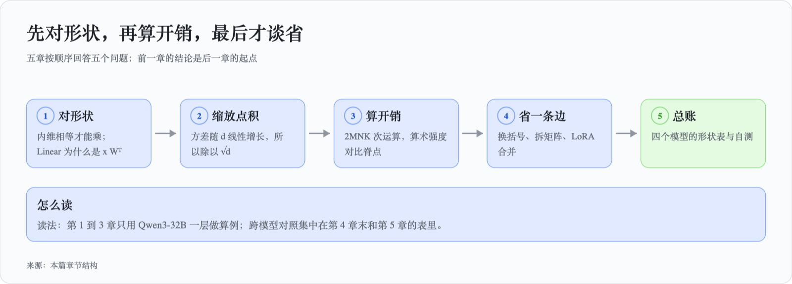
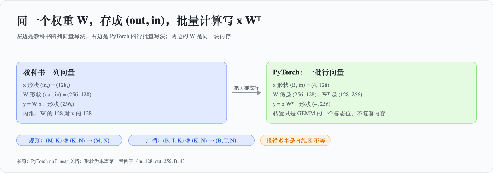
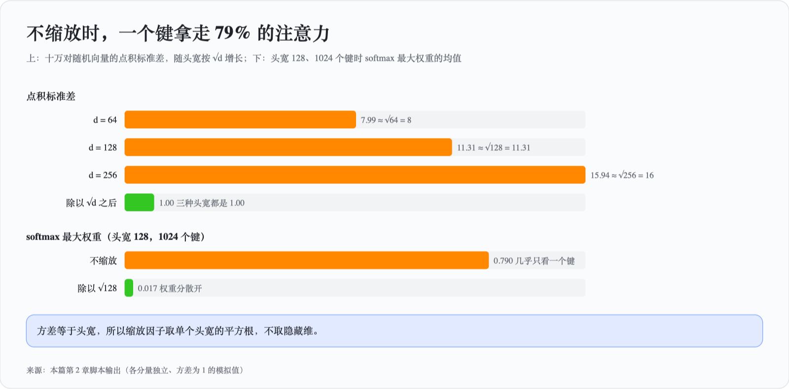
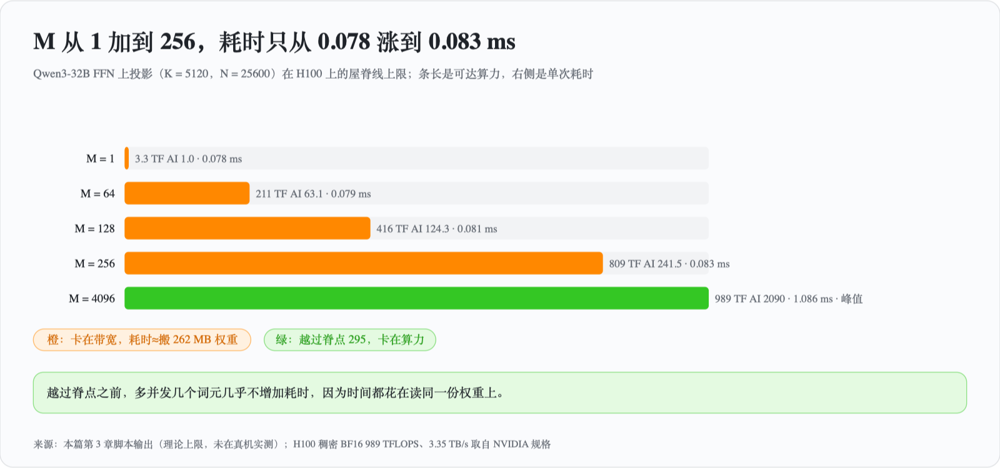
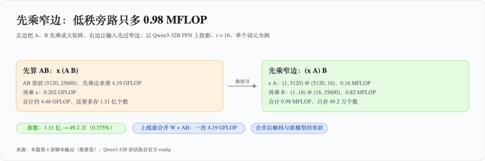
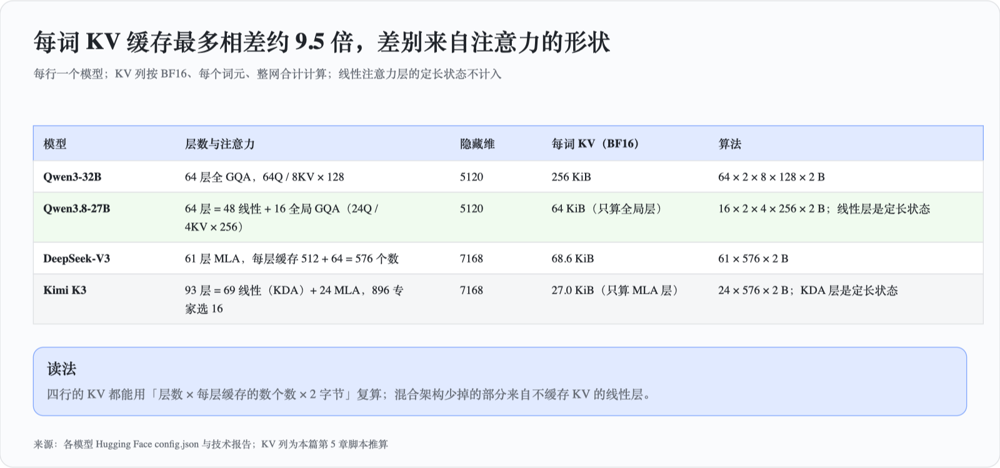

# ZTL-01｜数学｜符号、向量与矩阵乘法

> 🎯 **这篇文档解决什么问题**：<b>核心命题：读懂大模型必须先读懂矩阵乘法的形状。形状决定了点积要不要缩放、一次乘法要算多少次、要搬多少字节，也决定了矩阵能不能拆小。</b>
>
> **使用方式**：五章按顺序读。第 1 章讲记号和形状规则，第 2 章讲点积为什么要除以 $`\sqrt{d}`$，第 3 章算一次矩阵乘的运算量和搬运量。第 4 章讲换括号与低秩分解怎样省开销，第 5 章把四个代表模型的形状放进一张表并给出自测题。只需要高中向量知识和一点 Python。
>
> **读完能做什么**：拿到任意一个模型的 config.json，能写出每个权重的形状。还能算出解码一步的耗时下限和每词元的 KV 缓存，并判断加并发、挂 LoRA 会不会变慢。
>
> **动手实践**：每章都有一段可以直接运行的 Python 代码（只依赖 NumPy，CPU 即可）。代码下方贴了真实输出，正文里的数字都能用它复算。

<b>🧭 主线位置</b>：上一篇 [ZTL-00｜总览｜算清四个数：效果、显存、时延与成本](./README.md) 把学习目标定成四笔账：效果、显存、时延和成本。本篇是数学层第一篇，负责最底层的一块：用形状算出一次矩阵乘的运算量和搬运量，后面各篇的显存账与时延账都从这里起算。模型最后一层输出的是一排没有归一化的打分，下一篇 [ZTL-02｜数学｜条件概率、softmax 与采样](./02-softmax-sampling.md) 讲怎样把它变成概率并采样。

## 导读 · 先给结论

- <b>矩阵相乘只看内维。</b>形状 (M, K) 乘 (K, N) 得 (M, N)，中间的 K 必须相等。PyTorch 的 `nn.Linear` 把权重存成 (out, in)，所以批量计算写成 $`y = x W^{\top}`$，转置不复制内存[[1]](https://pytorch.org/docs/stable/generated/torch.nn.Linear.html)[[2]](https://numpy.org/doc/2.2/reference/generated/numpy.matmul.html)。
- <b>点积越长越大，所以注意力要缩放。</b>两个各分量独立、方差为 1 的 d 维向量，点积方差等于 d。头宽 128 时标准差约 11.3，除以 $`\sqrt{128}`$ 后回到 1[[3]](https://arxiv.org/abs/1706.03762)。
- <b>一次矩阵乘做 2MNK 次浮点运算。</b>BF16 下至少搬 2(MK + KN + MN) 字节，两者之比叫算术强度。它低于硬件脊点（H100 约 295，RTX 5090 约 117）就卡在带宽上[[4]](https://doi.org/10.1145/1498765.1498785)[[5]](https://resources.nvidia.com/en-us-tensor-core/nvidia-tensor-core-gpu-datasheet)。
- <b>解码一次只来一个词元，所以慢在搬权重。</b>以 Qwen3-32B 的 FFN 上投影为例，M = 1 时算术强度只有 1.0，H100 的理论上限只有 3.3 TFLOPS。M 要到约 318 才越过脊点[[6]](https://arxiv.org/abs/2505.09388)[[7]](https://docs.nvidia.com/deeplearning/performance/dl-performance-matrix-multiplication/index.html)。
- <b>换括号和拆矩阵都在省一条边。</b>秩 16 的 LoRA 旁路先乘窄边，每个词元只多 0.98 MFLOP。上线前把 W + AB 合并成一个矩阵，解码时的形状与原模型完全相同[[8]](https://arxiv.org/abs/2106.09685)[[9]](https://math.mit.edu/~gs/linearalgebra/)。

下图是五章的路线。前三章以 Qwen3-32B 一层为主算例，其他模型只在章末作对照，第 5 章再把四个模型汇总成一张表。



<b>📎 与系列其他文档的分工</b>：本篇只讲前向的形状、点积、运算量和低秩。打分怎样变成概率、温度和 top-p 怎样起作用，见 [ZTL-02｜数学｜条件概率、softmax 与采样](./02-softmax-sampling.md)。矩阵乘的反向传播与 softmax 交叉熵的梯度，见 [ZTL-04｜数学｜链式法则与 softmax-交叉熵的梯度](./04-backprop.md)。一张纸算清整个模型的算力、显存与缩放，见 [ZTL-06｜数学｜一张纸算清算力、显存与缩放](./06-compute-memory-scaling.md)。完整注意力实现见 [ZTL-08｜模型｜把注意力写成矩阵](./08-attention.md)，LoRA 与 QLoRA 的显存账见 [ZTL-15｜后训练｜只训练一小部分参数](./15-lora.md)。

## 第 1 章 · 先对形状，再写公式

本章的判断是：大模型里的每一次计算，先要过形状这一关。形状对上了，公式和代码才有意义；形状对不上，程序会直接报错，或者更糟，悄悄算出一个错的结果。本章先约定记号，再给出矩阵乘的内维规则，最后用 Qwen3-32B 的一层把形状和参数量完整算一遍。

### 1.1 标量、向量、矩阵与张量

本系列沿用一套固定写法。小写字母是向量，例如 $`x \in \mathbb{R}^{d}`$，形状写作 (d,)。大写字母是矩阵，例如 $`W \in \mathbb{R}^{m \times n}`$，形状写作 (m, n)，前一个数是行数，后一个数是列数。

超过两维的数组统称张量。语言模型里最常见的是 (B, T, d)：B 是一批里有几条样本，T 是每条样本有几个词元，d 是每个词元用多少个数来表示。Qwen3-32B 的 d 是 5120，也就是说每个词元在模型内部是一条 5120 个数的向量[[6]](https://arxiv.org/abs/2505.09388)。

读形状有一个小习惯：从右往左读。最后一维总是「每个东西有多宽」，往左依次是「有几个」和「有几批」。(B, T, d) 就读作每个词元宽 d、每条 T 个词元、一共 B 条。

记住这三个字母的含义，读论文时就能把公式翻译成形状。比如看到「隐藏状态 (B, T, d)」，就知道它是 B 条样本、每条 T 个位置、每个位置一条 d 维向量。

### 1.2 内维相等才能相乘

矩阵乘只有一条硬规则：左边的列数等于右边的行数。写成形状就是 (M, K) 乘 (K, N) 得到 (M, N)，中间那个 K 叫内维，两边必须相等[[2]](https://numpy.org/doc/2.2/reference/generated/numpy.matmul.html)。

直觉上，输出矩阵的每一格是「左边一行」和「右边一列」的点积，点积要求两条向量一样长，所以 K 必须相等。输出有 M 行 N 列，所以形状是 (M, N)。

手算一个小例子。A 是 2 行 3 列，B 是 3 行 2 列，内维都是 3。输出左上角等于 A 的第一行 [1, 2, 3] 和 B 的第一列 [1, 0, 1] 的点积：1 + 0 + 3 = 4。其余三格同理，结果是 [[4, 5], [10, 11]]。

还要记住乘法的顺序不能换。AB 和 BA 一般不相等，连形状都可能不同。(2, 3) 乘 (3, 2) 得 (2, 2)；反过来，(3, 2) 乘 (2, 3) 得 (3, 3)。所以公式里谁在左、谁在右，要和代码一一对上。

多出来的维度按广播处理：(B, T, K) 乘 (K, N) 时，前面的 B、T 原样保留，结果是 (B, T, N)。这正是模型里一个线性层作用在整批序列上的样子。下面的代码把这三件事各验一遍：

*内维规则、手算例子与广播*

```python
import numpy as np

A = np.array([[1, 2, 3],
              [4, 5, 6]])               # (2, 3)
B = np.array([[1, 0],
              [0, 1],
              [1, 1]])                  # (3, 2)
C = A @ B                               # inner dims: 3 == 3
print("A", A.shape, "@ B", B.shape, "->", C.shape)
print(C)

x = np.zeros((4, 10, 128), dtype=np.float32)   # (B, T, in)
W = np.zeros((128, 256), dtype=np.float32)     # (in, out)
print("broadcast:", x.shape, "@", W.shape, "->", (x @ W).shape)
try:
    A @ A                               # (2, 3) @ (2, 3): inner dims 3 != 2
except ValueError:
    print("error: inner dims", A.shape[1], "!=", A.shape[0])
```

*输出*

```text
A (2, 3) @ B (3, 2) -> (2, 2)
[[ 4  5]
 [10 11]]
broadcast: (4, 10, 128) @ (128, 256) -> (4, 10, 256)
error: inner dims 3 != 2
```

第三行输出说明广播只看最后两维：(4, 10, 128) 被当成 40 行、每行 128 个数，乘完再恢复成 (4, 10, 256)。最后一行是故意写错的例子，内维 3 和 2 不等，NumPy 直接拒绝计算。

### 1.3 Linear 为什么写成 x Wᵀ

教科书写线性变换习惯用列向量：$`y = W x`$，其中 W 是 (out, in)，x 是 (in,)。PyTorch 的 `nn.Linear` 沿用了这个存法，权重的形状就是 (out_features, in_features)[[1]](https://pytorch.org/docs/stable/generated/torch.nn.Linear.html)。

可是一批数据在内存里是一行一条样本，形状 (B, in)。要让内维对上，只能写成 $`y = x W^{\top}`$：(B, in) 乘 (in, out) 得 (B, out)。两种写法算出的数完全一样，只是把样本从列换成了行。

转置会不会多花时间？不会。矩阵库调用乘法时只需要标明「这个操作数按转置读」，不会真的复制一份转置矩阵[[7]](https://docs.nvidia.com/deeplearning/performance/dl-performance-matrix-multiplication/index.html)。下面用 NumPy 验证两种写法相等，并确认转置只是同一块内存的另一种读法：

*教科书写法与批量写法等价*

```python
import numpy as np

rng = np.random.default_rng(0)
W = rng.standard_normal((256, 128))     # stored like nn.Linear: (out, in)
x = rng.standard_normal((4, 128))       # 4 row vectors, (B, in)

y_rows = x @ W.T                        # batch form: y = x W^T
y_cols = (W @ x.T).T                    # textbook form: y = W x, one column per sample
print("W", W.shape, "W.T", W.T.shape, "y", y_rows.shape)
print("max |x W^T - (W x)^T| =", np.abs(y_rows - y_cols).max())
print("W.T is a view, no copy:", np.shares_memory(W, W.T))
```

*输出*

```text
W (256, 128) W.T (128, 256) y (4, 256)
max |x W^T - (W x)^T| = 0.0
W.T is a view, no copy: True
```

多头注意力还多一步改形状。q_proj 的输出是 (B, T, 8192)，先切成 (B, T, 64, 128)，再交换中间两维得到 (B, 64, T, 128)。这样每个头都是一个 (T, 128) 的矩阵，各自和键做点积，下一章要缩放的正是这一步。

图中左右两栏是同一个 W 的两种用法。读图时盯住内维：左边是 W 的 128 对上 x 的 128，右边是 x 的 128 对上 Wᵀ 的 128。



> 💡 **常见误区**：把 `linear.weight` 取出来直接写 `x @ W`。现象是报内维不匹配；如果恰好 in 等于 out，程序不报错，结果却是错的。原因是权重按 (out, in) 存。改法是写 `x @ W.T`，或者直接调用 `torch.nn.functional.linear(x, W)`，并在每次乘法前打印两边的形状。

### 1.4 一层 Qwen3-32B 的形状

把规则用到真实模型上。Qwen3-32B 有 64 层，每层隐藏维 5120。注意力用分组查询（GQA）：64 个查询头、8 个键值头，每个头 128 维[[6]](https://arxiv.org/abs/2505.09388)[[10]](https://arxiv.org/abs/2305.13245)。GQA 的意思是多个查询头共用一组键和值，这样每个词元要缓存的键值只有不分组时的八分之一。

前馈网络用 SwiGLU 结构，有门控、上投影、下投影三个矩阵，中间维度 25600。按 (out, in) 的存法，七个权重矩阵的形状和参数量如下，代码算出的结果和表一致：

| 权重 | 形状 (out, in) | 参数量 | 来历 |
|---|---|---|---|
| q_proj | (8192, 5120) | 41.94 M | 64 头 × 128 = 8192 |
| k_proj、v_proj | (1024, 5120) | 各 5.24 M | 8 头 × 128 = 1024 |
| o_proj | (5120, 8192) | 41.94 M | 把 64 个头拼回 5120 |
| gate、up | (25600, 5120) | 各 131.07 M | 升到中间维度 |
| down_proj | (5120, 25600) | 131.07 M | 降回隐藏维 |
| 一层合计 | 7 个矩阵 | 487.6 M | 前馈占 80.6%，注意力占 19.4% |

*Qwen3-32B 一层的参数量与预填充运算量*

```python
H, D, hq, hkv, dh, L = 5120, 25600, 64, 8, 128, 64   # Qwen3-32B config
shapes = {
    "q_proj":    (hq * dh, H),
    "k_proj":    (hkv * dh, H),
    "v_proj":    (hkv * dh, H),
    "o_proj":    (H, hq * dh),
    "gate_proj": (D, H),
    "up_proj":   (D, H),
    "down_proj": (H, D),
}
total = 0
for name, (out_f, in_f) in shapes.items():
    n = out_f * in_f
    total += n
    print(f"{name:10s} weight {str((out_f, in_f)):15s} {n / 1e6:7.2f} M")
print(f"one layer {total / 1e6:.1f} M, {L} layers {total * L / 1e9:.2f} B")
print(f"prefill T=1024, linear layers only: {2 * total * L * 1024 / 1e12:.1f} TFLOP")
```

*输出*

```text
q_proj     weight (8192, 5120)      41.94 M
k_proj     weight (1024, 5120)       5.24 M
v_proj     weight (1024, 5120)       5.24 M
o_proj     weight (5120, 8192)      41.94 M
gate_proj  weight (25600, 5120)    131.07 M
up_proj    weight (25600, 5120)    131.07 M
down_proj  weight (5120, 25600)    131.07 M
one layer 487.6 M, 64 layers 31.21 B
prefill T=1024, linear layers only: 63.9 TFLOP
```

64 层合计 31.21 B 参数，再加上输入和输出两张 151936 × 5120 的词表矩阵（各约 0.78 B），就是名字里的「32B」。最后一行用到第 3 章的公式：每个参数对每个词元做一次乘加，也就是 2 次浮点运算。所以 1024 个词元的预填充仅线性层就要约 63.9 TFLOP。

表里 k_proj、v_proj 只有 q_proj 的八分之一，这就是 GQA 省下的部分。假如 64 个查询头各配一组键值，每层每个词元要缓存 2 × 64 × 128 个数，BF16 下 64 层合计 2 MiB。现在只有 8 组，合计 256 KiB，正好少了 8 倍。

作为落点，再看一行 Qwen3.8-27B。它的隐藏维同样是 5120，但 64 层里只有 16 层是全局注意力。这些层每层 24 个查询头、4 个键值头、每头 256 维[[11]](https://huggingface.co/Qwen/Qwen3.8-27B/blob/main/config.json)。头数和头宽都变了，内维规则不变，第 5 章会把它和其他模型放进同一张表。

读配置文件时，对应的字段是 hidden_size、num_attention_heads、num_key_value_heads、head_dim 和 intermediate_size。把它们填进上面的 shapes 字典，就能得到任何一个稠密模型的单层形状表。

> 🔑 **本章要点与回到主线**：矩阵乘只看内维，`nn.Linear` 按 (out, in) 存权重，所以批量计算写成 x Wᵀ。一层 Qwen3-32B 有 487.6 M 参数，八成在前馈网络。但新的矛盾随之浮现：注意力里查询和键的点积会随头宽变大而变大，为什么要除以 $`\sqrt{d}`$，这正是下一章要回答的问题。

## 第 2 章 · 点积越长越大，所以要缩放

上一章留下的问题是：注意力里查询和键的点积，为什么要除以 $`\sqrt{d}`$。本章的判断是：两个随机向量的点积，方差恰好等于向量长度 d。不缩放的话，头宽越大，softmax 越只盯着一个键，梯度也越小。缩放因子取单个头宽的平方根，正好把方差拉回 1。

### 2.1 点积同时量长度和方向

两个等长向量的点积，就是对应分量逐个相乘再相加，NumPy 里写作 `np.dot` 或 `@`[[12]](https://numpy.org/doc/2.2/reference/generated/numpy.dot.html)。它有一个几何解释：点积等于两个向量的长度相乘，再乘以夹角的余弦[[9]](https://math.mit.edu/~gs/linearalgebra/)。

```math
q \cdot k = \sum_{i=1}^{d} q_i k_i = \|q\| \, \|k\| \cos\theta
```

手算一个三维例子。q = [1, 2, 2]，k = [3, 1, 0]，点积是 1×3 + 2×1 + 2×0 = 5。q 的长度是 3，k 的长度是 $`\sqrt{10} \approx 3.16`$，所以余弦约 0.53，夹角约 58 度。方向越接近，余弦越大；长度越长，点积也越大。方向相同时余弦是 1，方向垂直时余弦是 0，点积也为 0。

注意力用点积给每个键打分。一个查询 q 的形状是 (1, d)。把 S 个键排成矩阵 K，形状是 (S, d)。打分就是 $`q K^{\top}`$：(1, d) 乘 (d, S) 得 (1, S)，每个键一个分数。这又回到第 1 章的内维规则，内维是头宽 d。

分数随后送进 softmax 变成权重，权重和为 1。问题在于点积同时受长度影响：即使方向毫无关系，只要向量够长，分数的绝对值也会很大。下一节算一算它到底有多大。

### 2.2 方差为什么等于 d

假设 q 和 k 的每个分量都独立、均值为 0、方差为 1。这是训练初期的典型情况，也是原始 Transformer 论文分析缩放时用的假设[[3]](https://arxiv.org/abs/1706.03762)。

先看一项 $`q_i k_i`$。两个独立变量相乘，均值是 0 × 0 = 0。它的方差等于平方的均值，也就是 $`E[q_i^2] \, E[k_i^2] = 1 \times 1 = 1`$。

再看 d 项求和。独立变量相加，方差直接相加，所以点积的方差是 d，标准差是 $`\sqrt{d}`$。头宽 64 时标准差是 8，头宽 128 时约 11.3，头宽 256 时是 16。

```math
\mathrm{Var}\left(\frac{q \cdot k}{\sqrt{d}}\right) = \frac{1}{d} \, \mathrm{Var}(q \cdot k) = \frac{d}{d} = 1
```

如果分量的方差换成 $`\sigma^2`$，同样的推导给出点积方差 $`d \sigma^4`$。分量尺度 σ 翻倍，点积的标准差就放大 4 倍，这也是 2.4 节要提 QK-Norm 的原因。

方差为 1 的假设在训练初期大体成立。权重按小方差初始化，进入注意力之前又有一层归一化，把每个词元的向量尺度拉回 1 附近。训练开始以后这个假设会慢慢失效，所以只靠缩放还不够。

上式就是缩放的全部理由：除以 $`\sqrt{d}`$ 后，方差和头宽无关，恒为 1。这个因子由方差可加性直接推出，不需要调参。

### 2.3 不缩放，softmax 只看一个键

推导可以用模拟来验。下面的代码先复算 2.1 节的手算例子，再对三种头宽各抽十万对随机向量，看点积的标准差。最后取头宽 128、1024 个键，比较缩放前后 softmax 最大那个权重平均有多大：

*点积方差随头宽增长，以及缩放对 softmax 的影响*

```python
import numpy as np

q, k = np.array([1.0, 2, 2]), np.array([3.0, 1, 0])
cos = q @ k / (np.linalg.norm(q) * np.linalg.norm(k))
print(f"q.k = {q @ k:.0f}, |q| = {np.linalg.norm(q):.2f}, |k| = {np.linalg.norm(k):.2f}, "
      f"cos = {cos:.2f}, angle = {np.degrees(np.arccos(cos)):.0f} deg")

rng = np.random.default_rng(0)
n = 100_000
for d in (64, 128, 256):
    a = rng.standard_normal((n, d), dtype=np.float32)
    b = rng.standard_normal((n, d), dtype=np.float32)
    s = (a * b).sum(axis=1)                       # n independent dot products
    print(f"d={d:3d}  std(q.k) = {s.std():5.2f}  sqrt(d) = {np.sqrt(d):5.2f}  "
          f"std(q.k / sqrt(d)) = {(s / np.sqrt(d)).std():.2f}")

def softmax(z):
    z = z - z.max(axis=-1, keepdims=True)
    e = np.exp(z)
    return e / e.sum(axis=-1, keepdims=True)

d, keys, trials = 128, 1024, 2000
Q = rng.standard_normal((trials, 1, d))
K = rng.standard_normal((trials, keys, d))
scores = (Q @ K.transpose(0, 2, 1))[:, 0, :]      # (trials, keys)
for name, z in (("raw", scores), ("scaled", scores / np.sqrt(d))):
    p = softmax(z)
    print(f"{name:6s} mean top-1 weight over {keys} keys = {p.max(axis=-1).mean():.3f}")
```

*输出*

```text
q.k = 5, |q| = 3.00, |k| = 3.16, cos = 0.53, angle = 58 deg
d= 64  std(q.k) =  7.99  sqrt(d) =  8.00  std(q.k / sqrt(d)) = 1.00
d=128  std(q.k) = 11.31  sqrt(d) = 11.31  std(q.k / sqrt(d)) = 1.00
d=256  std(q.k) = 15.94  sqrt(d) = 16.00  std(q.k / sqrt(d)) = 1.00
raw    mean top-1 weight over 1024 keys = 0.790
scaled mean top-1 weight over 1024 keys = 0.017
```

中间三行和推导一致：标准差 7.99、11.31、15.94 贴着 $`\sqrt{d}`$，缩放后都是 1.00。最后两行是后果。不缩放时，1024 个键里最大的那个平均权重是 0.79，也就是拿走 79%。缩放后只有 0.017，权重分散到许多键上。

权重集中本身不一定是坏事，坏在训练初期就集中。softmax 的梯度和 p(1 − p) 同阶，p 接近 1 或 0 时都接近 0。打分一开始就被推到极端，大部分键几乎收不到梯度，模型很难学会该看哪里[[3]](https://arxiv.org/abs/1706.03762)。

代码里的 softmax 先减去每行的最大值，再取指数。这是防止指数溢出的标准写法，结果不变。它和缩放解决的是两件事：减最大值管溢出，除以 $`\sqrt{d}`$ 管分布有多尖。



> 💡 **常见误区**：用隐藏维代替头宽去算缩放因子。现象是注意力权重过于平均，模型对位置和内容都不敏感。原因是 Qwen3-32B 的隐藏维 5120 开方约 71.6，而头宽 128 开方约 11.3，打分被多压小了约 6.3 倍。改法是缩放因子固定取 `head_dim ** -0.5`，并在单测里打印一次缩放后分数的标准差。

### 2.4 头宽变了，缩放因子跟着变

多头注意力把隐藏维切成若干个头，每个头单独做点积，所以缩放看的是单个头的宽度。Qwen3-32B 每头 128 维，缩放因子约 11.31[[6]](https://arxiv.org/abs/2505.09388)。Qwen3.8-27B 的全局注意力层每头 256 维，缩放因子是 16[[11]](https://huggingface.co/Qwen/Qwen3.8-27B/blob/main/config.json)。头宽翻倍，未缩放分数的标准差放大约 1.41 倍。

缩放只管住了「随机情况下」的尺度。训练中 q 和 k 的分量会偏离方差 1，个别头的分数仍可能越来越大。Qwen3 系列因此在点积前对每个头的 q、k 各做一次 RMS 归一化，常称 QK-Norm。它先把分量的尺度拉回 1 附近，再按 $`\sqrt{d}`$ 缩放[[6]](https://arxiv.org/abs/2505.09388)。

缩放本身几乎不花时间，但放在哪里有讲究。分数矩阵是 (T, S)，查询只有 (T, d)。上下文长时 S 远大于 d，所以实现里常把 $`1/\sqrt{d}`$ 先乘到查询上。以 S = 4096、d = 128 为例，要乘的数少了 32 倍，结果完全相同。

从 softmax 的角度看，除以 $`\sqrt{d}`$ 等价于把温度设成 $`\sqrt{d}`$。温度越高，分布越平；温度越低，分布越尖。采样时调温度的道理与此相同，细节见 [ZTL-02｜数学｜条件概率、softmax 与采样](./02-softmax-sampling.md)。

向量检索走的是另一条路：先把查询和文档向量都归一化到长度 1，点积就等于余弦，范围固定在 −1 到 1，和维度无关。代价是丢掉了长度信息，这在检索里通常可以接受，在注意力里则交给缩放和 QK-Norm 来平衡。

> 🔑 **本章要点与回到主线**：随机向量的点积方差等于头宽，除以单个头宽的平方根就把它拉回 1；不缩放时，头宽 128、1024 个键的 softmax 有 79% 权重落在一个键上。但新的矛盾随之浮现：缩放只解决了数值范围，一次注意力或一次线性层要算多少次、搬多少字节，才决定它跑多快，这正是下一章要回答的问题。

## 第 3 章 · 一次矩阵乘要算 2MNK 次

上一章留下的问题是：一次线性层要算多少次、搬多少字节，才决定它跑多快。本章的判断是：运算量看 2MNK，搬运量看三块矩阵的字节数，两者之比叫算术强度。拿它和硬件脊点一比，就知道这一步卡在算力还是带宽。本章用 Qwen3-32B 的 FFN 上投影做案例，按本系列的六步方法走一遍，3.3 节每段开头的粗体就是一步。

### 3.1 运算量：每格做 K 次乘加

回到第 1 章的形状：(M, K) 乘 (K, N) 得 (M, N)。在模型里，M 是同时经过这一层的词元数，K 是输入宽度，N 是输出宽度。一批序列 (B, T, K) 展平后，M 就是 B × T。预填充时 M 是提示词的全部词元，解码时 M 是同时在解的请求数。

输出一共 M × N 格，每格是一行和一列的点积，要做 K 次乘法和 K 次加法。硬件通常把一次乘法加一次加法合成一条乘加指令，业界按 2 次浮点运算计[[7]](https://docs.nvidia.com/deeplearning/performance/dl-performance-matrix-multiplication/index.html)。所以一次矩阵乘的运算量是：

```math
\mathrm{FLOP} = 2 M N K
```

代入案例。Qwen3-32B 的上投影 K = 5120，N = 25600[[6]](https://arxiv.org/abs/2505.09388)。解码时每次只来一个词元，M = 1，运算量是 2 × 5120 × 25600 ≈ 262.1 MFLOP。同一公式也适用于注意力打分：每个头的 $`QK^{\top}`$ 是 (T, d) 乘 (d, S)，运算量 2TSd，随上下文长度平方增长。按满矩阵算，4096 个词元预填充时，Qwen3-32B 全部 64 层的打分与加权求和约 35.2 TFLOP。线性层约 255.6 TFLOP，仍是大头（本篇推算）。

注意两个容易混的写法：FLOP 是运算次数，TFLOPS 是每秒多少万亿次，前者是工作量，后者是速度。

### 3.2 搬运量、算术强度与脊点

运算之前，数据要从显存搬进芯片。BF16 每个数 2 字节，至少要读一遍输入 MK 个数、读一遍权重 KN 个数、写一遍输出 MN 个数。这是每个矩阵只读写一次的下界，真实内核只会更多。M 很小时，大头是权重；M 很大时，输入和输出的字节会追上来。

运算量除以搬运量，叫算术强度（AI），意思是每搬一个字节能做多少次运算[[4]](https://doi.org/10.1145/1498765.1498785)：

```math
\mathrm{AI} = \frac{2MNK}{2(MK + KN + MN)} = \frac{MNK}{MK + KN + MN}
```

硬件也有一个对应的数，叫脊点：峰值算力除以显存带宽。H100 的稠密 BF16 峰值是 989 TFLOPS，带宽 3.35 TB/s，脊点约 295[[5]](https://resources.nvidia.com/en-us-tensor-core/nvidia-tensor-core-gpu-datasheet)。RTX 5090 是 209 TFLOPS 和 1.79 TB/s，脊点约 117[[13]](https://images.nvidia.com/aem-dam/Solutions/geforce/blackwell/nvidia-rtx-blackwell-gpu-architecture.pdf)。TFLOPS 和 TB/s 都带 10 的 12 次方，相除后单位是「次运算每字节」，可以直接和 AI 比。

屋脊线模型的判断很简单：AI 低于脊点，算力再强也用不满，速度由带宽决定，上限是 AI × 带宽。AI 高于脊点，速度由峰值算力决定。M = 1 时，上投影的 AI 只有 1.0，比 H100 的脊点低了近 300 倍。

### 3.3 一个案例走完六步

<b>立目标。</b>估算 Qwen3-32B 在单张 H100 上解码时，FFN 上投影一步的耗时下限，并判断「多并发几条请求」能不能提高吞吐。

<b>算上限。</b>下面的代码对五个 M 值算出运算量、搬运量、算术强度和两张卡的屋脊线上限，再找出 AI 越过脊点的最小 M。最后一行留给 3.4 节的 MoE 对照：

*Qwen3-32B 上投影的屋脊线上限*

```python
GPUS = {"H100": (989, 3.35), "RTX 5090": (209, 1.79)}   # dense BF16 TFLOPS, TB/s
K, N = 5120, 25600                                       # Qwen3-32B up_proj

def gemm(M, K, N, bytes_per=2):
    flops = 2 * M * N * K
    moved = bytes_per * (M * K + K * N + M * N)          # read x, read W, write y once
    return flops, moved, flops / moved

for name, (tf, bw) in GPUS.items():
    print(f"{name:8s} ridge = {tf / bw:.0f} FLOP/byte")
for M in (1, 64, 128, 256, 4096):
    f, b, ai = gemm(M, K, N)
    h100 = min(989, ai * 3.35)                           # roofline bound, TFLOPS
    rtx = min(209, ai * 1.79)
    print(f"M={M:5d}  {f / 1e9:8.2f} GFLOP  {b / 1e6:6.1f} MB  AI {ai:7.1f}  "
          f"H100 {h100:5.1f} TF ({f / h100 / 1e9:.3f} ms)  RTX 5090 {rtx:5.1f} TF")

for name, (tf, bw) in GPUS.items():
    M = 1
    while gemm(M, K, N)[2] < tf / bw:
        M += 1
    print(f"{name:8s} becomes compute-bound at M = {M}")

E, top, B = 256, 8, 64                                   # DeepSeek-V3 routed experts
hit = 1 - (1 - top / E) ** B                             # chance an expert gets >=1 token
print(f"DeepSeek-V3 B={B}: {hit:.0%} of experts touched, "
      f"{B * top / (E * hit):.1f} tokens per touched expert")
```

*输出*

```text
H100     ridge = 295 FLOP/byte
RTX 5090 ridge = 117 FLOP/byte
M=    1      0.26 GFLOP   262.2 MB  AI     1.0  H100   3.3 TF (0.078 ms)  RTX 5090   1.8 TF
M=   64     16.78 GFLOP   266.1 MB  AI    63.1  H100 211.2 TF (0.079 ms)  RTX 5090 112.9 TF
M=  128     33.55 GFLOP   270.0 MB  AI   124.3  H100 416.3 TF (0.081 ms)  RTX 5090 209.0 TF
M=  256     67.11 GFLOP   277.9 MB  AI   241.5  H100 809.1 TF (0.083 ms)  RTX 5090 209.0 TF
M= 4096   1073.74 GFLOP   513.8 MB  AI  2089.8  H100 989.0 TF (1.086 ms)  RTX 5090 209.0 TF
H100     becomes compute-bound at M = 318
RTX 5090 becomes compute-bound at M = 121
DeepSeek-V3 B=64: 87% of experts touched, 2.3 tokens per touched expert
```

<b>测实际。</b>本篇没有在真机上测，表里都是理论上限。实测时用性能分析工具读出这一个内核的耗时和实际 DRAM 字节数，和上表对照。差得越多，说明内核越没把带宽用满。

<b>找瓶颈。</b>看搬运量一列：M 从 1 到 256，搬运量只从 262.2 MB 涨到 277.9 MB。大头是 262 MB 的权重，和 M 无关。所以在 H100 上，M 小于 318 时这一步都卡在读权重。

<b>做取舍。</b>看耗时一列：M 从 1 到 256，单步耗时只从 0.078 ms 涨到 0.083 ms，吞吐却涨了 256 倍。这就是推理服务要攒批的原因。代价是每条请求要等别人凑齐，首字时延变长。越过脊点以后，再加并发耗时就按比例上涨。

换成 RTX 5090，结论的形状不变，拐点提前。它的脊点只有 117，M 到 121 就越过脊点，再往上加并发，耗时就开始按比例上涨。消费卡攒批的收益来得早，封顶也早。

<b>留证据。</b>把脚本、输出和口径（BF16、稠密峰值、每个矩阵只读写一次）一起留下。换一张卡，只要改第一行的两个数，结论就能重算。



| 场景 | M | AI | H100 上的判断 |
|---|---|---|---|
| 单条解码 | 1 | 1.0 | 卡带宽，3.3 TFLOPS，0.078 ms，算力只用 0.3% |
| 64 条并发解码 | 64 | 63.1 | 仍卡带宽，211 TFLOPS，0.079 ms |
| 128 条并发解码 | 128 | 124.3 | 仍卡带宽，416 TFLOPS，0.081 ms |
| 256 条并发解码 | 256 | 241.5 | 接近脊点，809 TFLOPS，0.083 ms |
| 4096 个词元预填充 | 4096 | 2090 | 卡算力，989 TFLOPS，1.086 ms |

> 💡 **常见误区**：用运算量除以峰值算力估解码耗时。现象是估出 0.27 微秒，实际上限是 78 微秒，差了约 295 倍，正好是 H100 的脊点。原因是 M = 1 时时间花在搬权重，不花在计算。改法是先算 AI，低于脊点就用搬运量除以带宽估时间。

### 3.4 MoE 让每个专家又回到小 M

混合专家模型（MoE）把一个大 FFN 换成许多小专家，每个词元只走其中几个。DeepSeek-V3 有 256 个路由专家，每个词元选 8 个，外加 1 个共享专家[[14]](https://arxiv.org/abs/2412.19437)。每个词元算的少了，但对搬运量的影响要另算。

上面脚本的最后一行给了答案。64 条请求并发解码时，约 87% 的路由专家至少被一个词元选中，它们的权重都要读一遍。平均每个被选中的专家只分到 2.3 个词元。对单个专家来说，M 又回到了 2 左右，AI 也只有 2 左右。

共享专家是例外。它对每个词元都生效，64 条并发时就有 M = 64，和稠密层一样能吃到攒批的好处。路由专家越多、每个词元选得越少，单个专家分到的 M 就越小。

所以 MoE 解码比同等激活量的稠密模型更难攒出大 M。工程上的对策是把专家分散到多张卡上、让每张卡看到更大的批，这部分交给后续的推理篇章。

> 🔑 **本章要点与回到主线**：一次矩阵乘做 2MNK 次运算，至少搬 2(MK + KN + MN) 字节；Qwen3-32B 上投影在 H100 上要到 M = 318 才越过脊点，在此之前攒批几乎不增加耗时。但新的矛盾随之浮现：单条解码卡在搬权重，能不能让要乘的矩阵本身变小，这正是下一章要回答的问题。

## 第 4 章 · 换括号与拆矩阵都在省一条边

上一章留下的问题是：解码时卡在搬权重，能不能让要乘的矩阵变小。本章的判断是：能，而且办法只有两类。一类是换括号，让大矩阵晚一点出现；另一类是拆矩阵，把一个大矩阵写成两个细长矩阵的乘积。两者省的都是形状里最长的那条边。

### 4.1 换括号，开销差几千倍

矩阵乘满足结合律：$`(AB)C = A(BC)`$，结果一模一样，但两种算法的运算量可以差几千倍，下面的例子会算出来。原因是中间结果的形状不同，而第 3 章的公式 2MNK 对每一步都成立。

看一个本篇后面会反复用到的例子。输入 x 是一个词元，形状 (1, 5120)。A 是 (5120, 16)，B 是 (16, 25600)。先算 AB 会得到一个 (5120, 25600) 的大矩阵，光这一步就要 2 × 5120 × 16 × 25600 ≈ 4.19 GFLOP。再乘 x 还要 0.262 GFLOP，合计约 4.46 GFLOP。

换个括号先算 xA，得到的只是 (1, 16) 的一小条，只要 0.16 MFLOP。再乘 B 得到 (1, 25600)，要 0.82 MFLOP。两步合计 0.98 MFLOP，比先算 AB 少了约 4500 倍。

规律可以一句话说清：让最窄的那一维尽早出现在中间结果里。这里最窄的是 16，先乘窄边，中间结果始终很小。

注意力里也有同类问题，但带 softmax 的标准注意力不能这样换括号：softmax 夹在 $`QK^{\top}`$ 和 V 之间，结合律不再成立。去掉 softmax 的线性注意力才能把 $`(QK^{\top})V`$ 改成 $`Q(K^{\top}V)`$，这条路线留给 [ZTL-20｜系统｜减少注意力的内存搬运](./20-flash-attention.md) 和 [ZTL-24｜系统｜长上下文与混合专家怎样改变账单](./24-long-context-moe.md)。

### 4.2 秩是矩阵真正独立的方向数

拆矩阵的数学基础是秩。直观地说，一个 m × n 矩阵的秩，就是它的列里真正互不重复的方向有几个，最多不超过 min(m, n)[[9]](https://math.mit.edu/~gs/linearalgebra/)。

如果秩只有 r，这个矩阵就能精确写成 $`A B`$，其中 A 是 m × r，B 是 r × n。存储从 m × n 个数降到 r(m + n) 个数。以 5120 × 25600 为例，满秩要存 1.31 亿个数，秩 16 的分解只要 16 × 30720 ≈ 49.2 万个，是原来的 0.375%。

举两个极端的例子。单位矩阵的每一列方向都不同，秩等于边长，没法压缩。每一行都相同的矩阵秩是 1，存一行一列就够。

换个角度理解秩：任何矩阵都能拆成若干个「一列乘一行」的外积之和，每个外积的秩是 1。秩为 r，就是最少需要 r 个这样的外积。奇异值分解把这些外积按重要性排好序，只保留前 r 个，得到的就是误差最小的秩 r 近似[[9]](https://math.mit.edu/~gs/linearalgebra/)。

代价是表达力。预训练好的权重一般接近满秩，硬把它截成秩 16 会丢掉大量信息。所以低秩分解更适合用在「变化量」上，而不是权重本身，这正是 LoRA 的做法。

### 4.3 LoRA 只训练一个低秩增量

LoRA 的思路是冻结原权重 W，只学一个增量 $`\Delta W = A B`$，前向写成 $`y = xW + (xA)B`$[[8]](https://arxiv.org/abs/2106.09685)。训练开始时把 B 设成 0，于是 $`\Delta W = 0`$，模型起点和原模型完全相同。

按 4.1 节的算法，旁路先乘窄边，每个词元只多 0.98 MFLOP，相当于原矩阵乘 262.1 MFLOP 的 0.38%。可训练参数从 1.31 亿降到 49.2 万。梯度和优化器状态也随之只为这 49.2 万个数保留，显存账的细节在 [ZTL-15｜后训练｜只训练一小部分参数](./15-lora.md)。

实际微调通常不只挂一个矩阵。把秩 16 的 LoRA 挂到 Qwen3-32B 每层全部 7 个权重上，每层新增 16 × (in + out) 之和，正好 2,097,152 个参数。64 层合计约 1.34 亿，占 31.21 B 的 0.43%（本篇推算）。可训练参数少两个数量级以上，这是 LoRA 能在一张卡上微调大模型的前提之一。

上线时还可以更进一步：提前算一次 $`W' = W + AB`$，代价是 4.19 GFLOP，只做一次。合并后的 W' 和原 W 形状相同，解码路径与原模型完全一样，这就是常说的「合并后零额外延迟」。下面的代码复算本节所有数字，并用小矩阵验证合并前后结果一致：

*换括号的开销与 LoRA 合并的等价性*

```python
import numpy as np

def flops(m, k, n):                     # one (m, k) @ (k, n) matmul
    return 2 * m * k * n

H, D, r = 5120, 25600, 16               # Qwen3-32B up_proj, LoRA rank 16
# one decoding token x: (1, H); low-rank update A: (H, r), B: (r, D)
merge_first = flops(H, r, D) + flops(1, H, D)   # x (A B): build A B first
narrow_first = flops(1, H, r) + flops(1, r, D)  # (x A) B: pass the narrow edge first
print(f"x(AB): {merge_first / 1e9:.2f} GFLOP   (xA)B: {narrow_first / 1e6:.2f} MFLOP")
print(f"ratio: {merge_first / narrow_first:.0f}x")

full, lora = H * D, r * (H + D)
print(f"params full {full / 1e6:.1f} M, LoRA {lora / 1e3:.1f} K ({lora / full:.3%})")
print(f"base matmul per token {flops(1, H, D) / 1e6:.1f} MFLOP, "
      f"unmerged LoRA adds {narrow_first / flops(1, H, D):.2%}")

rng = np.random.default_rng(0)
W = rng.standard_normal((64, 48))
A = rng.standard_normal((64, 4)); B = rng.standard_normal((4, 48))
x = rng.standard_normal((3, 64))
merged = x @ (W + A @ B)                # merge once before serving
side = x @ W + (x @ A) @ B              # keep the side branch
print("rank(A @ B) =", np.linalg.matrix_rank(A @ B),
      "| max |merged - side| =", f"{np.abs(merged - side).max():.1e}")
```

*输出*

```text
x(AB): 4.46 GFLOP   (xA)B: 0.98 MFLOP
ratio: 4533x
params full 131.1 M, LoRA 491.5 K (0.375%)
base matmul per token 262.1 MFLOP, unmerged LoRA adds 0.38%
rank(A @ B) = 4 | max |merged - side| = 1.8e-14
```

合并也有不适用的时候。同一个服务里若要同时挂多个 LoRA、按请求切换，就不能把某一个合并进 W，只能保留旁路，按 `(x @ A) @ B` 计算。运算量只多 0.38%，但每个旁路多出两次小矩阵乘，调度上要另做批处理。

最后一行有两层意思。AB 的秩是 4，正好等于窄边宽度，说明低秩分解的秩被窄边卡住。合并和不合并的结果只差 $`10^{-14}`$ 量级，是浮点舍入，不是近似误差。

下图左右两栏对比两种括号：左边先造出 1.31 亿个数的大矩阵，右边只让输入穿过宽度为 16 的窄边。



> 💡 **常见误区**：在推理代码里写 `x @ (A @ B)`。现象是加了 LoRA 之后解码明显变慢、显存上涨。原因是括号让 (5120, 25600) 的大矩阵在每一步都被重新造出来。改法是写 `(x @ A) @ B`，或者上线前合并成 W + AB。

### 4.4 真实模型里的同一招

DeepSeek 的多头潜在注意力（MLA）用的也是这两招[[14]](https://arxiv.org/abs/2412.19437)[[15]](https://arxiv.org/abs/2405.04434)。它不缓存完整的键和值，每层每个词元只缓存一条 512 维的压缩向量，外加 64 维的位置部分，键和值都由这条向量乘上投影矩阵还原。

解码时如果每步都先还原出完整的键再和查询做点积，就是 4.1 节里「先造大矩阵」的错误括号。DeepSeek 的做法是利用结合律，把还原键用的矩阵提前并进查询一侧，让查询直接和 512 维的压缩向量做点积。细节和每词元的缓存账见 [ZTL-08｜模型｜把注意力写成矩阵](./08-attention.md) 与第 5 章的表。

这一招的代价是查询一侧多算一步。每个头的查询要先乘一次合并后的矩阵，映射到 512 维。解码时 M 很小，多出的这点运算远比少读的缓存便宜，正好符合第 3 章的判断。

> 🔑 **本章要点与回到主线**：换括号让窄边先出现，秩 16 的旁路每个词元只多 0.98 MFLOP；LoRA 只训练低秩增量，上线前合并即可保持原有解码形状。但新的矛盾随之浮现：不同模型的头数、头宽和缓存方式各不相同，怎样用一张表把它们的形状和缓存账放在一起比，这正是下一章要回答的问题。

## 第 5 章 · 形状与开销总账、核对清单与自测

本章把前四章收成一本账：同样的形状规则，套在四个代表模型上，就能读出它们每个词元要缓存多少字节。账本之后是一份上线前核对清单、五道自测题，以及本篇没能核实的说法。

### 5.1 四个模型的形状总账

每词元的键值缓存（KV）是解码阶段最大的显存开销之一，算法只有一条：缓存 KV 的层数 × 每层缓存几个数 × 每个数的字节数。头数、头宽和缓存方式的差别，最后都落在这个乘积上[[6]](https://arxiv.org/abs/2505.09388)[[11]](https://huggingface.co/Qwen/Qwen3.8-27B/blob/main/config.json)[[14]](https://arxiv.org/abs/2412.19437)。

- <b>Qwen3-32B。</b>64 层都缓存键和值，每层 8 个键值头、每头 128 维，合计 64 × 2 × 8 × 128 × 2 B = 256 KiB。
- <b>Qwen3.8-27B。</b>64 层里 48 层是线性注意力，只保留一个大小固定的状态，不随上下文变长[[16]](https://arxiv.org/abs/2412.06464)。只有 16 层全局注意力缓存 KV，每层 4 个键值头、每头 256 维，合计 64 KiB，是前者的四分之一。
- <b>DeepSeek-V3。</b>隐藏维 7168，61 层多头潜在注意力，每层每词元只缓存 512 + 64 = 576 个数，合计 68.6 KiB。
- <b>Kimi K3。</b>隐藏维同为 7168，93 层里 69 层是线性注意力（KDA），24 层是 MLA，每层同样缓存 576 个数，合计 24 × 576 × 2 B = 27.0 KiB。路由专家 896 个、每词元选 16 个[[17]](https://huggingface.co/moonshotai/Kimi-K3)[[18]](https://arxiv.org/abs/2510.26692)。MLA 层每词元缓存的 512 + 64 维与上一代 Kimi K2 相同，K2 又沿用了 DeepSeek-V3 的 MLA 设计[[19]](https://arxiv.org/abs/2507.20534)。



读这张表时，先看「算法」一列能不能自己复算，再看 KV 一列的倍数关系：最多的 256 KiB 和最少的 27.0 KiB 相差约 9.5 倍。下面的脚本把四行数字重算一遍，并换算成 32K 上下文下单条序列要占多少显存：

*四个模型的每词元 KV 与 32K 上下文显存*

```python
BF16 = 2  # bytes per element

def kv_gqa(layers, kv_heads, head_dim):           # K and V for every cached layer
    return layers * 2 * kv_heads * head_dim * BF16

def kv_mla(layers, latent, rope):                  # one compressed vector per layer
    return layers * (latent + rope) * BF16

models = {
    "Qwen3-32B":   kv_gqa(64, 8, 128),
    "Qwen3.8-27B": kv_gqa(16, 4, 256),             # only the 16 global layers cache KV
    "DeepSeek-V3": kv_mla(61, 512, 64),
    "Kimi K3":     kv_mla(24, 512, 64),               # only the 24 MLA layers cache KV
}
for name, b in models.items():
    print(f"{name:12s} {b:7d} B/token = {b / 1024:6.1f} KiB/token")

ctx = 32768
for name, b in models.items():
    print(f"{name:12s} {ctx} tokens -> {b * ctx / 2**30:5.2f} GiB per sequence")

assert models["Qwen3-32B"] == 4 * models["Qwen3.8-27B"]
print("ridge H100 =", round(989 / 3.35), " ridge RTX 5090 =", round(209 / 1.79))
```

*输出*

```text
Qwen3-32B     262144 B/token =  256.0 KiB/token
Qwen3.8-27B    65536 B/token =   64.0 KiB/token
DeepSeek-V3    70272 B/token =   68.6 KiB/token
Kimi K3        27648 B/token =   27.0 KiB/token
Qwen3-32B    32768 tokens ->  8.00 GiB per sequence
Qwen3.8-27B  32768 tokens ->  2.00 GiB per sequence
DeepSeek-V3  32768 tokens ->  2.14 GiB per sequence
Kimi K3      32768 tokens ->  0.84 GiB per sequence
ridge H100 = 295  ridge RTX 5090 = 117
```

把四行放在一起看，减少 KV 缓存有三条路线。GQA 减少每层的键值头数，Qwen3-32B 用 8 组代替 64 组。混合架构减少缓存 KV 的层数，Qwen3.8-27B 只有四分之一的层缓存。MLA 压缩每层缓存的内容，DeepSeek-V3 每层只存 576 个数。三条路线可以叠加：Kimi K3 同时用了后两条，KV 是四个模型里最少的 27.0 KiB。

三条路线的代价各不相同。GQA 让多个查询头共用键值，表达力略有损失。混合架构的线性层只有定长记忆，长距离检索要靠剩下的全局层。MLA 要多做一次投影，靠第 4 章的换括号把开销吸收掉。

输出的后几行最能说明问题：同样 32K 上下文，Qwen3-32B 一条序列要 8 GiB 缓存。Qwen3.8-27B 和 DeepSeek-V3 约 2 GiB，Kimi K3 只要 0.84 GiB。并发 16 条时，Qwen3-32B 要 128 GiB，Qwen3.8-27B 要 32 GiB，前者已经超过一张 80 GiB 显卡。

### 5.2 上线前核对清单

> 📌 **核对清单**：每次写矩阵乘或读一个新模型的配置，按顺序过一遍。每一项都对应前面一章，出错时按章回查。
>
> - <b>内维。</b>每个 `@` 两边打印形状，确认 (M, K) 对 (K, N)。
> - <b>权重朝向。</b>`nn.Linear` 的权重是 (out, in)，批量计算写 `x @ W.T`。
> - <b>缩放。</b>注意力打分除以 $`\sqrt{d_k}`$，d_k 取单个头的宽度，不是隐藏维。
> - <b>算术强度。</b>用 2MNK 除以 2(MK + KN + MN)，和 H100 的 295、RTX 5090 的 117 比，判断卡在算力还是带宽。
> - <b>括号。</b>低秩旁路写 `(x @ A) @ B`，不写 `x @ (A @ B)`；上线前合并 W + AB。
> - <b>缓存层数。</b>混合架构只数真正缓存 KV 的层，MLA 按每层缓存的数个数算，不按头数算。

### 5.3 自测题与参考解析

先自己动笔算，再看解析。每道题只用到前面某一章的一个公式，算错时回到那一章重读。

**自测 1**：输入 x 的形状是 (2, 8, 5120)，`q_proj.weight` 的形状是 (8192, 5120)。代码怎么写，输出是什么形状？

**参考解析**：写 `x @ W.T`，内维 5120 对 5120，输出 (2, 8, 8192)，也就是 64 个头、每头 128 维拼在一起。如果误写成 `x @ W`，内维变成 5120 对 8192，程序直接报错。

**自测 2**：某全局注意力层头宽 256。查询和键各分量独立、方差为 1 时，未缩放点积的标准差是多少？缩放因子是多少？

**参考解析**：方差等于头宽 256，标准差 16，除以 $`\sqrt{256} = 16`$ 后标准差回到 1。

**自测 3**：Qwen3-32B 的 FFN 上投影（K = 5120，N = 25600）在 M = 128 时算术强度是多少？在 H100 上卡在哪里？

**参考解析**：$`128 \times 25600 \times 5120 / (128 \times 5120 + 5120 \times 25600 + 128 \times 25600) \approx 124`$，低于 H100 的脊点 295，仍卡在带宽，理论上限约 124 × 3.35 ≈ 416 TFLOPS。它已高于 RTX 5090 的脊点 117，在那张卡上会卡在算力。要在 H100 上越过脊点，M 至少要到 318。

**自测 4**：给 5120 × 25600 的矩阵加秩 8 的 LoRA，新增多少参数，占原矩阵的比例是多少？

**参考解析**：8 × (5120 + 25600) = 245,760 个，占 1.31 亿的 0.1875%。秩减半，参数也减半。若挂到每层全部 7 个矩阵、64 层合计，是第 4 章 1.34 亿的一半，约 0.67 亿。

**自测 5**：32K 上下文、并发 8 条时，Qwen3-32B 和 Qwen3.8-27B 的 KV 缓存各要多少？

**参考解析**：单条分别是 8 GiB 和 2 GiB，乘以 8 得 64 GiB 和 16 GiB。差 4 倍，来自后者只有 16 层缓存 KV、每层 4 个键值头。再加上权重：按第 1 章的 32.77 B 参数，Qwen3-32B 的 BF16 权重约 61 GiB，加 64 GiB 缓存已超过单张 80 GiB 显卡。Qwen3.8-27B 约 50 GiB 加 16 GiB，放得下。

### 5.4 诚实清单与修订记录

1. <b>线性层的定长状态没有计入。</b>Qwen3.8-27B 和 Kimi K3 的线性注意力层各有一份不随上下文增长的状态，表中 KV 只算真正随词元增长的部分。短上下文时这份定长状态并不小，比较显存时要另算。
2. <b>算术强度是下界估计。</b>字节数按「每个矩阵只读写一次」计算，真实内核会因分块和缓存命中而多读。核实方法：用 Nsight Compute 读实际 DRAM 字节数。
3. <b>脊点按标称峰值计算。</b>H100 的 989 TFLOPS 与 RTX 5090 的 209 TFLOPS 都是稠密 BF16 标称值[[5]](https://resources.nvidia.com/en-us-tensor-core/nvidia-tensor-core-gpu-datasheet)[[13]](https://images.nvidia.com/aem-dam/Solutions/geforce/blackwell/nvidia-rtx-blackwell-gpu-architecture.pdf)。实际可达值更低，且受功耗和频率影响。
4. <b>模型规格有时效。</b>Qwen3.8-27B、DeepSeek-V3、Kimi K3 的数字取自 2026-11-18 的官方 config.json，后续版本可能变化。

#### 修订记录

| 日期 | 改了什么 |
|---|---|
| 2026-11-18 | 按试点规范重写：章节回到本篇主题（形状、点积、运算量、低秩），删除线性注意力递推推导等超纲内容，前沿模型集中到第 4 章末与本章；全部数字改由文中代码复算；新增诚实清单。 |

**接下来的问题在哪**：本篇算到模型最后一层为止，输出是一排没有归一化的打分，每个词表条目一个数。怎样把它变成概率，温度和 top-p 又怎样改变采样结果，交给 [ZTL-02｜数学｜条件概率、softmax 与采样](./02-softmax-sampling.md)。

> 🔑 **本章要点**：回到主线，本篇的四步结论都能落到同一张形状表上。内维决定能不能乘，头宽决定怎样缩放，算术强度决定卡在哪里，窄边决定能省多少。同样 32K 上下文，Qwen3-32B 每条序列的 KV 是 Qwen3.8-27B 的 4 倍，这一点直接进入后续各篇的显存账。

## 参考文献

按正文首次引用顺序编号，资料截至 2026 年 11 月。

[1] PyTorch Contributors. torch.nn.Linear. PyTorch documentation. [pytorch.org/docs/stable/generated/torch.nn.Linear.html](https://pytorch.org/docs/stable/generated/torch.nn.Linear.html)

[2] NumPy Developers. numpy.matmul Reference. NumPy v2.2 Manual. [numpy.org/doc/2.2/reference/generated/numpy.matmul.html](https://numpy.org/doc/2.2/reference/generated/numpy.matmul.html)

[3] Vaswani et al. Attention Is All You Need. NeurIPS / arXiv:1706.03762 (2017). [arxiv.org/abs/1706.03762](https://arxiv.org/abs/1706.03762)

[4] Williams, Waterman, and Patterson. Roofline: An Insightful Visual Performance Model for Multicore Architectures. Communications of the ACM 52(4), 2009. [doi.org/10.1145/1498765.1498785](https://doi.org/10.1145/1498765.1498785)

[5] NVIDIA. NVIDIA H100 Tensor Core GPU datasheet. NVIDIA. [resources.nvidia.com/en-us-tensor-core/nvidia-tensor-core-gpu-datasheet](https://resources.nvidia.com/en-us-tensor-core/nvidia-tensor-core-gpu-datasheet)

[6] Qwen Team. Qwen3 Technical Report. arXiv:2505.09388 (2025). [arxiv.org/abs/2505.09388](https://arxiv.org/abs/2505.09388)

[7] NVIDIA. Matrix Multiplication Background User's Guide. NVIDIA Deep Learning Performance Docs. [docs.nvidia.com/deeplearning/performance/dl-performance-matrix-multiplication/index.html](https://docs.nvidia.com/deeplearning/performance/dl-performance-matrix-multiplication/index.html)

[8] Hu et al. LoRA: Low-Rank Adaptation of Large Language Models. ICLR / arXiv:2106.09685 (2022). [arxiv.org/abs/2106.09685](https://arxiv.org/abs/2106.09685)

[9] Strang. Introduction to Linear Algebra, 5th ed. Wellesley-Cambridge Press / MIT OpenCourseWare. [math.mit.edu/~gs/linearalgebra/](https://math.mit.edu/~gs/linearalgebra/)

[10] Ainslie et al. GQA: Training Generalized Multi-Query Transformer Models from Multi-Head Checkpoints. EMNLP / arXiv:2305.13245 (2023). [arxiv.org/abs/2305.13245](https://arxiv.org/abs/2305.13245)

[11] Qwen Team. Qwen3.8-27B model configuration (config.json, tokenizer_config.json). Hugging Face (2026). [huggingface.co/Qwen/Qwen3.8-27B/blob/main/config.json](https://huggingface.co/Qwen/Qwen3.8-27B/blob/main/config.json)

[12] NumPy Developers. numpy.dot Reference. NumPy v2.2 Manual. [numpy.org/doc/2.2/reference/generated/numpy.dot.html](https://numpy.org/doc/2.2/reference/generated/numpy.dot.html)

[13] NVIDIA. NVIDIA RTX Blackwell GPU Architecture (whitepaper), 2025. [images.nvidia.com/aem-dam/Solutions/geforce/blackwell/nvidia-rtx-blackwell-gpu-architecture.pdf](https://images.nvidia.com/aem-dam/Solutions/geforce/blackwell/nvidia-rtx-blackwell-gpu-architecture.pdf)

[14] DeepSeek-AI. DeepSeek-V3 Technical Report. arXiv:2412.19437 (2024). [arxiv.org/abs/2412.19437](https://arxiv.org/abs/2412.19437)

[15] DeepSeek-AI. DeepSeek-V2: A Strong, Economical, and Efficient Mixture-of-Experts Language Model. arXiv:2405.04434 (2024). [arxiv.org/abs/2405.04434](https://arxiv.org/abs/2405.04434)

[16] Yang, Kautz, and Hatamizadeh. Gated Delta Networks: Improving Mamba2 with Delta Rule. ICLR / arXiv:2412.06464 (2025). [arxiv.org/abs/2412.06464](https://arxiv.org/abs/2412.06464)

[17] Moonshot AI. Kimi-K3 model card. Hugging Face (2026). [huggingface.co/moonshotai/Kimi-K3](https://huggingface.co/moonshotai/Kimi-K3)

[18] Kimi Team. Kimi Linear: An Expressive, Efficient Attention Architecture. arXiv:2510.26692 (2025). [arxiv.org/abs/2510.26692](https://arxiv.org/abs/2510.26692)

[19] Kimi Team. Kimi K2: Open Agentic Intelligence. arXiv:2507.20534 (2025). [arxiv.org/abs/2507.20534](https://arxiv.org/abs/2507.20534)

---

本章代码：[`01-matmul/`](../01-matmul/) · 上一章：[ZTL-00｜总览｜算清四个数：效果、显存、时延与成本](./README.md) · [目录](./README.md) · 下一章：[ZTL-02｜数学｜条件概率、softmax 与采样](./02-softmax-sampling.md)
