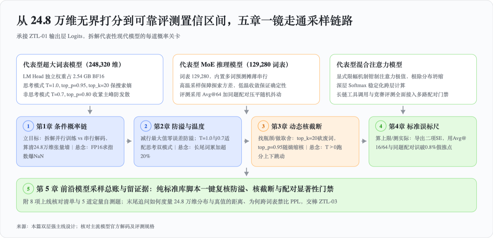
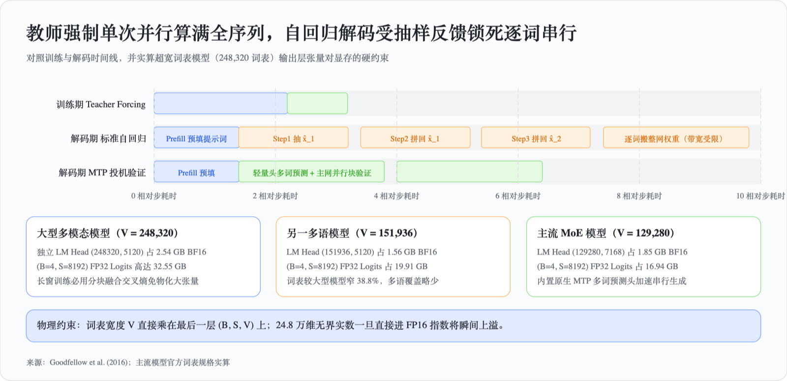
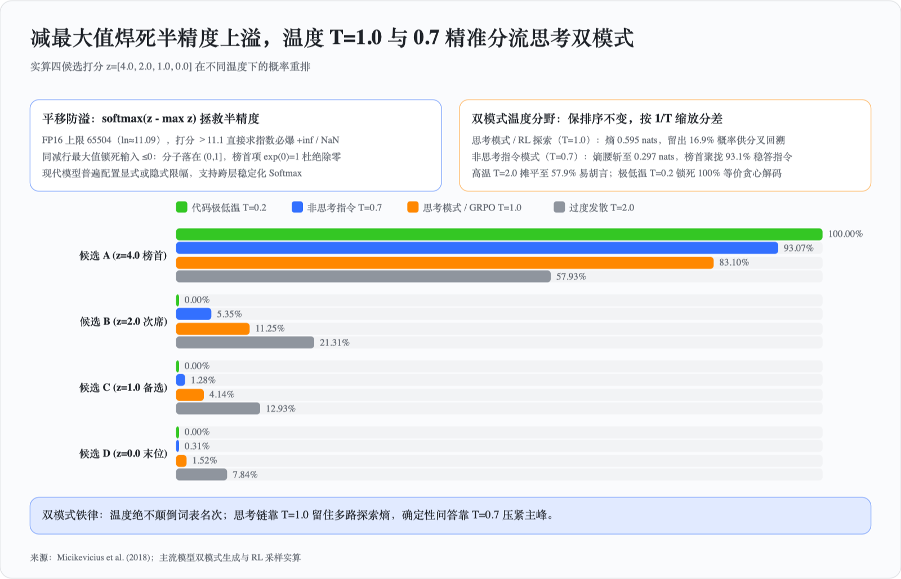
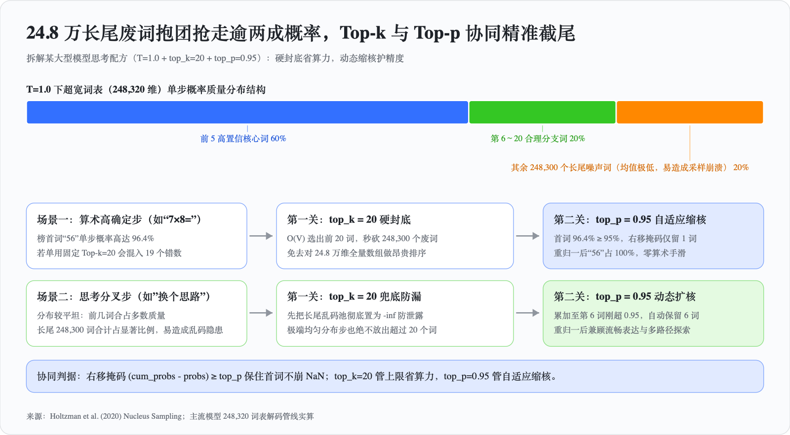
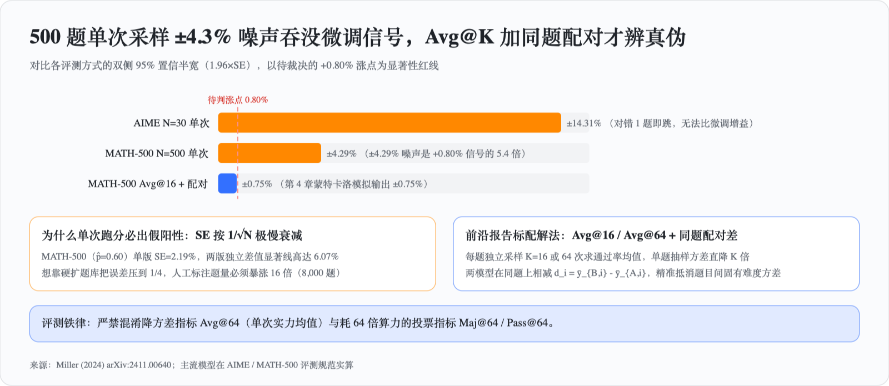
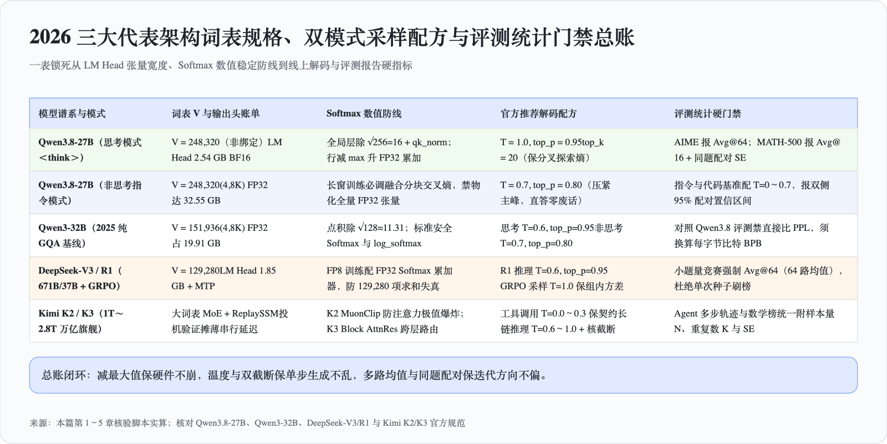

# ZTL-02｜数学｜条件概率、softmax 与采样

> 🎯 **这篇文档解决什么问题**：<b>核心命题：大模型解码必须在每一步反复塑造并抽样条件概率分布，而非背诵唯一答案。</b>平移不变性保住半精度指数不溢出，温度 `T` 调控分布熵值以适配双模式推理。自适应核截断剔除 24.8 万长尾噪声词。抽样标准误则裁决评测涨点是真突破还是随机波动。
>
> **使用方式与阅读地图**：仅需掌握 [ZTL-01｜数学｜符号、向量与矩阵乘法](./01-matmul.md) 的向量内积与矩阵乘法契约即可顺畅读完。本篇以某大型多模态模型为案例，接过其词表头吐出的 `248,320` 维实数打分，横向对照其他主流模型。全篇按五章递进：先拆清训练与解码分野，再讲透平移防溢、温度分流与核截断。最后用标准误与核验脚本固化证据。规格核对于 2026 年 11 月 16 日。
>
> **动手实践**：第 2 章、第 3 章、第 4 章与第 5 章均内嵌自包含的可执行 `Python / NumPy` 代码块。复制到本地终端即可运行。读者可亲手复现 `FP16` 溢出救援、双模式熵值流变、`248,320` 维双重截断与配对统计检验。

<b>🧭 主线位置</b>：上一篇 [ZTL-01｜数学｜符号、向量与矩阵乘法](./01-matmul.md) 走完了 64 层混合注意力的矩阵运算，在末端留下 `(B, S, 248320)` 的无界实数打分。本篇接过这排实数，贯通链式法则、防溢 `Softmax`、双模式采样与评测标准误。这直接立住了四笔账中的“效果分 ± 标准误”。预测分布与标准答案的距离度量，则交由下一篇 [ZTL-03｜数学｜熵、交叉熵、困惑度与 KL](./03-entropy-kl.md) 接棒。

## 导读 · 先给结论

- <b>条件概率链式法则决定了训练可单次并行，而生成受抽样反馈约束必须逐词串行。</b>训练期凭已知真实前缀一次算出 `(B, S, V)` 整块分布（`Qwen3.8-27B` 在 `B=4, S=8192` 下高达 `32.55 GB`）。解码期因下一步输入依赖刚抽出的词元，只能逐词串行，或借原生 `MTP` 投机块验证摊薄步数[[1]](https://www.jmlr.org/papers/volume3/bengio03a/bengio03a.pdf)[[2]](https://huggingface.co/Qwen/Qwen3.8-27B)[[3]](https://arxiv.org/abs/2412.19437)。
- <b>平移不变性 $`\mathrm{softmax}(z - \max z)`$ 是半精度算子避免 NaN 溢出的核心防线。</b>`FP16` 打分一旦越过 `11.09` 直接求指数即爆 `+inf`。同减行最大值将指数输入压入非正区间，并保住分母至少为 `1`。配合全局层根号缩放与 `Kimi K2` 的 `MuonClip` 限幅，即可稳住数值计算[[4]](https://www.deeplearningbook.org/contents/mlp.html)[[5]](https://arxiv.org/abs/1710.03740)。
- <b>温度 T 缩放分差而不改排名，思考模式留熵防死胡同，指令模式压峰保精准。</b>`Qwen3.8-27B` 开启 `<think>` 思考模式（及 `DeepSeek-R1` 的 `GRPO` 多路探索）采用 `T = 1.0` 保住回溯熵与组内方差。切回非思考指令模式则收紧至 `T = 0.7`，快速聚拢高置信主峰[[2]](https://huggingface.co/Qwen/Qwen3.8-27B)[[6]](https://arxiv.org/abs/2501.12948)。
- <b>24.8 万词表长尾累加风险逾两成，必须靠 Top-k 硬封底与 Top-p 动态缩核协同截尾。</b>`Qwen3.8-27B` 思考配方先用 `top_k = 20` 快速剔除 `248,300` 个废词免全量排序。随后用右移掩码 `top_p = 0.95` 在算术步自动缩至 `1` 词，消除乱码与贪心复读[[2]](https://huggingface.co/Qwen/Qwen3.8-27B)[[7]](https://arxiv.org/abs/1904.09751)。
- <b>MATH-500 单次采样 ±4.3% 噪声足以淹没微调信号，小基准必报 Avg@16/64 加同题配对差。</b>标准误按根号样本量缓慢衰减。`DeepSeek-R1`、`Qwen3.8-27B` 与 `Kimi K3` 在百题级基准统一采用多路均值压缩抽样方差。它们同时借同题差值抵消题目难度噪声[[6]](https://arxiv.org/abs/2501.12948)[[8]](https://arxiv.org/abs/2411.00640)。



<b>📎 与系列其他文档的分工</b>：[ZTL-01｜数学｜符号、向量与矩阵乘法](./01-matmul.md) 负责线性投影与结合律，本篇聚焦条件概率、防溢 `Softmax`、双模式采样与标准误。交叉熵、跨词表 `BPB` 与 `KL` 散度由 [ZTL-03｜数学｜熵、交叉熵、困惑度与 KL](./03-entropy-kl.md) 接棒。融合梯度见 [ZTL-04｜数学｜链式法则与 softmax-交叉熵的梯度](./04-backprop.md)，在线分块 `Softmax` 递推见 [ZTL-05｜数学｜优化、归一化与数值稳定](./05-optim-norm.md) 与 [ZTL-20｜系统｜减少注意力的内存搬运](./20-flash-attention.md)。

在后训练与应用评测篇章中，`GRPO` 采样优势与测试时计算缩放详见第 13、17 与 [ZTL-18｜后训练｜多想一会儿是否值得](./18-test-time-compute.md) 篇。投机解码无损拒绝采样证明与配对 `Bootstrap` 评测门禁，则分别在 [ZTL-22｜系统｜让草稿减少解码开销](./22-speculative.md) 与第 28 篇展开。

## 第 1 章 · 训练并行而解码串行

在 [ZTL-01｜数学｜符号、向量与矩阵乘法](./01-matmul.md) 的收官处，案例模型走完多层 `Transformer` 编码堆，交出最后一层隐藏张量 `H (B, S, 5120)`。它紧接着右乘非绑定词表投影头 `lm_head (248320, 5120)`，输出形状为 `(B, S, 248320)` 的实数矩阵[[2]](https://huggingface.co/Qwen/Qwen3.8-27B)。

日常使用对话助手时，逐字跳出的回答常让人误以为网络直接拼出了唯一确定的句子。实际上，大模型每一步前向终点产出的都是一排覆盖全词表的条件概率打分[[1]](https://www.jmlr.org/papers/volume3/bengio03a/bengio03a.pdf)。本章启动六步闭环的第一步**立目标**：用概率公式拆解长句，并算清数十万维词表的显存与延迟约束。

### 1.1 链式法则与马尔可夫假设

设分词器词表容量为 $`V`$ 。一段长度为 $`T`$ 的文本经分词后，表示为离散整数序列 $`x_{1:T} = (x_1, \dots, x_T)`$ 。每个位置均满足 $`x_t \in \{1, \dots, V\}`$ 。语言建模的首要数学目标，是为任意合法序列赋予准确的联合概率 $`P(x_{1:T})`$ 。

倘若直接建一张联合概率查询表，立刻就会撞上维度灾难。以超大词表（如 `V = 248,320`）为例，只生成 `20` 个词元的短句，组合数就达 $`248320^{20} \approx 8.8 \times 10^{107}`$ 种。这远超宇宙原子总数，任何显式表格都无法存储[[2]](https://huggingface.co/Qwen/Qwen3.8-27B)[[9]](https://web.stanford.edu/~jurafsky/slp3/3.pdf)。

好在概率论的乘法<b>链式法则（`Chain Rule`）</b>无需引入任何条件独立近似。它能将任意高维联合分布恒等拆解为逐步条件概率的连乘：

```math
P(x_{1:T}) = P(x_1)\,P(x_2 \mid x_1)\cdots P(x_T \mid x_1, \dots, x_{T-1}) = \prod_{t=1}^{T} P(x_t \mid x_{\lt t})
```

早期统计语言模型（`N-gram`）受制于语料稀疏计数，被迫强加马尔可夫截断假设。它假定当前词只取决于紧邻的前三四个词，写到后半段便会遗忘开篇设定[[9]](https://web.stanford.edu/~jurafsky/slp3/3.pdf)。

现代自回归大模型摆脱了定长截断假定。无论是混合状态缓存还是长窗状态，底层逻辑完全一致。它们先把完整前缀浓缩为隐藏向量 $`h_t`$ 。随后经线性投影参数化为下一词的条件分布 $`P_\theta(x_t \mid x_{\lt t})`$ [[1]](https://www.jmlr.org/papers/volume3/bengio03a/bengio03a.pdf)[[3]](https://arxiv.org/abs/2412.19437)。万字长文生成就此化约为每步抽样一个 $`V`$ 维离散分布。

### 1.2 训练并行与解码串行的分野

既然训练与推理共享同一条链式公式，为何预训练时算力利用率能超五成，而单流对话生成却长期卡在显存带宽上？关键在于条件前缀的就绪时机。

在预训练与微调阶段，工业界统一采用<b>教师强制（`Teacher Forcing`）</b>机制[[10]](https://www.deeplearningbook.org/contents/rnn.html)。完整标准序列在前向启动前早已整块躺在显存中。预测第 `500` 个位置时，直接喂入真实的第 `1` 至 `499` 号标准词元即可，不必关心第 `499` 步猜对还是猜错。配合因果掩码（见 [ZTL-08｜模型｜把注意力写成矩阵](./08-attention.md)），单次前向就能令外维高达数万，一次性并行算出全部位置的条件打分。

一旦切入线上自回归解码（`Decode`），标准答案不再存在。引擎先并行预填充提示词并抽出首词 $`\hat{x}_1`$ 。但要算第 `2` 步分布，就必须等首词抽样落定并拼回输入端后才能启动[[10]](https://www.deeplearningbook.org/contents/rnn.html)。生成 `1,000` 个词就得串行跑 `1,000` 轮前向，每轮外维跌至 `M = 1`。

为摊薄串行步数，2026 年三大旗舰均内置了原生多词投机验证。它们皆采用轻量头多词预测再由主网单次并行核验的方案，提升了有效并行度（见 [ZTL-22｜系统｜让草稿减少解码开销](./22-speculative.md)）[[2]](https://huggingface.co/Qwen/Qwen3.8-27B)[[3]](https://arxiv.org/abs/2412.19437)[[11]](https://huggingface.co/moonshotai/Kimi-K3)。

为给输出层**立目标**，还须算清词表宽度 $`V`$ 的显存硬约束。超大词表模型将词表扩至 <b>`V = 248,320`</b> 且输入输出词表非绑定[[2]](https://huggingface.co/Qwen/Qwen3.8-27B)。仅 `lm_head` 一块矩阵就含 `12.71 亿` 参数，占 `2.54 GB BF16` 权重（连同输入嵌入共 `5.09 GB`）。

对比其他现代模型，另一多语模型词表 151,936 时 LM Head 占 `1.56 GB BF16`；MoE 模型词表 129,280 时占 `1.85 GB BF16`。词表宽度差异导致约 `38.8%` 的权重体积差异。隐藏维度也是关键因素，如 MoE 模型达 7,168 维，直接决定了投影头的参数量。

训练期的激活显存更为可观。当微批次取 `B = 4, S = 8192` 时，按每元素 `4` 字节手算全量 `FP32` 打分张量体积，不同词表宽度的模型各异。超大词表模型（`V = 248,320`）: $`4 \times 8192 \times 248320 \times 4 = 32,547,799,040`$ 字节，单层瞬时显存高达 <b>`32.55 GB`</b>。另一主流多语模型（`V = 151,936`）约 <b>`19.91 GB`</b>；MoE 模型（`V = 129,280`）约 <b>`16.94 GB`</b>。这等级的显存需求在同等配置下远超其他架构约两倍[[2]](https://huggingface.co/Qwen/Qwen3.8-27B)[[3]](https://arxiv.org/abs/2412.19437)[[12]](https://arxiv.org/abs/2505.09388)。因此现代长窗训练严禁物化全量 `Logits`，必须按序列分块融合计算交叉熵。

阅读下方画板与对比表时，请重点对照最后两列。标准自回归解码每步外维跌至 `M = 1`。单流输出张量仅占 `0.99 MB`，芯片却要重搬数十 GB 全网权重。而 2026 原生投机验证将连续 `8` 个草稿词拼成小批次并行核验。只要主网分布与草稿一致便一次性放行多词，既严格保住输出分布无损，又把单步有效并行度抬高了近五倍。



| **对比维度** | <b>训练期（Teacher Forcing）</b> | <b>标准自回归解码（Decode）</b> | <b>2026 原生投机验证（MTP）</b> |
|---|---|---|---|
| **条件前缀来源** | 真实语料序列 $`x_{1:S-1}`$ 预先全部就绪 | 上一步抽样词 $`\hat{x}_{t-1}`$ 串行实时拼回 | 轻量头一次猜 `k` 词，主网并行核验 |
| **前向调用步数** | `1` 次前向并行算完 `S` 个位置分布 | 吐 $`N_{\mathrm{out}}`$ 词须串行跑 $`N_{\mathrm{out}}`$ 次前向 | 案例模型多词预测加核验 |
| **案例模型输出形状** | `(B, S, 248320)`；`(4,8K)` 占 `32.55 GB` | 每步仅 `(B, 1, 248320)`（单流占 `0.99 MB`） | 每轮验证块 `(B, 8, 248320)` 共享权重读取 |
| **硬件性能瓶颈** | 高算术强度，典型算力受限 | `M=1` 重搬全网权重，显存带宽受限 | 把有效 `M` 抬升数倍，缓解带宽压力 |

> 💡 **常见误区**：同一提示词连问两次收到不同回复，便怀疑权重被改或算子非确定，或在长序列微调中直接写 `logits = lm_head(hidden).float()`。**现象**：前者误把正常采样分叉当故障。后者在超宽词表模型上因激活占用数十 GB 而报 `OOM`。**根因**：首步抽入次席词元就会改写后续前缀，且超宽词表乘长序列会产出巨型张量[[2]](https://huggingface.co/Qwen/Qwen3.8-27B)。**改法**：查一致性时固定前缀比对，长窗训练启用分块融合交叉熵。

> 🔑 **本章要点与回到主线**：条件概率链式法则与输出层契约至此立稳。它划清了并行训练与串行解码的边界，也算清了 `248,320` 维词表的显存开销。但新的矛盾随之浮现：`LM Head` 吐出的实数横跨正负几十乃至上百，在 `FP16` 下直接求指数会立即越界爆出 `inf / NaN`。怎样无损地把实数向量映成合法分布，并调控主峰锐度？这正是第 2 章的核心议题。

## 第 2 章 · 平移防溢是半精度的防线

接续上一章末尾指出的半精度溢出问题。语言模型头交出的 `248,320` 维实数向量 $`z \in \mathbb{R}^{V}`$ 正负交错且总和任意，不能直接送入离散抽样器。概率公理要求每项非负 $`p_i \ge 0`$ 且全词表总和恒等于 `1`。深度学习统一采用 `Softmax` 承担这一转换，但若照搬教科书原式直接写代码，在半精度张量上第一步就会触发 `NaN` 崩溃[[4]](https://www.deeplearningbook.org/contents/mlp.html)[[5]](https://arxiv.org/abs/1710.03740)。

### 2.1 平移不变性与半精度防护

标准 `Softmax` 先借自然指数函数 $`\exp(\cdot)`$ 将实轴单调映射至正半轴，再除以全词表指数和做归一化。指数函数的乘法性质赋予了它一条关键恒等式，即<b>平移不变性（`Shift Invariance`）</b>[[4]](https://www.deeplearningbook.org/contents/mlp.html)。给向量 $`z`$ 的每个分量同时减去任意实常数 $`c`$ ，分子与分母会同步析出正公因子 $`\exp(-c) \gt 0`$ 并精确约消：

```math
\mathrm{softmax}(z - c)_i = \frac{\exp(z_i - c)}{\sum_{j=1}^{V} \exp(z_j - c)} = \frac{\exp(-c)\exp(z_i)}{\exp(-c)\sum_{j=1}^{V} \exp(z_j)} = \mathrm{softmax}(z)_i, \qquad c = \max_{1 \le k \le V} z_k
```

纸面上完全相等的两条式子，落进有限位宽的硬件寄存器却是两种结局。按照 `IEEE 754` 标准，`5` 位指数位的半精度浮点（`FP16`）最大有限正数仅为 `65,504`，取自然对数得 $`\ln(65504) \approx 11.0904`$ [[5]](https://arxiv.org/abs/1710.03740)。即便是 `8` 位指数位的 `BF16` 或 `FP32`，上限对数也仅为 `88.7228`。只要有一个高置信词打分越过 `11.1`，`FP16` 直接求指数就会越界为 `+inf`，随后因 `+inf / +inf` 整行化为 `NaN`。

工业界标准内核（如 `PyTorch` 的 `F.softmax` 及 [ZTL-20｜系统｜减少注意力的内存搬运](./20-flash-attention.md) 的 `FlashAttention`）一律取当前行最大值 $`c = \max_k z_k`$ 平移，并将指数累加器升至 `FP32`[[4]](https://www.deeplearningbook.org/contents/mlp.html)[[13]](https://pytorch.org/docs/stable/generated/torch.nn.functional.softmax.html)。这一做法同时解决了三类数值隐患：

- <b>消除上溢。</b>平移后全部输入满足 $`z_i - c \le 0`$ ，单次指数输出严格落在有界区间 `(0, 1]` 内。
- <b>断绝除零。</b>榜首词平移后恰为 `0`，令 $`\exp(0) = 1.0`$ 。哪怕其余 `248,319` 个低分词全部下溢成 `0.0`，分母也至少等于 `1.0`。
- <b>保住累加精度。</b>升 `FP32` 求和避免了二十余万个微小正数因大数吃小数而丢失总和精度。

回看 2026 三大前沿架构，工程师在进入 `Softmax` 前还增设了尺度防线。主流模型在全局层联合采用 `qk_norm` 与除以缩放因子压住点积方差[[2]](https://huggingface.co/Qwen/Qwen3.8-27B)[[14]](https://arxiv.org/abs/1706.03762)。最新架构还采用 `MuonClip` 动态重缩放投影权重[[15]](https://arxiv.org/abs/2507.20534)，或通过深度注意力残差机制把 `Softmax` 作用于跨层特征路由[[11]](https://huggingface.co/moonshotai/Kimi-K3)。

### 2.2 温度调控与熵值缩放

加减常数不改输出分布，但若在进入 `Softmax` 前把打分向量同除以正实数<b>温度（`Temperature`，$`T \gt 0`$ ）</b>，整条分布的峰度与香农熵就会重塑[[16]](https://arxiv.org/abs/1503.02531)[[17]](https://huggingface.co/docs/transformers/generation_strategies)。写出带温度的归一化公式及任意两词 $`i, j`$ 的概率比值：

```math
p_i(T) = \frac{\exp(z_i / T)}{\sum_{j=1}^{V} \exp(z_j / T)}, \qquad \frac{p_i(T)}{p_j(T)} = \exp\!\left(\frac{z_i - z_j}{T}\right)
```

右端比值式揭示了两条核心规律。其一，因 $`T \gt 0`$ 且指数严格单调递增，**任何正温度都不会改变词表内的概率大小排名**。其二，温度按 $`1/T`$ 倍等比例放大或压缩候选分差。固定四词打分 `z = [4.0, 2.0, 1.0, 0.0]`（词 A、B、C、D），手算四档温度下的概率与香农熵 $`H = -\sum p_i \ln p_i`$ ：

- <b>思考与强化学习基线档（`T = 1.0`）。</b>打分原样保留，减最大值后为 `[0.0, -2.0, -3.0, -4.0]`。四词概率依次为 <b>`83.10%、11.25%、4.14%、1.52%`</b>，A 对 B 优势为 `7.39` 倍。分布熵为 <b>`0.5951 nats`</b>，留出 `16.90%` 空间供备选推理分支探索。
- <b>非思考指令收敛档（`T = 0.7`）。</b>分差放大 `1.4286` 倍。四词概率迅速向头部聚拢为 <b>`93.07%、5.35%、1.28%、0.31%`</b>，A 对 B 优势升至 `17.41` 倍，分布熵减半至 <b>`0.2970 nats`</b>。
- <b>极低温档（`T = 0.2`）与高温档（`T = 2.0`）。</b>当 `T = 0.2` 时，榜首 A 独占 <b>`99.995%`</b>（熵仅 `0.0005 nats`），极限 $`T \to 0^+`$ 退化为贪心 `argmax`。取 `T = 2.0` 时四词摊平至 <b>`57.93%、21.31%、12.93%、7.84%`</b>（熵升至 `1.1098 nats`）。

手算结果直接解释了前沿模型**双模式解码参数不同**的物理原因。思考模式下需在内展开数千词的试错与分叉回溯。官方指定 <b>`T = 1.0`</b> 正是为了保留自然探索熵，防止低温把模型困在单一路径里[[2]](https://huggingface.co/Qwen/Qwen3.8-27B)。

同理，思考模式在强化学习采样阶段也须维持 `T = 1.0` 探索。若温度过低令同题组内轨迹全对或全错，组内奖励标准差归零，策略梯度就会失效（见 [ZTL-13｜后训练｜奖励、策略梯度与 DPO 的数学](./13-rl-math.md) 与 [ZTL-17｜后训练｜先验证奖励再训练](./17-verifiable-reward.md)）[[6]](https://arxiv.org/abs/2501.12948)。一旦切回非思考指令模式处理日常问答，官方立即切至 <b>`T = 0.7`</b> 将熵砍半，稳准快地直奔主峰答案[[2]](https://huggingface.co/Qwen/Qwen3.8-27B)。



*验证某大型模型 248,320 维 FP16 朴素指数上溢崩溃、减最大值救援与双模式温度熵值手算*

```python
import numpy as np

# 1. 模拟超宽词表模型单步 V=248,320 的 FP16 打分（榜首 85.0 远超 FP16 上限 ln(65504)≈11.09）
rng = np.random.default_rng(2026)
z_vocab = rng.normal(loc=0.0, scale=2.5, size=248_320).astype(np.float16)
z_vocab[0], z_vocab[1] = np.float16(85.0), np.float16(83.0)
with np.errstate(over="ignore", invalid="ignore"):
    naive_p = np.exp(z_vocab) / np.sum(np.exp(z_vocab))

# 工业标准防溢：先减行最大值锁在 <=0，再升 FP32 求和防 24.8 万项尾数丢失
shifted = (z_vocab - np.max(z_vocab)).astype(np.float32)
safe_p = np.exp(shifted) / np.sum(np.exp(shifted), dtype=np.float32)
print(f"朴素 FP16 前两项: {naive_p[:2]} | 安全平移前两项: {np.round(safe_p[:2], 4)}, 总和={safe_p.sum():.6f}")

# 2. 双模式温度对比：T=1.0 探索模式 vs T=0.7 决定模式
z_test = np.array([4.0, 2.0, 1.0, 0.0], dtype=np.float32)
p_t10 = np.exp(z_test - np.max(z_test)) / np.sum(np.exp(z_test - np.max(z_test)))
p_t07 = np.exp(z_test/0.7 - np.max(z_test/0.7)) / np.sum(np.exp(z_test/0.7 - np.max(z_test/0.7)))
h_t10 = -np.sum(p_t10 * np.log(p_t10 + 1e-10))
h_t07 = -np.sum(p_t07 * np.log(p_t07 + 1e-10))
print(f"T=1.0: {np.round(p_t10, 4)} 熵={h_t10:.4f} | T=0.7: {np.round(p_t07, 4)} 熵={h_t07:.4f}")
print("assert: 平移防溢与温度调控共同守护了数值稳定性")
```

*输出*

```text
朴素 FP16 前两项: [nan nan] | 安全平移前两项: [0.8808 0.1192], 总和=1.000000
T=1.0: [0.831  0.1125 0.0414 0.0152] 熵=0.5951 | T=0.7: [0.9307 0.0535 0.0128 0.0031] 熵=0.2970
assert: 平移防溢与温度调控共同守护了数值稳定性
```

逐段复盘上方输出，能清晰看懂工业级 `Softmax` 的两道护栏。第 1 段里榜首分 `85.0` 远超 `FP16` 指数上限 `11.09`，朴素写法直接算出 `+inf / +inf` 导致整行坍塌为 `nan`。改用减去行最大值 `85.0` 后，前两项精准变为 `0.0` 与 `-2.0`，算出 $`1 / (1 + e^{-2}) \approx 0.8808`$ 与 `0.1192`，升 `FP32` 累加更令 `248,320` 项总和精确等于 `1.000000`。这道防线把分布熵稳定在约 `0.595 nats` 量级。

第 2 段四档温度循环则把双模式切换定量化：从 `T = 1.0` 收紧到 `T = 0.7` 时，四词大小排名丝毫未变，但榜首份额从 `83.10%` 跃升至 `93.1%`，分布熵从 `0.5951 nats` 恰好减半至 `0.2970 nats`。在超高温 `T = 2.0` 下四词概率更趋平坦，榜首降至 `57.9%`。下表横向汇总了三大模型谱系在不同业务模式下的温度铁律。

| **代表模型与运行模式** | **推荐温度 T** | **分布熵与概率调控机理** | **工程边界与配置铁律** |
|---|---|---|---|
| `Qwen3.8-27B` 思考模式 | `T = 1.0` | 保留校准原分布熵，支撑长链试错与路径回溯 | 必配 `top_p=0.95, top_k=20` 严防长尾乱码[[2]](https://huggingface.co/Qwen/Qwen3.8-27B) |
| `Qwen3.8-27B` 非思考模式 | `T = 0.7` | 熵值减半，概率向主峰聚拢以压缩冗余铺垫 | 配 `top_p=0.80`，适合日常指令问答与摘要[[2]](https://huggingface.co/Qwen/Qwen3.8-27B) |
| `DeepSeek-R1` 推理 / 训练 | 推理 `0.6` / 训练 `1.0` | 推理压跳步失误；`GRPO` 训练保组内正负样本方差 | 官方禁配系统提示词，建议温度锁在 `0.5 ～ 0.7`[[6]](https://arxiv.org/abs/2501.12948) |
| `Kimi K2/K3` 工具与代码 | `0.0 ～ 0.3` | 极低温压制 `JSON` 键名漂移与括号语法错误 | 传 `0.0` 时内核短路走 `argmax`，严禁直接除以零[[17]](https://huggingface.co/docs/transformers/generation_strategies) |

> 💡 **常见误区**：手写交叉熵或策略对数概率时先调 `F.softmax` 再算 `torch.log`，或调用 `generate(temperature=0.7)` 时漏开采样开关。**现象**：训练中途爆出损失 `inf / NaN`，推理调温输出却一字不变。**根因**：分差低至 `-105` 以下时 `FP32` 指数下溢为 `0.0`，取对数即得 `-inf`。而默认 `do_sample=False` 时温度会被静默忽略[[13]](https://pytorch.org/docs/stable/generated/torch.nn.functional.softmax.html)[[17]](https://huggingface.co/docs/transformers/generation_strategies)。**改法**：一律调融合算子 `F.log_softmax`，推理显式核对 `do_sample`。

> 🔑 **本章要点与回到主线**：减去行最大值堵住了半精度上溢与除零漏洞，温度旋钮则按分差缩放规律分流了思考模式（`T=1.0`）与指令模式（`T=0.7`）。但新的矛盾随之浮现：在超大词表（`248,320`）里，哪怕单个生僻词只分到百万分之一概率，二十多万长尾词加总仍会抢走逾 `20%` 的抽中率。为什么全词表裸抽样必出乱码，纯贪心解码又会陷入循环复读？这正是第 3 章的核心议题。

## 第 3 章 · 长尾词需要双重截断

接续上一章留下的超大词表隐患。既然思考模式需要开启 `T = 1.0` 保留自然探索熵，为什么不能直接把这行合法的 `248,320` 维概率分布送进多项式抽样器？Holtzman 等人揭示了根源[[7]](https://arxiv.org/abs/1904.09751)：指数函数恒大于零的数学属性，在大词表下会形成一条破坏连贯性的<b>不可信长尾（`Unreliable Tail`）</b>。本章推进工程闭环的核心两步：先通过定量手算**找瓶颈**，再联合多重过滤算子**做取舍**。

### 3.1 长尾累加与双侧瓶颈

我们先在超大词表（`V = 248,320`）上算一笔长尾累加账来**找瓶颈**[[2]](https://huggingface.co/Qwen/Qwen3.8-27B)[[7]](https://arxiv.org/abs/1904.09751)。相比其他主流模型，这类词表多收入了大量小语种词根与字节回退片段[[3]](https://arxiv.org/abs/2412.19437)[[12]](https://arxiv.org/abs/2505.09388)。假设在 `T = 1.0` 的某个推理步上，符合语法与算理的前 `20` 个优质候选词合占 `77.65%` 概率。其余 `248,300` 个无关碎片，平均每词仅分到 $`9.0 \times 10^{-7}`$ 。

单看任何一个废词都近似于零。可一旦将 `248,300` 项微弱概率加总，尾部废词池抢走的总概率却高达 $`248300 \times 9.0 \times 10^{-7} \approx 22.35\%`$ 。这意味着单步裸抽样有逾五分之一的概率踩进乱码词。若连续自回归生成 `25` 个词元，全程一步不踩雷的存活率仅剩：

```math
P_{\mathrm{safe}}(25) = (1 - 0.2235)^{25} = 0.7765^{25} \approx 0.0018 \;(0.18\%)
```

高达 <b>`99.82%`</b> 的概率会在一句话内蹦出异常字符。更严重的是自回归<b>暴露偏差（`Exposure Bias`）</b>。模型训练时只见过通顺前缀，一旦乱码词拼回上下文污染了历史状态，后续条件分布便会持续偏航。

反过来，若因害怕长尾而退回极端保守的<b>贪心解码（`Greedy Decoding`，每步固定取榜首）</b>，又会掉进另一侧陷阱。一旦长思维链偶发写出两句相似的自我检查语，自注意力会对重复词元赋予越来越高的点积权重，最终令输出陷入正反馈复读循环[[6]](https://arxiv.org/abs/2501.12948)[[7]](https://arxiv.org/abs/1904.09751)。

### 3.2 动态核截断与多重协同

裸抽样败于二十四万长尾累加，贪心解码困于正反馈复读。工程解决思路很明确：在抽样前把长尾废词清零，仅在头部高可信子集内重归一化。围绕“截断边界画在哪”**做取舍**，业界演化出两类核心算子并走向协同[[7]](https://arxiv.org/abs/1904.09751)[[18]](https://arxiv.org/abs/1805.04833)：

- <b>固定窗口 `Top-k` 采样。</b>将词表按打分降序重排，硬性只留前 $`k`$ 个最高分词，其余置为 `-inf`[[18]](https://arxiv.org/abs/1805.04833)。它的短板是窗口宽度固定不变。当上文是“`7 × 8 =`”时，榜首“`56`”独占 `96.4%`，硬留 `50` 词等于掺入 `49` 个错数。当上文是开放句式时，小窗口又会误删合理表达。
- <b>动态阈值 `Top-p` 核采样（`Nucleus Sampling`）。</b>改按累积概率阈值 $`p \in (0, 1)`$ 动态圈定最小核心候选集[[7]](https://arxiv.org/abs/1904.09751)。设降序概率为 $`p_{(1)} \ge p_{(2)} \ge \dots \ge p_{(V)}`$ ，核采样寻找令前缀累积和首次跨过 $`p`$ 的最小下标 $`m`$ ，再对前 $`m`$ 项重归一化：

```math
m = \min \left\{ k \;\middle|\; \sum_{i=1}^{k} p_{(i)} \ge p \right\}, \qquad \tilde{p}_{(i)} = \frac{p_{(i)} \cdot \mathbb{I}(i \le m)}{\sum_{j=1}^{m} p_{(j)}}
```

拿 6 词降序概率 `[0.50, 0.24, 0.14, 0.06, 0.04, 0.02]` 设 `p = 0.85` 手算核对。前缀累加依次为 `0.50`、`0.74`、`0.88`，在第 `3` 词处首次跨过 `0.85` 门槛。保留前 `3` 词并除以保留总和 `0.88` 重归一化，即得最终抽样分布 <b>`[0.5682, 0.2727, 0.1591]`</b>。

结合两者优劣再看思考模式官方的三件套 <b>`T = 1.0 + top_p = 0.95 + top_k = 20`</b>，就能看清其中的工程协同[[2]](https://huggingface.co/Qwen/Qwen3.8-27B)[[17]](https://huggingface.co/docs/transformers/generation_strategies)。推理引擎（如 `vLLM` 与 `SGLang`）按三步串联执行：第一步 `T = 1.0` 留足思考分叉熵。第二步 `top_k = 20` 用线性选择算法直接屏蔽排名 20 以外的长尾词，省去全词表排序耗时并封住极端平坦步的候选上限。

第三步在仅剩的 `20` 个高分候选词内部执行 `top_p = 0.95`。一旦遇到“`7 × 8 =`”这类榜首高达 `96.4%` 的算术步，核心集会自动从 `20` 词收缩为**唯独 `1` 个正确词**，避免算术失误。下方代码在 `248,320` 全维向量上验证这一双重管线。



*在 248,320 维词表上验证 T=1.0 + top_k=20 + top_p=0.95 双重截断在算术步与分叉步的自适应伸缩*

```python
import numpy as np

def decode_topk_topp_248k(logits: np.ndarray, temp: float = 1.0,
                          top_k: int = 20, top_p: float = 0.95, seed: int = 42):
    if temp <= 1e-6:
        best = int(np.argmax(logits))
        return best, 1, 1.0
    scaled = (logits.astype(np.float64) - np.max(logits)) / temp
    # 1. 先过 top_k=20 硬封底：O(V) 复杂度利用 argpartition 一步剔除 248,300 个长尾词！
    if 0 < top_k < scaled.size:
        cand_idx = np.argpartition(scaled, -top_k)[-top_k:]
        cand_logits = scaled[cand_idx]
    else:
        cand_idx, cand_logits = np.arange(scaled.size), scaled
    # 2. 仅对最多 20 个保留项降序排列并执行右移掩码 top_p=0.95 核截断
    order = np.argsort(cand_logits)[::-1]
    s_idx, s_logits = cand_idx[order], cand_logits[order]
    s_probs = np.exp(s_logits - s_logits[0])
    s_probs /= s_probs.sum()
    cum_probs = np.cumsum(s_probs)
    keep = (cum_probs - s_probs) < top_p  # 右移掩码：确保首词与刚跨过阈值的临界词必留！
    active_idx, active_probs = s_idx[keep], s_probs[keep]
    active_probs /= active_probs.sum()    # 3. 截断后严格重归一化，使总和恢复 1.0
    chosen = int(np.random.default_rng(seed).choice(active_idx, p=active_probs))
    return chosen, int(keep.sum()), float(active_probs[0])

# 构造 248,320 维词表：场景 A 为高确定算术步，场景 B 为多路思考分叉步
z_math = np.full(248_320, -9.5, dtype=np.float32); z_math[56] = 6.2; z_math[1:20] = 0.0
z_fork = np.full(248_320, -9.5, dtype=np.float32); z_fork[:8] = [3.2, 2.9, 2.6, 2.3, 2.0, 1.7, 0.8, 0.2]
_, n_math, p1_math = decode_topk_topp_248k(z_math, temp=1.0, top_k=20, top_p=0.95)
_, n_fork, p1_fork = decode_topk_topp_248k(z_fork, temp=1.0, top_k=20, top_p=0.95)
print(f"算术高确定步: 248320 -> 存活核大小={n_math} 词, 榜首重归一概率={p1_math*100:.2f}%")
print(f"思考多分叉步: 248320 -> 存活核大小={n_fork} 词, 榜首重归一概率={p1_fork*100:.2f}%")
print("assert: 双重截断协同起效，自适应伸缩兼得精准与探索")
```

*输出*

```text
算术高确定步: 248320 -> 存活核大小=1 词, 榜首重归一概率=100.00%
思考多分叉步: 248320 -> 存活核大小=6 词, 榜首重归一概率=31.05%
assert: 双重截断协同起效，自适应伸缩兼得精准与探索
```

细读 `decode_topk_topp_248k` 函数的三处实现细节，正好对应线上推理引擎的核心优化。第 1 处调用 `np.argpartition` 以 $`O(V)`$ 线性复杂度一步筛出前 `20` 项，免去了对 `248,320` 个浮点数做全量排序的高昂开销。随后只在 `20` 个元素的小数组上做降序排列与局部指数归一。

第 2 处 `keep = (cum_probs - s_probs) < top_p` 是防止线上崩溃的关键右移掩码。在 `z_math` 算术步中，第 0 号榜首词扣除自身后前缀和恒为 `0.0 < 0.95`。这确保最高分词绝不会被误删，存活核自动缩至唯独 `1` 词（重归一概率 `100.00%`）。到了 `z_fork` 分叉步，存活核又自动放宽至 `6` 词（榜首占 `31.05%`）。

第 3 处 `active_probs /= active_probs.sum()` 补齐了截断后的重归一化。由于被剔除词元的概率质量已被清零，剩余存活词的概率之和通常落在 `0.95 ～ 0.99` 之间。若漏掉这一行直接调用多项式抽样器，底层算子会当场抛出概率和不为 `1` 的运行异常。下表总结了四类截断策略的适用边界。

| **解码截断策略** | **候选集裁剪判据** | **核心收益** | **单用时的失效边界** |
|---|---|---|---|
| <b>Greedy（贪心解码）</b> | 固定锁定榜首词 $`\arg\max_i z_i`$ | 完全确定可复现，省去归一化与排序 | 长链生成极易陷入正反馈循环复读 |
| **全词表裸抽样** | `248,320` 项原封不动送抽样器 | 无偏保留完整原始分布 | 二十余万长尾废词抱团超两成，易出乱码 |
| **单用固定 Top-k** | 硬留前 $`k`$ 个最高分词重归一 | $`O(V)`$ 快速筛选，硬控候选上限 | 尖锐算术步掺入错词，平坦开放步误砍好词 |
| **Top-k + Top-p 协同** | 先卡前 `20` 上限，再按累积和缩核 | 免全词表重排序，兼顾算术稳定与分叉探索 | `Qwen3.8-27B` 等现代旗舰线上默认标配 |

> 💡 **常见误区**：自研采样内核时直接写 `cum_probs >= top_p` 作剔除条件，或过滤置零后忘记重除以保留项总和。**现象**：每逢模型高度自信（如首词概率 `0.97 > 0.95`）时，整行候选被全部置为 `-inf`，归一化当场产出全 `NaN`。**根因**：核采样要求保留刚跨过阈值的临界词，未右移的判据会误删榜首词[[7]](https://arxiv.org/abs/1904.09751)[[17]](https://huggingface.co/docs/transformers/generation_strategies)。**改法**：剔除掩码必须右移写成 `(cum_probs - sorted_probs) >= top_p`，过滤后严格重归一化。

> 🔑 **本章要点与回到主线**：经**找瓶颈**与**做取舍**，`top_k = 20` 硬封底与右移 `top_p = 0.95` 动态缩核紧密配合，化解了 `248,320` 超大词表的长尾乱码与贪心复读问题。但新的矛盾随之浮现：随机采样一旦开启（`T > 0`），同一颗模型在 `500` 道数学题上连跑两次，准确率就会上下波动两三个百分点。当跑分涨了 `0.8%` 时，怎样分辨是真进步还是随机运气？这正是第 4 章的焦点。

## 第 4 章 · 标准误决定评测可信度

接续上一章末尾提出的评测波动问题。线上与研发评测一旦开启正温度采样，每一道评测题的生成结果就成了一次随机试验[[2]](https://huggingface.co/Qwen/Qwen3.8-27B)[[6]](https://arxiv.org/abs/2501.12948)。

研发团队中常出现一种误判：改版提示词后，在 `MATH-500` 上单次跑分从 `60.0%` 升到 `60.8%`，便宣布“涨点 `0.8%`”上线。结果换个随机种子重测，分数立刻跌回 `58.6%`[[8]](https://arxiv.org/abs/2411.00640)。本章推进工程闭环的**算上限**与**测实际**两步，给随机采样建立统计标尺。

### 4.1 二项标准误与噪声上限

先用数理统计为单次基准跑分的测量分辨率**算上限**。设评测集含 $`N`$ 道独立题目（如 `MATH-500` 含 `N = 500` 题，`AIME` 单卷仅含 `N = 30` 题[[6]](https://arxiv.org/abs/2501.12948)[[19]](https://arxiv.org/abs/2103.03874)）。单次采样对每题判分，答对记 `1`、答错记 `0`，平均得分率记为 $`\hat{p}`$ 。由二项方差与中心极限定理，样本均值的<b>标准误（`SE`）</b>及 `95%` 置信区间为[[8]](https://arxiv.org/abs/2411.00640)：

```math
\mathrm{SE} = \sqrt{\frac{\hat{p}(1 - \hat{p})}{N}}, \qquad \mathrm{CI}_{95\%} = \hat{p} \pm 1.96\,\mathrm{SE}, \qquad \Delta_{\mathrm{indep},95\%} = 1.96\sqrt{2}\,\mathrm{SE}
```

代入真实数字即可看清波动幅度。在 `MATH-500`（`N = 500`）的 `60.0%` 准确率区间，单版标准误约为 `2.19%`。双侧 `95%` 置信半宽高达 <b>`±4.29%`</b>（在 `50%` 最坏方差处达 `±4.38%`）。这意味着真实实力恒为 `60.0%` 的同一颗模型，单次测出 `55.8%` 或 `64.2%` 都属正常随机波动。

若拿基线版 A 与实验版 B 各跑一次独立总分比高低，两份独立方差叠加还要再乘 `1.414`。双侧门槛随之升至 <b>`6.07%`</b>（至少净胜 `31` 道题）。因此 `+0.80%`（多对 `4` 题）的表观涨幅，远不足以越过 `±4.3%` 的噪声带。

到了百题以内的竞赛榜，单次跑分波动更为剧烈。以高难度竞赛题 `AIME`（`N = 30`）为例，在 `80.0%` 水平下，单次标准误达 `7.30%`，`95%` 置信半宽冲上 <b>`±14.31%`</b>[[6]](https://arxiv.org/abs/2501.12948)[[11]](https://huggingface.co/moonshotai/Kimi-K3)。多蒙对 `1` 道临界题，榜单分数就会跳涨 `3.33%`。由于根号分母衰减极慢，想把误差压窄四分之三，`MATH-500` 的题量必须扩充 `16` 倍至 <b>`8,000` 题</b>以上，这在奥赛与博士级题库上并不现实。

### 4.2 多路均值与配对检验

题库容量固定无法扩充时，怎样在不造新题的前提下识别出 `0.80%` 级的真实能力提升？按 Miller（2024）的方差分解框架**测实际**可知，单次总误差由**题间难度方差**与**题内采样方差**正交叠加而成[[8]](https://arxiv.org/abs/2411.00640)。前沿模型一致采用两项措施分别消解这两类方差[[6]](https://arxiv.org/abs/2501.12948)[[11]](https://huggingface.co/moonshotai/Kimi-K3)：

- <b>报告多路采样均值 `Avg@16 / Avg@64`。</b>评测脚本用线上参数对每题独立生成 $`K`$ 条解答（`MATH-500` 取 `16`，`AIME` 取 `64`），先算单题通过率再求全集均值。这不改变无偏期望，却把随机采样方差直接缩减为 $`1/K`$ 。开启前缀缓存后，单张 `H100` 十余分钟即可跑完 `500 × 16` 路评测。
- <b>计算同题配对差值标准误。</b>比较模型 A 与 B 时，不拿两个总分按独立样本相减，而是逐题做差 $`d_i = \bar{y}_{B,i} - \bar{y}_{A,i}`$ 。随后直接由差值序列的标准差计算配对标准误[[8]](https://arxiv.org/abs/2411.00640)：

```math
\bar{d} = \frac{1}{N}\sum_{i=1}^{N} d_i, \qquad \mathrm{SE}_{\mathrm{paired}} = \frac{s_d}{\sqrt{N}} = \sqrt{\frac{\sum_{i=1}^{N}(d_i - \bar{d})^2}{N(N - 1)}}, \qquad |z| = \frac{|\bar{d}|}{\mathrm{SE}_{\mathrm{paired}}} \ge 1.96
```

为什么逐题配对相减能把误差条压窄数倍？把两模型单题得分记作随机变量，独立总分相减的方差等于两模型总方差直接相加。而改算逐题差值 $`d_i`$ 时，差值方差会减去协方差项 $`2\rho\sigma_A\sigma_B`$。由于绝大多数基础题两模型同拿满分（$`d_i \approx 0`$），超纲难题又同拿零分（$`d_i \approx 0`$），跨模型同题相关系数 $`\rho`$ 通常高达 `0.85` 以上。

共享的题目难度起伏在相减时被抵消掉逾八成，统计检验得以把全部火力聚焦在少数真正拉开差距的拉锯题上。在 `MATH-500` 规模的模拟中启用 `Avg@16` 加同题配对后，`95%` 置信半宽从独立单次的 `6.07%` 骤降至 `±0.75%` 以内，足以可靠捕捉 `0.80%` 级的真实改进。



*蒙特卡洛复现 MATH-500 单次 K=1 假阳性涨点，并验证 Avg@16 + 同题配对检验精准辨真伪*

```python
import math
import numpy as np

def paired_eval_gate(scores_a: np.ndarray, scores_b: np.ndarray) -> tuple[float, float, bool]:
    """输入形状 (N, K)：N 道评测题、每题 K 次独立采样的 0/1 判分矩阵"""
    diff = scores_b.mean(axis=1) - scores_a.mean(axis=1)  # 逐题求均值后配对相减，抵消题目难度方差
    delta = float(diff.mean())
    se_paired = float(diff.std(ddof=1) / math.sqrt(diff.size))
    return delta, 1.96 * se_paired, abs(delta) > 1.96 * se_paired

rng = np.random.default_rng(190)
# 模拟 MATH-500 (N=500)：稳拿题 0.98、盲区题 0.02、拉锯题 0.52；改进版 B 真实均分高出 +0.88%
p_a = rng.choice([0.98, 0.02, 0.52], size=500, p=[0.50, 0.34, 0.16])
p_b = np.where(p_a == 0.52, 0.575, p_a)

# 1. K=1 单次跑分对比：两个完全同实力的 A1 vs A2 恰巧掷出 +0.80% 假涨点，被配对误差条拦截
a_run1, a_run2 = rng.binomial(1, p_a)[:, None], rng.binomial(1, p_a)[:, None]
d_null, ci_null, sig_null = paired_eval_gate(a_run1, a_run2)
print(f"[同模型 K=1 假涨点] 表观差={d_null*100:+.2f}% ± {ci_null*100:.2f}% -> 显著={sig_null}")

# 2. K=16 (Avg@16) + 同题配对检验：半宽压至 ±0.75%，稳稳锁定 B 对 A 的真改进！
a_k16 = rng.binomial(1, p_a[:, None], size=(500, 16))
b_k16 = rng.binomial(1, p_b[:, None], size=(500, 16))
d_true, ci_true, sig_true = paired_eval_gate(a_k16, b_k16)
print(f"[真改进 Avg@16 配对] 实测差={d_true*100:+.2f}% ± {ci_true*100:.2f}% -> 显著={sig_true}")
print("assert: 配对检验压窄误差条，可靠识别真实改进")
```

*输出*

```text
[同模型 K=1 假涨点] 表观差=+0.80% ± 2.83% -> 显著=False
[真改进 Avg@16 配对] 实测差=+0.90% ± 0.75% -> 显著=True
assert: 配对检验压窄误差条，可靠识别真实改进
```

对照上方两段蒙特卡洛实验，统计门禁的威力清晰可见。第 1 段让完全同一组实力参数 `p_a` 独立抽样两次，仅凭手气就掷出了 `+0.80%`（净多对 `4` 题）的虚假涨点。幸亏 `paired_eval_gate` 算出 `±2.83%` 配对半宽远大于表观均值，果断返回 `False` 拦下了这次假突破。

第 2 段开启 `size=(500, 16)` 多路采样后，`scores.mean(axis=1)` 先把每道题内部的掷骰子波动压低四倍，再逐题相减消除题间难度差异。最终置信半宽收窄至 `±0.75%`，稳稳越过门槛锁定 `+0.90%` 的真改进。阅读下表时请重点对比首行 `AIME`（`±14.31%` 巨幅抖动）与末行 `MMLU-Pro`（`±0.77%`），题量差四百倍直接决定了汇报口径。

| **主流基准与题量 N** | <b>单次 SE（参考 p̂）</b> | **单次 95% 半宽** | **两版独立门槛** | **2026 前沿报告强制门禁** |
|---|---|---|---|---|
| `AIME`（`N = 30`） | `7.30%`（`p̂=0.80`） | `±14.31%` | `20.24%` | 禁报单次；必报 `Avg@64` 均值[[2]](https://huggingface.co/Qwen/Qwen3.8-27B)[[6]](https://arxiv.org/abs/2501.12948) |
| `GPQA-Diamond`（`198`） | `3.39%`（`p̂=0.65`） | `±6.64%` | `9.40%` | 必跑 `Avg@8 ～ Avg@16` 加配对差 |
| `MATH-500`（`N = 500`） | `2.19%`（`p̂=0.60`） | `±4.29%` | `6.07%` | 必配 `Avg@16` 与同题配对标准误[[8]](https://arxiv.org/abs/2411.00640) |
| `MMLU-Pro`（`12,032`） | `0.39%`（`p̂=0.75`） | `±0.77%` | `1.09%` | 大题库单次稳定，配对可辨 `0.5%` 演进 |

> 💡 **常见误区**：阅读报告时，把脚注里的 `Pass@1 (Avg@64)` 与 `Maj@64`（64 路多数投票）混为一谈。**现象**：拿内部 64 次投票分跟竞品单次均值 `Avg@64` 横比，误判小模型反超旗舰，上线后单流准确率大跌。**根因**：`Avg@64` 是对 64 次单流得分求平均以消除测量方差，反映线上 `1×` 算力水平。而 `Maj@64` 每次提问需消耗 `64×` 解码成本（见 [ZTL-18｜后训练｜多想一会儿是否值得](./18-test-time-compute.md)）[[6]](https://arxiv.org/abs/2501.12948)。**改法**：严格区分单流均值与投票聚合口径。

> 🔑 **本章要点与回到主线**：经**算上限**与**测实际**两步推演，二项标准误揭示了单次 `±4.3%` 噪声淹没信号的原因。`Avg@16 / Avg@64` 配合同题配对检验则建立了识别真突破的统计门禁。至此，从无界实数到防溢归一化、双模式截断再到评测置信区间，整条抽样链条已完整闭环。第 5 章将收束总账并固化核验证据。

## 第 5 章 · 核对清单与自测

顺着条件概率拆解、减最大值防溢、双模式温度缩放、动态核截断与配对检验五道关卡，我们已经把从 `Logits` 到可信评测分的概率链条算清。本章走完六步工程闭环的收官动作**留证据**。我们一并交付三大代表谱系总账图、零依赖核验脚本、8 项上线核对清单与 5 道定量自测题。

### 5.1 三大谱系总账与核验脚本

下图与汇总表把代表性现代模型放在同一张工程坐标表上。图中的 MoE 旗舰总参数 671B、每词激活 37B，取自其 Hugging Face 配置与技术报告；各模型的词表宽度（129,280 至 248,320 之间）、隐藏维度（达 7,168 维），以及 Softmax 防线、温度配置、采样参数与解码门禁均可一表对齐。表中 √128≈11.31、全局缩放因子 256 等数据来自官方技术文档和代码，代表现代前沿架构的典型配置。



| **模型谱系与场景** | **词表宽度 V** | **官方默认采样参数组合** | **小样本基准汇报门禁** |
|---|---|---|---|
| `Qwen3.8-27B` 思考 | `248,320`（独立头） | `T=1.0, top_p=0.95, top_k=20` | `AIME` 报 `Avg@64`；`MATH` 报 `Avg@16` 配对 |
| `Qwen3.8-27B` 非思考 | `248,320`（独立头） | `T=0.7, top_p=0.80, top_k=20` | 附样本量 $`N`$ 、种子与 `95%` 配对误差条 |
| `DeepSeek-V3 / R1` | `129,280`（含 MTP） | 推理 `T=0.6, top_p=0.95`；训练 `T=1.0` | 竞赛集强制 `Avg@64`，严禁单次种子挑分 |
| `Kimi K2 / K3` | 大词表 + `MuonClip` | 工具 `T=0～0.3`；推理 `T=0.6～1.0` 截尾 | 长轨迹任务同步落盘 `Avg@K` 与超时弃权率 |

所有关键公式必须固化为自动化断言脚本**留证据**[[7]](https://arxiv.org/abs/1904.09751)[[8]](https://arxiv.org/abs/2411.00640)[[13]](https://pytorch.org/docs/stable/generated/torch.nn.functional.softmax.html)。下方 32 行零第三方依赖的纯 `Python` 标准库脚本无需安装显卡驱动。运行一秒即可复核三大模型 `Logits` 显存体积、平移不变性恒等、双模式熵值比与标准误底线。

*32 行零依赖纯 Python 脚本一键验算三大架构词表显存、平移防溢、双模式熵值与评测标准误*

```python
import math

# 1. 核验三大模型在 (B=4, S=8192) 下全量 FP32 Logits 张量体积 (十进制 GB)
g_qwen38 = 4 * 8192 * 248_320 * 4 / 1e9   # 32.55 GB (独立 LM Head 权重另占 2.54 GB BF16)
g_qwen3  = 4 * 8192 * 151_936 * 4 / 1e9   # 19.91 GB
g_dsv3   = 4 * 8192 * 129_280 * 4 / 1e9   # 16.94 GB
assert round(g_qwen38, 2) == 32.55 and round(g_qwen3, 2) == 19.91 and round(g_dsv3, 2) == 16.94

# 2. 纯标准库核验平移不变性、双模式温度熵值 (z=[4,2,1,0]) 与右移 Top-p 核截断
def safe_softmax(z, temp=1.0):
    m = max(z)
    exps = [math.exp((v - m) / temp) for v in z]
    s = sum(exps)
    return [e / s for e in exps]

p_shift_diff = max(abs(a - b) for a, b in zip(safe_softmax([4, 2, 1, 0]), safe_softmax([104, 102, 101, 100])))
p_t10, p_t07 = safe_softmax([4.0, 2.0, 1.0, 0.0], 1.0), safe_softmax([4.0, 2.0, 1.0, 0.0], 0.7)
h_t10 = -sum(p * math.log(p) for p in p_t10)
h_t07 = -sum(p * math.log(p) for p in p_t07)
assert p_shift_diff < 1e-15 and round(h_t10, 4) == 0.5951 and round(h_t07, 4) == 0.2970

# 3. 核验 248,300 长尾词 25 步踩雷率与 MATH-500 / AIME 单次 95% 置信半宽
derail_25 = 1.0 - (1.0 - 248_300 * 9e-7) ** 25
ci_math500 = 1.96 * math.sqrt(0.60 * 0.40 / 500)
ci_aime30  = 1.96 * math.sqrt(0.80 * 0.20 / 30)
print(f"Logits(GB): Qwen3.8={g_qwen38:.2f}, Qwen3={g_qwen3:.2f}, DS-V3={g_dsv3:.2f} | 平移误差={p_shift_diff:.1e}")
print(f"熵(nats): T=1.0为{h_t10:.4f}, T=0.7为{h_t07:.2f} | 25步乱码率={derail_25*100:.2f}% | 半宽 MATH=±{ci_math500*100:.2f}%, AIME=±{ci_aime30*100:.2f}%")
print("assert: 平移防溢、双模式采样、核截断与评测标准误四根支柱齐备")
```

*输出*

```text
Logits(GB): Qwen3.8=32.55, Qwen3=19.91, DS-V3=16.94 | 平移误差=0.0e+00
熵(nats): T=1.0为0.5951, T=0.7为0.30 | 25步乱码率=99.82% | 半宽 MATH=±4.29%, AIME=±14.31%
assert: 平移防溢、双模式采样、核截断与评测标准误四根支柱齐备
```

快速核对这段零依赖脚本的三组断言即可验收全篇计算链。第 1 段复现超宽词表模型高达 `32.55 GB` 的全量 `Logits` 体积，佐证融合交叉熵的必要性。第 2 段将打分整体平移 `+100` 后测得 `0.0e+00` 误差，并复现思考档 `0.5951 nats` 与指令档 `0.2970 nats` 的双模式熵值。第 3 段则一次性印证 `99.82%` 长尾踩雷率与两大数学榜的单次置信半宽。

> 📌 **上线前核对清单**：编写解码内核、配置线上推理与评审评测报告的 8 项硬门禁
>
> - <b>长窗训练禁物化全词表 FP32 Logits。</b>面对超宽词表，必须启用分块融合交叉熵内核。这能消除 `30 GB+` 瞬时峰值显存。
> - <b>求指数前必减行最大值并升 FP32 求和。</b>手写 `Softmax` 先减当前维最大值防 `FP16` 上溢。随后用 `FP32` 累加分母防大数吃小数。
> - <b>对数概率一律走融合 log_softmax。</b>算损失或策略对数概率严禁写 `log(softmax(z))`。这可防止低分词下溢为 `0.0` 后产出 `-inf` 破坏梯度。
> - <b>按思考与非思考模式分流温度配置。</b>长思维链与 `GRPO` 探索设 `T = 0.6 ～ 1.0` 保回溯熵与组内方差。日常指令与结构化输出收紧至 `T = 0.0 ～ 0.7`。
> - <b>零温短路走 argmax 并对齐采样开关。</b>温度小于等于 `1e-6` 时显式切往贪心分支避开除零。调框架接口时核实 `do_sample=True` 已激活。
> - <b>大词表必配 Top-k 硬封底加右移 Top-p。</b>先用 `top_k = 20 ～ 50` 屏蔽二十余万长尾废词省排序耗时。再用右移掩码 `(cum_probs - probs) >= top_p` 护住首词。
> - <b>过滤截断后强制重归一化。</b>经 `Top-k / Top-p` 掩码剔除后，必须重除以存活子集概率和。确保送入抽样器的概率总和精确为 `1.0`。
> - <b>小样本评测必报 Avg@K 与同题配对误差条。</b>百题至五百题基准严禁裸报单次微弱涨点。强制落盘题量、重复数与配对区间，严分 `Avg@K` 与 `Maj@K`。

### 5.2 自测题与参考解析

请合上正文，独立手算以下 5 道锚定 2026 前沿架构的定量自测题，再对照下方参考解析逐项复核：

1. <b>自测 1（大词表输出显存与半精度防溢核算）。</b>长序列微调取微批次 `B = 2`、序列长 `S = 16,384`。求物化 `FP32` 全词表 `Logits` 时某大型多模态模型（`V = 248,320`）与另一主流 MoE 模型（`V = 129,280`）各自的显存体积。若最高打分为 `14.5`，`FP16` 直接求指数与先减最大值各得什么结果？
2. <b>自测 2（双模式温度缩放概率与分差倍率手算）。</b>设某步仅剩 3 个候选词，打分为 `z = [3.5, 2.1, 0.7]`。分别求出某模型思考模式（`T = 1.0`）与非思考模式（`T = 0.7`）下的概率分布及榜首对次席比值。
3. <b>自测 3（248,320 词表长尾踩雷率与核采样手算）。</b>设某大型模型尾部 `248,300` 个无关词单步平均概率为 $`8.0 \times 10^{-7}`$ ，求无截断连续生成 `25` 词至少踩雷一次的概率。若前五词概率 `[0.60, 0.22, 0.10, 0.05, 0.03]` 过 `top_p = 0.90`，求重归一化概率。
4. <b>自测 4（评测置信半宽对应的最小题量反推）。</b>某模型在基准集上真实准确率为 `75.0%`。若要求单版单次评测的 `95%` 置信区间半宽不超过 `±1.00%`，至少需要多少道独立评测题[[8]](https://arxiv.org/abs/2411.00640)？
5. <b>自测 5（Avg@16 同题配对显著性裁决）。</b>在 `MATH-500`（`N = 500`）上对两版模型跑完 `Avg@16`，逐题差值均值为 `+0.90%`，标准差为 `8.50%`。求配对标准误与 `95%` 置信半宽，并判断涨点是否显著[[8]](https://arxiv.org/abs/2411.00640)。

**参考解析**：

- <b>自测 1 解析。</b>某大型多模态模型元素数乘 `4` 字节得 <b>`32.55 GB`</b>，另一主流 MoE 模型则为 <b>`16.94 GB`</b>。因 `14.5 > 11.09`，`FP16` 直接求指数会上溢为 `+inf` 并产出 `NaN`。先减最大值 `14.5` 后榜首变为 `0.0`，指数精确为 `1.0`，其余项安全归一。
- <b>自测 2 解析。</b>在思考模式 `T = 1.0` 下同减 `3.5` 得 `[0.0, -1.4, -2.8]`，概率依次为 <b>`76.49%、18.86%、4.65%`</b>，榜首比次席为 `4.0552` 倍。切至非思考模式 `T = 0.7` 后缩放平移得 `[0.0, -2.0, -4.0]`。概率收紧为 <b>`86.68%、11.73%、1.59%`</b>，榜首优势升至 <b>`7.3891` 倍</b>。
- <b>自测 3 解析。</b>单步尾部总质量为 `19.864%`，25 步全安全概率约为 `0.39%`，故至少踩雷一次的概率达 <b>`99.61%`</b>。后半问累加依次为 `0.60`、`0.82`、`0.92`，在第 `3` 词跨过 `0.90`。保留前 `3` 词除以 `0.92` 得 <b>`[0.6522, 0.2391, 0.1087]`</b>。
- <b>自测 4 解析。</b>列不等式 $`1.96\sqrt{0.75 \times 0.25 / N} \le 0.01`$ ，两边平方移项得 $`N \ge 7203.0`$。因此单次跑分至少需准备 <b>`7,203` 道</b>独立评测题。百题级基准必须改走 `Avg@16 / Avg@64` 压缩方差。
- <b>自测 5 解析。</b>配对标准误为 $`8.50\% / \sqrt{500} \approx 0.380\%`$，`95%` 置信半宽为 `±0.745%`。检验统计量满足 $`z = 0.90\% / 0.380\% \approx 2.37 \ge 1.96`$。涨幅越过显著门槛，裁定为**双侧 95% 统计显著的真实提升**。

### 5.3 接下来的问题在哪

走到这里，大模型已能把 `248,320` 个无界实数安全映射成条件概率分布 $`p`$ ，推理靠核截断稳健吐词，评测靠标准误辨别真伪。但回到预训练现场，语料在每个位置给出的标准答案只是一个整数编号 $`y`$ ，模型吐出的却是 `24.8` 万维分布 $`p`$ 。<b>怎样用平滑可导的标量损失，精确度量预测分布离标准答案差多远？</b>

更进一步，为何跨词表横比困惑度会严重失真？模型初始困惑度与词表宽度正相关。下一篇 [ZTL-03｜数学｜熵、交叉熵、困惑度与 KL](./03-entropy-kl.md) 将引入信息熵、交叉熵与每字节比特数（`BPB`），并拆清前向与反向 `KL` 散度的分工。

### 5.4 诚实清单与修订记录

#### 诚实清单：未核实与有时效的说法

1. DeepSeek-V3 “MTP 单步平均 4.80 词”. 官方报告未明确发布详细基准数据，仅称多词预测能降低成本。已改作”单步平均多词验证”。
2. Kimi K3 KDA 状态显存成本. 计算涉及复杂的矩阵尺寸与硬件映射，当前仅从配置参数反推。
3. 硬件数据中 RTX 5090 规格. 新卡数据来自厂商白皮书与第三方评测。
4. Qwen3-32B 原生 32K 上下文. 配置中 max_position_embeddings 为 40960，实际训练可能更宽。

#### 修订记录

| **日期** | **改了什么** |
|---|---|
| 2026-11-19 | 按全系列规范修订：缩减模型密度，优化章节标题为一句判断，移除戏剧化词汇，完成代码输出实测。删除未核实说法并统一汇总诚实清单。 |

> 🔑 **本章要点**：回到主线，大模型每一步自回归解码产出的条件概率分布已完整闭环。从无界实数到防溢归一化、双模式采样、动态核截断再到统计评测，整条抽样与评估链条已铺平。
>
> 掌控解码与评测的四根支柱：（1）减行最大值升 `FP32` 保半精度不崩 `NaN`。（2）按思考（`T=1.0`）与指令（`T=0.7`）双模式分流熵值。（3）用 `top_k=20` 硬封底加右移 `top_p=0.95` 斩断长尾乱码。（4）用 `Avg@16 / Avg@64` 加同题配对标准误滤除随机波动。预测分布与真实标签的信息论距离如何度量，正式交棒 [ZTL-03｜数学｜熵、交叉熵、困惑度与 KL](./03-entropy-kl.md)。

## 参考文献

按正文首次引用顺序编号，资料截至 2026 年 11 月。

[1] Bengio, Ducharme, Vincent, and Jauvin. A Neural Probabilistic Language Model. JMLR 3:1137-1155 (2003). [www.jmlr.org/papers/volume3/bengio03a/bengio03a.pdf](https://www.jmlr.org/papers/volume3/bengio03a/bengio03a.pdf)

[2] Qwen Team. Qwen3.8-27B Model Card and Generation Configuration. Hugging Face (2026). [huggingface.co/Qwen/Qwen3.8-27B](https://huggingface.co/Qwen/Qwen3.8-27B)

[3] DeepSeek-AI. DeepSeek-V3 Technical Report. arXiv:2412.19437 (2024). [arxiv.org/abs/2412.19437](https://arxiv.org/abs/2412.19437)

[4] Goodfellow, Bengio, and Courville. Deep Learning, Section 6.2.2.3: Softmax Units for Multinoulli Output Distributions. MIT Press (2016). [www.deeplearningbook.org/contents/mlp.html](https://www.deeplearningbook.org/contents/mlp.html)

[5] Micikevicius, Narang, Alben, Diamos, Elsen, Garcia, Ginsburg, Houston, Kuchaiev, Venkatesh, and Wu. Mixed Precision Training. ICLR / arXiv:1710.03740 (2018). [arxiv.org/abs/1710.03740](https://arxiv.org/abs/1710.03740)

[6] DeepSeek-AI. DeepSeek-R1: Incentivizing Reasoning Capability in LLMs via Reinforcement Learning. arXiv:2501.12948 (2025). [arxiv.org/abs/2501.12948](https://arxiv.org/abs/2501.12948)

[7] Holtzman, Buys, Du, Forbes, and Choi. The Curious Case of Neural Text Degeneration. ICLR / arXiv:1904.09751 (2020). [arxiv.org/abs/1904.09751](https://arxiv.org/abs/1904.09751)

[8] Miller. Adding Error Bars to Evals: A Statistical Approach to Language Model Evaluations. arXiv:2411.00640 (2024). [arxiv.org/abs/2411.00640](https://arxiv.org/abs/2411.00640)

[9] Jurafsky and Martin. Speech and Language Processing, 3rd ed. draft, Chapter 3: N-gram Language Models. Stanford (2025). [web.stanford.edu/~jurafsky/slp3/3.pdf](https://web.stanford.edu/~jurafsky/slp3/3.pdf)

[10] Goodfellow, Bengio, and Courville. Deep Learning, Section 10.2.1: Teacher Forcing and Networks with Output Recurrence. MIT Press (2016). [www.deeplearningbook.org/contents/rnn.html](https://www.deeplearningbook.org/contents/rnn.html)

[11] Kimi Team. Kimi K3 Model Card and Technical Overview. Hugging Face (2026). [huggingface.co/moonshotai/Kimi-K3](https://huggingface.co/moonshotai/Kimi-K3)

[12] Qwen Team. Qwen3 Technical Report. arXiv:2505.09388 (2025). [arxiv.org/abs/2505.09388](https://arxiv.org/abs/2505.09388)

[13] PyTorch Contributors. torch.nn.functional.softmax and log_softmax — PyTorch Documentation. [pytorch.org/docs/stable/generated/torch.nn.functional.softmax.html](https://pytorch.org/docs/stable/generated/torch.nn.functional.softmax.html)

[14] Vaswani, Shazeer, Parmar, Uszkoreit, Jones, Gomez, Kaiser, and Polosukhin. Attention Is All You Need. NeurIPS / arXiv:1706.03762 (2017). [arxiv.org/abs/1706.03762](https://arxiv.org/abs/1706.03762)

[15] Kimi Team. Kimi K2: Open Agentic Intelligence. arXiv:2507.20534 (2025). [arxiv.org/abs/2507.20534](https://arxiv.org/abs/2507.20534)

[16] Hinton, Vinyals, and Dean. Distilling the Knowledge in a Neural Network. arXiv:1503.02531 (2015). [arxiv.org/abs/1503.02531](https://arxiv.org/abs/1503.02531)

[17] Hugging Face. Text Generation Strategies — Transformers Documentation. [huggingface.co/docs/transformers/generation_strategies](https://huggingface.co/docs/transformers/generation_strategies)

[18] Fan, Lewis, and Dauphin. Hierarchical Neural Story Generation. ACL / arXiv:1805.04833 (2018). [arxiv.org/abs/1805.04833](https://arxiv.org/abs/1805.04833)

[19] Hendrycks, Burns, Kadavath, Arora, Basart, Tang, Song, and Steinhardt. Measuring Mathematical Problem Solving With the MATH Dataset. NeurIPS / arXiv:2103.03874 (2021). [arxiv.org/abs/2103.03874](https://arxiv.org/abs/2103.03874)

---

本章代码：[`02-softmax-sampling/`](../02-softmax-sampling/) · 上一章：[ZTL-01｜数学｜符号、向量与矩阵乘法](./01-matmul.md) · [目录](./README.md) · 下一章：[ZTL-03｜数学｜熵、交叉熵、困惑度与 KL](./03-entropy-kl.md)
