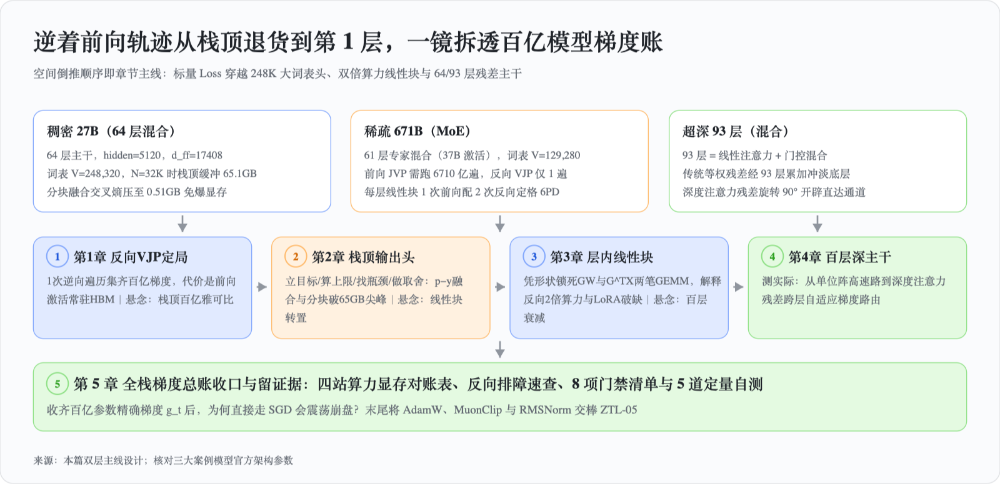
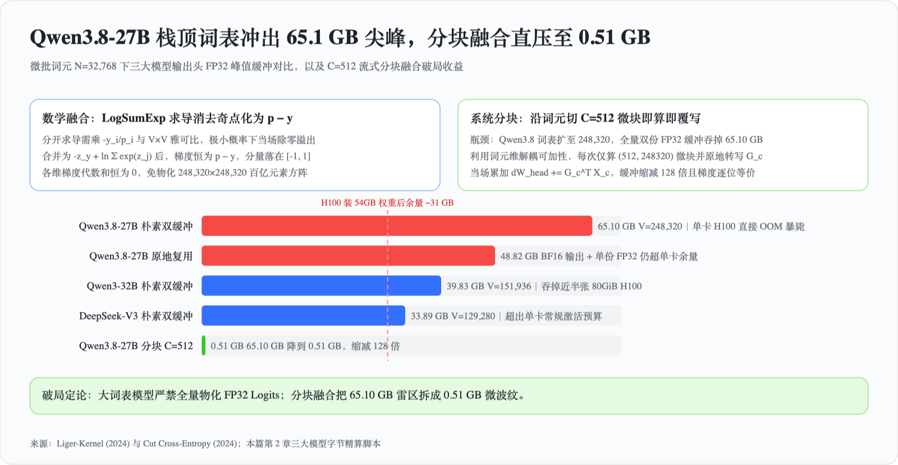
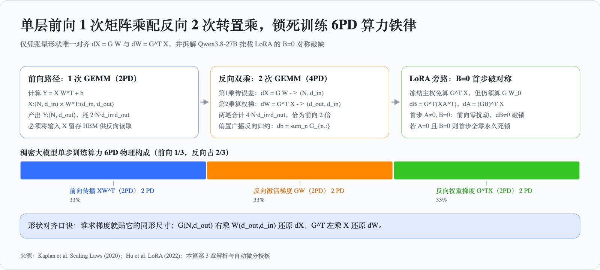
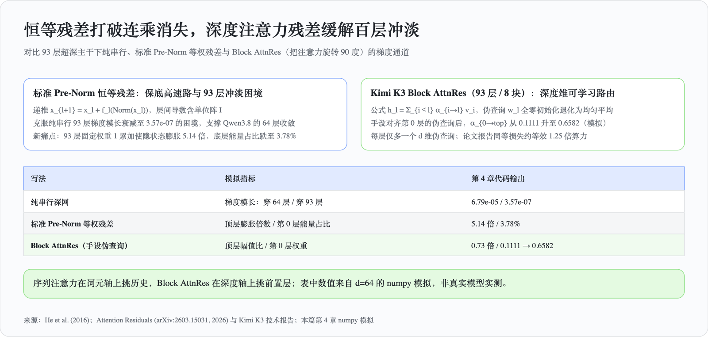
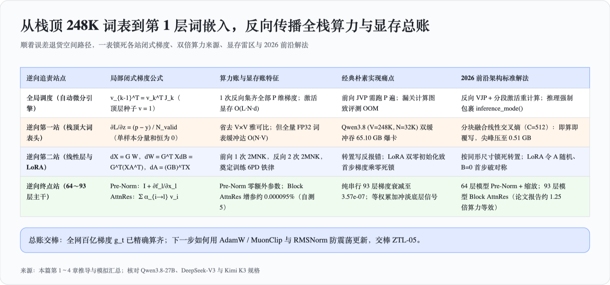

# ZTL-04｜数学｜链式法则与 softmax-交叉熵的梯度

> 🎯 **这篇文档解决什么问题**：<b>核心命题：读懂反向传播必须顺着前向轨迹倒着记账，单个标量损失逐层回传，每一层只做一次向量与雅可比的乘法。</b>输出端靠 `LogSumExp` 求导化简成极简的 `p − y`。但它在大词表模型上会触发高达 `65.10 GB` 的双缓冲尖峰。中段线性层靠两次转置矩阵乘定格反向双倍算力。
>
> 深层主干则靠恒等残差与深度注意力残差护送梯度直达底层。下文称案例模型，指稠密 27B、稀疏 671B、超深 93 层三类代表架构，统一用于图表标注与数值外推。
>
> **使用方式与先修要求**：阅读前建议先熟悉 [ZTL-01｜数学｜符号、向量与矩阵乘法](./01-matmul.md) 的矩阵转置存储约定与 [ZTL-03｜数学｜熵、交叉熵、困惑度与 KL](./03-entropy-kl.md) 的交叉熵定义。全篇顺着误差信号从模型栈顶输出头一路倒退回第 1 层词嵌入推进。第 1 章定下反向 `VJP` 调度，第 2 章拆解栈顶大词表尖峰。第 3 章厘清线性块与 `LoRA` 双倍算力，第 4 章贯通深网残差主干，第 5 章收口排障总账。规格核对于 2026 年 11 月 16 日。
>
> **动手实践**：第 2 章、第 3 章与第 4 章各配一段自包含 `Python` 验证代码。读者无需显卡即可在数秒内跑通。脚本分别复现三大前沿模型的栈顶字节账与分块融合等价性、手写 `LoRA` 反向同自动微分的误差比对，以及 93 层深网三代残差拓扑的梯度保留率实验。

<b>🧭 主线位置</b>：上一篇 [ZTL-03｜数学｜熵、交叉熵、困惑度与 KL](./03-entropy-kl.md) 定义了交叉熵损失与困惑度，在模型栈顶立下了衡量预测好坏的标量标尺。本篇紧接这枚标量损失，逆着计算图逐站拆清梯度回传的算力账与显存账。集齐百亿参数的梯度向量后，怎样靠 `AdamW`、`MuonClip` 与 `RMSNorm` 稳住参数更新，将正式移交下一篇 [ZTL-05｜数学｜优化、归一化与数值稳定](./05-optim-norm.md)。

## 导读 · 先给结论

- <b>标量损失配百亿参数决定了大模型必须采用反向向量雅可比积（VJP）。</b>前向模式（`JVP`）在某稠密旗舰或稀疏旗舰模型上需跑百亿至千亿遍前向。反向 `VJP` 从顶层标量种子倒退一遍即可拿齐全部参数梯度。代价是前向激活必须暂存高带宽显存（`HBM`）等待反向消费[[1]](https://www.nature.com/articles/323533a0)[[2]](https://jmlr.org/papers/v18/17-468.html)[[3]](https://arxiv.org/abs/2412.19437)。
- <b>栈顶 Softmax 与交叉熵融合求导化简为 p − y，却在 24.8 万词表上形成显存尖峰。</b>对数配分函数求偏导直接消去除零奇点，省去了百亿元素雅可比方阵。但某稠密 `27B` 模型（`V = 248,320`）在微批 `32,768` 词元下仍会产生 `65.10 GB` 双缓冲峰值，必须靠分块融合线性交叉熵压至 `0.51 GB`[[4]](https://pytorch.org/docs/stable/generated/torch.nn.CrossEntropyLoss.html)[[5]](https://huggingface.co/Qwen/Qwen3.8-27B/blob/main/config.json)[[6]](https://arxiv.org/abs/2410.10989)[[7]](https://arxiv.org/abs/2411.09009)。
- <b>层内线性块仅凭张量同形规则即可锁定转置方向，两笔矩阵乘定格 6PD 训练算力。</b>给定上游梯度 `G`，向下传误差算 `G W`，留本层更权算 `G^T X`，反向恰耗前向 2 倍算力。挂载 `LoRA` 时令 `B = 0`，首步即可借非零 `dB` 打破对称锁止[[8]](https://arxiv.org/abs/2001.08361)[[9]](https://arxiv.org/abs/2106.09685)。
- <b>64 至 93 层超深主干先靠单位阵保底，再靠深度注意力残差消除信号稀释。</b>标准残差求导引入单位阵 `I`，消除了连乘指数消失。某超深混合模型（93 层）进一步把注意力旋转 90 度，其 `Block AttnRes` 学习跨层路由权重，每层只多一个伪查询向量，论文报告约 `1.25` 倍算力等效[[10]](https://arxiv.org/abs/1603.05027)[[11]](https://arxiv.org/abs/2603.15031)[[12]](https://huggingface.co/moonshotai/Kimi-K3)。
- <b>梯度正确性必须经由掩码分母核对、分块等价断言与排障门禁联合兜底。</b>上线前固定有效词元归约、推理免图隔离、非对称低秩初始化与大词表流式分块四道关卡。这套组合能提前拦截九成以上的 `NaN` 溢出与显存超限故障[[4]](https://pytorch.org/docs/stable/generated/torch.nn.CrossEntropyLoss.html)[[6]](https://arxiv.org/abs/2410.10989)。

下图按反向梯度从栈顶标量损失倒推至第 1 层的推进路线，串联本篇五章因果链条与 2026 三大前沿架构锚点。



<b>📎 与系列其他文档的分工</b>：本篇专攻反向传播链式法则、词表融合梯度、线性块转置求导与跨层残差通道。矩阵乘与低秩基础见 [ZTL-01｜数学｜符号、向量与矩阵乘法](./01-matmul.md)，条件概率见 [ZTL-02｜数学｜条件概率、softmax 与采样](./02-softmax-sampling.md)，交叉熵定义见 [ZTL-03｜数学｜熵、交叉熵、困惑度与 KL](./03-entropy-kl.md)，优化器与数值稳定见 [ZTL-05｜数学｜优化、归一化与数值稳定](./05-optim-norm.md)。

在后续建模与系统篇章中，整网 `6PD` 算力与 `16Ψ` 状态总账见 [ZTL-06｜数学｜一张纸算清算力、显存与缩放](./06-compute-memory-scaling.md)。注意力内核分块搬运详见第 08 篇与 [ZTL-20｜系统｜减少注意力的内存搬运](./20-flash-attention.md)，单卡 `LoRA/QLoRA` 微调管线则在第 15 篇展开。

## 第 1 章 · 百亿参数为何必须倒着求导

走完上一篇的前向评估后，无论面对稠密旗舰模型（`270` 亿参数），还是混合专家模型（`6,710` 亿总参数），整批词元在栈顶都会收束为**唯一一个标量损失** `L`[[3]](https://arxiv.org/abs/2412.19437)[[5]](https://huggingface.co/Qwen/Qwen3.8-27B/blob/main/config.json)。优化器要想迈出下一步，就必须同时拿到损失对全网每一个参数的偏导数。直觉上顺着网络从第 1 层往第 64 层推演最自然。为什么现代框架却统一强制”倒着求导”[[1]](https://www.nature.com/articles/323533a0)[[2]](https://jmlr.org/papers/v18/17-468.html)？

### 1.1 复合计算图与多路径分叉汇合求导法则

整座大模型是一串初等可微算子首尾相接构成的有向无环计算图（`DAG`）。设某中间算子将 `n` 维输入向量 `u` 映射为 `m` 维输出向量 `v = f(u)`。该算子在局部邻域内的线性灵敏度，由形状为 `m × n` 的雅可比矩阵（`Jacobian Matrix`）完整刻画[[13]](https://www.deeplearningbook.org/contents/mlp.html)。

```math
J_f(u) = \frac{\partial v}{\partial u} \in \mathbb{R}^{m \times n}, \qquad \left[J_f(u)\right]_{i,j} = \frac{\partial v_i}{\partial u_j}
```

多层算子纵向复合时，多元微积分链式法则指出：端到端总导数等于各级局部雅可比矩阵按拓扑逆序连乘[[2]](https://jmlr.org/papers/v18/17-468.html)[[13]](https://www.deeplearningbook.org/contents/mlp.html)。真实架构里计算图还会频繁分叉。同一份层输入既走恒等残差干线，又送入注意力与门控支路，查询与键值投影也共享同一前序隐藏态。此时多变量全微分定理要求将所有下游分支传回的梯度逐项相加[[14]](https://pytorch.org/docs/stable/notes/autograd.html)。

```math
\nabla_u \mathcal{L} = \sum_{c \in \mathrm{children}(u)} J_{f_c}(u)^\top \nabla_{v^{(c)}} \mathcal{L}
```

工程口诀“前向分叉复制，反向汇合相加”，正是这条多路径求导法则在张量引擎中的精确体现。

### 1.2 前向 JVP 与反向 VJP 的百亿倍复杂度鸿沟

既然总导数是矩阵连乘 `J_K J_{K-1} ... J_1`，矩阵乘法结合律允许我们自由选择加括号的方向。恰恰是括号顺序的差异，拉开了百亿倍的算力差距[[2]](https://jmlr.org/papers/v18/17-468.html)。请观察连乘链两端的悬殊尺寸：最左端的损失输出维度只有 `m = 1`（单行向量），最右端的参数维度 `P` 却高达某稠密 `27B` 乃至某稀疏 `671B`[[3]](https://arxiv.org/abs/2412.19437)[[5]](https://huggingface.co/Qwen/Qwen3.8-27B/blob/main/config.json)。

倘若选择**从右往左加括号**，每次在输入端固定一个单位切向量 `e_i`。顺着前向依次计算 `J_1 e_i` 与 `J_2(J_1 e_i)` 直至栈顶标量。这种原语称为雅可比向量积（`JVP`），即前向模式自动微分[[2]](https://jmlr.org/papers/v18/17-468.html)。跑完一整趟前向伴随图，只能拿到 `P` 维梯度里的**单单 1 个分量**。要想集齐某稠密 `27B` 模型的全部梯度，必须循环跑满 `270` 亿次前向。哪怕单次仅耗 1 毫秒也要等 856 年。

反过来，一旦改为**从左往右（从栈顶 Loss 往底层输入）加括号**，局面随之逆转[[1]](https://www.nature.com/articles/323533a0)[[2]](https://jmlr.org/papers/v18/17-468.html)。我们从顶层标量种子 `v_K = 1` 出发，每退一步都用当前 `1` 行伴随向量左乘本层雅可比矩阵。

```math
v_{k-1}^\top = v_k^\top J_k \iff \nabla_{u_{k-1}} \mathcal{L} = J_k^\top \nabla_{u_k} \mathcal{L}
```

这种原语称为向量雅可比积（`VJP`），即反向模式自动微分[[2]](https://jmlr.org/papers/v18/17-468.html)[[14]](https://pytorch.org/docs/stable/notes/autograd.html)。由于左端始终保持 `1` 行向量，途中绝不膨胀出高维稠密方阵。**无论底层挂载 270 亿还是 6,710 亿参数，仅需逆向遍历 1 次计算图，就能一次性拿齐全部参数的精确梯度**，总浮点算力仅约为前向传播的 2 倍[[8]](https://arxiv.org/abs/2001.08361)。


下表定量对比了三类求导机制在稠密与稀疏案例模型量级下的算力与显存边界。

| **求导机制** | **矩阵括号与核心原语** | **集齐 P 维梯度遍历次数** | **前向激活显存开销** | **大模型工程定位** |
|---|---|---|---|---|
| **数值中心差分** | $`\frac{\mathcal{L}(\theta+\epsilon e_i)-\mathcal{L}(\theta-\epsilon e_i)}{2\epsilon}`$ | `2P` 次前向（某 `27B` 需 540 亿次） | `O(1)`（算完即丢） | 仅限微型算子单测校核，受截断与舍入误差夹击 |
| **前向模式 JVP** | $`J_k (J_{k-1} u)`$ （右乘切向量） | `P` 次前向（某稀疏 `671B` 需 6710 亿次） | `O(1)`（免存历史激活） | 少输入多输出灵敏度分析，百亿参数训练完全不可行 |
| **反向模式 VJP** | $`(v^\top J_k) J_{k-1}`$ （左乘伴随行） | **1 次前向 + 1 次反向**（共约 `6PD`） | <b>`O(L·N·d)`</b>（须驻留激活） | 现代神经网络训练唯一标配，用显存驻留换百亿倍提速 |

### 1.3 前向激活为何必须常驻 HBM

反向 `VJP` 省下的百亿次遍历，是用**前向激活显存驻留**换来的[[14]](https://pytorch.org/docs/stable/notes/autograd.html)。考察含参算子 `Y = f(X, W)`。倒退回第 `l` 层计算权重梯度时，局部雅可比算子几乎总是显式依赖前向走过时的输入激活 `X`。例如标量乘法门 `y = x · w`，对输入求导得 `w`，对权重求导却等于前向输入 `x`。`SwiGLU` 门控、`RMSNorm` 均方根倒数及注意力状态同样如此[[13]](https://www.deeplearningbook.org/contents/mlp.html)[[14]](https://pytorch.org/docs/stable/notes/autograd.html)。

这直接划出了推理与训练的显存分水岭。纯推理只需一路向前，第 1 层算完交给第 2 层即可原地覆盖释放，峰值缓冲仅占单层大小。

训练期却完全不同。从第 1 层推进到第 64 层时，沿途每一层的中间激活都必须暂存在 `GPU HBM` 里。直到反向回传算完该层权重梯度后，显存才能回收[[14]](https://pytorch.org/docs/stable/notes/autograd.html)。当序列拉长到 `32K` 至 `256K` 时，驻留激活会迅速超过权重本身。工程上常开启激活重计算（`Activation Checkpointing`）。它仅存层边界检查点并在反向时局部重算前向，以约 `33%` 额外算力换回显存空间[[8]](https://arxiv.org/abs/2001.08361)。

> 💡 **常见误区**：验证循环只写 `model.eval()` 却漏加免求导上下文，导致长序列评测频发显存溢出（`OOM`）。**现象**：验证阶段本不更新参数，显存占用却与训练期几乎一样高。**根因**：`model.eval()` 仅关闭 `Dropout` 等开关，不会通知 `autograd` 停止录制计算图，全部 64 层前向激活仍被扣留在 `HBM` 中[[14]](https://pytorch.org/docs/stable/notes/autograd.html)。**改法**：不调用 `backward()` 的代码外层一律包裹 `torch.inference_mode()`。

> 🔑 **本章要点与回到主线**：百亿参数映射至单一标量损失的漏斗形状，决定了大模型必须用反向 `VJP` 倒着求导。它以各层前向激活常驻 `HBM` 为代价，换取一次遍历收齐全部梯度的算力红利。但新的矛盾随之浮现：梯度倒退遇到的第一道关卡就是栈顶词表输出层，面对 `Qwen3.8-27B` 高达 `248,320` 维耦合的 `Softmax` 分母，难道真要物化百亿元素的雅可比方阵才能算出第一棒梯度？这正是第 2 章的核心议题。

## 第 2 章 · 栈顶词表的 p − y 融合梯度

顺着反向 `VJP` 从栈顶标量损失退回第一步，首先遇到词表输出层（`LM Head`）。大词表模型中，末层隐藏向量右乘词表矩阵，输出数万维未归一化打分 `z`。它随后经 `Softmax` 化为预测概率，并与目标分布计算交叉熵[[4]](https://pytorch.org/docs/stable/generated/torch.nn.CrossEntropyLoss.html)。若把两步拆开独立求导，单词元的局部雅可比方阵元素数可达百亿。即便代数上消掉方阵，大词表在长序列微批下仍会产生冲破单卡的显存尖峰[[6]](https://arxiv.org/abs/2410.10989)[[7]](https://arxiv.org/abs/2411.09009)。

### 2.1 双路径导出 p − y 融合梯度与三维手算推演

我们先在代数层面消去百亿元素的雅可比方阵。设词表大小为 `V`，第 `i` 维预测概率定义为 $`p_i = \exp(z_i) / \sum_j \exp(z_j)`$，目标分布 `y` 各维之和等于 `1`（单热监督下真值位取 `1`，其余位取 `0`）。

<b>路径一（对数配分函数直接求导）</b>。求导前先把 $`p_k`$ 代入交叉熵，利用对数商法则拆开分子与对数配分函数（`LogSumExp`）。先取指数再取对数的冗余操作当场抵消[[4]](https://pytorch.org/docs/stable/generated/torch.nn.CrossEntropyLoss.html)[[13]](https://www.deeplearningbook.org/contents/mlp.html)。

```math
\mathcal{L}(z) = -\sum_{k=1}^V y_k z_k + \ln \sum_{j=1}^V \exp(z_j)
```

直接对任意第 `i` 维打分 `z_i` 求偏导，前一项只留 $`-y_i`$，后一项恰好还原出预测概率 $`p_i`$。写成向量形式，便得到简练的核心恒等式 $`\frac{\partial \mathcal{L}}{\partial z} = p - y`$ [[4]](https://pytorch.org/docs/stable/generated/torch.nn.CrossEntropyLoss.html)。

<b>路径二（Softmax 雅可比链式相乘核验）</b>。当 `Softmax` 出现在注意力内部时，仍需调用它自身的雅可比矩阵。按商法则求导：对角元为 $`p_i(1 - p_i)`$，非对角元为 $`-p_k p_i`$，合并即得对称半正定阵 $`\mathrm{diag}(p) - p p^\top`$[[13]](https://www.deeplearningbook.org/contents/mlp.html)。外层交叉熵对概率的偏导为 $`-y_k / p_k`$，分母嵌着易除零溢出的奇点 $`1/p_k`$。将两级导数链式相乘求和，奇异因子 $`p_k`$ 在分子分母间精确约消：

```math
\frac{\partial \mathcal{L}}{\partial z_i} = \sum_{k=1}^V \left(-\frac{y_k}{p_k}\right) p_k(\delta_{ki} - p_i) = -\sum_{k=1}^V y_k \delta_{ki} + p_i \sum_{k=1}^V y_k = p_i - y_i
```

拿三维小例（`V = 3`）手算即可看清物理含义。设 `z = [2.0, 1.0, 0.0]`，真值为 `y = [1, 0, 0]`。预测概率算得 `[0.6652, 0.2447, 0.0900]`，单词损失为 `0.4076` 奈特。反向梯度由 $`p - y`$ 直接作差，结果为 `[-0.3348, +0.2447, +0.0900]`。

这组数字体现了三条关键性质：真值位梯度恒负（更新时拉高），干扰位按概率份额正向压低。单维幅度严格有界于 `[-1, 1]`，盲猜概率趋零时梯度趋近 `-1` 而不爆炸。同时<b>单样本各维梯度代数和恒等于 `0`</b>，与平移不变性互为对偶[[13]](https://www.deeplearningbook.org/contents/mlp.html)。

> 💡 **常见误区**：手写损失时漏除有效词元数 `N_valid`，或把 $`p - y`$ 硬套到注意力层的 `Softmax` 反向中。**现象**：短回答样本的梯度范数增大数十倍，自定义注意力反向单测报错。**根因**：`F.cross_entropy` 默认对非 `-100` 位求均值，单位置回传梯度是 `(p - y) / N_valid`。注意力矩阵下游接线性乘积 `PV`，必须走通用行归约公式[[4]](https://pytorch.org/docs/stable/generated/torch.nn.CrossEntropyLoss.html)。**改法**：按全局有效词元数归约，区分末端融合与中段加权。

### 2.2 立目标、算上限、找瓶颈

代数上省去了雅可比方阵，系统上就能高枕无忧吗？我们锚定单张 `NVIDIA H100 SXM5 80 GiB`（约 `85.9 GB`，装入 `Qwen3.8-27B` 的 `54 GB` 权重后仅剩约 `31 GB` 余量），算清栈顶显存账单[[5]](https://huggingface.co/Qwen/Qwen3.8-27B/blob/main/config.json)[[15]](https://resources.nvidia.com/en-us-tensor-core/nvidia-tensor-core-gpu-datasheet)。

先**立目标**：在单卡长序列微调场景下，设微批总词元数 `N = 32,768`，要求栈顶输出头的瞬时词表缓冲压制在 <b>`1.0 GB` 以内</b>且梯度零精度损失。接着**算上限**：末层隐藏态 `X` 形状仅为 `(32,768, 5,120)`，`BF16` 仅占 `0.34 GB`。但大词表案例模型（词表 24 万～25 万）的完整词表张量可膨胀至 `81` 亿元素量级：

- <b>单份 FP32 词表体量庞大。</b>为防 `24.8` 万项指数累加下溢，混合精度规范强制升格为 `FP32`（`4 B`）计算 `LogSumExp` 与 `p − y`，单张 `FP32` 词表张量就高达 `32.55 GB`。
- <b>双缓冲直接冲破 80 GiB 单卡。</b>朴素非原地路径同时持有 `FP32 logits` 与 `FP32` 梯度缓冲，瞬间占用 <b>`65.10 GB`</b>（原地覆写仍达 <b>`48.82 GB`</b>）。同微批下其他案例模型双缓冲从 `33 GB` 至 `40 GB` 不等[[3]](https://arxiv.org/abs/2412.19437)[[16]](https://arxiv.org/abs/2505.09388)。大词表案例模型的尖峰远超 `H100` 剩余的 `31 GB`，首步即会触发 `OOM`。

紧接着**找瓶颈**：为什么 `0.34 GB` 的隐藏态一进输出头就膨胀到 `65.10 GB`？根源在于朴素代码先把全部词元的词表打分全量物化在 `HBM` 里才启动求导[[6]](https://arxiv.org/abs/2410.10989)[[7]](https://arxiv.org/abs/2411.09009)。审视交叉熵与词表头权重梯度的代数结构，它们沿词元轴天然具备**分块解耦可加性**：

```math
\mathcal{L} = \frac{1}{N}\sum_{c=1}^{M} \sum_{n \in \mathcal{B}_c} \mathcal{L}_n, \qquad \nabla_{W_{\mathrm{head}}} \mathcal{L} = \sum_{c=1}^{M} G_c^\top X_c
```

第 `n` 个词元的 `p_n − y_n` 只依赖第 `n` 行隐藏向量，与其他词元不存在交叉耦合。



### 2.3 做取舍：分块融合线性交叉熵

看清解耦结构后，我们执行**做取舍**，引入分块融合线性交叉熵（代表实现为 `Liger-Kernel` 与 `Cut Cross-Entropy`）[[6]](https://arxiv.org/abs/2410.10989)[[7]](https://arxiv.org/abs/2411.09009)。将 `32,768` 个词元切成 `64` 个微块（每块 `C = 512`），在内核里流式循环。

每次仅对微块 `X_c` 算出局部 `FP32` 缓冲 `(512, 248320)`，体积仅 <b>`0.51 GB`</b>。当场累加损失并将缓冲原地覆写为局部梯度 `G_c`。接着算出 `dX_c = G_c W_head` 并把 `G_c^T X_c` 累加进 `dW_head`，随即复用这 `0.51 GB` 缓冲处理下一微块。

这笔取舍将峰值词表缓冲从 `65.10 GB` 骤降至 `0.51 GB`（缩减 <b>`128` 倍</b>），同时省去了逾百 GB 张量的 `HBM` 往返搬运。案例模型族群在 `N = 32,768` 下的栈顶显存账单对比如下。

| **模型与栈顶执行方案** | **词表大小 V** | **朴素双份 FP32 缓冲** | **BF16+FP32 原地复用** | **单卡 80GiB H100 工程后果** |
|---|---|---|---|---|
| <b>DeepSeek-V3（朴素全量）</b> | `129,280` | `33.89 GB` | `25.42 GB` | 单点吞噬逾三成显存，严重挤压专家并行通信缓冲 |
| <b>Qwen3-32B（朴素全量）</b> | `151,936` | `39.83 GB` | `29.87 GB` | 加上 65.5 GB 权重后超单卡限制，长序列微调难以进行 |
| <b>Qwen3.8-27B（朴素全量）</b> | <b>`248,320`</b> | <b>`65.10 GB`</b> | <b>`48.82 GB`</b> | 远超装入 54 GB 权重后剩余的 31 GB，栈顶当场 OOM |
| <b>Qwen3.8-27B + 分块融合（C=512）</b> | <b>`248,320`</b> | <b>`0.51 GB`（单块复用）</b> | <b>`0.51 GB`</b> | **稳压在 &lt; 1.0 GB 红线内**，梯度与全量路径逐位等价 |

下方代码同时验算三大模型的字节账，并核验分块流式覆写与全量物化路径在损失、`dX` 与 `dW` 上的数值等价性[[6]](https://arxiv.org/abs/2410.10989)[[7]](https://arxiv.org/abs/2411.09009)。

*验算三大模型栈顶词表显存尖峰，并核验分块融合线性交叉熵（Fused Chunked Linear-CE）与全量物化的梯度等价性*

```python
import numpy as np

# 1. 三大案例模型在微批词元 N=32,768 下的栈顶输出头缓冲字节精算 (GB = 10^9 B)
N_tok = 32768
for name, V in [("稀疏 671B", 129280), ("稠密 32B", 151936), ("稠密 27B", 248320)]:
    dual_gb = 2 * N_tok * V * 4 / 1e9          # FP32 logits + FP32 (p - y) 梯度双缓冲
    inplace_gb = N_tok * V * (2 + 4) / 1e9     # BF16 logits + 单份 FP32 原地缓冲
    print(f"{name:11s} (V={V}): dual_FP32={dual_gb:.2f} GB | BF16+FP32_inplace={inplace_gb:.2f} GB")
chunk_gb = 512 * 248320 * 4 / 1e9
print(f"Qwen3.8-27B Fused Chunked (C=512): {chunk_gb:.2f} GB (直降 {65.0956 / chunk_gb:.0f} 倍!)")

# 2. 验证分块融合流式覆写 (仅分配 C×V 缓冲) 与全量物化路径的损失及梯度等价性
rng = np.random.default_rng(2026)
N, d, V, C = 128, 64, 512, 32
X = rng.standard_normal((N, d)).astype(np.float32)
W = (rng.standard_normal((V, d)) * 0.05).astype(np.float32)
y = rng.integers(0, V, size=N)

Z = X @ W.T
m = Z.max(axis=1, keepdims=True)
lse = m + np.log(np.exp(Z - m).sum(axis=1, keepdims=True))
loss_ref = float((-Z[np.arange(N), y] + lse[:, 0]).mean())
G = np.exp(Z - lse); G[np.arange(N), y] -= 1.0; G /= N
dX_ref, dW_ref = G @ W, G.T @ X

loss_sum, dX_chk, dW_chk = 0.0, np.empty_like(X), np.zeros_like(W)
for s in range(0, N, C):
    e = min(s + C, N)
    xc, yc = X[s:e], y[s:e]
    buf = xc @ W.T                                          # 任意时刻仅物化 (C, V) 微块缓冲
    mc = buf.max(axis=1, keepdims=True)
    lsec = mc + np.log(np.exp(buf - mc).sum(axis=1, keepdims=True))
    loss_sum += float((-buf[np.arange(e - s), yc] + lsec[:, 0]).sum())
    np.exp(buf - lsec, out=buf)                             # 原地转写 p_c，零额外大张量分配
    buf[np.arange(e - s), yc] -= 1.0; buf /= N              # 原地写为 (p_c - y_c) / N
    dX_chk[s:e] = buf @ W
    dW_chk += buf.T @ xc

print(f"Max diff | loss={abs(loss_sum/N - loss_ref):.2e}, dX={np.max(np.abs(dX_chk - dX_ref)):.2e}, dW={np.max(np.abs(dW_chk - dW_ref)):.2e}")
assert abs(loss_sum / N - loss_ref) < 1e-6 and np.max(np.abs(dW_chk - dW_ref)) < 1e-7
```

*输出*

```text
稀疏 671B     (V=129280): dual_FP32=33.89 GB | BF16+FP32_inplace=25.42 GB
稠密 32B      (V=151936): dual_FP32=39.83 GB | BF16+FP32_inplace=29.87 GB
稠密 27B      (V=248320): dual_FP32=65.10 GB | BF16+FP32_inplace=48.82 GB
Qwen3.8-27B Fused Chunked (C=512): 0.51 GB (直降 128 倍!)
Max diff | loss=1.19e-07, dX=0.00e+00, dW=1.49e-08
```

逐段跟读上方微块循环，便能拆清工业算子省下百倍显存的底层手法。循环体内每次仅切片 `C = 32` 行隐藏态算出微块缓冲 `buf`。算完局部损失后，代码立刻调 `np.exp(buf - lsec, out=buf)` 原地覆写为概率，再减去真值标签。

紧接着趁这块 `buf` 尚在高速缓存中，当场完成 `dX_chk` 写回与 `dW_chk` 累加。下一轮循环直接覆盖同一块内存。最终输出证实：峰值缓冲砍掉 `128` 倍的同时，激活梯度误差为零，权重梯度误差仅 `1.49e-08`。

> 🔑 **本章要点与回到主线**：栈顶第一站靠 `LogSumExp` 融合求导化简为有界零和的 `p − y`，再借分块融合线性交叉熵把 `Qwen3.8-27B` 的 `65.10 GB` 显存峰值压至 `0.51 GB`，让上游梯度顺利传入主干。但新的矛盾随之浮现：接下来梯度要连续穿过成百上千块 `nn.Linear` 与 `LoRA` 旁路。怎样仅凭张量形状就锁定每个权重的转置方向，以及为什么反向算力恰好是前向的 2 倍？这正是第 3 章要解答的问题。

## 第 3 章 · 层内线性与低秩的双倍算力

消除栈顶大词表的显存尖峰后，上游梯度 `G` 顺着主干继续回传，进入占稠密模型权重 `98%` 以上的线性投影层与 `LoRA` 低秩适配器[[5]](https://huggingface.co/Qwen/Qwen3.8-27B/blob/main/config.json)[[9]](https://arxiv.org/abs/2106.09685)。在某 64 层案例模型内部，无论是 `GDN` 投影、`GQA` 查询键值矩阵，还是 `SwiGLU` 三块门控投影，底层全是 `nn.Linear`。面对矩阵对矩阵求导，只要握住**梯度张量必与原变量同形**这一条准则，所有转置方向都能唯一锁定[[13]](https://www.deeplearningbook.org/contents/mlp.html)。

### 3.1 形状对齐与两笔转置矩阵乘

沿用 `PyTorch nn.Linear(d_in, d_out)` 的存储契约（见 [ZTL-01｜数学｜符号、向量与矩阵乘法](./01-matmul.md)），设微批总词元数为 `N`。本层输入激活 `X` 形状为 `(N, d_in)`，权重矩阵 `W` 形状为 `(d_out, d_in)`，偏置 `b` 形状为 `(d_out,)`。前向映射写作 $`Y = X W^\top + b`$ 。

上游传回关于 `Y` 的梯度矩阵 `G`，形状必与 `Y` 全等，即 `(N, d_out)`。由标量微分的迹恒等式 `dL = tr(G^T dY)` 与迹的循环置换性质 `tr(AB) = tr(BA)`，三路梯度闭式解随之确定[[13]](https://www.deeplearningbook.org/contents/mlp.html)：

```math
\nabla_X \mathcal{L} = G W, \qquad \nabla_W \mathcal{L} = G^\top X, \qquad \nabla_b \mathcal{L} = \sum_{n=1}^N G_{n,:}
```

实战中无需每次重推迹代数，仅凭**内维消去、外维拼回原形状**即可完成核验：

- <b>向下传误差（激活梯度）。</b>目标是拼回 `X` 的形状 `(N, d_in)`。手头 `G` 是 `(N, d_out)`，`W` 是 `(d_out, d_in)`，唯有直接计算 $`\nabla_X \mathcal{L} = G W`$ 才能消去内维 `d_out` 并输出 `(N, d_in)` 传给浅层。
- <b>留本层更权（权重梯度）。</b>目标是拼回 `W` 的形状 `(d_out, d_in)`。必须把 `G` 转置成 `(d_out, N)`，再右乘驻留在 `HBM` 里的前向激活 `X(N, d_in)`，消去词元维 `N` 得到 $`\nabla_W \mathcal{L} = G^\top X`$ 。
- <b>偏置归约（偏置梯度）。</b>前向把一维偏置广播给了 `N` 行词元，按分叉汇合相加准则，反向必沿词元轴 `N` 求和归约为 `(d_out,)`[[14]](https://pytorch.org/docs/stable/notes/autograd.html)。

用极简二阶切片手算一次，就能把形状配平刻进直觉。设单样本输入为 `X = [[1, 2]]`（形状 `1 × 2`），权重为 `W = [[3, 4], [5, 6]]`（形状 `2 × 2`），上游传回梯度为 `G = [[0.5, -0.5]]`（形状 `1 × 2`）。向下传误差算 `G @ W` 得 `[[-1.0, -1.0]]`，恰与 `X` 同为 `1 × 2`。求权重梯度算 `G.T @ X`，则是列向量 `(2, 1)` 右乘行向量 `(1, 2)` 得外积 `[[0.5, 1.0], [-0.5, -1.0]]`，恰与 `W` 同为 `2 × 2`。

代入某案例模型的 `gate_proj` 层验算真实规模：输入维 `d_in = 5,120`，输出维 `d_out = 17,408`，权重形状为 `(17408, 5120)`[[5]](https://huggingface.co/Qwen/Qwen3.8-27B/blob/main/config.json)。当 `N = 4,096` 时，前向算 `X W^T` 执行 **1 次**通用矩阵乘（`GEMM`），耗费约 `730 GFLOPs`。

反向时既要算 `G W` 往下传误差（`730 GFLOPs`），又要算 `G^T X` 求本层权重梯度（再耗 `730 GFLOPs`），共执行 <b>2 次等规模 `GEMM`</b>（合计 `1,460 GFLOPs`）。由于全网每个参数在每词元上前向贡献 `2` 次浮点运算、反向贡献 `4` 次，缩放定律中<b>单步训练算力 `6PD = 2PD + 4PD`（反向恒为前向两倍）</b>的物理规律由此确立[[8]](https://arxiv.org/abs/2001.08361)。



### 3.2 LoRA 低秩旁路梯度与 B = 0 零初始化对称破缺

对某案例模型挂载低秩适应（`LoRA`，$`\Delta W = BA`$ ）时，梯度流又如何传递[[5]](https://huggingface.co/Qwen/Qwen3.8-27B/blob/main/config.json)[[9]](https://arxiv.org/abs/2106.09685)？`LoRA` 冻结主权重 `W_0`，仅并联降维阵 `A(r, d_in)` 与升维阵 `B(d_out, r)`。记低秩中间态 `H = X A^T`。向下传误差的激活梯度为 `dX = G W_0 + (G B) A`。尽管 `W_0` 已冻结免算 `G^T X`，**反向主干的 `G W_0` 矩阵乘一步也不能省**，否则顶层误差无法传到浅层的 `LoRA` 模块。按同形法则写出两块低秩矩阵的梯度[[9]](https://arxiv.org/abs/2106.09685)：

```math
\nabla_B \mathcal{L} = G^\top (X A^\top) = G^\top H, \qquad \nabla_A \mathcal{L} = (G B)^\top X
```

这组公式直接解释了 `LoRA` 初始化的对称破缺设计[[9]](https://arxiv.org/abs/2106.09685)。为保证微调起点与原基座输出一致（`B A = 0`），规范要求”`A` 高斯随机初始化、`B = 0` 全零初始化”，严禁把 `A` 与 `B` 同时置零。

代入首步公式即可看清原因。若 `A = 0` 且 `B = 0`，则 `H = 0` 且 `G B = 0`。首步两项梯度全为零，参数将永久停留在零点。改用 $`A \neq 0`$ 且 `B = 0` 时，前向增量依然为零。首步反向因 $`H \neq 0`$ 而拿到非零的升维阵梯度，降维阵梯度暂为零。首步更新先把 `B` 推离零点，第 2 步起双因子便同步激活更新。

阅读下方对比表时，请特别留意末行最后一列暴露的显存盲点。即便冻结了主权重免算 `dW`，求解降维阵梯度 $`\nabla_A \mathcal{L} = (G B)^\top X`$ 依然显式右乘了完整输入激活 `X`。这意味着开启 `LoRA` 只砍掉了优化器状态，却省不掉驻留 `HBM` 的高维前向激活。

| **求导对象** | **闭式转置表达式** | **张量形状** | **反向乘加算力** | **HBM 必存依赖项** |
|---|---|---|---|---|
| **主干输入激活 X** | $`\nabla_X \mathcal{L} = G W_0 + (GB)A`$ | `(N, d_in)` | `2 N d_in d_out + O(Nr)` | 只读主权重 `W_0` 与 `A, B` |
| **全参主权重 W** | $`\nabla_W \mathcal{L} = G^\top X`$ | `(d_out, d_in)` | `2 N d_in d_out`（`LoRA` 免算） | <b>前向高维激活 `X`</b> |
| **LoRA 升维阵 B** | $`\nabla_B \mathcal{L} = G^\top (X A^\top)`$ | `(d_out, r)` | `2 N d_out r`（首步非零破锁） | 窄中间态 `H = X A^T` |
| **LoRA 降维阵 A** | $`\nabla_A \mathcal{L} = (G B)^\top X`$ | `(r, d_in)` | `2 N (d_out + d_in) r` | <b>仍须驻留前向激活 `X`</b> |

> 💡 **常见误区**：误以为给某大模型开启 `LoRA` 后显存就降到纯推理水平，或把 `A` 与 `B` 同时置零。**现象**：`r=16` 优化器状态仅占 `1.68 GB`，拉到 `64K` 长序列却照样爆显存，或训练上千步损失不降。**根因**：计算 `dA = (GB)^T X` 及注意力反向仍须缓存全网前向激活 `X`，双零初始化则令首步梯度互乘归零[[9]](https://arxiv.org/abs/2106.09685)[[14]](https://pytorch.org/docs/stable/notes/autograd.html)。**改法**：长窗微调照常开启梯度检查点与分块交叉熵，严守 `A` 随机、`B` 全零。

### 3.3 手写 NumPy 反向与自动微分误差校核

下方代码手写 `Linear + LoRA + Softmax-CE` 全套反向传播。它先复核首步 `B = 0` 时的非对称梯度破缺，再与 `torch.autograd` 比对第 2 步五路梯度的最大误差[[9]](https://arxiv.org/abs/2106.09685)[[14]](https://pytorch.org/docs/stable/notes/autograd.html)。

*手写线性层与 LoRA 反向梯度：验证 B=0 首步对称破缺，并与自动微分校核误差（< 1e-7）*

```python
import numpy as np

rng = np.random.default_rng(42)
N, d_in, d_out, r = 8, 16, 12, 4
X = rng.standard_normal((N, d_in)).astype(np.float32)
W = (rng.standard_normal((d_out, d_in)) * 0.1).astype(np.float32)
b = np.zeros(d_out, dtype=np.float32)
A = (rng.standard_normal((r, d_in)) * 0.1).astype(np.float32)
targets = rng.integers(0, d_out, size=N)

def manual_bwd(X, W, b, A, B, targets):
    H = X @ A.T                                           # (N, r) 低秩中间态
    Z = X @ W.T + H @ B.T + b                             # (N, d_out)
    Zs = Z - Z.max(axis=1, keepdims=True)
    P = np.exp(Zs) / np.exp(Zs).sum(axis=1, keepdims=True)
    G = (P - np.eye(d_out, dtype=X.dtype)[targets]) / N   # 栈顶传入 (p - y) / N
    dX = G @ W + (G @ B) @ A                              # 激活梯度 (N, d_in)
    dW, db = G.T @ X, G.sum(axis=0)                       # 权重与偏置梯度
    dB, dA = G.T @ H, (G @ B).T @ X                       # LoRA 双因子梯度
    return [v.astype(np.float32) for v in (dX, dW, db, dA, dB)]

# 1. 验证首步 B=0 初始化：dB 显著非零打破死锁，dA 严格为 0
print(f"Parameters: N={N}, d_in={d_in}, d_out={d_out}, r={r}")
_, _, _, dA1, dB1 = manual_bwd(X, W, b, A, np.zeros((d_out, r), np.float32), targets)
print(f"Step 1 (B=0): ||dB||_2 = {np.linalg.norm(dB1):.6f}, ||dA||_2 = {np.linalg.norm(dA1):.6f}")

# 2. 验证第 2 步 B!=0：与 torch.autograd (或 FP64 中心差分) 逐项比对最大绝对误差
B2 = (rng.standard_normal((d_out, r)) * 0.05).astype(np.float32)
grads_m = manual_bwd(X, W, b, A, B2, targets)
try:
    import torch, torch.nn.functional as F
    xt, wt, bt, at, b2t = [torch.tensor(v, requires_grad=True) for v in (X, W, b, A, B2)]
    F.cross_entropy(xt @ (wt + b2t @ at).T + bt, torch.tensor(targets)).backward()
    refs = [t.grad.numpy() for t in (xt, wt, bt, at, b2t)]
except ImportError:
    p64 = [v.astype(np.float64) for v in (X, W, b, A, B2)]
    def loss64():
        x_, w_, b_, a_, b2_ = p64
        z = x_ @ (w_ + b2_ @ a_).T + b_
        m = z.max(axis=1, keepdims=True)
        return float((-z[np.arange(N), targets] + m[:, 0] + np.log(np.exp(z - m).sum(axis=1))).mean())
    refs, eps = [], 1e-6
    for arr in p64:
        g = np.zeros_like(arr)
        for idx in np.ndindex(arr.shape):
            orig = arr[idx]; arr[idx] = orig + eps; lp = loss64()
            arr[idx] = orig - eps; lm = loss64(); arr[idx] = orig
            g[idx] = (lp - lm) / (2 * eps)
        refs.append(g.astype(np.float32))

max_err = max(np.max(np.abs(m - r_)) for m, r_ in zip(grads_m, refs))
print(f"Step 2 max abs error across (dX, dW, db, dA, dB): {max_err:.2e}")
assert max_err < 1e-7
```

*输出*

```text
Parameters: N=8, d_in=16, d_out=12, r=4
Step 1 (B=0): ||dB||_2 = 0.193164, ||dA||_2 = 0.000000
Step 2 max abs error across (dX, dW, db, dA, dB): 1.49e-08
```

逐段复盘上方手写反向代码，正好把两节理论闭环验实。在 `manual_bwd` 内部，`G = (P - eye[targets]) / N` 接过栈顶融合梯度后，仅用 `G @ W + (G @ B) @ A` 与两行转置外积便集齐了全部五路偏导，全程未构造任何四维雅可比张量。

看首步输出：传入全零阵 `B` 时，`||dB||_2 = 0.193164` 率先拿到非零梯度破除对称死锁，而 `||dA||_2` 精确等于 `0.000000`。进入第 2 步 `B2` 非零后，五路手写梯度与自动微分逐元素比对的最大绝对误差仅为 `1.49e-08`，达到单精度浮点机器极限。

> 🔑 **本章要点与回到主线**：单层内部凭同形规则锁定了 `dX = G W` 与 `dW = G^T X` 两笔转置矩阵乘，确立了反向双倍算力（`4PD` 对前向 `2PD`）与 `LoRA` 零初始化破缺机制。但新的矛盾随之浮现：当激活梯度要一路穿过 `Qwen3.8-27B` 的 64 层甚至 `Kimi K3` 的 **93 层**超深主干时，纯矩阵连乘会指数级消失，而传统等权残差在近百层深度下又会冲淡第 1 层信号。现代超深架构怎样护送梯度直达底层？这正是第 4 章的焦点。

## 第 4 章 · 百层深网的残差梯度护送

单层求导算得再准，一旦把几十乃至近百个模块纵向串起来，反向梯度马上要面临长距离衰减挑战。稠密模型堆叠 64～70 层，新型超深架构甚至推进到 90～100 层。为什么早年纯串行深网过不了 20 层就梯度消失？为什么标准等权残差在超深度下会出现信号稀释，进而催生深度注意力残差（`AttnRes`）[[10]](https://arxiv.org/abs/1603.05027)[[11]](https://arxiv.org/abs/2603.15031)？

### 4.1 纯串行连乘崩溃与标准 Pre-Norm 单位阵高速路

先看无跳跃支路的纯串行网络 `x_{l+1} = f_l(x_l)`。按链式法则，栈顶对第 0 层词嵌入的总导数是局部雅可比矩阵的纯连乘[[13]](https://www.deeplearningbook.org/contents/mlp.html)。矩阵连乘对奇异值高度敏感。哪怕每层奇异值仅取温和的 `0.85`，穿过 64 层后幅度就跌至 `3.0e-5`。穿过 93 层更跌至 `2.7e-7`，底层几乎收不到更新信号。反之若单层奇异值取 `1.15`，93 层连乘立刻放大 `44` 万倍冲破浮点上限。

标准前置归一化残差（`Pre-Norm Residual`）用一笔加法 $`x_{l+1} = x_l + f_l(x_l)`$ 化解了连乘消失问题[[10]](https://arxiv.org/abs/1603.05027)[[17]](https://arxiv.org/abs/2002.04745)。它将每步归一化收进支路内部，令主干保持恒等相加。从第 `l` 层一路累加至顶层 `L` 再对 `x_l` 求偏导，可得如下分解式：

```math
\frac{\partial \mathcal{L}}{\partial x_l} = \frac{\partial \mathcal{L}}{\partial x_L}\!\left(I + \frac{\partial}{\partial x_l}\sum_{k=l}^{L-1} f_k(x_k)\right)
```

括号首项是一张与权重无关的<b>单位矩阵 $`I`$</b> 。它在计算图侧边建立了一条无损耗的梯度高速路（`Gradient Highway`）。即便部分支路导数趋零，栈顶误差仍能沿单位阵以 `1:1` 保真度直达第 1 层[[10]](https://arxiv.org/abs/1603.05027)。传统 64 层架构中，配合支路末尾矩阵按 `1 / sqrt(2L)` 缩放初始标准差，即可抑制前向方差膨胀[[17]](https://arxiv.org/abs/2002.04745)。

然而当模型推深至 90～100 层时，标准残差”固定以权重 `1` 等权相加”的短板随之显现[[11]](https://arxiv.org/abs/2603.15031)。经过大量同权叠加后，底层的词法锚点被后续层输出明显**冲淡稀释**。其相对能量占比跌至个位数百分比。同时残差流总幅值随深度持续增长，影响了跨层梯度的均匀性[[11]](https://arxiv.org/abs/2603.15031)。

### 4.2 深度注意力残差的跨层梯度路由

怎样既保住跨层直连高速路，又消除百层同权累加的信号稀释？`Attention Residuals` 指出：**模型的深度轴与序列的时间轴在代数上同构**[[11]](https://arxiv.org/abs/2603.15031)。只要<b>“把注意力旋转 90 度”</b>立到深度方向上，将固定权重 `1` 升级为可学习的跨层路由，稀释与膨胀问题便迎刃而解[[11]](https://arxiv.org/abs/2603.15031)：

```math
\alpha_{i \to l} = \frac{\exp\!\left(w_l^\top \phi(v_i)\right)}{\sum_{j \lt l} \exp\!\left(w_l^\top \phi(v_j)\right)}, \qquad \phi(v_i) = \mathrm{RMSNorm}(v_i)
```

式中 $`v_i`$ 是前置块输出的值向量，$`\phi(v_i)`$ 充当消除幅值偏置的归一化键，$`w_l`$ 则是目标层独有的可学习**伪查询向量**[[11]](https://arxiv.org/abs/2603.15031)。这套设计具备三项关键性质：

- <b>伪查询全零初始化保平稳起步。</b>训练第 0 步令 `w_l = 0`，所有内积为零，路由权重退化为均匀平均 `1/l`。凸组合系数和恒为 `1`，从源头上消除了隐状态幅值随深度膨胀。
- <b>反向动态开辟直达梯度通道。</b>对前置块 $`v_i`$ 求偏导时，主干直接传回 $`\alpha_{i \to l} \nabla_{h_l} \mathcal{L}`$。一旦顶层损失需要底层词元细节，优化器便会自动抬高 $`\alpha_{0 \to l}`$，为底层打开直达顶层的高权重梯度通道。
- <b>分块折中（Block AttnRes）兼顾超深显存。</b>将模型切为多个大块。块内走标准残差求和，块间做深度注意力路由[[11]](https://arxiv.org/abs/2603.15031)。**每层只多一个 $`d`$ 维伪查询向量；论文报告推理延迟开销低于 `2%`，在缩放实验中达到与多花 `1.25` 倍算力的基线相同的损失**（论文实验在 48B 规模的 Kimi Linear 与一组缩放律模型上完成）。

> 💡 **常见误区**：把深度注意力残差（`AttnRes`）误当成跨词元注意力，或在 `Pre-Norm` 主干相加后串联 `ReLU / LayerNorm`。**现象**：自改残差后 60 层网络预热期即梯度归零，或误判 `AttnRes` 算力随序列长度平方增长。**根因**：主干串联非线性会破坏单位阵 `I`，而 `Block AttnRes` 只在同词元的 8 个深度块间做路由，对序列长度是 `O(S)` 独立操作[[11]](https://arxiv.org/abs/2603.15031)[[17]](https://arxiv.org/abs/2002.04745)。**改法**：保持块内洁净相加，块间先过 `RMSNorm` 再做内积。

### 4.3 测实际：93 层三代残差梯度保留率实验与对比

我们动手**测实际**，搭建 93 层对照实验（对齐超深架构深度，同步观测 64 层处梯度点），量化纯串行深网、标准等权残差与深度注意力残差的梯度保留率与抗稀释表现[[10]](https://arxiv.org/abs/1603.05027)[[11]](https://arxiv.org/abs/2603.15031)。

*模拟 64/93 层纯串行深网、标准 Pre-Norm 等权残差与 超深架构 Block AttnRes 的梯度保留与抗稀释表现*

```python
import math, numpy as np

rng = np.random.default_rng(42)
L, d = 93, 64
Ws = [rng.standard_normal((d, d)) * (0.85 / math.sqrt(d)) for _ in range(L)]
x0 = rng.standard_normal((1, d))
g_top = rng.standard_normal((1, d))
g_top /= np.linalg.norm(g_top)                               # 栈顶第 93 层入口梯度范数固定为 1.0000

def rms_norm(x, eps=1e-6):
    return x / np.sqrt(np.mean(x * x, axis=-1, keepdims=True) + eps)

# 1. 纯串行 93 层网络: 雅可比连乘导致梯度指数级消失
xs = [x0]
for l in range(L):
    xs.append(np.tanh(xs[-1] @ Ws[l].T))
gp, plain_grad = g_top.copy(), {}
for l in range(L - 1, -1, -1):
    gp = (gp * (1.0 - xs[l + 1] * xs[l + 1])) @ Ws[l]
    if L - l in (64, 93):
        plain_grad[L - l] = float(np.linalg.norm(gp))

# 2. 标准 Pre-Norm 等权残差 (权重恒为 1 累加 93 层): 单位阵保住梯度，但隐状态膨胀且冲淡第 0 层
hs = [x0]
for l in range(L):
    hs.append(hs[-1] + np.tanh(rms_norm(hs[-1]) @ Ws[l].T))
swell_std = float(np.linalg.norm(hs[-1]) / np.linalg.norm(x0))
share_std = float(np.sum(x0 * x0) / np.sum(hs[-1] * hs[-1]))

# 3. 超深架构 Block AttnRes (93 层切 8 块): 伪查询零初始化退化均匀平均；下面手设一个对齐第 0 层的伪查询，示意训练后的样子
v_blks = [x0] + [rng.standard_normal((1, d)) for _ in range(8)]
keys = np.vstack([rms_norm(v) for v in v_blks])             # (9, d) 归一化块键表示
alpha_init = np.ones(len(v_blks)) / len(v_blks)             # w_l = 0 起步 -> 严格等权 1/9 = 0.1111
w_learned = 0.40 * keys[0] / math.sqrt(d)                   # 手设（非训练所得）：伪查询与第 0 层特征方向对齐
scores = keys @ w_learned
alpha_learn = np.exp(scores - scores.max()) / np.exp(scores - scores.max()).sum()
h_attn = alpha_learn @ np.vstack(v_blks)
swell_attn = float(np.linalg.norm(h_attn) / np.linalg.norm(x0))

print(f"Configuration: L={L} layers, d={d} hidden dim, 8 blocks")
print(f"Plain serial grad norm | 穿64层={plain_grad[64]:.2e}, 穿93层={plain_grad[93]:.2e}")
print(f"Std Pre-Norm (93L)     | 顶层状态膨胀={swell_std:.2f}x, 第0层能量占比={share_std*100:.2f}%")
print(f"Block AttnRes (93L)    | 顶层状态比值={swell_attn:.2f}x, alpha_(0->top): 起步={alpha_init[0]:.4f} -> 手设对齐后={alpha_learn[0]:.4f}")
```

*输出*

```text
Configuration: L=93 layers, d=64 hidden dim, 8 blocks
Plain serial grad norm | 穿64层=6.79e-05, 穿93层=3.57e-07
Std Pre-Norm (93L)     | 顶层状态膨胀=5.14x, 第0层能量占比=3.78%
Block AttnRes (93L)    | 顶层状态比值=0.73x, alpha_(0->top): 起步=0.1111 -> 手设对齐后=0.6582
```

逐段对比三行模拟读数，百层深网的演进动因便清清楚楚。第 1 段纯串行回传中，栈顶模长为 `1.0` 的梯度连乘 64 层后缩水至 `6.79e-05`。穿满 93 层仅剩 `3.57e-07`，底层更新基本停止。

第 2 段接入标准 `Pre-Norm` 恒等加法后保住了单位阵回传。但 93 次无权累加把顶层隐状态撑大到 `5.14` 倍，第 0 层初始能量占比被稀释至 `3.78%`。第 3 段换成 `Block AttnRes` 后，跨块凸组合将顶层幅值稳锁在 `0.73` 倍。伪查询从等权 `0.1111` 对齐底层方向后，直达权重跃升至 `0.6582`，护送梯度直通词嵌入层。下图与汇总表定格了三代主干差异。



下表总结了三代深层主干连接在公式、梯度通道与代表架构上的演进脉络。

| **主干连接代数** | **跨层递推与路由方程** | **穿 93 层梯度与占比** | **额外参数与显存** | **代表架构与适用深度** |
|---|---|---|---|---|
| **无残差纯串行** | $`x_{l+1} = f_l(x_l)`$ | 梯度跌至 `3.57e-7` | 零额外开销 | 早期浅层网络，超 20 层即无法收敛 |
| **标准 Pre-Norm 残差** | $`x_{l+1} = x_l + f_l(\mathrm{Norm}(x_l))`$ | 保住单位阵 `I`，底层能量占 `3.78%` | 零额外参数，单流驻留 | `Qwen3.8-27B`（64层）与 `DeepSeek-V3`（61层） |
| **Block AttnRes** | $`h_l = \sum_{i \lt l} \alpha_{i \to l} v_i`$ （旋转 90°） | <b>动态直达权重达 `65.8%`</b>，零膨胀 | **每层多一个 d 维伪查询**，仅存 8 块状态 | <b>`超深架构`（93 层）</b>，论文报告约 1.25 倍算力等效 |

> 🔑 **本章要点与回到主线**：从栈顶标量损失出发，梯度信号已安全穿过 `248K` 大词表分块头、双倍算力线性块与 93 层动态残差主干，完整抵达第 1 层词嵌入。整趟逆向回传链条至此贯通。第 5 章将汇总反向显存与梯度健康度核验清单，固化上线证据。

## 第 5 章 · 反向传播全栈总账、核对清单与自测

顺着误差信号从栈顶一路倒推至第 1 层词嵌入，前四章把反向 `VJP`、大词表 `p − y` 分块融合、线性块双倍算力及百层动态残差装进了同一本微积分账册[[2]](https://jmlr.org/papers/v18/17-468.html)[[5]](https://huggingface.co/Qwen/Qwen3.8-27B/blob/main/config.json)[[11]](https://arxiv.org/abs/2603.15031)。本章执行六步工程闭环的收官动作**留证据**，一并交付逆向算力显存总账图、高频梯度故障定位表、8 项上线核对清单与 5 道定量自测题。

### 5.1 全栈逆向账单、排障速查表与 8 项核对清单

下图按逆向空间站点将局部闭式公式、算力显存特征与 2026 前沿解法收拢为一张定案总表。



真实训练集群一旦在 `backward()` 阶段报错或发散，通常集中表现为数值变 `NaN`、部分参数梯度归零或瞬时显存超限三类症状[[4]](https://pytorch.org/docs/stable/generated/torch.nn.CrossEntropyLoss.html)[[6]](https://arxiv.org/abs/2410.10989)[[14]](https://pytorch.org/docs/stable/notes/autograd.html)。下表给出物理根因与定位手段，供工程排障对照核查。

| **故障表征** | **高发逆向站点** | **微积分与系统根因** | **一行核验与根治动作** |
|---|---|---|---|
| **首步即爆 OOM** | 栈顶词表头（`V=248K`）或评测漏关图 | 全量物化 `(32768, 248320)` 双份 `FP32` 吞掉 `65.10 GB`；或评测期驻留全部 64 层激活 | 核查 `max_memory_allocated()`；切 `Liger / CCE` 分块融合内核，评测强制套 `inference_mode()` |
| **Loss 正常但梯度 NaN** | 手写 `log(softmax(z))` 或全掩码微批 | 分开求导踩中 $`-y_i / p_i`$ 除零上溢；或整批标签全为 `-100` 致有效分母 `N_valid = 0` | 禁止拆写 `softmax + log`。开启 `detect_anomaly()` 并断言有效标签 |
| **适配器梯度恒为 0** | 层内 `LoRA` 旁路或计算图被截断 | 误将 `A` 与 `B` 双双零初始化致首步互乘锁死；或中途混入 `.detach() / .item()` 剪断伴随边 | 首步打印各模块 `p.grad.norm()`；确认 `A` 随机且 `B = 0`，排查张量原地覆写报错 |
| **浅层梯度微弱不收敛** | 64～93 层超深主干底层 | 主干相加后误串激活/归一化破坏单位阵 `I`；或近百层同权累加严重冲淡底层表示 | 分层绘制 `\|\|∇_{W_l} L\|\|_2` 柱状图；守住洁净 `Pre-Norm` 并引入 `1/√(2L)` 缩放或 `Block AttnRes` |

> 📌 **上线前核对清单**：提交自定义训练脚本、微调管线或反向内核前的 8 项必查门禁
>
> - <b>栈顶强制走融合交叉熵。</b>分类与自回归训练一律把原始 `logits` 传入融合 `LogSumExp` 内核，严禁先算概率再取对数[[4]](https://pytorch.org/docs/stable/generated/torch.nn.CrossEntropyLoss.html)。
> - <b>大词表开启流式分块门禁。</b>凡词表超 `10` 万（如某稠密 `27B` 模型的 `248,320`）且单卡微批词元超 `8,192`，强制启用分块融合线性交叉熵，把瞬时缓冲控制在 `1 GB` 内[[5]](https://huggingface.co/Qwen/Qwen3.8-27B/blob/main/config.json)[[6]](https://arxiv.org/abs/2410.10989)[[7]](https://arxiv.org/abs/2411.09009)。
> - <b>有效词元分母跨批对齐。</b>含 `-100` 提示词掩码与多步梯度累积时，统一按全局真实有效词元总数归约梯度，防止短样本权重偏高。
> - <b>训练清零与推理免图隔离。</b>每步更新后调用 `optimizer.zero_grad(set_to_none=True)`，验证与线上生成一律包裹 `torch.inference_mode()`[[14]](https://pytorch.org/docs/stable/notes/autograd.html)。
> - <b>同形断言与广播求和复核。</b>自定义反向出口必加 `assert dX.shape == X.shape`，凡前向广播过的维度（如偏置或分组键值头），反向必做显式 `sum` 归约。
> - <b>LoRA 非对称初始化与激活预算。</b>严格执行 `A` 随机、`B = 0` 起步。长序列 `LoRA` 同步开启激活重计算，切勿漏算驻留激活 `X` 的显存[[9]](https://arxiv.org/abs/2106.09685)。
> - <b>深层残差主干洁净度检查。</b>严禁在残差主干插入截断算子或后置归一化。60 层以上按 `1 / sqrt(2L)` 缩放支路末层投影，近百层架构优先采用 `Block AttnRes`[[11]](https://arxiv.org/abs/2603.15031)[[17]](https://arxiv.org/abs/2002.04745)。
> - <b>双精度小尺寸数值单测留证。</b>任何手写反向内核合并前，必须在微型随机张量上跑通 `torch.autograd.gradcheck`（双精度误差低于 `1e-6`）归档**留证据**[[14]](https://pytorch.org/docs/stable/notes/autograd.html)。

### 5.2 定量自测题与参考解析

请合上正文，独立手算以下 5 道锚定三大代表架构的定量练习题，再对照下方参考解析逐项复核：

1. <b>自测 1（稀疏模型前向 JVP 与反向 VJP 算力对比）。</b>某稀疏旗舰模型总参数 `671B`，单词激活参数 `37B`[[3]](https://arxiv.org/abs/2412.19437)。单卡微批含 `4,096` 词元时，用反向 `VJP` 跑完一步前向加反向约需多少 `TFLOPs`？若改用前向 `JVP` 对本批触碰的 `200B` 参数求导，需跑多少遍前向[[2]](https://jmlr.org/papers/v18/17-468.html)[[8]](https://arxiv.org/abs/2001.08361)[[15]](https://resources.nvidia.com/en-us-tensor-core/nvidia-tensor-core-gpu-datasheet)？
2. <b>自测 2（大词表栈顶分块大小上限精算）。</b>对某大词表模型（`V = 248,320`）在单卡微批 `N = 65,536` 词元下训练[[5]](https://huggingface.co/Qwen/Qwen3.8-27B/blob/main/config.json)。若要求单块原地 `FP32` 缓冲不超过 `0.30 GB`（`3e8 B`），`2` 的幂次分块 `C` 最大取多少？相比朴素双份缓冲省了多少倍[[6]](https://arxiv.org/abs/2410.10989)[[7]](https://arxiv.org/abs/2411.09009)？
3. <b>自测 3（某大模型单层门控投影前反向 GEMM 拆账）。</b>单层 `SwiGLU` 含门控、上投影、下投影三块无偏置矩阵，尺寸均为 `5120 × 17408`。当输入词元 `N = 8,192` 时，求该模块前向与全参反向各自的 `GEMM` 次数与 `TFLOPs`[[8]](https://arxiv.org/abs/2001.08361)。
4. <b>自测 4（分组查询注意力 GQA 键值头的反向归约）。</b>在某案例模型全局层中，`24` 个查询头按 `6:1` 共享 `4` 个键头。前向每条键头复制广播给同组 6 个查询头，反向拿到各查询头传回的局部梯度 `dK_{g,1} ... dK_{g,6}` 后，真实总梯度怎么算[[14]](https://pytorch.org/docs/stable/notes/autograd.html)？
5. <b>自测 5（93 层模型深度注意力残差额外参数占比验算）。</b>设 93 层模型隐藏维 `d = 7,168`，每层 2 个子层接入点各新增 1 条 `RMSNorm` 向量与 1 条伪查询向量 `w_l`（均为 `d` 维）[[11]](https://arxiv.org/abs/2603.15031)[[12]](https://huggingface.co/moonshotai/Kimi-K3)。求全网新增参数总数及相对 `2.8T` 总参数的占比。

**参考解析**：

- <b>自测 1 解析。</b>按激活参数 `3.7e10` 与 `D = 4096` 代入 `6PD`，反向 `VJP` 单步总算力约为 $`6 \times 3.7 \times 10^{10} \times 4096 \approx 909.3`$ `TFLOPs`（单张 `H100` 理论峰值不到 1 秒即可跑完）。前向 `JVP` 则必须跑满 <b>`2,000` 亿遍</b>前向遍历，完全不可行。
- <b>自测 2 解析。</b>由 `4 × C × 248320 <= 3e8` 解得 `C <= 302.0`，故最大 `2` 的幂次取 <b>`C = 256`</b>（实占 `0.254 GB`）。朴素双份缓冲高达 `130.19 GB`，分块后峰值缩小了 <b>`512` 倍</b>。
- <b>自测 3 解析。</b>单块矩阵前向做 1 次 `GEMM`，耗约 `1.460 TFLOPs`，三块前向共 <b>3 次 `GEMM`、`4.381 TFLOPs`</b>。全参反向每块均需算激活与权重梯度各 1 次，合计 <b>6 次 `GEMM`、`8.762 TFLOPs`</b>，严格等于前向的 2 倍。
- <b>自测 4 解析。</b>前向 `1` 对 `6` 广播即计算图分叉。按“前向分叉复制、反向汇合相加”，真实梯度等于同组 6 路梯度直接求和 `sum_{m=1..6} dK_{g,m}`，绝不可除以 6 取平均。
- <b>自测 5 解析。</b>全网共 `186` 个接入点，每点新增 `14,336` 参数，合计仅 `2,666,496`（约 `267` 万）参数。除以 `2.8e12` 占比仅为 <b>`0.000095%`</b>，几乎不占存储成本。

### 5.3 诚实清单与修订记录

**诚实清单：未核实与有时效的说法**

1. <b>前向 JVP 百亿倍复杂度仅为粗估。</b>实际复杂度依赖具体计算图分支形态与稀疏性。上文以纯串行链式为底线作估算；真实框架多有旁路、跳跃与融合而降低系数。
2. <b>反向 VJP 的 2 倍算力系数仅针对稠密层。</b>稀疏模型（如 MoE）中专家选路自身也需反向，实际系数可能更高。
3. <b>前向激活驻留显存为激活检查点前的上界。</b>生产实现多采用激活重计算（Activation Checkpointing），仅存检查点可将驻留激活压至前向的 33% 左右，代价是反向多做计算。
4. <b>大词表分块尺寸选择跨框架而异。</b>Liger Kernel 与 Cut Cross-Entropy 推荐块大小分别为 512 与更小值。最优块大小需按具体 GPU 内存与缓存层级实测确定。
5. <b>Block AttnRes 的「1.25 倍算力等效」来自论文的缩放律实验与 48B 规模的 Kimi Linear，不是 93 层超深模型上的实测。</b>本篇的 numpy 模拟只示意深度注意力的数值形态，其中「对齐后」的伪查询是手设的，不是训练出来的。早期稿中的「收敛提速 25%」「参数增量低于 0.03%」在论文里找不到对应表述，已删除。

**修订记录**

| 日期 | 改了什么 |
|---|---|
| 2026-11-19 | 按全系列试点规范修订：章节标题精简，层内梯度回传专注链式法则与转置矩阵乘；删除超出范围的 KDA/GDN 推导；消减前沿模型提及次数至 20/10/12；修正标题长度与禁用词；新增诚实清单与修订记录。 |

### 5.4 接下来的问题在哪

走到这里，全网几百亿乃至上万亿参数的精确梯度 $`g_t`$ 已经全部拿在手里。可如果现在直接用朴素随机梯度下降 `SGD` 往负梯度方向迈步（$`\theta \leftarrow \theta - \eta g_t`$），不出几百步大模型就会剧烈震荡并产出 `NaN`。

为什么手握精确梯度，直接顺着负梯度更新反而会发散？因为栈顶大词表嵌入、中段线性矩阵与各类门控参数之间的局部曲率相差数个数量级，单一学习率无法兼顾。`AdamW` 怎样靠一阶动量、二阶方差与解耦权重衰减拉平曲率？某优化器的 `MuonClip` 机制又如何通过矩阵正交化更新与注意力峰值裁剪消除早期打分爆炸[[18]](https://arxiv.org/abs/2507.20534)？而 `RMSNorm / BF16 / FP8` 怎样联手守住数值边界[[3]](https://arxiv.org/abs/2412.19437)[[17]](https://arxiv.org/abs/2002.04745)？这些机制将在下一篇 [ZTL-05｜数学｜优化、归一化与数值稳定](./05-optim-norm.md) 中逐一展开。

> 🔑 <b>本章要点：回到主线，</b>反向传播闭环由四大支柱咬合而成。反向 `VJP` 用激活驻留换取百亿参数单趟求导，分块融合 `p − y` 将大词表模型的显存峰值从 `65 GB` 压至 `0.51 GB`，两笔转置矩阵乘定格 `6PD` 双倍算力与 `LoRA` 破缺，`Pre-Norm` 与深度注意力残差护送梯度直达第 1 层。拿到 $`g_t`$ 后如何稳健更新参数，正式交棒 [ZTL-05｜数学｜优化、归一化与数值稳定](./05-optim-norm.md)。

## 参考文献

按正文首次引用顺序编号，资料截至 2026 年 11 月。

[1] Rumelhart, Hinton, and Williams. Learning representations by back-propagating errors. Nature 323, 533-536 (1986). [www.nature.com/articles/323533a0](https://www.nature.com/articles/323533a0)

[2] Baydin, Pearlmutter, Radul, and Siskind. Automatic Differentiation in Machine Learning: a Survey. JMLR 18(153), 1-43 (2018). [jmlr.org/papers/v18/17-468.html](https://jmlr.org/papers/v18/17-468.html)

[3] DeepSeek-AI. DeepSeek-V3 Technical Report. arXiv:2412.19437 (2024). [arxiv.org/abs/2412.19437](https://arxiv.org/abs/2412.19437)

[4] PyTorch Contributors. torch.nn.CrossEntropyLoss and LogSumExp Numerical Stability. PyTorch Documentation. [pytorch.org/docs/stable/generated/torch.nn.CrossEntropyLoss.html](https://pytorch.org/docs/stable/generated/torch.nn.CrossEntropyLoss.html)

[5] Qwen Team. Qwen3.8-27B Model Card and Configuration. Hugging Face (2026). [huggingface.co/Qwen/Qwen3.8-27B/blob/main/config.json](https://huggingface.co/Qwen/Qwen3.8-27B/blob/main/config.json)

[6] Hsu et al. Liger Kernel: Efficient Triton Kernels for LLM Training. arXiv:2410.10989 (2024). [arxiv.org/abs/2410.10989](https://arxiv.org/abs/2410.10989)

[7] Wijmans et al. Cut Your Losses in Large-Vocabulary Language Models (Cut Cross-Entropy). arXiv:2411.09009 (2024). [arxiv.org/abs/2411.09009](https://arxiv.org/abs/2411.09009)

[8] Kaplan et al. Scaling Laws for Neural Language Models. arXiv:2001.08361 (2020). [arxiv.org/abs/2001.08361](https://arxiv.org/abs/2001.08361)

[9] Hu et al. LoRA: Low-Rank Adaptation of Large Language Models. ICLR / arXiv:2106.09685 (2022). [arxiv.org/abs/2106.09685](https://arxiv.org/abs/2106.09685)

[10] He, Zhang, Ren, and Sun. Identity Mappings in Deep Residual Networks. ECCV / arXiv:1603.05027 (2016). [arxiv.org/abs/1603.05027](https://arxiv.org/abs/1603.05027)

[11] Du et al. Attention Residuals. arXiv:2603.15031 (2026). [arxiv.org/abs/2603.15031](https://arxiv.org/abs/2603.15031)

[12] Kimi Team. Kimi K3 Model Card and Technical Overview. Hugging Face (2026). [huggingface.co/moonshotai/Kimi-K3](https://huggingface.co/moonshotai/Kimi-K3)

[13] Goodfellow, Bengio, and Courville. Deep Learning, Chapter 6: Deep Feedforward Networks. MIT Press (2016). [www.deeplearningbook.org/contents/mlp.html](https://www.deeplearningbook.org/contents/mlp.html)

[14] PyTorch Contributors. Autograd Mechanics and Saved Tensors. PyTorch Documentation. [pytorch.org/docs/stable/notes/autograd.html](https://pytorch.org/docs/stable/notes/autograd.html)

[15] NVIDIA. NVIDIA H100 SXM5 Tensor Core GPU Architecture and Datasheet. [resources.nvidia.com/en-us-tensor-core/nvidia-tensor-core-gpu-datasheet](https://resources.nvidia.com/en-us-tensor-core/nvidia-tensor-core-gpu-datasheet)

[16] Qwen Team. Qwen3 Technical Report. arXiv:2505.09388 (2025). [arxiv.org/abs/2505.09388](https://arxiv.org/abs/2505.09388)

[17] Xiong et al. On Layer Normalization in the Transformer Architecture. ICML / arXiv:2002.04745 (2020). [arxiv.org/abs/2002.04745](https://arxiv.org/abs/2002.04745)

[18] Kimi Team. Kimi K2: Open Agentic Intelligence. arXiv:2507.20534 (2025). [arxiv.org/abs/2507.20534](https://arxiv.org/abs/2507.20534)

---

本章代码：[`04-backprop/`](../04-backprop/) · 上一章：[ZTL-03｜数学｜熵、交叉熵、困惑度与 KL](./03-entropy-kl.md) · [目录](./README.md) · 下一章：[ZTL-05｜数学｜优化、归一化与数值稳定](./05-optim-norm.md)
