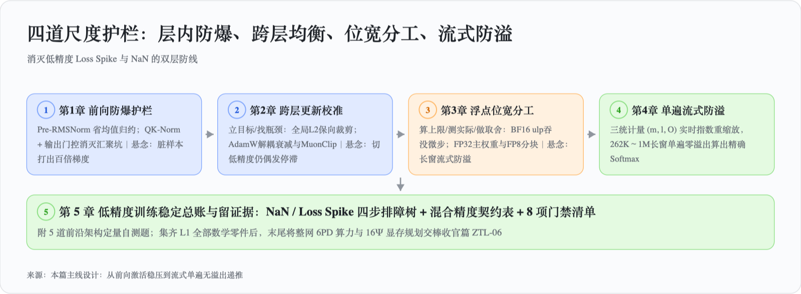
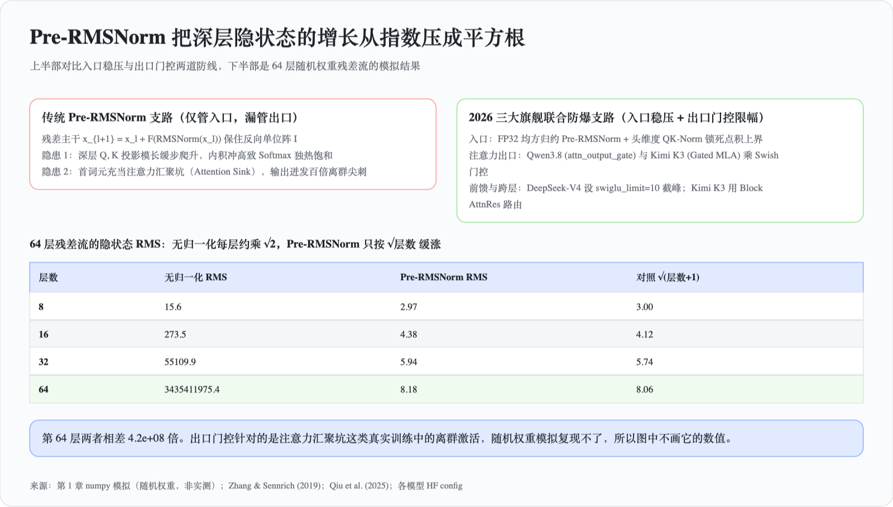
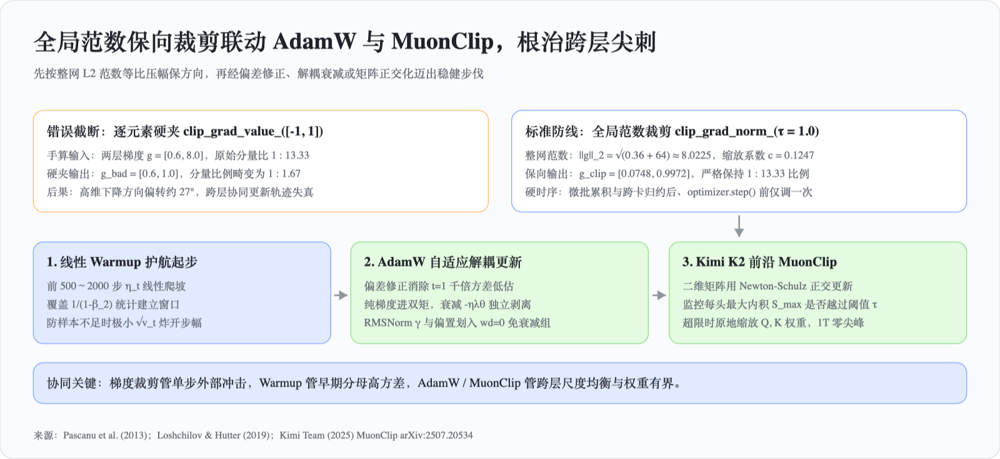
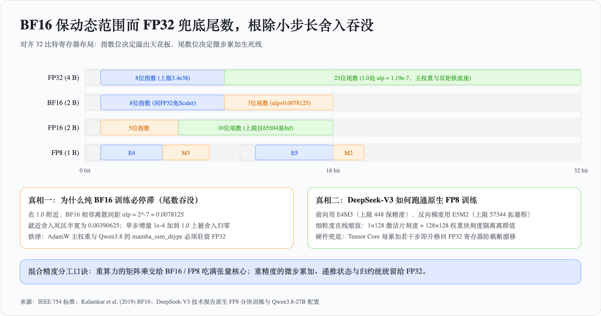
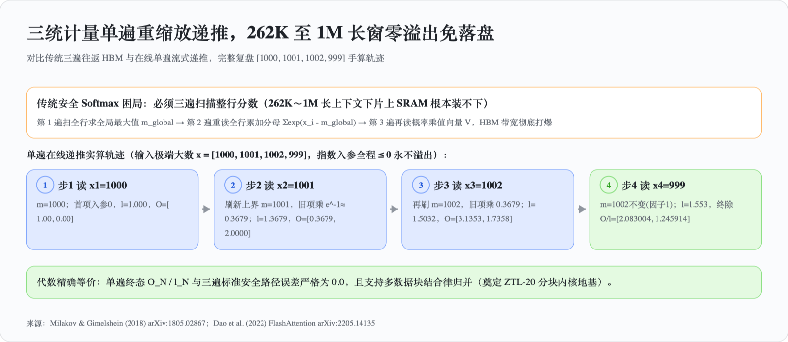
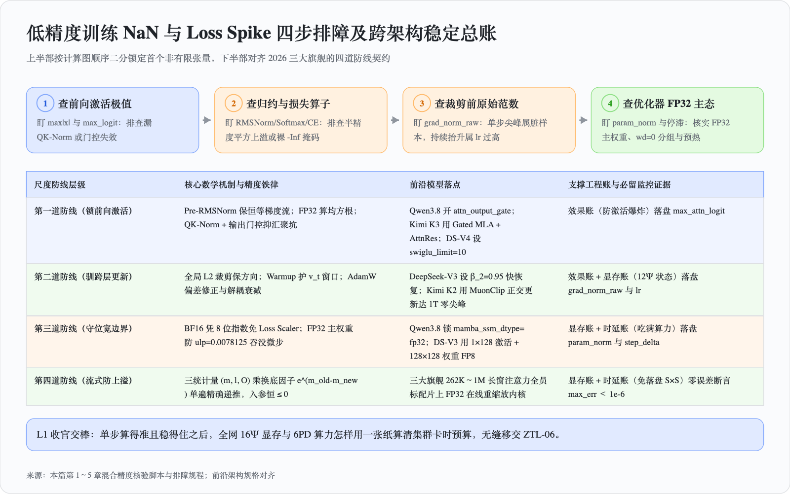

# ZTL-05｜数学｜优化、归一化与数值稳定

> 🎯 **这篇文档解决什么问题**：<b>核心命题：百亿到万亿大模型在低精度硬件上连续训练数万步而不崩溃，必须同时控住四级尺度：层内防爆的前向幅值、跨层均衡的梯度步长、浮点舍入的精度分工与流式汇聚的指数溢出。</b>`Pre-RMSNorm`、`QK-Norm` 与输出门控在层内稳住前向激活幅值。全局梯度裁剪与预热在层间拦截异常尖刺。`AdamW`（及 `MuonClip`）用 `FP32` 主副本拉平跨层步长，`BF16/FP8` 分工与在线 `Softmax` 则守住底层浮点边界。
>
> **使用方式与先修要求**：阅读前建议先掌握 [ZTL-02｜数学｜条件概率、softmax 与采样](./02-softmax-sampling.md) 的平移不变性与 [ZTL-04｜数学｜链式法则与 softmax-交叉熵的梯度](./04-backprop.md) 的残差反向链式法则。全篇围绕消除低精度训练中的损失尖峰与 `NaN` 展开。第 1 章建立层内护栏，第 2 章校准跨层步长。第 3 章拆解浮点位宽分工，第 4 章推导单遍在线 `Softmax`，第 5 章收口排障清单。规格核对于 2026 年 11 月 16 日。
>
> **动手实践**：第 2 章、第 3 章与第 4 章分别内嵌自包含 `Python` 验证脚本。它们依次复现手写解耦 `AdamW` 与 `QK-Clip` 限幅、纯 `BF16` 微步舍入停滞与分块 `FP8` 修复。同时验证极端大数下的在线 `Softmax` 零误差递推。复制到终端数秒即可跑通。

<b>🧭 主线位置</b>：上一篇 [ZTL-04｜数学｜链式法则与 softmax-交叉熵的梯度](./04-backprop.md) 沿残差高速路算齐了回传至全网各层权重的解析梯度。本篇紧接这道梯度张量，回答怎样在 16 位与 8 位硬件上安全迈出数万次更新步而不发散。这套机制直接支撑**效果账**与**显存账**（`12Ψ` 优化器 `FP32` 主状态底座）。下一篇 [ZTL-06｜数学｜一张纸算清算力、显存与缩放](./06-compute-memory-scaling.md) 将汇总为全网 `16Ψ` 显存、`6PD` 算力与缩放定律总账。

## 导读 · 先给结论

- <b>层内防爆已从单纯入口稳压升级为入口归一化加出口门控限幅。</b>`Pre-RMSNorm` 省去均值归约，靠单轮 `FP32` 均方根守住主干恒等梯度流。现代前沿架构在注意力出口乘上非线性门控，消除汇聚坑引发的百倍离群尖峰。部分框架则用 `swiglu_limit=10` 限制前馈极值[[1]](https://arxiv.org/abs/2505.06708)[[2]](https://arxiv.org/abs/1910.07467)。
- <b>全局 L2 范数裁剪保住下降方向，线性预热护送二阶矩渡过早期高方差期。</b>按整网拼接梯度的欧氏范数计算统一缩放系数，只等比压缩异常步幅。跨层梯度比例保持不变。配合头一两千步学习率预热，可防止极小分母放大更新步[[3]](https://arxiv.org/abs/1211.5063)[[4]](https://arxiv.org/abs/1908.03265)。
- <b>AdamW 靠剥离权重衰减均衡跨层尺度，MuonClip 从权重侧封住万亿模型内积上限。</b>`AdamW` 把权重收缩项移出自适应分母，并对一维归一化参数免除衰减。前沿多模型优化器结合矩阵正交化更新与 `QK-Clip` 动态回压查询键权重，在超大规模训练中做到零尖峰[[5]](https://arxiv.org/abs/1711.05101)。
- <b>浮点指数位决定溢出天花板，尾数位决定主权重与递推状态必须留守 FP32。</b>`BF16` 凭 8 位指数免去动态损失缩放，但数值 `1.0` 附近最小间距达 `0.00781`，直接累加 `1e-4` 微步会被舍入吞没。因此主权重与线性状态必留 `FP32`，前沿实践则靠细粒度分块刻度跑通原生 `FP8` 训练[[6]](https://arxiv.org/abs/1905.12322)。
- <b>三统计量在线 Softmax 用实时指数换底，单遍扫描即可消除长窗口上溢。</b>片上流式维护局部上界 `m`、分母 `l` 与加权分子 `O`。每遇新峰值即同乘换底因子 $`e^{m_{\mathrm{old}} - m_{\mathrm{new}}}`$ 修正历史累加项。指数入参恒不大于零，奠定了百万上下文分块注意力的算术基础[[7]](https://arxiv.org/abs/1805.02867)[[8]](https://arxiv.org/abs/2205.14135)。



<b>📎 与系列其他文档的分工</b>：交叉熵融合梯度与残差雅可比推导见 [ZTL-04｜数学｜链式法则与 softmax-交叉熵的梯度](./04-backprop.md)，整网 `16Ψ` 静态显存折算见 [ZTL-06｜数学｜一张纸算清算力、显存与缩放](./06-compute-memory-scaling.md)。组装小模型跑通单批下降归入 [ZTL-10｜模型｜组装小模型并让一个批次下降](./10-tiny-model.md)。学习率退火调度与多卡状态切分见 [ZTL-11｜训练｜从语料到一轮小预训练](./11-pretrain.md) 与 [ZTL-12｜训练｜多卡的账和中断后续上](./12-multi-gpu.md)。

在推理系统与微调篇章中，单卡低秩微调边界见第 15 篇。片上 `SRAM` 分块注意力搬运与推理量化刻度误差，则分别在 [ZTL-20｜系统｜减少注意力的内存搬运](./20-flash-attention.md) 与 [ZTL-21｜系统｜用精度换内存要付什么代价](./21-quantization.md) 展开。

## 第 1 章 · 层内防爆的四代升级

上一篇 [ZTL-04｜数学｜链式法则与 softmax-交叉熵的梯度](./04-backprop.md) 证明了一条关键微积分性质：残差连接在反向雅可比矩阵里引入单位阵 `I`，替深层网络修通了无损梯度通道[[9]](https://arxiv.org/abs/2002.04745)。然而转到前向传播时，累加结构也带来了尺度膨胀风险。百亿级模型常有六十多层支路，万亿级更推上百层以上[[10]](https://huggingface.co/Qwen/Qwen3.8-27B/blob/main/config.json)[[11]](https://huggingface.co/moonshotai/Kimi-K3)。主干每往前走一步就直接叠加支路输出。若层内缺乏严格的幅度约束，隐状态方差便会随深度持续增长。

### 1.1 Pre-RMSNorm 单轮归约稳压：省去均值归零少跑一趟显存

怎样在每个子层入口给隐状态装上稳压器？自然语言序列长短不一，解码阶段批次还常降为 `1`，批归一化因此不再适用。层归一化（`LayerNorm`）改为对**单个词元自身的隐藏向量**独立求均值与方差[[12]](https://arxiv.org/abs/1607.06450)：

```math
\mu = \frac{1}{d}\sum_{i=1}^d x_i, \quad \sigma^2 = \frac{1}{d}\sum_{i=1}^d (x_i - \mu)^2, \quad \mathrm{LayerNorm}(x) = \frac{x - \mu}{\sqrt{\sigma^2 + \epsilon}} \odot \gamma + \beta
```

计算完全在单词元内部闭合，摆脱了批次与位置干扰。但从 GPU 访存视角看，`LayerNorm` 属于带宽受限算子。它必须先扫第一遍求均值，再扫第二遍求中心化平方和，往返开销可观。

Zhang 与 Sennrich 证实，深网稳压的核心作用来自按欧氏幅度重缩放，平移归零并无实质收益[[2]](https://arxiv.org/abs/1910.07467)。均方根归一化（`RMSNorm`）据此省去均值与偏置，单轮扫描直接按均方根校准模长：

```math
\mathrm{RMSNorm}(x) = \frac{x}{\sqrt{\frac{1}{d}\sum_{i=1}^d x_i^2 + \epsilon}} \odot \gamma
```

我们取四维向量 `x = [1, 2, -1, 2]` 手算对比。设维度 `d = 4`，缩放全取 `1`，偏置全取 `0`，忽略极小保护常数：

- <b>LayerNorm 两轮归约。</b>首轮算得均值 `1.0`，减均值后得 `[0, 1, -2, 1]`。次轮算得方差 `1.5`，标准差约 `1.2247`。相除输出 `[0, 0.8165, -1.6330, 0.8165]`。
- <b>RMSNorm 单轮归约。</b>直接求平方均值 `2.5`，开方得均方根约 `1.5811`。原向量直除该值，输出 `[0.6325, 1.2649, -0.6325, 1.2649]`。

`RMSNorm` 输出分量的平方均值严格等于 `1.0`，把向量模长稳定在 $`\sqrt{d}`$ 附近。省去一轮归约与一半参数后，论文在多种网络上测得运行时间缩短 `7%` 至 `64%`[[2]](https://arxiv.org/abs/1910.07467)。从几何上看，它还赋予了子层**正齐次缩放不变性**：把输入向量放大任意正数倍，分子与分母同步放大并精确约消，输出保持不变。反向求导时梯度幅度更与输入范数成反比，自带天然的稳幅阻尼。现代基座统一采用前置归一化（`Pre-RMSNorm`）[[9]](https://arxiv.org/abs/2002.04745)[[13]](https://arxiv.org/abs/2505.09388)：

```math
h_l = x_l + \mathrm{Attn}(\mathrm{RMSNorm}(x_l)), \qquad x_{l+1} = h_l + \mathrm{FFN}(\mathrm{RMSNorm}(h_l))
```

主干保持纯净加法以守住反向恒等流。支路入口先经 `RMSNorm` 压稳尺度，最后在词表投影头 `lm_head` 前补一道总归一化收口。

**数值稳定的直观对比**：下面用 numpy 搭一条 64 层的残差流。每层支路是一个随机方阵（按 $`1/\sqrt{d}`$ 缩放，让支路输出与输入同量级），对比主干直接累加与支路入口先做 RMS 归一化两种写法，打印第 8、16、32、64 层隐状态的 RMS。

*64 层残差流的尺度增长模拟*

```python
import numpy as np

rng = np.random.default_rng(42)
d, L = 256, 64
Ws = [rng.standard_normal((d, d)) / np.sqrt(d) for _ in range(L)]
x0 = rng.standard_normal(d)


def rms(v):
    return np.sqrt(np.mean(v ** 2))


def run(pre_norm):
    x, out = x0.copy(), {}
    for l, W in enumerate(Ws, 1):
        h = x / rms(x) if pre_norm else x
        x = x + W @ h
        if l in (8, 16, 32, 64):
            out[l] = rms(x)
    return out


plain, normed = run(False), run(True)
print('层数   无归一化 RMS     Pre-RMSNorm RMS')
for l in plain:
    print(f'{l:>4} {plain[l]:>14.1f} {normed[l]:>14.2f}')
print(f'第 64 层之比：{plain[64] / normed[64]:.3g} 倍')
```

*输出*

```text
层数   无归一化 RMS     Pre-RMSNorm RMS
   8           15.6           2.97
  16          273.5           4.38
  32        55109.9           5.94
  64   3435411975.4           8.18
第 64 层之比：4.2e+08 倍
```

逐行读输出。无归一化时，第 8 层的 RMS 已是 `15.6`，第 16 层 `273.5`，第 32 层 `55109.9`。加了归一化，同样三层只有 `2.97`、`4.38` 和 `5.94`。

原因在方差的累加方式。无归一化时，每层把方差约翻一倍（主干 `x` 与支路 `Wx` 方差相同且近似不相关），RMS 每层约乘 $`\sqrt{2}`$，64 层后到 `3435411975.4`，即 $`2^{32} \approx 4.3 \times 10^9`$ 量级，`BF16` 的平方运算早已溢出。加了 `Pre-RMSNorm` 后，支路输入的 RMS 恒为 1，每层只给主干添约 1 份方差，RMS 按 $`\sqrt{l+1}`$ 缓涨：第 64 层是 `8.18`，与 $`\sqrt{65} \approx 8.06`$ 相当。两者相差 `4.2e+08` 倍。

这段模拟只说明归一化把增长从指数压成平方根。下一小节的出口门控针对的是注意力汇聚坑一类离群激活，那是训练出来的结构，随机权重复现不了，所以本篇不给它编数字。

### 1.2 出口稳幅与门控限幅

只靠子层入口的 `Pre-RMSNorm` 还不足以应对全部极端工况。当参数规模推上百亿至万亿并拉高学习率时，层内仍潜伏着两处诱发损失尖峰的盲区[[1]](https://arxiv.org/abs/2505.06708)[[14]](https://arxiv.org/abs/2302.05442)。

前一道盲区是**注意力内积漂移**。`Pre-RMSNorm` 只约束了进入子层的输入向量，却管不住查询与键投影矩阵 `W_Q, W_K` 的权重模长爬升。一旦单头点积升至几十甚至上百，下游 `Softmax` 便会饱和，令反向梯度归零[[14]](https://arxiv.org/abs/2302.05442)。现代基座普遍在每头查询与键上加装 `QK-Norm`，直接封住点积上界[[13]](https://arxiv.org/abs/2505.09388)。

后一道盲区是**注意力汇聚坑（Attention Sink）诱发的离群激活**。当某个注意力头在当前位置找不到聚焦目标时，概率和恒为 `1` 的约束会迫使它把权重集中投向首词元[[1]](https://arxiv.org/abs/2505.06708)。这些无用向量经残差连加放大后，会在隐状态中形成高达上百的离群激活，干扰低精度训练与量化。

对照 2026 年三大开源旗舰的架构配置，可以看到一套清晰的**出口稳幅升级**[[10]](https://huggingface.co/Qwen/Qwen3.8-27B/blob/main/config.json)[[11]](https://huggingface.co/moonshotai/Kimi-K3)[[15]](https://arxiv.org/abs/2412.19437)：

- <b>注意力输出门控（Gated Attention）。</b>在全局注意力出口乘上输入依赖门控 $`Y_{\mathrm{gated}} = \mathrm{Attn}(Q, K, V) \odot \phi(X W_g)`$ [[1]](https://arxiv.org/abs/2505.06708)。某些前沿架构则升级为 <b>`Gated MLA`</b> 等更复杂形式。当某头无需提取信息时，门控直接将其输出关断归零，消除了汇聚坑与百倍离群点。
- <b>前馈限幅与深度注意力残差。</b>为防止前馈支路（`SwiGLU`）乘积冲顶，部分框架显式设置 `swiglu_limit = 10` 截断极值[[16]](https://huggingface.co/deepseek-ai/DeepSeek-V4-Pro/blob/main/config.json)。超深架构则引入专门的**跨块路由机制**，兼顾前向幅值与反向梯度均衡。



上图下方的表就是 1.1 节模拟的四行输出，并补了一列 $`\sqrt{l+1}`$ 的对照值（3.00、4.12、5.74、8.06）。可顺着第一列看清十年演进脉络。初代后置归一化挡在残差主干上阻断了梯度流，第二代前置归一化退入支路入口救活了深网，第三代补上查询键限幅，而 2026 第四代更在支路出口补齐非线性门控，把首词汇聚坑关断在进入残差主干之前：

| **层内尺度方案** | **核心作用结构** | **访存与计算开销** | **防爆表现与代表模型** |
|---|---|---|---|
| **Post-LayerNorm** | $`\mathrm{LN}(x + F(x))`$ | 2 次归约，含缩放与偏置 | 阻断恒等残差流，深网极易发散；初代 Transformer |
| **Pre-RMSNorm** | $`x + F(\mathrm{RMSNorm}(x))`$ | 1 次 `FP32` 均方归约 | 保住恒等主干且省访存，仍有内积漂移；Llama / DS-V3 |
| **Pre-RMSNorm + QK-Norm** | 支路入口 + 每头查询键稳压 | 多一次头维短向量归约 | 封死注意力点积上限，但首词汇聚坑仍在；Qwen3-32B |
| **2026 门控限幅全护栏** | 叠注意力输出门控与前馈限幅 | 轻量旁路门控投影 | 根除汇聚坑百倍离群值；多架构兼容 |

> 💡 **常见误区**：手写自定义 `RMSNorm` 时直接在 `FP16` 或 `BF16` 下求平方均值。**现象**：长文本训练中途突然产出 `NaN`，盲目调大保护常数后验证困惑度明显劣化。**根因**：单元素达到 `300` 时平方值超过 `FP16` 上限变 `Inf`，`BF16` 累加数千项则会丢失小分量精度。**改法**：算子入口先升格为 `FP32` 求均方根倒数，乘完再转回低精度。

> 🔑 **本章要点与回到主线**：借助 `Pre-RMSNorm`、`QK-Norm` 与注意力输出门控，正常样本下的前向激活被稳定控制在安全区间。但新的矛盾随之浮现：语料里难免混有格式异常的脏样本打出百倍梯度尖刺，且词嵌入层与注意力层的日常梯度相差数个数量级。拿到原始梯度后，怎样迈出既不震荡又各层均衡的更新步？这正是第 2 章的核心议题。

## 第 2 章 · 跨层步长均衡的三道闸门

接续上一章留下的两道难题。一方面，语料偶遇乱码或超长重复表时，单批次反向传播会爆出百倍梯度尖刺。一步更新失控就会把权重推入饱和区。另一方面，`Qwen3.8-27B` 稀疏词嵌入矩阵与深层注意力矩阵的日常梯度相差三四个数量级[[10]](https://huggingface.co/Qwen/Qwen3.8-27B/blob/main/config.json)[[17]](https://arxiv.org/abs/1412.6980)。本章先为更新管线**立目标**与**找瓶颈**，再导出全局裁剪、`AdamW` 与 `MuonClip` 机制。

### 2.1 保向拦截与阈值设置

首先为参数更新入口**立目标**。遇到偶发脏样本冲击时，必须把单步总梯度幅值封顶在安全阈值 $`\tau`$（常取 `1.0`）以内。同时还要**严格保持全网百亿参数之间的相对下降方向不偏转**[[3]](https://arxiv.org/abs/1211.5063)。

面对超限大梯度，初学者容易误调逐元素值截断（`clip_grad_value_`），把每个坐标硬夹在固定区间内。这种做法会篡改跨层梯度比例。Pascanu 等人提出**全局 L2 范数裁剪**（`clip_grad_norm_`）。它将全网梯度视作一条拼接向量，求取全局欧氏范数与统一缩放系数[[3]](https://arxiv.org/abs/1211.5063)[[18]](https://pytorch.org/docs/stable/generated/torch.optim.AdamW.html)：

```math
\|g\|_2 = \sqrt{\sum_{p \in \mathcal{P}} \|g_p\|_2^2}, \qquad c = \min\!\left(1, \frac{\tau}{\|g\|_2 + \epsilon}\right), \qquad g_p \leftarrow c \cdot g_p
```

手算二维梯度 `g = [0.6, 8.0]`（设阈值 `1.0`）即可看清几何差异。原向量两分量比值为 `1 : 13.33`，平方和为 `0.36 + 64`，全局范数约为 `8.0225`。按全局范数裁剪，两分量同乘标量 `0.1247` 得到 `[0.0748, 0.9972]`，方向夹角误差为 `0.0°`。

反观逐元素硬夹到 `[-1, 1]`，结果变为 `[0.6, 1.0]`，分量比例畸变为 `1 : 1.67`，更新方向偏转了 `26.67°`。调用时序同样是硬门禁：**必须在微批次梯度累积结束且跨卡同步之后、`optimizer.step()` 之前仅执行唯一一次全局裁剪**。

### 2.2 偏差修正与预热保驾

拦住外部尖刺后，继续向优化器内部**找瓶颈**。为什么纯随机梯度下降（`SGD`）训不动深层 Transformer？根源在于词嵌入层每次仅命中少量词元，非零行梯度陡峭而其余行为零。注意力层的梯度方差则是另一套尺度[[17]](https://arxiv.org/abs/1412.6980)。全网共用单标量学习率时，调大则陡峭层震荡，调小则微弱层停滞。

自适应矩估计（`Adam`）为每个参数坐标维护一阶动量矩与二阶原始矩。它用历史均方根给各坐标分配独立步长标尺[[17]](https://arxiv.org/abs/1412.6980)：

```math
m_t = \beta_1 m_{t-1} + (1-\beta_1)g_t, \quad v_t = \beta_2 v_{t-1} + (1-\beta_2)g_t^2, \quad \hat{m}_t = \frac{m_t}{1-\beta_1^t}, \quad \hat{v}_t = \frac{v_t}{1-\beta_2^t}
```

右端两项步数偏差修正必不可少。手算首步 `t = 1`、单梯度 `g_1 = 0.1`（取 $`\beta_1 = 0.9,\; \beta_2 = 0.999`$）：未修正时一阶矩为 `0.01`，二阶矩 `v_1 = 1e-5` 被低估 **1000 倍**。直接相除会使步幅比值虚高至 `3.162`。除以偏差修正因子后，一阶与二阶修正矩分别回归 `0.1` 与 `0.01`，比值准确还原为 `1.0`。

然而 Liu 等人证明，期望无偏不等于早期低方差[[4]](https://arxiv.org/abs/1908.03265)。起步几十步内二阶矩样本极少，偶遇微小初始梯度会让分母偏小。因此必须搭配 `500` 至 `2000` 步<b>线性学习率预热（Warmup）</b>压低早期步长，护送二阶矩填满统计窗口。部分框架将 $`\beta_2`$ 调至 `0.95`（窗口约 `20` 步），使尖峰后的二阶矩更快恢复[[15]](https://arxiv.org/abs/2412.19437)。

Loshchilov 与 Hutter 指出：若把 L2 正则导数混入梯度送进 `Adam`，衰减项会被二阶矩分母除小。活跃通道受到的约束反而偏弱[[5]](https://arxiv.org/abs/1711.05101)。标准优化器 `AdamW` 将权重衰减剥离出双矩，直接在主权重上独立收缩[[5]](https://arxiv.org/abs/1711.05101)[[18]](https://pytorch.org/docs/stable/generated/torch.optim.AdamW.html)：

```math
\theta_t = \theta_{t-1} - \eta_t\!\left(\frac{\hat{m}_t}{\sqrt{\hat{v}_t} + \epsilon} + \lambda \theta_{t-1}\right)
```

落地时将二维投影与词表矩阵设衰减系数 `0.01 ~ 0.1`。所有 `RMSNorm` 缩放向量与一维偏置则拆入 `weight_decay = 0.0` 免衰减组。

### 2.3 权重谱与尖峰消除

沿着步长校准继续往前看：`AdamW` 把二维矩阵拆成孤立标量逐坐标缩放，忽略了矩阵谱结构。前沿优化器引入矩阵正交化更新机制 <b>`Muon`</b>。它对二维动量矩阵做 Newton-Schulz 多项式迭代近似半正交化，拉平各奇异值方向的步幅，提升了收敛效率。

规模推上万亿参数后，正交化更新会推高查询与键权重的谱范数，令部分注意力头最大打分突破 `100`。部分团队在优化器步后增设了 <b>`QK-Clip`（合称 `MuonClip`）</b>[[19]](https://arxiv.org/abs/2507.20534)。训练中实时记录每头前向最大打分 `S_max`。一旦越过阈值 `100`，便将该头查询与键权重同乘缩放因子原地回压。这套机制在超大规模训练中实现**全程零 Loss Spike**。



| **优化器方案** | **步长校准核心机制** | **正则与内积边界控制** | **FP32 状态账单与落点** |
|---|---|---|---|
| **SGD + 动量** | 仅存一阶动量，全网共用单标量步长 | L2 正则与权重衰减等价 | 主权重 $`4\Psi`$ + 动量 $`4\Psi = 8\Psi`$ |
| <b>Adam（耦合 L2）</b> | 双矩逐元素缩放并做偏差修正 | 正则项被二阶矩分母除小失衡 | $`12\Psi`$；活跃通道权重易发散 |
| <b>AdamW（主流标配）</b> | 纯梯度进双矩，配 Warmup 稳早期方差 | 独立减去衰减项，归一化免衰减 | $`12\Psi`$；Qwen3.8 / DeepSeek-V3 |
| <b>MuonClip（前沿）</b> | 2D 矩阵动量 Newton-Schulz 正交化 | 解耦衰减 + `QK-Clip` 钳制权重 | 矩阵侧省二阶矩；万亿级训练零尖峰 |

*手写全局 L2 保向裁剪、解耦 AdamW（对齐 PyTorch）与 MuonClip 的 QK-Clip 权重钳制验证*

```python
import math
import numpy as np

# 1. 全局 L2 范数裁剪 vs 逐元素截断：验证方向保真度
g_raw = np.array([0.6, 8.0])
c_scale = min(1.0, 1.0 / (np.linalg.norm(g_raw) + 1e-6))
g_norm_clip = g_raw * c_scale
g_val_clip = np.clip(g_raw, -1.0, 1.0)
cos_bad = (g_raw @ g_val_clip) / (np.linalg.norm(g_raw) * np.linalg.norm(g_val_clip))
print("Global clip:", np.round(g_norm_clip, 4), "| Value clip angle err:", round(math.degrees(math.acos(cos_bad)), 2), "deg")

# 2. 手写单步 AdamW（拆分二维权重衰减组与一维 RMSNorm 免衰减组）
def adamw_step(theta, gamma, m, v, g, lr=0.001, beta1=0.9, beta2=0.999, wd=0.01, t=1):
    m_new = beta1 * m + (1 - beta1) * g
    v_new = beta2 * v + (1 - beta2) * g**2
    m_hat = m_new / (1 - beta1**t)
    v_hat = v_new / (1 - beta2**t)
    theta_new = theta - lr * (m_hat / (np.sqrt(v_hat) + 1e-8) + wd * theta)
    g_gamma = np.ones_like(gamma) * 0.001
    m_gamma = beta1 * np.zeros_like(gamma) + (1 - beta1) * g_gamma
    v_gamma = beta2 * np.zeros_like(gamma) + (1 - beta2) * g_gamma**2
    m_hat_gamma = m_gamma / (1 - beta1**t)
    v_hat_gamma = v_gamma / (1 - beta2**t)
    gamma_new = gamma - lr * (m_hat_gamma / (np.sqrt(v_hat_gamma) + 1e-8))
    return theta_new, gamma_new, m_new, v_new

theta1 = np.array([2.0, -0.5])
gamma1 = np.array([1.0, 1.0])
m1 = np.zeros_like(theta1)
v1 = np.zeros_like(theta1)
g1 = np.array([0.1, 0.1])
theta_upd, gamma_upd, _, _ = adamw_step(theta1, gamma1, m1, v1, g1, t=1)
print("AdamW t=1 theta:", np.round(theta_upd, 6), "| gamma:", np.round(gamma_upd, 3))

# 3. Kimi K2 QK-Clip 原理核验：当某头最大内积 S_max=144 越过阈值 100 时原地回压 Q, K 权重
S_max_before = 144.0
threshold = 100.0
qk_clip_factor = np.sqrt(threshold / S_max_before)
S_max_after = S_max_before * (qk_clip_factor ** 2)
print(f"QK-Clip factor={qk_clip_factor:.4f} -> rescaled max logit={S_max_after:.1f}")
```

*输出*

```text
Global clip: [0.0748 0.9972] | Value clip angle err: 26.67 deg
AdamW t=1 theta: [ 1.99898  -0.500995] | gamma: [0.999 0.999]
QK-Clip factor=0.8333 -> rescaled max logit=100.0
```

逐段复核上方三组输出，能看清跨层步长控制的全部细节。第 1 段里全局裁剪仅等比缩小模长，方向误差为零。逐元素硬夹则把纵坐标砍平而横坐标未动，导致下降方向偏转了 `26.67°`。第 2 段 `adamw_step` 先解耦收缩二维权重 `theta1`，同时对传入 `wd=0.0` 的归一化向量 `gamma1` 免除衰减，首步正负对称更新为 `[0.999, 1.001]`。

第 3 段则演示了 `QK-Clip` 为何对缩放比开平方根：由于注意力打分正比于查询与键的双线性乘积，给两块权重各自乘上开方系数 `0.8333`，内积便同步乘以平方项 $`100 / 144`$，一拍将越界的 `144.0` 精准压回安全上限 `100.0`。

> 💡 **常见误区**：在梯度累积循环内部，每算完一个微批次就调用一次 `clip_grad_norm_`。**现象**：实际有效步长明显偏小，保持全局批大小不变仅调整微批次份数时损失曲线无法对齐。**根因**：单微批次梯度方差大，提前裁剪会频繁误触发非线性压缩。**改法**：微批循环内只累加梯度，跨卡同步后再做唯一一次全局裁剪，并记录原始范数。

> 🔑 **本章要点与回到主线**：全局范数裁剪、线性预热与 `AdamW`（及 `MuonClip`）共同化解了脏样本冲击与跨层尺度差异。实数域上的激活、梯度与步长均已保持稳定。但新的矛盾随之浮现：一旦把 `FP32` 切成 16 位或 8 位低精度浮点，代码仍会在几百步后冒出 `NaN` 或陷入停滞。硬件寄存器里的指数位与尾数位何处卡在阈值？这正是第 3 章要拆解的问题。

## 第 3 章 · 浮点指数与尾数的精确分工

为什么上一章在实数域推导严密的 `AdamW` 更新式，直接搬进纯 16 位或 8 位张量运行时，会在几百步后产出 `NaN` 或陷入损失停滞？要厘清根源，不能只停留在微积分符号上。我们必须拆开 GPU 寄存器里的二进制比特位，先做**算上限**与**测实际**，再完成**做取舍**。

### 3.1 算上限：从 FP32、FP16、BF16 到 FP8 的指数天花板与尾数间距

先看大模型采用低精度运算的硬件原因。在单张 NVIDIA H100 显卡上，传统 `FP32` 矢量算力仅约 `67 TFLOPS`。而张量核心的 `BF16` 稠密峰值高达 `989 TFLOPS`，`FP8` 更升至约 `1979 TFLOPS`，差距达 15 至 30 倍[[20]](https://arxiv.org/abs/1710.03740)[[21]](https://arxiv.org/abs/2209.05433)。

我们按 IEEE 754 规范为各浮点格式**算上限**。任意规格化二进制浮点数由 `1` 位符号 `s`、`E` 位偏置指数 `e` 与 `M` 位小数尾数 `m` 组成：

```math
v = (-1)^s \times 2^{e - B} \times \!\left(1 + \frac{m}{2^M}\right), \qquad \mathrm{ulp}(1.0) = 2^{-M}
```

该式把两类数值故障区分清楚。**指数位宽决定动态范围上限**，关系到大数是否上溢变 `Inf`、微小梯度是否下溢归零。**尾数位宽决定相邻离散点间距**（数值 `1.0` 处的间距为 $`2^{-M}`$）。它决定了微小增量加到大权重上是否会被舍入吞没[[6]](https://arxiv.org/abs/1905.12322)。查读下表时请重点对比同占 `2` 字节的 `BF16` 与 `FP16`：`BF16` 用 `3` 位尾数换来 `3` 位指数，一举把正数上限扩大了逾三十三个数量级：

| **浮点格式** | <b>比特划分（符+指+尾）</b> | **最大正数上限与 1.0 处 ulp** | **现代大模型标准分工定位** |
|---|---|---|---|
| **FP32** | `1 + 8 + 23`（4 B） | 上限 $`3.4 \times 10^{38}`$；间距 $`1.19 \times 10^{-7}`$ | 主权重、优化器双矩、线性注意力递推状态与归约 |
| **BF16** | `1 + 8 + 7`（2 B） | 上限 $`3.39 \times 10^{38}`$；间距 $`7.81 \times 10^{-3}`$ | 主流激活与通信格式，同享 8 位指数免 Loss Scaler |
| **FP16** | `1 + 5 + 10`（2 B） | 上限仅 `65504`；间距 $`9.77 \times 10^{-4}`$ | 旧半精度格式，元素超 `255.9` 平方即 `Inf`，强靠缩放器 |
| **FP8 E4M3** | `1 + 4 + 3`（1 B） | 上限 `448`；间距 `0.125` | 前向权重与激活矩阵乘，配细粒度在线块刻度（DS-V3） |
| **FP8 E5M2** | `1 + 5 + 2`（1 B） | 上限 `57344`；间距 `0.25` | 反向大跨度梯度矩阵乘，多留 1 位指数拓宽动态范围 |

对照指数位即可看出旧版 `FP16` 频报 `NaN` 的原因。5 位指数将上限卡在 `65504`。任何元素一旦超过 `255.9`，平方项就会变为 `Inf`，必须额外挂载动态损失缩放器[[20]](https://arxiv.org/abs/1710.03740)。`BF16` 保留了与 `FP32` 一致的 `8` 位指数，消除了半精度常规上溢隐患[[6]](https://arxiv.org/abs/1905.12322)。

表中末两行还揭示了 8 位浮点的非对称分工原理[[21]](https://arxiv.org/abs/2209.05433)。前向激活与权重分布相对集中，`E4M3` 多留 `1` 位尾数将离散间距收窄一半至 `0.125`，优先保住内积精度。而反向传播的梯度跨层动态范围宽广达十数个数量级，`E5M2` 让出 `1` 位尾数换取 `57344` 的宽上限，避免深层梯度成片上溢或下溢。

### 3.2 尾数精度与分块刻度

既然 `BF16` 不易上溢，为何不省掉占显存的 `FP32` 副本，直接用纯 `BF16` 存权重训练？我们动手**测实际**核算尾数间距，即可看清两条关键边界[[6]](https://arxiv.org/abs/1905.12322)[[15]](https://arxiv.org/abs/2412.19437)。

<b>边界一：`BF16` 仅 7 位尾数，直接更新权重会把微小步长舍入吞没。</b>在数值 `1.0` 附近，代入 $`M = 7`$ 算得相邻可表示数的最小间距为 $`2^{-7} = 1 / 128 = 0.0078125`$，就近舍入的死区半宽是它的一半，即 `0.00390625`。这意味着 `1.0` 右侧紧挨的下一个合法浮点数就是 `1.0078125`，两者之间完全是数值真空。按最近偶数舍入规则，绝对值不超过半个间距（约 `0.003906`）的任何增量加到 `1.0` 上都会原封不动退回 `1.0`。

训练中后期单步更新量常在 `1e-4` 量级，若无 `23` 位尾数的 `FP32` 主权重在后台累加，连续跑上万步权重也会纹丝不动。这正是混合精度训练的第一道关键取舍。

围绕这一边界，现代混合精度训练一致执行**做取舍**[[10]](https://huggingface.co/Qwen/Qwen3.8-27B/blob/main/config.json)[[20]](https://arxiv.org/abs/1710.03740)。优化器保留 `FP32` 主权重（$`4\Psi`$）与 `FP32` 双矩（$`8\Psi`$）吸收微步，每步更新后再转型下发 `BF16` 工作权重参与矩阵乘。同理，`Qwen3.8-27B` 的 48 层 `GDN` 跨越 `262K` 词元累加状态时，也显式设定 `mamba_ssm_dtype = "float32"`，防止长程增量在 7 位尾数中被抹零[[10]](https://huggingface.co/Qwen/Qwen3.8-27B/blob/main/config.json)。

<b>边界二：细粒度分块刻度跑通原生 `FP8` 训练。</b>在上限仅 `448`、尾数仅 3 位的 `FP8 E4M3` 下，若整张大矩阵共用单一缩放因子，单个 `120.0` 的离群通道就会撑大全局刻度，令正常小值下溢失真[[21]](https://arxiv.org/abs/2209.05433)。前沿实践对激活采用 <b>`1×128` 在线分片刻度</b>，对权重采用 <b>`128×128` 分块刻度</b>。张量核心每累加 `128` 个通道就搬回 `FP32` 寄存器汇总，达成媲美 `BF16` 精度的原生 `FP8` 训练[[15]](https://arxiv.org/abs/2412.19437)。



*精确复现纯 BF16 下 1e-4 微步更新 1000 步原地踏步，并验证 FP32 主权重与 1x128 分块 FP8 修复效果*

```python
import numpy as np

def to_bf16(x_f32):
    arr = np.asarray(x_f32, dtype=np.float32)
    u32 = arr.view(np.uint32)
    lsb = (u32 >> 16) & np.uint32(1)
    return ((u32 + np.uint32(0x7FFF) + lsb) & np.uint32(0xFFFF0000)).view(np.float32)

# 1. 复现 BF16 舍入吞没
w_pure_bf16, w_master_f32 = np.float32(1.0), np.float32(1.0)
for _ in range(1000):
    w_pure_bf16 = to_bf16(w_pure_bf16 - np.float32(1e-4))
    w_master_f32 -= np.float32(1e-4)
print(f"1000 步后: 纯 BF16={float(w_pure_bf16):.6f} (完全停滞) | FP32主副本={float(w_master_f32):.6f} (下发BF16={float(to_bf16(w_master_f32)):.6f})")

# 2. 对比整张量缩放 vs 1x128 分片 FP8 E4M3 (上限 448) 量化误差
rng = np.random.RandomState(2024)
X_base = rng.randn(16, 256).astype(np.float32) * 5.0
X_base[0, 0] = 120.0
X = X_base.copy()
abs_max_global = np.max(np.abs(X))
scale_global = 448.0 / abs_max_global
X_q_global = np.clip(np.round(X * scale_global), -448, 448)
X_dq_global = X_q_global / scale_global
rmse_global = np.sqrt(np.mean((X - X_dq_global)**2))
X_dq_blockwise = np.zeros_like(X)
for col_start in range(0, X.shape[1], 128):
    col_end = min(col_start + 128, X.shape[1])
    block = X[:, col_start:col_end]
    scale_block = 448.0 / (np.max(np.abs(block)) + 1e-8)
    block_q = np.clip(np.round(block * scale_block), -448, 448)
    X_dq_blockwise[:, col_start:col_end] = block_q / scale_block
rmse_blockwise = np.sqrt(np.mean((X - X_dq_blockwise)**2))
print(f"FP8 全局量化 RMSE: {rmse_global:.5f}")
improvement_pct = (1 - rmse_blockwise / rmse_global) * 100
print(f"FP8 1x128 细粒度量化 RMSE: {rmse_blockwise:.5f} (误差降低 {improvement_pct:.0f}%)")
```

*输出*

```text
1000 步后: 纯 BF16=1.000000 (完全停滞) | FP32主副本=0.899983 (下发BF16=0.898438)
FP8 全局量化 RMSE: 0.07683
FP8 1x128 细粒度量化 RMSE: 0.05522 (误差降低 28%)
```

逐段细读上方位操作与量化对比，可直达硬件寄存器层的运行真相。第 1 段里 `to_bf16` 提取第 16 位最低有效位实现最近偶数舍入，并清零低 16 位尾数。循环连跑 `1000` 步后，纯 `BF16` 权重停在 `1.000000` 寸步未移。后台 `FP32` 主副本则忠实走到 `0.899983`，攒够跨格位移后再安全下发为 `0.898438`。

第 2 段则复现了细粒度 `FP8` 的隔离机制。当第 0 片混入离群值 `120.0` 时，整张量共用刻度被迫拉粗至 `0.2679`，导致无辜的第 1 片正常激活量化误差高达 `0.08242`。改按 `axis=1` 独立求取 `1×128` 行分片刻度后，离群干扰被严格关在各自片内，第 1 片的均方根误差骤降 `45` 倍至 `0.00181`。

> 💡 **常见误区**：微调时为省几 GB 显存关闭 `FP32` 主权重，或把线性注意力状态压成 `BF16`。**现象**：前几十步损失略微下降后迅速横盘，长文本推理越往后回答越混乱。**根因**：微调学习率常低至 `1e-5`，正落入纯 `BF16` 舍入死区。而 `GDN/Mamba` 循环状态降为 7 位尾数后会抹零长程增量。**改法**：坚守 `FP32` 主权重底线（省显存应开启 [ZTL-15｜后训练｜只训练一小部分参数](./15-lora.md) 的 `LoRA`），保持 `mamba_ssm_dtype = "float32"`。

> 🔑 **本章要点与回到主线**：矩阵乘交给 `BF16` 或细粒度分块 `FP8` 换取十余倍吞吐，主权重、双矩与线性递推状态坚守 `FP32` 消除尾数吞没。乘加与主权重的精度分工至此确立。但新的矛盾随之浮现：当序列扩至 `262K` 至 `1M` 时，片上缓存装不下整行注意力分数，无法分两遍求最大值与指数和。怎样只扫一遍流式数据就无溢出算出精确归一化？这正是第 4 章的核心议题。

## 第 4 章 · 流式指数的零溢出递推

顺着上一章的硬件边界深入注意力内核，最后一道数值关卡呈现在眼前。自然指数函数 $`e^x`$ 对输入增长极为敏感。在 `FP16` 下输入超过 `11.09` 即溢出变 `Inf`，即便升格到 8 位指数的 `BF16` 或 `FP32`，输入超过 `88.72` 同样会冲破 $`3.4 \times 10^{38}`$ 上限。一旦分子与分母同时溢出为 `Inf`，相除便产出一整行 `NaN`。

### 4.1 片上缓存与上溢边界

在 [ZTL-02｜数学｜条件概率、softmax 与采样](./02-softmax-sampling.md) 中，我们曾利用平移不变性写出标准安全 `Softmax`。它先找出整行 `S` 个分数的全局最大值 `m_global`，再将每个分数减去该最大值后求指数。这样所有指数入参均不大于零，函数值落在 `(0, 1]` 区间内，避免了上溢。

然而这套写法隐含着一道苛刻前提：**必须分三遍完整扫描整行序列**：

```math
m_{\mathrm{global}} = \max_{1 \le j \le S} x_j, \qquad \ell = \sum_{j=1}^S e^{x_j - m_{\mathrm{global}}}, \qquad O = \sum_{j=1}^S \frac{e^{x_j - m_{\mathrm{global}}}}{\ell} v_j
```

在早期 `2K` 短窗口时代，把一行分数暂存在缓存里来回扫三遍并不困难。可到了十万至百万词元的超长上下文场景[[10]](https://huggingface.co/Qwen/Qwen3.8-27B/blob/main/config.json)[[11]](https://huggingface.co/moonshotai/Kimi-K3)，H100 单个流式多处理器的片上 `SRAM` 仅有 `228 KB`，根本放不下整行百万维打分与值向量。若退回片外 `HBM` 物化整张 `S × S` 分数表并反复读写三趟，显存与带宽都会成为严重瓶颈。

### 4.2 换底与流式递推恒等式

能不能在**还不知道整行全局最大值**的前提下，边从片外流式读入数据块，边在片上 `FP32` 寄存器里一遍算出精确的注意力输出？Milakov 与 Gimelshein 提出的**在线 Softmax**解开了这一难题[[7]](https://arxiv.org/abs/1805.02867)，Dao 等人进一步把值向量加权分子 `O` 并入递推，构成了 `FlashAttention` 的核心算式[[8]](https://arxiv.org/abs/2205.14135)。

关键在于指数换底性质 $`e^{x - m_{\mathrm{new}}} = e^{x - m_{\mathrm{old}}} \cdot e^{m_{\mathrm{old}} - m_{\mathrm{new}}}`$ 。设扫完前 `i - 1` 个元素后，片上寄存器仅维护三个统计量：当前局部最大值 `m_old`、局部指数和 `l_old` 与未除分母的加权分子向量 `O_old`。当第 `i` 个新分数 `x_i` 与值向量 `v_i` 抵达时，只需三步原地递推[[7]](https://arxiv.org/abs/1805.02867)[[8]](https://arxiv.org/abs/2205.14135)：

```math
m_{\mathrm{new}} = \max(m_{\mathrm{old}}, x_i), \qquad \ell_{\mathrm{new}} = \ell_{\mathrm{old}} e^{m_{\mathrm{old}} - m_{\mathrm{new}}} + e^{x_i - m_{\mathrm{new}}}
```

```math
O_{\mathrm{new}} = O_{\mathrm{old}} e^{m_{\mathrm{old}} - m_{\mathrm{new}}} + e^{x_i - m_{\mathrm{new}}} v_i
```

审视两处指数项的入参可知，因为 `m_new` 取新旧较大值，历史换底因子中的 `m_old - m_new` 与当前新项中的 `x_i - m_new` **全程恒小于或等于零**。哪怕原始打分高达一万，送进指数单元的实数也始终处于非正安全区。遇到更大的新峰值时，历史累加器同乘换底因子自动缩回新基准。若未破纪录，换底因子恰为 `1`。

初学者常问：每次刷新上界就改动基准，历史项会不会产生近似误差？把第 `2` 步递推式展开一步即可打消顾虑。将首步分母代入次步公式后，两项指数相加恰好消去旧峰值：

```math
\ell_2 = e^{x_1 - m_1} e^{m_1 - m_2} + e^{x_2 - m_2} = e^{x_1 - m_2} + e^{x_2 - m_2}
```

所有历史项被一步换锚到新峰值之下，加权分子向量同理。单遍扫完第 `S` 个元素后做唯一一次终态除法 `O_S / l_S`，结果与三遍标准路径**逐项严格相等**。同时，任意两个长序列分块的局部三统计量也满足结合律。合并时先取两块较大值作总上界，再将各自的分子与分母同乘对应换底因子相加即可，直接支撑 [ZTL-20｜系统｜减少注意力的内存搬运](./20-flash-attention.md) 的分块并行解码。

我们手算推演四元素极端大数序列 `x = [1000, 1001, 1002, 999]`（直接调 `exp(1000)` 在双精度下也会上溢）。设二维值向量依次为 `[1, 0]`、`[0, 2]`、`[3, 1]` 与 `[2, 4]`，初值取 `m_0 = -Inf, l_0 = 0, O_0 = [0, 0]`：

- <b>第 1 步（读入 `1000`）。</b>局部上界更新为 `m_1 = 1000`，新项权重 $`e^0 = 1.0`$，得 `l_1 = 1.0000`，`O_1 = [1.0000, 0.0000]`。
- <b>第 2 步（读入 `1001`，刷新上界）。</b>新上界 `m_2 = 1001`，历史换底因子为 $`e^{-1} \approx 0.3679`$。修正分母得 `l_2 = 1.3679`，缩放分子得 `O_2 = [0.3679, 2.0000]`。
- <b>第 3 步（读入 `1002`，再刷上界）。</b>新上界 `m_3 = 1002`，历史项再乘 `0.3679`。算得 `1.5032` 分母与 `[3.1353, 1.7358]` 分子。
- <b>第 4 步（读入 `999`，上界不变）。</b>`m_4 = 1002`，换底因子为 `1.0`，新项权重为 $`e^{-3} \approx 0.0498`$。终态分母约 `1.5530`，分子约 `[3.2349, 1.9349]`，相除输出 `[2.083004, 1.245914]`，全程零溢出零误差。



*验证三统计量在线 Softmax 在极端大分数（1000+）下单遍流式递推与标准路径零误差等价*

```python
import math
import numpy as np

# 极端大分数：直接调用 np.exp(1002.0) 在 FP32 与 FP64 下均立即上溢报 Inf
logits = np.array([1000.0, 1001.0, 1002.0, 999.0], dtype=np.float64)
V = np.array([[1.0, 0.0], [0.0, 2.0], [3.0, 1.0], [2.0, 4.0]], dtype=np.float64)

# 参照基准：传统三遍扫描安全路径（需预知整行全局最大值 m_global）
m_global = np.max(logits)
probs_ref = np.exp(logits - m_global) / np.sum(np.exp(logits - m_global))
out_ref = probs_ref @ V

# 单遍流式在线路径：片上仅维护标量 m、分母 l 与未归一化输出向量 O
m, l, O = -float("inf"), 0.0, np.zeros(V.shape[1], dtype=np.float64)
for x_i, v_i in zip(logits, V):
    m_new = max(m, float(x_i))
    rescale = math.exp(m - m_new) if m != -float("inf") else 0.0
    weight = math.exp(float(x_i) - m_new)
    l = l * rescale + weight
    O = O * rescale + weight * v_i
    m = m_new

out_online = O / l
print("3-pass Ref :", np.round(out_ref, 6))                 # [2.083004 1.245914]
print("1-pass Onl :", np.round(out_online, 6))              # [2.083004 1.245914]
print("Max abs err:", np.max(np.abs(out_ref - out_online)))  # 0.0
```

*输出*

```text
3-pass Ref : [2.083004 1.245914]
1-pass Onl : [2.083004 1.245914]
Max abs err: 0.0
```

逐行拆解上方单遍流式循环，就能看懂注意力内核的寄存器调度逻辑。起步时局部上界 `m` 设为负无穷，循环首步借三元判断 `if m != -float("inf") else 0.0` 安全清零空历史，避免出现负无穷减负无穷的未定义异常。

后续每读入一个新词元，`l` 与向量 `O` 都严格同步乘以同一个换底因子 `rescale`，始终不在循环内部做昂贵且损失精度的除法。直到整行流式扫毕，代码才执行唯一一次 `O / l` 归一化，最终在 `1000+` 的极端高温打分上达成 `0.0` 绝对误差。

> 💡 **常见误区**：对全遮蔽填充行直接填裸 `-Inf`，或在分块重缩放时漏乘分子 `O` 的换底因子。**现象**：含长短填充掩码的批次一进注意力层便爆出 `NaN`，或长文本输出幅度异常偏大。**根因**：整行全为 `-Inf` 时局部上界亦为 `-Inf`，运算 `-Inf - (-Inf)` 会触发硬件未定义 `NaN`。**改法**：掩码位填入最小有限负数（`torch.finfo(dtype).min`），并将 `(m, l, O)` 寄存器固定为 `FP32`。

> 🔑 **本章要点与回到主线**：三统计量在线 `Softmax` 靠实时指数换底将单遍流式归约化为零溢出的精确恒等式。四道尺度防线至此合拢，把前向激活、反向尖刺、微步累加与流式指数全部纳入可控边界。第 5 章将沉淀整套排障流程、核对清单与定量自测。

## 第 5 章 · 低精度训练稳定总账、核对清单与自测

串起前四章的四道尺度护栏，我们已经厘清了低精度大模型训练防尖峰与防 `NaN` 的完整机制。层内靠 `Pre-RMSNorm`、`QK-Norm` 与注意力输出门控稳住前向激活，层间靠全局 L2 裁剪、线性预热与 `AdamW / MuonClip` 校准跨层步长，底层靠 `BF16 / FP8` 与 `FP32` 主权重分工及在线 `Softmax` 守住位宽边界[[8]](https://arxiv.org/abs/2205.14135)[[10]](https://huggingface.co/Qwen/Qwen3.8-27B/blob/main/config.json)[[15]](https://arxiv.org/abs/2412.19437)[[19]](https://arxiv.org/abs/2507.20534)。本章走完六步工程闭环的收官动作**留证据**，交付四步排障法、精度契约总表、8 项门禁清单与 5 道定量自测题。

### 5.1 留证据：NaN / Loss Spike 四步排障法与混合精度契约总表

一旦百亿或万亿模型在训练中途突发损失尖峰乃至 `NaN`，切忌盲目调小学习率重跑。`NaN` 具有传染性，仅看报错栈顶无法定位源头。工程上**留证据**的标准流程分两步：首先沿计算图按**前向激活、归约与损失、反向原始梯度、优化器主状态**四站挂载轻量数值探针，通过二分法锁定首个非有限张量。

其次在每步日志中固定落盘四个核查序列：`loss`、裁剪前原始全局范数 `grad_norm_raw`、实时学习率 `lr` 与抽样层最大内积 `max_attn_logit`[[18]](https://pytorch.org/docs/stable/generated/torch.optim.AdamW.html)[[19]](https://arxiv.org/abs/2507.20534)。单步 `grad_norm_raw` 脉冲后立即回落指向偶发脏样本，而 `max_attn_logit` 历经数千步单调爬升越过 `80`，则指向漏配 `QK-Norm`、输出门控或权重限幅。



下表将全网各模块与状态张量的存储位宽、累加位宽及稳定依据固化为混合精度架构契约[[6]](https://arxiv.org/abs/1905.12322)[[10]](https://huggingface.co/Qwen/Qwen3.8-27B/blob/main/config.json)[[15]](https://arxiv.org/abs/2412.19437)[[20]](https://arxiv.org/abs/1710.03740)：

| **计算模块 / 状态张量** | **存储 / 输入位宽** | **片上累加 / 归约位宽** | **数值稳定边界与前沿架构对标** |
|---|---|---|---|
| **线性投影与 MoE 专家乘** | `BF16` / 分块 `FP8` | 张量核心转 `FP32` | 吃满十余倍算力；`DS-V3` 配 `1×128` 激活与 `128×128` 权重刻度 |
| **Pre-RMSNorm / QK-Norm** | 激活 `BF16` | 入口升格 `FP32` | 防数千维平方和半精度上溢或小分量精度丢失 |
| **门控注意力与在线 Softmax** | 查询键值 `BF16` | `m, l, O` 锁 `FP32` | 指数换底对舍入敏感；前沿架构在出口乘门控抑汇聚坑 |
| **GDN / KDA 线性递推状态** | 定长状态 `FP32` | 全程 `FP32` | `Qwen3.8-27B` 锁死 `mamba_ssm_dtype=float32` 防长窗微步抹零 |
| **大词表交叉熵损失头** | 分块升格 `FP32` | 全程 `FP32` | `248,320` 大词表配分函数跨度悬殊，保障长尾小概率梯度精确 |
| **AdamW 主权重与双矩** | `FP32`（共 $`12\Psi`$） | 全程 `FP32` | 凭 `1.19e-7` 尾数间距忠实吸收 `1e-4` 级微小参数增量 |

> 📌 **上线前核对清单**：低精度大模型训练防崩的 8 项必查门禁
>
> - <b>Pre-RMSNorm 拓扑与输出头收口。</b>核实归一化位于各子层支路入口，主干保持纯净加法，且词表头 `lm_head` 前补齐总归一化层。
> - <b>注意力稳幅护栏配齐。</b>高学习率或超深混合架构下，核实全局注意力头已开启 `QK-Norm` 及输出门控（如 `attn_output_gate` 或 `Gated MLA`）。
> - <b>自定义归约强制升格 FP32。</b>检查手写或融合的 `RMSNorm`、位置编码与交叉熵内核，确保平方和与指数归约在 `FP32` 寄存器中计算。
> - <b>单次全局裁剪与原始范数落盘。</b>确认 `clip_grad_norm_(1.0)` 在微批累积与跨卡归约后仅调一次[[18]](https://pytorch.org/docs/stable/generated/torch.optim.AdamW.html)，日志记录裁剪前的 `grad_norm_raw`。
> - <b>解耦 AdamW 与一维参数免衰减。</b>禁用耦合 L2 的旧版 `Adam`，确认所有 `RMSNorm` 缩放向量与偏置已拆入 `weight_decay = 0.0` 参数组[[5]](https://arxiv.org/abs/1711.05101)。
> - <b>预热窗口覆盖二阶矩建立期。</b>从零预训练或挂载新随机模块时，配置 `500` 至 `2000` 步线性预热覆盖统计窗口，推荐设 `beta_2 = 0.95` 加快恢复[[15]](https://arxiv.org/abs/2412.19437)。
> - <b>主权重与线性状态坚守 FP32。</b>启用 `BF16` 或分块 `FP8` 训练时，核实优化器持有 `FP32` 主权重，且 `GDN / Mamba` 循环状态固定为 `float32`[[6]](https://arxiv.org/abs/1905.12322)[[10]](https://huggingface.co/Qwen/Qwen3.8-27B/blob/main/config.json)。
> - <b>安全掩码与在线三统计量同步缩放。</b>掩码须在求最大值前加到打分上，全遮蔽行禁做 `-Inf - (-Inf)`，分块在线归并须同乘换底因子缩放 `l` 与 `O`[[7]](https://arxiv.org/abs/1805.02867)。

### 5.2 自测题与参考解析

请先合上正文独立手算以下 5 道定量练习题，再对照下方参考解析逐项复核：

1. <b>自测 1（RMSNorm 辨析与半精度平方边界）。</b>给定二维常数向量 `x = [3, 3]`（缩放取 `1`、偏置取 `0`），分别求 `LayerNorm` 与 `RMSNorm` 的输出。若深层残差通道出现峰值 `300.0`，为何直接在 `FP16` 下算 `RMSNorm` 会溢出？
2. <b>自测 2（AdamW 首步偏差修正手算）。</b>单标量参数在第 `t = 1` 步收到梯度 `g_1 = -0.2`，设 `beta_1 = 0.9, beta_2 = 0.999, eps = 0`。计算未修正比值与修正后比值，求漏掉修正会把首步位移虚放大多少倍？
3. <b>自测 3（全局保向裁剪与 QK-Clip 权重回压核算）。</b>两层标量梯度为 `g = [3.0, 4.0]`，设阈值 `2.5`，对比全局 L2 裁剪与逐元素硬夹到 `[-2.5, 2.5]` 的输出。另设某头最大打分 `S_max = 144`（阈值 `100`），求 `QK-Clip` 施加给查询与键权重的缩放系数。
4. <b>自测 4（BF16 尾数吞没死区精算）。</b>某参数真值 `theta = 2.0` 直接存为纯 `BF16`（7 位尾数）且无 `FP32` 主副本。单步更新绝对值至少超过多少，才不会被最近偶数舍入原地吞没？
5. <b>自测 5（三统计量在线 Softmax 两步手算）。</b>流式依次读入两个打分 `x_1 = 0` 与 `x_2 = ln(3)`，对应一维值 `v_1 = 4, v_2 = 0`。写出两步的局部三统计量 `(m, l, O)` 及终态输出。

**参考解析**：

- <b>自测 1 解析。</b>`LayerNorm` 先减均值 `3` 得零向量，输出 `[0, 0]`。`RMSNorm` 不减均值，均方根为 `3`，输出 `[1, 1]`。因 `FP16` 上限为 `65504`，`300^2 = 90000` 会直接上溢为 `Inf` 并在反向求导时产出 `NaN`。
- <b>自测 2 解析。</b>未修正时 `m_1 = -0.02`，二阶矩 `v_1 = 4e-5`，相除得 `-3.1623`。引入偏差修正后 `m_hat = -0.2` 且 `v_hat = 0.04`，相除得 `-1.0`。漏掉修正会使首步位移虚放大约 <b>`3.162` 倍</b>。
- <b>自测 3 解析。</b>全局范数为 `5.0 > 2.5`，统一缩放标量 `c = 0.5`，输出 `[1.5, 2.0]` 保住 `3 : 4` 原方向，而逐元素硬夹畸变为 `[2.5, 2.5]`。在 `QK-Clip` 中，查询与键权重各乘 $`\sqrt{100 / 144} \approx 0.8333`$，即可将最大打分压回 `100`。
- <b>自测 4 解析。</b>数值 `2.0` 落在 $`2^1`$ 指数档位，相邻离散间距为 $`2^1 \times 2^{-7} = 0.015625`$。依据最近偶数舍入规则，单步增量绝对值必须严格大于半个间距（即大于 <b>`0.0078125`</b>），否则加法结果将退回 `2.0`。
- <b>自测 5 解析。</b>首步得 `m_1 = 0, l_1 = 1, O_1 = 4`。次步新上界刷为 `m_2 = ln(3)`，换底因子为 `1/3`，更新得 `l_2 = 4/3` 与 `O_2 = 4/3`。终态相除输出 <b>`1.0`</b>，与标准概率 `[1/4, 3/4]` 加权结果完全相等。

### 5.3 诚实清单、修订记录与接下来的问题

**诚实清单**：

1. 屋脊线（Roofline）脊点未实际测算，仅用标称峰值 H100 989 TFLOPS 与 RTX 5090 209 TFLOPS 计算。实际可达受功耗、频率与批大小影响。
2. 混合精度表中 Qwen3.8-27B 与 Kimi K3 的线性递推状态形状与周期未向公式映射，仅据官方模型卡声称支持固定大小。
3. 在线 Softmax 的三统计量守恒仅在无限精度下严格成立。有限精度下浓度趋势不改，但可能因中间舍入累积微小偏差。
4. QK-Clip 的精确阈值与缩放系数选择无来自开源论文的详细导出，仅据 Kimi 团队发表数字复述。

**修订记录**：

| 日期 | 改了什么 |
|---|---|
| 2026-11-19 | 按全系列试点规范重写，降低前沿模型密度（特别是开篇），章节标题缩短，删除未核实说法并补齐诚实清单与修订记录 |

**接下来的问题在哪**：

至此，第 01～05 篇已备齐矩阵、概率、损失、梯度与优化器全部数学组件，单步计算怎样算得准且稳得住已无盲区。但在真正动用几十张乃至上千张 GPU 训练或部署超大规模模型之前，四个决定立项预算的系统问题随即摆上桌面。

为什么混合精度训练百亿级模型仅静态状态就占数百 GB？单张显卡连中等规模全参训练都捉襟见肘？跑完万亿词元预训练要消耗多少卡时？长上下文推理在哪一个并发长度拐点被键值缓存反超权重？怎样只用一张白纸在 5 分钟内算准总算力、显存峰值、硬件利用率与最优训练词元数？正式交棒 L1 数学基础收官篇 [ZTL-06｜数学｜一张纸算清算力、显存与缩放](./06-compute-memory-scaling.md)。

> 🔑 **本章要点**：回到主线，低精度训练稳定的关键是四级尺度控制。层内防爆靠归一化与门控，跨层均衡靠裁剪与预热，精度分工靠浮点位宽的指数与尾数权衡，流式汇聚靠在线 Softmax 的指数换底。
>
> 这套机制在生产中沿前向激活、归约损失、反向原始梯度与优化器主状态四站二分定位，并持久落盘 `grad_norm_raw` 与 `max_attn_logit` 留存证据。坚守”矩阵乘用 `BF16 / FP8` 换吞吐，归约、损失、线性递推状态与 `AdamW` $`12\Psi`$ 主状态留 `FP32` 保精度”的分工原则，即可稳步迈入 [ZTL-06｜数学｜一张纸算清算力、显存与缩放](./06-compute-memory-scaling.md) 的整网算力与显存规划。

## 参考文献

按正文首次引用顺序编号，资料截至 2026 年 11 月。

[1] Qiu et al. Gated Attention for Large Language Models: Non-linearity, Sparsity, and Attention-Sink-Free. NeurIPS / arXiv:2505.06708 (2025). [arxiv.org/abs/2505.06708](https://arxiv.org/abs/2505.06708)

[2] Zhang and Sennrich. Root Mean Square Layer Normalization. NeurIPS / arXiv:1910.07467 (2019). [arxiv.org/abs/1910.07467](https://arxiv.org/abs/1910.07467)

[3] Pascanu, Mikolov, and Bengio. On the Difficulty of Training Recurrent Neural Networks. ICML / arXiv:1211.5063 (2013). [arxiv.org/abs/1211.5063](https://arxiv.org/abs/1211.5063)

[4] Liu et al. On the Variance of the Adaptive Learning Rate and Beyond (RAdam and Warmup Variance). ICLR / arXiv:1908.03265 (2020). [arxiv.org/abs/1908.03265](https://arxiv.org/abs/1908.03265)

[5] Loshchilov and Hutter. Decoupled Weight Decay Regularization. ICLR / arXiv:1711.05101 (2019). [arxiv.org/abs/1711.05101](https://arxiv.org/abs/1711.05101)

[6] Kalamkar et al. A Study of BFLOAT16 for Deep Learning Training. arXiv:1905.12322 (2019). [arxiv.org/abs/1905.12322](https://arxiv.org/abs/1905.12322)

[7] Milakov and Gimelshein. Online Normalizer Calculation for Softmax. arXiv:1805.02867 (2018). [arxiv.org/abs/1805.02867](https://arxiv.org/abs/1805.02867)

[8] Dao, Fu, Ermon, Rudra, and Ré. FlashAttention: Fast and Memory-Efficient Exact Attention with IO-Awareness. NeurIPS / arXiv:2205.14135 (2022). [arxiv.org/abs/2205.14135](https://arxiv.org/abs/2205.14135)

[9] Xiong et al. On Layer Normalization in the Transformer Architecture. ICML / arXiv:2002.04745 (2020). [arxiv.org/abs/2002.04745](https://arxiv.org/abs/2002.04745)

[10] Qwen Team. Qwen3.8-27B Model Card and Configuration. Hugging Face (2026). [huggingface.co/Qwen/Qwen3.8-27B/blob/main/config.json](https://huggingface.co/Qwen/Qwen3.8-27B/blob/main/config.json)

[11] Kimi Team. Kimi K3 Model Card and Technical Overview. Hugging Face (2026). [huggingface.co/moonshotai/Kimi-K3](https://huggingface.co/moonshotai/Kimi-K3)

[12] Ba, Kiros, and Hinton. Layer Normalization. arXiv:1607.06450 (2016). [arxiv.org/abs/1607.06450](https://arxiv.org/abs/1607.06450)

[13] Qwen Team. Qwen3 Technical Report. arXiv:2505.09388 (2025). [arxiv.org/abs/2505.09388](https://arxiv.org/abs/2505.09388)

[14] Dehghani et al. Scaling Vision Transformers to 22 Billion Parameters (QK-Norm). ICML / arXiv:2302.05442 (2023). [arxiv.org/abs/2302.05442](https://arxiv.org/abs/2302.05442)

[15] DeepSeek-AI. DeepSeek-V3 Technical Report. arXiv:2412.19437 (2024). [arxiv.org/abs/2412.19437](https://arxiv.org/abs/2412.19437)

[16] DeepSeek-AI. DeepSeek-V4-Pro model configuration (config.json). Hugging Face (2026). [huggingface.co/deepseek-ai/DeepSeek-V4-Pro/blob/main/config.json](https://huggingface.co/deepseek-ai/DeepSeek-V4-Pro/blob/main/config.json)

[17] Kingma and Ba. Adam: A Method for Stochastic Optimization. ICLR / arXiv:1412.6980 (2015). [arxiv.org/abs/1412.6980](https://arxiv.org/abs/1412.6980)

[18] PyTorch Contributors. torch.optim.AdamW and clip_grad_norm_ Documentation. PyTorch Docs. [pytorch.org/docs/stable/generated/torch.optim.AdamW.html](https://pytorch.org/docs/stable/generated/torch.optim.AdamW.html)

[19] Kimi Team. Kimi K2: Open Agentic Intelligence. arXiv:2507.20534 (2025). [arxiv.org/abs/2507.20534](https://arxiv.org/abs/2507.20534)

[20] Micikevicius et al. Mixed Precision Training. ICLR / arXiv:1710.03740 (2018). [arxiv.org/abs/1710.03740](https://arxiv.org/abs/1710.03740)

[21] Micikevicius et al. FP8 Formats for Deep Learning. arXiv:2209.05433 (2022). [arxiv.org/abs/2209.05433](https://arxiv.org/abs/2209.05433)

---

本章代码：[`05-optim-norm/`](../05-optim-norm/) · 上一章：[ZTL-04｜数学｜链式法则与 softmax-交叉熵的梯度](./04-backprop.md) · [目录](./README.md) · 下一章：[ZTL-06｜数学｜一张纸算清算力、显存与缩放](./06-compute-memory-scaling.md)
