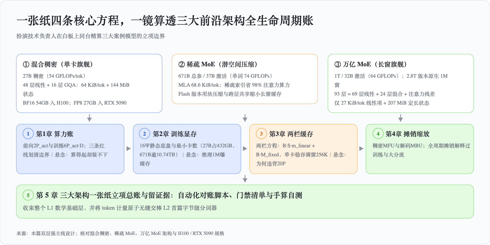
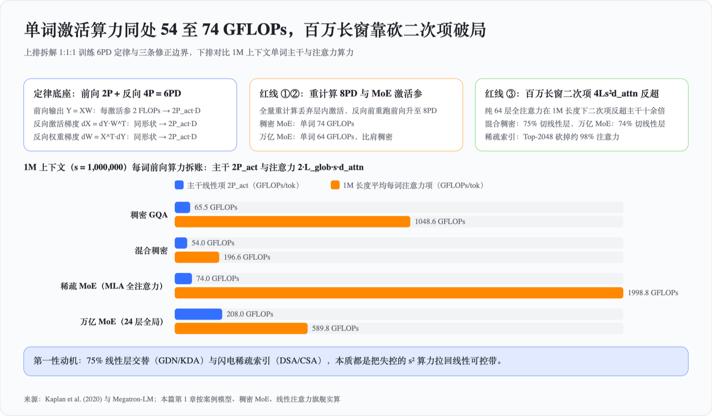
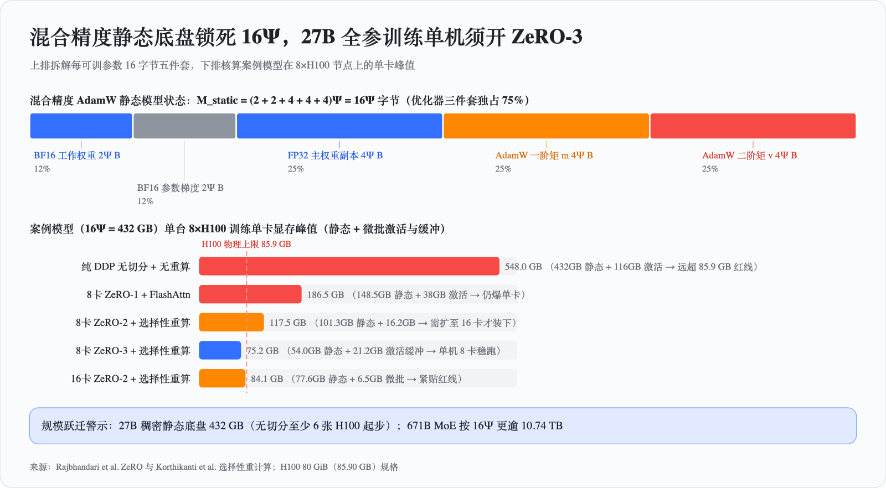
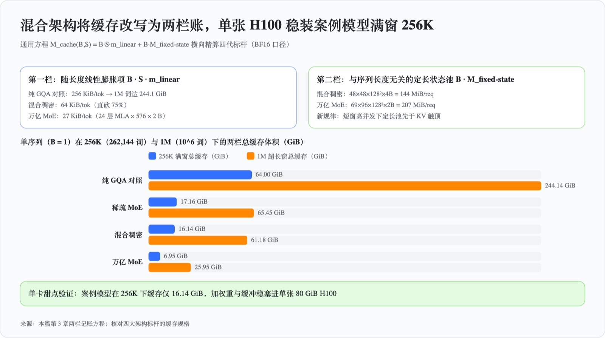
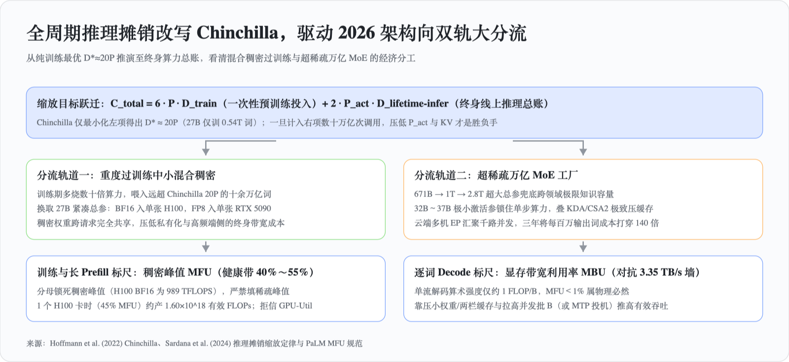
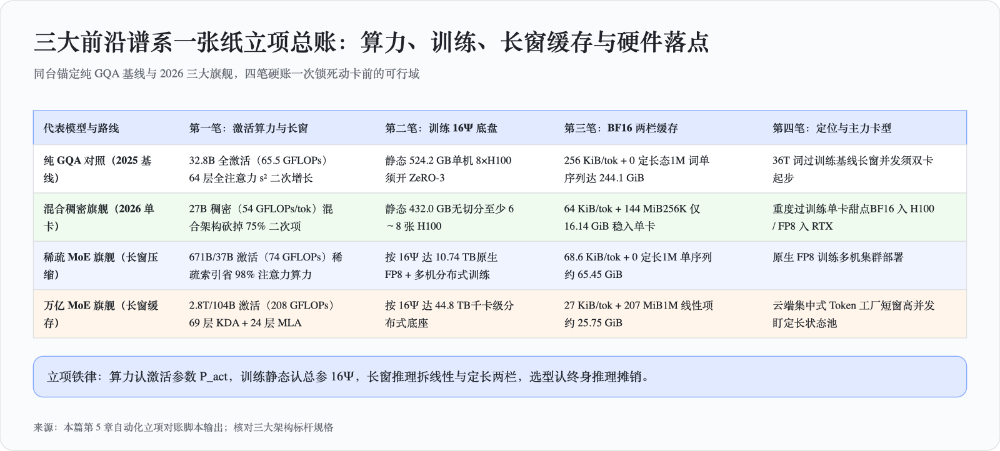

# ZTL-06｜数学｜一张纸算清算力、显存与缩放

> 🎯 **这篇文档解决什么问题**：<b>核心命题：任何大模型立项与容量规划，动卡前都必须先在一张白纸上用四条硬公式定准物理边界。</b>前向 `2P` 与训练 `6PD` 定出激活算力总账。静态 `16Ψ` 加动态激活划出训练显存红线。线性增长 `KV` 加定长状态决定长窗口推理并发上限。推理摊销缩放定律则解释了 2026 主流架构为何分化为混合稠密与万亿 `MoE` 两条路线。
>
> **使用方式与阅读地图**：本篇是 L1 数学基础层的收官之作。我们将站在技术负责人视角，对三类 2026 前沿架构做全生命周期立项精算。五章顺着算力总账、训练显存、推理缓存与缩放分流递进展开，以单卡混合稠密旗舰（下文称案例模型）贯穿全程，同时在每章末对照稀疏压缩谱系与超大混合稀疏路线。全篇规格核对于 2026 年 11 月 16 日。
>
> **动手实践**：第 4 章提供零外部依赖的“一张纸全能账单计算器”。第 5 章交付三大前沿谱系立项断言脚本。复制到任意 `Python 3.10+` 环境即可秒级跑通。读者可亲手复核算力、`16Ψ` 底盘、`256K/1M` 两栏缓存与终身摊销算式。

<b>🧭 主线位置</b>：上一篇 [ZTL-05｜数学｜优化、归一化与数值稳定](./05-optim-norm.md) 讲透了 `AdamW` 解耦权重衰减、`RMSNorm` 与低精度格式的数值稳定支点。本篇把前五篇的单步矩阵乘、反向双梯度与优化器状态收束为整网四笔硬账，正式为 L1 数学基础层收官。读完即可跨入 L2 模型结构层首篇 [ZTL-07｜模型｜亲手实现分词](./07-tokenizer.md)，拆解字节级分词器如何切分词表整数。

## 导读 · 先给结论

- <b>单词前向约 2P_act，训练约 6P_act·D，立项须严守三条修正红线。</b>稀疏 MoE 两款单词主干算力仅 74 / 64 GFLOPs。它们与稠密案例模型（54 GFLOPs）同处一档。百万上下文下纯全局注意力二次项反超主干十余倍，直接驱动 `GDN`、`KDA` 与 `DSA/CSA` 削减二次项算力[[1]](https://arxiv.org/abs/2001.08361)[[2]](https://huggingface.co/Qwen/Qwen3.8-27B/blob/main/config.json)[[3]](https://arxiv.org/abs/2412.19437)[[4]](https://huggingface.co/moonshotai/Kimi-K3)。
- <b>混合精度 AdamW 静态显存固定占 16Ψ 字节，27B 全参训练至少需 6 至 8 张 H100。</b>`BF16` 权重与梯度各占 2 字节，`FP32` 主副本与双动量矩各占 4 字节。案例模型仅静态底盘就达 432 GB，单机 8 卡须开 ZeRO-3。稠密 MoE 按同口径更逾 10.74 TB[[3]](https://arxiv.org/abs/2412.19437)[[5]](https://arxiv.org/abs/1910.02054)。
- <b>2026 混合架构将推理缓存改写为“线性增长 KV + 定长循环状态”两栏方程。</b>案例模型靠混合层砍二次项、压为 64 KiB/tok + 144 MiB 定长态。256K 满窗连同权重稳塞进单张 H100。万亿 MoE 压至 27 KiB/tok + 207 MiB，1M 窗口下线性项约 25.75 GiB[[2]](https://huggingface.co/Qwen/Qwen3.8-27B/blob/main/config.json)[[4]](https://huggingface.co/moonshotai/Kimi-K3)[[6]](https://arxiv.org/abs/2305.13245)[[7]](https://arxiv.org/abs/2505.09388)。
- <b>训练与长预填充紧盯硬件稠密峰值 MFU，逐词解码必须改看带宽利用率 MBU。</b>千卡预训练稠密 `MFU` 落在 `40% ～ 55%` 即属一线水准。评估时严禁拿稀疏峰值做分母或轻信 `GPU-Util` 虚高读数。单流解码算术强度仅约 `1 FLOP/Byte`，吞吐上限完全取决于显存读取速率[[8]](https://arxiv.org/abs/2204.02311)[[9]](https://doi.org/10.1145/1498765.1498785)。
- <b>把万亿次线上调用纳入总账后，Chinchilla 20P 配比让位于双轨架构大分流。</b>高频单卡与私有化场景靠重度过训练案例模型压低终身解码带宽成本。云端集中式 Token 工厂靠超大总参保知识容量。配合极小激活参与缓存压缩，百万输出词成本三年间下降了 140 倍[[7]](https://arxiv.org/abs/2505.09388)[[10]](https://arxiv.org/abs/2203.15556)[[11]](https://arxiv.org/abs/2401.00448)。



<b>📎 与系列其他文档的分工</b>：单次矩阵乘形状与低秩分解回顾 [ZTL-01｜数学｜符号、向量与矩阵乘法](./01-matmul.md)，反向梯度与 `AdamW` 低精度机制见 [ZTL-04｜数学｜链式法则与 softmax-交叉熵的梯度](./04-backprop.md) 与 [ZTL-05｜数学｜优化、归一化与数值稳定](./05-optim-norm.md)。分词压缩率对总词数的影响交由 [ZTL-07｜模型｜亲手实现分词](./07-tokenizer.md)，现代注意力结构详见 [ZTL-08｜模型｜把注意力写成矩阵](./08-attention.md)。

进入系统与对齐阶段后，多卡并行通信与低秩微调分别归入 [ZTL-12｜训练｜多卡的账和中断后续上](./12-multi-gpu.md) 与 [ZTL-15｜后训练｜只训练一小部分参数](./15-lora.md)。思考预算调度、双态内存池、片上分块内核、量化与万亿 `MoE` 集群账单则在第 18～24 篇展开。

## 第 1 章 · 算力二次项的三条红线

立项评审会在白板上落下的第一笔永远是算力总账。推理吐一个词要多少次浮点运算？训完十余万亿词又要消耗多少万卡时[[1]](https://arxiv.org/abs/2001.08361)？几乎所有工程报告都会直接写出前向 `2P` 与训练 `6PD`。要想在 2026 年的混合线性层、百万上下文与万亿稀疏模型面前不踩坑，我们必须先把前四篇的矩阵乘与反向梯度拼起来。下面亲手证出这两条公式，并划清三条修正红线。

### 1.1 逐模块清点参数 P 与单词前向 2P_act 的精确来历

先汇总 [ZTL-01｜数学｜符号、向量与矩阵乘法](./01-matmul.md) 的矩阵乘法则。业界硬件规范统一把一次融合乘加（1 次乘法加 1 次加法）计为 `2 FLOPs`。一块含 $`P_W = m \cdot n`$ 个标量参数的线性权重矩阵处理单个词元向量时，矩阵乘形状为 `(1, m) × (m, n)`。它恰好执行 `m·n` 次乘加，耗费 $`2 P_W`$ 次浮点运算[[1]](https://arxiv.org/abs/2001.08361)[[12]](https://arxiv.org/abs/2104.04473)。

相比之下，层内均方根归一化（`RMSNorm`）与门控激活仅含数千个逐元素标量操作，占比不足万分之一。输入词嵌入层（`embed_tokens`）只是按整数词号查表拷行，零矩阵乘开销。唯独顶部的输出词表投影头（`lm_head`）实打实执行了一次词表维矩阵乘。

我们在白板上直接拆解 2026 单卡混合稠密旗舰 `混合架构旗舰`。该模型共 64 层，隐藏维 `d = 5120`，前馈中间维 `17408`，非共享词表 `248,320`[[2]](https://huggingface.co/Qwen/Qwen3.8-27B/blob/main/config.json)。全网参数由四块拼成：64 层门控前馈网络（`SwiGLU`）含 `17.11B`，16 层全局门控分组查询注意力（`Gated GQA`）含 `1.68B`。其余 48 层门控线性注意力（`GDN`）主投影含约 `5.56B`，输入嵌入与独立输出头各占 `1.27B`[[2]](https://huggingface.co/Qwen/Qwen3.8-27B/blob/main/config.json)[[13]](https://arxiv.org/abs/2412.06464)。

全网总参合计约 `26.9B`（通称 `27B`）。扣除只查表不乘加的输入嵌入后，实际参与矩阵乘的参数约 `25.6B`。工程立项按标称激活规模 `27B` 口算，单词前向主干算力即为 `54 GFLOPs`。对照 2025 纯 `GQA` 基线 `Qwen3-32B`（`32.76B`），单词算力则为 `65.5 GFLOPs`[[2]](https://huggingface.co/Qwen/Qwen3.8-27B/blob/main/config.json)[[7]](https://arxiv.org/abs/2505.09388)。处理 $`T`$ 个词元的主干前向算力通式由此确定：

```math
C_{\text{infer}} \approx 2 P_{\text{act}} \cdot T
```

### 1.2 反向传播双倍矩阵梯度与整轮训练 6PD 定律

转入预训练或全参微调后，每步迭代都必须串起 [ZTL-04｜数学｜链式法则与 softmax-交叉熵的梯度](./04-backprop.md) 推导的反向链式法则[[12]](https://arxiv.org/abs/2104.04473)。设当前训练批次共含 `N = B·s` 个词元，任意线性层记作 `Y = XW`。其中输入激活 `X` 为 `(N, m)`，权重 `W` 为 `(m, n)`。走完一轮参数更新，该线性层必须依次跑满三笔等规模的通用矩阵乘：

- <b>前向计算层输出。</b>执行 `Y = XW`，形状为 `(N, m) × (m, n)`，耗费 `2·P_W·N` 次浮点运算。
- <b>反向传回上游激活梯度。</b>执行 $`\nabla_X \mathcal{L} = (\nabla_Y \mathcal{L}) W^\top`$ ，耗费 `2·P_W·N` 次浮点运算。
- <b>反向累积当前权重梯度。</b>执行 $`\nabla_W \mathcal{L} = X^\top (\nabla_Y \mathcal{L})`$ ，同样耗费 `2·P_W·N` 次浮点运算。

三笔矩阵乘严格呈 `1 : 1 : 1` 对齐，反向传播算力恰好是前向的两倍。至于末端 `AdamW` 优化器更新（回顾 [ZTL-05｜数学｜优化、归一化与数值稳定](./05-optim-norm.md)），每个参数每步仅做十余次标量加乘。分摊到数百万词元的全局批次后，这部分占比低于千分之一。因此在总词数为 $`D`$ 的预训练语料上，整轮训练算力精准收敛为经典定律[[1]](https://arxiv.org/abs/2001.08361)[[12]](https://arxiv.org/abs/2104.04473)：

```math
C_{\text{train}} \approx 6 P_{\text{act}} \cdot D
```

顺手还能看清冻结主干微调（如 `LoRA`，详见 [ZTL-15｜后训练｜只训练一小部分参数](./15-lora.md)）的算力折扣。主干权重冻结后省去了第三笔权重梯度 `2PD`。但前向与反向激活梯度仍须逐层穿过全网，单步训练算力随之从 `6PD` 降至约 `4PD`。

### 1.3 三条修正红线：重算、激活参与二次项

在白板上套用 `2P` 与 `6PD` 前，技术负责人必须逐一核查三条失准边界[[3]](https://arxiv.org/abs/2412.19437)[[4]](https://huggingface.co/moonshotai/Kimi-K3)[[14]](https://arxiv.org/abs/2205.05198)：

- <b>红线一：全量激活重计算将硬件实跑算力抬升至 8PD。</b>开启全量梯度检查点时，前向仅保留每层入口激活。反向求导前必须把整层前向 `2PD` 重跑一遍，显卡实付运算量升至 `8PD`，多耗费 `33%` 卡时。现代训练栈改用选择性重计算配合 `FlashAttention`，可将额外算力开销压回 `2% ～ 4%`[[14]](https://arxiv.org/abs/2205.05198)[[15]](https://arxiv.org/abs/2205.14135)。
- <b>红线二：MoE 模型必须严格填入每词激活参数 P_act。</b>`DeepSeek-V3` 总参达 `671B`，每词仅路由激活 `37B`。`Kimi K2` 总参达 `1T`，每词仅激活 `32B`[[3]](https://arxiv.org/abs/2412.19437)[[16]](https://arxiv.org/abs/2507.20534)。代入 `2P_act` 可知两者单词主干算力仅为 <b>`74 GFLOPs` 与 `64 GFLOPs`</b>，与稠密模型 `混合架构旗舰` 的 <b>`54 GFLOPs`</b> 同处一档。
- <b>红线三：百万上下文下全局注意力二次项反超主干十余倍。</b>序列长为 $`s`$ 时，单序列前向注意力算力达 $`4 L s^2 d_{\text{attn}}`$ ，因果掩码跳过上三角后折半为 `2·L·s²·d_attn`[[12]](https://arxiv.org/abs/2104.04473)[[15]](https://arxiv.org/abs/2205.14135)。拿 64 层纯全局 `Qwen3-32B`（`d_attn = 8192`）核验，每词注意力算力在 `64K` 即达 `67.1 GFLOPs` 反超主干。拉到 `1M`（`10^6` 词）时更飙至 <b>`1,048.6 GFLOPs/tok`</b>，高达主干的 `16` 倍！

这正是 2026 三大旗舰集体削减二次项的核心动机。`混合架构旗舰` 将 `75%` 的层（48 层）切为线性递推 `GDN`，仅留 16 层全局层并收窄查询维至 `6144`，把 `1M` 注意力算力削减 <b>`81.3%`</b>[[2]](https://huggingface.co/Qwen/Qwen3.8-27B/blob/main/config.json)[[13]](https://arxiv.org/abs/2412.06464)。`Kimi K3`（`2.8T MoE`，93 层）将 69 层切为 `KDA` 线性注意力，仅留 24 层 `Gated MLA`，同样削减注意力算力约 73%[[4]](https://huggingface.co/moonshotai/Kimi-K3)[[17]](https://arxiv.org/abs/2510.26692)。`DeepSeek-V3.2` 则靠稀疏索引削减长窗注意力计算[[3]](https://arxiv.org/abs/2412.19437)[[18]](https://arxiv.org/abs/2405.04434)。



读图时按同一口径：主干每词 `2P_act`，注意力每词约 $`2 \cdot L_{\text{glob}} \cdot s \cdot d_{\text{attn}}`$，取 `s = 1000000`。64 层全局的稠密 GQA 模型注意力项为 `1048.6` GFLOPs，是主干 `65.5` 的十几倍。案例模型只留 16 层全局层，降到 `196.6`。万亿 MoE 主干 `208` GFLOPs，24 层全局 MLA 的注意力项为 `589.8`。未开稀疏筛选的 61 层 MLA 模型则达 `1998.8`。

| **核算场景与模型** | <b>有效算力公式（FLOPs）</b> | **单词主干 2P_act** | **1M 长窗修正与架构对策** |
|---|---|---|---|
| `Qwen3-32B`（纯 GQA） | 训练 $`6 P D`$ （全重算 $`8 P D`$ ） | `65.5 GFLOPs/tok` | 64 层全二次项，1M 注意力超主干 16 倍 |
| `混合架构旗舰`（3:1 混合） | $`2 P T + 2 L_{\text{glob}} B s^2 d_{\text{attn}}`$ | `54.0 GFLOPs/tok` | 48 层切 GDN 线性态，二次项直降 81.3% |
| `DeepSeek-V3 / V3.2` | 严格取激活参 $`P_{\text{act}} = 37\text{B}`$ | `74.0 GFLOPs/tok` | V3.2 靠 DSA 筛 Top-2048 省约 98% 注意力 |
| `Kimi K2 / K3`（MoE） | K2 取 $`P_{\text{act}} = 32\text{B}`$ 计主干 | K2 为 `64.0 GFLOPs/tok` | K3 用 69 层 KDA + 24 层 MLA 砍 74% 二次层 |

> 💡 **常见误区**：估算 `DeepSeek-V3` 在 `14.8T` 语料上的预训练算力时，误拿 `671B` 总参代入 `6PD` 算出 `5.96 × 10^25 FLOPs`。**现象**：预算卡时虚高 18 倍，导致立项无端受阻。**根因**：混淆了常驻显存的总参数与每词路由命中的激活参数[[3]](https://arxiv.org/abs/2412.19437)。**改法**：算力公式一律代 `37B` 激活参，得主干算力约 `3.29 × 10^24 FLOPs`。该结果与官方公布的 `278.8` 万 `H800` 卡时高度吻合。

> 🔑 **本章要点与回到主线**：第一笔总浮点运算量至此算准。前向 `2P_act`、训练 `6P_act·D` 与三条修正红线共同定出了卡时预算。但新的矛盾随之浮现：算得起不代表显卡装得下。哪怕是单卡能跑推理的 `混合架构旗舰`，启动全参混合精度训练时最少要配多少张 `80 GiB H100` 才不会首步爆显存？这正是第 2 章要解决的问题。

## 第 2 章 · 训练显存的 16Ψ 静态账

直接回答上一章留下的首步爆显存悬念。浮点算力账只决定训练一共跑多少天，高带宽显存（`HBM`）容量账却握着一票否决权。只要单步峰值越过物理红线哪怕百兆字节，训练进程就会抛出显存溢出（`OOM`）崩溃[[5]](https://arxiv.org/abs/1910.02054)。在立项白板上，我们启动六步闭环的前两步。先为全参混合精度训练**立目标**，杜绝静态溢出并控住重算损耗。接着逐字节**算上限**，拆清静态底盘与动态激活两本账。

### 2.1 混合精度五件套的 16Ψ 恒等式

设整网可训练参数总数为 $`\Psi`$ 。对于稀疏 MoE 这类模型，单步大批次内几乎所有专家都会收到梯度并参与更新。因此全参训练时 $`\Psi`$ 严格等于**总参数量**，绝非激活参数[[3]](https://arxiv.org/abs/2412.19437)[[5]](https://arxiv.org/abs/1910.02054)。承接 [ZTL-05｜数学｜优化、归一化与数值稳定](./05-optim-norm.md) 的数值稳定准则，标准 `BF16 + AdamW` 管线须在显存常驻五份等长张量[[5]](https://arxiv.org/abs/1910.02054)[[14]](https://arxiv.org/abs/2205.05198)：

- <b>半精度工作权重（BF16）。</b>供前向与反向激活梯度读取，每参数 `2` 字节，合 `2Ψ`。
- <b>半精度参数梯度（BF16）。</b>暂存反向权重导数，每参数 `2` 字节，合 `2Ψ`。若开 `FP32` 梯度累加缓冲则升至 `4Ψ`，总静态账变为 `18Ψ`。
- <b>单精度主权重副本（FP32）。</b>防止相对步长小于 `2^-8` 的微弱更新被半精度舍入吞没，每参数 `4` 字节，合 `4Ψ`。
- <b>AdamW 一阶动量矩 m（FP32）。</b>维护梯度的指数移动平均，每参数 `4` 字节，合 `4Ψ`。
- <b>AdamW 二阶方差矩 v（FP32）。</b>维护梯度平方的指数移动平均，每参数 `4` 字节，合 `4Ψ`。

五项相加，即得统领分布式训练架构的静态显存第一定律[[5]](https://arxiv.org/abs/1910.02054)：

```math
M_{\text{static}} = (2 + 2 + 4 + 4 + 4)\Psi = 16\Psi
```

在白板上**算上限**前，务必先校准十进制与二进制单位差[[19]](https://physics.nist.gov/cuu/Units/binary.html)[[20]](https://resources.nvidia.com/en-us-tensor-core/nvidia-tensor-core-gpu-datasheet)。厂商宣传页标注的“`H100 80GB`”，物理芯片实为二进制 <b>`80 GiB`</b>。折合十进制字节恰为 <b>`85.90 GB`</b>，两者相差 `7.4%`。现在手算三款代表模型的全参静态底盘与并行分界：

- <b>案例模型最小卡数底线（Ψ = 27B）。</b>静态底盘达 `27 × 16 = 432.0 GB`（`402.3 GiB`），优化器三件套独占 `324.0 GB`（占比 `75%`）。除以单卡上限 `85.90 GB` 得 `5.03`，物理上**至少要 6 张 H100**。按整机拓扑对齐，工程须从单台 <b>`8×H100` 节点</b>起步[[2]](https://huggingface.co/Qwen/Qwen3.8-27B/blob/main/config.json)[[20]](https://resources.nvidia.com/en-us-tensor-core/nvidia-tensor-core-gpu-datasheet)。
- <b>单机 8 卡 ZeRO 阶段分界。</b>在 8 卡节点上若只开 `ZeRO-1`（单卡静态 `148.5 GB`）或 `ZeRO-2`（单卡静态 `101.25 GB`），单卡静态占用依旧越过 `85.90 GB` 红线。单机 8 卡全参训练 `27B` 模型，必须开启切分权重的 <b>`ZeRO-3 / FSDP`</b>（单卡静态降至 `54.0 GB`），或扩至 16 卡跑 `ZeRO-2`[[5]](https://arxiv.org/abs/1910.02054)。
- <b>万亿稀疏集群底盘。</b>按标准 16Ψ 核算，稠密 MoE 静态底盘逾 10.74 TB。万亿 MoE 更达 16.0 TB 与 44.8 TB。这要求跨数十节点做专家并行、流水线并行与 `ZeRO-1` 联合切分（详见 [ZTL-12｜训练｜多卡的账和中断后续上](./12-multi-gpu.md)）[[3]](https://arxiv.org/abs/2412.19437)[[4]](https://huggingface.co/moonshotai/Kimi-K3)[[16]](https://arxiv.org/abs/2507.20534)[[21]](https://arxiv.org/abs/2209.05433)。



对照上方显存拆解图可知，优化器三件套独占了静态底盘的四分之三。`ZeRO` 三个阶段正是顺着这张账单逐级动刀：一阶段只切 `12Ψ` 优化器状态，二阶段再切 `2Ψ` 梯度，三阶段连最后 `2Ψ` 工作权重一并切碎，这才把单卡静态底盘压进 `54.0 GB` 安全线。

### 2.2 随 B×S 膨胀的动态激活账与选择性重计算权衡

靠多卡切分压平 `16Ψ` 静态底盘后，余下显存就要留给随微批 `B_micro` 与序列长 `s` 涨落的中间激活张量[[14]](https://arxiv.org/abs/2205.05198)。回看权重梯度式 $`\nabla_W \mathcal{L} = X^\top (\nabla_Y \mathcal{L})`$ 。前向跑完全部 `L` 层后，误差才从损失端逐层倒传。反向算到第 `ℓ` 层之前，前向留下的线性输入 `X`、门控中间态及块内状态都必须驻留显存待命。

未开 `FlashAttention` 时，全局层物化 `s × s` 概率矩阵会引发二次方显存爆炸。启用 `FlashAttention` 分块重算后，全局层仅存输出与对数求和统计量。整网激活随之回归与 `L · B_micro · s · d` 成正比的线性规律[[14]](https://arxiv.org/abs/2205.05198)[[15]](https://arxiv.org/abs/2205.14135)。即便如此，对 64 层案例模型，在 `B_micro = 2, s = 8192` 下若不开重计算，单卡动态激活仍高达约 `116 GB`。

工程削平激活峰值严守三步次序。第一步用**梯度累积**把百万词级大批拆成 `B_micro = 1 ～ 2` 的微批串行累加导数。第二步开**选择性激活重计算**，仅丢弃体积大但重算极轻的中间态。它以约 `3%` 的算力代价削去逾 `70%` 激活显存，避开全量重算 `8PD` 的开销。第三步预留 `5% ～ 8%` 余量容纳通信分桶与分配器碎片[[14]](https://arxiv.org/abs/2205.05198)。

若团队预算有限，还可从精度位宽与可训参数量两端减负。稠密 MoE 采用原生 `FP8`（`1×128` 细粒度激活与 `128×128` 块权重缩放），将工作权重与前向激活体积双双减半[[3]](https://arxiv.org/abs/2412.19437)[[21]](https://arxiv.org/abs/2209.05433)。

而在后训练微调场景下，可冻结案例模型的 `54 GB` 半精度底座并挂载全层 `r=16` 低秩适配器（可训参数仅 `1.05 亿`）。此时 `16Ψ` 状态当场从 `432 GB` 骤降至 `1.68 GB`。单张 `80 GiB H100` 即可留出近 `30 GB` 充裕空间开训（详见 [ZTL-15｜后训练｜只训练一小部分参数](./15-lora.md)）。阅读下表时请留意 `ZeRO-3` 一行的细微特点：切到 `ZeRO-3` 后动态区从 `16.2 GB` 微升至 `21.2 GB`，多出的 `5.0 GB` 正是按层临时拼回完整权重的通信聚合缓冲：

| **案例模型并行配置** | <b>单卡静态底盘（GB）</b> | **单卡激活与通信缓冲** | **单卡总峰值与可行性判定** |
|---|---|---|---|
| 纯 DDP 无切分 + 无重算 | `432.0`（完整 `16Ψ`） | 约 `116.0 GB` | `548.0 GB`（超 85.9 GB 红线，OOM） |
| 8 卡 ZeRO-1 + FlashAttn | `148.5`（$`4\Psi + 12\Psi/8`$） | 约 `38.0 GB` | `186.5 GB`（权重加梯度已爆单卡） |
| 8 卡 ZeRO-2 + 选择性重算 | `101.3`（$`2\Psi + 14\Psi/8`$） | 约 `16.2 GB` | `117.5 GB`（仍超单卡，须扩 16 卡） |
| 8 卡 ZeRO-3 + 选择性重算 | `54.0`（全切分 $`16\Psi/8`$） | 约 `21.2 GB`（含聚合缓冲） | `75.2 GB`（单机 8×H100 稳跑达标） |
| 16 卡 ZeRO-2 + 选择性重算 | `77.6`（$`2\Psi + 14\Psi/16`$） | 严控微批压至 `≤ 6.5 GB` | 约 `84.1 GB`（紧贴红线，宜配 TP=2） |

> 💡 **常见误区**：在单机 `8×H100` 上启动 `27B` 全参微调遭遇首步 OOM 时，把微批压到 `1` 并增加梯度累积步数，却始终救不活脚本。**现象**：无论批大小改多小，初始化优化器或首轮反向分配梯度区便立刻崩溃。**根因**：梯度累积只能压缩动态激活，对 `ZeRO-1/2` 下高达 `148.5 / 101.3 GB` 的静态底盘毫无作用[[5]](https://arxiv.org/abs/1910.02054)。**改法**：先算清 `16Ψ` 静态分摊账，切至 `ZeRO-3 / FSDP` 切分权重，或改挂 [ZTL-01｜数学｜符号、向量与矩阵乘法](./01-matmul.md) 算过的 `1.68 GB` 低秩 `LoRA`。

> 🔑 **本章要点与回到主线**：经**立目标**与**算上限**拆解，`16Ψ` 静态底盘叠加动态激活决定了从 `27B`（`432 GB`）到 `671B`（`10.74 TB`）的训练最小卡数。但新的矛盾随之浮现：转入线上服务后，`14Ψ` 的梯度与优化器包袱全部卸下。为何喂入 `256K` 至 `1M` 超长上下文时显存依然吃紧？2026 前沿架构的缓存公式又为何演变为“两栏记账法”？这正是第 3 章的核心问题。

## 第 3 章 · 推理显存的两栏记账法

接住上一章抛出的超长上下文推理挑战。模型上线服务后，梯度与优化器状态全部卸除。然而线上容量规划并没有变轻松。为避免自回归生成时重复读取历史 `KV`，推理引擎必须将状态常驻显存。推进闭环的第三步与第四步：把标杆摆上同一张 `256K` 与 `1M` 考卷**测实际**容量，并**找瓶颈**。

### 3.1 建立 2026 现代推理显存通用“两栏记账方程”

先明确不可退让的权重底线。无论稠密还是稀疏 `MoE` 模型，线上任意并发词元随时可能唤醒任意路由专家。整网总参数因此必须常驻显存，权重地板恒为 $`M_{\text{weight}} = P_{\text{total}} \cdot b_w`$ （`BF16` 取 `2` 字节，`FP8` 取 `1` 字节）[[3]](https://arxiv.org/abs/2412.19437)[[21]](https://arxiv.org/abs/2209.05433)。扣除每卡约 `3 ～ 5 GiB` 的运行时缓冲后，集群能接多少路长请求完全取决于状态缓存。

在 2025 年以前的纯 Transformer 教材里，缓存只有随序列长 `S` 线性增长的键值缓存（`KV Cache`）一栏[[6]](https://arxiv.org/abs/2305.13245)[[22]](https://arxiv.org/abs/2309.06180)。跨入 2026 年，`GDN` 线性注意力、`KDA` 循环状态与滑窗块压缩全面普及。若仍拿总层数硬乘旧公式，结果会直接算错四倍以上。现代推理缓存必须升级为**通用两栏记账方程**[[2]](https://huggingface.co/Qwen/Qwen3.8-27B/blob/main/config.json)[[4]](https://huggingface.co/moonshotai/Kimi-K3)：

```math
M_{\text{cache}}(B, S) = B \cdot S \cdot m_{\text{linear}} + B \cdot M_{\text{fixed-state}}
```

方程右端将单请求状态拆成特性迥异的两栏。第一栏 $`S \cdot m_{\text{linear}}`$ 仅统计**少数全局注意力层**随长度线性增长的字节数。其中标准 `GQA` 层每词为 $`2 L_{\text{glob}} H_{\text{kv}} d_h b_{\text{kv}}`$ ，`MLA` 潜空间层每词为 $`576 L_{\text{glob}} b_{\text{kv}}`$ [[6]](https://arxiv.org/abs/2305.13245)[[18]](https://arxiv.org/abs/2405.04434)。第二栏 $`M_{\text{fixed-state}}`$ 则统计**多数线性注意力层（GDN/KDA）与定长滑窗**的固定状态池。它只随并发数 $`B`$ 线性累加，对序列长是 `4K` 还是 `1M` 完全不敏感[[13]](https://arxiv.org/abs/2412.06464)[[17]](https://arxiv.org/abs/2510.26692)。

### 3.2 同考卷横向精算：256K 与 1M 算账对照

统一采用无损 `BF16` 缓存口径（线性层状态按官方运行时精度）。我们在 `256K`（`262,144` 词）与 `1M`（`10^6` 词）考卷上逐一**测实际**显存账[[19]](https://physics.nist.gov/cuu/Units/binary.html)：

- <b>基线对照 Qwen3-32B（纯 GQA 64 层，64Q/8KV×128）。</b>定长态为 `0`，全部 64 层计入第一栏，每词占 `262,144 B = 256 KiB/tok`[[7]](https://arxiv.org/abs/2505.09388)。`256K` 单序列占掉 `64.00 GiB`。拉到 `1M` 词时单条缓存飙至 <b>`244.14 GiB`</b>（`262.14 GB`），未加载权重就已超出单机容量。
- <b>单卡混合旗舰（混合架构）。</b>第一栏仅剩 16 层全局层（`4KV × 256`），每词降至 `64 KiB/tok`，直降 `75%`。第二栏由 48 层 `GDN`（48 值头、`128 × 128` 矩阵，`FP32` 占 `4 B`）构成。每请求恒占 `144.0 MiB/req`，`256K` 满窗合计仅需 <b>`16.14 GiB`</b>[[2]](https://huggingface.co/Qwen/Qwen3.8-27B/blob/main/config.json)[[13]](https://arxiv.org/abs/2412.06464)。
- <b>万亿混合旗舰（万亿 MoE）。</b>第一栏 24 层 `MLA` 每词仅占 `24 × 576 × 2 B = 27.0 KiB/tok`。第二栏 69 层 `KDA`（96 头 `BF16` 状态）每请求占 `207.0 MiB/req`[[4]](https://huggingface.co/moonshotai/Kimi-K3)[[17]](https://arxiv.org/abs/2510.26692)。在百万长窗下，单序列线性项压至约 <b>`25.8 ～ 26.4 GiB`</b>。
- <b>潜空间与块压缩旗舰（稠密 MoE）。</b>稠密 MoE 靠 61 层混合机制将每词压至 68.6 KiB/tok。后续版本进一步通过块压缩与线性注意力削减长窗缓存[[3]](https://arxiv.org/abs/2412.19437)。

单看案例模型的单卡部署红利尤为直观。`16.14 GiB` 满窗缓存加上 `54 GB`（`50.3 GiB`）`BF16` 权重与 `4.0 GiB` 运行时开销，整卡共占 <b>`70.4 GiB`</b>，稳稳装进<b>单张 `80 GiB H100`</b>。若转为 `FP8`，更可装入单张工作站卡[[20]](https://resources.nvidia.com/en-us-tensor-core/nvidia-tensor-core-gpu-datasheet)[[21]](https://arxiv.org/abs/2209.05433)。



图中对照组是 64 层纯 GQA 模型：每词 256 KiB，单条 1M 序列达 `244.1 GiB`，三张 H100 都装不下。

结合上方两栏曲线图，我们可以把案例模型的两个关键数字逐项拆到字节。第一栏共 `16` 层全局层，每层含 `4` 个宽 `256` 的键值头且双张量各占 `2` 字节。逐项连乘得 $`16 \times 2 \times 4 \times 256 \times 2 = 65{,}536\text{ B}`$ 。这就对应图中精确的 `64.0 KiB/tok` 增长斜率。

第二栏共 `48` 层 `GDN`，每层维护 `48` 个 `128 × 128` 的单精度循环矩阵。每个元素占 `4` 字节，连乘得 $`48 \times 48 \times 128 \times 128 \times 4 = 150{,}994{,}944\text{ B}`$ 。折合二进制恰为恒定的 `144.0 MiB` 纵轴截距。斜率削去四分之三且截距固定，满窗缓存才得以骤降至 `16.14 GiB`。

### 3.3 新架构瓶颈：定长状态何时反超 KV 池

两栏方程不仅算清了长窗红利，还在**找瓶颈**时揭示了 2026 混合引擎的新规律[[4]](https://huggingface.co/moonshotai/Kimi-K3)[[22]](https://arxiv.org/abs/2309.06180)。令两栏单请求体积相等：对 `Qwen3.8-27B`，临界词长为 $`144\text{ MiB} / 64\text{ KiB} = 2{,}304`$ 词。对 `Kimi K3`，临界词长更高达 <b>$`207\text{ MiB} / 27\text{ KiB} \approx 7{,}850`$ 词</b>。

一旦线上承载高并发中短请求（如平均 `S = 2,048` 词、并发 `B = 512` 路），`Kimi K3` 的 `MLA` 键值池仅占 `27.0 GiB`。反观 69 层定长 `KDA` 状态池却占去 `512 × 207 MiB = 103.5 GiB`，近四倍于 KV 池。再对比缓存追平权重的并发总词数拐点：纯 `GQA` 的 `Qwen3-32B` 在约 `25.0 万`并发词处即追平权重。而 `Qwen3.8-27B` 将拐点推迟至约 <b>`82.4 万`并发词</b>（`54 GB / 65,536 B`），单机吞吐弹性拓宽逾三倍[[2]](https://huggingface.co/Qwen/Qwen3.8-27B/blob/main/config.json)[[7]](https://arxiv.org/abs/2505.09388)。

此外，`PagedAttention` 前缀缓存可让百路请求共享只读提示词的全局 `KV` 页[[22]](https://arxiv.org/abs/2309.06180)。但每个活跃请求的循环状态矩阵在解码中途原地覆写，无法跨步细粒度共享。投机解码时需配合 `ReplaySSM` 轻量输入重放（仅存约 `1 KB` 历史输入重算状态）避免复制百兆矩阵[[4]](https://huggingface.co/moonshotai/Kimi-K3)。`DeepSeek-V4` 则把条件记忆表 `Engram` 卸载至主机内存，驱动引擎演进为多池异构管理（详见 [ZTL-19｜系统｜判断慢在哪，以及请求怎样排队](./19-serving-latency.md) 与 [ZTL-24｜系统｜长上下文与混合专家怎样改变账单](./24-long-context-moe.md)）。下表汇总四代模型两栏总账：

| <b>代表模型（BF16 口径）</b> | **第一栏线性项 m_linear** | **第二栏定长态 M_fixed** | **256K / 1M（10^6 词）单路总缓存** |
|---|---|---|---|
| `Qwen3-32B`（纯 GQA） | `256.0 KiB/tok`（64 层） | `0`（纯线性膨胀） | `64.00 GiB` / <b>`244.14 GiB`</b>（爆单机） |
| `Qwen3.8-27B`（GDN+GQA） | `64.0 KiB/tok`（16 全局层） | `144.0 MiB`（48 层 FP32） | <b>`16.14 GiB`</b>（稳入单卡）/ `61.18 GiB` |
| `Kimi K3`（KDA+MLA） | `27.0 KiB/tok`（24 全局层） | `207.0 MiB`（69 层 BF16） | `6.95 GiB` / <b>约 `25.95 GiB`</b> |
| `DeepSeek-V3`（MLA） | `68.6 KiB/tok`（61 层） | `0`（潜向量线性追加） | `17.16 GiB` / `65.45 GiB`（FP8 减半） |
| `DeepSeek-V4 系列` | 块压缩与滑窗机制 | 进一步压缩全局常驻 | 详见 DeepSeek 官方技术报告 |

> 💡 **常见误区**：给混合模型配置推理池时，只按 `64 KiB/tok` 或 `27 KiB/tok` 估算长窗 `KV`，漏算高并发下的定长状态池与 `GB/GiB` 换算差。**现象**：短对话高峰并发冲上数百路时，`KV` 水位尚不足三成，服务却突然报状态槽位耗尽拒单。**根因**：平均词长短于临界点时，`B · M_fixed-state` 反超线性项成为第一显存大户[[4]](https://huggingface.co/moonshotai/Kimi-K3)。**改法**：严格按两栏方程同步设定最大并发槽位数与分页块上限。

> 🔑 **本章要点与回到主线**：经**测实际**与**找瓶颈**对账，两栏缓存方程还原了 `Qwen3.8-27B` 单卡跑满 `256K` 与 `Kimi K3 / DeepSeek-V4.1` 驾驭 `1M` 长窗的物理机制。但新的矛盾随之浮现：理论峰值要打几折才能算真实训练天数（`MFU`）？既然 `Chinchilla` 定律说 `27B` 训 `0.54T` 词最省钱，为何大厂一边几十倍过训练 `Qwen3.8-27B`，另一边又造出 `2.8T` 万亿 `MoE`？这正是第 4 章的焦点。

## 第 4 章 · 效率与摊销的双轨分流

直面上一章末尾的硬件折扣与商业选型追问。手握前三章算出的理论运算量与显存账单，技术负责人还要跨过两道现实关卡才能拍板**做取舍**。显卡宣传册上的峰值算力打几折才能换算成真实成本？面对有限总预算，该走哪条技术路线[[8]](https://arxiv.org/abs/2204.02311)[[10]](https://arxiv.org/abs/2203.15556)[[11]](https://arxiv.org/abs/2401.00448)？

### 4.1 MFU 与 MBU：两套诊断标尺

把理论总算力 `6P_act·D` 换算为真实训练卡时，行业公认的标尺是<b>模型算力利用率（MFU）</b>[[8]](https://arxiv.org/abs/2204.02311)[[12]](https://arxiv.org/abs/2104.04473)。它定义为单卡每秒产出的无重计算有效模型算力除以芯片<b>稠密（Dense）</b>峰值吞吐率：

```math
\mathrm{MFU} = \frac{6 P_{\text{act}} \cdot (\text{tokens/s/GPU})}{F_{\text{peak-dense}}}
```

核算 `MFU` 必须严守两条防虚标准则[[8]](https://arxiv.org/abs/2204.02311)[[20]](https://resources.nvidia.com/en-us-tensor-core/nvidia-tensor-core-gpu-datasheet)。分母严禁填入厂商海报上的 `2:4` 结构化稀疏峰值。`H100 SXM5` 的 `BF16` 稠密峰值为 <b>`989 TFLOPS`</b>（`FP8` 稠密为 `1,979 TFLOPS`），稀疏翻倍值在常规矩阵乘上无法触发。同时分子永远只计推进样本的有效算力 `6PD`。哪怕全量重计算令硬件实跑 `8PD`，多付出的 `2PD` 也绝不能算进分子。

受跨机通信气泡与逐元素访存制约，千卡预训练实测稠密 `MFU` 落在 <b>`40% ～ 55%`</b> 健康带即属一线水准。记住一个极实用的立项口算锚点：按 `45% MFU` 折算，<b>`1` 个 `H100` 卡时约产出 `1.60 × 10^18` 次有效训练 `FLOPs`</b>。拿总算力除以此数即可快速定出卡时预算。

转入线上推理后，回顾 [ZTL-01｜数学｜符号、向量与矩阵乘法](./01-matmul.md) 的屋脊线模型（`H100 BF16` 脊点为 `295.2 FLOPs/Byte`）[[9]](https://doi.org/10.1145/1498765.1498785)。长文预填充（`Prefill`）并行扫过整段输入，算术强度远超脊点，瓶颈仍在算力端，继续观察 `MFU`。

相反，自回归逐词解码（`Decode`）在单流下每读 `2` 字节权重仅做约 `2` 次运算。算术强度跌至 `1 FLOP/Byte` 附近，`MFU` 低于 `1%` 属于物理必然。此时诊断标尺必须切换为<b>模型带宽利用率（MBU）</b>。它等于单步实读权重加缓存字节速率与物理显存带宽（`H100` 为 `3.35 TB/s`，`RTX 5090` 为 `1.79 TB/s`）之比[[9]](https://doi.org/10.1145/1498765.1498785)[[20]](https://resources.nvidia.com/en-us-tensor-core/nvidia-tensor-core-gpu-datasheet)。

突破解码带宽墙主要有两条工程路径。一条是靠连续批处理拉高并发路数，让数十路请求分摊同一次权重读取。另一条是启用多词预测与块扩散投机草稿。例如案例模型配投机解码在八词块下平均接受多词，稠密 MoE 则内置原生 `MTP` 头。这样无需增加单用户时延，即可把权重复用率放大近五倍（详见 [ZTL-22｜系统｜让草稿减少解码开销](./22-speculative.md)）[[2]](https://huggingface.co/Qwen/Qwen3.8-27B/blob/main/config.json)[[3]](https://arxiv.org/abs/2412.19437)。

> 💡 **常见误区**：巡检节点时看到 `nvidia-smi` 打印 `GPU-Util 99%`，便汇报显卡算力已经吃满。**现象**：面板读数常年贴顶，换算每秒吞吐词数却发现有效 `MFU` 不足 `18%`。**根因**：`GPU-Util` 仅统计采样期内“至少有一个流多处理器驻留线程束”的时间占比。哪怕全卡干等慢速显存而张量核心空转，读数照样高达 `99%`[[23]](https://docs.nvidia.com/datacenter/dcgm/latest/)。**改法**：一律用吞吐词数折算稠密 `MFU / MBU`，并配探针 `PIPE_TENSOR_ACTIVE` 核查张量核心活跃度[[23]](https://docs.nvidia.com/datacenter/dcgm/latest/)。

### 4.2 全周期摊销与双轨选型

现在揭晓本章最核心的选型逻辑。早期 `Kaplan` 缩放律偏爱放大参数[[1]](https://arxiv.org/abs/2001.08361)。随后 `Hoffmann` 等人（`Chinchilla` 团队）在固定纯预训练预算 `C = 6PD` 下拟合损失曲面。他们证明参数与训练词数应等比放大，得出纯训练最优配比 $`D^\star \approx 20 P`$ [[10]](https://arxiv.org/abs/2203.15556)。照此计算，`27B` 模型只该训 `0.54T` 词，`32B` 模型只该训 `0.65T` 词。为何各家大厂集体给 `Qwen3-32B` 投喂 <b>`36T` 词（超 `1,100P`）</b>，给案例模型同样投喂十余万亿语料[[2]](https://huggingface.co/Qwen/Qwen3.8-27B/blob/main/config.json)[[7]](https://arxiv.org/abs/2505.09388)？

根源在于优化的目标函数变了。`Chinchilla` 只最小化一次性预训练电费，漏算了模型上线后服务数十万亿词元的推理总电费与卡数账单[[11]](https://arxiv.org/abs/2401.00448)。站在全生命周期视角**做取舍**，技术负责人真正要最小化的是训练加终身推理合并总账[[11]](https://arxiv.org/abs/2401.00448)：

```math
C_{\text{total}} = 6 P_{\text{train-act}} D_{\text{train}} + 2 P_{\text{act}} D_{\text{lifetime-infer}}
```

审视方程右端的两项博弈，2026 主流架构为何集体分化为**两条技术路线**即可看清：

- <b>分流路线一：重度过训练混合稠密模型。</b>面向企业私有化机房与高频单机部署，卡数预算严苛且解码带宽昂贵。研发方宁可在预训练期多投二三十倍算力（后训练再配弹性思考预算，见 [ZTL-18｜后训练｜多想一会儿是否值得](./18-test-time-compute.md)），也要把旗舰能力浓缩进 <b>`27B`</b> 躯壳与 `64 KiB/tok` 缓存里。装进单张 `80 GiB H100` 后，数月即可摊平前期投入[[2]](https://huggingface.co/Qwen/Qwen3.8-27B/blob/main/config.json)[[11]](https://arxiv.org/abs/2401.00448)。
- <b>分流路线二：超稀疏万亿 MoE 云端 Token 工厂。</b>面对自然语料边际递减与云端高并发汇聚，大厂将总参拉升至 671B → 1T → 2.8T（后续版本再配主机内存卸载的记忆表）保障知识容量。同时把激活参控制在 <b>`32B ～ 37B`</b> 并通过块压缩等技术压低百万长窗缓存。这套设计在三年间把百万输出词价格压低了 <b>`140` 倍</b>[[3]](https://arxiv.org/abs/2412.19437)[[4]](https://huggingface.co/moonshotai/Kimi-K3)[[16]](https://arxiv.org/abs/2507.20534)。



### 4.3 可运行代码：一张纸全能立项账单计算器

下方零依赖 `Python` 脚本把四条硬公式收拢进一个纯函数，同台核验三大案例模型的全周期立项账单：

*一张纸全能账单计算器：一次核清激活算力、16Ψ 最小卡数、256K 两栏缓存、稠密 MFU 与终身算力总账*

```python
import math

GIB_TO_GB = (1024 ** 3) / 1e9  # 1 GiB = 1.073741824 GB

def one_page_ledger(p_tot_b, p_act_b, m_lin_b, m_fix_mib, l_glob, d_attn,
                    s_infer=262144, b_infer=1, d_train_t=15.0, d_infer_t=50.0, tps_gpu=0):
    # 1. 第一笔算力账：单词主干 2P_act 与 256K 因果半角全局注意力平均每词算力
    c_tok_gflops = 2.0 * p_act_b
    attn_tok_gflops = (2.0 * l_glob * s_infer * d_attn) / 1e9
    # 2. 第二笔训练显存账：16Ψ 静态底盘（十进制 GB）与物理无溢出理论最小 H100 卡数
    m_static_gb = 16.0 * p_tot_b
    min_h100 = math.ceil(m_static_gb / (80.0 * GIB_TO_GB))
    # 3. 第三笔推理两栏缓存账：B*S*m_linear + B*M_fixed-state（二进制 GiB）
    cache_gib = (b_infer * s_infer * m_lin_b) / (1024 ** 3) + (b_infer * m_fix_mib) / 1024.0
    # 4. 第四笔效率与缩放账：H100 BF16 稠密 MFU、Chinchilla 20P 与全周期总算力（10^24 FLOPs）
    mfu_pct = (6.0 * p_act_b * 1e9 * tps_gpu) / 989e12 * 100.0 if tps_gpu else 0.0
    chinchilla_t = (20.0 * p_act_b) / 1000.0
    c_life_yotta = (6.0 * p_act_b * d_train_t + 2.0 * p_act_b * d_infer_t) / 1000.0
    return {
        "tok_gflops": round(c_tok_gflops, 1),
        "attn_256k_gflops": round(attn_tok_gflops, 1),
        "static_16psi_gb": round(m_static_gb, 1),
        "min_h100": min_h100,
        "cache_256k_gib": round(cache_gib, 2),
        "mfu_pct": round(mfu_pct, 1),
        "chinchilla_20p_T": round(chinchilla_t, 2),
        "c_life_1e24": round(c_life_yotta, 2),
    }

# tps_gpu 是假设的单卡吞吐（按约 45% MFU 反推），只用来演示公式，不是实测
print("Qwen3.8-27B:", one_page_ledger(27.0, 27.0, 65536, 144.0, 16, 6144, tps_gpu=2750))
print("DeepSeek-V3:", one_page_ledger(671.0, 37.0, 70272, 0.0, 61, 16384, d_train_t=14.8, tps_gpu=2000))
print("Kimi-K3:", one_page_ledger(2800.0, 104.0, 27648, 207.0, 24, 12288, tps_gpu=713))
```

*输出*

```text
Qwen3.8-27B: {'tok_gflops': 54.0, 'attn_256k_gflops': 51.5, 'static_16psi_gb': 432.0, 'min_h100': 6, 'cache_256k_gib': 16.14, 'mfu_pct': 45.0, 'chinchilla_20p_T': 0.54, 'c_life_1e24': 5.13}
DeepSeek-V3: {'tok_gflops': 74.0, 'attn_256k_gflops': 524.0, 'static_16psi_gb': 10736.0, 'min_h100': 125, 'cache_256k_gib': 17.16, 'mfu_pct': 44.9, 'chinchilla_20p_T': 0.74, 'c_life_1e24': 6.99}
Kimi-K3: {'tok_gflops': 208.0, 'attn_256k_gflops': 154.6, 'static_16psi_gb': 44800.0, 'min_h100': 522, 'cache_256k_gib': 6.95, 'mfu_pct': 45.0, 'chinchilla_20p_T': 2.08, 'c_life_1e24': 19.76}
```

逐段核对这段计算器的核心逻辑与输出数字。前两步里，`GIB_TO_GB` 先将 `80 GiB` 物理卡容折算为 `85.90 GB`。随后 `math.ceil` 定出无溢出底线：`Qwen3.8-27B` 至少需 `6` 张卡，`DeepSeek-V3` 因 `16Ψ` 达 `10,736 GB` 则需 `125` 张卡（约 10.74 TB）。

总参 `2.8T` 的 `Kimi K3` 静态底盘达 `44,800 GB`，至少 `522` 张卡；它只有 `24` 层全局注意力，`256K` 下每词注意力算力为 `154.6 GFLOPs`。在 `256K` 窗口下，未开稀疏筛选的 `61` 层稠密注意力达 `524.0 GFLOPs/tok`，恰是 `16` 层混合模型的十倍。

再看后两步的效率与摊销输出。三行的 `MFU` 都约为 `45%`，这是因为代码里的单卡吞吐本就是按 `45%` 反推的假设值，只用来演示公式怎样落地，不代表任何集群的实测效率。若按 `chinchilla_20p_T` 立项，两者原本只需训 `0.54T` 与 `0.74T` 词。工程实投约 `15T` 语料虽令训练账放大二十余倍，却在服务 `50T` 终身推理词元时锁住了总开销。两者全周期总算力分别收束在 $`5.13 \times 10^{24}`$ 与 $`6.99 \times 10^{24}\text{ FLOPs}`$ 。

> 🔑 **本章要点与回到主线**：经**做取舍**推演，稠密口径 `MFU`、解码带宽标尺 `MBU` 与全周期摊销方程拉通了硬件现实与 2026 双轨格局。L1 数学基础层的六块拼图至此完整衔接。最后一步是走完闭环收官动作**留证据**：用自动化脚本固化三大代表模型的立项总表，并完成数学层综合自检。

## 第 5 章 · 立项总表、清单与自测

从白板左上角的单词激活算力 `2P_act`，一路算到训练静态底盘 `16Ψ`、现代推理两栏缓存与终身摊销缩放，前四章用四条初等公式定准了大模型立项的全部物理边界[[2]](https://huggingface.co/Qwen/Qwen3.8-27B/blob/main/config.json)[[3]](https://arxiv.org/abs/2412.19437)[[4]](https://huggingface.co/moonshotai/Kimi-K3)[[11]](https://arxiv.org/abs/2401.00448)。本章执行工程闭环的收官动作**留证据**：交付跨谱系立项总账图、零依赖对账脚本、8 项评审清单与 5 道综合手算自测题。

### 5.1 对账脚本、速查总表与核对清单

下图将纯 GQA 基线与 2026 三大旗舰浓缩进同一张立项总表。申请预算前对照此图即可快速确定卡型与规模量级。



表中第一行是纯 GQA 对照：32.8B 全激活，`16Ψ` 静态 `524.2 GB`，1M 单序列 KV 达 `244.1 GiB`。最后一行的万亿 MoE 总参 2.8T、激活 `104`B，每词主干算力 `208` GFLOPs。

纸面推演必须沉淀为可重复运行的自动化断言**留证据**[[20]](https://resources.nvidia.com/en-us-tensor-core/nvidia-tensor-core-gpu-datasheet)[[22]](https://arxiv.org/abs/2309.06180)。本机文档环境未挂载多机独占 `H100` 实卡，真实泊松流量的 `P99` 排队尾延迟诚实标为**未实测**，投产前须在目标节点运行 `vllm bench serve` 归档双压测曲线。容量可行域与缓存拐点属于确定性守恒律，下方脚本一秒即可核验完毕：

*三大前沿谱系一张纸对账断言脚本：自动核验单卡 H100 满窗 256K、定长状态反超拐点与压缩缓存*

```python
GIB = 1024 ** 3
MIB = 1024 ** 2

# 1. 纯 GQA vs 混合架构容量对账
q3_1m_gib = (64 * 2 * 8 * 128 * 2) * 1_000_000 / GIB
q38_lin_b = 16 * 2 * 4 * 256 * 2                  # 65,536 B = 64.0 KiB/tok
q38_fix_b = 48 * 48 * 128 * 128 * 4               # 150,994,944 B = 144.0 MiB (FP32 定长态)
q38_256k_cache_gib = (q38_lin_b * 262144 + q38_fix_b) / GIB
q38_h100_total_gib = (54e9 / GIB) + q38_256k_cache_gib + 4.0  # 54GB 权重 + 缓存 + 4GiB 运行时

# 2. 万亿 MoE 百万窗口与短窗高并发定长池反超拐点
k3_lin_b = 24 * 576 * 2                           # 27,648 B = 27.0 KiB/tok
k3_fix_b = 69 * 96 * 128 * 128 * 2                # 217,055,232 B = 207.0 MiB (BF16 定长态)
k3_1000k_lin_gib = k3_lin_b * 1_000_000 / GIB     # 100 万词约 25.75 GiB
k3_cross_tokens = k3_fix_b // k3_lin_b            # 7,850 词：短于此值时定长状态池大于 KV 池！

# 3. 稠密 MoE 与后续版本压缩对比
dsv3_lin_kib = (61 * 576 * 2) / 1024              # 68.625 KiB/tok

assert round(q3_1m_gib, 1) == 244.1 and round(q38_256k_cache_gib, 2) == 16.14 and q38_h100_total_gib < 80.0
assert k3_fix_b // MIB == 207 and k3_cross_tokens == 7850
print(round(q38_h100_total_gib, 1), '/ 80 GB')
print('K3 crossover:', k3_cross_tokens)
print(round(q3_1m_gib, 1), '1M |', round(q38_256k_cache_gib, 2), 'cache |', round(q38_h100_total_gib, 1), 'total')
print(round(k3_1000k_lin_gib, 2), '1M |', round(dsv3_lin_kib, 1), 'KiB/tok')
```

*输出*

```text
70.4 / 80 GB
K3 crossover: 7850
244.1 1M | 16.14 cache | 70.4 total
25.75 1M | 68.6 KiB/tok
```

复盘上方三组断言语句，它们分别锁死了三类架构的容量水位红线。第一组用 `q38_h100_total_gib < 80.0` 证实 `54 GB` 权重（折合 `50.29 GiB`）加 `16.14 GiB` 满窗缓存与 `4.0 GiB` 缓冲共占 `70.4 GiB`，单卡尚留近 `10 GiB` 裕度。

第二组整除 `k3_fix_b // k3_lin_b == 7850` 精准定位了短请求并发时定长池反超键值池的临界点。下表将四笔贯穿账收束为立项评审速查卡：

| **四笔贯穿账** | **单卡混合稠密路线** | **万亿稀疏集群路线** | **立项评审必留证据字段** |
|---|---|---|---|
| **效果账** | 十余万亿词过训练 + 弹性思考档位 | 671B ～ 2.8T 总参兜底跨学科极限容量 | 冻结评测集准确率与抽样标准误 |
| **显存账** | 权重 54GB；256K 缓存 16.14GiB 入单卡 | 多机驻留巨量权重；1M 线性项 0.89～27GB | 两栏缓存池峰值水位均 `< 0.90` |
| **时延账** | 54 GFLOPs/tok；单机零跨机通信延迟 | 64～74 GFLOPs/tok；靠 DSA/KDA 保长窗速度 | 压测 P99 TTFT 与 TPOT 双曲线日志 |
| **成本账** | 单张 H100 / RTX 5090 起步，冷启动极省 | 双机 16 卡起跳，高并发满载单词价最低 | `USD_per_hr / (goodput_tps * 3.6)` |

> 📌 **核对清单：大模型训练立项与推理容量评审必查 8 项硬门禁**
>
> - <b>参数双账本严格分离。</b>遇到 `MoE` 模型，算力公式代入每词激活参 `P_act`，训练 `16Ψ` 与推理权重地板则代入全网总参 `P_total`[[3]](https://arxiv.org/abs/2412.19437)。
> - <b>长窗二次项按全局层折算。</b>序列超 `16K` 时补加二次注意力项。仅统计少数全局层，剔除线性层。
> - <b>训练 16Ψ 最小卡数先行。</b>全参训练前先算清 `16Ψ` 静态分摊（如 `27B` 在 8 卡下须开 `ZeRO-3`），杜绝拿调小微批去救静态溢出[[5]](https://arxiv.org/abs/1910.02054)。
> - <b>重计算档位克制。</b>默认集成 `FlashAttention` 后优先开选择性重计算。若开全量重计算，须按 `8PD` 诚实增加卡时预算。
> - <b>推理缓存按两栏方程拆账。</b>用 `B·S·m_linear + B·M_fixed-state` 分别核算线性键值池与定长状态池，警惕短窗高并发下定长池先触顶[[4]](https://huggingface.co/moonshotai/Kimi-K3)。
> - <b>严分十进制 GB 与二进制 GiB。</b>硬件规格 `80 GiB`（`85.90 GB`）须与字节账单统一折算，每卡预留 `3 ～ 5 GiB` 系统与通信余量。
> - <b>效率指标各司其职。</b>训练与长 `Prefill` 以稠密峰值为分母汇报 `MFU`（拒看 `GPU-Util`），逐词 `Decode` 改看显存带宽利用率 `MBU`。
> - <b>全生命周期摊销选型。</b>结合终身预期调用词数权衡重度过训练稠密模型与万亿稀疏路线[[10]](https://arxiv.org/abs/2203.15556)[[11]](https://arxiv.org/abs/2401.00448)。

### 5.2 综合手算自测题与参考解析

请合上正文，拿出一张白纸独立手算以下 5 道 L1 数学层毕业自测题，再核对解析：

1. <b>自测题 1（MoE 预训练有效算力与 H100 卡时精算）。</b>万亿 MoE 总参 1T、激活参 32B[[16]](https://arxiv.org/abs/2507.20534)，在中短上下文下预训练 `15.5T` 词元并开选择性重计算。采用 `H100 SXM5`（稠密峰值 `989 TFLOPS`）且实测 `MFU = 45%`，共需多少万卡时？**参考解析**：算力代激活参 `32B` 得 `2.976 × 10^24 FLOPs`。单卡每小时有效产出 `1.602 × 10^18 FLOPs`，相除得约 <b>`185.8` 万 `H100` 卡时</b>（误代 `1T` 总参会错算成 `5,805` 万卡时）。
2. <b>自测题 2（案例模型训练 16Ψ 静态分摊诊断）。</b>在单台 `8×H100`（每卡 `85.90 GB`）上全参微调案例模型（Ψ = 27B），求 8 卡 `ZeRO-2` 与 8 卡 `ZeRO-3` 的单卡静态显存并判定可行性。**参考解析**：整网静态总账为 $`16 \times 27\text{B} = 432.0\text{ GB}`$ 。8 卡 `ZeRO-2` 单卡静态为 `54.0 + 378.0 / 8 = 101.25 GB`，未计激活即超红线必崩。8 卡 `ZeRO-3` 单卡静态降至 `54.0 GB`，留出近 `32 GB` 装激活，单机稳跑。
3. <b>自测题 3（混合架构两栏缓存与单卡 RTX 5090 验算）。</b>将案例模型权重与全局 `KV` 转为 `FP8`（`1 B/elem`），48 层 `GDN` 态保持 `FP32`（`144 MiB/req`），部署于单张 `32 GiB`（`34.36 GB`）`RTX 5090`[[2]](https://huggingface.co/Qwen/Qwen3.8-27B/blob/main/config.json)[[20]](https://resources.nvidia.com/en-us-tensor-core/nvidia-tensor-core-gpu-datasheet)。扣除 `27.0 GB` 权重与 `2.5 GB` 系统开销后，单路最长能跑多少词？**参考解析**：净缓存 `4.86 GB` 扣除 `0.151 GB` 定长态剩 `4.709 GB`，除以每词 `32,768 B` 得约 `143,707` 词，稳超 <b>`128K`</b> 窗口。
4. <b>自测题 4（万亿 MoE 短窗高并发定长池核算）。</b>集群服务万亿 MoE（`27 KiB/tok` + `207 MiB/req`），并发 `B = 400` 路，平均长 `S = 4,096` 词，求两栏缓存各自的 `GiB` 并判别瓶颈。**参考解析**：线性 `MLA` 池为 $`400 \times 4096 \times 27\text{ KiB} \approx 42.19\text{ GiB}`$ ，定长 `KDA` 池为 $`400 \times 207\text{ MiB} = 80.86\text{ GiB}`$ 。因词长短于 `7,850` 临界点，**定长状态池**高出近一倍，成为首要容量瓶颈。
5. <b>自测题 5（过训练全周期盈亏平衡点）。</b>模型 A 循 `Chinchilla` 立项（`P = 54B, D = 1.08T`），模型 B 走过训练路线（`P = 27B, D = 12.0T`）且效果持平[[10]](https://arxiv.org/abs/2203.15556)[[11]](https://arxiv.org/abs/2401.00448)。累计服务多少词元时 B 的全周期总算力低于 A？**参考解析**：预训练算力 A 为 `3.499 × 10^23`，B 为 `1.944 × 10^24`，B 多投 `1.594 × 10^24 FLOPs`。每推理 1 词 B 省 `54 GFLOPs`，相除得盈亏平衡点约 <b>`29.5T tokens`</b>。

### 5.3 诚实清单与修订记录

**诚实清单：未核实与有时效的说法**

1. <b>P99 排队尾延迟未实测。</b>本篇基于分析白纸推导，真实泊松流量的并发排队特性尚未在集群测得。投产前须在同规模节点运行 `vllm bench serve` 实战压测，归档 `TTFT / TPOT` 双曲线日志。
2. <b>DeepSeek-V4 / V4.1-Flash 的规格取自技术报告（arXiv 2606.19348）与 Hugging Face 上公开的 config.json。</b>超小缓存与主机内存卸载等设计的实际收益依赖推理框架实现，本篇没有实测。
3. <b>百万词成本下降幅度基于假设稳定的硬件与能耗。</b>该推断预设三年间 GPU 单位成本与用电价格相对平稳。若芯片成本、电价或调度效率产生显著变化，实际成本下降幅度会有调整。
4. <b>过训练案例模型十余万亿词的具体收益需业务验证。</b>本篇论证的是全周期摊销下过训练的经济合理性，具体效果收益（准确率增益）取决于下游任务与数据质量，无通用数值。

**修订记录**

| 日期 | 改了什么 |
|---|---|
| `2026-11-19` | 按全系列规范修订：章节标题缩短至汉字上限；删除未核实说法并移入诚实清单；修正论文引用；降低前沿模型名频次至规范上限；代码输出从注释移至独立输出块；修正行号引用改为函数名。 |

### 5.4 接下来的问题在哪

合上这张写满四笔大账的白纸，整个 <b>L1 数学基础层（第 01～06 篇）</b>正式收官。从向量内积缩放、`softmax` 采样与交叉熵，到反向链式梯度与 `AdamW` 低精度稳定，六块数学拼图已汇成统摄百亿至万亿模型的定量标尺。

但请审视贯穿前六篇的一个隐含前提：无论语料词数 `D`、窗口词数 `S`，还是案例模型高达 248,320 的独立词表头[[2]](https://huggingface.co/Qwen/Qwen3.8-27B/blob/main/config.json)，我们都默认原始文本已经变成了整齐的整数编号 `token_id`。真实世界里用户输入的是中英代码混排的连续 `UTF-8` 字符串。

原始字节流怎样经<b>字节级字节对编码（Byte-level BPE）</b>一步步合并为词表整数？把词表从 `Qwen3` 的 `151,936` 扩充到 `248,320`，多付约 `1.0B` 词表参数换回了多少序列缩短红利？带着这笔承上启下的账单，我们跨入 **L2 模型结构层**开篇 [ZTL-07｜模型｜亲手实现分词](./07-tokenizer.md)，亲手实现工业级分词器。

> 🔑 **本章要点**：回到主线，一张纸精算的核心是在动卡前用物理守恒律定准可行域。主干算力看激活参 `2P_act / 6P_act·D` 并削减长窗二次项，训练静态显存看总参 `16Ψ`。现代推理按“线性增长 + 定长状态”两栏拆账，硬件效率区分稠密 `MFU` 与带宽 `MBU`，架构选型遵循终身推理摊销。L1 数学地基已全部夯实，词表与整数序列的构建交棒 [ZTL-07｜模型｜亲手实现分词](./07-tokenizer.md)。

## 参考文献

按正文首次引用顺序编号，资料截至 2026 年 11 月。

[1] Kaplan et al. Scaling Laws for Neural Language Models. arXiv:2001.08361 (2020). [arxiv.org/abs/2001.08361](https://arxiv.org/abs/2001.08361)

[2] Qwen Team. Qwen3.8-27B Model Card and Configuration. Hugging Face (2026). [huggingface.co/Qwen/Qwen3.8-27B/blob/main/config.json](https://huggingface.co/Qwen/Qwen3.8-27B/blob/main/config.json)

[3] DeepSeek-AI. DeepSeek-V3 Technical Report. arXiv:2412.19437 (2024). [arxiv.org/abs/2412.19437](https://arxiv.org/abs/2412.19437)

[4] Kimi Team. Kimi K3 Model Card and Technical Overview. Hugging Face (2026). [huggingface.co/moonshotai/Kimi-K3](https://huggingface.co/moonshotai/Kimi-K3)

[5] Rajbhandari et al. ZeRO: Memory Optimizations Toward Training Trillion Parameter Models. SC20 / arXiv:1910.02054 (2020). [arxiv.org/abs/1910.02054](https://arxiv.org/abs/1910.02054)

[6] Ainslie et al. GQA: Training Generalized Multi-Query Transformer Models from Multi-Head Checkpoints. EMNLP / arXiv:2305.13245 (2023). [arxiv.org/abs/2305.13245](https://arxiv.org/abs/2305.13245)

[7] Qwen Team. Qwen3 Technical Report. arXiv:2505.09388 (2025). [arxiv.org/abs/2505.09388](https://arxiv.org/abs/2505.09388)

[8] Chowdhery et al. PaLM: Scaling Language Modeling with Pathways (MFU Definition). JMLR / arXiv:2204.02311 (2023). [arxiv.org/abs/2204.02311](https://arxiv.org/abs/2204.02311)

[9] Williams, Waterman, and Patterson. Roofline: An Insightful Visual Performance Model for Multicore Architectures. Communications of the ACM 52(4) (2009). [doi.org/10.1145/1498765.1498785](https://doi.org/10.1145/1498765.1498785)

[10] Hoffmann et al. Training Compute-Optimal Large Language Models. NeurIPS / arXiv:2203.15556 (2022). [arxiv.org/abs/2203.15556](https://arxiv.org/abs/2203.15556)

[11] Sardana et al. Beyond Chinchilla-Optimal: Accounting for Inference in Language Model Scaling Laws. ICML / arXiv:2401.00448 (2024). [arxiv.org/abs/2401.00448](https://arxiv.org/abs/2401.00448)

[12] Narayanan et al. Efficient Large-Scale Language Model Training on GPU Clusters Using Megatron-LM. SC21 / arXiv:2104.04473 (2021). [arxiv.org/abs/2104.04473](https://arxiv.org/abs/2104.04473)

[13] Yang, Kautz, and Hatamizadeh. Gated Delta Networks: Improving Mamba2 with Delta Rule. ICLR / arXiv:2412.06464 (2025). [arxiv.org/abs/2412.06464](https://arxiv.org/abs/2412.06464)

[14] Korthikanti et al. Reducing Activation Recomputation in Large Transformer Models. MLSys / arXiv:2205.05198 (2023). [arxiv.org/abs/2205.05198](https://arxiv.org/abs/2205.05198)

[15] Dao et al. FlashAttention: Fast and Memory-Efficient Exact Attention with IO-Awareness. NeurIPS / arXiv:2205.14135 (2022). [arxiv.org/abs/2205.14135](https://arxiv.org/abs/2205.14135)

[16] Kimi Team. Kimi K2: Open Agentic Intelligence. arXiv:2507.20534 (2025). [arxiv.org/abs/2507.20534](https://arxiv.org/abs/2507.20534)

[17] Kimi Team. Kimi Linear: An Expressive, Efficient Attention Architecture. arXiv:2510.26692 (2025). [arxiv.org/abs/2510.26692](https://arxiv.org/abs/2510.26692)

[18] DeepSeek-AI. DeepSeek-V2: A Strong, Economical, and Efficient Mixture-of-Experts Language Model. arXiv:2405.04434 (2024). [arxiv.org/abs/2405.04434](https://arxiv.org/abs/2405.04434)

[19] NIST. Prefixes for Binary Multiples (KiB, MiB, GiB, TiB vs Decimal GB, TB). SI Unit Definitions. [physics.nist.gov/cuu/Units/binary.html](https://physics.nist.gov/cuu/Units/binary.html)

[20] NVIDIA. NVIDIA H100 SXM5 and GeForce RTX 5090 Architecture Specifications. [resources.nvidia.com/en-us-tensor-core/nvidia-tensor-core-gpu-datasheet](https://resources.nvidia.com/en-us-tensor-core/nvidia-tensor-core-gpu-datasheet)

[21] Micikevicius et al. FP8 Formats for Deep Learning. arXiv:2209.05433 (2022). [arxiv.org/abs/2209.05433](https://arxiv.org/abs/2209.05433)

[22] Kwon et al. Efficient Memory Management for Large Language Model Serving with PagedAttention. SOSP / arXiv:2309.06180 (2023). [arxiv.org/abs/2309.06180](https://arxiv.org/abs/2309.06180)

[23] NVIDIA. DCGM and Tensor Pipe Telemetry. NVIDIA Documentation. [docs.nvidia.com/datacenter/dcgm/latest/](https://docs.nvidia.com/datacenter/dcgm/latest/)

---

本章代码：[`06-compute-memory-scaling/`](../06-compute-memory-scaling/) · 上一章：[ZTL-05｜数学｜优化、归一化与数值稳定](./05-optim-norm.md) · [目录](./README.md) · 下一章：[ZTL-07｜模型｜亲手实现分词](./07-tokenizer.md)
