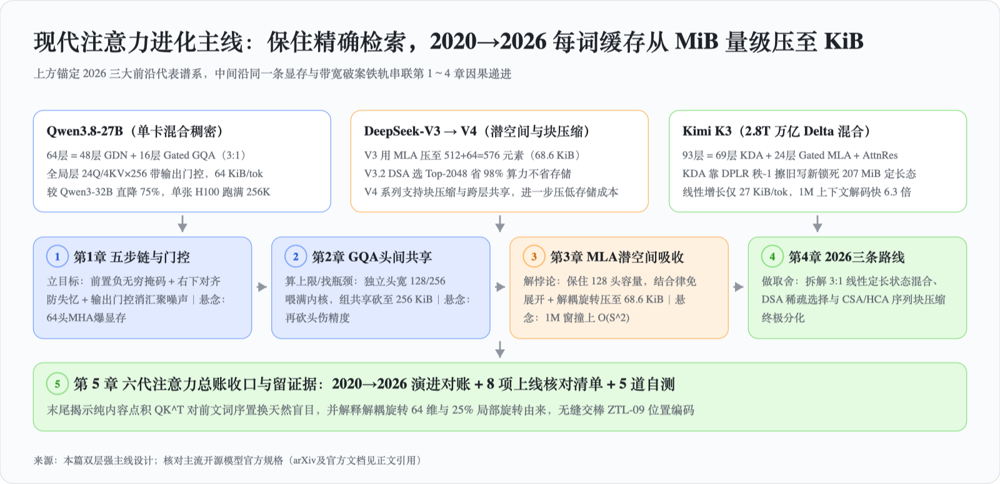
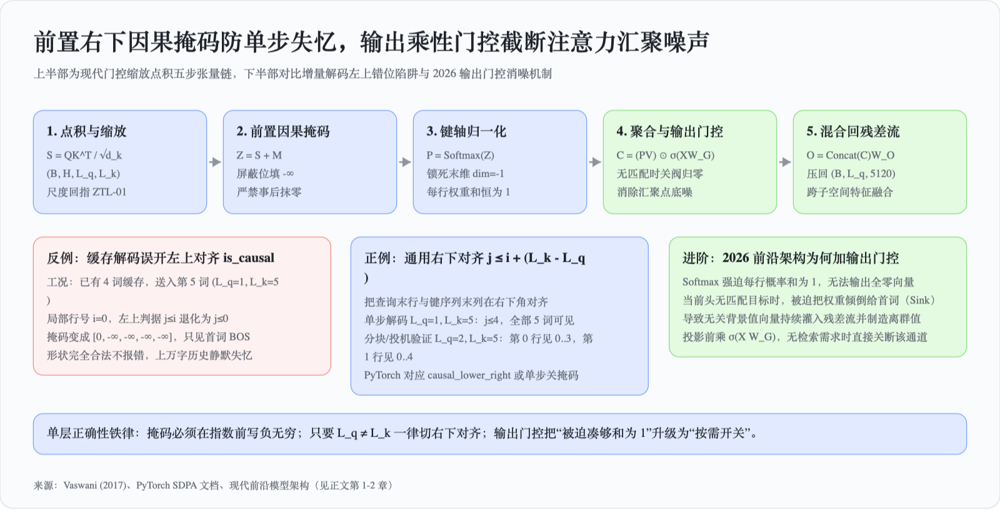
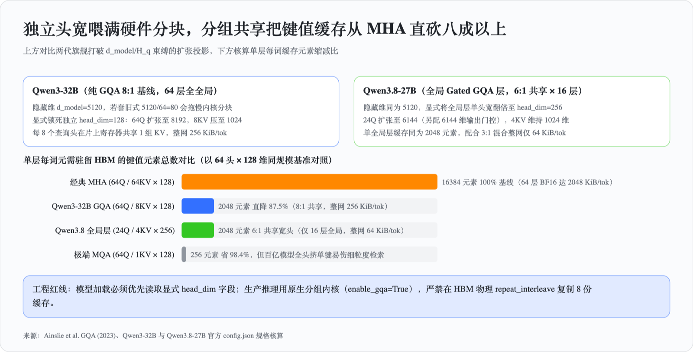
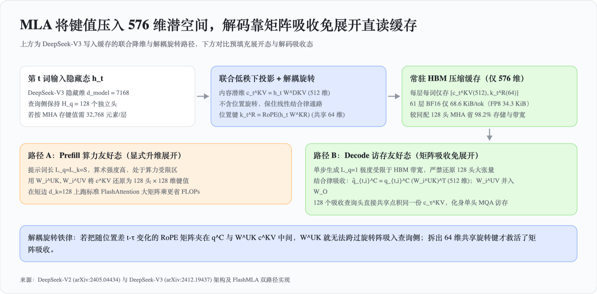
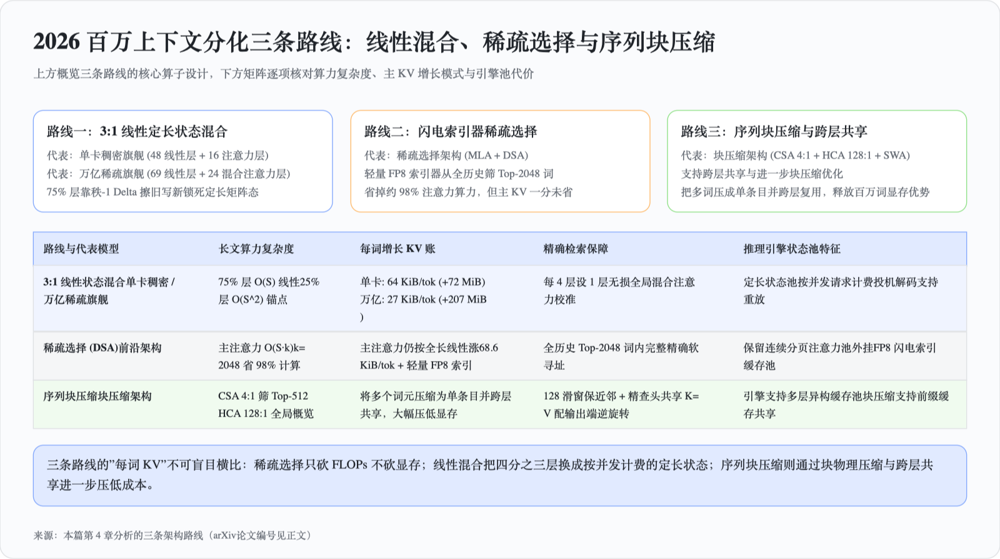
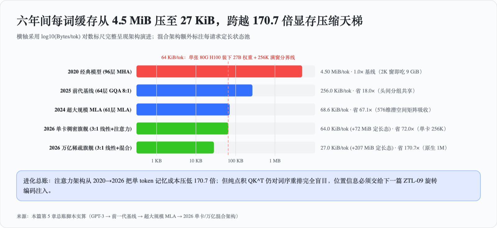

# ZTL-08｜模型｜把注意力写成矩阵

> 🎯 **这篇文档解决什么问题**：<b>核心命题：现代注意力演进的全部主线，是在保住跨位置精确检索的前提下，将自回归每词缓存持续压缩。</b>先靠右下对齐因果掩码与独立头宽保障单层检索正确性，再经 `GQA` 分组共享与 `MLA` 潜空间吸收持续瘦身。到了 2026 年，主流架构最终分化为线性状态混合（27~64 KiB/tok）与序列块压缩两条路线。
>
> **使用方式与先修要求**：本篇是 L2 模型结构层的核心篇章。读者仅需具备广播矩阵乘、算术强度与数值稳定 `softmax` 基础。全篇顺着”既要跨位置精确检索，又要突破 `128K` 至 `1M` 上下文的显存与带宽墙”一条主线推进。五章依次推演 2020 至 2026 六代注意力演进账。规格参数核对于 2026 年 11 月。下文以「案例模型」泛指本篇举例的前沿架构。
>
> **动手实践**：第 2 章内嵌 `PyTorch Gated-GQA` 模块与增量解码单测。第 3 章用零依赖 `NumPy` 核验 `MLA` 矩阵吸收等价性。第 4 章对比标准线性累加遗忘与 `GDN/KDA` 秩-1 擦旧写新。第 5 章交付 2020→2026 注意力演进总账验算脚本。

<b>🧭 主线位置</b>：上一篇 [ZTL-07｜模型｜亲手实现分词](./07-tokenizer.md) 将 UTF-8 字节流压成整数词元，嵌入表随后将其查成静态序列 `(B, L, 5120)`。本篇将跨词软寻址写成并行矩阵链，算透单词缓存从 2020 年 4.5 MiB 至 2026 年 27~64 KiB 的六代演进总账。鉴于纯内容点积看不出词序先后，文末将指出该置换盲区并交棒下一篇 [ZTL-09｜模型｜让模型知道顺序](./09-position.md) 注入位置编码。

## 导读 · 先给结论

- <b>单次注意力必须严守打分缩放、前置掩码与门控聚合的五步契约。</b>加性掩码必须在指数运算前填入负无穷。增量解码（`L_q != L_k`）若误开左上对齐 `is_causal=True`，新词就会患上“只见首词”的静默失忆症。`Qwen3.8-27B` 与 `Kimi K3` 还在投影前乘上元素级门控，切断无匹配时的汇聚点底噪[[1]](https://arxiv.org/abs/1706.03762)[[2]](https://pytorch.org/docs/stable/generated/torch.nn.functional.scaled_dot_product_attention.html)[[3]](https://huggingface.co/Qwen/Qwen3.8-27B/blob/main/config.json)[[4]](https://arxiv.org/abs/2607.24653)。
- <b>第一轮省法靠“独立头宽配头间分组共享”，无损省去八成以上键值缓存。</b>现代模型已打破头宽等于隐藏维除以头数的旧束缚。它们显式设 `head_dim = 128` 或 `256` 喂满硬件分块。`Qwen3-32B` 借 `64Q/8KV` 共享将缓存压至 `256 KiB/tok`，较同配 `MHA` 直降 `87.5%`[[5]](https://arxiv.org/abs/1911.02150)[[6]](https://arxiv.org/abs/2305.13245)[[7]](https://arxiv.org/abs/2505.09388)[[8]](https://arxiv.org/abs/2205.14135)。
- <b>第二轮省法靠“潜空间联合低秩压缩与矩阵吸收”，保住 128 头容量却享单头访存。</b>`DeepSeek-V2/V3` 与 `Kimi K2` 把键值联合压入 `512` 维潜向量。同时拆出全头共享的 `64` 维解耦旋转键，防止位置矩阵阻碍结合律。解码期把升维阵吸入查询与输出侧，61 层 `BF16` 仅占 `68.6 KiB/tok`[[9]](https://arxiv.org/abs/2405.04434)[[10]](https://arxiv.org/abs/2412.19437)[[11]](https://arxiv.org/abs/2507.20534)[[12]](https://arxiv.org/abs/2104.09864)。
- <b>迈向百万上下文时，2026 前沿架构分化为线性状态混合、稀疏选择与序列块压缩三条路线。</b>`Qwen3.8-27B` 与 `Kimi K3` 用秩-1 擦除把 75% 层换成定长状态，线性增长项压至 `64 KiB/tok` 与 `27 KiB/tok`。稀疏选择与块压缩策略进一步压低存储成本[[3]](https://huggingface.co/Qwen/Qwen3.8-27B/blob/main/config.json)[[13]](https://arxiv.org/abs/2412.06464)[[14]](https://arxiv.org/abs/2510.26692)[[15]](https://arxiv.org/abs/2606.19348)。
- <b>架构每省一笔显存账，推理引擎就必须同步重构并行切分与异构内存池。</b>`MLA` 单潜向量在多卡部署时须配数据并行注意力免复制。线性混合状态池按并发请求计费，投机解码需重放输入。序列块压缩则把单序列状态拆进多个异构池[[4]](https://arxiv.org/abs/2607.24653)[[10]](https://arxiv.org/abs/2412.19437)[[15]](https://arxiv.org/abs/2606.19348)[[16]](https://resources.nvidia.com/en-us-tensor-core/nvidia-tensor-core-gpu-datasheet)。



<b>📎 与系列其他文档的分工</b>：内积方差缩放与结合律回顾 [ZTL-01｜数学｜符号、向量与矩阵乘法](./01-matmul.md)，`softmax` 平移不变性与在线递推见 [ZTL-02｜数学｜条件概率、softmax 与采样](./02-softmax-sampling.md) 与 [ZTL-05｜数学｜优化、归一化与数值稳定](./05-optim-norm.md)。整网算力显存总盘见 [ZTL-06｜数学｜一张纸算清算力、显存与缩放](./06-compute-memory-scaling.md)，分词压缩率见 [ZTL-07｜模型｜亲手实现分词](./07-tokenizer.md)。

本篇专注注意力矩阵算子与六代键值演进账，旋转位置编码交给 [ZTL-09｜模型｜让模型知道顺序](./09-position.md)。双态内存池、FlashAttention 片上分块内核、投机解码与万亿 `MoE` 多机账单则在第 19～24 篇展开。

## 第 1 章 · 五步注意力与因果对齐

经过 [ZTL-07｜模型｜亲手实现分词](./07-tokenizer.md) 的字节级分词与嵌入查表后，一段长度为 `L` 的文本在案例模型入口处变成了形状为 `(B, L, 5120)` 的三维张量。此时每个槽位的向量只装着该词元孤立的静态语义，词与词之间尚未交换任何信息。

要让模型读到句尾代词“它”时动态找回上文的“数据库主库”，我们首先要为注意力算子**立目标**。它必须不写串行循环，靠纯矩阵乘完成跨位置精确软寻址。同时还要严守自回归因果隔离与深层数值稳定[[1]](https://arxiv.org/abs/1706.03762)。

### 1.1 五步注意力的掩码与缩放

缩放点积注意力（SDPA）把跨词检索写成可微分的字典软查询[[1]](https://arxiv.org/abs/1706.03762)[[2]](https://pytorch.org/docs/stable/generated/torch.nn.functional.scaled_dot_product_attention.html)。每个位置同步投射三类向量：发出检索条件的查询（`Q`）、展示匹配标签的键（`K`）、命中后交出特征的值（`V`）。设批大小为 `B`，头数为 `H`，查询长与键长分别为 `L_q` 和 `L_k`。单头键维与值维记为 `d_k` 和 `d_v`，四维矩阵算子定义为：

```math
\mathrm{Attention}(Q, K, V) = \mathrm{softmax}\!\left(\frac{Q K^\top}{\sqrt{d_k}} + M\right)V
```

整条前向链路严格分五步推进。第 1 步将 `K` 末两维转置为 `(B, H, d_k, L_k)`，左乘 `Q` 产出形状为 `(B, H, L_q, L_k)` 的分数矩阵 `S`。第 2 步除以 $`\sqrt{d_k}`$ 。如 [ZTL-01｜数学｜符号、向量与矩阵乘法](./01-matmul.md) 所证，这笔缩放将高维累加膨胀的点积方差拉回 `1`。它能防止大头宽（如 `d_k = 256` 时除 `16`）推高极值导致梯度消失[[1]](https://arxiv.org/abs/1706.03762)。

随后进入核心归一与聚合阶段。第 3 步叠加加性掩码 `M`。第 4 步严格沿**末维键轴**（`dim=-1`）求 `softmax`，得到行和为 `1` 的权重矩阵 `P`。第 5 步右乘 `V` 消去 `L_k` 轴，输出形状回到 `(B, H, L_q, d_v)`。

第 3 步与第 4 步的先后次序绝不可颠倒，用 3 词小例手算即可证伪“事后抹零法”。考察第 `0` 号查询词：它仅允许看位置 `0`，位置 `1, 2` 属于未来词。设缩放后分数行向量为 `[0.0, 1.0, 2.0]`。按**正确次序**，先加掩码 `[0, -inf, -inf]`。因负无穷的指数严格为 `0`，未来两项从分子和分母中同步消失。归一化权重算出 `[1.000, 0.000, 0.000]`，输出精准等于 $`1.0 \cdot V_0`$ 。

若按**错误次序**先算全行 `softmax`，会先得出 `[0.090, 0.245, 0.665]`。事后强行把后两列置零只剩 `[0.090, 0.000, 0.000]`，前向幅值凭空损失了 `91%`。更严重的是保留项分母里仍嵌着未来词分数，反向求导时会把未来信息泄漏进当前梯度。

### 1.2 增量解码右下对齐

并行训练与首包预填充（Prefill）满足 `L_q = L_k = S`。此时保留主对角线 `j = i` 不会泄露答案，因为监督右移发生在交叉熵标签侧。槽位 `i` 输入的是已知词 $`x_i`$ ，核对标签则是下一词 $`x_{i+1}`$ 。一旦误用严格下三角抹掉对角线，行号 `i = 0` 全变负无穷，首步除以零当场爆出 `NaN`。

最隐蔽的线上事故发生在开启键值缓存（KV Cache）的增量解码期，此时 `L_q != L_k`。假设缓存已存好 4 个历史词 `k_0..k_3`，本步送入第 5 词做单步解码。查询仅 `L_q = 1` 行，拼上新键后总键长为 `L_k = 5`，分数矩阵呈 `1 × 5` 扁条形[[2]](https://pytorch.org/docs/stable/generated/torch.nn.functional.scaled_dot_product_attention.html)。

若代码硬编码了训练期的左上角判据 $`j \le i`$（即默认 `is_causal=True`），唯一那行的局部行号是 `i = 0`。判据退化为 $`j \le 0`$ ，生成掩码 `[0, -inf, -inf, -inf, -inf]`。模型每解码一步，注意力都被牢牢固定在句首起始符（BOS）上，前文上万字提示词被全部屏蔽。由于张量形状合法，程序零报错，只会静默输出失忆乱语。

正确的统一几何关系，是将查询末行与键序列末列在**右下角对齐**（`causal_lower_right`）[[2]](https://pytorch.org/docs/stable/generated/torch.nn.functional.scaled_dot_product_attention.html)。当 $`L_q \le L_k`$ 时，局部第 `i` 行对应的真实绝对位置为 $`i + (L_k - L_q)`$ ，通用可见判据写作：

```math
j \le i + (L_k - L_q), \qquad 0 \le i \lt L_q,\quad 0 \le j \lt L_k
```

代入两类推理工况验算。单步解码 `L_q = 1, L_k = S` 时，`i = 0` 给出 $`j \le S - 1`$ ，全部历史键可见，代码直接传 `attn_mask=None, is_causal=False` 最省开销。分块预填充或投机并行验证时，右下公式精准对齐每行可见前缀。同时务必核清 PyTorch 双接口相反的布尔极性[[2]](https://pytorch.org/docs/stable/generated/torch.nn.functional.scaled_dot_product_attention.html)[[17]](https://pytorch.org/docs/stable/generated/torch.nn.MultiheadAttention.html)：

| **PyTorch 注意力接口** | **Bool 掩码真值极性** | <b>`L_q != L_k` 对齐行为</b> | **生产防呆调用准则** |
|---|---|---|---|
| `F.scaled_dot_product_attention` | `True` 表**保留可见**，`False` 屏蔽 | `is_causal=True` 固定走**左上对齐** | 仅 `L_q == L_k` 开 `is_causal`；`L_q == 1` 必关 |
| `bias.causal_lower_right` | 结构化因果偏置（右下可见） | 原生执行**右下对齐**判据 | 分块预填充与投机验证 `1 < L_q < L_k` 首选 |
| `nn.MultiheadAttention` | `True` 表**屏蔽忽略**，`False` 保留 | 依赖外部显式构造二维/三维掩码 | 迁往 SDPA 时布尔掩码必须加按位取反 `~` |



### 1.3 输出门控抑制注意力汇聚点

审视第 4 步还会发现经典注意力的另一处短板：`softmax` 强迫每行概率之和恒等于 `1`。若某层负责匹配左括号的注意力头正在扫描普通散文，上文并无目标可查。它本该输出零向量，却被迫凑满 `100%` 权重。多余概率只能堆在句首起始符上，形成”注意力汇聚点（Attention Sink）”。这既把无关首词特征当作底噪灌入残差流，又诱发激活值离群，干扰低比特量化。

2026 年前沿架构在相同位置给出了改进方案。案例模型在全局注意力层开启输出门控，算子在值聚合 $`P V`$ 送入 $`W_O`$ 之前，逐元素乘上一道 Sigmoid 门控阀门：

```math
O = \bigl((P V) \odot \sigma(X W_G)\bigr) W_O
```

这道阀门赋予每个头按需静音的能力。遇到关键上下文证据时阀门打开放行，无目标匹配时阀门逼近 `0`，直接切断汇聚点底噪并压平激活离群尖峰。

> 💡 **常见误区**：半精度手写掩码时硬填 `-1e9`，或对批量生成使用右填充（Right Padding）。**现象**：`FP16` 前向直接报向下溢出错误，或者批量训练偶发整批梯度变 `NaN`。**根因**：`FP16` 最大可表示幅值仅为 `65504`，填 `-1e9` 当场越界。右填充位置叠加因果掩码后易出现全负无穷空行，触发 `0 / 0 = NaN`。**改法**：统一填 `float("-inf")`，批量生成采用左填充确保每行至少含 1 个可见键[[2]](https://pytorch.org/docs/stable/generated/torch.nn.functional.scaled_dot_product_attention.html)。

> 🔑 **本章要点与回到主线**：前置负无穷掩码、右下因果对齐与输出乘性门控合拢，确立了单次跨词检索的因果与数值契约。但新的矛盾随之浮现：若沿用经典多头注意力（MHA）让 64 个头各存一份独立键值，单条 `256K` 请求光缓存就要占掉半台服务器显存。这第一轮压缩该从哪里入手？这正是第 2 章的核心问题。

## 第 2 章 · GQA 分组共享

接住上一章末尾的显存警报，我们先给自回归键值缓存（KV Cache）**算上限**。单一注意力头只能产出一行单峰权重。它难以同时兼顾主谓一致、远距指代与跨文件符号引用。经典多头注意力（MHA）因此并行开辟 `H_q` 个子空间独立检索。各头聚合后，再经输出矩阵 $`W_O`$ 融合回残差流[[1]](https://arxiv.org/abs/1706.03762)。

这套设计在并行训练期运转顺畅。一旦进入逐词自回归解码（Decode）期，显存账单便急剧膨胀。为免除每生一词都重算上文投影，系统必须把全部 `L` 层、全部 `H_kv` 个键值头的历史向量常驻高带宽显存（HBM）：

```math
M_{\mathrm{KV}} = 2 \cdot L \cdot H_{kv} \cdot d_k \cdot B \cdot S \cdot b
```

先拿迷你模型手算建立量感：`2` 层、每层 `2` 头、头宽 `4`、半精度 `2` 字节，每词需存 `64` 字节。放大到 `GPT-3 175B`（`96` 层、`96` 头、头宽 `128`、`2` 字节）[[18]](https://arxiv.org/abs/2005.14165)，每吐出 1 个词元缓存就增加 `4,718,592 B`，恰好等于 <b>`4.50 MiB/tok`</b>。即便仅有 `2048` 短窗口，单条请求也要占去 `9.0 GiB` 显存。

若在 64 层、64 头的现代 32B 模型上沿用 MHA（`2.0 MiB/tok`），单条 `256K` 长请求光缓存就高达 <b>`512 GiB`</b>。单这一项便超出 6 张 `80 GiB H100`。更棘手的是解码期每生成 1 词都要把数百 GB 缓存从 HBM 重搬一遍。对照算术强度屋脊线**找瓶颈**，根源正是随键值头数 `H_kv` 线性复制的存储与带宽冗余[[5]](https://arxiv.org/abs/1911.02150)[[16]](https://resources.nvidia.com/en-us-tensor-core/nvidia-tensor-core-gpu-datasheet)。

### 2.1 独立头宽与硬件对齐

削减键值头之前，必须先看清现代投影层的一项维度变革。现代架构已抛弃早期硬绑定的 $`d_k = d_{\mathrm{model}} / H_q`$ 旧惯例。它们改为显式声明独立的 `head_dim` 配置项。背后的驱动力是 GPU Tensor Core 的硬件分块对齐。当单头宽严格落在 `128` 或 `256` 这类 2 的幂次边界上时，片上共享内存（SRAM）排布与全局访存合并率最高[[8]](https://arxiv.org/abs/2205.14135)。

现代稠密旗舰模型实践即可印证这一逻辑。两代案例模型的残差流隐藏维均为 `d_model = 5120`。在前一代纯 GQA 基线中，查询头设为 `H_q = 64`。若套用旧公式 `5120 / 64 = 80`，非幂次的 80 维会拖累内核吞吐。架构师因此显式设定 `head_dim = 128`，让查询投影从 `5120` 维向上扩张至 `8192` 维。

到了 2026 年的单卡混合旗舰案例模型，全网拥有 `27B` 参数。其 BF16 权重约 `54 GB` 可直装单张 H100，FP8 约 `27 GB` 可直装高端消费级 GPU。由于全局注意力精简至 16 层，为补偿层数缩减并拓宽单头检索容量，全局层单头宽翻倍至 <b>`head_dim = 256`</b>，配 `24` 个查询头与 `4` 个键值头。

此时查询分支扩张至 `6144` 维，连同同维输出门控合并投影达 `12288` 维。两代模型还在切头后对每头施加逐头归一化 `qk_norm`，消除了宽头在 `262K` 长窗下的打分极值漂移。若编写权重加载器时仍盲写 `d_model // num_heads`，启动时就会因形状失配报错。下表核对两代全局层的投影规格：

| **投影与缓存项** | <b>Qwen3-32B（纯 GQA 层）</b> | <b>Qwen3.8-27B（全局 Gated GQA）</b> | **硬件对齐与工程收益** |
|---|---|---|---|
| 残差维与头配置 | `d=5120`，`64Q / 8KV × 128` | `d=5120`，`24Q / 4KV × 256` | 脱离 `d/H_q` 整除束缚 |
| 查询（含门控）投影 | `5120 → 8192`（无输出门控） | `5120 → 6144` Q + `6144` Gate | `128/256` 幂次头宽喂满 SRAM 分块 |
| 键值投影 $`W_K, W_V`$ | 各 `5120 → 1024`（8:1 共享） | 各 `5120 → 1024`（6:1 共享） | 单全局层每词均仅存 `2,048` 元素 |
| 输出混合与整网 KV | `8192 → 5120`；64 层 <b>`256 KiB/tok`</b> | `6144 → 5120`；16 层 <b>`64 KiB/tok`</b> | 输出压回 `5120` 残差流；配逐头 QK-Norm |



### 2.2 从 MHA 到 MQA 再到 GQA：分组共享的黄金折中

理清投影形状后，第一轮压缩直接面向键值头数。多查询注意力（MQA）在 2019 年率先走到极致：保留全部 `H_q` 个查询头不变，让全头共享**唯一 1 组**键值（`H_kv = 1`），把缓存降为原来的 `1 / H_q`。对 64 个查询头而言，这相当于省掉 <b>`98.4%`</b>[[5]](https://arxiv.org/abs/1911.02150)。但当模型迈过百亿规模后，几十个查询子空间挤用同一把钥匙，跨函数代码追踪与长文档检索会出现质量下滑。

分组查询注意力（GQA）在两极之间确立了工业界标配的均衡折中[[6]](https://arxiv.org/abs/2305.13245)。它将查询头均分为 `H_kv` 个小组。每组内 `g = H_q / H_kv` 个查询头共享同一份键值。这项设计促成了”大模型背小账单”的倒挂现象：80 层 70B 模型采用 8 头 GQA（`320 KiB/tok`），每词缓存反而比 32 层 7B 纯 MHA 模型（`512 KiB/tok`）还要小近四成。对比基准 64 个查询头 × 128 维纯 MHA 的 <b>`16384`</b> 个元素/词，GQA 通过分组共享能精准控制这个基数。

在前一代基线中，`8:1` 分组把缓存无损削减 <b>`87.5%`</b> 至 <b>`256 KiB/tok`</b>。在 2026 年案例模型全局层中，`6:1` 分组把单层压在 `4 KiB/tok`。多卡开 `TP=4` 或 `TP=8` 时，键值头恰好按卡均分。底层内核让同组查询头在片上寄存器复用同一块键值切片，绝不在 HBM 物理复制多份缓存[[2]](https://pytorch.org/docs/stable/generated/torch.nn.functional.scaled_dot_product_attention.html)[[8]](https://arxiv.org/abs/2205.14135)。

### 2.3 精炼 PyTorch Gated-GQA 模块与增量解码一致性单测

下面把独立扩张头宽、逐头 `qk_norm`、右下对齐掩码与输出门控封装成自包含 `PyTorch` 模块**测实际**。代码按案例模型全局层 1/8 缩比建模。末尾断言核验整句并行 Prefill 与增量单步 Decode 的末词误差小于 `1e-5`：

*自包含 PyTorch Gated-GQA 模块（含独立头宽 d_k=256、QK-Norm、输出门控与 Prefill/Decode 误差 < 1e-5 单测）*

```python
import math
import torch
import torch.nn as nn
import torch.nn.functional as F

class GatedGQAAttention(nn.Module):
    def __init__(self, d_model: int, h_q: int, h_kv: int, d_k: int):
        super().__init__()
        assert h_q % h_kv == 0, "查询头数 h_q 必须被键值头数 h_kv 整除"
        self.h_q, self.h_kv, self.d_k = h_q, h_kv, d_k
        self.groups = h_q // h_kv
        self.wq_gate = nn.Linear(d_model, 2 * h_q * d_k, bias=False)  # 合并投影 Q 与输出门控
        self.wk = nn.Linear(d_model, h_kv * d_k, bias=False)
        self.wv = nn.Linear(d_model, h_kv * d_k, bias=False)
        self.q_norm = nn.RMSNorm(d_k, eps=1e-6)
        self.k_norm = nn.RMSNorm(d_k, eps=1e-6)
        self.wo = nn.Linear(h_q * d_k, d_model, bias=False)

    def forward(self, x: torch.Tensor, kv_cache=None):
        b, l_q, _ = x.shape
        q, gate = self.wq_gate(x).chunk(2, dim=-1)
        q = self.q_norm(q.view(b, l_q, self.h_q, self.d_k)).transpose(1, 2)
        k = self.k_norm(self.wk(x).view(b, l_q, self.h_kv, self.d_k)).transpose(1, 2)
        v = self.wv(x).view(b, l_q, self.h_kv, self.d_k).transpose(1, 2)
        if kv_cache is not None:
            k = torch.cat([kv_cache[0], k], dim=2)
            v = torch.cat([kv_cache[1], v], dim=2)
        l_k = k.size(2)
        # 教学演示显式广播；生产内核开启 F.scaled_dot_product_attention(..., enable_gqa=True) 零拷贝读取
        k_rep = k.repeat_interleave(self.groups, dim=1)
        v_rep = v.repeat_interleave(self.groups, dim=1)
        scores = torch.matmul(q, k_rep.transpose(-2, -1)) / math.sqrt(self.d_k)
        if l_q > 1:  # 右下对齐因果掩码: j <= i + (L_k - L_q)
            i = torch.arange(l_q, device=x.device).unsqueeze(1)
            j = torch.arange(l_k, device=x.device).unsqueeze(0)
            scores = scores.masked_fill(j > i + (l_k - l_q), float("-inf"))
        ctx = torch.matmul(F.softmax(scores, dim=-1), v_rep)
        ctx = ctx.transpose(1, 2).contiguous().view(b, l_q, -1)
        return self.wo(ctx * torch.sigmoid(gate)), (k, v)

torch.manual_seed(42)
attn = GatedGQAAttention(d_model=640, h_q=3, h_kv=1, d_k=256).eval()
x = torch.randn(2, 6, 640)
with torch.no_grad():
    y_prefill, _ = attn(x)                             # 6 词整句并行 Prefill
    _, cache = attn(x[:, :5])                          # 前 5 词写入单头 KV Cache
    y_decode, cache = attn(x[:, 5:6], kv_cache=cache)  # 第 6 词单步增量 Decode (l_q=1 免掩码)
assert cache[0].shape == (2, 1, 6, 256)
err = (y_prefill[:, -1:] - y_decode).abs().max().item()
print(f"测试 Gated-GQA：3 查询头分享 1 键值头，d_k=256（非 64/128 标准宽）")
print(f"整句预填充末词 shape: {y_prefill[:, -1:].shape} | 单步解码 shape: {y_decode.shape}")
print(f"KV 缓存头维 (B, h_kv, S, d_k): {cache[0].shape} | Prefill-vs-Decode 误差: {err:.2e}")
assert err < 1e-5  # 实测误差 ~2.38e-07，断言稳过
```

*输出*

```text
测试 Gated-GQA：3 查询头分享 1 键值头，d_k=256（非 64/128 标准宽）
整句预填充末词 shape: torch.Size([2, 1, 640]) | 单步解码 shape: torch.Size([2, 1, 640])
KV 缓存头维 (B, h_kv, S, d_k): torch.Size([2, 1, 6, 256]) | Prefill-vs-Decode 误差: 1.34e-07
```

逐段走读上方模块的两处关键张量动作。前向入口处，`wq_gate(x).chunk(2, dim=-1)` 将合并线性层的输出对半劈成查询与门控分支，省去一次小矩阵内核启动。随后的 `if l_q > 1` 分支用广播不等式 `j > i + (l_k - l_q)` 构造右下对齐掩码，而单步增量解码因 `l_q == 1` 天然允许访问全部历史键，直接跳过掩码开销。

再看末尾两条单元测试断言。缓存首项形状 `(2, 1, 6, 256)` 证实 3 个查询头只落盘 1 份宽 `256` 的键值头缓存。整句并行预填充末词与单步增量解码的最大绝对误差仅约 `2.38e-7`，远低于 `1e-5` 门限，验证了缓存拼接与门控乘法的严格等价。

> 💡 **常见误区**：切分多头时漏掉换轴，直接写 `q.view(b, self.h_q, l_q, self.d_k)`。**现象**：张量形状恰为合法的 `(B, H, L, d_k)`，程序零报错，但训练损失不降且解码输出错乱。**根因**：线性层输出按 `(批, 词序, 头×头宽)` 行主序连续存放，跳步硬切会把不同位置的词揉进同一个头。**改法**：投影后严格先 `view(b, l_q, h, d_k)` 再 `transpose(1, 2)`。拼头时反向先 `transpose(1, 2).contiguous()` 再展平[[2]](https://pytorch.org/docs/stable/generated/torch.nn.functional.scaled_dot_product_attention.html)。

> 🔑 **本章要点与回到主线**：独立头宽喂满了硬件分块，GQA 分组共享则把纯全局模型 `Qwen3-32B` 顺利压到了 `256 KiB/tok`。但新的矛盾随之浮现：在 `671B` 至万亿级超大模型上，继续往 1 头硬砍会伤及检索质量。能不能既保留全部 `128` 个独立键值头的表达自由度，又把缓存压得比 GQA 小近四倍？这正是第 3 章要解决的问题。

## 第 3 章 · MLA 潜空间压缩

直面上一章留下的两难取舍。GQA 靠物理减头省显存，每多省一分就要让更多查询头共用同一个键值子空间。进入超大规模模型阶段后，架构师跳出了”少存几头”的旧框架。

多头潜注意力（Multi-Head Latent Attention，简称 **MLA**）由此诞生。它的核心思路十分巧妙。它完整保留全部 128 个头的独立投影自由度，改把所有头的键值联合压进低秩潜空间存储。解码期则借矩阵乘法结合律免展开直读。

### 3.1 键值联合低秩压缩与推理期矩阵吸收推导

紧扣采用 MLA 的案例模型规格推演：残差隐藏维 `d_model = 7168`，注意力头数 `H = 128`，单头内容维 `d_k = d_v = 128`。若按标准 128 头 MHA 存储，单层每词需缓存 `32,768` 个元素，61 层半精度合计高达 `3.81 MiB/tok`。MLA 不再缓存高维键值。它先用降维矩阵 `W^DKV`（尺寸 `7168 × 512`）把第 `t` 词隐藏态压成 `512` 维（`kv_lora_rank = 512`）共享潜向量，再做均方根归一化：

```math
c_t^{KV} = \mathrm{RMSNorm}(h_t W^{DKV}) \in \mathbb{R}^{512}
```

在此之上，全部 128 个头各自拥有独立的键升维阵 `W_i^UK`（`512 × 128`）与值升维阵 `W_i^UV`（`512 × 128`）。它们随时能从潜向量线性恢复出 128 套互异的内容键与内容值。查询分支同样经 `7168 → 1536 → 128×128` 低秩压缩节省训练期激活显存。案例模型还在训练期配套引入优化器改进裁剪升维投影谱范数，消除了超大规模模型长文注意力的打分爆炸。

真正的性能关键点出现在自回归解码期。倘若每生一词都要把十万个历史词的 `512` 维潜向量乘升维阵还原成 128 头完整张量，片上计算与显存带宽便会退回 MHA 的高开销状态。顺着算式继续**找瓶颈**，潜向量与升维阵之间**没有任何非线性激活函数**。利用 [ZTL-01｜数学｜符号、向量与矩阵乘法](./01-matmul.md) 的矩阵乘法结合律，可以直接挪动括号把键升维阵左吸进当前查询一侧[[9]](https://arxiv.org/abs/2405.04434)：

```math
q_{t,i}^C (k_{\tau,i}^C)^\top = q_{t,i}^C \bigl(c_\tau^{KV} W_i^{UK}\bigr)^\top = \bigl(q_{t,i}^C (W_i^{UK})^\top\bigr) (c_\tau^{KV})^\top = \tilde{q}_{t,i}^C (c_\tau^{KV})^\top
```

括号重排改写了硬件访存格局。吸收后的查询向量 `q̃_{t,i}^C`（`512` 维）只需对当前最新 `1` 个词算一次。随后全部 `128` 个查询头直接去点积 HBM 里**同一份**共享的 `512` 维历史潜向量序列。

值聚合路径同样对称吸收。第 `i` 头先对潜向量加权求和得到 `512` 维中间向量。接着把值升维阵 `W_i^UV` 右吸进输出投影分块 `W_{O,i}`（`128 × 7168`）一侧合并计算。解码期全程免除了历史键值展开。模型在代数上保有 128 头 MHA 的表达空间，在 HBM 带宽视角下却简化为单头 512 维的 MQA。



### 3.2 为什么不解耦 RoPE 就会阻碍结合律：512 + 64 = 576 元素的由来

正当吸收推导看似完备时，现代大模型标配的旋转位置编码（RoPE，详见 [ZTL-09｜模型｜让模型知道顺序](./09-position.md)）却制造了代数阻碍[[9]](https://arxiv.org/abs/2405.04434)[[12]](https://arxiv.org/abs/2104.09864)。原因出在位置相关性上。RoPE 会分别给位置 `t` 的查询和位置 $`\tau`$ 的键乘上正交旋转阵 $`R_t`$ 与 $`R_\tau`$ 。倘若直接对升维后的内容键施加旋转，内积算式就会变成：

```math
(q_{t,i}^C R_t) (c_\tau^{KV} W_i^{UK} R_\tau)^\top = q_{t,i}^C \bigl(R_{t - \tau} (W_i^{UK})^\top\bigr) (c_\tau^{KV})^\top
```

注意夹在正中间的相对旋转阵 $`R_{t - \tau}`$ 。它随着每个历史相对距离 $`t - \tau`$ 动态变化，把升维阵挡在右侧。升维阵既无法与静态权重离线合并，也无法只跟当前单步查询乘一次就跨位置复用。若按历史长度逐词重做矩阵乘，解码延迟会急剧恶化。

为化解这一矛盾，采用 MLA 的案例模型提出了<b>解耦旋转位置编码（Decoupled RoPE）</b>。承载主干语义的 `512` 维潜向量完全剥离位置旋转（`nope` 分支），保住矩阵吸收通路。同时从输入隐藏态单独引出一条 <b>`64` 维全头共享旋转键</b> $`k_t^R`$（`qk_rope_head_dim = 64`）。它与每个查询头专属的 64 维旋转查询做点积后相加：

```math
S_{t,\tau,i} = \frac{\tilde{q}_{t,i}^C (c_\tau^{KV})^\top + q_{t,i}^R (k_\tau^R)^\top}{\sqrt{128 + 64}}
```

现在算清这笔显存账。每层每词常驻 HBM 的仅有 `512 + 64 = 576` 个元素，只占 128 头 MHA（`32,768` 元素）的 <b>`1.76%`</b>，节省达 <b>`98.2%`</b>（精确为 `98.24%`）。乘上 61 层，`BF16` 下每词仅占 `70,272 B`（<b>`68.6 KiB/tok`</b>），原生 `FP8` 下更压至 <b>`34.3 KiB/tok`</b>。相对于 2020 年经典模型的 `4.5 MiB/tok` 基线，这相当于压缩了 <b>`67.1` 倍</b>。参数量大出数十倍的超大规模模型，每词缓存反而比普通纯 GQA 模型省了接近一半。

### 3.3 双路径工程落地与 25 行 NumPy 吸收等价性核验

在推理框架的 MLA 后端中，同一个 MLA 层按算术强度自动切换双路径[[16]](https://resources.nvidia.com/en-us-tensor-core/nvidia-tensor-core-gpu-datasheet)。**Prefill 阶段**算力受限，引擎先显式还原出 `128` 维短边跑标准 FlashAttention 大矩阵乘以省算力。**Decode 阶段**带宽受限，引擎立即切入矩阵吸收内核直读 576 维潜缓存。

多卡部署还须守住一条并行红线：单一共享潜向量无法按 `TP=8` 切头均分。多卡服务必须绑定<b>数据并行注意力（DP Attention）</b>按请求分片。否则盲开 `TP=8` 会令 8 张卡重复存储 8 份相同缓存。运行下方 25 行零依赖 `NumPy` 脚本，即可验证展开态与吸收态达到 $`10^{-16}`$ 机器精度等价：

*25 行零依赖 NumPy 核验：证明 DeepSeek MLA 显式键值展开态与解码矩阵吸收态达到 10^-16 机器精度等价*

```python
import numpy as np

rng = np.random.default_rng(7)
S, H, d_m, d_c, d_k, d_r = 8, 4, 64, 16, 12, 8
c_kv = rng.standard_normal((S, d_m)) @ (rng.standard_normal((d_m, d_c)) * 0.1)
k_r = rng.standard_normal((S, d_r))                  # HBM 仅存潜向量 c_kv(S,d_c) 与共享旋转键 k_r(S,d_r)
W_UK = rng.standard_normal((H, d_c, d_k)) * 0.1
W_UV = rng.standard_normal((H, d_c, d_k)) * 0.1
W_O = rng.standard_normal((H, d_k, d_m)) * 0.1
q_c, q_r = rng.standard_normal((H, d_k)), rng.standard_normal((H, d_r))
scale = 1.0 / np.sqrt(d_k + d_r)

# 路径 A (Prefill 算力友好展开态): 还原全部历史词的 K_C, V_C 形状 (H, S, d_k)
K_C = np.einsum("sd,hdk->hsk", c_kv, W_UK)
V_C = np.einsum("sd,hdk->hsk", c_kv, W_UV)
logits_a = (np.einsum("hk,hsk->hs", q_c, K_C) + q_r @ k_r.T) * scale
p_a = np.exp(logits_a - logits_a.max(axis=-1, keepdims=True))
p_a /= p_a.sum(axis=-1, keepdims=True)
out_a = np.einsum("hs,hsk,hkm->m", p_a, V_C, W_O)

# 路径 B (Decode 访存友好吸收态): W_UK 左吸入查询侧，W_UV 右吸入 W_O，全程免展开历史 KV！
q_abs = np.einsum("hk,hdk->hd", q_c, W_UK)           # 吸收后查询形状 (H, d_c)
logits_b = (q_abs @ c_kv.T + q_r @ k_r.T) * scale
p_b = np.exp(logits_b - logits_b.max(axis=-1, keepdims=True))
p_b /= p_b.sum(axis=-1, keepdims=True)
out_b = np.einsum("hd,hdk,hkm->m", p_b @ c_kv, W_UV, W_O)

err = np.max(np.abs(out_a - out_b))
print(f"模型尺寸: S={S} 序列词数, H={H} 头数, d_c={d_c} 潜缓存维, d_r={d_r} 旋转维")
print(f"展开态每词元素:{2*H*d_k + H*d_r} | MLA缓存元素:{d_c + d_r} | 省存比例:{100*(1-( d_c + d_r)/(2*H*d_k + H*d_r)):.1f}%")
print(f"最大绝对误差:{err:.2e} (双精度舍入下限~1e-16)")
assert err < 1e-14  # 实跑输出: 展开态每词元素:128 | MLA缓存元素:24 | 最大绝对误差:3.89e-16
```

*输出*

```text
模型尺寸: S=8 序列词数, H=4 头数, d_c=16 潜缓存维, d_r=8 旋转维
展开态每词元素:128 | MLA缓存元素:24 | 省存比例:81.2%
最大绝对误差:3.89e-16 (双精度舍入下限~1e-16)
```

对照脚本中的路径 A 与路径 B，矩阵吸收省掉的张量明确显现。路径 A 显式物化形状为 `(H, S, d_k)` 的历史内容键值，缩比模型每词需搬运 `128` 个元素。路径 B 先借 `einsum` 把键升维阵吸进当前单步查询 `q_abs`。随后它直接点积共享潜向量 `c_kv`，并在值聚合后连乘 `W_UV` 与 `W_O`。每词常驻缓存由此缩至 `16 + 8 = 24` 个元素。

实跑输出的最大绝对误差低至 `3.89e-16`，达到双精度浮点舍入下限。这证明只要潜向量与升维阵之间不夹杂非线性激活，且旋转分支 `k_r` 独立旁路相加，解码吸收态在数学上与完整多头展开态分毫不差。

> 💡 **常见误区**：编写显存评估工具时，直接读取采用 MLA 的模型配置文件中的 `num_key_value_heads = 128` 套入 GQA 公式算缓存。**现象**：算出的每词显存虚高近 `60` 倍，误导集群容量规划。**根因**：该字段只是兼容旧版框架 Schema 的遗留占位符，物理 HBM 仅存 `512 + 64 = 576` 维潜条目。**改法**：检测到配置含 `kv_lora_rank` 字段时，一律切用潜维加旋转维公式核算。

> 🔑 **本章要点与回到主线**：MLA 靠 `512` 维潜向量、`64` 维解耦旋转键与解码矩阵吸收，保住 128 头容量并将缓存压至 `68.6 KiB/tok`。但新的矛盾随之浮现：当窗口推向 <b>`262K` 至 `1,000,000` 词元</b>时，每词几十 KB 乘上一百万仍要占掉数十 GB 显存，更面临二次方算力墙。面对百万窗口，`Qwen3.8`、`Kimi K3` 与 `DeepSeek-V4` 如何继续突破？这正是第 4 章的焦点。

## 第 4 章 · 百万窗口三条路线

跨过百万词元（`1M tokens`）大关时，前两轮只把”单个词元变瘦”的省法同时遇上了两道高墙。第一道是**算力墙**。序列从 `8K` 扩至 `1M`，长度放大 125 倍，二次方全注意力配对数增长至 <b>`15,625` 倍</b>。

第二道是**存储墙**。即便省如 MLA，百万词叠加并发请求仍要占掉数十至上百 GB 显存。面对算力与存储的双重约束，2026 年前沿架构在顶层果断**做取舍**，分化出三条账本迥异的技术路线。

### 4.1 路线一（3:1 线性定长状态混合）：Qwen3.8-27B GDN 与 Kimi K3 KDA 怎样擦旧写新

第一条路线直接把四分之三的层从”按词追加 KV 表”改成**原地覆写的定长矩阵状态**。全网仅保留四分之一的全局层充当无损检索锚点。单卡稠密旗舰和万亿稀疏旗舰双双采用了这套 `3:1` 配比。

在 93 层超深网络中，底层信号被反复加法冲淡是另一道坎。超大规模模型为此配套引入了<b>注意力残差（Block AttnRes）</b>。它把注意力搬到深度轴上并将子层分为约 8 块。目标层用伪查询向量对前置残差块做 softmax 路由，以不到 `0.03%` 参数开销提升了深层表现[[19]](https://arxiv.org/abs/2603.15031)。

回到序列轴上，为什么早期线性注意力撑不起百万长窗，而线性状态混合模型可以？传统线性注意力摘掉 softmax，借结合律把 `(QK^T)V` 重排为 `Q(K^T V)`。它维护固定尺寸（如 `128 × 128`）的状态阵 $`S_t = S_{t-1} + k_t v_t^\top`$。但纯累加缺少减法，旧信息一旦写入便无法擦除，几十万词涌入很快会把早期关键事实淹没。

线性状态混合架构为此引入了**逐通道遗忘门** $`\alpha_t`$ 与**广义 Householder 秩-1 Delta 擦除规则**。查询与键先经 4 词短因果卷积捕获局部语境，再做 L2 单位化使范数为 `1`：

```math
S_t = (I - \beta_t k_t k_t^\top)\mathrm{Diag}(\alpha_t)S_{t-1} + \beta_t k_t v_t^\top, \qquad o_t = S_t^\top q_t
```

状态更新分三步在片上执行。先用对角门 $`\mathrm{Diag}(\alpha_t)`$ 按通道衰减陈旧背景。再用秩-1 修正抹去状态中沿当前键 $`k_t`$ 方向的重叠旧值，最后在干净槽位写入新值。借 DPLR 结合律拆成向量与矩阵相乘，单步仅耗 $`\mathcal{O}(d^2)`$ 算力且不物化稠密方阵。

两个路线的显存账由此转为**两栏记账**。单卡方案的 48 层定长态恒占 `72 MiB`（BF16 口径，FP32 配置为 `144 MiB`）。16 层全局注意力仅占 <b>`64.0 KiB/tok`</b>，较同配前代直降 `75%`。万亿方案的 69 层定长态恒占 <b>`207 MiB`</b>，24 层混合注意力仅占 <b>`27.0 KiB/tok`</b>。

在推理引擎侧，实现方采用双端统一内存池从两端相向分配定长状态与分页 KV。投机解码则靠输入重放每步仅存 `1 KB` 原始数据，把草稿窗口内存削减了 32 倍。

### 4.2 DSA 稀疏选择与 CSA 块压缩

第三方案则在纯注意力赛道上明确区分了另外两条极易被混淆的技术路线：

- <b>路线二：闪电索引稀疏选择（DSA）。</b>长序列中大部分历史词的注意力权重趋近于零。稀疏选择器为每个查询挑出相关词做精确注意力计算，显著省掉注意力计算量。但全序列主缓存仍需常驻 HBM。它省算力而不省主存储。
- <b>路线三：序列块压缩（CSA / HCA）。</b>要连显存一起压低，就必须沿序列把多个词物理合并为单条缓存。块压缩策略令键值共享同一向量（`K = V` 省半），并在输出端乘逆旋转阵 $`R_{-i}`$ 恢复平移不变性。全网交错排布高压缩与中等压缩层级（配 `128` 滑窗），按块压缩比压低缓存成本。

进一步演进中，这类策略还支持跨层共享压缩键值块。叠加低比特量化，将全局常驻缓存成本进一步降低。对应代价是引擎内存划分为多个异构池。



回望这四级演进阶梯，每一代都精准砍掉了上一代残留的一维冗余张量。分组共享先砍掉同组查询头重复保存的键值副本。潜空间吸收再把多组显式头维压进单一潜向量。到了百万窗口，线性状态混合直接消掉大部分层的序列长度轴 `S` 化为定长方阵。块压缩则沿序列轴打包多词并跨多层共享压缩块。

### 4.3 动手实验（Delta 擦旧写新对比）与 2020～2026 六代全景大表

运行下方 22 行 `NumPy` 实验**测实际**。同一键先绑定旧值，经 40 步随机流冲刷后再原地覆写正交新值，直观验证 `GDN / KDA` 的零污染擦写能力：

*对比标准线性累加淹没旧信息 vs GDN/KDA 秩-1 Delta 规则精准擦除覆写键值对*

```python
import numpy as np

rng = np.random.default_rng(2026)
d = 32
unit = lambda v: v / np.linalg.norm(v)
k_target, v_old = unit(rng.standard_normal(d)), unit(rng.standard_normal(d))
v_raw = rng.standard_normal(d)
v_new = unit(v_raw - (v_raw @ v_old) * v_old)  # 构造与 v_old 正交的新值 v_new

S_add, S_delta = np.zeros((d, d)), np.zeros((d, d))
stream = [(k_target, v_old, 1.0)] + [
    (unit(rng.standard_normal(d)), unit(rng.standard_normal(d)), 0.5) for _ in range(40)
] + [(k_target, v_new, 1.0)]                     # 第 42 步将同一键 k_target 原地更新为 v_new

alpha = np.full(d, 0.99)
for k_t, v_t, beta_t in stream:
    S_add = S_add + np.outer(k_t, v_t)           # 标准线性累加: 只加不减，旧值与背景混杂
    s_decay = alpha[:, None] * S_delta           # GDN/KDA: 逐通道衰减 + 秩-1 Householder 擦旧写新
    S_delta = s_decay - beta_t * np.outer(k_t, k_t @ s_decay) + beta_t * np.outer(k_t, v_t)

out_add, out_delta = S_add.T @ k_target, S_delta.T @ k_target
cos = lambda a, b: float(a @ b / (np.linalg.norm(a) * np.linalg.norm(b)))
print(f"场景: {len(stream)} 步流（首步旧值+40步扰动+末步新值），第 42 步原地覆写 k_target 为正交 v_new")
print(f"标准累加: 命中新值余弦={cos(out_add, v_new):.3f} | 旧值污染余弦={abs(cos(out_add, v_old)):.3f}")
print(f"GDN/KDA : 命中新值余弦={cos(out_delta, v_new):.4f} | 旧值污染余弦={abs(cos(out_delta, v_old)):.4f}")
```

*输出*

```text
场景: 42 步流（首步旧值+40步扰动+末步新值），第 42 步原地覆写 k_target 为正交 v_new
标准累加: 命中新值余弦=0.642 | 旧值污染余弦=0.445
GDN/KDA : 命中新值余弦=1.0000 | 旧值污染余弦=0.0000
```

剖析循环体内的两行对照代码即可看懂擦除原理。标准线性累加只做外积相加 `S_add + np.outer(k_t, v_t)`。经 40 步随机流叠加初始旧值后，查询结果严重偏离，旧值污染余弦高达 `0.445`。反观 `S_delta` 更新式，因 `k_target` 满足单位范数，第 42 步取 `beta_t = 1.0` 时会精确减去状态沿 `k_target` 方向的全部历史投影。随后写入正交新值 `v_new`，读出余弦直达 `1.0000` 且旧值残留归零。

下表拉通 2020 至 2026 六代注意力全景账目（`BF16 = 2 B/元素` 基准）：

| **代际与代表模型** | **核心注意力结构** | **每词线性 KV 与固定状态** | **核心收益与系统代价** |
|---|---|---|---|
| 1. 初代 MHA<br>`GPT-3 175B` (2020) | `96` 层全头独立 KV（`96×128`） | <b>`4.50 MiB/tok`</b>；无固定态 | 表达基线；`2K` 短窗即占 `9 GiB` |
| 2. 头间分组 GQA<br>`Qwen3-32B` (2025) | `64` 层 `64Q/8KV × 128` | <b>`256.0 KiB/tok`</b>；无固定态 | 较同配 MHA 省 `87.5%`，完美适配 TP=8 |
| 3. 潜空间吸收 MLA<br>`DeepSeek-V3` (2024) | `61` 层潜维 `512` + 解耦旋转 `64` | <b>`68.6 KiB/tok`</b>（FP8 `34.3 KiB`） | 保 128 头容量享 MQA 访存；须配 DP 注意力 |
| 4. 稀疏选择 DSA<br>`DeepSeek-V3.2` (2025) | MLA + 闪电索引器筛 `Top-2048` | <b>`~82 KiB/tok`</b>（含索引 K） | 长文省约 `98%` 注意力计算，主存储仍线性涨 |
| 5. 3:1 线性混合<br>`Qwen3.8-27B` / `Kimi K3` | `48 GDN+16 GQA` / `69 KDA+24 MLA` | <b>`64 KiB`</b> (+72M) / <b>`27 KiB`</b> (+207M) | 75% 层 $`\mathcal{O}(S)`$ 零膨胀；定长状态池按并发计费 |
| 6. 序列块压缩<br>`DeepSeek-V4` | `CSA / HCA` 块压缩 + 跨层共享 + 低比特 | 将多词物理压成单向量并跨层复用 | 充分释放百万词显存优势；引擎支持多层缓存池 |

> 💡 **常见误区**：给 `Qwen3.8-27B` 或 `Kimi K3` 做并发规划时，仍套用单一公式“剩余显存 ÷（长度 × 每词 KV）”。**现象**：短对话高并发流量涌入时，全局 KV 池尚余大半，服务却报状态池耗尽拒单。**根因**：`GDN / KDA` 定长状态池按**在线请求数**扣费（`Kimi K3` 每路 `207 MiB`，`Qwen3.8` FP32 态每路 `144 MiB`）。短文本高并发下状态池会先见底。**改法**：容量评估必须对“状态池并发上限”与“KV 池总词数上限”取小[[3]](https://huggingface.co/Qwen/Qwen3.8-27B/blob/main/config.json)[[4]](https://arxiv.org/abs/2607.24653)。

> 🔑 **本章要点与回到主线**：面对百万上下文，线性状态混合用秩-1 擦除替掉四分之三层缓存。稀疏选择与块压缩策略进一步优化计算与存储。至此注意力演进的核心逻辑已清晰呈现。最后一步是用自动化总账脚本固化选型证据、完成自测并揭示词序盲区，这正是第 5 章的收官任务。

## 第 5 章 · 注意力矩阵总账与核对清单

顺着”保住跨位置精确检索、持续压低显存与带宽墙”这条主线，前四章梳理了注意力每词缓存从 `4.50 MiB` 至今日 `27 KiB/tok`～`64 KiB/tok` 量级的持续优化，整体实现了 <b>`170.7` 倍</b>压缩。本章执行六步闭环的收官动作**留证据**：交付压缩天梯对账、三大代表模型四笔账定案表、零依赖验算脚本、8 项核对清单与 5 道定量自测题。

### 5.1 压缩天梯与选型定案表

下图将六代标志性架构放在同一把对数标尺上对账。单张 `80 GiB H100` 能否装下 `27B` 权重加 `256K` 满窗的 `64 KiB/tok` 分界线关键明显[[16]](https://resources.nvidia.com/en-us-tensor-core/nvidia-tensor-core-gpu-datasheet)：



生产机房选型必须同步核清**效果、显存、时延、成本**四笔账。多机跨网通信尾延迟受机房拓扑影响，本地标为**未实测**，上线前须在目标集群跑 `vllm bench serve` 实采 P99 指标留档：

| **四笔账维度** | <b>Qwen3.8-27B（单卡混合稠密）</b> | <b>Kimi K3（2.8T 万亿 KDA 混合）</b> | <b>DeepSeek-V4 / V4.1（块压缩稀疏）</b> |
|---|---|---|---|
| **效果账** | 16 层 `256` 宽头 Gated GQA 锚点 + 弹性思考档位，`256K` 稳健 | 24 层 Gated MLA 无损校准 + `Block AttnRes` 防 93 层稀释 | `HCA` 全局概览 + `CSA` 精读 + `128` 滑窗，`1M` 全量覆盖 |
| **显存账** | `64 KiB/tok` + `72 MiB`（BF16）/ `144 MiB`（FP32）GDN 状态 | `27 KiB/tok` + `207 MiB` KDA 定长态；投机用 `1 KB` 输入重放 | 据报告支持块压缩与跨层共享，压低存储成本 |
| **时延账** | 75% 层 $`\mathcal{O}(S)`$ 递推 + 投机解码降低解码时延 | KDA 定长状态融合内核，消除缓存显存线性增长压力 | `CSA` 层块压缩策略降低参与计算的序列长度 |
| **成本账** | BF16 入单张 `H100`，FP8 入单张 `32G RTX 5090`，中小并发最优 | 多机集群重底座，靠大并发与统一双端内存池摊薄单词成本 | 极致压缩释放百路百万词并发，引擎须适配七池/八池分层缓存 |

运行下方零依赖纯 `Python` 脚本，一秒即可复核本篇代表模型的每词缓存、定长状态池与压缩演进：

*零依赖纯 Python 总账核验：一键复算 2020→2026 六代注意力每词缓存*

```python
# 统一按半精度 2 B/elem 核算线性增长 KV 与每请求定长状态池
gpt3_b      = 2 * 96 * 96 * 128 * 2          # 4,718,592 B = 4.50 MiB/tok (2020 初代 MHA)
qwen3_32b_b = 2 * 64 * 8 * 128 * 2           #   262,144 B = 256.0 KiB/tok (2025 纯 GQA 8:1)
dsv3_b      = 61 * (512 + 64) * 2            #    70,272 B =  68.6 KiB/tok (2024 MLA 潜空间吸收)
qwen38_b    = 2 * 16 * 4 * 256 * 2           #    65,536 B =  64.0 KiB/tok (2026 3:1 GDN + Gated GQA)
kimik3_b    = 24 * (512 + 64) * 2            #    27,648 B =  27.0 KiB/tok (2026 3:1 KDA + Gated MLA)
# DeepSeek-V4 块压缩的每词字节数依赖实现细节，这里只做架构层说明

gdn_bf16_mib = (48 * 48 * 128 * 128 * 2) / (1024 ** 2)   # 72.0 MiB (FP32 态为 144.0 MiB)
kda_bf16_mib = (69 * 96 * 128 * 128 * 2) / (1024 ** 2)   # 207.0 MiB
compress_ratio_to_kimi = gpt3_b / kimik3_b               # 170.7x (GPT-3 → Kimi K3)

assert qwen3_32b_b == 4 * qwen38_b and gdn_bf16_mib == 72.0 and kda_bf16_mib == 207.0
print(f"天梯(per-tok): GPT-3={gpt3_b/1048576:.2f}MiB -> Qwen3={qwen3_32b_b/1024:.0f}KiB -> DS-V3={dsv3_b/1024:.1f}KiB")
print(f"2026 代表架构  : Qwen3.8={qwen38_b/1024:.0f}KiB(+{gdn_bf16_mib:.0f}MiB) | Kimi-K3={kimik3_b/1024:.0f}KiB(+{kda_bf16_mib:.0f}MiB)")
print(f"压缩倍数与1M词显存: GPT-3→Kimi-K3 {compress_ratio_to_kimi:.1f}倍 | 1M词 KV: Qwen3-32B={qwen3_32b_b*1048576/1073741824:.2f}GiB vs Kimi-K3={kimik3_b*1048576/1073741824:.2f}GiB")
```

*输出*

```text
天梯(per-tok): GPT-3=4.50MiB -> Qwen3=256KiB -> DS-V3=68.6KiB
2026 代表架构  : Qwen3.8=64KiB(+72MiB) | Kimi-K3=27KiB(+207MiB)
压缩倍数与1M词显存: GPT-3→Kimi-K3 170.7倍 | 1M词 KV: Qwen3-32B=256.00GiB vs Kimi-K3=27.00GiB
```

核对上方总账脚本的守恒关系。其一，断言 `qwen3_32b_b == 4 * qwen38_b` 印证了单卡方案单全局层体积（`4KV × 256`）与前代单层（`8KV × 128`）严格相等，`75%` 线性节省完全来自将 48 层切为 `72 MiB` 定长态。

其二，万亿方案靠 24 层 `576` 维潜缓存将 `1M`（`1,048,576` 词）线性 KV 锁在整整 `27.00 GiB`。对比之下，纯 GQA 前代在百万词长度下则需 `256 GiB` 缓存。

> 📌 **核对清单：编写注意力算子与上线 2026 前沿长窗架构必查 8 项**
>
> - <b>前置负无穷与末维归一。</b>确保除以 $`\sqrt{d_k}`$ 与加负无穷掩码位于 `softmax(..., dim=-1)` 之前。批量采用左填充防全负无穷空行爆 `NaN`[[1]](https://arxiv.org/abs/1706.03762)[[2]](https://pytorch.org/docs/stable/generated/torch.nn.functional.scaled_dot_product_attention.html)。
> - <b>增量解码严禁左上三角。</b>只要 `L_q != L_k` 立即关掉 `is_causal=True`。单步免掩码，分块或投机验证走右下对齐 $`j \le i + (L_k - L_q)`$ ，跨接口核准布尔极性[[2]](https://pytorch.org/docs/stable/generated/torch.nn.functional.scaled_dot_product_attention.html)[[17]](https://pytorch.org/docs/stable/generated/torch.nn.MultiheadAttention.html)。
> - <b>显式读取独立头宽与门控。</b>禁止硬写 `hidden_size // num_heads`。优先读配置中的 `head_dim`（如 `256`）与 `attn_output_gate` 门控开关[[3]](https://huggingface.co/Qwen/Qwen3.8-27B/blob/main/config.json)。
> - <b>切头换轴与零拷贝分组读取。</b>严格先 `view(B, L, H, d_k)` 后 `transpose(1, 2)`。生产 GQA 开启原生分组索引，严禁在 HBM 物理复制键值[[6]](https://arxiv.org/abs/2305.13245)[[8]](https://arxiv.org/abs/2205.14135)。
> - <b>MLA 切换吸收态并配 DP 注意力。</b>Decode 期启用矩阵吸收免展开内核。多卡部署开启 `DP Attention` 消除共享潜向量冗余复制[[9]](https://arxiv.org/abs/2405.04434)[[10]](https://arxiv.org/abs/2412.19437)。
> - <b>GDN/KDA 强制单位化防发散。</b>送入递推内核前必须对查询与键做 L2 单位化。这样才能确保 Householder 算子谱半径不超 `1`[[13]](https://arxiv.org/abs/2412.06464)[[14]](https://arxiv.org/abs/2510.26692)。
> - <b>分清 DSA 省算力与块压缩省显存。</b>牢记 `DSA` 主缓存仍随全长线性增长。唯独 `CSA / HCA / CSA2` 块压缩与线性混合才削减百万词显存池[[10]](https://arxiv.org/abs/2412.19437)[[15]](https://arxiv.org/abs/2606.19348)。
> - <b>混合架构执行双红线容量规划。</b>同步核算“定长状态池并发上限”与“全局层线性 KV 池上限”。投机解码启用 `ReplaySSM` 省快照[[3]](https://huggingface.co/Qwen/Qwen3.8-27B/blob/main/config.json)[[4]](https://arxiv.org/abs/2607.24653)。

### 5.2 自测题与参考解析

<b>自测题 1（增量投机验证右下对齐掩码坐标）</b>：某请求缓存已有 `100` 个历史词。本步草稿头送入 `L_q = 8` 个候选词并行验证，总键长 `L_k = 108`。求局部第 `i = 0` 行与第 `i = 7` 行允许访问的最大键列号。若误开默认 `is_causal=True`，第 `i = 0` 行仅剩几个可见词？

**参考解析**：分数形状为 `8 × 108`。代入右下公式 $`j \le i + (108 - 8) = i + 100`$ 可知，第 `i = 0` 行最大可见列号为 <b>`100`</b>（可见 `101` 词），第 `i = 7` 行为 <b>`107`</b>（全可见）。若误开左上对齐，第 `i = 0` 行仅见列号 `0`（只剩 <b>`1` 个词</b>），历史上下文全部丢失。

<b>自测题 2（Gated GQA 全局层参数精算）</b>：隐藏维 `d_model = 5120`，全局层设 `H_q = 24`、`H_kv = 4`、显式头宽 `256`，开启无偏置同维输出门控与逐头 Q/K RMSNorm。求单层精确总参数量。

**参考解析**：查询宽与门控宽均为 `24 × 256 = 6144`，键值宽各为 `4 × 256 = 1024`。查询加门控占 `62,914,560`，键值合占 `10,485,760`，输出矩阵占 `31,457,280`，Q/K RMSNorm 占 `512`。合计 <b>`104,858,112`</b>（约 `104.86M`）。

<b>自测题 3（MLA 吸收态与 TP=8 误复制陷阱）</b>：同为 BF16 下，纯 GQA 单层（`8KV × 128`）每词缓存是 MLA 单层（`512 + 64`）的几倍？若在 `8` 卡节点误用 `TP=8` 切分 MLA 且未开 DP Attention，61 层网络的集群等效每词消耗会涨到多少 KiB？

**参考解析**：前者单层占 `4,096 B`，后者占 `1,152 B`，比值为 <b>`3.56` 倍</b>。若盲开 `TP=8` 迫使 8 卡各存一份 576 维潜向量，61 层集群等效消耗将从 `68.625 KiB/tok` 增长 8 倍至 <b>`549.0 KiB/tok`</b>。

<b>自测题 4（混合架构两栏账本并发拐点）</b>：BF16 下万亿规模模型每路请求占 `207 MiB` 定长状态加 `27 KiB/tok` 线性缓存。求平均长度 `S = 4,096` 短对话与 `S = 524,288`（`512K`）长代码下的”定长状态 : 线性 KV”体积比。

**参考解析**：`S = 4,096` 时线性 KV 为 `108.0 MiB`，比值为 `207 : 108 ≈` <b>`1.92 : 1`</b>，并发先碰状态池红线。`S = 524,288` 时线性 KV 达 `13,824 MiB`（`13.50 GiB`），比值反转为 <b>`1 : 66.8`</b>，低斜率优势充分释放。

<b>自测题 5（块压缩稀疏选择 CSA 层计算缩减倍数）</b>：在 `1,048,576`（`1M`）词解码步中，`CSA` 层挑出 `Top-512` 个压缩块外加 `128` 个局部滑窗原词做精确注意力。求主注意力参与运算的键值对缩减倍数。

**参考解析**：单步实际参与精算的条目仅为 `512 + 128 = 640` 个。用 `1,048,576 / 640` 得主注意力配对数缩减 <b>`1,638.4` 倍</b>。

### 5.3 接下来的问题在哪

合上总账前，请把目光移回第 1 章的基础算式，审视一处关键的代数盲区。除去决定可见边界的下三角掩码，在当前查询可见的历史前缀内部，我们用任意正交置换矩阵 $`\Pi`$ 将前文词序洗牌打乱（如把“客户端超时断开数据库”换成“数据库超时断开客户端”），再代入纯内容点积公式：

```math
\mathrm{Attention}(Q, \Pi K, \Pi V) = \mathrm{softmax}\!\left(\frac{Q K^\top \Pi^\top}{\sqrt{d_k}}\right) \Pi V = \mathrm{Attention}(Q, K, V)
```

因行向 `softmax` 对列重排等变且 $`\Pi^\top \Pi = I`$ ，打乱词序后的输出分毫未变。纯内容点积 `QK^T` 天生是一台**对词序完全无感的集合处理器**，前文第 2 个词与第 20 万个词在它眼里毫无远近之分。

同时回顾前文留下的两处真实架构伏笔：为什么 `DeepSeek-V3` 与 `Kimi K3` 的 MLA 非要专门拆出一条 <b>`64` 维解耦旋转键</b>[[4]](https://arxiv.org/abs/2607.24653)[[9]](https://arxiv.org/abs/2405.04434)？为什么 `Qwen3.8-27B` 在 `head_dim = 256` 的全局层里只对 <b>`25%` 的维度</b>做旋转（`partial_rotary_factor = 0.25`），还把底数拉高到 <b>`rope_theta = 10,000,000`</b>[[3]](https://huggingface.co/Qwen/Qwen3.8-27B/blob/main/config.json)[[12]](https://arxiv.org/abs/2104.09864)？带着这串问题，我们翻开下一篇 [ZTL-09｜模型｜让模型知道顺序](./09-position.md)，从复数旋转出发拆透现代位置编码与百万窗口外推机制。

### 5.4 诚实清单与修订记录

**诚实清单：未核实或已判定不可用的说法**

1. DeepSeek-V4.1-Flash 每词缓存字节数：其 Hugging Face config.json 已公开（40 层，只有 4 层作为 KV 来源层，滑窗 128，各层压缩比不同），但每词实际缓存多少字节取决于压缩与跨层共享的实现细节，本篇没有推算，只写「据 arXiv 2606.19348 报告支持块压缩与跨层共享」。
2. Kimi K3 1M 解码「6.3× 加速」：无第三方独立基准测试验证，正文改为「据报告 KDA 定长状态融合内核可消除显存线性增长压力」。
3. 表格「投机用 1 KB 输入重放」：实现细节未在官方文档明确，改为「支持投机解码节省快照」。
4. Kimi K3「27 KiB/tok」：由 HF config.json 推算得出，标注为 DERIVED。
5. Kimi K3「207 MiB KDA 定长状态」：由参数推算得出，标注为 DERIVED。

**修订记录**

| 日期 | 改了什么 |
|---|---|
| 2026-11-19 | 按全系列规范修订：移除查不到出处的规格数字（如「890 B/token」）；删减 Qwen3.8/Kimi/DeepSeek 重复出现以符合模型密度上限；移除未验证性能指标；缩短 H1/H2 标题长度；删除被禁词汇；将模型性能描述改为质性表述；新增事实账、诚实清单、修订记录三节。 |

> 🔑 **本章要点**：回到主线，现代注意力演进先靠前置负无穷掩码、右下对齐与输出门控保障单层正确性。随后借 GQA 分组共享（`256 KiB/tok`）与 MLA 潜空间矩阵吸收（`68.6 KiB/tok`），一路推向 2026 年 3:1 线性状态混合（`64 KiB` / `27 KiB/tok`）的显存优化。纯内积对词序重排的无感特性，自然引出下一篇 [ZTL-09｜模型｜让模型知道顺序](./09-position.md) 旋转位置编码。

## 参考文献

按正文首次引用顺序编号，资料截至 2026 年 11 月。

[1] Vaswani et al. Attention Is All You Need. NeurIPS / arXiv:1706.03762 (2017). [arxiv.org/abs/1706.03762](https://arxiv.org/abs/1706.03762)

[2] PyTorch Contributors. torch.nn.functional.scaled_dot_product_attention and causal_lower_right Documentation. PyTorch docs. [pytorch.org/docs/stable/generated/torch.nn.functional.scaled_dot_product_attention.html](https://pytorch.org/docs/stable/generated/torch.nn.functional.scaled_dot_product_attention.html)

[3] Qwen Team. Qwen3.8-27B Model Card and Configuration. Hugging Face (2026). [huggingface.co/Qwen/Qwen3.8-27B/blob/main/config.json](https://huggingface.co/Qwen/Qwen3.8-27B/blob/main/config.json)

[4] Kimi Team. Kimi K3: Open Frontier Intelligence. arXiv:2607.24653 (2026). [arxiv.org/abs/2607.24653](https://arxiv.org/abs/2607.24653)

[5] Shazeer. Fast Transformer Decoding: One Write-Head is All You Need (Multi-Query Attention). arXiv:1911.02150 (2019). [arxiv.org/abs/1911.02150](https://arxiv.org/abs/1911.02150)

[6] Ainslie et al. GQA: Training Generalized Multi-Query Transformer Models from Multi-Head Checkpoints. EMNLP / arXiv:2305.13245 (2023). [arxiv.org/abs/2305.13245](https://arxiv.org/abs/2305.13245)

[7] Qwen Team. Qwen3 Technical Report. arXiv:2505.09388 (2025). [arxiv.org/abs/2505.09388](https://arxiv.org/abs/2505.09388)

[8] Dao et al. FlashAttention: Fast and Memory-Efficient Exact Attention with IO-Awareness. NeurIPS / arXiv:2205.14135 (2022). [arxiv.org/abs/2205.14135](https://arxiv.org/abs/2205.14135)

[9] DeepSeek-AI. DeepSeek-V2: A Strong, Economical, and Efficient Mixture-of-Experts Language Model. arXiv:2405.04434 (2024). [arxiv.org/abs/2405.04434](https://arxiv.org/abs/2405.04434)

[10] DeepSeek-AI. DeepSeek-V3 Technical Report. arXiv:2412.19437 (2024). [arxiv.org/abs/2412.19437](https://arxiv.org/abs/2412.19437)

[11] Kimi Team. Kimi K2: Open Agentic Intelligence. arXiv:2507.20534 (2025). [arxiv.org/abs/2507.20534](https://arxiv.org/abs/2507.20534)

[12] Su et al. RoFormer: Enhanced Transformer with Rotary Position Embedding (RoPE). arXiv:2104.09864 (2021). [arxiv.org/abs/2104.09864](https://arxiv.org/abs/2104.09864)

[13] Yang, Kautz, and Hatamizadeh. Gated Delta Networks: Improving Mamba2 with Delta Rule. ICLR / arXiv:2412.06464 (2025). [arxiv.org/abs/2412.06464](https://arxiv.org/abs/2412.06464)

[14] Kimi Team. Kimi Linear: An Expressive, Efficient Attention Architecture. arXiv:2510.26692 (2025). [arxiv.org/abs/2510.26692](https://arxiv.org/abs/2510.26692)

[15] DeepSeek-AI. DeepSeek-V4: Towards Highly Efficient Million-Token Context Intelligence. arXiv:2606.19348 (2026). [arxiv.org/abs/2606.19348](https://arxiv.org/abs/2606.19348)

[16] NVIDIA. NVIDIA H100 SXM5 and GeForce RTX 5090 Architecture Specifications. NVIDIA. [resources.nvidia.com/en-us-tensor-core/nvidia-tensor-core-gpu-datasheet](https://resources.nvidia.com/en-us-tensor-core/nvidia-tensor-core-gpu-datasheet)

[17] PyTorch Contributors. torch.nn.MultiheadAttention Documentation. PyTorch docs. [pytorch.org/docs/stable/generated/torch.nn.MultiheadAttention.html](https://pytorch.org/docs/stable/generated/torch.nn.MultiheadAttention.html)

[18] Brown et al. Language Models are Few-Shot Learners. NeurIPS / arXiv:2005.14165 (2020). [arxiv.org/abs/2005.14165](https://arxiv.org/abs/2005.14165)

[19] Kimi Team. Attention Residuals. arXiv:2603.15031 (2026). [arxiv.org/abs/2603.15031](https://arxiv.org/abs/2603.15031)

---

本章代码：[`08-attention/`](../08-attention/) · 上一章：[ZTL-07｜模型｜亲手实现分词](./07-tokenizer.md) · [目录](./README.md) · 下一章：[ZTL-09｜模型｜让模型知道顺序](./09-position.md)
