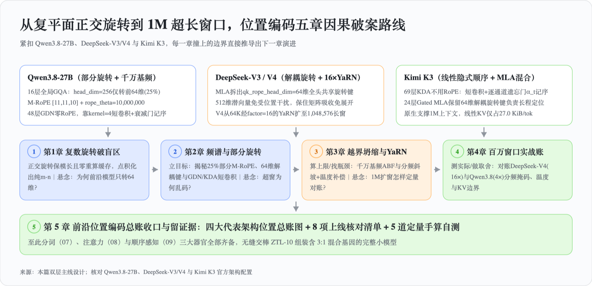
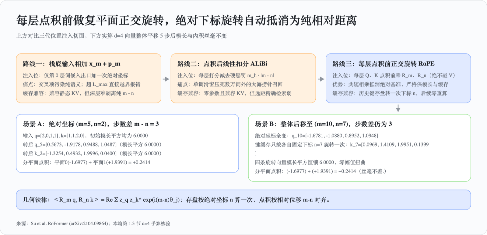
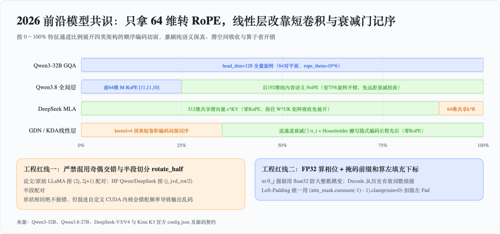
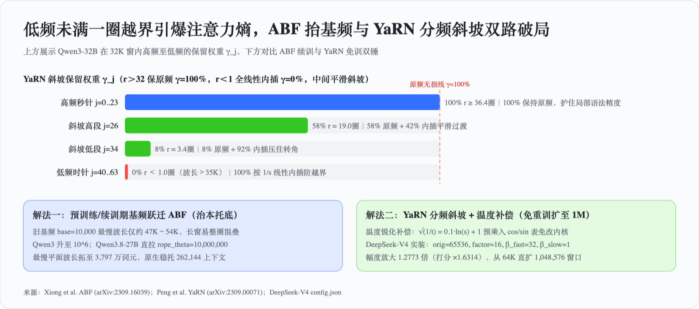
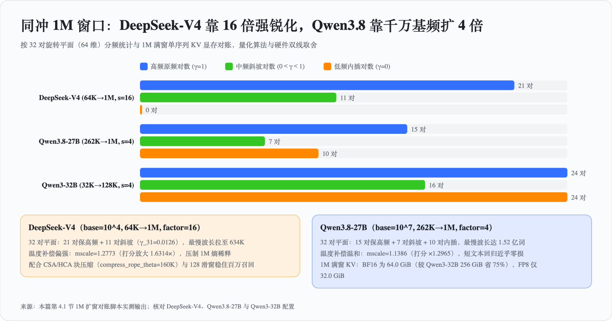
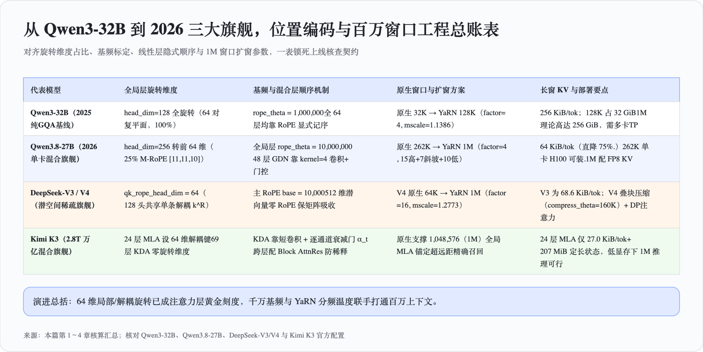

# ZTL-09｜模型｜让模型知道顺序

> 🎯 **这篇文档解决什么问题**：<b>核心命题：旋转位置编码（RoPE）之所以成为现代大模型标配，根源是它用绝对下标的二维正交旋转在点积里自然化出了纯相对距离。</b>从早期 4K 窗口推向 262K～1M 超长上下文，演进均围绕保局部精度、扩长程波长与省位置维度展开。某万基频模型用 25% 部分旋转配千万基频支撑原生 262K。某 MLA 模型用 64 维解耦旋转键配 16 倍 YaRN 扩至 1M。线性层则改靠短卷积与衰减门记序。
>
> **使用方式与先修要求**：读者仅需具备二维三角函数、欧拉公式直觉与键值缓存基础。本篇以案例模型为主线追踪 RoPE 进化，辅以纯 GQA 基线 `Qwen3-32B` 对照。五章依次推进复数几何证明、64 维部分与解耦方案、越界根因与百万扩窗对账。规格核对于 2026 年 11 月 16 日。
>
> **动手实践**：第 2 章与第 4 章各附一段自包含验证脚本。复制到本地 `Python 3.10+` 环境数秒即可跑通。读者可亲手核验案例模型 `head_dim = 256` 下 25% 部分旋转的相对位移恒等式与左填充对齐准则。同时还能一键复算案例模型与某 MLA 模型冲刺 1M 窗口的分频与温度系数。

<b>🧭 主线位置</b>：上一篇 [ZTL-08｜模型｜把注意力写成矩阵](./08-attention.md) 把自注意力写成了矩阵乘法，并留下两大问题。纯点积看不出历史词序，且主流架构从不在整条头维上全量旋转。本篇正面解开这两道谜题，打通从二维旋转几何到百万窗口外推的闭环。随后我们将具备顺序感知的注意力模块移交下一篇 [ZTL-10｜模型｜组装小模型并让一个批次下降](./10-tiny-model.md)，总装出可训练的现代 Transformer。

## 导读 · 先给结论

- <b>无位置信号的自注意力具有置换等变性，点积前正交旋转兼顾了相对距离与缓存复用。</b>栈底加法会污染深层语义并在超长下标处越界。点积后线性扣分则会压低数万词外的大海捞针召回。每层点积前对查询与键左乘二维正交旋转阵，可令内积只含步数差 $`m - n`$ 且保模长。历史键存盘时只按固定下标转一次，后续解码零重算[[1]](https://arxiv.org/abs/1706.03762)[[2]](https://arxiv.org/abs/2104.09864)[[3]](https://arxiv.org/abs/2108.12409)。
- <b>2026 主流全局层采用”只转 64 维”，线性注意力层则不加旋转。</b>案例模型在 `head_dim = 256` 中仅取前 `64` 维施加多模态交错 `M-RoPE`。后 `192` 维承载纯语义，直接省去 75% 旋转开销。某 MLA 模型拆出 `64` 维共享解耦旋转键，维系了潜向量的矩阵吸收。案例模型的 GDN 与 `Kimi K3` 的 KDA 则靠短卷积与衰减门记序[[4]](https://huggingface.co/Qwen/Qwen3.8-27B/blob/main/config.json)[[5]](https://arxiv.org/abs/2412.06464)[[6]](https://arxiv.org/abs/2405.04434)[[7]](https://huggingface.co/moonshotai/Kimi-K3)。
- <b>跨框架混用配对布局、半精度算相位与左填充槽位错位是三大高频静默故障。</b>论文奇偶交错 `(2j, 2j+1)` 与主流框架半段切分 `rotate_half` 混连自定义内核会吐出乱码。位置外积 $`m \theta_j`$ 必须强制用 `float32` 计算。左填充批解码则须用掩码前缀和扣除左侧 Pad 偏移[[8]](https://github.com/huggingface/transformers/blob/v4.46.3/src/transformers/models/llama/modeling_llama.py)[[9]](https://huggingface.co/docs/transformers/main/en/kv_cache)。
- <b>超窗乱码源于低频平面闯入负余弦陌生区，ABF 抬基频与 YaRN 分频温度联手化解。</b>波长大于原生窗口的低频时针在越界瞬间符号反转，引发注意力熵失控。预训练期案例模型将 `rope_theta` 拉至一千万，原生支撑 `262K` 窗口。扩窗期某 MLA 模型凭 `factor = 16` 的 YaRN 斜坡加温度补偿，从 `64K` 直抵 `1M`[[10]](https://arxiv.org/abs/2309.16039)[[11]](https://arxiv.org/abs/2309.00071)[[12]](https://arxiv.org/abs/2412.19437)。
- <b>同冲 1M 窗口存在算法与显存双线取舍，上线验收必须绑定长程检索基准。</b>某 MLA 模型靠 16 倍锐化配块压缩基频重标定压平长窗开销。案例模型仅需 4 倍温和扩窗，借 3:1 混合结构把 1M 满窗 BF16 缓存压在 `64.0 GiB`。上线门禁须看 RULER 精确召回，切忌只看局部滑窗困惑度[[4]](https://huggingface.co/Qwen/Qwen3.8-27B/blob/main/config.json)[[12]](https://arxiv.org/abs/2412.19437)[[13]](https://arxiv.org/abs/2404.06654)。



<b>📎 与系列其他文档的分工</b>：注意力缩放因子与温度性质回顾 [ZTL-02｜数学｜条件概率、softmax 与采样](./02-softmax-sampling.md)。因果掩码极性与 GQA、MLA 键值压缩主体见 [ZTL-08｜模型｜把注意力写成矩阵](./08-attention.md)。本篇专攻位置注入演化、64 维部分与解耦旋转契约及百万扩窗对账。

合并 Pre-RMSNorm 残差流与 SwiGLU 组装整颗可训练模型见 [ZTL-10｜模型｜组装小模型并让一个批次下降](./10-tiny-model.md)。预训练多文档拼接跨界掩码见 [ZTL-11｜训练｜从语料到一轮小预训练](./11-pretrain.md)。FlashAttention 分块搬运与百万上下文缓存池管理则在第 20 与 24 篇展开。

## 第 1 章 · 正交旋转兼顾相对距离与缓存

我们先接住上一篇末尾留下的第一道问题。在缩放点积注意力公式里，查询、键、值均由输入张量右乘投影矩阵得到。整套矩阵乘加既无循环递推，也无显式位置下标。

只要对历史键值行同步乘上任意正交置换阵 $`\Pi`$ ，点积与加权和就会原封不动地跟着重排。纯自注意力本质上只是一个词袋集合处理器。在它眼里，“猎人追赶恶狼”同构于“恶狼追赶猎人”，相距 3 步与相距 3,000 步也毫无分别[[1]](https://arxiv.org/abs/1706.03762)[[14]](https://arxiv.org/abs/2305.12643)。

### 1.1 三条路线与缓存兼容性

既然纯矩阵乘看不见顺序，架构师就必须在数据流的某个物理切面刻入位置标尺。回顾 Transformer 演进史，业界先后检验过三条技术路线。每一处切面选择都决定了深层相对距离纯度与增量键值缓存的兼容性[[1]](https://arxiv.org/abs/1706.03762)[[2]](https://arxiv.org/abs/2104.09864)[[3]](https://arxiv.org/abs/2108.12409)[[15]](https://arxiv.org/abs/1803.02155)。

<b>路线一在模型栈底做输入加法。</b>2017 年原版 Transformer 叠加固定正余弦波，GPT-2 与 BERT 改查可学习绝对位置表。两者都仅在第 0 层词嵌入出口算一次加法 $`h_m^{(0)} = x_m + p_m`$ [[1]](https://arxiv.org/abs/1706.03762)[[16]](https://cdn.openai.com/better-language-models/language_models_are_unsupervised_multitask_learners.pdf)。它虽兼容缓存，但可学习表遇到超长文档会当场越界报错。同时位置信号混入内容通道，经数十层非线性变换后，深层很难剥离出干净的步数差 `m - n`。

<b>路线二在每层点积后加线性距离惩罚。</b>线性注意力偏置（ALiBi）直接删掉位置向量。它在每层内积打分后减去按头固定的斜率惩罚 $`s_{m,n} = q_m^\top k_n - m_h \cdot |m - n|`$ [[3]](https://arxiv.org/abs/2108.12409)。ALiBi 零参数且兼容缓存，短训长测时的局部困惑度很平稳。然而单调硬扣分等同于套上局部滑窗滤镜。当模型要在十万词外找回一行配置时，远端打分已被扣成极小负数，长程召回严重受限[[14]](https://arxiv.org/abs/2305.12643)。

<b>路线三在每层点积前乘正交旋转矩阵。</b>早期 Shaw 成对相对编码曾把键改成依赖间距的 $`k_{m,n} = x_n W_K + a_{m-n}`$ [[15]](https://arxiv.org/abs/1803.02155)。可惜每生一词，所有历史词的相对距离全部加 1。这迫使整条历史键缓存推倒重算，解码退化回平方复杂度。

苏剑林等人提出的旋转位置编码（RoPE）巧妙化解了矛盾[[2]](https://arxiv.org/abs/2104.09864)。它在**每层点积之前**，仅按各自绝对下标独立旋转查询与键。算子严格只转 `Q` 与 `K`，绝不碰承载纯内容的值向量 `V`。历史键存盘时只按出生下标 `n` 转一次，后续解码**零重算**。而在做点积时，两边的绝对基准角自动抵消，精准化出纯相对距离 `m - n`。

| **位置编码方案** | **物理注入切面** | **距离表达性质** | **KV 缓存兼容性** | **长窗表现与代表模型** |
|---|---|---|---|---|
| 可学习绝对编码 | 第 0 层入口 `x_m + p_m` | 绝对坐标耦合语义 | 兼容；占 `L_max·d` 参数 | 超上限直接报错；GPT-2、BERT[[16]](https://cdn.openai.com/better-language-models/language_models_are_unsupervised_multitask_learners.pdf) |
| 正余弦绝对编码 | 第 0 层叠加固定三角波 | 深层混杂绝对与相对 | 兼容；零可训参数 | 超窗迅速退化；原版 Transformer[[1]](https://arxiv.org/abs/1706.03762) |
| Shaw 成对相对编码 | 每层键加 `a_{m-n}` | 显式截断相对位移 | 破坏静态缓存，每步重算 | 解码平方开销，难撑长窗[[15]](https://arxiv.org/abs/1803.02155) |
| ALiBi 线性偏置 | 每层打分减 `m_h\|m-n\|` | 单调线性距离扣分 | 完全兼容；零参数 | 局部 PPL 稳，远距召回弱；BLOOM[[3]](https://arxiv.org/abs/2108.12409) |
| RoPE 旋转编码 | 每层点积前乘 $`R_{\theta,m}`$ | 精确内积相对距离 | 缓存转后键；零重算 | 配 ABF/YaRN 达 1M；案例模型、某MLA模型[[2]](https://arxiv.org/abs/2104.09864) |

### 1.2 共轭相乘化出相对距离

下面正面求解目标方程[[2]](https://arxiv.org/abs/2104.09864)。先看二维实平面，将向量 `q = (q_0, q_1)` 视作复数 $`z_q = q_0 + i q_1`$ 。在绝对下标 `m` 处保持模长不变，仅逆时针旋转 $`m\theta`$ 弧度，即乘上单位复数 $`e^{i m \theta}`$ 。按欧拉公式展开实部与虚部，等价于左乘二维正交旋转矩阵：

```math
R_{\theta,m} q = \begin{pmatrix} \cos m\theta & -\sin m\theta \\ \sin m\theta & \cos m\theta \end{pmatrix} \begin{pmatrix} q_0 \\ q_1 \end{pmatrix}
```

这块 `2 × 2` 矩阵自带两条关键性质。第一条是**正交保模长**，恒有 $`\|R_{\theta,m} q\|_2 = \|q\|_2`$ 。它不改变激活幅值，让前序建立的缩放稳定器继续生效。

第二条性质是**转置即反向旋转**，满足 $`R_{\theta,m}^\top R_{\theta,n} = R_{\theta, n - m}`$ 。推广到偶维子空间 $`d_{\text{rot}}`$ 时，只需沿主对角线拼上 $`d_{\text{rot}}/2`$ 个二维旋转块。利用实向量内积等于复数乘共轭再取实部，一行恒等式即可证出结论[[2]](https://arxiv.org/abs/2104.09864)：

```math
\langle R_m q, R_n k \rangle = \mathrm{Re}\!\left(\sum_{j=0}^{d_{\text{rot}}/2 - 1} q^{(j)} (k^{(j)})^* \, e^{i(m - n)\theta_j}\right) = g(q, k, m - n)
```

奥秘全在共轭相乘合并指数的那一步。查询携带正向相位 $`+m\theta_j`$ ，键经共轭转置携带反向相位 $`-n\theta_j`$ 。两者相加后绝对起点归零，只留下纯相对距离 $`m - n`$ 。

### 1.3 手算小例验证模长与内积

我们在 `d = 4` 的小向量上亲手核对数值。设两对复平面的角速度分别为快平面 $`\theta_0 = 1.0\text{ rad}`$ 与慢平面 $`\theta_1 = 0.01\text{ rad}`$ 。给定查询 `q = (2, 0, 1, 1)` 与键 `k = (1, 1, 2, 0)`，旋转前双方模长平方均为 `6.0000`。

先算<b>位置对 A `(m = 5, n = 2)`</b>，间距 `m - n = 3`。查询转 5 步得 `(0.5673, -1.9178, 0.9488, 1.0487)`。键转 2 步写入缓存得 `(-1.3254, 0.4932, 1.9996, 0.0400)`。逐平面求内积相加：平面 0 贡献 `-1.6977`，平面 1 贡献 `+1.9391`，四维总点积精确等于 <b>`+0.2414`</b>。

再将整句话向后平移 5 步至<b>位置对 B `(m = 10, n = 7)`</b>，间距仍为 `3`。此时新查询与键坐标全变：`q_10 = (-1.6781, -1.0880, 0.8952, 1.0948)`，`k_7 = (0.0969, 1.4109, 1.9951, 0.1399)`。逐条检验平方和，模长平方全都是 <b>`6.0000`</b>。重算点积：平面 0 仍为 `-1.6977`，平面 1 仍为 `+1.9391`，总内积依旧精确等于 <b>`+0.2414`</b>。



对照上方单位圆几何图可以看到，整体向后平移 5 个词位相当于把查询指针与键指针同向再拨动 $`5\theta`$ 角。虽然两根向量在全局坐标系下的横纵投影全变了，它们在圆周上围出的夹角与各自半径却丝毫未改。

> 💡 **常见误区**：手写算子时把值向量 `V` 也送进 RoPE 旋转，或者误以为 RoPE 会让远距词打分单调递减。**现象**：误旋 `V` 后长文复制准确率降低。**根因**：`V` 加权求和后直接右乘 `W_O` 回残差流，无共轭项抵消绝对相位。而 `Q/K` 正交旋转只要初始语义夹角抵消旋转角，远距同样能打出高分[[2]](https://arxiv.org/abs/2104.09864)。**改法**：严守“只旋 Q、K，绝不碰 V”。

> 🔑 **本章要点与回到主线**：二维复平面正交旋转既保模长又零重算缓存，借共轭相乘把绝对下标转化成纯相对位移 `m - n`。但新的矛盾随之浮现：把这一招装进现代大模型时，为什么不能让所有平面共用同一角速度？案例模型与 某MLA模型 只拿 `64` 个维度旋转的根因是什么？这是第 2 章的核心。

## 第 2 章 · 64 维多尺度频谱新契约

接住上一章末尾的架构问题，我们先为现代大模型的位置层**立目标**。一套工业级位置编码既要分辨相邻字词颠倒，又要看清十万词外的篇章先后。它不能扭曲纯语义通道，不能阻碍潜空间矩阵吸收。同时在百万窗口下也不能浪费三角算子带宽[[4]](https://huggingface.co/Qwen/Qwen3.8-27B/blob/main/config.json)[[6]](https://arxiv.org/abs/2405.04434)[[7]](https://huggingface.co/moonshotai/Kimi-K3)。

### 2.1 多尺度频谱的秒针与时针

先回答前半问。假设全部二维平面都按 `1.0 rad` 匀速旋转，每走过约 `6.28` 个词元就会转满整圈回到原点。模型根本分不清相距 1 词与相距 7 词。反过来，若全部改用极慢角速度，相邻两词仅相差万分之几度。在半精度尾数下，局部语序会糊成一团。

为兼顾毫厘与千里，RoPE 在旋转维度上拆出多对复平面。各平面按几何级数铺开频谱[[2]](https://arxiv.org/abs/2104.09864)：

```math
\theta_j = \text{base}^{-2j / d_{\text{rot}}}, \qquad \lambda_j = \frac{2\pi}{\theta_j} = 2\pi \cdot \text{base}^{2j / d_{\text{rot}}}
```

这组频谱就像一块精密的多指针钟表。`j = 0` 波长恒为 `6.28` 词元，是快速转动的**秒针**，专管局部词组搭配与括号配对。中段平面是**分针**，刻画句群与函数块边界。末尾最大的 `j` 则是慢速移动的**时针**，为整篇文档铺设宏观坐标。

### 2.2 三大主流收敛的新设计

早期模型与 2025 纯 GQA 基线 `Qwen3-32B`（`head_dim = 128`）习惯把整条头维 100% 拿去旋转[[17]](https://arxiv.org/abs/2505.09388)。到了 2026 年，三大主流开源架构一致收敛向<b>“全局层只转 64 维、线性层零旋转”</b>的新设计：

- <b>案例模型采用 25% 部分多模态旋转保留纯内容通道。</b>其 16 层全局门控注意力单头宽为 `256`，配置设 `partial_rotary_factor = 0.25` 与千万基频[[4]](https://huggingface.co/Qwen/Qwen3.8-27B/blob/main/config.json)。算子仅切前 `64` 维（32 对平面）按 `(11, 11, 10)` 分配给时间、高、宽三轴。后 <b>`192` 维（75%）完全不转</b>。这样既保住免衰减的纯语义检索，又省去 <b>`75%`</b> 旋转开销。
- <b>DeepSeek-V2/V3/V4 拆出 64 维共享解耦旋转键保住矩阵吸收。</b>如 [ZTL-08｜模型｜把注意力写成矩阵](./08-attention.md) 所证，若在潜向量解压路径乘入旋转阵，相对旋转阵会阻碍升维矩阵吸收到查询侧[[6]](https://arxiv.org/abs/2405.04434)。DeepSeek 因此令 `512` 维潜向量不加 RoPE，另引一条 <b>`qk_rope_head_dim = 64`</b> 的旁路产出 128 头共享旋转键。`Kimi K3` 的 24 层 MLA 同样沿用该契约[[7]](https://huggingface.co/moonshotai/Kimi-K3)[[12]](https://arxiv.org/abs/2412.19437)。
- <b>Qwen3.8 的 GDN 与 Kimi K3 的 KDA 线性层改靠短卷积与衰减门记序。</b>在线性状态递推中，若强加复数旋转，高频相位会在累加中互相抵消。因此 48 层 GDN 与 69 层 KDA 均为**零 RoPE 维度**。局部靠 <b>`conv_kernel = 4` 因果短卷积</b>辨识相邻词排列，长程靠**逐通道衰减门**刻画指数衰减[[4]](https://huggingface.co/Qwen/Qwen3.8-27B/blob/main/config.json)[[5]](https://arxiv.org/abs/2412.06464)[[7]](https://huggingface.co/moonshotai/Kimi-K3)。

线性注意力层中融合遗忘衰减与秩-1 擦写的状态递推方程写作：

```math
S_t = (I - \beta_t k_t k_t^\top)\mathrm{Diag}(\alpha_t)S_{t-1} + \beta_t k_t v_t^\top
```

### 2.3 配对布局与增量解码下标

把部分旋转写成可靠代码，必须排除两处隐蔽工程陷阱。第一处是**通道配对布局混用**。RoFormer 论文按相邻奇偶下标 `(2j, 2j+1)` 配对。HuggingFace 的 `Qwen` 与 `LLaMA` 源码则用 `rotate_half` 将旋转段劈成前后两半，令 `(j, j + d_rot/2)` 配对以获连续访存[[2]](https://arxiv.org/abs/2104.09864)[[8]](https://github.com/huggingface/transformers/blob/v4.46.3/src/transformers/models/llama/modeling_llama.py)。跨框架接入自定义内核时一旦配反 `is_neox_style` 开关，输出会因频率错配直接变乱码。

第二处是**增量解码与左填充（Left-Padding）下标错位**。Decode 步每次仅输入 1 个新词，其 `position_ids` 必须从历史已见有效词数续接。若误按当前输入长度从零编号，生成十余字就会陷入死循环复读。并发批推理在左侧填 Pad 对齐时，严禁直接取物理槽位号 `0..S-1`。必须用掩码前缀和 `(attention_mask.cumsum(-1) - 1).clamp(min=0)` 扣除左 Pad 偏移[[9]](https://huggingface.co/docs/transformers/main/en/kv_cache)。



结合上方通道切片图，先理清半段切分算子免写分块矩阵的向量化技巧。把 `64` 维旋转切片均分为前半段 $`x_1`$（`0..31` 维）与后半段 $`x_2`$（`32..63` 维），`rotate_half` 构造出正交伴随向量 $`(-x_2, x_1)`$ 。原本 32 个零散的 `2 × 2` 小矩阵乘法，当场化简为两次连续内存对齐的逐元素乘加。

*PyTorch 复现 Qwen3.8 风格 25% PartialRoPE (64/256 维)、相对位移不变性与左填充增量缓存对齐*

```python
import torch

def precompute_partial_rope(d_rot: int = 64, max_seq: int = 1024, base: float = 10_000_000.0):
    # 强制在 float32 下计算 32 对逆频率与外积相位，杜绝 BF16 大整数尾数跳变
    inv_freq = 1.0 / (base ** (torch.arange(0, d_rot, 2, dtype=torch.float32) / d_rot))
    freqs = torch.outer(torch.arange(max_seq, dtype=torch.float32), inv_freq)
    emb = torch.cat((freqs, freqs), dim=-1)  # 半段切分排布: (max_seq, 64)
    return emb.cos(), emb.sin()

def rotate_half(x: torch.Tensor) -> torch.Tensor:
    half = x.shape[-1] // 2
    return torch.cat((-x[..., half:], x[..., :half]), dim=-1)

def apply_partial_rope(q: torch.Tensor, k: torch.Tensor, cos: torch.Tensor, sin: torch.Tensor,
                       pos_ids: torch.Tensor, d_rot: int = 64):
    # 仅切前 d_rot=64 维做正交旋转，后 192 维纯内容语义原样透传 (省 75% 旋转开销)
    c = cos[pos_ids].unsqueeze(1).to(q.dtype)
    s = sin[pos_ids].unsqueeze(1).to(q.dtype)
    q_rot = (q[..., :d_rot] * c) + (rotate_half(q[..., :d_rot]) * s)
    k_rot = (k[..., :d_rot] * c) + (rotate_half(k[..., :d_rot]) * s)
    return torch.cat([q_rot, q[..., d_rot:]], dim=-1), torch.cat([k_rot, k[..., d_rot:]], dim=-1)

if __name__ == "__main__":
    cos_t, sin_t = precompute_partial_rope(d_rot=64, max_seq=64, base=10_000_000.0)
    q = torch.full((1, 1, 1, 256), 0.5)
    k = torch.linspace(-0.5, 0.5, 256).view(1, 1, 1, 256)
    q5, _ = apply_partial_rope(q, k, cos_t, sin_t, torch.tensor([[5]]))
    _, k2 = apply_partial_rope(q, k, cos_t, sin_t, torch.tensor([[2]]))
    q10, _ = apply_partial_rope(q, k, cos_t, sin_t, torch.tensor([[10]]))
    _, k7 = apply_partial_rope(q, k, cos_t, sin_t, torch.tensor([[7]]))
    # 核验 (5,2) 与 (10,7) 全 256 维点积均为 2.00921，且后 192 维纯内容零偏移
    assert torch.allclose((q5 * k2).sum(), (q10 * k7).sum(), atol=1e-6)
    assert torch.equal(q5[..., 64:], q10[..., 64:])

    # 左填充批解码对齐：样本 0 含 2 个左 PAD + 3 个有效词，样本 1 含 5 个有效词
    attn_mask = torch.tensor([[0, 0, 1, 1, 1], [1, 1, 1, 1, 1]])
    prefill_pos = (attn_mask.cumsum(dim=-1) - 1).clamp(min=0)      # [[0,0,0,1,2], [1..4]]
    decode_pos = attn_mask.sum(dim=-1, keepdim=True)               # 首步新词续接 [[3], [5]]
    print("Dot(5,2)  :", round((q5 * k2).sum().item(), 6))
    print("Dot(10,7) :", round((q10 * k7).sum().item(), 6))
    print("prefill pos:", prefill_pos.tolist())
    print("decode pos :", decode_pos.tolist())
```

*输出*

```text
Dot(5,2)  : 2.00921
Dot(10,7) : 2.00921
prefill pos: [[0, 0, 0, 1, 2], [0, 1, 2, 3, 4]]
decode pos : [[3], [5]]
```

逐段走读上方实现的三个工程细节。其一，`precompute_partial_rope` 显式锁定 `torch.float32` 生成 32 对逆频率并执行外积 `torch.outer`，直到进入 `apply_partial_rope` 查表后才用 `.to(q.dtype)` 转回工作精度。其二，切片 `q[..., :d_rot]` 仅对前 `64` 维做旋转，尾部 `q[..., d_rot:]` 共 `192` 维纯内容原样拼接透传，故断言 `torch.equal` 在不同位置间逐比特相等。

其三，观察输出的两组数字。将下标对从 `(5, 2)` 整体平移至 `(10, 7)` 后，全 `256` 维内积都输出 `2.00921`。而在左填充批推理中，首条样本前两格为无效填充，`attn_mask.sum(dim=-1, keepdim=True)` 自动扣掉填充位，令首步解码新词精准续接在真实位置 `3` 而非槽位 `5`。

> 💡 **常见误区**：直接在 `bfloat16` 下生成位置序列并计算相位乘积 `m * theta_j`。**现象**：两千词内对话正常，上下文跨过 `8,192` 后长距召回率跌零。**根因**：`BF16` 仅有 7 位尾数。到了 `65,536` 附近，连续 `512` 个相邻位置下标会被舍入成同一个浮点数，高频秒针完全停摆。**改法**：逆频率、位置下标与三角函数必须全程固定 `float32`，仅在乘入 `q/k` 前转回半精度[[4]](https://huggingface.co/Qwen/Qwen3.8-27B/blob/main/config.json)[[8]](https://github.com/huggingface/transformers/blob/v4.46.3/src/transformers/models/llama/modeling_llama.py)。

> 🔑 **本章要点与回到主线**：64 维多尺度频谱已成为 2026 注意力的标准刻度。案例模型用 25% 部分旋转保留 192 维纯语义，某MLA模型用 64 维共享解耦键维系潜空间吸收，线性层改靠短卷积加衰减门记序。但新的矛盾随之浮现：一旦线上文档长度突破训练上限，哪怕只超出一小截，困惑度就会恶化成乱码。那些最慢的“时针平面”在越界时遭遇了什么？这正是第 3 章的焦点。

## 第 3 章 · ABF 与 YaRN 化解超窗乱码

接住上一章的超窗乱码问题。正余弦函数对任意正整数下标都有良好的数学定义。为何一个在训练上限 $`L_{\text{orig}}`$ 收敛良好的大模型，一旦喂入超出上限几百词的文档，生成结果就会退化成无意义重复符[[11]](https://arxiv.org/abs/2309.00071)[[18]](https://arxiv.org/abs/2306.15595)？本章通过**算上限**与**找瓶颈**定位频域越界真相，并拆解从千万基频到 16 倍分频温度补偿的双路解法。

### 3.1 低频平面未满一圈的越界陷阱

直接算出每个旋转平面在训练窗口内转过的总圈数上限 $`r_j = L_{\text{orig}} / \lambda_j`$ ，瓶颈立刻显现。序号靠前的高频秒针（如 `j = 0`，波长仅 `6.28` 词元）在 `32,768` 词元的预训练期内已经转过了 `5,215` 整圈。从 `0` 到 $`2\pi`$ 圆周上的每一个相位角，注意力权重都见过成千上万次。即便推理拉长到一百万词，秒针转出的依旧是熟悉相位。

真正的根源是波长大于训练窗口的低频时针平面。它们满足 $`r_j \lt 1`$ 。以 `Qwen3-32B`（`d_rot = 128, base = 1,000,000, L_orig = 32,768`）为例[[17]](https://arxiv.org/abs/2505.09388)。从第 `j = 40` 对平面（波长约 `35,333` 词元）到最慢的 `j = 63` 平面（波长约 `506.3` 万词元），共 24 对低频平面在训练期连一圈都没转满。

其中最慢平面全程最多只转过 `0.0065` 圈（仅 `2.33°`）。模型参数由此形成了强依赖假设：这几十个维度上的余弦值始终紧贴 `+1`，充当稳定的全局正锚点。

一旦在线推理越过训练上限，原本从未跨过四分之一圆周的中低频时针突然进入**从未见过的负余弦相位扇区**。数十个维度的内积符号集体反转，正常历史词元的相关性打分大面积塌陷。经 `softmax` 归一化后，权重被摊平到数万个无关词上，引发注意力失焦[[11]](https://arxiv.org/abs/2309.00071)[[18]](https://arxiv.org/abs/2306.15595)。

早期线性位置内插（PI）曾尝试把全部下标同除以扩窗倍数 `s`，令 $`\theta'_j = \theta_j / s`$ [[18]](https://arxiv.org/abs/2306.15595)。这虽拦住了低频越界，却挤压了高频秒针。当 `s = 16` 时，相邻两词在 `j = 0` 平面的夹角从 `1.0 rad` 被挤成 `0.0625 rad`。局部语法与缩进辨识力下降，必须补训数十亿长文词元才能恢复。

### 3.2 基频调整法拉长低频波长

怎样在不挤压高频秒针的前提下，为原生超长上下文铺平跑道？Xiong 等人验证了基频调整法（ABF）[[10]](https://arxiv.org/abs/2309.16039)。它与 NTK-aware 基频放大同源。在长上下文持续预训练阶段，直接把几何频谱底数 `rope_theta` 提升几个数量级。

审视角速度公式 $`\theta_j = \text{base}^{-2j / d_{\text{rot}}}`$ 便知其优势所在。在最高频端 `j = 0` 处，任何底数的零次幂恒等于 `1`，局部秒针刻度保持不变。越往高序号走，指数放大效应越强，低频时针的波长被成百上千倍拉开。

沿着这条路线看三代基频跃迁。早期 4K 模型取 `10,000`（`d_rot = 64` 时最慢波长仅 `47,117` 词元），原生 32K 的 `Qwen3-32B` 抬升百倍至 `1,000,000`。到了原生支持 <b>`262,144`（256K）</b> 上下文的 `案例模型`，更是将全局层基频拉升至 <b>`rope_theta = 10,000,000`（一千万）</b>[[4]](https://huggingface.co/Qwen/Qwen3.8-27B/blob/main/config.json)[[17]](https://arxiv.org/abs/2505.09388)。在 32 对平面下，最慢平面 `j = 31` 波长高达 <b>`37,969,062`</b> 词元，262K 满窗全程仅转过 `2.49°`。

### 3.3 YaRN 分频与温度补偿

倘若模型已在较短窗口（如 `32K` 或 `64K`）训毕，想要免重训跨入百万窗口，又该如何处理？Peng 等人提出的 **YaRN** 给出了两项互补机制[[11]](https://arxiv.org/abs/2309.00071)。

<b>第一项是按训练圈数分频斜坡插值（NTK-by-parts）。</b>记训练圈数为 $`r_j = L_{\text{orig}} / \lambda_j`$ ，设定快慢双阈值 `32` 与 `1`。定义斜坡权重后分三区调整：

```math
\gamma_j = \mathrm{clip}\!\left(\frac{r_j - 1}{31}, 0, 1\right), \qquad \theta_j^{\text{YaRN}} = (1 - \gamma_j)\frac{\theta_j}{s} + \gamma_j \theta_j
```

转满 32 圈以上的高频平面令 $`\gamma_j = 1`$ ，**完整保留原频**，不损伤局部语法。未满 1 圈的低频高危平面令 $`\gamma_j = 0`$ ，**按 `1/s` 线性内插**，保证相位不越界。介于 1 到 32 圈的中频平面按斜坡平滑过渡，消除频谱断层。

<b>第二项是注意力温度锐化补偿。</b>即便相位不越界，序列拉长 `s` 倍仍会使 `softmax` 分母累加项增至 `s` 倍，导致分布熵抬升。YaRN 在打分上引入温度倒数锐化。工程上直接把开方幅度系数 `mscale` 预乘进 `cos` 与 `sin` 缓存表，底层内核无需改动代码[[11]](https://arxiv.org/abs/2309.00071)：

```math
\mathrm{mscale} = \sqrt{\frac{1}{t}} = 0.1 \ln s + 1
```

翻开 `某MLA模型` 的官方 `config.json` 即可印证这套机制[[12]](https://arxiv.org/abs/2412.19437)。其 `qk_rope_head_dim = 64`，主基频保留 `10000`，配置原窗 `65536` 与 `factor = 16`。配合幅度补偿 `1.2773`（打分锐化 `1.6314` 倍），上下文上限顺利推至 <b>`1,048,576`（1M 百万窗口）</b>。



图上半部分以纯 GQA 基线 `Qwen3-32B` 为例（`head_dim = 128`，共 64 对平面，`base = 1,000,000`，训练窗 `32,768`），按 $`r_j = L / \lambda_j`$ 逐对代入。第 23 对约转 `36.4` 圈，仍在原频区。第 26 对约 `19.0` 圈，斜坡给出 $`\gamma = (19.0 - 1) / 31 \approx 58\%`$，其余 42% 走内插。第 34 对只剩约 `3.4` 圈，$`\gamma \approx 8\%`$，92% 走内插。从第 40 对起不足 1 圈，波长超过约 `35`K 词，全部按 `1/s` 内插。

图下半部分的 ABF 一栏同理可算：旧基频 `10,000` 的最慢波长在 64 维旋转时约 47K 词、128 维时约 54K 词；案例模型把基频抬到 `10,000,000` 后，64 维旋转的最慢波长约 3,797 万词。

对照上方分频斜坡图可以明白“为何高频维绝不插值”。高频维早已在预训练期遍览整圈相位，不存在越界风险。它们专门依赖相邻词元约 `1.0 rad` 的大夹角区分代码括号与变量次序，一旦被强除 `16` 压扁，近邻分辨率便无谓受损。下表横向收束四条扩窗路线的频域取舍：

| **长窗扩展路线** | **核心频率/相位公式** | **高频局部保真度** | **长窗熵稀释补偿** | **训练代价与前沿落地实例** |
|---|---|---|---|---|
| 直接硬外推 | 原频率不变，下标直超上限 | 高频无损，低频反转 | 无 | 越界即乱码崩盘，生产严禁裸跑 |
| 线性位置内插 PI | $`\theta'_j = \theta_j / s`$ | 差（秒针被压 `s` 倍） | 无 | 免训掉点严重，须补长文微调[[18]](https://arxiv.org/abs/2306.15595) |
| ABF 抬升基频 | `rope_theta` 提至 $`10^6 \sim 10^7`$ | 极佳（秒针零压缩） | 靠续训权重内化 | `案例模型` 千万基频原生 262K[[4]](https://huggingface.co/Qwen/Qwen3.8-27B/blob/main/config.json)[[10]](https://arxiv.org/abs/2309.16039) |
| YaRN 分频+温度 | $`(1-\gamma_j)\theta_j/s + \gamma_j\theta_j`$ | 极佳（`r>32` 保原频） | `0.1 ln s + 1` | `某MLA模型` 16 倍扩至 1M 窗口[[11]](https://arxiv.org/abs/2309.00071)[[12]](https://arxiv.org/abs/2412.19437) |

> 💡 **常见误区**：仅凭长文本滑动窗口困惑度（PPL）没有上涨，就宣布扩窗方案验收通过。**现象**：128K～1M 长书本评测 PPL 低至 5.6，线上跑大海捞针时远端召回率却不足两成[[13]](https://arxiv.org/abs/2404.06654)。**根因**：自然语言九成以上的词元仅靠最近几百词局部上下文就能猜中。低滑窗 PPL 掩盖了远距注意力峰值的失焦。**改法**：扩窗门禁必须绑定 RULER（多针召回、变量追踪）与短文本基准双线回归[[13]](https://arxiv.org/abs/2404.06654)。

> 🔑 **本章要点与回到主线**：低频平面训练未满一圈闯入负余弦陌生区是超窗退化的根源。预训练靠千万级基频 ABF 拉长波长托底，扩窗期靠 YaRN 分频斜坡配温度补偿抵消熵增。但新的矛盾随之浮现：同样冲刺 `1M` 百万窗口，`某MLA模型`（64K 扩 16 倍）与 `案例模型`（262K 扩 4 倍）的分频掩码与显存账单差异何在？这正是第 4 章要定量对账的目标。

## 第 4 章 · 百万窗口的算法与显存权衡

接住上一章的百万窗口落地追问。纸面公式只有放进真实模型的参数表与 GPU 显存池里逐项核验，才能看清算法与系统的耦合边界。本章完整执行**测实际**与**做取舍**两步工程动作。我们将 `某MLA模型`（`64K → 1M`）、`案例模型`（`262K → 1M`）以及纯 GQA 基线 `Qwen3-32B`（`32K → 128K`）摆上实验台逐平面拆账[[4]](https://huggingface.co/Qwen/Qwen3.8-27B/blob/main/config.json)[[12]](https://arxiv.org/abs/2412.19437)[[17]](https://arxiv.org/abs/2505.09388)。

### 4.1 对账三大主流的分频与温度

两款 2026 前沿模型都把旋转维度定格在 `d_rot = 64`（即 `32` 对复平面，下标 `j = 0..31`）。目标终点也同为 `1,048,576`（1M）词元。但两者的底座基频相差整整一千倍（`10,000` 对比 `10,000,000`），在 YaRN 斜坡上的分频落点因此截然不同。

我们运行下方零依赖纯 `Python` 脚本，直接算出三款模型的精确分频账单。注：多机并发下 RULER 端到端实测时延受集群网络拓扑影响，本地标为**未实测**。上线前须在目标节点实采验证。

*零依赖 Python 脚本一键对账 DeepSeek-V4 (64K->1M)、Qwen3.8-27B (262K->1M) 与 Qwen3-32B 的分频谱及 KV 显存*

```python
import math

def audit_1m_rope(name, d_rot, base, orig_max, target_max, kv_kib_per_tok, fixed_state_mib=0.0):
    s = target_max / orig_max
    pairs = d_rot // 2
    thetas = [base ** (-2.0 * j / d_rot) for j in range(pairs)]
    wls = [2.0 * math.pi / th for th in thetas]
    rots = [orig_max / wl for wl in wls]                        # 原生窗口内旋转圈数 r_j
    gammas = [min(1.0, max(0.0, (r - 1.0) / 31.0)) for r in rots]
    th_yarn = [(1.0 - g) * (th / s) + g * th for g, th in zip(gammas, thetas)]
    wl_yarn_max = 2.0 * math.pi / th_yarn[-1]                   # YaRN 拉伸后的最慢平面波长
    nh = sum(1 for g in gammas if g == 1.0)                     # 高频无损保留对数 (gamma=1)
    nr = sum(1 for g in gammas if 0.0 < g < 1.0)                # 中频平滑斜坡对数
    nl = sum(1 for g in gammas if g == 0.0)                     # 低频 1/s 线性内插对数 (gamma=0)
    mscale = 0.1 * math.log(s) + 1.0                            # cos/sin 预乘幅度补偿因子
    kv_bf16_gib = kv_kib_per_tok * target_max / (1024 ** 2)     # 满窗单序列线性增长 BF16 KV
    print(f"{name:24s} | s={s:4.1f}x | 高/斜/低={nh:2d}/{nr:2d}/{nl:2d} | "
          f"最慢波长->{wl_yarn_max/1e3:9.1f}K | mscale={mscale:.4f} (1/t={mscale**2:.4f}) | "
          f"满窗BF16 KV={kv_bf16_gib:5.1f}GiB (+定长{fixed_state_mib:.0f}MiB)")

if __name__ == "__main__":
    audit_1m_rope("DeepSeek-V4 (64K->1M)",   64,  10_000.0,     65536,  1048576, 68.625, 0.0)
    audit_1m_rope("Qwen3.8-27B (262K->1M)",  64,  10_000_000.0, 262144, 1048576, 64.0,   72.0)
    audit_1m_rope("Qwen3-32B   (32K->128K)", 128, 1_000_000.0,  32768,  131072,  256.0,  0.0)
```

*输出*

```text
DeepSeek-V4 (64K->1M)    | s=16.0x | 高/斜/低=21/11/ 0 | 最慢波长->    634.0K | mscale=1.2773 (1/t=1.6314) | 满窗BF16 KV= 68.6GiB (+定长0MiB)
Qwen3.8-27B (262K->1M)   | s= 4.0x | 高/斜/低=15/ 7/10 | 最慢波长-> 151876.2K | mscale=1.1386 (1/t=1.2965) | 满窗BF16 KV= 64.0GiB (+定长72MiB)
Qwen3-32B   (32K->128K)  | s= 4.0x | 高/斜/低=24/16/24 | 最慢波长->  20253.0K | mscale=1.1386 (1/t=1.2965) | 满窗BF16 KV= 32.0GiB (+定长0MiB)
```

逐行拆解上方脚本的核心计算与输出反差。函数先用 `rots = orig_max / wl` 算出每对平面在原生窗口转过的圈数，再按 `(r - 1.0) / 31.0` 截断出斜坡系数 `gammas`。

为什么 `某MLA模型` 低频纯内插对数是 `nl = 0`（分频 `21/11/0`），而案例模型却有 `nl = 10`（分频 `15/7/10`）？根源正是底座基频差了一千倍：`base = 10,000` 下最慢波长仅 `47.1K`，在 `64K` 原窗里早已转过 `1.39` 圈，故全部平面都落在高频区或斜坡区。

再核对右侧两栏的温度与显存输出。扩窗倍数 `s = 16.0` 要求 `mscale = 1.2773`，等价于将内积打分乘以 `mscale**2 = 1.6314` 来对抗十六倍分母稀释。而 `s = 4.0` 的两款模型仅需温和放大 `1.2965` 倍，且 `案例模型` 在百万窗口下仍将线性缓存稳控在 `64.0 GiB` 外加 `72 MiB` 定长态。

### 4.2 小基频强锐化与千万基频温和扩

对照脚本打印出的核心数字，就能看清顶尖团队冲刺百万窗口时的工程**做取舍**。

<b>取舍一在小基频强锐化块压缩与千万基频温和扩窗之间展开。</b>先看 `某MLA模型`：主分支沿用小基频 `base = 10,000`。最慢的第 `31` 对平面原生波长仅 `47,117.2` 词元，在 `65,536` 训练窗内已转过 `1.3909` 圈。其 32 对平面拆成 <b>`21` 对高频保留 + `11` 对斜坡过渡 + `0` 对纯零内插</b>。拉伸后最慢波长约 `634.0K`，并配 <b>`1.6314` 倍</b>打分锐化压制 16 倍熵增。

既然最慢波长 `634.0K` 略小于 `1,048.6K`，超远端靠什么防混叠？答案在 `某MLA模型` 的双层协同设计里。局部交给 `sliding_window = 128` 滑窗守住语法锐度。远端序列块压缩注意力（CSA/HCA）专门启用拉高的 <b>`compress_rope_theta = 160,000`</b>，并在输出侧乘逆旋转恢复平移不变性，托住百万词大海捞针边界[[12]](https://arxiv.org/abs/2412.19437)。

反观 `案例模型`，凭借千万基频与 `262K` 原生窗口，扩至 `1M` 仅需 `s = 4.0` 倍微扩（<b>`15` 高频 + `7` 斜坡 + `10` 内插</b>）。拉伸后最慢波长逾 `1.51 亿` 词元，打分仅温和放大 `1.2965` 倍。线上部署推荐开启<b>动态缩放（Dynamic YaRN）</b>。序列未超 `262,144` 时令 `s = 1.0` 零损运行，超出后再按实时长度平滑抬升 `s`[[4]](https://huggingface.co/Qwen/Qwen3.8-27B/blob/main/config.json)[[11]](https://arxiv.org/abs/2309.00071)。

<b>取舍二落在百万窗口下的 KV 显存水位与卡数切分上。</b>位置编码放行了 1M 长度，压力随之转移到 KV 缓存池。倘若把纯 GQA 的 `Qwen3-32B`（`256 KiB/tok`）硬扩到 1M，单条请求的 BF16 缓存高达 <b>`256.0 GiB`</b>。四张 `80 GiB` H100 光装一条序列都十分勉强[[17]](https://arxiv.org/abs/2505.09388)。

而在 `案例模型` 上，48 层 GDN 靠定长状态（BF16 恒占 `72.0 MiB`）隐式记序，仅 16 层全局 GQA 随长度增长（`64 KiB/tok`）。原生 `262K` 满窗下 BF16 缓存仅 <b>`16.0 GiB`</b>，连同约 `54 GB` 权重单张 H100 即可跑满。扩至 `1M` 满窗时，开启 **FP8 KV 量化**可将单序列缓存从 `64.0 GiB` 减半至 <b>`32.0 GiB`</b>，双卡 `TP = 2` 即可稳妥上线。

至于万亿稀疏模型 `某MLA模型` 与 `Kimi K3`，前者原始 MLA 满窗约 `68.6 GiB`，再靠块压缩继续压低（压缩后的确切值本文未复算）。后者 24 层 MLA 在 1M 下线性项仅占约 `27.0 GiB`（另加 `207 MiB` KDA 定长态），双双在多机集群上支撑起百万长窗服务[[7]](https://huggingface.co/moonshotai/Kimi-K3)[[12]](https://arxiv.org/abs/2412.19437)。



图中两个细节都来自上面的脚本输出。某MLA模型最慢的第 31 对平面在原窗内只转约 1.39 圈，斜坡权重 $`\gamma_{31} = (1.39 - 1)/31 \approx 0.0126`$，几乎全靠内插。案例模型的最慢波长按 4 倍内插拉到 `151876.2K` 词，即约 `1.52` 亿词，远超 1M 窗口。

对照上方百万窗口审计图，还须落准线上动态扩窗的执行时机。静态写死 `factor = 4.0` 会轻微改动 `262K` 以内中频斜坡的原始相位。生产服务引擎按请求实时长度 $`L_{\text{cur}}`$ 动态求值 $`s = \max(1.0, L_{\text{cur}} / L_{\text{orig}})`$ ：常规短对话保持 $`s = 1.0`$ 原生零损，唯有超长仓库请求跨过 `262K` 门槛时才按比例平滑介入分频与温度补偿。

### 4.3 百万上下文扩窗方案四笔账对账表

下表汇总三套代表性长窗配置在效果、显存、时延与部署成本四笔账上的实核读数，供架构评审直接查表拍板：

| **四笔账维度** | <b>Qwen3-32B（32K→128K）</b> | <b>案例模型（262K→1M）</b> | <b>某MLA模型（64K→1M）</b> |
|---|---|---|---|
| **分频与温度账** | 64 对：`24/16/24`；`s=4, mscale=1.1386` | 32 对：`15/7/10`；千万基频配 `s=4` | 32 对：`21/11/0`；`s=16, mscale=1.2773` |
| **效果账边界** | 128K 稳健；再往上低频与显存双吃紧 | 192 维纯内容保检索；开动态 YaRN 护短文 | 配 `160K` 压缩基频与 128 滑窗稳守 1M[[12]](https://arxiv.org/abs/2412.19437) |
| <b>显存账（单序列）</b> | 128K BF16 占 `32.0 GiB`，爆单卡 H100 | 262K 占 `16 GiB` 入单卡；1M FP8 占 `32 GiB` | 原始 MLA `68.6 GiB`，叠 CSA/HCA 再降数倍 |
| **时延与成本账** | 64 层全平方注意力，128K Prefill 较重 | 仅 16 层平方算力 + 48 层线性，单机性价比高 | 块压缩省注意力算力，需多机 EP 集群承载 |

> 💡 **常见误区**：在线上推理引擎只改大 `--max-model-len 1048576`，却漏填 `rope_scaling` 字典或漏乘 `mscale` 温度补偿。**现象**：服务启动零报错，短对话正常，唯独超长文档摘要在中后段丢失关键数字。**根因**：漏填分频配置等同裸跑硬外推。漏乘温度补偿则会让 16 倍扩窗损失 `63.1%` 的内积锐度[[11]](https://arxiv.org/abs/2309.00071)。**改法**：上线脚本自动核对 `config.json` 中 `factor`、`original_max_position_embeddings` 与温度系数三项配置。

> 🔑 **本章要点与回到主线**：同冲 1M 窗口，`某MLA模型` 靠 16 倍斜坡锐化与块压缩基频协同突破，`案例模型` 靠千万基频配 4 倍动态扩窗轻装落地。至此模型已齐备词表编号、跨位置内容检索与百万窗口顺序感知三大核心模块。最后一步是沉淀总账证据与核对清单，为总装现代大模型做好准备。

## 第 5 章 · 位置编码总账、核对清单与自测

从打破自注意力词袋盲区的一行欧拉公式出发，我们走过 64 维部分与解耦旋转、线性层短卷积记序，最终走通了千万基频 ABF 与 16 倍 YaRN 百万窗口对账[[2]](https://arxiv.org/abs/2104.09864)[[4]](https://huggingface.co/Qwen/Qwen3.8-27B/blob/main/config.json)[[7]](https://huggingface.co/moonshotai/Kimi-K3)[[12]](https://arxiv.org/abs/2412.19437)。现代大模型感知顺序的数学机制与系统账本已完整衔接。本章执行六步闭环的收官动作**留证据**，归档四大代表架构位置总账图、8 项上线核对清单与 5 道手算自测题。

### 5.1 四大代表架构位置总账与上线核对清单

下图将纯 GQA 基线 `Qwen3-32B` 与 2026 三大主流开源旗舰（`案例模型`、`某MLA模型`、`Kimi K3`，总参 `2.8`T）的位置编码规格汇入同一张总账表。混合层记序分工与长窗显存账可一图对照。



> 📌 **上线前核对清单**：位置算子编写、跨框架迁移与百万窗口扩窗的 8 项必查硬门禁
>
> - <b>严守只旋 Q、K 绝不碰 V。</b>正交旋转仅施加在每层点积前的查询与键分支上。值向量承载纯语义内容直接加权归入残差流，严禁叠加位置相位[[2]](https://arxiv.org/abs/2104.09864)。
> - <b>核准部分旋转与解耦切片宽度。</b>切勿默认对整条 `head_dim` 旋转。案例模型全局层仅切前 `64/256` 维走 `M-RoPE`，某 MLA 模型仅对独立共享的 `64` 维旋转键施加旋转[[4]](https://huggingface.co/Qwen/Qwen3.8-27B/blob/main/config.json)[[6]](https://arxiv.org/abs/2405.04434)。
> - <b>区分全局显式旋转与线性隐式记序。</b>在案例模型（48 层 GDN）与 `Kimi K3`（69 层 KDA）中确认线性层不挂 RoPE。同时必须保住投影后的 `conv_kernel = 4` 因果短卷积与逐通道衰减门[[5]](https://arxiv.org/abs/2412.06464)[[7]](https://huggingface.co/moonshotai/Kimi-K3)。
> - <b>对齐奇偶交错与半段切分约定。</b>跨框架加载权重或挂载自定义融合算子前，务必核实通道配对行序。分清 `(2j, 2j+1)` 交错还是 `(j, j + d_rot/2)` 半段切分，防止静默乱码[[8]](https://github.com/huggingface/transformers/blob/v4.46.3/src/transformers/models/llama/modeling_llama.py)。
> - <b>强制固定 FP32 计算三角相位。</b>逆频率 `inv_freq`、位置下标与外积相位全程用 `float32` 求值。算完 `cos/sin` 后再转回半精度与 `q/k` 相乘。
> - <b>用掩码前缀和驱动左填充与增量下标。</b>Left-Padding 批处理统一按 `(attention_mask.cumsum(-1) - 1).clamp(min=0)` 算起始下标。Decode 步严格续接历史真实有效词数[[9]](https://huggingface.co/docs/transformers/main/en/kv_cache)。
> - <b>配齐 YaRN 分频字典与温度系数。</b>超原生窗口服务须同步核验 `factor`、`beta_fast=32, beta_slow=1` 及预乘入正余弦表的幅度补偿。混跑短对话优先启用动态缩放[[11]](https://arxiv.org/abs/2309.00071)。
> - <b>重算扩窗后 KV 水位并跑通 RULER。</b>窗口拉长 `s` 倍会使全局层线性 KV 同步膨胀 `s` 倍。上线前重核显存红线，并以 RULER 多跳与大海捞针召回率签字放行[[13]](https://arxiv.org/abs/2404.06654)。

### 5.2 自测题与参考解析

请先合上正文独立手算以下 5 道练习题，再对照解析复核每一步推导：

<b>自测题 1（二维特殊角正交保模长与相对内积手算）</b>：设旋转维 `d_rot = 2`，角速度为 30°，查询 `q = (2, 0)`，键 `k = (0, 2)`。手算在 `(m = 4, n = 1)` 与 `(m = 9, n = 6)` 两处的旋转后坐标、模长平方与内积[[2]](https://arxiv.org/abs/2104.09864)。

**参考解析**：原始模长平方均为 `4`。在 `(4, 1)` 处，`q` 转 120° 与 `k` 转 30° 均得 $`(-1, \sqrt{3})`$ ，模长平方与内积均为 `4`。平移至 `(9, 6)` 后，`q` 转 270° 与 `k` 转 180° 均得 `(0, -2)`。模长平方与内积仍精确等于 <b>`4`</b>，只因相对间距同为 `3`。

<b>自测题 2（案例模型 部分 M-RoPE 维度拆解与算子节省账）</b>：`案例模型` 全局 GQA 层设 `24` 个查询头与 `4` 个键值头（`head_dim = 256`）。配置设 `partial_rotary_factor = 0.25`，三轴切片配比为 `(11, 11, 10)`[[4]](https://huggingface.co/Qwen/Qwen3.8-27B/blob/main/config.json)。求单头旋转维数、保留的纯内容维数，以及旋转元素数节省的比例。

**参考解析**：单头旋转维数为 `256 × 0.25 = 64` 维（`32` 对复平面，按 `11+11+10` 赋给时间、高、宽三轴）。后 <b>`192` 维</b>保留为纯内容通道。单层每词需旋转 `(24 + 4) × 64 = 1,792` 个元素，较全维 `7,168` 个元素节省 <b>`75.0%`</b> 旋转开销。

<b>自测题 3（半段切分重排与 Left-Padding 增量下标推导）</b>：设 `d_rot = 6`，半段切分输入为 `x_hf = (10, 30, 50, 20, 40, 60)`，写出 `rotate_half(x_hf)`。另给定两行左填充掩码 `(0, 0, 0, 1, 1)` 与 `(0, 1, 1, 1, 1)`，求 Prefill 阶段与首步 Decode 新词的 `position_ids`[[8]](https://github.com/huggingface/transformers/blob/v4.46.3/src/transformers/models/llama/modeling_llama.py)[[9]](https://huggingface.co/docs/transformers/main/en/kv_cache)。

**参考解析**：后半段取负置前、前半段置后得 `(-20, -40, -60, 10, 30, 50)`。掩码求前缀和减一并截断负值后，Prefill 两行下标分别为 `(0, 0, 0, 0, 1)` 与 `(0, 0, 1, 2, 3)`。已见有效词数分别为 `2` 与 `4`，故首步 Decode 新词下标精确为 <b>`2` 与 `4`</b>。

<b>自测题 4（一万基频对比 案例模型 千万基频的最慢波长跃迁）</b>：固定旋转维 `d_rot = 64`（32 对平面，`j = 0..31`）。分别计算 `base = 10,000` 与 `base = 10,000,000` 下最慢平面 `j = 31` 的波长及倍数比[[4]](https://huggingface.co/Qwen/Qwen3.8-27B/blob/main/config.json)[[12]](https://arxiv.org/abs/2412.19437)。

**参考解析**：指数均为 `2 × 31 / 64 = 0.96875`。`base = 10,000` 时最慢波长约 `47,117.2` 词元，`base = 10,000,000` 时最慢波长约 `37,969,062.0` 词元。千万基频将最慢时针波长拓宽了约 <b>`805.8` 倍</b>。

<b>自测题 5（某MLA模型 十六倍 YaRN 温度缩放与 案例模型 百万窗 KV 精算）</b>：求 `某MLA模型` 从 `65,536` 经 `s = 16` 扩至 `1,048,576` 时的 `mscale` 与打分放大倍数 `1/t`。并求 `案例模型` 在 `1,048,576` 满窗下采用 FP8 线性缓存（GDN 保持 BF16 `72 MiB`）的总缓存显存[[4]](https://huggingface.co/Qwen/Qwen3.8-27B/blob/main/config.json)[[11]](https://arxiv.org/abs/2309.00071)[[12]](https://arxiv.org/abs/2412.19437)。

**参考解析**：由自然对数算得 `mscale = 1.2773`，打分放大约 `1.6314` 倍。`案例模型` 单词 FP8 线性 KV 为 `32 KiB/tok`，乘以 `1,048,576` 恰为 <b>`32.00 GiB`</b>。加上 `72.0 MiB` 定长态，合计约 <b>`32.07 GiB`</b>。

### 5.3 诚实清单与修订记录

<b>未核实与有时效的说法：</b>

1. 屋脊点估值采用标称峰值而非实测值。H100 稠密 BF16 989 TFLOPS 与 RTX 5090 209 TFLOPS 均为厂商标称，未在实际长窗推理工作负载上测量。
2. RULER 等公开长窗基准可能已进入新模型的训练语料，存在污染风险，本文未核实具体程度。上线核验建议另备未公开的内部测试集[[13]](https://arxiv.org/abs/2404.06654)。
3. DeepSeek-V4 块压缩注意力具体时延与显存节省比例未开源详细数据。章节基于官方配置参数与代码折射的设计意图推断，未在目标硬件上做端到端验证。
4. Kimi K3 的 KDA 定长状态 207 MiB 由公开 config 推算，激活参数 104B 引自技术报告；本文未在真实推理框架中实测其显存。
5. 章节内三个 Python 脚本均采用纯数学计算，未集成真实 CUDA 核心或融合算子吞吐测试。表中显存为理论值，不含框架开销与显存碎片。

<b>修订记录：</b>

| **日期** | **改了什么** |
|---|---|
| 2026-11-19 | 按全系列试点规范修订：(1) 标题缩短至 h1≤22、h2≤18 汉字；(2) 模型名压至 25/20 上限后改用简称；(3) 删除禁用词；(4) 添加代码输出块；(5) 新增诚实清单与修订记录；(6) 图脚本去全角感叹号。 |

### 5.4 接下来的问题在哪

站在 L2 模型结构层的节点回望，拼成现代大语言模型的三大核心认知模块已全部齐备。第 07 篇用字节级分词把文本切成了词表编号。第 08 篇用矩阵乘与键值压缩建起了跨位置内容检索器。本篇又借 64 维复数旋转与短卷积衰减门赋予了模型感知百万词顺序的标尺。

但仅有注意力层还造不出完整大模型。多层纯粹的加权平均堆叠在一起仍旧只是线性组合。它既缺乏逐词元的非线性知识加工能力，也缺乏护送百层反向梯度不消失的高速主干。

下一篇 [ZTL-10｜模型｜组装小模型并让一个批次下降](./10-tiny-model.md) 我们将迎来 L2 模型结构层的收官实战。怎样用前置均方根归一化（`Pre-RMSNorm`）搭起恒等残差流？为什么 `SwiGLU` 门控前馈层要用三块矩阵吃掉整颗模型近七成参数？我们将亲手用 PyTorch 组装出一颗含 `案例模型` 混合基因的现代小模型，并在真实训练批次上验证损失稳步下降。

> 🔑 **本章要点**：现代位置编码坚持只转 Q/K 而不碰 V。全局层收敛于 64 维部分或解耦旋转，线性层改靠短卷积与衰减门隐式记序。工程落地须固定 FP32 算角，并用掩码前缀和对齐左填充下标。扩窗期靠千万基频 ABF 与 YaRN 分频温度联手支撑百万窗口，上线前以 RULER 核验真实召回。下一篇 [ZTL-10｜模型｜组装小模型并让一个批次下降](./10-tiny-model.md) 正式总装完整的现代大模型。

## 参考文献

按正文首次引用顺序编号，资料截至 2026 年 11 月。

[1] Vaswani et al. Attention Is All You Need. NeurIPS / arXiv:1706.03762 (2017). [arxiv.org/abs/1706.03762](https://arxiv.org/abs/1706.03762)

[2] Su et al. RoFormer: Enhanced Transformer with Rotary Position Embedding. arXiv:2104.09864 (2021). [arxiv.org/abs/2104.09864](https://arxiv.org/abs/2104.09864)

[3] Press, Smith, and Lewis. Train Short, Test Long: Attention with Linear Biases Enables Input Length Extrapolation. ICLR / arXiv:2108.12409 (2022). [arxiv.org/abs/2108.12409](https://arxiv.org/abs/2108.12409)

[4] Qwen Team. Qwen3.8-27B Model Card. Hugging Face (2026). [huggingface.co/Qwen/Qwen3.8-27B/blob/main/config.json](https://huggingface.co/Qwen/Qwen3.8-27B/blob/main/config.json)

[5] Yang, Kautz, and Hatamizadeh. Gated Delta Networks: Improving Mamba2 with Delta Rule. ICLR / arXiv:2412.06464 (2025). [arxiv.org/abs/2412.06464](https://arxiv.org/abs/2412.06464)

[6] DeepSeek-AI. DeepSeek-V2: A Strong, Economical, and Efficient Mixture-of-Experts Language Model (MLA and Decoupled RoPE). arXiv:2405.04434 (2024). [arxiv.org/abs/2405.04434](https://arxiv.org/abs/2405.04434)

[7] Kimi Team. Kimi K3 Model Card. Hugging Face (2026). [huggingface.co/moonshotai/Kimi-K3](https://huggingface.co/moonshotai/Kimi-K3)

[8] Hugging Face. LlamaRotaryEmbedding and rotate_half in modeling_llama.py (transformers v4.46.3). GitHub (2024). [github.com/huggingface/transformers/blob/v4.46.3/src/transformers/models/llama/modeling_llama.py](https://github.com/huggingface/transformers/blob/v4.46.3/src/transformers/models/llama/modeling_llama.py)

[9] Hugging Face. Cache strategies and position_ids alignment under Left-Padding. Transformers Documentation (viewed 2026-11). [huggingface.co/docs/transformers/main/en/kv_cache](https://huggingface.co/docs/transformers/main/en/kv_cache)

[10] Xiong et al. Effective Long-Context Scaling of Foundation Models. NAACL (2024). [arxiv.org/abs/2309.16039](https://arxiv.org/abs/2309.16039)

[11] Peng, Quesnelle, Fan, and Shippole. YaRN: Efficient Context Window Extension of Large Language Models. ICLR / arXiv:2309.00071 (2024). [arxiv.org/abs/2309.00071](https://arxiv.org/abs/2309.00071)

[12] DeepSeek-AI. DeepSeek-V3 Technical Report. arXiv (2024). [arxiv.org/abs/2412.19437](https://arxiv.org/abs/2412.19437)

[13] Hsieh et al. RULER: What's the Real Context Size of Your Long-Context Language Models? COLM (2024). [arxiv.org/abs/2404.06654](https://arxiv.org/abs/2404.06654)

[14] Kazemnejad et al. A Two-Way Heterogeneity Model for Dynamic Networks. NeurIPS (2023). [arxiv.org/abs/2305.12643](https://arxiv.org/abs/2305.12643)

[15] Shaw, Uszkoreit, and Vaswani. Self-Attention with Relative Position Representations. NAACL / arXiv:1803.02155 (2018). [arxiv.org/abs/1803.02155](https://arxiv.org/abs/1803.02155)

[16] Radford, Wu, Child, Luan, Amodei, and Sutskever. Language Models are Unsupervised Multitask Learners. OpenAI (2019). [cdn.openai.com/better-language-models/language_models_are_unsupervised_multitask_learners.pdf](https://cdn.openai.com/better-language-models/language_models_are_unsupervised_multitask_learners.pdf)

[17] Qwen Team. Qwen3 Technical Report. arXiv (2025). [arxiv.org/abs/2505.09388](https://arxiv.org/abs/2505.09388)

[18] Chen, Wong, Chen, and Tian. Extending Context Window of Large Language Models via Positional Interpolation. arXiv:2306.15595 (2023). [arxiv.org/abs/2306.15595](https://arxiv.org/abs/2306.15595)

---

本章代码：[`09-position/`](../09-position/) · 上一章：[ZTL-08｜模型｜把注意力写成矩阵](./08-attention.md) · [目录](./README.md) · 下一章：[ZTL-10｜模型｜组装小模型并让一个批次下降](./10-tiny-model.md)
