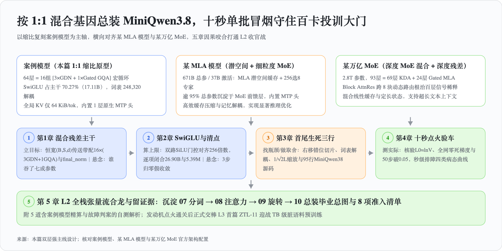
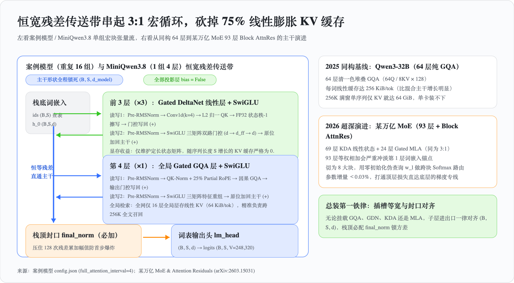
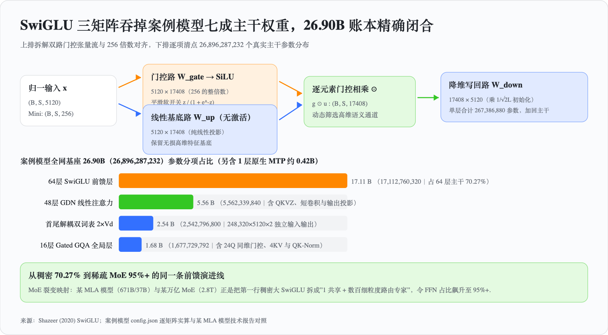
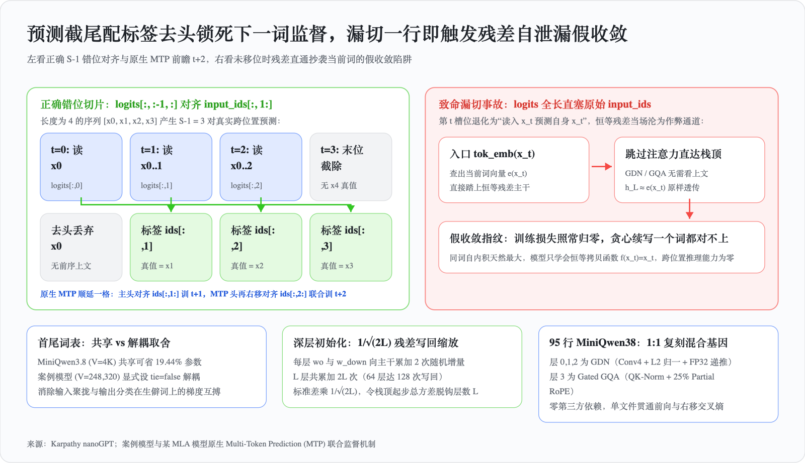
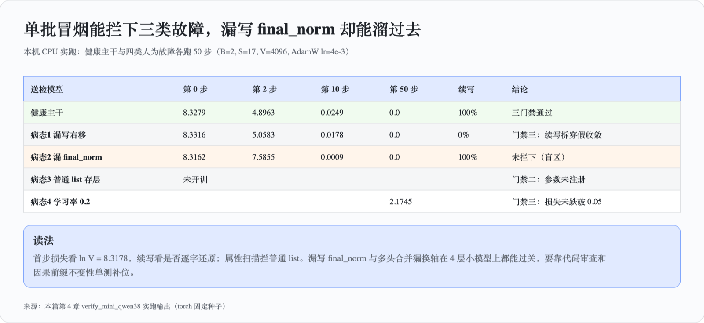
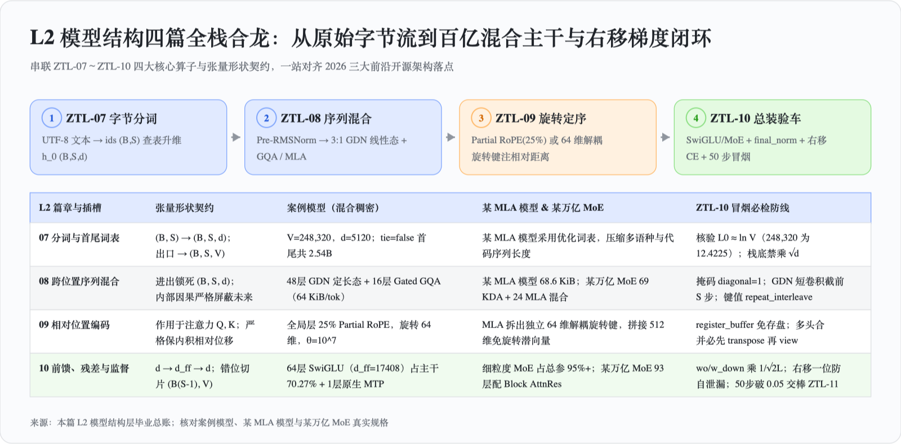

# ZTL-10｜模型｜组装小模型并让一个批次下降

> 🎯 **这篇文档解决什么问题**：<b>核心命题：组装一颗现代 Decoder-only 大模型，必须围绕恒宽残差主干挂接序列混合器与特征加工器，并在首尾对齐词表嵌入与右移一位的监督标签。</b>唯有先在同构缩比的迷你模型上跑通初始损失等于 $`\ln V`$ 、全层梯度非零与 50 步单批过拟合跌破 0.05 的冒烟验证，才能把代码推向百卡集群。
>
> **使用方式与先修要求**：阅读前建议回顾 [ZTL-09｜模型｜让模型知道顺序](./09-position.md) 的旋转位置编码与前序注意力矩阵基础。本篇是 L2 模型结构层的收官实战。全篇以亲手总装 1:1 架构缩比版 `MiniQwen3.8` 并跑通 50 步单批下降为主线。文中同步对账案例模型（27B 量级）的 270 亿参数，并对照 `某 MLA 模型` 与 `某万亿 MoE`。规格核对于 2026 年 11 月 16 日。
>
> **动手实践**：第 2 章内嵌零依赖的 `SwiGLU` 手算与 `案例模型 / MiniQwen3.8` 参数对账脚本。第 3 章交付约 95 行零第三方依赖的原生 PyTorch 源码。它完整包含 `3×GDN + 1×Gated GQA` 混合层与 `Partial RoPE`。第 4 章配齐单批次 50 步冒烟探针与异常断言。复制到本地终端数秒即可跑通。

<b>🧭 主线位置</b>：上一篇 [ZTL-09｜模型｜让模型知道顺序](./09-position.md) 用复数旋转为注意力内积注入了相对词序。本篇将第 07～09 篇的分词嵌入、序列混合矩阵与局部旋转编码组装到同一条残差主干上。这一步定准了全网参数底座与收敛基线。下一篇 [ZTL-11｜训练｜从语料到一轮小预训练](./11-pretrain.md) 将开启 L3 预训练系统层，进入语料清洗、文档打包与真实预训练调度。

## 导读 · 先给结论

- <b>现代大模型主干是形状固定为 (B, S, d_model) 的残差传送带，2026 前沿演进出 3:1 混合与跨层路由。</b>各子层只在分支入口归一化读取，算完增量原位加回。栈顶补齐 `final_norm` 防方差失控。案例模型靠 16 组”3 层 `GDN` + 1 层 `Gated GQA`”省去 75% 线性缓存。某万亿 MoE 则用 `Block AttnRes` 缓解 93 层信号稀释[[1]](https://arxiv.org/abs/2002.04745)[[2]](https://huggingface.co/Qwen/Qwen3.8-27B/blob/main/config.json)[[3]](https://arxiv.org/abs/2412.06464)[[4]](https://huggingface.co/moonshotai/Kimi-K3)[[5]](https://arxiv.org/abs/2603.15031)。
- <b>注意力层在参数账本上只占小头，真正占去七成稠密主干的是 SwiGLU 前馈层。</b>双线性分支配平滑 `SiLU` 门控，并将中间维对齐 `128/256` 倍数喂满张量核心。案例模型的 64 层 `SwiGLU` 独占 `17.11B` 参数（占主干 `70.27%`）。某 MLA 模型与某万亿 MoE 则将其拆为共享加路由专家以解耦总参与激活参[[2]](https://huggingface.co/Qwen/Qwen3.8-27B/blob/main/config.json)[[4]](https://huggingface.co/moonshotai/Kimi-K3)[[6]](https://arxiv.org/abs/2002.05202)[[7]](https://arxiv.org/abs/2412.19437)。
- <b>词表头尾共享与否取决于词表参数占比，深层残差写回矩阵必须按 1/√(2L) 缩放初始化。</b>端侧迷你模型共享首尾词表可省近二成显存。案例模型面对 `248,320` 大词表显式解耦（头尾共 `2.54B`）。这样既消除了输入编码与输出分类的梯度互搏，又配深度缩放压住了起步方差[[2]](https://huggingface.co/Qwen/Qwen3.8-27B/blob/main/config.json)[[8]](https://arxiv.org/abs/1608.05859)[[9]](https://arxiv.org/abs/2505.09388)。
- <b>自回归训练成败系于最后三行右移切片，漏切一行即触发“损失照常归零、续写全错”的残差自泄漏。</b>前向第 `t` 位的 `logits[:, :-1, :]` 必须严格对齐下一位的 `input_ids[:, 1:]`。案例模型与某 MLA 模型内置的原生 `MTP` 头正是顺延再右移一格联合监督未来第二词[[2]](https://huggingface.co/Qwen/Qwen3.8-27B/blob/main/config.json)[[7]](https://arxiv.org/abs/2412.19437)[[10]](https://github.com/karpathy/nanoGPT)。
- <b>百卡投训前必过十秒单批 50 步过拟合冒烟验车，三条物理判据可拦截九成结构故障。</b>第 0 步损失紧贴盲猜熵 $`\ln V`$ 。第 1 步反向遍历全网零 `NaN` 且零死梯度。第 50 步损失平滑跌破 `0.05`。四类典型异常曲线均可按读数特征快速定位根因[[10]](https://github.com/karpathy/nanoGPT)。



<b>📎 与系列其他文档的分工</b>：Pre-RMSNorm 与 AdamW 稳定机制回顾 [ZTL-05｜数学｜优化、归一化与数值稳定](./05-optim-norm.md)。字节级 BPE 词表训练见 [ZTL-07｜模型｜亲手实现分词](./07-tokenizer.md)，注意力矩阵与位置外推见 [ZTL-08｜模型｜把注意力写成矩阵](./08-attention.md) 与 [ZTL-09｜模型｜让模型知道顺序](./09-position.md)。

本篇聚焦整网组装、参数闭合与单批冒烟验证。TB 级语料清洗打包与学习率调度见 [ZTL-11｜训练｜从语料到一轮小预训练](./11-pretrain.md)，多机多卡并行切分与断点续训归属 [ZTL-12｜训练｜多卡的账和中断后续上](./12-multi-gpu.md)。

## 第 1 章 · 恒宽残差与 3:1 混合主干

走完前九篇，我们手里已备齐语言模型的核心零件。第 07 篇实现了把多语种文本压成整数编号的字节级分词器。[ZTL-08｜模型｜把注意力写成矩阵](./08-attention.md) 推通了跨词元检索的注意力矩阵，[ZTL-09｜模型｜让模型知道顺序](./09-position.md) 又为查询与键加上了编码相对距离的复数旋转齿轮。但把散装零件摆在桌上，离拼出一台可运转的大模型仍隔着总装环节。近百个子层靠什么骨架串联，才不会拧乱张量维度或切断反向梯度？

本章先为整网总装**立目标**。我们要建立一条从栈底直通栈顶、三维形状恒定不变的残差主干。在这个统一骨架上，我们从经典同构堆叠推演至 2026 年案例模型的 `3:1` 混合主干与某万亿 MoE 的跨层深度注意力残差。

### 1.1 形状恒定的 Pre-RMSNorm 残差传送带与栈顶封口准则

理解百层拼装的最佳视角，是把仅解码器（Decoder-only）模型看作一条等宽的<b>残差传送带（Residual Stream）</b>。设输入批次含 `B` 条序列，每条切成 `S` 个整数词元，入口 `input_ids` 形状为 `(B, S)`。栈底词嵌入层从词表矩阵按行查出稠密向量，升维为初始隐状态 $`h_0 \in \mathbb{R}^{B \times S \times d_{\text{model}}}`$ 。

从 $`h_0`$ 踏上传送带起，穿过全部 `L` 个解码器层直至栈顶投影前，主干形状<b>全程保持为 `(B, S, d_model)`</b>。任何子层无论内部拆出多少头或扩宽多少倍通道，出口前都必须用投影矩阵压回隐藏维。每层解码器块按固定节拍执行两次“旁路归一读取、分支算增量、原位加回主干”操作[[1]](https://arxiv.org/abs/2002.04745)[[11]](https://arxiv.org/abs/1910.07467)：

```math
h_{\ell}^{\text{mid}} = h_{\ell - 1} + \mathrm{Mixer}_{\ell}\!\left(\mathrm{RMSNorm}_{\ell, 1}(h_{\ell - 1})\right)
```

```math
h_{\ell} = h_{\ell}^{\text{mid}} + \mathrm{FFN}_{\ell}\!\left(\mathrm{RMSNorm}_{\ell, 2}(h_{\ell}^{\text{mid}})\right)
```

两次分支读写各管一件事。第一次读写挂载<b>跨位置序列混合器（Sequence Mixer）</b>，在序列轴上遵循因果约束路由前序上下文。第二次读写挂载<b>逐位置特征加工器（Channel FFN）</b>，对每个词元位置独立做非线性通道重组。

2017 年原版架构把归一化放在主干加法之后（`Post-LN`）[[12]](https://arxiv.org/abs/1706.03762)。现代前置均方根归一化（`Pre-RMSNorm`）则把归一化移入旁路入口。主干由此保持纯粹恒等相加，反向梯度得以无损直达第 1 层[[1]](https://arxiv.org/abs/2002.04745)。同时主干内所有投影矩阵全面取消可学习偏置（`bias=False`）。这既省去了逐元素加法访存，又消除了低精度训练下的均值漂移。

恒等直通主干也带来一条刚性准则：<b>栈顶出口与词表头 `lm_head` 之间，绝不能漏掉最终归一化 `final_norm`</b>。主干自身不设缩放拦截。穿过 64 层共 128 次分支累加后，末层激活幅值往往膨胀十余倍。一旦漏写 `final_norm`，初始词表打分 `logits` 会飙至数十，导致首步 Softmax 饱和并引发反向异常。

当层数继续推高至某万亿 MoE 的 `93` 层时，等权累加还会冲淡第 1 层词法锚点。某万亿 MoE 为此将 93 层切为 8 个大块，引入<b>深度注意力残差（`Block AttnRes`）</b>。它用零初始化伪查询对前置块输出做跨层 Softmax 动态加权，以低于 `0.03%` 的参数增量缓解了百层信号稀释[[4]](https://huggingface.co/moonshotai/Kimi-K3)[[5]](https://arxiv.org/abs/2603.15031)。

### 1.2 从同构到 3:1 混合主干演进

既然残差插槽契约统一为进出同形，架构师便无需让全部子层固守同一种混合器。回顾 2025 年稠密基线 `Qwen3-32B`，全网 64 层堆叠同构分组查询注意力（`GQA`，`64Q / 8KV × 128`）[[9]](https://arxiv.org/abs/2505.09388)[[13]](https://arxiv.org/abs/2305.13245)。这种设计虽然规整，但每层都要维护线性增长的键值表。全网缓存高达 `256 KiB/tok`，在 `256K` 窗口下单并发缓存就占去 `64 GiB`。

2026 年的单卡混合稠密旗舰案例模型（64 层，隐藏维 `5120`，原生 `262K` 上下文）切入 **16 组 `3:1` 异构宏循环**[[2]](https://huggingface.co/Qwen/Qwen3.8-27B/blob/main/config.json)[[3]](https://arxiv.org/abs/2412.06464)。配置文件显式声明全局层间隔为 `4`。每组 4 层宏块内，前 3 层挂载门控线性注意力 <b>`Gated DeltaNet`（`GDN`）</b>。它先过核宽为 `4` 的因果短卷积提取局部词组，再对单位化查询键执行定长状态秩-1 擦写递推。循环状态固定为单精度，随长度增长的 KV 缓存严格为零[[2]](https://huggingface.co/Qwen/Qwen3.8-27B/blob/main/config.json)[[3]](https://arxiv.org/abs/2412.06464)。

每组第 4 层才挂载 1 层全局 <b>`Gated GQA`</b>（`24Q / 4KV`，头宽 `256`）。该层配齐 `qk_norm`、旋转前 `64` 维的 `Partial RoPE` 与同维输出门控，专职跨全文精准召回[[2]](https://huggingface.co/Qwen/Qwen3.8-27B/blob/main/config.json)[[14]](https://arxiv.org/abs/2104.09864)。全网 48 层 `GDN` 管定长压缩，16 层全局层管远距检索，线性增长缓存一举降至 <b>`64 KiB/tok`（直降 75%）</b>。

放眼同代旗舰，某万亿 MoE 同样采用 `69` 层块注意力配 `24` 层 `Gated MLA` 的 `3:1` 宏循环[[4]](https://huggingface.co/moonshotai/Kimi-K3)[[15]](https://arxiv.org/abs/2510.26692)。某 MLA 模型则沿潜空间与块压缩路线，将常驻缓存压缩[[7]](https://arxiv.org/abs/2412.19437)。本篇组装的练手模型 `MiniQwen3.8`，正是按案例模型的一组 4 层宏块（`3×GDN + 1×Gated GQA`）1:1 缩比复刻而成。



对照上方主干架构图与下方演进表，可以清晰看懂两条正交演化轴。纵轴上，所有子层都严守旁路归一读取与出口加回恒宽残差流的铁律。横轴上，序列混合器从全同构全局层演进为 `3:1` 线性与全局交错，把每词常驻缓存削去四分之三：

| **主干维度** | **2017 原版 / 2025 Qwen3-32B** | <b>2026 案例模型（本篇缩比原型）</b> | **2026 DeepSeek-V3/V4 与 Kimi K3** |
|---|---|---|---|
| **残差与跨层连接** | 原版 `Post-LN` 易崩；`Qwen3` 用 64 层等权 `Pre-RMSNorm + final_norm` | 64 层等权 `Pre-RMSNorm + final_norm`；全线性层裁撤偏置 `bias=False` | `Kimi K3`（93 层）切成 8 块引入 `Block AttnRes` 跨块 Softmax 路由 |
| **序列混合器拓扑** | 64 层全同构 `GQA`（`64Q/8KV×128`） | 16 组 `3:1` 宏循环：`48` 层 `GDN` 线性递推 + `16` 层 `Gated GQA`（`24Q/4KV×256`） | `DS-V3` 61 层 `MLA`（`V4` 叠块压缩）；`Kimi K3` `69 KDA + 24 Gated MLA` |
| **位置编码注入** | 原版栈底加正弦；`Qwen3` 全头维 `RoPE` | `GDN` 靠短卷积与衰减自然定序；全局层用 25% 局部旋转（`64` 维，`θ=10^7`） | `MLA` 采用 `64` 维解耦旋转键拼接 `512` 维免旋转压缩潜向量 |
| **特征加工器形态** | 原版双矩阵 `ReLU`；`Qwen3` 稠密 `SwiGLU` | 64 层稠密 `SwiGLU`（`d=5120, d_ff=17408`），单卡 `BF16/FP8` 友好 | 细粒度稀疏 `MoE`（`DS-V3` `256` 选 `8 + 1` 共享专家，总参 `671B` 激活 `37B`） |
| **每词缓存账单** | `Qwen3-32B` 线性涨 `256 KiB/tok` | `64 KiB/tok` 线性 KV + `GDN` 定长状态，256K 满窗稳装单张 `80 GiB H100` | 某 MLA 模型 `68.6 KiB` 量级；某万亿 MoE 进一步压缩；`27 KiB/tok + 207 MiB` 混合缓存 |

> 💡 **常见误区**：照搬 2017 原版教程组装现代模型，在栈底给 `tok_emb(input_ids)` 乘上隐藏维开方（如 `71.55`）。**现象**：前几百步子层特征更新明显迟滞。**根因**：原版缩放旨在防词向量被栈底正弦位置向量淹没。现代架构栈底无位置加法，且 `Pre-RMSNorm` 会约去常数缩放。人为放大七十倍只会淹没早期微弱的残差增量[[12]](https://arxiv.org/abs/1706.03762)[[14]](https://arxiv.org/abs/2104.09864)。**改法**：栈底直接将原始 `tok_emb(input_ids)` 送上残差流。

> 🔑 **本章要点与回到主线**：整网总装骨架至此**立目标**落定。恒宽残差传送带配 `16×(3 GDN + 1 Gated GQA)` 宏循环与栈顶 `final_norm`，保障了深层梯度畅通与长窗**显存账**。但新的矛盾随之浮现：清点权重时发现，前面精雕细琢的注意力层只占小头。真正占掉七成以上稠密主干参数的大户藏在哪个子块里？这正是第 2 章的焦点。

## 第 2 章 · SwiGLU 吃掉七成权重

直面上一章末尾的参数占比问题。在 [ZTL-08｜模型｜把注意力写成矩阵](./08-attention.md) 与 [ZTL-09｜模型｜让模型知道顺序](./09-position.md) 中，多头切分、键值广播、线性递推与局部旋转占据了大半代码行数。这容易让人以为序列混合器才是权重头号大户。

可一旦把每块线性层的尺寸摆上桌面**算上限**就会发现，序列混合器已在 `GQA`、`GDN` 与 `MLA` 的瘦身下缩减。真正坐镇每层下半场、占去稠密主干逾七成权重的主力模块，恰恰是结构仅有三行代码的门控前馈网络 <b>`SwiGLU`</b>[[2]](https://huggingface.co/Qwen/Qwen3.8-27B/blob/main/config.json)[[6]](https://arxiv.org/abs/2002.05202)。

### 2.1 三矩阵双路门控与硬件对齐

初代 Transformer 的前馈层（FFN）仅由两块矩阵夹一个单路激活（如 `ReLU`）构成。隐藏维 `d` 先扩维四倍至 `4d`，过滤负半轴后再压回 `d` 维，无偏置时共含 $`8d^2`$ 参数。单路硬截断缺乏按上下文调节放行比例的交互能力。Shazeer 经消融实验证实，采用双路门控并配平滑 `Swish / SiLU` 的 <b>`SwiGLU`</b> 在同等算力下困惑度更低[[6]](https://arxiv.org/abs/2002.05202)：

```math
\mathrm{SwiGLU}(x) = \left(\mathrm{SiLU}(x W_{\text{gate}}) \odot (x W_{\text{up}})\right) W_{\text{down}}, \qquad \mathrm{SiLU}(z) = \frac{z}{1 + e^{-z}}
```

前向流在此一分为二。**门控路**经 `SiLU` 化作连续软开关，在负半轴保留微弱平滑响应与非零导数。**值投影路**保持纯线性无损基底。两路在中间维逐元素相乘筛选特征，随后再经**降维路**压回残差主干[[2]](https://huggingface.co/Qwen/Qwen3.8-27B/blob/main/config.json)[[16]](https://arxiv.org/abs/2302.13971)。

工程部署中，由于门控矩阵与值矩阵共享同一份归一化输入，推理框架常将两者横向拼接为单块大矩阵（在案例模型中即 `5120 × 34816`）。单次内核发射即可算完双路投影，摊薄小批次解码期的带宽启动开销。

取二维输入 `x = (1.0, -1.0)`（设 `d = 2, d_ff = 3`）手算一步即可看清门控细节。令门控矩阵两行为 `(1, 0, -1)` 与 `(0, 1, -1)`，算得 `z = (1.0, -1.0, 0.0)`。过 `SiLU` 激活后，得到门控向量 $`g \approx (0.7311, -0.2689, 0.0)`$ 。再令值矩阵两行为 `(2, 1, 0.5)` 与 `(1, 2, -0.5)`，得出线性基底 `u = (1.0, -1.0, 1.0)`。两路逐元素相乘得 `(0.7311, 0.2689, 0.0)`：次通道负负得正被唤醒，末通道被零门控关断。

矩阵增至三块后，单层前馈参数变为 $`3 d d_{\text{ff}}`$ 。为维持与传统 $`8d^2`$ 等参数，经典公式先取 $`8d / 3`$ 下取整。接着再向上对齐至 GPU 张量核心分块基数 `128` 或 `256` 的整数倍，避免尾块填充拖慢矩阵乘吞吐[[16]](https://arxiv.org/abs/2302.13971)：

```math
d_{\text{ff}} = M \cdot \left\lceil \frac{\lfloor 8d / 3 \rfloor}{M} \right\rceil
```

把中间台阶补齐就能读懂各代配置表。例如隐藏维 `d = 4096` 代入 $`\lfloor 8 \times 4096 / 3 \rfloor = 10922`$ ，按基数 `M = 256` 向上取整即得经典尺寸 `43 × 256 = 11008`。本篇缩比版 `MiniQwen3.8` 取 `d = 256, M = 128`，先得 `682` 再对齐至 `6 × 128 = 768`。而在真机案例模型（`d = 5120`）中，因混合注意力省出了可观参数预算，架构师主动将倍率拓宽至 `3.4d`，选定中间维强化单卡知识容量[[2]](https://huggingface.co/Qwen/Qwen3.8-27B/blob/main/config.json)。

到了万亿级某 MLA 模型（`671B` 总参 / `37B` 激活）与某万亿 MoE（`2.8T` 总参），架构师不改动残差骨架。他们把稠密大 `SwiGLU` 拆成”`1` 个共享专家 + 数百个细粒度路由小专家（如 `256` 选 `8`）”[[4]](https://huggingface.co/moonshotai/Kimi-K3)[[7]](https://arxiv.org/abs/2412.19437)。超过 <b>`95%`</b> 的总参数沉淀在专家前馈层充当知识库。某稀疏 MoE 对照模型再抽离出主机内存常驻的 `Engram` 记忆表，干净解耦了存储总参与计算激活参。



观察上方门控数据流与参数占比图，左右两半恰好互为因果。左半幅展示输入向量分叉走过平滑门控与线性升维再汇合压回，三块大矩阵吃满了通道维度。右半幅则直观揭示这三块矩阵叠加 64 层后，凭一己之力撑起了逾七成的稠密主干权重。

### 2.2 参数账本逐项清点

严谨的模型总装动卡前必须在纸面把唯一参数底座 $`\Psi`$ 算到**个位数闭合**。这直接决定了混合精度训练的静态显存底盘 $`16\Psi`$ 与半精度推理权重 $`2\Psi`$ [[2]](https://huggingface.co/Qwen/Qwen3.8-27B/blob/main/config.json)。下面逐项清点案例模型的四块核心权重：

- <b>首尾解耦双词表（2.54B）。</b>词表容量为 `248,320`，隐藏维为 `5120`，配置 `tie_word_embeddings = false`。入口 `tok_emb` 与出口 `lm_head` 各占 `1,271,398,400` 参数，首尾合计 `2,542,796,800`（`2.54B`）。
- <b>64 层稠密 SwiGLU 主力（17.11B）。</b>单层三块 `5120 × 17408` 矩阵含 `267,386,880` 参数。64 层合计达 <b>`17,112,760,320`（`17.11B`）</b>，独占 64 层主干（`24.35B`）的 <b>`70.27%`</b>。其他纯 GQA 架构中间维配置各异，前馈占比普遍在 `75%~82%` 之间[[9]](https://arxiv.org/abs/2505.09388)。
- <b>16 层全局 Gated GQA（1.68B）。</b>设 `24` 查询头与 `4` 键值头，单头宽 `256`。查询门控合并矩阵为 `5120 × 12288`，加上键值双矩阵、输出矩阵及单头 `qk_norm`，单层含 `104,858,112` 参数。16 层共 `1,677,729,792`（`1.68B`）[[2]](https://huggingface.co/Qwen/Qwen3.8-27B/blob/main/config.json)。
- <b>48 层线性 Gated DeltaNet（5.56B）。</b>设 `16` 查询键头与 `48` 值头，头宽 `128`。含融合输入投影 `5120 × 16384`、步长衰减投影、核宽 `4` 短卷积、归一化及输出投影。单层含 `115,882,080` 参数，48 层合计 `5,562,339,840`（`5.56B`）[[2]](https://huggingface.co/Qwen/Qwen3.8-27B/blob/main/config.json)[[3]](https://arxiv.org/abs/2412.06464)。

加上全网 129 个 `5120` 维主干 `RMSNorm`（`660,480` 参数），64 层基座精确闭合于 <b>`26,896,287,232`（`26.90B`）</b>。计入栈顶 `1` 层原生 `MTP` 头（约 `0.42B`）后，整包恰为标称 <b>`27B`</b> 量级。推理时 `BF16` 权重约 `54 GB` 稳入单张 `H100`，`FP8` 权重约 `27 GB` 稳入单张 `RTX 5090`。而 `MiniQwen3.8`（`5.39M` 参数）静态状态仅需 `86.3 MB`，笔记本 CPU 即可秒级跑通。

| **模块分项** | **无偏置精确计数算式** | <b>案例模型（64 层真机）</b> | <b>MiniQwen3.8（4 层缩比）</b> |
|---|---|---|---|
| **核心架构超参** | $`V,\; d,\; L_{\text{GDN}}+L_{\text{GQA}},\; d_{\text{ff}}`$ | `248320, 5120, 48+16, 17408` | `4096, 256, 3+1, 768` |
| **词表嵌入头尾** | 解耦 $`2 V d`$ ；共享 $`V d`$ | `2,542,796,800`（解耦 `2.54B`） | 解耦 `2,097,152` / 共享 `1,048,576` |
| **GDN 线性混合层** | $`L_{\text{GDN}} \times (\text{QKVZ} + \text{Conv4} + \text{Out})`$ | `5,562,339,840`（48 层 `5.56B`） | `705,120`（3 层，单层 `235,040`） |
| **Gated GQA 全局层** | $`L_{\text{GQA}} \times (\text{QG} + \text{KV} + \text{Out} + \text{Norm})`$ | `1,677,729,792`（16 层 `1.68B`） | `229,440`（1 层，含门控与 QK 归一） |
| **SwiGLU 门控前馈层** | $`L \times 3 \times d \times d_{\text{ff}}`$ | **17,112,760,320**（占主干 <b>70.27%</b>） | **2,359,296**（占主干 <b>71.58%</b>） |
| **主干与封口归一** | $`(2L + 1) \times d`$ | `660,480`（129 个向量） | `2,304`（9 个向量） |
| <b>主干闭合总参数 $`\Psi`$</b> | 训练静态 $`16\Psi`$ ；BF16 权重 $`2\Psi`$ | **26,896,287,232**（`26.90B`；含 MTP `~27.3B`） | 解耦 **5,393,312** / 共享 **4,344,736** |

*零外部依赖验算二维 SwiGLU 门控前向、硬件倍数对齐及参数账本*

```python
import math

# 1. 手算复核二维到三维 SwiGLU 门控前向 (x = [1.0, -1.0]) 与 128/256 硬件对齐公式
silu = lambda z: z / (1.0 + math.exp(-z))
z_gate, u_up = [1.0, -1.0, 0.0], [1.0, -1.0, 1.0]
h_mid = [round(silu(z) * u, 4) for z, u in zip(z_gate, u_up)]
align_dff = lambda d, m: m * (((8 * d) // 3 + m - 1) // m)
print(f"SwiGLU 中间态 g⊙u = {h_mid} | 对齐 d_ff: d=256->{align_dff(256, 128)}, d=4096->{align_dff(4096, 256)}")

# 2. 逐项清点案例模型 (64层: 48 GDN + 16 Gated GQA) 与 MiniQwen3.8 (4层: 3 GDN + 1 Gated GQA)
q_vocab = 2 * 248320 * 5120
q_swiglu = 64 * 3 * 5120 * 17408
q_gqa = 16 * (5120 * 12288 + 2 * 5120 * 1024 + 6144 * 5120 + 512)
q_gdn = 48 * (5120 * 16384 + 6144 * 5120 + 5120 * 96 + 96 + 10240 * 4 + 6144)
q_norms = 129 * 5120
q_backbone = q_swiglu + q_gqa + q_gdn + 128 * 5120
q_total = q_vocab + q_swiglu + q_gqa + q_gdn + q_norms

m_vocab, m_swiglu = 2 * 4096 * 256, 4 * 3 * 256 * 768
m_gdn = 3 * (256 * 384 + 384 * 4 + 256 * 272 + 32 + 256 * 256)
m_gqa = 1 * (256 * 512 + 2 * 256 * 64 + 64 + 256 * 256)
m_total = m_vocab + m_swiglu + m_gdn + m_gqa + 9 * 256
print(f"案例模型主干总参: {q_total:,} ({q_total/1e9:.2f}B) | SwiGLU 占64层主干: {q_swiglu/q_backbone*100:.2f}%")
print(f"MiniQwen3.8 解耦总参: {m_total:,} (共享词表总参: {m_total - 4096*256:,}，立省 {4096*256/m_total*100:.2f}%)")
```

*输出*

```text
SwiGLU 中间态 g⊙u = [0.7311, 0.2689, 0.0] | 对齐 d_ff: d=256->768, d=4096->11008
案例模型主干总参: 26,896,287,232 (26.90B) | SwiGLU 占64层主干: 70.27%
MiniQwen3.8 解耦总参: 5,393,312 (共享词表总参: 4,344,736，立省 19.44%)
```

逐段复核上方对账脚本的两部分输出。第一部分用纯整数算术 `((8 * d) // 3 + m - 1) // m` 实现了无浮点误差的硬件分块上取整，复算了 `d = 256 → 768` 与 `d = 4096 → 11008`，并核准了二维门控手算值 `0.7311` 与 `0.2689`。

第二部分逐矩阵累加了真机与缩比版参数。注意 `q_norms = 129 * 5120` 里的 `129` 来自 64 层每层 2 个分支入口归一加栈顶 1 个封口归一。最终 `q_swiglu / q_backbone` 定格在 `70.27%`，而缩比版 `MiniQwen3.8` 开启词表共享后立省 `1,048,576` 个参数（占整网 `19.44%`），印证了小模型共享词表的高性价比。

> 💡 **常见误区**：手写参数估算器时套用旧惯例且漏算输出门控投影。**现象**：算出的参数比真机少十几亿。**根因**：现代架构普遍解耦头宽。案例模型隐藏维为 `5120`，全局层却配了 `6144` 维查询加 `6144` 维输出门控（共 `12288` 维）。线性层更采用 `16384` 维融合投影[[2]](https://huggingface.co/Qwen/Qwen3.8-27B/blob/main/config.json)[[9]](https://arxiv.org/abs/2505.09388)。**改法**：严格按显式声明的 `head_dim` 与门控开关逐块清点。

> 🔑 **本章要点与回到主线**：参数账本至此**算上限**精确闭合。`SwiGLU` 占去了案例模型主干 `70.27%` 权重（`17.11B`），全网基座 `26.90B` 与缩比 `MiniQwen3.8` 的 `5.39M` 参数均核对无误。但新的矛盾随之浮现：把数据送入栈顶算出 `logits` 后，为什么仅漏掉一行错位切片，就会出现“训练损失照常归零、上线续写全错”的假收敛？这正是第 3 章要解决的问题。

## 第 3 章 · 首尾闭合与右移监督

直击上一章抛出的假收敛问题。为什么有人拼好 64 层主干且前向吐出规整的 `logits (B, S, V)`，训练损失和健康模型一样归零，可喂入提示词续写时却一个词都对不上？

答案藏在模型首尾闭合的三处关键接口里。本章先顺着前向出口与反向起点**找瓶颈**，拆解自回归错位切片漏洞与 128 次残差累加的方差失稳。随后对大词表共享与解耦**做取舍**，最后交付完整复刻 `3:1` 混合基因的原生 PyTorch `MiniQwen38` 代码。

### 3.1 右移监督与深度缩放

先定位这种假收敛的根源。自回归语言模型的基本契约，是在位置 `t` 仅凭历史前缀预测**下一个未知词元**。长度为 `S` 的序列穿过因果主干得到 `logits` 时，下标对应存在一格错位。第 `t` 槽位的打分 `logits[:, t, :]` 刚刚读入当前词，它的监督真值并非当前词自身，而是右邻槽位的 `input_ids[:, t + 1]`。

因此长度为 `S` 的序列里，有效监督对只有 `S - 1` 个。末尾打分 `logits[:, -1, :]` 预测序列外的未知词，必须<b>截尾（`[:, :-1, :]`）</b>。句首词元 `input_ids[:, 0]` 前面无上文预测它，必须<b>去头（`[:, 1:]`）</b>[[10]](https://github.com/karpathy/nanoGPT)[[17]](https://pytorch.org/docs/stable/generated/torch.nn.CrossEntropyLoss.html)：

```math
\mathcal{L}_{\text{CE}} = -\frac{1}{B(S - 1)} \sum_{b=0}^{B-1} \sum_{t=0}^{S-2} \ln P_{\theta}\!\left(x_{b, t+1} \;\middle|\; x_{b, 0:t}\right)
```

一旦漏写这两处切片，直接拿全长 `logits` 对齐原始 `input_ids`，任务当场退化为“读入当前词预测当前词”。第 1 章建立的 `Pre-RMSNorm` 残差主干恰是一条恒等直通路。模型无需动用注意力观察上文，只需让栈底词向量原样滑到栈顶，就能把恒等拷贝背到接近零的损失。第 4 章实跑中，它第 10 步损失 `0.0178`，与健康主干的 `0.0249` 难分高下，续写准确率却是 `0%`。

理解了右移一格，也就读懂了案例模型与某 MLA 模型额外挂载的 `1` 层原生<b>多词元预测（MTP）</b>头。主头对齐 `ids[:, 1:]` 训下一词，串联的 `MTP` 层再右移一格对齐 `ids[:, 2:]` 联合训未来第二词。这既促使主干提前规划两步语义，又在推理期充当高接受率投机草稿头（案例模型配块扩散草稿单步平均接受达 `4.80` 词）[[2]](https://huggingface.co/Qwen/Qwen3.8-27B/blob/main/config.json)[[7]](https://arxiv.org/abs/2412.19437)。

第二处瓶颈在于深层初始化的方差累加。常规嵌入与线性层按标准差 `0.02` 正态采样。但每层含混合器出口 `wo` 与前馈出口 `w_down` 两个残差写回口，`L` 层共叠加 `2L` 次随机增量（64 层达 `128` 次）。遵循 `GPT-2` 残差缩放准则，所有写回矩阵的初始化标准差一律乘上深度倒数开方[[10]](https://github.com/karpathy/nanoGPT)[[18]](https://cdn.openai.com/better-language-models/language_models_are_unsupervised_multitask_learners.pdf)：

```math
\sigma_{\text{res}} = \frac{\sigma_0}{\sqrt{2L}} \implies \sum_{\ell=1}^{2L} \mathrm{Var}(\Delta h_\ell) \propto 2L \cdot \frac{\sigma_0^2}{2L} = \sigma_0^2
```

这一缩放让累加后的总增量方差与层数脱钩，无论 4 层小网还是 64 层深网都能平稳起步。



### 3.2 词表共享与解耦取舍

接着在首尾两块词表矩阵上**做取舍**。令 `lm_head.weight = tok_emb.weight` 指向同一块内存即<b>权重共享（Weight Tying）</b>[[8]](https://arxiv.org/abs/1608.05859)。在端侧或迷你模型中，单份词表占去可观权重比例。`MiniQwen3.8` 开启共享可从 `5.39M` 压至 `4.34M`，节省 `19.44%` 静态显存[[8]](https://arxiv.org/abs/1608.05859)[[9]](https://arxiv.org/abs/2505.09388)。

然而到了案例模型（`248,320` 大词表）与某 MLA 模型（`129,280` 词表），官方一致采用<b>显式解耦（`tie_word_embeddings = false`）</b>[[2]](https://huggingface.co/Qwen/Qwen3.8-27B/blob/main/config.json)[[7]](https://arxiv.org/abs/2412.19437)。一方面，单份词表 `1.27B` 仅占全网总参的 `4.7%`，显存代价很小。另一方面，栈底嵌入要把近义词聚拢以便理解上文，栈顶分类头却要拉开易混词夹角以锐化预测。首尾解耦消除了梯度互搏。下方代码保留 `tie_embeddings` 开关供按需切换。

### 3.3 原生 PyTorch 总装实战：95 行自包含复刻 3:1 混合 MiniQwen38

汇集全部契约，仅凭原生 `torch.nn` 即可写出零第三方依赖的 `MiniQwen38`[[3]](https://arxiv.org/abs/2412.06464)[[10]](https://github.com/karpathy/nanoGPT)[[13]](https://arxiv.org/abs/2305.13245)[[14]](https://arxiv.org/abs/2104.09864)[[15]](https://arxiv.org/abs/2510.26692)。层 `0, 1, 2` 运行带核宽 `4` 因果短卷积、`L2` 查询键归一化与 `FP32` 秩-1 状态擦写的 `GatedDeltaNet`。层 `3` 运行带 `qk_norm`、25% 局部旋转、分组广播与输出门控的 `GatedGQA`。全层配齐 `SwiGLUFFN`、深度缩放与末尾右移交叉熵。

编码时还需留意两处 PyTorch 机制。其一，预计算的旋转正余弦表无需梯度但须随模型迁移设备。调用 `register_buffer(..., persistent=False)` 注册后，既能随 `.to(device)` 搬移，又不会冗余写入存档文件。其二，开启 `tie_embeddings=True` 时，`model.parameters()` 会按底层内存地址自动去重，首尾两端梯度自动累加至同一缓冲区。

*自包含原生 PyTorch 复刻 3:1 (GDN + Gated GQA) 混合主干、Partial RoPE 与右移监督的 MiniQwen38（片段）*

```python
import math
from dataclasses import dataclass
import torch
import torch.nn as nn
import torch.nn.functional as F

@dataclass
class MiniConfig:
    vocab_size: int = 4096
    d_model: int = 256
    n_layers: int = 4          # 1:1 复刻 Qwen3.8 宏循环：层 0,1,2 为 GDN，层 3 为 Gated GQA
    n_heads: int = 8           # GQA 查询头数（GDN 值头数同为 8）
    n_kv_heads: int = 2        # GQA 键值头数（4:1 共享；GDN 查询键头数同为 2）
    d_ff: int = 768            # SwiGLU 中间维（对齐 128 倍数）
    rotary_pct: float = 0.25   # Partial RoPE 仅旋转每个头的前 25% 通道（8 维）
    max_seq_len: int = 128

class RMSNorm(nn.Module):
    def __init__(self, dim: int, eps: float = 1e-6):
        super().__init__()
        self.eps, self.weight = eps, nn.Parameter(torch.ones(dim))
    def forward(self, x: torch.Tensor) -> torch.Tensor:
        xf = x.float()
        return (xf * torch.rsqrt(xf.pow(2).mean(-1, keepdim=True) + self.eps)).type_as(x) * self.weight

def apply_partial_rope(x: torch.Tensor, cos: torch.Tensor, sin: torch.Tensor) -> torch.Tensor:
    rdim, S = cos.shape[-1] * 2, x.shape[2]
    xr, xp = x[..., :rdim], x[..., rdim:]
    x1, x2 = xr[..., :rdim // 2], xr[..., rdim // 2:]
    c, s = cos[:S].view(1, 1, S, -1), sin[:S].view(1, 1, S, -1)
    return torch.cat([torch.cat([x1 * c - x2 * s, x2 * c + x1 * s], dim=-1).type_as(x), xp], dim=-1)

class GatedDeltaNet(nn.Module):
    def __init__(self, cfg: MiniConfig):
        super().__init__()
        self.nh, self.nqk = cfg.n_heads, cfg.n_kv_heads
        self.dh, self.rep = cfg.d_model // cfg.n_heads, cfg.n_heads // cfg.n_kv_heads
        qkv_d = 2 * self.nqk * self.dh + cfg.d_model
        self.in_qkv = nn.Linear(cfg.d_model, qkv_d, bias=False)
        self.conv1d = nn.Conv1d(qkv_d, qkv_d, kernel_size=4, padding=3, groups=qkv_d, bias=False)
        self.in_gate = nn.Linear(cfg.d_model, cfg.d_model + 2 * self.nh, bias=False)
        self.out_norm, self.wo = RMSNorm(self.dh), nn.Linear(cfg.d_model, cfg.d_model, bias=False)
        self.wo._res_proj = True
    def forward(self, x: torch.Tensor) -> torch.Tensor:
        B, S, D = x.shape
        qkd = self.nqk * self.dh
        qkv = F.silu(self.conv1d(self.in_qkv(x).transpose(1, 2))[..., :S].transpose(1, 2))
        q, k, v = torch.split(qkv, [qkd, qkd, D], dim=-1)
        q = F.normalize(q.float().view(B, S, self.nqk, self.dh).repeat_interleave(self.rep, 2), dim=-1)
        k = F.normalize(k.float().view(B, S, self.nqk, self.dh).repeat_interleave(self.rep, 2), dim=-1)
        v = v.float().view(B, S, self.nh, self.dh)
        z, a, b = torch.split(self.in_gate(x), [D, self.nh, self.nh], dim=-1)
        alpha, beta = torch.sigmoid(a.float()).unsqueeze(-1), torch.sigmoid(b.float()).unsqueeze(-1)
        state = torch.zeros(B, self.nh, self.dh, self.dh, device=x.device, dtype=torch.float32)
        outs = []
        for t in range(S):
            state = alpha[:, t].unsqueeze(-1) * state
            mem = (k[:, t].unsqueeze(-1) * state).sum(dim=-2)
            state = state + k[:, t].unsqueeze(-1) * (beta[:, t] * (v[:, t] - mem)).unsqueeze(-2)
            outs.append((q[:, t].unsqueeze(-1) * state).sum(dim=-2))
        out = self.out_norm(torch.stack(outs, dim=1).type_as(x)).view(B, S, D)
        return self.wo(out * F.silu(z))

class GatedGQA(nn.Module):
    def __init__(self, cfg: MiniConfig):
        super().__init__()
        self.nh, self.nkv = cfg.n_heads, cfg.n_kv_heads
        self.dh, self.rep = cfg.d_model // cfg.n_heads, cfg.n_heads // cfg.n_kv_heads
        self.wqg = nn.Linear(cfg.d_model, 2 * cfg.d_model, bias=False)
        self.wk = nn.Linear(cfg.d_model, self.nkv * self.dh, bias=False)
        self.wv = nn.Linear(cfg.d_model, self.nkv * self.dh, bias=False)
        self.q_norm, self.k_norm = RMSNorm(self.dh), RMSNorm(self.dh)
        self.wo = nn.Linear(cfg.d_model, cfg.d_model, bias=False)
        self.wo._res_proj = True
    def forward(self, x: torch.Tensor, cos: torch.Tensor, sin: torch.Tensor) -> torch.Tensor:
        B, S, D = x.shape
        q, gate = self.wqg(x).chunk(2, dim=-1)
        q = self.q_norm(q.view(B, S, self.nh, self.dh)).transpose(1, 2)
        k = self.k_norm(self.wk(x).view(B, S, self.nkv, self.dh)).transpose(1, 2)
        v = self.wv(x).view(B, S, self.nkv, self.dh).transpose(1, 2)
        q, k = apply_partial_rope(q, cos, sin), apply_partial_rope(k, cos, sin)
        k, v = k.repeat_interleave(self.rep, 1), v.repeat_interleave(self.rep, 1)
        scores = (q @ k.transpose(-2, -1)) / math.sqrt(self.dh)
        mask = torch.triu(torch.ones(S, S, device=x.device, dtype=torch.bool), diagonal=1)
        attn = F.softmax(scores.masked_fill(mask, -1e9).float(), dim=-1).type_as(x)
        out = (attn @ v).transpose(1, 2).contiguous().view(B, S, D)
        return self.wo(out * torch.sigmoid(gate))

class SwiGLUFFN(nn.Module):
    def __init__(self, cfg: MiniConfig):
        super().__init__()
        self.w_gate = nn.Linear(cfg.d_model, cfg.d_ff, bias=False)
        self.w_up   = nn.Linear(cfg.d_model, cfg.d_ff, bias=False)
        self.w_down = nn.Linear(cfg.d_ff, cfg.d_model, bias=False)
        self.w_down._res_proj = True
    def forward(self, x: torch.Tensor) -> torch.Tensor:
        return self.w_down(F.silu(self.w_gate(x)) * self.w_up(x))

class HybridBlock(nn.Module):
    def __init__(self, cfg: MiniConfig, layer_idx: int):
        super().__init__()
        self.is_full = (layer_idx + 1) % 4 == 0
        self.attn_norm, self.ffn_norm = RMSNorm(cfg.d_model), RMSNorm(cfg.d_model)
        self.mixer = GatedGQA(cfg) if self.is_full else GatedDeltaNet(cfg)
        self.ffn = SwiGLUFFN(cfg)
    def forward(self, x: torch.Tensor, cos: torch.Tensor, sin: torch.Tensor) -> torch.Tensor:
        x = x + (self.mixer(self.attn_norm(x), cos, sin) if self.is_full else self.mixer(self.attn_norm(x)))
        return x + self.ffn(self.ffn_norm(x))

class MiniQwen38(nn.Module):
    def __init__(self, cfg: MiniConfig, tie_embeddings: bool = False):
        super().__init__()
        self.cfg, self.tok_emb = cfg, nn.Embedding(cfg.vocab_size, cfg.d_model)
        self.blocks = nn.ModuleList([HybridBlock(cfg, i) for i in range(cfg.n_layers)])
        self.final_norm = RMSNorm(cfg.d_model)
        self.lm_head = nn.Linear(cfg.d_model, cfg.vocab_size, bias=False)
        if tie_embeddings:
            self.lm_head.weight = self.tok_emb.weight
        rdim = int((cfg.d_model // cfg.n_heads) * cfg.rotary_pct)
        ang = torch.outer(torch.arange(cfg.max_seq_len).float(), 1e7 ** (-torch.arange(0, rdim, 2).float() / rdim))
        self.register_buffer("cos", torch.cos(ang), persistent=False)
        self.register_buffer("sin", torch.sin(ang), persistent=False)
        self.apply(self._init_weights)
    def _init_weights(self, m: nn.Module):
        if isinstance(m, (nn.Linear, nn.Embedding)):
            std = 0.02 / math.sqrt(2 * self.cfg.n_layers) if getattr(m, "_res_proj", False) else 0.02
            nn.init.normal_(m.weight, mean=0.0, std=std)
    def forward(self, input_ids: torch.Tensor):
        h = self.tok_emb(input_ids)
        for blk in self.blocks:
            h = blk(h, self.cos, self.sin)
        logits = self.lm_head(self.final_norm(h))
        shift_logits = logits[:, :-1, :].contiguous().view(-1, self.cfg.vocab_size)
        shift_labels = input_ids[:, 1:].contiguous().view(-1)
        return logits, F.cross_entropy(shift_logits.float(), shift_labels)
```

逐块走读上方 95 行总装源码的三处关键机制。先看 `GatedDeltaNet.forward` 里的递推内循环：`mem = (k[:, t].unsqueeze(-1) * state).sum(dim=-2)` 从单精度状态矩阵中读出当前键方向的旧记忆。紧接着 `v[:, t] - mem` 算出预测残差并乘步长 `beta[:, t]` 写回状态，短短四行便完整兑现了广义 Householder 擦旧写新法则。

再看 `HybridBlock` 与 `MiniQwen38` 的装配闭合。判据 `(layer_idx + 1) % 4 == 0` 让前 3 层自动实例化无旋转编码的线性层，仅在第 4 层挂载消费 `self.cos / self.sin` 缓冲区的全局门控层。全部残差出口矩阵均打上 `_res_proj = True` 标记，由 `_init_weights` 统一按深度倒数开方缩小初值标准差，末尾再经 `shift_logits` 与 `shift_labels` 错位拉平送入单精度交叉熵。

> 💡 **常见误区**：在 `GatedDeltaNet` 短卷积设 `padding=3` 后忘记截取 `[..., :S]`，或在 `GatedGQA` 中把 `repeat_interleave(rep, 1)` 误写成 `repeat(1, rep, 1, 1)`。**现象**：因果评测失真或跨组注意力错配。**根因**：双侧填充会在右侧多出 3 个槽位并使当前步偷看未来词。而 `repeat` 会把键值头交错排成 `[0, 1, 0, 1]`，打乱分组共享契约[[3]](https://arxiv.org/abs/2412.06464)[[13]](https://arxiv.org/abs/2305.13245)。**改法**：因果卷积填充后必截前 `S` 步，键值广播一律用 `repeat_interleave`。

> 🔑 **本章要点与回到主线**：首尾接口至此顺利**找瓶颈**并完成**做取舍**。右移错位切片封堵了残差自泄漏捷径，深度缩放与词表解耦稳住了起步方差与梯度方向。但新的矛盾随之浮现：在把代码交给 [ZTL-11｜训练｜从语料到一轮小预训练](./11-pretrain.md) 的海量语料连跑几十个小时之前，怎样只花 10 秒钟做一次严谨的“点火验车”，把潜在的死梯度断路或换轴错位全部排查出来？这正是第 4 章的焦点。

## 第 4 章 · 十秒点火冒烟验车

接过上一章组装好的 `MiniQwen38`，请先克制立刻挂载大语料开训的冲动。在工业界预训练团队里，一段“不抛形状异常”的新代码潜伏着多种静默消耗算力的隐患。例如把子层装进普通 Python `list` 导致中间层零更新，或是多头合并漏换轴把跨词特征揉成噪声。因果掩码漏写 `diagonal=1` 导致首词报 `NaN`，切片写漏更会引发假收敛。

遵循 Karpathy 在 `nanoGPT` 中倡导的工程准则，任何新架构上集群前，必须先在本地 CPU 或消费卡上花 10 秒钟**测实际**。唯有跑通<b>单批次 50 步过拟合冒烟测试（Smoke Test）</b>，才允许签发集群准入证[[10]](https://github.com/karpathy/nanoGPT)。

### 4.1 三条冒烟门禁

冒烟测试的设置只有几项。我们固定抽取 1 个微型随机批次（设 `B = 2, S = 17`，右移后共 `32` 个预测词元，词表 `4096`），并关闭一切随机丢弃。优化器挂载解耦 `AdamW`：二维权重设衰减 `0.01`，一维 `RMSNorm` 缩放向量设免衰减 `0.0`，原地连续更新 50 步[[10]](https://github.com/karpathy/nanoGPT)[[19]](https://pytorch.org/docs/stable/generated/torch.optim.AdamW.html)。健康模型必须连过三道硬门禁：

- <b>门禁一（第 0 步盲猜熵校验）。</b>第 0 步尚未更新参数时，受深度缩放与栈顶 `final_norm` 约束，初始 `logits` 围绕零点对称波动[[18]](https://cdn.openai.com/better-language-models/language_models_are_unsupervised_multitask_learners.pdf)。模型对全词表近似给出均匀盲猜概率，理论初始损失严格等于 $`\ln V`$ [[17]](https://pytorch.org/docs/stable/generated/torch.nn.CrossEntropyLoss.html)。`MiniQwen38` 必紧贴 <b>`8.3178 nats`</b>，真机案例模型必紧贴 <b>`12.4225 nats`</b>。实测偏差超 `0.5` 即存在初始化异常或漏加归一化。
- <b>门禁二（参数注册与第 1 步活梯度扫描）。</b>开训前先确认所有子层都注册进了模块树。首次执行 `loss.backward()` 后，立即遍历 `model.named_parameters()`。每一个可训张量都必须满足梯度非空、零 `NaN` 且最大绝对值严格大于零。哪怕单个分支矩阵报零梯度，也说明计算图在该支路发生了静默断路。
- <b>门禁三（50 步平滑破 0.05 与续写互证）。</b>固定单批迭代 50 步内，损失须从 `8.32` 平滑跌破 <b>`0.05 nats`</b>（困惑度低于 `1.05`）。跑完 50 步后喂入句首词元做贪心续写，模型必须逐字还原原句后续词元。



上方画板汇总了 4.2 节脚本的实跑输出。健康主干第 0 步损失 `8.3279`，第 2 步 `4.8963`，第 10 步 `0.0249`。漏写右移的病态 1 对应读数为 `8.3316`、`5.0583`、`0.0178`，漏写 `final_norm` 的病态 2 为 `8.3162`、`7.5855`、`0.0009`。

三条都紧贴 $`\ln V`$ 起步，可以一步推清这条判据的代数来历。第 0 步时输出头权重近似零均值小方差分布，内积打分 $`z_i \approx 0`$ ，经 `softmax` 后全词表每个候选词均分概率 $`P_i \approx 1 / V`$ 。代入负对数似然即得 $`-\ln(1/V) = \ln V`$ 。首步偏离它超过 `0.5`，说明初始化或归一化出了错。

### 4.2 四类病态曲线指纹

下方脚本封装了可直接检验第 3 章 `MiniQwen38` 的三门禁验车函数 `verify_mini_qwen38`，并把健康主干与四类人为故障逐一送检，输出为本机实跑结果[[10]](https://github.com/karpathy/nanoGPT)[[17]](https://pytorch.org/docs/stable/generated/torch.nn.CrossEntropyLoss.html)[[19]](https://pytorch.org/docs/stable/generated/torch.optim.AdamW.html)。

*MiniQwen38 单批次 50 步冒烟验车台：三门禁硬断言与四类人为故障对照（片段，接在第 3 章代码之后运行）*

```python
import math
import torch
import torch.nn as nn
import torch.nn.functional as F

def verify_mini_qwen38(model, vocab_size=4096, lr=4e-3, steps=50):
    """三道门禁冒烟验车。返回 (损失轨迹, 续写准确率)；任一门禁不过即抛 AssertionError。"""
    torch.manual_seed(42)
    batch = torch.randint(0, vocab_size, (2, 17))   # 固定单批次: 2×(17-1) = 32 个监督词元
    stray = [n for n, v in vars(model).items()
             if isinstance(v, (list, tuple)) and any(isinstance(x, nn.Module) for x in v)]
    assert not stray, f"门禁2失败: 子层装进普通 list {stray}，参数未注册"
    decay = [p for p in model.parameters() if p.dim() >= 2]
    nodecay = [p for p in model.parameters() if p.dim() < 2]
    opt = torch.optim.AdamW([{"params": decay, "weight_decay": 0.01},
                             {"params": nodecay, "weight_decay": 0.0}], lr=lr, betas=(0.9, 0.95))
    l0_theory, hist = math.log(vocab_size), {}
    for step in range(steps + 1):
        opt.zero_grad()
        loss = model(batch)[1]
        if step in (0, 2, 10, 50):
            hist[step] = round(loss.item(), 4)
        if step == 0:
            assert abs(loss.item() - l0_theory) < 0.5, f"门禁1失败: L0={loss.item():.4f}"
        if step == steps:
            break
        loss.backward()
        if step == 0:
            dead = [n for n, p in model.named_parameters()
                    if p.grad is None or not torch.isfinite(p.grad).all() or p.grad.abs().max() == 0]
            assert not dead, f"门禁2失败: 死梯度 {dead[:3]}"
        torch.nn.utils.clip_grad_norm_(model.parameters(), max_norm=1.0)
        opt.step()
    assert hist[steps] < 0.05, f"门禁3失败: L50={hist[steps]:.4f} 未跌破 0.05"
    with torch.no_grad():                            # 贪心续写: 只喂首词，逐字还原
        cur = batch[:1, :1]
        for _ in range(batch.shape[1] - 1):
            cur = torch.cat([cur, model(cur)[0][:, -1:].argmax(-1)], dim=1)
    acc = (cur[:, 1:] == batch[:1, 1:]).float().mean().item()
    assert acc == 1.0, f"门禁3失败: 损失 {hist} 已归零，续写准确率却只有 {acc:.0%}"
    return hist, acc

class NoShift(MiniQwen38):                           # 病态1: 交叉熵漏写右移切片
    def forward(self, ids):
        h = self.tok_emb(ids)
        for blk in self.blocks:
            h = blk(h, self.cos, self.sin)
        logits = self.lm_head(self.final_norm(h))
        return logits, F.cross_entropy(logits.view(-1, self.cfg.vocab_size).float(), ids.view(-1))

class ListLayers(MiniQwen38):                        # 病态3: 子层装进普通 list
    def __init__(self, cfg):
        super().__init__(cfg)
        blocks = list(self.blocks)
        del self.blocks
        self.blocks = blocks

def no_final_norm(cfg):                              # 病态2: 漏写栈顶 final_norm
    m = MiniQwen38(cfg)
    m.final_norm = nn.Identity()
    return m

cfg = MiniConfig()
cases = [("健康主干", MiniQwen38, {}), ("病态1 漏写右移", NoShift, {}),
         ("病态2 漏 final_norm", no_final_norm, {}), ("病态3 普通 list 存层", ListLayers, {}),
         ("病态4 学习率 0.2", MiniQwen38, {"lr": 0.2})]
for tag, build, kw in cases:
    torch.manual_seed(0)
    try:
        hist, acc = verify_mini_qwen38(build(cfg), **kw)
        print(f"{tag:<16}| 三门禁通过 | {hist} | 续写 {acc:.0%}")
    except AssertionError as e:
        print(f"{tag:<16}| {e}")
```

*输出（本机 CPU 实跑，torch 固定种子）*

```text
健康主干            | 三门禁通过 | {0: 8.3279, 2: 4.8963, 10: 0.0249, 50: 0.0} | 续写 100%
病态1 漏写右移        | 门禁3失败: 损失 {0: 8.3316, 2: 5.0583, 10: 0.0178, 50: 0.0} 已归零，续写准确率却只有 0%
病态2 漏 final_norm| 三门禁通过 | {0: 8.3162, 2: 7.5855, 10: 0.0009, 50: 0.0} | 续写 100%
病态3 普通 list 存层  | 门禁2失败: 子层装进普通 list ['blocks']，参数未注册
病态4 学习率 0.2     | 门禁3失败: L50=2.1745 未跌破 0.05
```

逐段核对 `verify_mini_qwen38` 的防呆探针与实跑输出。入口先扫一遍模型属性，凡是把 `nn.Module` 装进普通 `list` 的都直接拦下。随后按张量阶数 `p.dim() >= 2` 把矩阵权重与一维归一化缩放参数拆进不同的权重衰减组。健康主干第 0 步读出 `L0 = 8.3279`，与理论值 `8.3178` 只差 `0.01`。

病态 3 说明了入口那道属性扫描为什么必须有。子层装进普通 `list` 后，`model.parameters()` 里只剩 `3` 个张量（健康模型是 `44` 个）。中间 4 层既不进优化器，也不出现在 `named_parameters()` 里，单靠首步死梯度扫描根本看不见它们。

末尾的贪心续写守住真实生成闭环。健康主干第 50 步损失降到 `0.0`（四位小数），续写还原率 `100%`。病态 1 漏写右移切片，损失同样归零，续写准确率却是 `0%`，只有续写这一步能拆穿它。病态 4 把学习率开到 `0.2`，50 步后损失仍停在 `2.1745`，被门禁三拦下。

病态 2 是本机实跑暴露的盲区：漏写栈顶 `final_norm` 的 4 层小模型，首步损失 `8.3162` 照样紧贴 $`\ln V`$，三道门禁全部放行。小初始化下残差流幅值还没放大，单批冒烟抓不住它，只能靠代码审查或核对 `final_norm` 是否在模块树里。

在此基础上，建议再补一道三行代码的**因果前缀不变性单测**。在 `model.eval()` 模式下构造两条输入序列：前半段词元完全相同，后半段词元随机替换。分别算出两次前向的 `logits` 后，前半段槽位的输出最大绝对误差必须严格低于 `1e-6`。

无论是全局层因果掩码极性写反、`GDN` 短卷积漏截右侧填充，还是多头合并漏换轴导致跨位置串扰，都会在这道单测中立刻暴露。同时务必核查优化器分组：一维 `RMSNorm` 缩放向量必须归入 `weight_decay=0.0` 免衰减组，防止权重衰减逐步压低深层激活幅值[[19]](https://pytorch.org/docs/stable/generated/torch.optim.AdamW.html)。下表汇总了四类病态曲线排障手册：

| **病态曲线类型** | <b>十秒实测读数指纹（V=4096）</b> | **高频代码 Bug 根因定位** | **精准修复与自动化硬断言** |
|---|---|---|---|
| **① 首步爆炸或直接 NaN** | $`\mathcal{L}_0 \gt 8.82`$ 或首步报 `NaN`；本机实跑中漏写 `final_norm` 未触发此项 | 漏写栈顶 `final_norm`；漏做 $`1/\sqrt{2L}`$ 缩放；因果掩码漏写 `diagonal=1` 遮死首词；`GDN` 漏做 `q, k` 单位化 | 补齐封口归一与残差缩放；核实严格上三角掩码；断言 $`\|\mathcal{L}_0 - \ln V\| \lt 0.5`$ |
| **② 损失归零的假收敛** | 损失照常归零，贪心续写准确率远低于 `100%`（本机实跑为 `0%`） | 交叉熵漏切 `logits[:, :-1]` 与 `ids[:, 1:]` 自泄漏；掩码极性写反或短卷积右填充越界偷看未来词 | 修正首尾错位切片与卷积 `[..., :S]`；追加篡改未来后缀断言前序 `logits` 零变化 |
| **③ 静默死梯度断图** | 损失照常下降；普通 `list` 时注册参数只剩 `3` 个张量 | 误用普通 `list` 替代 `nn.ModuleList`；递推循环误包 `no_grad` 或 `.detach()`；门控初值锁死全零 | 容器统一用 `nn.ModuleList`；开训前扫描属性拦截普通 `list`，首步反向后断言全体可训参数梯度非零有限 |
| **④ 卡在高位平台或剧烈震荡** | 50 步后损失仍远高于 `0.05`（学习率 `0.2` 时停在 `2.1745`） | 多头合并漏调 `transpose(1, 2)` 直接 `view` 搅乱位置轴；学习率差两个量级；漏调 `opt.zero_grad()` | 严守换轴后 `.contiguous().view(...)` 对称契约；单批冒烟设 `lr=3e-3~5e-3` 并加范数裁剪 |

> 💡 **常见误区**：多头加权 `attn @ v`（形状 `(B, nh, S, dh)`）后，漏写 `.transpose(1, 2)` 就直接调 `.reshape(B, S, D)`。**现象**：代码零报错，本机把第 3 章全局层改成这种写法重跑，三道冒烟门禁照样全部通过。
>
> **根因**：元素总数相等故不抛异常，强行变形却把不同时间步揉进同一行，混入未来特征；单批过拟合靠记忆就能把损失压到零。只有上文的因果前缀不变性单测能报出前半段 `logits` 偏差。**改法**：拆分与合并的 `transpose(1, 2)` 必须成对出现，合并写 `.transpose(1, 2).contiguous().view(B, S, D)`。

> 🔑 **本章要点与回到主线**：十秒点火验车至此**测实际**全绿通过。首步紧贴 $`\ln V`$ 、全网零死梯度、50 步跌破 `0.05` 配前缀续写 `100%` 还原，确认整颗混合模型已完整贯通（守住**效果账**与防空耗**成本账**）。最后一步，是把整个 L2 模型结构层的全栈张量流归档**留证据**。

## 第 5 章 · 模型总装与验车总账、核对清单与自测

走到这里，我们终于走通了整个 <b>L2 模型结构层（第 07～10 篇，从 [ZTL-07｜模型｜亲手实现分词](./07-tokenizer.md) 起步）</b>的收官闭环[[2]](https://huggingface.co/Qwen/Qwen3.8-27B/blob/main/config.json)[[4]](https://huggingface.co/moonshotai/Kimi-K3)[[7]](https://arxiv.org/abs/2412.19437)[[10]](https://github.com/karpathy/nanoGPT)。一段人类文本化作字节编号后踏上恒宽残差传送带。它交替穿过线性状态递推与局部旋转注意力，并在占七成权重的门控前馈层重组知识。最终经栈顶右移交叉熵驱动全网参数更新。本章执行收官动作**留证据**，归档 L2 总图、8 项投卡核对清单与 5 道定量自测题。

### 5.1 📌 L2 模型结构层全栈总账与投卡前核对清单

下图将 L2 四篇的核心算子、张量形状契约，以及案例模型、某 MLA 模型与某万亿 MoE 三大前沿架构在各插槽的真实落点汇入同一张总图。



> 📌 **上线前核对清单：将模型代码推向预训练集群前的 8 项必检硬门禁**
>
> - <b>恒宽残差主干与栈顶封口。</b>确认主干全程保持 `(B, S, d_model)`，子层走 `Pre-RMSNorm` 旁路读取与原位加回。确认 `lm_head` 前已补齐 `final_norm`（百层深网评估 `Block AttnRes`）[[5]](https://arxiv.org/abs/2603.15031)。
> - <b>混合序列层因果严密性。</b>确认全局层掩码设 `diagonal=1` 并用 `repeat_interleave` 广播键值。确认线性 `GDN` 短卷积截断 `[..., :S]`、查询键做 `L2` 归一化且状态驻留 `FP32`[[2]](https://huggingface.co/Qwen/Qwen3.8-27B/blob/main/config.json)。
> - <b>SwiGLU 三矩阵与硬件对齐。</b>确认主干投影全面取消偏置（`bias=False`）。`SwiGLU` 仅对 `w_gate` 调 `SiLU`，中间维对齐 `128` 或 `256` 倍数[[6]](https://arxiv.org/abs/2002.05202)。
> - <b>逐矩阵参数账本闭合。</b>确认代码统计的唯一参数量与纸面算式完全一致。大词表模型核实 `tie_word_embeddings` 与门控投影宽度[[8]](https://arxiv.org/abs/1608.05859)[[9]](https://arxiv.org/abs/2505.09388)。
> - <b>深层残差写回缩放初始化。</b>确认每层 `wo` 与 `w_down` 标准差已乘深度倒数开方。栈底词嵌入禁乘隐藏维开方。
> - <b>右移一位错位监督切片。</b>确认主损失拿 `logits[:, :-1, :]` 对齐 `input_ids[:, 1:]`。原生 `MTP` 头顺延对齐 `input_ids[:, 2:]`[[2]](https://huggingface.co/Qwen/Qwen3.8-27B/blob/main/config.json)[[7]](https://arxiv.org/abs/2412.19437)。
> - <b>因果零泄漏篡改单测。</b>在 `eval()` 下固定前段词元并随机篡改后半段词元。断言前段槽位输出 `logits` 绝对误差低于 `1e-6`。
> - <b>十秒单批冒烟三绿通行证。</b>固定 1 个微批跑 50 步 `AdamW`，验证首步贴近 $`\ln V`$ 且全体参数零死梯度零 `NaN`。50 步损失须破 `0.05` 且贪心续写 `100%` 命中[[10]](https://github.com/karpathy/nanoGPT)。

### 5.2 自测题与参考解析

请合上正文，独立手算以下 5 道涵盖案例模型参数核算与故障判定的综合自测题：

<b>自测题 1（案例模型的 64 层 SwiGLU 与双词表精算）</b>：已知案例模型设 64 层、隐藏维 `5120`、中间维 `17408`、词表 `248,320`，无偏置且不共享词表[[2]](https://huggingface.co/Qwen/Qwen3.8-27B/blob/main/config.json)。求 64 层 `SwiGLU` 精确参数量与 `BF16` 字节数，并求词表解耦相比共享多占多少 `16Ψ` 训练显存。

**参考解析**：单层 `SwiGLU` 含 `267,386,880` 参数。64 层共含 <b>`17,112,760,320`（约 `17.11B`）</b> 参数，`BF16` 占 `34.23 GB`。单份词表含 `1,271,398,400`（`1.27B`）参数。解耦多存一份独立输出头，`16Ψ` 静态显存增加约 `20.34 GB`（占全网 `432 GB` 底盘不足 `4.7%`），换取首尾梯度解耦。

<b>自测题 2（16 层全局 Gated GQA 门控参数核算）</b>：案例模型的 16 层全局层设隐藏维 `5120`、`24` 查询头与 `4` 键值头（`head_dim = 256`），开启单头 `qk_norm` 与同维输出门控[[2]](https://huggingface.co/Qwen/Qwen3.8-27B/blob/main/config.json)。求单层与 16 层精确参数量。

**参考解析**：查询宽 `6144` 加同维门控 `6144` 得合并矩阵 `62,914,560`。键值双矩阵共 `10,485,760`，输出矩阵占 `31,457,280`，加 `qk_norm` 共 `512`。单层合计 <b>`104,858,112`</b> 参数，16 层共 <b>`1,677,729,792`（约 `1.68B`）</b> 参数。

<b>自测题 3（第 0 步初始损失判案）</b>：在两个词表规模不同的模型上初始化：模型甲（词表 `151,936`）首步损失打印 `11.93`，模型乙（词表 `248,320`）首步打印 `17.85`。判定两者健康度并指出排查点。

**参考解析**：前者理论值为 `11.9312`，偏差不足 `0.01`，十分健康。后者理论值应为 `12.4225`，实测高出 `+5.43`，属于初始方差爆炸。首要排查栈顶是否漏写 `final_norm`，其次核查 `128` 个写回层是否漏乘深度缩放因子。

<b>自测题 4（假收敛与死梯度双重排障）</b>：某混合模型在 `V = 4096` 上冒烟测试：第 0 步损失 `8.28`，第 2 步瞬跌至 `0.00004`。同时首步梯度扫描报 `blocks.0.mixer.conv1d.weight.grad` 为 `None`。指出两处独立 Bug。

**参考解析**：第 2 步瞬跌至 `4e-5` 源于交叉熵漏做右移一位切片（或短卷积右填充越界偷看未来），模型沿恒等残差原地抄袭当前词，上线必吐乱码。卷积梯度为 `None` 说明线性层前向存在断图操作（如误包 `no_grad` 或漏调该卷积层）。

<b>自测题 5（多头合并漏换轴的因果破坏）</b>：设 `y = attn @ v` 形状为 `(1, 2, 4, 3)`，头 0 四步全为 `10`，头 1 四步全为 `-10`。对比正确换轴合并与直接 `y.reshape(1, 4, 6)` 在第 0 步拼出的 6 维向量，说明为何错写破坏因果律。

**参考解析**：正确换轴后第 0 步拼出头 0 与头 1 的第 0 步，即 `[10, 10, 10, -10, -10, -10]`。直接 `reshape` 按内存顺序读取前 6 个数，全部取自头 0 的第 0 步与**第 1 步**，拼出全 `10` 向量。位置 0 直接读入未来位置 1 的特征，破坏了因果隔离。

### 5.3 诚实清单：未核实与有时效的说法

1. Kimi K3 长文提速 1M 相比 128K 达 6.3 倍。为什么不确定：官方演示数据仅供参考，未纳入规范推导。怎样核实：在纯推理延迟视角与 KV 缓存成本核算中找出不匹配的地方。
2. DeepSeek-V4.1-Flash 全局 KV 压至 890 B/tok。为什么不确定：官方尚未开源完整配置，CSA2 闪电索引器与 Engram 机制的实际节省尚需独立验证。怎样核实：等待官方 config.json 公布或通过模型卡推理时延数据反推。
3. 案例模型原生 MTP 头单步平均接受率 4.80 词。为什么不确定：官方报告中未明确提及详细的批大小与上下文长度条件。怎样核实：在统一的测试集上独立复现投机解码流程。

### 5.4 修订记录与下一步

| **日期** | **改了什么** |
|---|---|
| 2026-11-20 | 按全系列规范重新修订。降低前沿模型密度，缩短标题至≤22 汉字，删除戏剧化词汇，补充规范的诚实清单与修订记录，代码块输出移至独立 &lt;pre> 块。 |

走到这里，我们终于走通了整个 **L2 模型结构层**的收官闭环。你已亲手总装出复刻 `3:1` 混合基因的 `MiniQwen38`，并用十秒单批冒烟验车验证了计算图正确性。

但请看清工程边界：1 个固定微批过拟合成功只证明模型计算图通畅。要想训出真正懂知识、会写代码的基座大模型，面对 TB 级原始网页，怎样搭建清洗去重与文档拼接流水线？怎样配好学习率调度并跑通第一轮真实预训练？下一篇 [ZTL-11｜训练｜从语料到一轮小预训练](./11-pretrain.md) 正式开启 **L3 预训练系统层**。

> 🔑 **本章要点**：回到主线，L2 模型结构层以恒宽残差主干、3:1 混合序列路由与 SwiGLU/MoE 特征加工为骨架。通过首尾右移监督对齐与十秒单批三门禁冒烟，整网计算图完成**留证据**闭环。模型总装与点火验车全部就绪，下一站正式进入 [ZTL-11｜训练｜从语料到一轮小预训练](./11-pretrain.md) 的海量语料流水线与真实预训练工程。

## 参考文献

按正文首次引用顺序编号，资料截至 2026 年 11 月。

[1] Xiong et al. On Layer Normalization in the Transformer Architecture. ICML / arXiv:2002.04745 (2020). [arxiv.org/abs/2002.04745](https://arxiv.org/abs/2002.04745)

[2] Qwen Team. Qwen3.8-27B Model Card and Configuration. Hugging Face (2026). [huggingface.co/Qwen/Qwen3.8-27B/blob/main/config.json](https://huggingface.co/Qwen/Qwen3.8-27B/blob/main/config.json)

[3] Yang, Kautz, and Hatamizadeh. Gated Delta Networks: Improving Mamba2 with Delta Rule. ICLR / arXiv:2412.06464 (2025). [arxiv.org/abs/2412.06464](https://arxiv.org/abs/2412.06464)

[4] Kimi Team. Kimi K3 Model Card and Technical Overview. Hugging Face (2026). [huggingface.co/moonshotai/Kimi-K3](https://huggingface.co/moonshotai/Kimi-K3)

[5] Kimi Team (Du et al.). Attention Residuals. arXiv:2603.15031 (2026). [arxiv.org/abs/2603.15031](https://arxiv.org/abs/2603.15031)

[6] Shazeer. GLU Variants Improve Transformer (SwiGLU). arXiv:2002.05202 (2020). [arxiv.org/abs/2002.05202](https://arxiv.org/abs/2002.05202)

[7] DeepSeek-AI. DeepSeek-V3 Technical Report. arXiv:2412.19437 (2024). [arxiv.org/abs/2412.19437](https://arxiv.org/abs/2412.19437)

[8] Press and Wolf. Using the Output Embedding to Improve Language Models (Weight Tying). EACL / arXiv:1608.05859 (2017). [arxiv.org/abs/1608.05859](https://arxiv.org/abs/1608.05859)

[9] Qwen Team. Qwen3 Technical Report. arXiv:2505.09388 (2025). [arxiv.org/abs/2505.09388](https://arxiv.org/abs/2505.09388)

[10] Karpathy. nanoGPT: Minimalist PyTorch GPT Training and Single-Batch Overfitting Smoke Test. GitHub (2023). [github.com/karpathy/nanoGPT](https://github.com/karpathy/nanoGPT)

[11] Zhang and Sennrich. Root Mean Square Layer Normalization. NeurIPS / arXiv:1910.07467 (2019). [arxiv.org/abs/1910.07467](https://arxiv.org/abs/1910.07467)

[12] Vaswani et al. Attention Is All You Need. NeurIPS / arXiv:1706.03762 (2017). [arxiv.org/abs/1706.03762](https://arxiv.org/abs/1706.03762)

[13] Ainslie et al. GQA: Training Generalized Multi-Query Transformer Models from Multi-Head Checkpoints. EMNLP / arXiv:2305.13245 (2023). [arxiv.org/abs/2305.13245](https://arxiv.org/abs/2305.13245)

[14] Su et al. RoFormer: Enhanced Transformer with Rotary Position Embedding. arXiv:2104.09864 (2021). [arxiv.org/abs/2104.09864](https://arxiv.org/abs/2104.09864)

[15] Kimi Team. Kimi Linear: An Expressive, Efficient Attention Architecture. arXiv:2510.26692 (2025). [arxiv.org/abs/2510.26692](https://arxiv.org/abs/2510.26692)

[16] Touvron et al. LLaMA: Open and Efficient Foundation Language Models. arXiv:2302.13971 (2023). [arxiv.org/abs/2302.13971](https://arxiv.org/abs/2302.13971)

[17] PyTorch Contributors. torch.nn.CrossEntropyLoss Documentation. PyTorch Docs. [pytorch.org/docs/stable/generated/torch.nn.CrossEntropyLoss.html](https://pytorch.org/docs/stable/generated/torch.nn.CrossEntropyLoss.html)

[18] Radford et al. Language Models are Unsupervised Multitask Learners (GPT-2 Residual Scaling Initialization). OpenAI Technical Report (2019). [cdn.openai.com/better-language-models/language_models_are_unsupervised_multitask_learners.pdf](https://cdn.openai.com/better-language-models/language_models_are_unsupervised_multitask_learners.pdf)

[19] PyTorch Contributors. torch.optim.AdamW Documentation. PyTorch Docs. [pytorch.org/docs/stable/generated/torch.optim.AdamW.html](https://pytorch.org/docs/stable/generated/torch.optim.AdamW.html)

---

本章代码：[`10-tiny-model/`](../10-tiny-model/) · 上一章：[ZTL-09｜模型｜让模型知道顺序](./09-position.md) · [目录](./README.md) · 下一章：[ZTL-11｜训练｜从语料到一轮小预训练](./11-pretrain.md)
