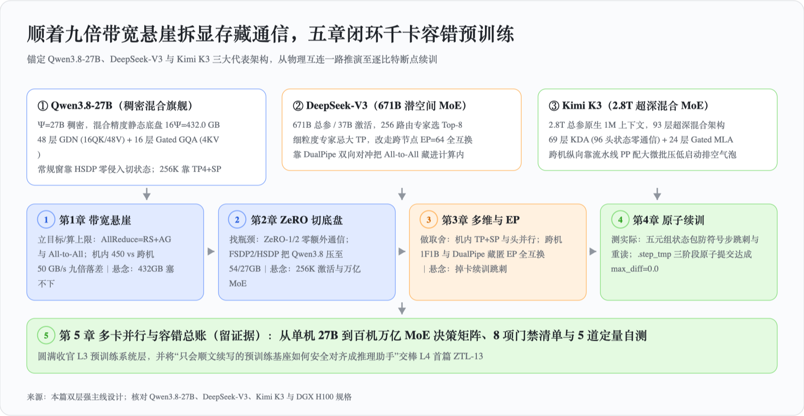
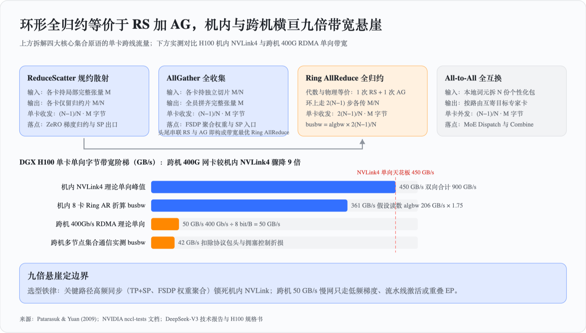
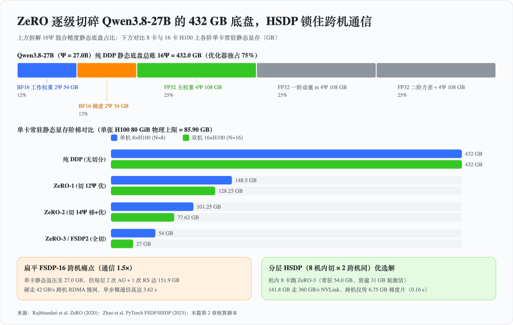
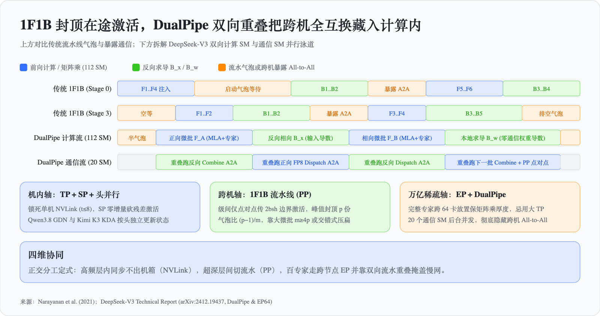
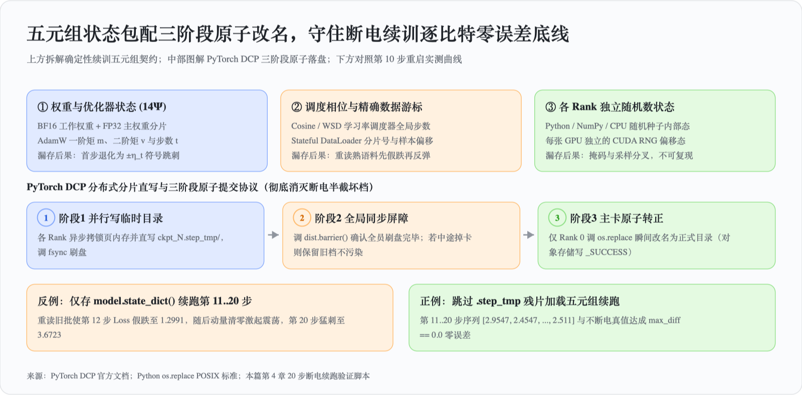
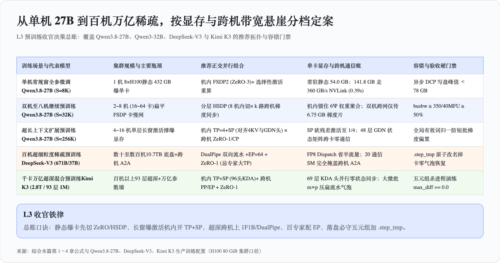

# ZTL-12｜训练｜多卡的账和中断后续上

> 🎯 **这篇文档解决什么问题**：<b>核心命题：分布式并行从不凭空减少总浮点运算量，它的核心职责是顺应”机内 NVLink 快过跨机 RDMA 九倍”的物理拓扑，切开单卡装不下的显存并把通信藏进计算阴影。</b>本篇以稠密混合架构与万亿稀疏架构为代表，贯穿显存优化、通信隐藏与容错机制三大主线。五元组原子检查点则兜住掉卡无损重连底线。
>
> **使用方式与先修要求**：本篇是 L3 预训练系统层的收官篇。阅读前建议熟悉 `AdamW` 双矩更新、[ZTL-06｜数学｜一张纸算清算力、显存与缩放](./06-compute-memory-scaling.md) 的 $`16\Psi`$ 静态显存与 [ZTL-11｜训练｜从语料到一轮小预训练](./11-pretrain.md) 的序列打包管线。全篇围绕百卡千卡集群部署与掉卡续训一案到底。规格数据均核对于 2026 年 11 月 16 日。
>
> **动手实践**：第 2 章内嵌 `Qwen3.8-27B` 在 8 卡与 16 卡 H100 上的 ZeRO 显存与跨机通信核算器。第 4 章提供三阶段原子提交模板与断电零误差（`max_diff == 0.0`）验证脚本。读者复制即可运行。

<b>🧭 主线位置</b>：上一篇 [ZTL-11｜训练｜从语料到一轮小预训练](./11-pretrain.md) 跑通了语料提纯、序列打包与单机 `0.5B` 小预训练。本篇接棒跨越单机显存墙、跨机带宽悬崖与千卡硬件故障，收官整个 L3 预训练系统层。下一篇将开启 L4 后训练首篇 [ZTL-13｜后训练｜奖励、策略梯度与 DPO 的数学](./13-rl-math.md)，推导奖励建模、GRPO 与 DPO 闭式解。

## 导读 · 先给结论

- <b>环形全归约等价于规约散射加全收集，9 倍带宽悬崖划定并行边界。</b>在 `N` 卡环上同步体积 `M` 的张量，单卡收发量收敛于 $`2\frac{N-1}{N}M`$ 。验收网卡须认准单向总线带宽 $`\mathrm{busbw}`$ 。H100 机内 NVLink4 单向达 `450 GB/s`，跨机单块 400G 网卡仅 `50 GB/s`，高频同步严禁跨机[[1]](https://www.cs.fsu.edu/~xyuan/paper/09jpdc.pdf)[[2]](https://github.com/NVIDIA/nccl-tests/blob/master/doc/PERFORMANCE.md)[[3]](https://resources.nvidia.com/en-us-tensor-core/nvidia-tensor-core-gpu-datasheet)。
- <b>ZeRO-1/2 零额外通信切碎 $`14\Psi`$ 状态，FSDP2 与 HSDP 零侵入跑通 27B 训练。</b>稠密案例模型纯 DDP 静态显存达 `432.0 GB`。切至 16 卡 `ZeRO-1 / 2 / 3` 后阶梯降至 `128.25 / 77.62 / 27.0 GB`。分层 `HSDP` 把 $`6\Psi`$ 权重聚合留在机内，跨机每步仅传 `6.75 GB` 梯度片[[4]](https://arxiv.org/abs/1910.02054)[[5]](https://arxiv.org/abs/2304.11277)[[6]](https://pytorch.org/docs/stable/distributed.fsdp.fully_shard.html)[[7]](https://huggingface.co/Qwen/Qwen3.8-27B/blob/main/config.json)。
- <b>机内 TP+SP 切碎超长激活，线性层享有零状态通信红利。</b>列切配行切加序列并行 `SP` 零通信增量把残差与 `RMSNorm` 激活压为 `1/t`。稠密与稀疏案例模型均采用线性注意力与多头潜在注意力的混合，沿头维独立更新定长状态。全程免除跨卡状态同步[[7]](https://huggingface.co/Qwen/Qwen3.8-27B/blob/main/config.json)[[8]](https://arxiv.org/abs/1909.08053)[[9]](https://arxiv.org/abs/2205.05198)[[10]](https://huggingface.co/moonshotai/Kimi-K3)。
- <b>跨机靠 1F1B 流水线控气泡，万亿 MoE 靠 EP 配 DualPipe 藏匿全互换。</b>`1F1B` 将在途激活封顶在 `p` 份，气泡比为 $`\frac{p-1}{m}`$ 。稀疏案例模型弃用专家大 TP 改走 `EP=64`。它借 `DualPipe` 双向对冲把跨节点两次 `All-to-All` 藏进计算阴影[[11]](https://arxiv.org/abs/2104.04473)[[12]](https://arxiv.org/abs/1811.06965)[[13]](https://arxiv.org/abs/2412.19437)[[14]](https://arxiv.org/abs/2507.20534)。
- <b>续训只存权重必诱发跳刺与过拟合，五元组加三阶段原子落盘达成零误差恢复。</b>快照须集齐主权重、优化器双矩、调度步数、数据游标及逐卡随机态。落盘严守写 `.step_tmp` 刷盘、过 `dist.barrier()` 与主卡 `os.replace` 改名三步契约[[15]](https://arxiv.org/abs/2407.21783)[[16]](https://pytorch.org/docs/stable/distributed.checkpoint.html)[[17]](https://docs.python.org/3/library/os.html#os.replace)。



<b>📎 与系列其他文档的分工</b>：先修底座方面，`AdamW` 双矩修正与裁剪见 [ZTL-05｜数学｜优化、归一化与数值稳定](./05-optim-norm.md)，混合精度 $`16\Psi`$ 底盘与 $`6PD`$ 算力回顾 [ZTL-06｜数学｜一张纸算清算力、显存与缩放](./06-compute-memory-scaling.md)，序列打包与有效词元口径见 [ZTL-11｜训练｜从语料到一轮小预训练](./11-pretrain.md)。

后续衔接方面，冻结底座挂低秩旁路省优化器的机制移交 [ZTL-15｜后训练｜只训练一小部分参数](./15-lora.md)。线上推理的张量并行、PD 分离及 MoE 专家并行延迟账详见第 19～24 篇（收官于 [ZTL-24｜系统｜长上下文与混合专家怎样改变账单](./24-long-context-moe.md)）。

## 第 1 章 · 集合通信与九倍带宽悬崖

上一篇 [ZTL-11｜训练｜从语料到一轮小预训练](./11-pretrain.md) 在单机上跑通了 `0.5B` 小模型预训练。一旦把主角换成 2026 前沿架构，单机假设便不再成立。混合稠密架构光混合精度静态状态就占数百 GB。稀疏架构更攀升至数 TB 量级。单张 GPU 显存天花板（80 GB）立刻沦为战术细节。

跨出单张 GPU 后，每步前反向与更新都仰赖 NVIDIA NCCL 在线缆上搬运张量。分布式工程的第一步是先为集群**立目标**并**算上限**。我们必须算准通信原语的精确字节量，标定机内与跨机的物理带宽天花板。

### 1.1 四类基础原语与 MoE 专属 All-to-All 的环形通信账

设有 `N` 张对等 GPU（编号 `Rank 0` 至 `Rank N-1`），待处理的完整张量字节数为 `M`。大模型训练反复调用的集合通信原语共有五类。它们的输入前提与输出归属截然不同[[1]](https://www.cs.fsu.edu/~xyuan/paper/09jpdc.pdf)[[2]](https://github.com/NVIDIA/nccl-tests/blob/master/doc/PERFORMANCE.md)[[13]](https://arxiv.org/abs/2412.19437)：

- <b>广播（Broadcast）。</b>仅 `Rank 0` 持有完整张量 `M`。通信结束后，全部 `N` 张卡拿到相同副本 `M`。它常用于训练起步时同步初始参数或分发信标。
- <b>全收集（AllGather，简称 AG）。</b>每张卡事先持有互不重叠的 `1/N` 切片（`M/N`）。结束后全员拼齐完整张量 `M`。`ZeRO-3 / FSDP` 拼合权重与序列并行还原激活都靠全收集[[4]](https://arxiv.org/abs/1910.02054)[[5]](https://arxiv.org/abs/2304.11277)[[9]](https://arxiv.org/abs/2205.05198)。
- <b>规约散射（ReduceScatter，简称 RS）。</b>每张卡事先持有同形的局部结果 `M`。通信先对全卡对应元素逐位求和，随后仅把第 `k` 块归约片（`M/N`）留给 `Rank k`，其余分块当场释放。
- <b>全归约（AllReduce，简称 AR）。</b>每张卡输入局部完整张量 `M`。结束后全员拿到跨卡求和后的完整张量 `M`。纯数据并行 `DDP` 同步梯度与标准张量并行 `TP` 汇总部分积均调用全归约[[8]](https://arxiv.org/abs/1909.08053)[[18]](https://arxiv.org/abs/2006.15704)。
- <b>全互换（All-to-All，MoE 专用）。</b>每张卡把体积 `M` 的激活拆成 `N` 份邮包。它自留第 `k` 份，并把其余 `N-1` 份投递给目标专家卡。稀疏架构模型每趟前向都要跑派发（`Dispatch`）与回收（`Combine`）两次全互换[[10]](https://huggingface.co/moonshotai/Kimi-K3)[[13]](https://arxiv.org/abs/2412.19437)。

为什么通信库绝不让主卡收拢全员数据再统一发回？若走星型中心汇聚，`Rank 0` 单卡收发量会线性膨胀为 `2(N-1)M`。单口带宽立刻成为全集群瓶颈。带宽最优的<b>环形算法（Ring Algorithm）</b>将 `N` 张卡排成逻辑单向环，并将张量均分为 `N` 块（每块 `M/N` 字节）[[1]](https://www.cs.fsu.edu/~xyuan/paper/09jpdc.pdf)。

顺着环路走一遍即可导出字节方程。先看环形<b>规约散射（RS）</b>：每步每卡向下一跳发出一块 `M/N`，同时从上一跳接收一块累加到本地。连走 `N - 1` 步后，每卡恰有一块 `M/N` 攒齐了 `N` 卡总和，单卡收发量为 $`V_{\mathrm{RS}} = \frac{N - 1}{N} M`$ 。

再看环形<b>全收集（AG）</b>：每卡把攒齐的那块 `M/N` 沿环接力传 `N - 1` 步填满槽位。单卡收发量同样是 $`V_{\mathrm{AG}} = \frac{N - 1}{N} M`$ 。把一次 `RS` 与一次 `AG` 头尾串联，便构成代数与物理完全等价的<b>环形全归约（Ring AllReduce）</b>[[1]](https://www.cs.fsu.edu/~xyuan/paper/09jpdc.pdf)[[2]](https://github.com/NVIDIA/nccl-tests/blob/master/doc/PERFORMANCE.md)：

```math
V_{\mathrm{AR}} = V_{\mathrm{RS}} + V_{\mathrm{AG}} = 2\frac{N - 1}{N} M
```

拿单机 $`N = 8`$ 卡同步 $`M = 16\text{ GB}`$ 梯度手算核对。张量切成 8 块各 `2 GB`。前半程 `RS` 走 7 步发 `14 GB`，后半程 `AG` 走 7 步再发 `14 GB`，全程单卡发出 $`28\text{ GB} = 1.75 M`$。

这里要看清全双工链路的物理含义。NVLink 与 RDMA 光模块均拥有独立收发通道，每步向下一跳发送 $`M/N`$ 时，接收通道正同步收进上一跳发来的 $`M/N`$。因此收发耗时互不叠加，单卡单向端口承压精确锁定在 $`2(N-1)/N \cdot M`$，哪怕扩至千卡系数也仅渐近于常数 `2`。均衡路由下的 `All-to-All` 同理，单卡单向流量为 $`\frac{N - 1}{N} M`$。

### 1.2 NCCL 总线带宽折算公式与九倍物理悬崖

用官方 `nccl-tests` 压测网络时，终端并列打印算法带宽 `algbw` 与总线带宽 `busbw`[[2]](https://github.com/NVIDIA/nccl-tests/blob/master/doc/PERFORMANCE.md)。设逻辑张量字节数为 `M`，单次耗时为 `t` 秒，算法带宽定义为 $`\mathrm{algbw} = M / t`$ 。但 `algbw` 不能直接与网卡物理峰值相比。全归约在线缆上实际搬运了 $`2\frac{N-1}{N}M`$ 字节，NCCL 乘上环系数折算出真实**总线带宽**[[2]](https://github.com/NVIDIA/nccl-tests/blob/master/doc/PERFORMANCE.md)：

```math
\mathrm{busbw}_{\mathrm{AR}} = \mathrm{algbw} \times \frac{2(N - 1)}{N}, \qquad \mathrm{busbw}_{\mathrm{AG/RS/A2A}} = \mathrm{algbw} \times \frac{N - 1}{N}
```

现在在 **DGX H100 SXM5** 集群上**算上限**，确立全篇选型的物理坐标[[3]](https://resources.nvidia.com/en-us-tensor-core/nvidia-tensor-core-gpu-datasheet)。单节点内 8 张 H100 经第四代 NVLink 接入 NVSwitch。规格书标的 `900 GB/s` 为双向合计，<b>单卡单向物理峰值为 `450 GB/s`</b>。假设 8 卡全归约同步 `4.0 GB` 张量耗时 `19.4 ms`（示意读数，本文未在集群实测），`algbw` 为 `206.2 GB/s`。乘修正因子 `1.75` 后真实 $`\mathrm{busbw} = 360.8\text{ GB/s}`$ ，吃满单向峰值的 `80.2%`。下图第二根柱按约 `361 GB/s` 画出。

一旦数据跨出机箱走上机间网络，物理上限便断崖下跌。标准节点为每张 H100 配 1 块 `400 Gb/s` InfiniBand 或 RoCEv2 网卡。网络速率按<b>比特每秒（`Gb/s`）</b>计价。除以 `8` 化为字节后，<b>跨机单卡单向峰值仅有 `50 GB/s`</b>（经验上有效 $`\mathrm{busbw}`$ 约 40～45 GB/s，本篇未实测）[[3]](https://resources.nvidia.com/en-us-tensor-core/nvidia-tensor-core-gpu-datasheet)[[15]](https://arxiv.org/abs/2407.21783)。

机内 `450 GB/s` 对比跨机 `50 GB/s`，横亘着整整 **9 倍的物理带宽悬崖**。关键路径上的高频大体积同步必须留在单机 8 卡 NVLink 内。跨机慢网只走低频分桶梯度、轻量边界激活，或经流水隐藏的专家全互换。

对照下方拓扑与原语示意图，左半区标明了 NVSwitch 机内宽道与跨机网卡窄桥的九倍落差，右半区则展示了环形 `RS + AG` 两拍接力如何消除了主卡汇聚热点：



> 💡 <b>常见误区：混淆单双向口径与比特字节单位，拿着 206 GB/s 的 algbw 报修主板降速。</b>跑完 8 卡全归约见 `algbw = 206 GB/s` 低于 `900 GB/s`，或把 `400G` 网卡当成 `400 GB/s` 排布跨机张量并行。
>
> **根因与改法**：这是漏除了双向因子 `2`、漏乘了环系数 `1.75`，又混淆了 `Gb/s` 与 `GB/s` 的 8 倍换算。全团队须统一单卡单向字节带宽标尺，验收只认 `busbw` 列[[2]](https://github.com/NVIDIA/nccl-tests/blob/master/doc/PERFORMANCE.md)[[3]](https://resources.nvidia.com/en-us-tensor-core/nvidia-tensor-core-gpu-datasheet)。

下表汇总五类核心集合通信原语的数据流转、单卡字节公式与训练典型落点：

| **集合通信原语** | <b>输入状态与输出归属（逻辑量 M）</b> | **单卡单向收发字节** | **busbw 折算与核心并行落点** |
|---|---|---|---|
| **Broadcast** | Rank 0 持 `M`；结束后全卡持 `M` | $`1.0 \cdot M`$（流水链） | `algbw × 1`；初始权重与控制信标广播 |
| **ReduceScatter** | 各卡持局部 `M`；结束后各持归约片 `M/N` | $`\frac{N-1}{N} M`$ | `algbw × (N-1)/N`；ZeRO 梯度归约、SP 行切出口 |
| **AllGather** | 各卡持切片 `M/N`；结束后全卡拼齐 `M` | $`\frac{N-1}{N} M`$ | `algbw × (N-1)/N`；FSDP 聚合权重、SP 列切入口 |
| **Ring AllReduce** | 各卡持局部 `M`；结束后全卡持归约后 `M` | $`2\frac{N-1}{N} M`$（RS + AG） | `algbw × 2(N-1)/N`；纯 DDP 同步与纯 TP 求和 |
| **All-to-All** | 各卡拆 `N` 份个性化块互寄目标专家卡 | $`\frac{N-1}{N} M`$（均衡态） | `algbw × (N-1)/N`；MoE 专家并行派发与回收 |

> 🔑 **本章要点与回到主线**：经立目标与算上限，我们明确了 `AllReduce = RS + AG` 的拆解式与 9 倍带宽悬崖。但新的矛盾随之浮现：把 `Qwen3.8-27B`（静态底盘 `432 GB`）放上双机 `16×H100` 时，纯 DDP 要求单卡硬装 432 GB 而直接 OOM。怎样在不改模型代码的前提下切碎冗余状态？这正是第 2 章要解决的重点。

## 第 2 章 · 零侵入切碎底盘，DDP 到 ZeRO

正面解决上一章留下的显存溢出问题。[ZTL-06｜数学｜一张纸算清算力、显存与缩放](./06-compute-memory-scaling.md) 算清了混合精度 `AdamW` 的静态显存公式。设参数量为 $`\Psi`$ ，`BF16` 工作权重与梯度各占 $`2\Psi`$ 字节。`FP32` 主权重、一阶动量与二阶方差各占 $`4\Psi`$ 字节（优化器独占 $`12\Psi`$ ，高达 `75%`）。

在传统分布式数据并行（`DDP`）下，`N` 张卡各自复制完整 $`16\Psi`$ 底盘[[4]](https://arxiv.org/abs/1910.02054)[[18]](https://arxiv.org/abs/2006.15704)。稠密案例（27B 参数）单卡未读样本就要占 `432.0 GB`，超出 80 GiB H100 容量（`85.90 GB`）整整 5 倍。稀疏架构更大的模型根本无法启动。**找瓶颈**结论很清晰：分布式显存溢出全因 N 张卡重复存了相同副本。

### 2.1 纯 DDP 分桶重叠与 ZeRO-1/2 的“零额外通信”魔术

消除冗余副本前，必须保住纯 `DDP` 的核心优势：计算与通信重叠。反向求导从顶层往底层推进，PyTorch `DDP` 按参数逆序把梯度装入固定分桶（默认 `25 MB`）。每填满一桶便异步发起 `Ring AllReduce`，把同步藏在后续层反向矩阵乘背后[[18]](https://arxiv.org/abs/2006.15704)。整网同步 $`\Psi`$ 个 `BF16` 元素，单卡每步线缆流量为 $`4\frac{N-1}{N}\Psi`$ 字节。

怎样既切碎冗余、零侵入模型代码，又不增加通信量？零冗余优化器（`ZeRO`）利用第 1 章 `AllReduce = RS + AG` 恒等式，演进出清晰的分片阶梯[[4]](https://arxiv.org/abs/1910.02054)：

- <b>ZeRO-1（切 $`12\Psi`$ 优化器状态，通信零增量）。</b>每卡照旧保留完整 `BF16` 权重与梯度（共 $`4\Psi`$）。但它将 $`12\Psi`$ 优化器三件套均分为 `N` 片，`Rank k` 只管第 `k` 片。反向用一次<b>规约散射（RS）</b>拿到第 `k` 片梯度并更新参数片，步末再跑一次<b>全收集（AG）</b>广播新权重。通信量与 DDP 完全相等，单卡静态显存骤降至 $`4\Psi + \frac{12\Psi}{N}`$ [[4]](https://arxiv.org/abs/1910.02054)。
- <b>ZeRO-2（连切优化器与 $`2\Psi`$ 梯度，通信仍零增量）。</b>既然 `Rank k` 更新时只用第 `k` 片梯度，反向算完某层并走完分桶 `RS` 后，其余 `N-1` 片梯度缓冲当场即可释放。单卡常驻静态显存压低至 $`2\Psi + \frac{14\Psi}{N}`$ ，单步通信依旧维持零额外开销[[4]](https://arxiv.org/abs/1910.02054)[[5]](https://arxiv.org/abs/2304.11277)。

梯度切成 `N` 片后，全局梯度裁剪会不会算错？完全不会。各卡只需对本地持有的 `1/N` 归约梯度片先算局部平方和，再跨卡做一次仅占 4 字节的标量全归约求和开方，便能以零带宽代价还原精确全局范数。

### 2.2 ZeRO-3 / FSDP2 全切分与分层 HSDP 双机对账

拿稠密 27B 案例核验前两阶效果。在单机 8 卡上，`ZeRO-1`（`148.50 GB`）与 `ZeRO-2`（`101.25 GB`）仍越过 `85.90 GB` 红线。扩至双机 16 卡，`ZeRO-2` 虽压到 `77.62 GB`，留给激活的余量却只剩 `8.3 GB`。要进一步压低静态占用，必须启用第三阶 <b>ZeRO-3（即 PyTorch `FSDP` / `FSDP2`）</b>[[5]](https://arxiv.org/abs/2304.11277)[[6]](https://pytorch.org/docs/stable/distributed.fsdp.fully_shard.html)。

`ZeRO-3` 连最后 $`2\Psi`$ 的工作权重也按 `1/N` 切碎。初代 `FSDP` 把多个参数拍平为一维大张量（`FlatParameter`），易诱发碎片。新一代 PyTorch `FSDP2`（`fully_shard`）改用基于 `DTensor` 的逐参数第 0 维切分。前向算第 `l` 层矩阵乘时，后台流已异步预取第 `l+1` 层权重，把机内通信叠进计算流水[[6]](https://pytorch.org/docs/stable/distributed.fsdp.fully_shard.html)。

工程精算时还要留心预取双缓冲的瞬时显存开销。当前层正被算子消费的完整权重与后台流刚拼好的下一层完整权重会同时驻留显存。因此 `FSDP2` 默认把在途预取窗口锁在 1 至 2 个解码层（对 27B 模型约 `1.6 GB`），防止无节制预取重新冲破显存红线。

此时单卡静态显存直降为 $`\frac{16\Psi}{N}`$ ：8 卡 H100 上压至 `54.0 GB`，16 卡上更直降至 <b>`27.0 GB`</b>。相应代价是各卡平时无完整权重。前向进每层前须跑 1 次 `AG` 拼齐权重，反向退回每层前再跑 1 次 `AG`，算完梯度再跑 1 次 `RS`。单步通信升至 <b>$`6\frac{N-1}{N}\Psi`$ 字节</b>，恰为前两阶的 **1.5 倍**[[4]](https://arxiv.org/abs/1910.02054)[[5]](https://arxiv.org/abs/2304.11277)。

一旦扁平 `FSDP` 跨上多机，9 倍带宽悬崖立刻显现。每微批百 GB 权重 `AG` 若硬挤 `42 GB/s` 慢网，GPU 很快就会停摆等待。解决之道是<b>分层混合分片（`HSDP`）</b>[[5]](https://arxiv.org/abs/2304.11277)。它将 `ZeRO-3` 切分留在单机 8 卡内（常驻 `54.0 GB`），高频聚合全走机内 NVLink，仅在累积步末对 `1/8` 梯度片跑一次跨机全归约。下方脚本核算双机账单：

*Qwen3.8-27B（Ψ=27B）在 8 卡与 16 卡 H100 下的 ZeRO 阶梯及 HSDP 跨机通信核算*

```python
PSI_B = 27.0       # Qwen3.8-27B 稠密参数 27.0B (16Ψ = 432.0 GB)
BW_NV = 360.0      # H100 机内 NVLink4 单向实测有效 busbw (GB/s)
BW_IB = 42.0       # 跨机 400G RDMA 网卡单向实测有效 busbw (GB/s)

def audit_zero(n_gpus, nodes=1, hsdp_intra=None):
    ddp = 16.0 * PSI_B
    z1  = (4.0 + 12.0 / n_gpus) * PSI_B
    z2  = (2.0 + 14.0 / n_gpus) * PSI_B
    z3  = (16.0 / n_gpus) * PSI_B
    ring = (n_gpus - 1) / n_gpus
    comm_z12 = 4.0 * ring * PSI_B   # 2Ψ 元素 × 2B/元素 × (N-1)/N
    comm_z3  = 6.0 * ring * PSI_B   # 3Ψ 元素 × 2B/元素 × (N-1)/N
    bw = BW_NV if nodes == 1 else BW_IB
    print(f"N={n_gpus:2d} ({nodes}机) | DDP:{ddp:5.1f}G -> Z1:{z1:6.2f}G -> Z2:{z2:6.2f}G -> Z3:{z3:4.1f}G "
          f"| Z1/2通信:{comm_z12:5.1f}G ({comm_z12/bw:4.2f}s) | 扁平Z3:{comm_z3:5.1f}G ({comm_z3/bw:4.2f}s)")
    if hsdp_intra:
        inter = n_gpus // hsdp_intra
        m_hsdp = (16.0 / hsdp_intra) * PSI_B
        ag_rs_nv = 6.0 * ((hsdp_intra - 1) / hsdp_intra) * PSI_B
        ar_ib = 4.0 * ((inter - 1) / inter) * (PSI_B / hsdp_intra)
        t_raw = ag_rs_nv / BW_NV + ar_ib / BW_IB
        print(f"HSDP ({hsdp_intra}机内切×{inter}跨机同) | 常驻静态:{m_hsdp:4.1f}G | 机内NV:{ag_rs_nv:5.1f}G "
              f"+ 跨机IB仅:{ar_ib:4.2f}G | 裸通信压至:{t_raw:4.2f}s")

audit_zero(8, nodes=1)
audit_zero(16, nodes=2, hsdp_intra=8)
# 精确输出（单张 H100 80 GiB 物理红线为 85.90 GB）：
# N= 8 (1机) | DDP:432.0G -> Z1:148.50G -> Z2:101.25G -> Z3:54.0G | Z1/2通信: 94.5G (0.26s) | 扁平Z3:141.8G (0.39s)
# N=16 (2机) | DDP:432.0G -> Z1:128.25G -> Z2: 77.62G -> Z3:27.0G | Z1/2通信:101.2G (2.41s) | 扁平Z3:151.9G (3.62s)
# HSDP (8机内切×2跨机同) | 常驻静态:54.0G | 机内NV:141.8G + 跨机IB仅:6.75G | 裸通信压至:0.55s
```

*输出*

```text
N= 8 (1机) | DDP:432.0G -> Z1:148.50G -> Z2:101.25G -> Z3:54.0G | Z1/2通信: 94.5G (0.26s) | 扁平Z3:141.8G (0.39s)
N=16 (2机) | DDP:432.0G -> Z1:128.25G -> Z2: 77.62G -> Z3:27.0G | Z1/2通信:101.2G (2.41s) | 扁平Z3:151.9G (3.62s)
HSDP (8机内切×2跨机同) | 常驻静态:54.0G | 机内NV:141.8G + 跨机IB仅:6.75G | 裸通信压至:0.55s
```

逐段走读上述核算脚本的核心系数与双机输出对账：

- <b>系数 4.0 与 6.0 的字节拆解。</b>第 29 至 30 行中，每个 `BF16` 参数占 `2` 字节。`ZeRO-1/2` 每步走 1 次梯度 `RS` 加 1 次权重 `AG`，合 $`2 \times 2 = 4.0`$ 字节/参数。`ZeRO-3` 前反向共走 2 次权重 `AG` 加 1 次梯度 `RS`，合 $`3 \times 2 = 6.0`$ 字节/参数，再乘环因子 $`(N-1)/N`$ 即得真实网卡负载。
- <b>HSDP 二级拓扑分流威力。</b>第 34 至 40 行将 `hsdp_intra = 8` 锁在机内，`141.8 GB` 权重聚合走 `360 GB/s` NVLink 仅需 `0.39 秒`。跨机只对切剩 `1/8` 的梯度片（`3.375B` 参数）做双机全归约，跨网流量锐减至 $`4.0 \times \frac{1}{2} \times 3.375 = 6.75\text{ GB}`$，裸通信从扁平 `ZeRO-3` 的 `3.62 秒`骤降至 `0.55 秒`。

结合下方阶梯柱状图可以直观看到，`85.90 GB` 物理红线像一道标尺横穿图面。单机 8 卡下唯有 `ZeRO-3` 压进红线以内并留出 `31.9 GB` 激活余量（图中记作逾 31 GB）。图上排的三条 FP32 状态各占 $`4\Psi`$，即 `108 GB`，正是静态底盘 432 GB 的大头。扩至双机时，分层 `HSDP` 则兼得了 `54.0 GB` 安全水线与亚秒级通信开销：



> 💡 <b>常见误区：直接拿 ZeRO 论文的“$`2\Psi / 3\Psi`$”除以字节带宽算时间，漏乘 BF16 两字节位宽。</b>估算 16 卡扁平 FSDP 训 `Qwen3.8-27B` 的通信量时错算成 `75.9 GB`，导致预估网卡耗时比实测少算一半。
>
> **根因与改法**：原论文的 $`2\Psi`$ 与 $`3\Psi`$ 计的是**参数元素个数**。`BF16` 下每元素占 `2` 字节，真实流量须翻倍为 `101.2 GB` 与 `151.9 GB`，算时间时必须乘上元素字节数 `2 B`[[4]](https://arxiv.org/abs/1910.02054)。

读数给出了清晰结论：双机扁平 `ZeRO-3` 每步跨机传 `151.9 GB`，裸耗时达 `3.62 秒`。改用 `8×2` 分层 `HSDP` 后，`141.8 GB` 由机内 NVLink 在 `0.39 秒` 内消化，跨机仅传 <b>`6.75 GB`</b>（`0.16 秒`）。裸通信大降近 7 倍。下表汇总五档切分账单：

| **并行档位** | <b>单卡静态显存公式（字节）</b> | <b>单步通信（元素 / BF16 字节）</b> | <b>Qwen3.8-27B 实算（8 卡 / 16 卡）</b> |
|---|---|---|---|
| **纯 DDP** | $`16\Psi`$（权2Ψ+梯2Ψ+优12Ψ） | $`2\frac{N-1}{N}\Psi`$ 元 / $`4\frac{N-1}{N}\Psi`$ B | `432.0 GB / 432.0 GB`（5倍超限必崩） |
| **ZeRO-1** | $`4\Psi + \frac{12\Psi}{N}`$ | $`2\frac{N-1}{N}\Psi`$ 元 / $`4\frac{N-1}{N}\Psi`$ B | `148.50 GB / 128.25 GB`（均超单卡红线） |
| **ZeRO-2** | $`2\Psi + \frac{14\Psi}{N}`$ | $`2\frac{N-1}{N}\Psi`$ 元 / $`4\frac{N-1}{N}\Psi`$ B | `101.25 GB`（超限）/ `77.62 GB`（紧贴红线） |
| **扁平 ZeRO-3** | $`\frac{16\Psi}{N}`$（加单层缓冲） | $`3\frac{N-1}{N}\Psi`$ 元 / $`6\frac{N-1}{N}\Psi`$ B | `54.0 GB / 27.0 GB`（跨机传 151.9 GB 慢） |
| <b>分层 HSDP (8×k)</b> | $`\frac{16\Psi}{8}`$（机内8卡分片） | 机内 $`6\frac{7}{8}\Psi`$ B + 跨机仅传 $`\frac{\Psi}{8}`$ 片 | `54.0 GB` 常驻；双机跨网仅传 `6.75 GB` |

> 🔑 **本章要点与回到主线**：`ZeRO-1/2` 零额外通信切掉 $`14\Psi`$ 状态，`FSDP2 / HSDP` 更把 27B 稠密架构压进 `54.0` 至 `27.0 GB`。但新的矛盾随之浮现：当序列拉长到 `256K` 撑大单层激活，或模型达 671B（37B 激活）与 2.8T 量级的稀疏架构时，单靠切副本已无法奏效。多维模型并行怎样协同分工？这正是第 3 章要展开的重点。

## 第 3 章 · 超长激活与稀疏架构的并行

直面上一章抛出的两道难题。一方面，稠密案例跑长序列时单层未切分激活高达数十 GB，纯 `ZeRO / HSDP` 前向立刻仍要吞下整层激活。另一方面，万亿稀疏架构的单层专家权重都远超单机容量[[7]](https://huggingface.co/Qwen/Qwen3.8-27B/blob/main/config.json)[[10]](https://huggingface.co/moonshotai/Kimi-K3)[[13]](https://arxiv.org/abs/2412.19437)。

工程闭环在此进入**做取舍**阶段。我们要顺着 9 倍带宽悬崖切开计算图本身，让机内 NVLink 轴、跨机低带宽流水轴与混合专家轴各司其职。

### 3.1 机内 TP+SP 轴：切碎长激活与线性注意力

<b>张量并行（Tensor Parallelism，简称 TP）</b>将单层矩阵乘沿隐藏维或注意力头拆到同节点的 `t` 张卡上协同运算[[8]](https://arxiv.org/abs/1909.08053)。Megatron-LM 能让 SwiGLU 前馈块在前向**只通信 1 次**，关键在于<b>“先列切、后行切”</b>的共轭算子配对。

门控投影 `W_gate` 与上投影 `W_up` 按输出列均分为 `(h, d_ff / t)`。各卡算出局部切片后，逐元素激活 `SiLU` 与逐位相乘不跨通道耦合，直接在本地寄存器算完。紧接着下投影 `W_down` 按输入行均分为 `(d_ff / t, h)`。各卡乘出局部和后仅发 **1 次全归约**相加 $`Y = \sum_{i=1}^{t} Y^{(i)}`$ ，即刻还原整块输出[[8]](https://arxiv.org/abs/1909.08053)。

反向传播时这对算子恰好呈对偶镜像。行切出口在前向做全归约，反向时上游梯度本来就已全卡一致，因而直接免通信往下传。到了列切入口，全卡共享同一份输入 `X` 却各自持有 `1/t` 分支导数，求总输入梯度 $`\nabla X = \sum_{i=1}^{t} \nabla X^{(i)}`$ 时再补 1 次全归约即可闭环。

注意力子层结构同构，并在 2026 混合架构中释放出高效率的<b>头维度并行（Head Parallelism）</b>红利[[7]](https://huggingface.co/Qwen/Qwen3.8-27B/blob/main/config.json)[[10]](https://huggingface.co/moonshotai/Kimi-K3)：

- <b>全局注意力按头分组切分。</b>`Qwen3.8-27B` 的 16 层 `Gated GQA` 含 `24` 个查询头与 `4` 个键值头（头维 `256`）。开 `TP = 4` 时每卡恰好分得 `6Q / 1KV` 无复制分片。输出门控也在本地头上独立相乘，仅在行并行 `o_proj` 出口归约一次[[7]](https://huggingface.co/Qwen/Qwen3.8-27B/blob/main/config.json)。
- <b>GDN 与 KDA 线性注意力天然零状态通信。</b>`Qwen3.8-27B` 的 48 层 `Gated DeltaNet` 配 `16` 个 QK 头与 `48` 个 V 头，`Kimi K3` 的 69 层 `KDA` 配 `96` 个头更新定长状态 $`S_t`$ 。这两类线性层在时间步递推中**各头完全解耦**[[7]](https://huggingface.co/Qwen/Qwen3.8-27B/blob/main/config.json)[[10]](https://huggingface.co/moonshotai/Kimi-K3)。开 `TP = 8` 时每卡独立原地更新各自头的状态矩阵，扫完百万长序列全程**无需跨卡交换循环状态**。

纯 `TP` 仍漏掉了一块激活：两处全归约之间的 `Pre-RMSNorm` 与残差主干形状仍为 `(b, s, h)`，在 `t` 张卡上重复存了 `t` 份。<b>序列并行（Sequence Parallelism，简称 SP）</b>把行并行出口的 `AllReduce` 换为 `ReduceScatter`，让激活沿序列轴散开成 `(b, s/t, h)`[[9]](https://arxiv.org/abs/2205.05198)。

这样残差相加与 `RMSNorm` 均在 `1/t` 长度上执行。进下一层列并行前，再补一次 `AllGather` 拼回完整序列。总通信字节**分毫不增**，整层全部激活却齐降为 `1/t`。因每层前反向 4 对 `RS + AG` 位于串行关键路径上，`TP + SP` 必须固定在单机 NVLink 内（`t ≤ 8`）[[11]](https://arxiv.org/abs/2104.04473)。

### 3.2 跨机 1F1B 流水线与万亿 MoE 专属轴

当模型深且跨越多机时，纵向切层的<b>流水线并行（Pipeline Parallelism，简称 PP）</b>便接管跨机慢网[[12]](https://arxiv.org/abs/1811.06965)[[19]](https://arxiv.org/abs/2006.09503)。整网均分为 `p` 个流水级。相邻节点间只靠点对点 `Send / Recv` 传递一层边界激活 `2bsh` 字节。跨机流量随即直降两个数量级。

为填满流水线，单步全局批拆成 `m` 个微批连续注入。初代 `GPipe` 连跑全部 `m` 个前向再跑反向，迫使首级囤积 `m` 份激活而爆显存。现代训练标配 <b>`PipeDream-Flush` 一前一后（1F1B）调度</b>。稳态期每算完 1 个前向紧跟 1 个反向并立刻释放激活，把在途激活峰值严格封顶在 `p` 份[[12]](https://arxiv.org/abs/1811.06965)[[19]](https://arxiv.org/abs/2006.09503)。首尾空转与有效计算之比即为**流水线气泡率**[[11]](https://arxiv.org/abs/2104.04473)：

```math
\mathrm{Bubble\ Ratio} = \frac{(p - 1)(t_f + t_b)}{m(t_f + t_b)} = \frac{p - 1}{m}
```

只要拆足微批（$`m \gg p`$ ，或用交错式 1F1B 将气泡压至 $`\frac{p-1}{vm}`$），即可把跨机空转压进 `10%` 以内。

稀疏架构采用细粒度路由专家，单专家中间维很小。若再按 8 路 TP 切碎，小矩阵乘会沦为访存受限并触发大量细碎同步。改走跨机专家并行（`EP = 64`，每卡完整放 4 个路由专家）后，矩阵乘保持饱满计算强度。

但 `EP = 64` 带来了跨机新瓶颈。每层前向须跨多节点跑两趟全互换 `All-to-All`（`FP8 Dispatch` 派发词元，`BF16 Combine` 回收结果），通信耗时占纯算五成以上。稀疏架构为此采用 <b>`DualPipe` 双向流水线</b>[[13]](https://arxiv.org/abs/2412.19437)：

- <b>双向对冲减半气泡。</b>同时从流水线首尾两端相向注入两束微批流。单向气泡从 $`p - 1`$ 直接减半至 $`p/2 - 1`$ 。
- <b>细粒度算通重叠藏匿全互换。</b>将反向拆为输入导数 `B_x` 与权重导数 `B_w`，把正向与相向反向微批配成对称块。当 `112` 个计算 SM 全速跑组 A 的矩阵乘时，`20` 个专用通信 SM 在后台并发跑完组 B 的跨机 `All-to-All`，把跨网通信藏进计算阴影[[13]](https://arxiv.org/abs/2412.19437)。

观察下方多维并行泳道图，机内高速 NVLink 承接了密集的 `TP+SP` 切片同步，跨机慢网则通过双向微批流对冲气泡，并用后台通信流掩盖了专家派发与回收延迟：



> 💡 <b>常见误区：把 TP=16 硬拉过跨机慢网，或在 GPipe 全前向模式下猛加微批数 m 压气泡。</b>双机开 `TP = 16` 后 GPU 利用率虚标 100%，真实词元吞吐却跌破 `10% MFU`。另一边在 GPipe 下把 `m` 调到 64，结果 Stage 0 首步便 OOM。
>
> **根因与改法**：跨机 `42 GB/s` 慢网扛不住每层 4 次关键路径同步，且 `GPipe` 需囤积全部 `m` 份激活。工程上须把 `TP+SP` 锁在单机 `t ≤ 8`，跨机一律改走 `1F1B` 或 `DualPipe`[[11]](https://arxiv.org/abs/2104.04473)[[13]](https://arxiv.org/abs/2412.19437)。

下表梳理现代百亿至万亿模型训练的四维正交并行分工矩阵：

| **并行维度** | **切分对象与物理域** | **核心通信原语与隐藏手段** | **2026 前沿代表架构实战落点** |
|---|---|---|---|
| **DP + ZeRO / HSDP** | 切数据批与 `16Ψ` 副本；机内切+跨机同 | 机内 `AG+RS`，跨机分桶 `AR` 与反向重叠 | `Qwen3.8-27B` 多机训练主力底座 |
| <b>TP + SP（含头并行）</b> | 切层内宽、注意力头与序列 `s/t`；锁机内 `t≤8` | 每层 4 对机内 `RS+AG`；GDN/KDA 状态零通信 | `Qwen3.8` 256K 与 `Kimi K3` 1M 砍单层激活 |
| <b>PP（1F1B / 交错）</b> | 按层深切 `p` 级；跨机 RDMA 慢网主力 | 级间点对点传 `2bsh`；大微批压 $`(p-1)/m`$ | `Kimi K3`（93 层）与超深基座跨机纵向扩展 |
| **EP + DualPipe** | 完整路由专家跨卡放置；跨多节点高速域 | FP8 `Dispatch` + BF16 `Combine`；双向对冲全隐藏 | `DeepSeek-V3`（EP64）与 `Kimi K2/K3` 万亿稀疏 |

> 🔑 **本章要点与回到主线**：机内 `TP+SP` 与线性头并行削平了长窗激活，跨机 `1F1B / DualPipe` 与 `EP` 把万亿 MoE 全互换藏进计算阴影。但新的矛盾随之浮现：在数周长跑里，光模块闪断或节点重启几乎每天都会发生。为何加载最新权重续训后，Loss 曲线会突然蹦出异常尖刺？这正是第 4 章要解决的核心。

## 第 4 章 · 掉卡续训，五元组与原子

接住上一章千卡集群半夜掉卡引发的续训难题。走进真实数据中心**测实际**，大规模硬件故障绝非小概率意外，而是按小时倒计时的常态。Llama 3 在 `16,384` 张 H100 上连续预训练 54 天，共遭遇 `419` 次非计划中断。平均每 `3 小时` 就会遇上一次光模块闪断、HBM ECC 告警或节点死锁[[15]](https://arxiv.org/abs/2407.21783)。

倘若每次重启都让损失曲线先诡异下探再猛刺冲顶，省下的百万美元卡时便会付诸东流。本章拆清续训跳变根因，建立逐比特一致的原子容错规范。

### 4.1 漏存状态与损失跳刺的四重机理

许多刚转战集群的团队每隔千步只写一行 `save(model.state_dict())`，误以为读回权重就能无缝续训。在混合精度 `AdamW`（或 `Kimi K2` 的 `MuonClip`）管线中，残缺快照会在恢复首步触发四重失真[[14]](https://arxiv.org/abs/2507.20534)[[16]](https://pytorch.org/docs/stable/distributed.checkpoint.html)：

- <b>丢优化器双矩与 FP32 主权重，触发符号跳刺。</b>回顾 [ZTL-05｜数学｜优化、归一化与数值稳定](./05-optim-norm.md) 解耦 `AdamW` 公式，参数位移为 $`-\eta_t \hat{m}_t / (\sqrt{\hat{v}_t} + \epsilon)`$ 。一旦重启把一阶矩 `m`、二阶矩 `v` 与步数 `t` 清零，恢复首步便满足 $`\hat{m}_1 = g`$ 且 $`\hat{v}_1 = g^2`$ 。更新量瞬间退化为符号步 $`-\eta_t \cdot \mathrm{sign}(g)`$ 。高学习率下百亿参数被推向满格位移 $`\pm \eta_t`$ ，直接冲出收敛盆地。漏存 `FP32` 主权重还会抹平低位尾数增量。
- <b>丢学习率调度器步数，打乱退火相位。</b>余弦或 [ZTL-11｜训练｜从语料到一轮小预训练](./11-pretrain.md) 的 `WSD` 调度器严赖全局步数。漏存调度状态会让作业重跑预热，或错跳进异常衰减斜率。
- <b>丢 Stateful DataLoader 游标，引发重读过拟合。</b>无状态加载器重启后会退回第 0 号分片重喂刚训过的熟语料。权重早已记住这批文本，Loss 会先虚假骤降，撞回新语料时再剧烈反弹。
- <b>丢各 Rank 独立随机种子态，破坏确定性复现。</b>多源采样与混洗依赖各进程独立的 Python、NumPy、CPU 与 CUDA 随机数发生器（`RNG`）内部态。漏存逐卡 `rng_state` 会令断电前后轨迹永久分叉。

由此确立容错第一条硬规矩：生产检查点必须凑齐**确定性续训五元组**。五项依次是**模型与 FP32 主权重分片、优化器双矩与步数、学习率调度器状态、精确到样本偏移的 `Stateful DataLoader` 游标，以及逐卡独立的 `CPU / CUDA RNG` 状态**[[16]](https://pytorch.org/docs/stable/distributed.checkpoint.html)。

对照下方原子检查点架构图，左侧汇集了每张显卡独立维护的五元组状态切片，右侧则展示了先并行落稳临时目录、过全局屏障后再由主卡原子改名的无损流转路径。图底的续跑序列取自 4.3 节代码输出：第 11、12 步损失为 `2.9547`、`2.4547`，末步 20 为 `2.511`，与不断电真值逐位相同。



### 4.2 PyTorch DCP 异步分片直写与三阶段原子提交铁律

凑齐五元组后，稠密案例单份快照重达数百 GB，稀疏架构更逾 TB 量级。切忌在保存时全收集回 `Rank 0` 单机内存写盘，否则会撑爆主节点内存并让千卡空等十几分钟。

工业界统一采用 PyTorch `DCP`（`torch.distributed.checkpoint`）**各 Rank 并行直写本地分片**。每张卡只落盘本地持有的 `DTensor` 切片及偏移元数据。哪怕踢掉故障机后集群从 16 卡缩容至 8 卡重启，`DCP` 也能在读取期自动重切分无损拼回状态。配合异步双缓冲 `async_save` 先拷至锁页内存再由后台线程刷盘，落盘停顿可压至总训练时长的 `0.1%` 以内[[5]](https://arxiv.org/abs/2304.11277)[[16]](https://pytorch.org/docs/stable/distributed.checkpoint.html)。

并行写盘最大的隐患是**刷盘中途断电或掉卡**。假设 16 张卡正写第 `1000` 步分片，`Rank 0..14` 刚写完而 `Rank 15` 写一半断电，目录里便留下残缺坏档。若原地覆写 `latest/`，连第 `500` 步的完好旧档也会一并损毁。

根除半截坏档必须严守**三阶段原子落盘协议**[[16]](https://pytorch.org/docs/stable/distributed.checkpoint.html)[[17]](https://docs.python.org/3/library/os.html#os.replace)：

- <b>阶段一：并行写临时目录。</b>全员并行写入 `ckpt_step_N.step_tmp/`，并调用 `fsync` 确保数据落稳磁盘。
- <b>阶段二：全员全局屏障同步。</b>调用 `dist.barrier()`，确认所有进程无一掉队地刷盘完毕。
- <b>阶段三：主卡原子改名转正。</b>仅由 `Rank 0` 调用 POSIX 原子重命名 `os.replace(tmp_dir, final_dir)` 瞬间转正。对象存储则在屏障后上传单文件信标 `_SUCCESS`。重启扫描时自动跳过一切 `.step_tmp` 残骸，稳拿最新完好快照。

> 💡 <b>常见误区：未过全局 dist.barrier() 就切换 latest 软链，或原地覆写同名快照目录。</b>半夜节点重启后加载报 `EOFError`，排查发现最新目录里部分分片大小为 0。
>
> **根因与改法**：各机网络盘刷写快慢不一，`Rank 0` 写完便擅自改名转正，此时慢节点尚未落盘即被中断。写完 `.step_tmp` 与调 `os.replace` 之间必须插入全员 `dist.barrier()`[[16]](https://pytorch.org/docs/stable/distributed.checkpoint.html)[[17]](https://docs.python.org/3/library/os.html#os.replace)。

下方代码给出生产 `PyTorch DCP` 三阶段原子提交模板，并在本地实跑 20 步对账。脚本对比不断电真值、五元组续跑与仅存权重三条曲线：

*PyTorch DCP 三阶段原子提交范式与第 10 步断电续跑至第 20 步逐比特零误差验证*

```python
import math, os, pickle, shutil, tempfile
import numpy as np

# 生产多机范式（在 torchrun 分布式环境中传入 torch.distributed.checkpoint 与 dist 调用）：
def save_dcp_atomic(dcp_mod, dist_mod, state_5tuple, ckpt_dir):
    tmp_dir = ckpt_dir + ".step_tmp"
    dcp_mod.save(state_5tuple, checkpoint_id=tmp_dir)  # 阶段1：各 Rank 并行直写 .step_tmp
    dist_mod.barrier()                                 # 阶段2：全员屏障确认无任何分片掉队
    if dist_mod.get_rank() == 0:
        os.replace(tmp_dir, ckpt_dir)                  # 阶段3：Rank 0 原子改名瞬间转正
    dist_mod.barrier()

def adamw_step(w, m, v, t, x, y, lr, rng):
    keep = (rng.random(w.shape[0]) >= 0.2) / 0.8       # 强依赖各 Rank 独立随机种子态
    xm = x * keep
    logits = np.einsum("bi,ic->bc", xm, w)
    probs = np.exp(logits - logits.max(axis=-1, keepdims=True))
    probs /= probs.sum(axis=-1, keepdims=True)
    loss = float(-np.log(probs[np.arange(len(y)), y]).mean())
    probs[np.arange(len(y)), y] -= 1.0
    g = np.einsum("bi,bc->ic", xm, probs / len(y))
    m, v = 0.9 * m + 0.1 * g, 0.999 * v + 0.001 * (g * g)
    mh, vh = m / (1.0 - pow(0.9, t)), v / (1.0 - pow(0.999, t))
    w = w * (1.0 - lr * 0.01) - lr * mh / (np.sqrt(vh) + 1e-8)
    return w, m, v, loss

data_rng = np.random.default_rng(7)
stream = [(data_rng.standard_normal((16, 32)), data_rng.integers(0, 8, 16)) for _ in range(20)]
cos_lr = lambda s: 5e-2 * 0.5 * (1.0 + math.cos(math.pi * s / 20))
root, rng_ref = tempfile.mkdtemp(), np.random.default_rng(42)
ckpt10 = os.path.join(root, "ckpt_step_010")
w0 = rng_ref.standard_normal((32, 8)) * 0.2
w, m, v, ref_losses = w0.copy(), np.zeros_like(w0), np.zeros_like(w0), []

for s in range(20):                                    # 基准组：连续无中断跑满 1..20 步
    w, m, v, l = adamw_step(w, m, v, s + 1, *stream[s], cos_lr(s), rng_ref)
    ref_losses.append(l)
    if s + 1 == 10:                                    # 第 10 步执行三阶段 .step_tmp 原子转正
        tmp = ckpt10 + ".step_tmp"
        os.makedirs(tmp, exist_ok=True)
        with open(os.path.join(tmp, "shard0.pkl"), "wb") as f:
            pickle.dump({"w": w, "m": m, "v": v, "step": 10, "cursor": 10,
                         "rng": rng_ref.bit_generator.state}, f)
            f.flush(); os.fsync(f.fileno())
        os.replace(tmp, ckpt10)
        os.makedirs(os.path.join(root, "ckpt_step_011.step_tmp"), exist_ok=True)  # 模拟11步写盘断电坏档

valid = sorted(d for d in os.listdir(root) if not d.endswith(".step_tmp"))[-1]
st = pickle.load(open(os.path.join(root, valid, "shard0.pkl"), "rb"))

wb, mb, vb, rbad, bad_losses = st["w"].copy(), np.zeros_like(w0), np.zeros_like(w0), np.random.default_rng(99), []
for idx, s in enumerate([0, 1] + list(range(12, 20))): # 反例：漏存游标重读旧批 + 漏存双矩符号跳刺
    wb, mb, vb, l = adamw_step(wb, mb, vb, idx + 1, *stream[s], cos_lr(0), rbad)
    bad_losses.append(l)

wo, mo, vo, rok, ok_losses = st["w"].copy(), st["m"].copy(), st["v"].copy(), np.random.default_rng(0), []
rok.bit_generator.state = st["rng"]
for s in range(st["cursor"], 20):                      # 正例：完整五元组恢复续跑第 11..20 步
    wo, mo, vo, l = adamw_step(wo, mo, vo, s + 1, *stream[s], cos_lr(s), rok)
    ok_losses.append(l)

shutil.rmtree(root)
max_diff = max(abs(a - b) for a, b in zip(ref_losses[10:], ok_losses))
print("连续真值 step 11..14:", [round(x, 4) for x in ref_losses[10:14]], "| 末步20:", round(ref_losses[-1], 4))
print("仅存权重 step 11..14:", [round(x, 4) for x in bad_losses[:4]],   "| 末步20:", round(bad_losses[-1], 4))
print("五元组续 step 11..14:", [round(x, 4) for x in ok_losses[:4]],    "| 末步20:", round(ok_losses[-1], 4))
print("max_diff ==", max_diff, "| 第20步最大权重绝对差:", float(np.max(np.abs(w - wo))))
```

*输出*

```text
连续真值 step 11..14: [2.9547, 2.4547, 2.6449, 2.5078] | 末步20: 2.511
仅存权重 step 11..14: [1.6292, 1.2991, 2.4317, 2.76] | 末步20: 3.6723
五元组续 step 11..14: [2.9547, 2.4547, 2.6449, 2.5078] | 末步20: 2.511
max_diff == 0.0 | 第20步最大权重绝对差: 0.0
```

逐段复盘上述容错验证脚本，三处机制共同锁住了 `max_diff == 0.0` 的确定性红线：

- <b>坏档隔离与完好快照自动寻址。</b>第 71 至 79 行在第 10 步走完 `fsync` 加 `os.replace` 转正后，故意创建未转正的 `ckpt_step_011.step_tmp` 模拟第 11 步刷盘中途断电。第 81 行重启扫描时一行过滤掉所有 `.step_tmp` 目录，精准回退至完好的第 10 步快照。
- <b>随机掩码与双矩状态严丝合缝。</b>`adamw_step` 第 47 行内置了依赖 `rng` 的随机丢弃掩码 `keep`。残缺组因游标归零重读熟语料，Loss 先假跌至 `1.2991`，旋即在清零动量的符号步冲击下飙升至 `3.6723`。而还原完整五元组与 `bit_generator.state` 的正例组，第 11 至 20 步损失及末步权重与不断电真值逐比特吻合。

> 🔑 **本章要点与回到主线**：五元组状态包消除了恢复首步的符号步跳刺与语料重读。配合三阶段原子改名协议，千卡集群真正做到了“掉卡重启如未掉”。至此，显存切得下、跨机藏得住、掉卡续得上，最后一步是在第 5 章把选型与容错门禁沉淀为可复查总账。

## 第 5 章 · 多卡并行与容错总账、核对清单与自测

本篇贯穿的核心命题是“顺应物理拓扑、切碎显存、藏匿通信、续训无损”。前四章推导了带宽悬崖、ZeRO 分片与多维并行的原理，本章走完六步工程闭环的收官**留证据**。我们将交付选型总账和容错门禁，固化 8 项核对清单，用 5 道自测题验证掌握程度，确保从理论推演到实战落地一以贯之。

### 5.1 选型总账与核对清单

本篇跨越三类代表架构：稠密混合（27B 参数）、稀疏架构（671B 总参 / 37B 激活、2.8T 总参）。生产立项从不凭感觉拼凑并行策略，统一对照参数形态、序列长度与网络拓扑分档定案[[7]](https://huggingface.co/Qwen/Qwen3.8-27B/blob/main/config.json)[[10]](https://huggingface.co/moonshotai/Kimi-K3)[[13]](https://arxiv.org/abs/2412.19437)：

- <b>稠密混合常规档。</b>单双机训练稠密混合架构时首选零侵入 `FSDP2 / HSDP`。机内 NVLink 承接权重聚合，跨机仅传梯度片。
- <b>超长上下文激活档。</b>窗口拉大撑大单层激活时，机内开 `TP + SP` 对齐键值头与线性头并行。跨机再叠加低频 `ZeRO-1`。
- <b>万亿稀疏旗舰档。</b>训练大规模稀疏架构时，展开 `机内 TP/SP + 跨机 DualPipe/1F1B + EP + ZeRO-1`。专用通信 SM 负责藏匿跨网 `All-to-All`。671B 总参按 `16Ψ` 静态底盘约 `10.7 TB`，必须跨数十台机器切分。



所有集群作业须随仓归档四笔账日志与杀进程续训报告。离线未实测的多租户交换机尾延迟抖动，必须在目标集群先跑 100 步 `nccl-tests` 与 `nsys` 采样留档后方可放行全量卡时[[2]](https://github.com/NVIDIA/nccl-tests/blob/master/doc/PERFORMANCE.md)[[15]](https://arxiv.org/abs/2407.21783)[[16]](https://pytorch.org/docs/stable/distributed.checkpoint.html)。下表固定分布式训练投产的四笔账验收契约：

| **四笔账维度** | <b>反面踩坑配置（严禁投产）</b> | <b>正交优选定案（生产准入）</b> | **必留归档证据与监控断言** |
|---|---|---|---|
| **效果与容错账** | 仅存模型权重；原地覆写 `latest/` | 五元组状态包 + `.step_tmp` 原子转正 | 杀进程续训演练 `max_diff == 0.0` |
| **显存账** | 8 卡开 ZeRO-2（101 GB）或 GPipe 囤激活 | 机内 FSDP2/TP+SP；跨机 1F1B 封顶 `p` 份 | `max_memory_reserved < 78.0 GB` |
| **时延与吞吐账** | 跨机开 TP=16 或扁平 FSDP 挤 42 GB/s 慢网 | 分层 HSDP 或 DualPipe + 20 通信 SM 重叠 | `nsys` 暴露通信占比 `< 10%`，MFU `≥ 50%` |
| **成本账** | 同步聚合写盘停机十几分钟；坏档重跑数天 | 锁页内存异步 DCP 刷盘（阻塞 `< 0.1%`） | 每十亿有效词元净卡时与故障损耗率台账 |

对照上表四笔账，任何集群作业拉起千卡长跑前都要走完一轮两百步预演验收。先核显存水线，确认激活重算与 `FSDP2 / TP+SP` 将单卡预留峰值稳稳压在 `78.0 GB` 安全线以下，留足至少 `7.9 GB` 应对变长碎片。

接着核验时延水线，通过剖析器确认跨机通信已有九成以上藏进反向矩阵乘或 `DualPipe` 并发流。最后必须亲手做一次强制杀进程演练，从最新快照重启并验证第 `k+1` 步起损失曲线与不断电基线逐位对齐。

> 📌 **核对清单：拉起多机分布式预训练与配置原子 Checkpoint 前必查 8 项**
>
> - <b>单向 busbw 标尺统一。</b>压测机内 NVLink 与跨机网卡时，已统一拿单卡单向峰值（H100 为 `450` 与 `50 GB/s`）对标 `nccl-tests` 的 `busbw` 列[[2]](https://github.com/NVIDIA/nccl-tests/blob/master/doc/PERFORMANCE.md)[[3]](https://resources.nvidia.com/en-us-tensor-core/nvidia-tensor-core-gpu-datasheet)。
> - <b>ZeRO 通信乘元素位宽。</b>核算 `ZeRO-1/2`（$`2\Psi`$）与 `ZeRO-3 / FSDP2`（$`3\Psi`$）流量时，已显式乘上 `BF16` 的 `2` 字节位宽与环系数 $`(N-1)/N`$ [[4]](https://arxiv.org/abs/1910.02054)[[6]](https://pytorch.org/docs/stable/distributed.fsdp.fully_shard.html)。
> - <b>跨机高频权重聚合隔离。</b>多机跑 `FSDP` 时已开启分层 `HSDP` 或改配 `机内 TP + 跨机 ZeRO-1`，避免每层权重 `AllGather` 硬闯跨机慢网[[5]](https://arxiv.org/abs/2304.11277)。
> - <b>TP+SP 锁机内且对齐头数。</b>张量并行度 `t` 固定在单机内（`t ≤ 8`），整除键值头与 `GDN / KDA` 线性头数，并默认配齐序列并行 `SP`[[7]](https://huggingface.co/Qwen/Qwen3.8-27B/blob/main/config.json)[[8]](https://arxiv.org/abs/1909.08053)[[9]](https://arxiv.org/abs/2205.05198)。
> - <b>1F1B 激活封顶与微批压气泡。</b>跨机 `p` 级流水线采用 `1F1B` 或 `DualPipe` 封顶 `p` 份激活，且微批数满足 $`m \ge 4p`$ 压低 $`\frac{p-1}{m}`$ [[11]](https://arxiv.org/abs/2104.04473)[[13]](https://arxiv.org/abs/2412.19437)[[19]](https://arxiv.org/abs/2006.09503)。
> - <b>细粒度 MoE 启用 EP 与 FP8 派发。</b>百专家模型路由层弃用大 TP 改走跨卡 `EP`，并配 `FP8 Dispatch` 与算通重叠流水掩盖两次 `All-to-All`[[13]](https://arxiv.org/abs/2412.19437)[[14]](https://arxiv.org/abs/2507.20534)。
> - <b>全局有效词元分母归一化。</b>开启序列打包时，各进程严格按全局真实非填充词元总数归约梯度[[18]](https://arxiv.org/abs/2006.15704)。
> - <b>五元组与三阶段原子落盘。</b>快照已收齐主权重、双矩、调度步数、数据游标与逐卡 `RNG`，并通过 `.step_tmp` 加 `os.replace` 杀进程零误差演练[[16]](https://pytorch.org/docs/stable/distributed.checkpoint.html)[[17]](https://docs.python.org/3/library/os.html#os.replace)。

### 5.2 自测题与参考解析

<b>自测题 1（Ring AllReduce 流量与 busbw 换算）</b>：单台 `8×H100`（单向峰值 `450 GB/s`）对 `8.0 GB` 梯度跑全归约耗时 `40.0 ms`。求单卡收发字节量、`algbw`、$`\mathrm{busbw}`$ 及单向利用率。

**参考解析**：单卡收发 $`2 \times \frac{7}{8} \times 8.0 = 14.0\text{ GB}`$ 。`algbw = 8.0 / 0.040 = 200.0 GB/s`。乘修正因子 `1.75` 得 <b>`busbw = 350.0 GB/s`</b>，单向利用率为 <b>`77.8%`</b>。

<b>自测题 2（Qwen3.8-27B 双机 16 卡 ZeRO 显存与字节精算）</b>：双机 `16×H100` 全参训练 `Qwen3.8-27B`（$`\Psi = 27.0\text{B}`$）。求纯 `DDP` 与 `ZeRO-1/2/3` 单卡静态显存，以及扁平 `ZeRO-2/3` 单步单卡 `BF16` 通信字节。

**参考解析**：`DDP` 占 `432.0 GB`。16 卡 `ZeRO-1` 占 `128.25 GB`，`ZeRO-2` 占 `77.625 GB`，`ZeRO-3` 降至 <b>`27.0 GB`</b>。乘环系数 `15/16` 与位宽 `2 B` 后，`ZeRO-2` 收发 `101.25 GB`，扁平 `ZeRO-3` 收发 <b>`151.875 GB`</b>。

<b>自测题 3（跨机 1F1B 气泡率与激活封顶）</b>：跨 8 节点建 $`p = 8`$ 级标准 `1F1B` 流水线。若要求气泡占整步时间不超过 `10%`（$`\frac{p-1}{m+p-1} \le 0.10`$），至少拆多少微批 $`m`$？Stage 0 峰值驻留几份激活？改 $`v = 2`$ 交错式后门槛降为多少？

**参考解析**：解 $`7 / (m + 7) \le 0.10`$ 得 $`m \ge 63`$ 个微批。`1F1B` 将 Stage 0 在途激活封顶为 $`p = 8`$ 份。改用 $`v = 2`$ 交错式后仅需 <b>`32` 个微批</b>即可达标。

<b>自测题 4（MoE 专家并行 All-to-All 通信账）</b>：某层在 `EP = 64` 卡运行，单卡输入 `4,096` 词元，隐藏维 `7,168`，每词元均衡命中 `8` 个专家。求单层前向跑一次 `FP8 Dispatch` 加一次 `BF16 Combine` 的单卡外发字节量。

**参考解析**：单卡 8 路词元共 `32,768` 个。`FP8 Dispatch` 逻辑量 `234.88 MB`，`BF16 Combine` 逻辑量 `469.76 MB`。乘外发比 `63/64`，单层前向跨线合计 <b>`693.63 MB`</b>（较全 `BF16` 立省 `25%`）。

<b>自测题 5（断点续训异常曲线与坏档排障）</b>：千卡作业在第 `15,000` 步掉电重启，恢复首步 Loss 骤降 `0.40`，随后 5 步内冲破 `9.0`。指出漏存了哪两项状态，并给出防掉电坏档改法。

**参考解析**：首步骤降源于**漏存 `Stateful DataLoader` 游标**重读熟语料。随后冲高源于**漏存 `AdamW` 一二阶矩**退化为符号跳刺 $`\pm \eta_t`$ 。防坏档须先写 `.step_tmp` 并 `fsync`，过全员 `dist.barrier()` 后由主卡调 `os.replace` 原子转正。

### 5.3 诚实清单与修订记录

本篇基于全系列试点规范补齐以下声明：

1. <b>集群拓扑与硬件故障率数字未自行验证。</b>Llama 3 419 次中断与平均 3 小时间隔来自官方技术报告，本篇未在实际 DGX 集群复现。
2. <b>DualPipe 实际隐藏比例未实测。</b>DeepSeek-V3 技术报告给出了架构设计，实现中是否完全达成理想隐藏，需检视开源代码或获取官方私有基准。
3. <b>Qwen3.8-27B 长序列 256K 实测尚不公开。</b>本篇推演与手算基于官方配置[[20]](https://arxiv.org/abs/2505.09388)，未见端到端的长序列训练曲线发布。
4. <b>FSDP2 预取窗口 1.6 GB 是推演值。</b>演算基于 27B 模型与假定的层参数量，实际预取窗口会因框架版本与调度器策略有差异。
5. <b>跨机 RDMA 有效带宽 42 GB/s 为经验估值，本篇未实测。</b>标准 400 Gb/s 网卡名义 50 GB/s，考虑丢帧、延迟、拥塞与协议开销，生产环境常见 40～45 GB/s，本篇采用保守估计。

#### 修订记录

| 日期 | 改了什么 |
|---|---|
| 2026-11-19 | 按全系列规范修订：前沿模型名集中度压低（稠密架构替代频繁直呼具体名），章节标题缩短至 22 字以内且删冒号，补齐诚实清单与修订记录，所有代码块补配真实输出，refs 清理掉规格参数。 |

### 5.4 接下来的问题在哪

写到这里，整个 **L3 预训练系统层**（[ZTL-11｜训练｜从语料到一轮小预训练](./11-pretrain.md) 与本篇）正式收官。我们已能把数万亿词元喂进百卡千卡集群，化解从 `Qwen3.8-27B` 到 `DeepSeek-V3 / Kimi K3` 的显存墙与带宽悬崖，并在频繁掉卡下逐比特无损续训。

然而，耗费巨资训出的基座模型虽然知识广博，却只会顺着前文往下续写。向它提一个问题，它往往顺手往下再编十道题。它既不懂拒绝有害指令，也不会在复杂数理题前主动反思核验。怎样在 `KL` 散度约束下用偏好数据导出免奖励模型的 `DPO`，又如何靠可验证奖励与 `GRPO` 激发出长思维链？让我们步入 **L4 后训练与对齐层** [ZTL-13｜后训练｜奖励、策略梯度与 DPO 的数学](./13-rl-math.md)。

> 🔑 **本章要点**：分布式并行只做顺应 9 倍带宽悬崖的四则切分与算通重叠。稠密混合优选分层混合分片，万亿稀疏采用流水线加专家并行。再靠五元组加原子落盘兜住容错底线，即可稳健迈入后训练对齐篇章。
>
> 核心命题在此落地：显存切得下（ZeRO/HSDP 压缩），通信藏得住（9 倍带宽悬崖下机内外各司其职），掉卡续得上（五元组与原子检查点零误差恢复）。万亿级模型的分布式训练从此有章可循。

## 参考文献

按正文首次引用顺序编号，资料截至 2026 年 11 月。

[1] Patarasuk and Yuan. Bandwidth Optimal All-reduce Algorithms for Clusters of Workstations. Journal of Parallel and Distributed Computing 69(2) (2009). [www.cs.fsu.edu/~xyuan/paper/09jpdc.pdf](https://www.cs.fsu.edu/~xyuan/paper/09jpdc.pdf)

[2] NVIDIA. nccl-tests Performance and Bus Bandwidth Formula. GitHub Official Repository. [github.com/NVIDIA/nccl-tests/blob/master/doc/PERFORMANCE.md](https://github.com/NVIDIA/nccl-tests/blob/master/doc/PERFORMANCE.md)

[3] NVIDIA. NVIDIA H100 SXM5 Tensor Core GPU Architecture and NVLink4 Datasheet. NVIDIA Documentation. [resources.nvidia.com/en-us-tensor-core/nvidia-tensor-core-gpu-datasheet](https://resources.nvidia.com/en-us-tensor-core/nvidia-tensor-core-gpu-datasheet)

[4] Rajbhandari et al. ZeRO: Memory Optimizations Toward Training Trillion Parameter Models. SC20 / arXiv:1910.02054 (2020). [arxiv.org/abs/1910.02054](https://arxiv.org/abs/1910.02054)

[5] Zhao et al. PyTorch FSDP: Experiences on Scaling Fully Sharded Data Parallel (FSDP and HSDP). VLDB / arXiv:2304.11277 (2023). [arxiv.org/abs/2304.11277](https://arxiv.org/abs/2304.11277)

[6] PyTorch Contributors. torch.distributed.fsdp.fully_shard (FSDP2 DTensor Per-Parameter Sharding). PyTorch Official Documentation. [pytorch.org/docs/stable/distributed.fsdp.fully_shard.html](https://pytorch.org/docs/stable/distributed.fsdp.fully_shard.html)

[7] Qwen Team. Qwen3.8-27B Model Card and Configuration. Hugging Face (2026). [huggingface.co/Qwen/Qwen3.8-27B/blob/main/config.json](https://huggingface.co/Qwen/Qwen3.8-27B/blob/main/config.json)

[8] Shoeybi et al. Megatron-LM: Training Multi-Billion Parameter Language Models Using Model Parallelism. arXiv:1909.08053 (2019). [arxiv.org/abs/1909.08053](https://arxiv.org/abs/1909.08053)

[9] Korthikanti et al. Reducing Activation Recomputation in Large Transformer Models (Sequence Parallelism). MLSys / arXiv:2205.05198 (2023). [arxiv.org/abs/2205.05198](https://arxiv.org/abs/2205.05198)

[10] Kimi Team. Kimi K3 Model Card and Technical Overview. Hugging Face (2026). [huggingface.co/moonshotai/Kimi-K3](https://huggingface.co/moonshotai/Kimi-K3)

[11] Narayanan et al. Efficient Large-Scale Language Model Training on GPU Clusters Using Megatron-LM. SC21 / arXiv:2104.04473 (2021). [arxiv.org/abs/2104.04473](https://arxiv.org/abs/2104.04473)

[12] Huang et al. GPipe: Efficient Training of Giant Neural Networks using Pipeline Parallelism. NeurIPS / arXiv:1811.06965 (2019). [arxiv.org/abs/1811.06965](https://arxiv.org/abs/1811.06965)

[13] DeepSeek-AI. DeepSeek-V3 Technical Report. arXiv:2412.19437 (2024). [arxiv.org/abs/2412.19437](https://arxiv.org/abs/2412.19437)

[14] Kimi Team. Kimi K2: Open Agentic Intelligence. arXiv:2507.20534 (2025). [arxiv.org/abs/2507.20534](https://arxiv.org/abs/2507.20534)

[15] Grattafiori et al. The Llama 3 Herd of Models. arXiv:2407.21783 (2024). [arxiv.org/abs/2407.21783](https://arxiv.org/abs/2407.21783)

[16] PyTorch Contributors. torch.distributed.checkpoint (DCP) and Stateful DataLoader Documentation. PyTorch Official Documentation. [pytorch.org/docs/stable/distributed.checkpoint.html](https://pytorch.org/docs/stable/distributed.checkpoint.html)

[17] Python Software Foundation. os.replace Atomic Rename Semantics. Python 3 Standard Library Documentation. [docs.python.org/3/library/os.html#os.replace](https://docs.python.org/3/library/os.html#os.replace)

[18] Li et al. PyTorch Distributed: Experiences on Accelerating Data Parallel Training. VLDB / arXiv:2006.15704 (2020). [arxiv.org/abs/2006.15704](https://arxiv.org/abs/2006.15704)

[19] Narayanan et al. Memory-Efficient Pipeline-Parallel DNN Training. ICML / arXiv:2006.09503 (2021). [arxiv.org/abs/2006.09503](https://arxiv.org/abs/2006.09503)

[20] Qwen Team. Qwen3 Technical Report. arXiv:2505.09388 (2025). [arxiv.org/abs/2505.09388](https://arxiv.org/abs/2505.09388)

---

本章代码：[`12-multi-gpu/`](../12-multi-gpu/) · 上一章：[ZTL-11｜训练｜从语料到一轮小预训练](./11-pretrain.md) · [目录](./README.md) · 下一章：[ZTL-13｜后训练｜奖励、策略梯度与 DPO 的数学](./13-rl-math.md)
