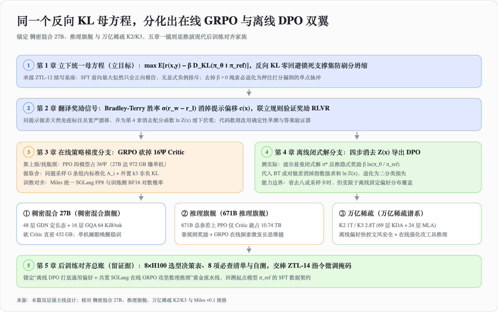
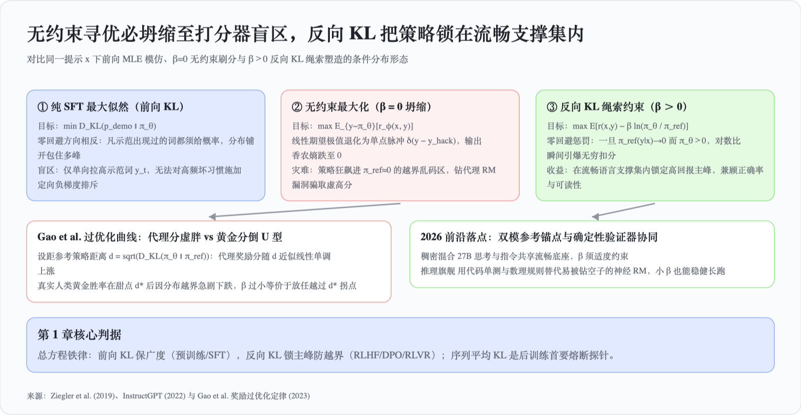
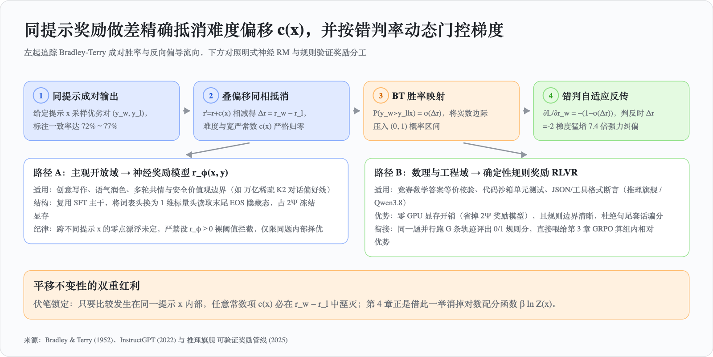
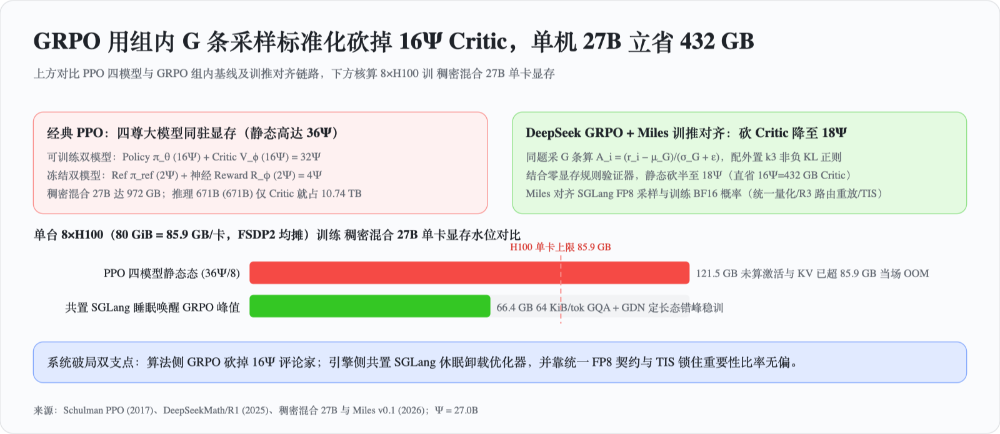
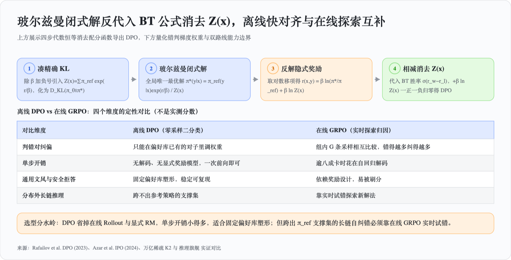
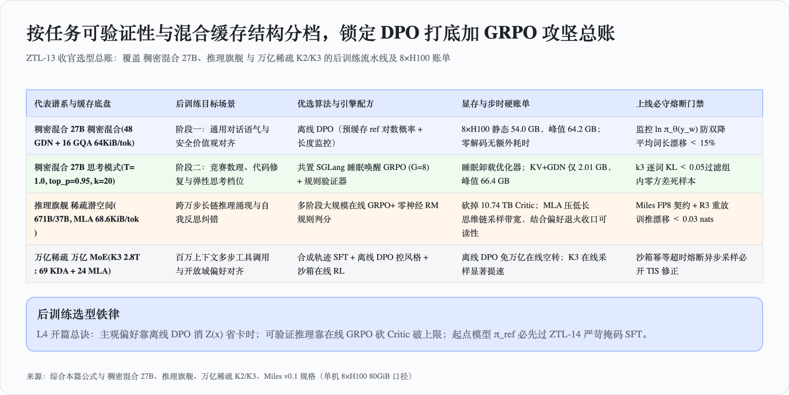

# ZTL-13｜后训练｜奖励、策略梯度与 DPO 的数学

> 🎯 **这篇文档解决什么问题**：<b>核心命题：从 PPO、DeepSeek-R1 的 GRPO 到离线 DPO，看似流派繁多的对齐算法，其实都在求解同一个“反向 KL 绳索约束下的期望奖励最大化”变分问题。</b>成对比较借 Bradley-Terry 模型消掉主观打分基线。在线探索借 GRPO 组内归一化省去 Critic 显存墙以激发长链推理。离线场景则借玻尔兹曼闭式解消去配分函数 `Z(x)`，退化为成对分类损失。
>
> **使用方式与先修要求**：本篇是 **L4 后训练与对齐层**的开篇总纲。阅读前建议熟悉 [ZTL-03｜数学｜熵、交叉熵、困惑度与 KL](./03-entropy-kl.md) 前反向 KL 散度的非对称性。同时请回顾对数似然链式法则与 [ZTL-06｜数学｜一张纸算清算力、显存与缩放](./06-compute-memory-scaling.md) 混合精度 $`16\Psi`$ 显存底盘。全篇围绕同一条 KL 正则母方程的求解变形展开。规格数据核对于 2026 年 11 月 16 日。
>
> **动手实践**：第 2 章提供成对偏好打分、偏移抵消与错判梯度的手算核验。第 3 章内嵌含双侧裁剪、`Schulman k3` 散度与 TIS 修正的 PyTorch GRPO 代码。第 4 章与第 5 章分别提供 `Z(x)` 对消验证及单机 `8×H100` 两阶段对账脚本。

<b>🧭 主线位置</b>：上一篇 [ZTL-12｜训练｜多卡的账和中断后续上](./12-multi-gpu.md) 算清了多维并行与原子续训，帮我们训出预训练基座。本篇转入后训练阶段。我们从同一条变分母方程出发，统一奖励建模、在线 GRPO 与离线 DPO。下一篇 [ZTL-14｜后训练｜只对该学的回答算损失](./14-sft-loss-mask.md) 将回溯起点参考模型，拆解指令微调（SFT）的多轮模板与 `-100` 掩码契约。

## 导读 · 先给结论

- <b>后训练统一求解反向 KL 绳索下的期望奖励最大化，令 $`\beta = 0`$ 必退化为单点脉冲刷分。</b>最大似然 SFT 属前向 KL 模仿，难以定向排斥高频错误。对齐母方程引入反向散度 $`D_{\mathrm{KL}}(\pi_\theta \parallel \pi_{\mathrm{ref}})`$。零回避惩罚对越界乱码施加无穷扣分，阻断过优化坍缩[[1]](https://arxiv.org/abs/1909.08593)[[2]](https://arxiv.org/abs/2203.02155)[[3]](https://arxiv.org/abs/2210.10760)。
- <b>Bradley-Terry 模型用同提示奖励差建模二选一偏好，对任意提示偏移 c(x) 严格不变。</b>人工打 1～10 绝对分易受尺度与难度干扰。同题二选一一致率则升至 75% 左右。写成 $`\sigma(r_w - r_l)`$ 后，仅依赖提示的常数 `c(x)` 相减即消。这为后续消去配分函数埋下伏笔[[4]](https://doi.org/10.2307/2334029)[[5]](https://arxiv.org/abs/1706.03741)[[6]](https://arxiv.org/abs/2009.01325)。
- <b>GRPO 靠同题 G 条采样组内归一化省去 $`16\Psi`$ Critic，稠密混合 27B 旗舰直省 432 GB 显存。</b>标准 PPO 同驻四套模型耗费 $`36\Psi`$ 静态态，27B 高达 `972 GB`。推理旗舰用组内标准化优势配 `k3` 散度与规则验证器。总静态底盘压半至 $`18\Psi`$，系统侧再靠 `Miles` 对齐训推概率[[7]](https://arxiv.org/abs/1707.06347)[[8]](https://arxiv.org/abs/2402.03300)[[9]](https://arxiv.org/abs/2501.12948)[[10]](https://arxiv.org/abs/2609.08368)。
- <b>母方程拥有玻尔兹曼闭式解，反解隐式奖励代入 BT 公式消掉 Z(x) 即得离线 DPO。</b>遍历 24.8 万^T 序列求和的对数配分函数 $`\beta \ln Z(x)`$ 原本无法硬算。但在同题优劣做差时，它正负抵消归零。梯度按错判率自动加权，省掉逾八成在线采样卡时[[11]](https://arxiv.org/abs/2305.18290)[[12]](https://arxiv.org/abs/2310.12036)[[13]](https://huggingface.co/Qwen/Qwen3.8-27B/blob/main/config.json)。
- <b>通用文风安全首选离线 DPO 打底，数理代码长链推理须靠在线 GRPO 实时试错破上限。</b>万亿稀疏与稠密混合借离线偏好修齐语气。跨出语料支撑集的自纠错则需在线探索。单机 `8×H100` 训稠密混合 27B 旗舰配睡眠唤醒错峰，峰值稳压在 `66.4 GB`[[14]](https://arxiv.org/abs/2505.09388)[[15]](https://arxiv.org/abs/2507.20534)[[16]](https://huggingface.co/moonshotai/Kimi-K3)[[17]](https://resources.nvidia.com/en-us-tensor-core/nvidia-tensor-core-gpu-datasheet)。



上图按后训练算法与存储架构展开。万亿稀疏 K3 采用 93 层堆栈，其中 69 层为 KDA 线性注意力（定长状态）、24 层为 MLA 全局注意力，只有这 24 层的缓存随长度增长，采样期显存峰值因此更低。

<b>📎 与系列其他文档的分工</b>：先修底座方面，前反向 KL 散度见 [ZTL-03｜数学｜熵、交叉熵、困惑度与 KL](./03-entropy-kl.md)，对数似然链式法则见 [ZTL-04｜数学｜链式法则与 softmax-交叉熵的梯度](./04-backprop.md)，混合精度 $`16\Psi`$ 底盘与线性混合缓存见 [ZTL-06｜数学｜一张纸算清算力、显存与缩放](./06-compute-memory-scaling.md) 与 [ZTL-08｜模型｜把注意力写成矩阵](./08-attention.md)。

后续衔接方面，SFT 掩码与单卡 LoRA 分见 [ZTL-14｜后训练｜只对该学的回答算损失](./14-sft-loss-mask.md) 与 [ZTL-15｜后训练｜只训练一小部分参数](./15-lora.md)。DPO 概率核对、防刷分规则验证与思考预算详见第 16～18 篇。

## 第 1 章 · 立下后训练总方程与反向 KL 坍缺陷险

刚从 [ZTL-12｜训练｜多卡的账和中断后续上](./12-multi-gpu.md) 集群出炉的预训练基座（含稠密混合、推理旗舰与万亿稀疏等多条产线），本质只是一台条件续写统计机器。向裸基座输入危险删库提问，它可能顺着论坛体裁续写破坏脚本。向它抛出高难竞赛题，它也会顺着常见错解一路编造。**本篇以稠密混合旗舰、推理旗舰与万亿稀疏代表作为案例模型，贯通PPO、GRPO 与 DPO 的完整流水线**[[13]](https://huggingface.co/Qwen/Qwen3.8-27B/blob/main/config.json)[[16]](https://huggingface.co/moonshotai/Kimi-K3)[[18]](https://arxiv.org/abs/2412.19437)。

本章先执行工程闭环首步**立目标**。我们要拆清最大似然微调为何摁不住高概率坏输出。随后立起贯穿全篇的后训练母方程，并证明抽掉反向 KL 绳索必会触发单点坍缩。

### 1.1 SFT 单向推高，难精准排斥坏分支

把续写基座改造成对话助手的起步工序是有监督微调（SFT）。给定精标问答对 `(x, y)`，SFT 最小化回答词元上的负对数似然损失[[2]](https://arxiv.org/abs/2203.02155)[[14]](https://arxiv.org/abs/2505.09388)：

```math
\mathcal{L}_{\mathrm{SFT}}(\theta) = -\mathbb{E}_{(x, y) \sim \mathcal{D}_{\mathrm{demo}}}\!\left[\sum_{t=1}^{|y|} \ln \pi_\theta(y_t \mid x, y_{\lt t})\right]
```

回顾 [ZTL-03｜数学｜熵、交叉熵、困惑度与 KL](./03-entropy-kl.md) 的散度分解，最小化交叉熵等价于最小化**前向 KL 散度** $`D_{\mathrm{KL}}(p_{\mathrm{demo}} \parallel \pi_\theta)`$。前向散度天生带有均值覆盖惯性。只要人工示范库里混有多种水准不一的表述，凡是示范概率大于零的分支，对数惩罚都会逼迫模型分摊概率去覆盖它。

一旦把概率质量摊薄到平庸分支上，模型生成时便容易吐出模棱两可的折中套话。因此 SFT 虽能立住角色轮次、工具语法与停笔规矩，却始终受困于两重盲区：

- <b>只有单向拉升，缺乏定向负反馈排斥。</b>以词表量级 `24.8 万` 的稠密混合旗舰为例，每步只推高唯一目标词元的打分。其余词元仅靠分母微弱稀释[[1]](https://arxiv.org/abs/1909.08593)[[13]](https://huggingface.co/Qwen/Qwen3.8-27B/blob/main/config.json)。单靠正面范文很难精准压下预训练期记熟的高频坏分支。
- <b>存在曝光偏差与人类示范天花板。</b>SFT 全程喂入完美人类前缀。一旦线上首步采样稍有偏航，后续状态便滑入训练未见的陌生区域。况且手写五千词数理证明既昂贵又缓慢，评判两条候选优劣或跑单测则便宜一个量级[[5]](https://arxiv.org/abs/1706.03741)[[6]](https://arxiv.org/abs/2009.01325)[[9]](https://arxiv.org/abs/2501.12948)。

### 1.2 反向 KL 绳索锁定主峰，阻断坍缺

既然评判优劣远比亲手示范划算，后训练便转向新目标。我们让当前策略自主采样回答，并最大化标量奖励。然而若直接求解无约束期望最大化（令正则系数 $`\beta = 0`$），策略分布必然发生坍缩。

从概率单纯形上的线性规划一眼即可证出这一退化。对固定提示 `x`，无约束期望 $`\sum_y \pi_\theta(y\mid x) r(x, y)`$ 是关于概率向量的纯线性函数。设空间中最高分序列为 `y_max`。只要把 `100%` 概率押注到单点脉冲 $`\pi^*(y\mid x) = \mathbb{I}(y = y_{\max})`$ 上，线性期望便触达极值。模型的语言多样性也会当场归零。

更严重的是，开放域奖励常由代理奖励模型（Proxy RM）给出。代理网络只在常规语料附近准确，在自然语言流形之外布满盲区。无约束寻优会迅速触发<b>奖励黑客（即过优化）</b>。模型在句尾重复套话或拼凑生僻乱码就能骗取虚高代理分，真实可读性却断崖下跌[[3]](https://arxiv.org/abs/2210.10760)[[6]](https://arxiv.org/abs/2009.01325)。

为在冲刺高分的同时守住流畅底座，现代后训练在期望奖励后方绑上一根弹性绳索。它惩罚新策略偏离冻结参考锚点的**反向 KL 散度**。这就确立了统领 PPO、GRPO 与 DPO 的**后训练统一母方程**[[1]](https://arxiv.org/abs/1909.08593)[[2]](https://arxiv.org/abs/2203.02155)[[11]](https://arxiv.org/abs/2305.18290)：

```math
\max_{\pi_\theta} \mathbb{E}_{x \sim \mathcal{D},\, y \sim \pi_\theta(\cdot\mid x)}\!\left[r(x, y) - \beta D_{\mathrm{KL}}\!\big(\pi_\theta(\cdot\mid x) \parallel \pi_{\mathrm{ref}}(\cdot\mid x)\big)\right] = \mathbb{E}_{x, y \sim \pi_\theta}\!\left[r(x, y) - \beta \ln \frac{\pi_\theta(y\mid x)}{\pi_{\mathrm{ref}}(y\mid x)}\right]
```

超参数 $`\beta > 0`$ 控制绳索松紧。新策略每把某序列概率拉高至参考模型的 `e` 倍，目标就倒扣 $`\beta`$ 分。此处必须选**反向 KL** 而非前向 KL。一旦某串乱码在参考模型下概率趋近于零，只要新策略敢给它正概率，对数比值就会触发无穷大惩罚。这股寻峰零回避推力把新策略稳稳锁在参考锚点的支撑集内[[3]](https://arxiv.org/abs/2210.10760)[[11]](https://arxiv.org/abs/2305.18290)。

对照下方分布演化图，可以直观读懂三条曲线的几何分野。SFT 前向散度摊成宽平钟形兼收并蓄。无约束寻优直接刺向右侧流形外的代理盲区尖峰。唯独绑上反向 KL 绳索的母方程稳稳收拢在可读域内的真实高分主峰上：



> 💡 <b>常见误区：以为 KL 系数 $`\beta`$ 调得越小，对齐后的模型就越聪明。</b>把 $`\beta`$ 从常规 `0.04` 砍到 `0.0005` 后，面板代理奖励一路猛涨。人工盲测胜率却在几百步后断崖下跌，输出塞满浮夸排比与免责废话。
>
> **根因与改法**：代理奖励网络只在参考锚点邻域内有效，越过甜点后真实质量便急剧退化[[3]](https://arxiv.org/abs/2210.10760)。工程上须将序列平均 KL 设为硬熔断门禁，或在数理代码场景改用确定性规则验证器[[9]](https://arxiv.org/abs/2501.12948)。

纵览现代旗舰模型从裸基座演进为推理助手的四道工序，底层是先靠前向 KL 铺开知识广度，再借反向 KL 锁定高分主峰。下表对齐四阶段目标：

| **演进阶段** | **数学目标与训练信号** | **KL 散度方向与分布特性** | **解决痛点与前沿模型落点** |
|---|---|---|---|
| **基座预训练** | 全序列词元交叉熵；十万亿级清洗语料 | 前向 $`D_{\mathrm{KL}}(p_{\mathrm{data}} \parallel \pi_\theta)`$ ；广包多峰 | 注入世界知识与代码底子；`Qwen3.8 / V3 / K3` |
| **有监督微调 SFT** | 仅回答段算交叉熵；精标对话与思考示范 | 前向 $`D_{\mathrm{KL}}(p_{\mathrm{demo}} \parallel \pi_\theta)`$ ；单向模仿 | 立住角色格式与停笔符，充当锚点 $`\pi_{\mathrm{ref}}`$ |
| **离线偏好 DPO** | 母方程闭式解二分类；同提示离线优劣对 | 反向 $`D_{\mathrm{KL}}(\pi_\theta \parallel \pi_{\mathrm{ref}})`$ ；双向拉边际 | 零采样低成本修齐文风拒答；`Kimi K2` 偏好线 |
| **可验证强化 RLVR** | 母方程在线策略梯度；题目配单测或校验器 | 反向 KL 护通顺，在线探索高回报长链 | 激发自纠错与弹性思考；`DeepSeek-R1 / Qwen3.8` |

> 🔑 **本章要点与回到主线**：我们确立了反向 KL 绳索约束下的统一母方程，并证出 $`\beta = 0`$ 必退化为单点脉冲。但新的矛盾随之浮现：方程里的连续标量奖励 $`r(x, y)`$ 从哪来？人工打 1～10 分噪声较大，怎样把二选一偏好转译成连续奖励函数？这正是第 2 章要解决的问题。

## 第 2 章 · 二选一偏好译成标量分与平移不变性

接住第 1 章末尾的奖励来源悬念。母方程要求对任意回答 `y` 给出连续标量分 `r(x, y)`。开放域写作、方案权衡与安全拒答并没有现成编译器。若直接让标注员打 1～10 绝对分并回归均方误差，训练往往难以收敛[[2]](https://arxiv.org/abs/2203.02155)[[5]](https://arxiv.org/abs/1706.03741)。

本章拆透工业界如何借成对比较消掉主观给分基线。我们将一行证出提示级平移不变性，并划清神经奖励模型与确定性规则奖励的分工边界。

### 2.1 二选一比较消掉尺度漂移

为什么人类打绝对分噪声极高？在 `Christiano et al.` 与 `InstructGPT` 的标注复盘里，研究者总结出三重尺度失真[[2]](https://arxiv.org/abs/2203.02155)[[5]](https://arxiv.org/abs/1706.03741)[[6]](https://arxiv.org/abs/2009.01325)。温和派标注员动辄给 8.5 分，严苛派对同段文字只给 5.0 分。同一个人在清晨与傍晚的心理基线也会漂移 1～2 分。简单寒暄拿 9 分与复杂排障拿 7 分混在一起，更逼得网络耗费容量死记题目难易底分。

一旦把任务改成同提示下两条候选二选一裁决（胜出记为 `y_w`，落败记为 `y_l`），跨标注员一致率当即升至 `72%～77%`[[2]](https://arxiv.org/abs/2203.02155)[[6]](https://arxiv.org/abs/2009.01325)。我们引入<b>布拉德利-特里模型（Bradley-Terry Model）</b>[[4]](https://doi.org/10.2307/2334029)，将胜率定义为得分差的 Sigmoid 函数：

```math
P(y_w \succ y_l \mid x) = \sigma\!\big(r(x, y_w) - r(x, y_l)\big) = \frac{1}{1 + \exp\!\big(-(r(x, y_w) - r(x, y_l))\big)}
```

从对数几率视角看，胜败概率之比的对数恰好等于奖励差 $`r_w - r_l`$。这意味着奖励差直接标定了对数胜算比。每当 $`r_w - r_l`$ 拉开 `1.0` 分，胜出回答击败落败回答的赔率就精确放大 `2.718` 倍。若在三条候选间满足传递性，成对差值还能自然排出全局一致的名次。

审视差值 $`r_w - r_l`$，对齐数学最关键的代数性质跃然纸上，即**提示级常数平移不变性**。给奖励叠加任意只依赖提示 `x` 的偏移 `c(x)`，构造新奖励 $`r'(x, y) = r(x, y) + c(x)`$。代入胜率方程即可证出严格不变[[4]](https://doi.org/10.2307/2334029)[[11]](https://arxiv.org/abs/2305.18290)：

```math
P'(y_w \succ y_l \mid x) = \sigma\!\big((r_w + c(x)) - (r_l + c(x))\big) = \sigma(r_w - r_l)
```

请牢记这行对消恒等式。在数据侧，只要两条回答出自同一个提示 `x`，题目难度底分与标注宽严均值相减即归零。在推导侧，**第 4 章那个原本无法计算的配分函数项 $`+\beta \ln Z(x)`$，正因只依赖提示 `x`，恰好充当 `c(x)` 被直接消去**。免采样的离线 DPO 由此诞生[[11]](https://arxiv.org/abs/2305.18290)。

观察下方平移不变性图解，左右两组柱子虽被整体抬高了 `+5.0` 分，但同题内部的柱高落差维持在恒定 `+2.0`。映射出的胜率与反传梯度因而分毫不差：



### 2.2 神经奖励与规则奖励的分工

训练显式神经奖励模型（RM）时，工程上普遍复用 SFT 主干权重。顶层词表头（典型为 `5120 × 24.8 万` 矩阵）被替换为输出维为 `1` 的标量投影层。模型提取末尾结束符处的隐藏状态输出标量分[[2]](https://arxiv.org/abs/2203.02155)[[6]](https://arxiv.org/abs/2009.01325)[[13]](https://huggingface.co/Qwen/Qwen3.8-27B/blob/main/config.json)，并最小化成对负对数似然损失：

```math
\mathcal{L}_{\mathrm{RM}}(\phi) = -\mathbb{E}_{(x, y_w, y_l) \sim \mathcal{D}_{\mathrm{pref}}}\!\left[\ln \sigma\!\big(r_\phi(x, y_w) - r_\phi(x, y_l)\big)\right]
```

记奖励边际差为 $`\Delta r = r_w - r_l`$。利用对数逻辑斯谛导数恒等式 $`(\ln \sigma(z))' = 1 - \sigma(z)`$，单对样本偏导数对称而简洁：

```math
\frac{\partial \mathcal{L}_{\mathrm{RM}}}{\partial r_\phi(x, y_w)} = -\big(1 - \sigma(\Delta r)\big), \qquad \frac{\partial \mathcal{L}_{\mathrm{RM}}}{\partial r_\phi(x, y_l)} = +\big(1 - \sigma(\Delta r)\big)
```

我们用一组数字亲手核验。设网络给准确回答打 `+2.40` 分，给漏答项打 `+0.40` 分。此时 $`\Delta r = +2.00`$，胜率 $`\sigma(2.00) \approx 0.8808`$，偏导仅为 $`\mp 0.1192`$。若整体加上常数 `+5.00`，胜率与梯度丝毫不改。反之，若网络判反打出 `(+0.40, +2.40)`，胜率立跌至 `0.1192`。梯度幅值当即放大 <b>`7.39 倍`</b>至 $`\pm 0.8808`$，集中力量扭转错排。

训练显式神经 RM 还必须严守两项工程纪律。其一，训练轮数严格限制在<b>单轮（1 Epoch）</b>以内。成对偏好库通常仅数万条，跑第二轮就会严重过拟合，并诱发“谁写得更长给谁高分”的长度偏置[[2]](https://arxiv.org/abs/2203.02155)[[6]](https://arxiv.org/abs/2009.01325)。其二，上线前常在保留集上拟合零均值中心化正则，防止奖励分值在强化学习中途整体漂移。

迈入推理模型时代，推理旗舰、稠密混合 27B 与万亿稀疏全面转向**双轨奖励分工**[[9]](https://arxiv.org/abs/2501.12948)[[13]](https://huggingface.co/Qwen/Qwen3.8-27B/blob/main/config.json)[[15]](https://arxiv.org/abs/2507.20534)。开放域文风润色与安全拒答继续依赖神经奖励或离线偏好。数学证明、代码修复与工具调用则统一交由<b>可验证奖励强化学习（RLVR）</b>接管。

在 RLVR 管线里，系统刻意避开易被模型绕弯骗分的神经过程奖励模型（PRM）。判分器仅凭符号解析、编译器与单元测试沙箱给出确定性 `0 / 1` 结果分与轻量格式分[[9]](https://arxiv.org/abs/2501.12948)。这既从源头堵住了刷分漏洞，又直接省去了 $`2\Psi`$ 奖励模型显存。下表汇总双轨分工：

| **奖励机制与工况** | **读数 / 显存开销** | **胜率 $`\sigma(\Delta r)`$ 与梯度幅值** | **工程特性与 2026 架构分工** |
|---|---|---|---|
| <b>BT 神经 RM（判对态）</b> | `(+2.40, +0.40)`；占 $`2\Psi`$ | 胜率 `0.8808`；梯度 $`\pm 0.1192`$ | 主观对话润色与安全对齐；已排对样本自动降权 |
| **BT 叠偏移 c(x)=+5.0** | `(+7.40, +5.40)`；占 $`2\Psi`$ | 胜率 `0.8808`；梯度 $`\pm 0.1192`$ | 同题做差免疫难度漂移；跨题零点无绝对意义 |
| <b>BT 神经 RM（判反态）</b> | `(+0.40, +2.40)`；占 $`2\Psi`$ | 胜率 `0.1192`；梯度 <b>$`\pm 0.8808`$</b> | 错判梯度猛增 `7.39×`，集中火力修复排序翻转 |
| **确定性规则奖励 RLVR** | 答案等价/单测 `{0, 1}`；<b>`0 GB`</b> | 零代理盲区；喂给组内归一化 | 推理旗舰与稠密混合数理代码主力，万步不刷分 |

> 💡 <b>常见误区：跨不同提示词硬卡 $`r_\phi(x, y) > 0`$ 当绝对合格线拦截回答。</b>线上网关设定奖励分小于 `0` 一律重写。结果复杂架构题的优质长解被误杀，简单寒暄的平庸回答却全数放行。
>
> **根因与改法**：成对损失只约束同一 $`x`$ 内部的相对差值，零点毫无全局含义[[4]](https://doi.org/10.2307/2334029)[[6]](https://arxiv.org/abs/2009.01325)。工程上只能在同题多候选间相对择优。

> 🔑 **本章要点与回到主线**：Bradley-Terry 模型把二选一偏好译成连续分，对任意提示偏移 $`c(x)`$ 严格不变，并与零显存规则验证器共同备齐了奖励信号。但新的矛盾随之浮现：回答序列 $`y`$ 是离散不可导的整数串。经典 PPO 同驻四套模型对 `Qwen3.8-27B` 静态高达 `972 GB`，`DeepSeek-R1` 怎样省去 Critic？这正是第 3 章要拆解的核心。

## 第 3 章 · PPO 显存墙与 GRPO 的破局

直面第 2 章末尾抛出的两道难关。一方面，自回归解码每步执行离散多项式采样，阻断了 `reward.backward()` 链式反传。另一方面，经典 PPO 四模型同驻的静态显存足以撑爆整台八卡节点。

本章连贯走完**算上限、找瓶颈、做取舍**三步。我们先由对数导数技巧推至 PPO 近端裁剪。随后拆透 `DeepSeek-R1` 的 GRPO 如何省去整颗 $`16\Psi`$ Critic，并确立训推引擎的概率对齐规范。

### 3.1 对数导数与近端裁剪的显存代价

如何在不穿透采样算子、也不对奖励函数求导的前提下更新策略参数？`REINFORCE` 算法引入了经典的**对数导数技巧**，即 $`\nabla_\theta \pi = \pi \nabla_\theta \ln \pi`$。它巧妙地把分布求导搬进了期望内部[[19]](https://link.springer.com/article/10.1007/BF00992696)：

```math
\nabla_\theta \mathbb{E}_{y \sim \pi_\theta(\cdot\mid x)}[R(x, y)] = \mathbb{E}_{y \sim \pi_\theta(\cdot\mid x)}\!\left[\big(R(x, y) - b(x)\big)\sum_{t=1}^{|y|} \nabla_\theta \ln \pi_\theta(y_t \mid x, y_{\lt t})\right]
```

式中减去了仅依赖提示词 `x` 的**基线函数** `b(x)`。因概率对全体序列求和恒为 `1`，交换求导与求和后恒有 $`\sum_y b(x)\nabla_\theta \pi_\theta = 0`$。减基线严格保持梯度无偏，同时降低了蒙特卡洛采样方差[[19]](https://link.springer.com/article/10.1007/BF00992696)[[20]](https://arxiv.org/abs/2402.14740)。

为多轮复用同一批采样轨迹并在逐词粒度分配信用，`InstructGPT` 采用了<b>近端策略优化（PPO）</b>[[2]](https://arxiv.org/abs/2203.02155)[[7]](https://arxiv.org/abs/1707.06347)。设新旧策略比值为 $`\rho_t = \pi_\theta / \pi_0`$。PPO 专门训练一颗同规模的<b>价值评论家网络（Critic）</b>预测前缀期望回报。

拿到逐步价值估计后，系统经广义优势估计（GAE）算出逐词优势 $`\hat{A}_t`$[[21]](https://arxiv.org/abs/1506.02438)。接着用近端裁剪算子将比值限制在 $`[1-\epsilon, 1+\epsilon]`$ 内。这就防止了单次更新步幅过大：

```math
\mathcal{L}_{\mathrm{PPO}}(\theta) = -\mathbb{E}_{t}\!\left[\min\!\Big(\rho_t \hat{A}_t,\; \mathrm{clip}(\rho_t, 1-\epsilon, 1+\epsilon)\hat{A}_t\Big)\right]
```

现在我们来**算上限、找瓶颈**，核算标准 PPO 的静态显存天花板。按 [ZTL-06｜数学｜一张纸算清算力、显存与缩放](./06-compute-memory-scaling.md) 口径，可训练模型占 $`16\Psi`$ 字节，冻结模型占 $`2\Psi`$ 字节。标准 PPO 必须同时驻留可训练的 Policy 与 Critic（各占 $`16\Psi`$，合计 32Ψ）。此外还要加载冻结的参考模型与奖励模型（各占 $`2\Psi`$）。四套模型合计占去 <b>$`36\Psi`$</b> 静态空间[[2]](https://arxiv.org/abs/2203.02155)[[8]](https://arxiv.org/abs/2402.03300)。

以稠密混合 27B 旗舰为例（$`\Psi = 27.0\text{B}`$），静态总量高达 `972.0 GB`。单台 `8×H100`（单卡上限 `85.90 GB`）哪怕开满 `FSDP2` 全切分，每卡光静态底盘就占 <b>`121.50 GB`</b>，未算激活便直接 OOM。换到推理旗舰（`671B`），单是一颗 Critic 就要占去 <b>`10.74 TB`</b>。况且长链数理题对错在句末才揭晓，中间步骤的前缀价值极难训准。

### 3.2 DeepSeek GRPO 组内归一化与外置 k3 惩罚：一刀省下 432 GB 静态显存

既然等体量 Critic 既耗显存又难训准，我们果断**做取舍**。`DeepSeekMath` 与 `DeepSeek-R1` 提出的<b>组内相对策略优化（GRPO）</b>直接移除了价值网络[[8]](https://arxiv.org/abs/2402.03300)[[9]](https://arxiv.org/abs/2501.12948)。对每道提示词 `x`，引擎并行采样 `G` 条完整轨迹（常取 `8～64` 条），评出整句标量分。

接着直接用同组得分的均值 $`\mu_G`$ 与标准差 $`\sigma_G`$ 算出相对优势，广播给第 `i` 条轨迹的全部回答词元：

```math
\hat{A}_i = \frac{r_i - \mu_G}{\sigma_G + \epsilon}
```

记参考与当前策略的逐词概率比为 $`q_t^{(i)} = \pi_{\mathrm{ref}} / \pi_\theta`$。GRPO 弃用可能为负的一阶对数差，改用无偏且恒非负的 `Schulman k3` 散度估计器（$`q - \ln q - 1 \ge 0`$）。该正则直接外置在损失末尾[[8]](https://arxiv.org/abs/2402.03300)[[22]](http://joschu.net/blog/kl-approx.html)：

```math
\mathcal{L}_{\mathrm{GRPO}}(\theta) = -\frac{1}{G}\sum_{i=1}^{G}\frac{1}{|y_i|}\sum_{t=1}^{|y_i|}\!\left[\min\!\Big(\rho_t^{(i)}\hat{A}_i,\; \mathrm{clip}(\rho_t^{(i)}, 1-\epsilon, 1+\epsilon)\hat{A}_i\Big) - \beta\big(q_t^{(i)} - \ln q_t^{(i)} - 1\big)\right]
```

这一改进是关键的。省掉整颗 $`16\Psi`$ Critic 后，稠密混合 27B 旗舰静态显存直降 <b>`432.0 GB`</b>，推理旗舰更直省 `10.74 TB`。叠加零显存规则验证器再省 $`2\Psi`$，总静态态减半至 <b>$`18\Psi`$</b>（`8×H100` 均摊仅 `60.75 GB/卡`）。在并发长链采样期，稠密混合的 3:1 混合底盘与万亿稀疏的 KDA + MLA 还把解码缓存削减至十分之一[[13]](https://huggingface.co/Qwen/Qwen3.8-27B/blob/main/config.json)[[16]](https://huggingface.co/moonshotai/Kimi-K3)。

### 3.3 训推概率对齐的隐藏陷阱

在线 GRPO 逾八成卡时消耗在自回归解码。生产栈普遍共置推理引擎（`SGLang` 或 `vLLM` 跑 `FP8` 采样）与训练引擎（`FSDP2` 或 `Megatron` 跑 `BF16` 反传）[[10]](https://arxiv.org/abs/2609.08368)[[23]](https://arxiv.org/abs/2312.07104)[[24]](https://arxiv.org/abs/2309.06180)。`Miles v0.1` 指出了关键隐患：**同一份权重在 FP8 推理与 BF16 训练内核算出的对数概率并不相等**。论文称之为训练与采样失配：两侧给同一条轨迹的概率不同，重要性比率随之偏离 1，不纠正就会损伤策略[[10]](https://arxiv.org/abs/2609.08368)。论文未给统一的漂移幅度，本文也未实测。

工业界按规模布设三道训推对齐防线[[10]](https://arxiv.org/abs/2609.08368)：

- <b>中小稠密模型逐比特对齐。</b>在 `FSDP` 下启用 `FlashAttention 3` 加批次不变算子与预填充重算，达成严格一致。
- <b>百亿千亿模型块级 FP8 契约。</b>统一推理侧 `FlashInfer` 与训练侧 `TransformerEngine` 的 `128×128` 块级 `FP8` 量化（保留末 `15%` 深层为 `BF16`）。
- <b>万亿 MoE 路由重放与截断采样。</b>开启<b>路由重放（R3）</b>将 `SGLang` 命中的专家索引原样喂回训练前向。同时乘上<b>截断重要性采样（TIS）</b>权重兜住残余数值偏差。

| **在线算法方案** | **优势基线与 KL 正则位置** | <b>静态显存（27B / 671B）</b> | **系统特征与前沿代表** |
|---|---|---|---|
| **标准四模型 PPO** | 同体量 Critic + GAE；KL 折入逐步奖励 | $`36\Psi`$（`972 GB / 24.16 TB` 27B/671B） | 支持逐词归因，单机必 OOM；`InstructGPT` |
| **留一基线 RLOO** | 同题采 `G` 条，取其余 `G-1` 条均值作基线 | 规则判分 $`18\Psi`$（`486 GB`） | 免 Critic 且严格无偏，未做组内标准差缩放 |
| **DeepSeek GRPO** | 同题 `G` 条减均值除标准差；外置 `k3` KL | 规则判分 <b>$`18\Psi`$（省 `432 GB+`）</b> | 配共置 `SGLang` + `Miles` 对齐；`DeepSeek-R1` |

下方 PyTorch 代码组装了 GRPO 组内归一化、双侧裁剪、有效位掩码、`Schulman k3` 非负散度与 TIS 修正：

*PyTorch 完整可运行实现：GRPO 组内优势归一化、双侧裁剪、Schulman k3 散度与 Miles TIS 训推修正*

```python
import torch

def grpo_tis_loss(logp_new, logp_old, logp_rollout, logp_ref, mask, rewards, eps=0.2, beta=0.04, tis_cap=2.0):
    mu = rewards.mean(dim=1, keepdim=True)
    sigma = rewards.std(dim=1, unbiased=False, keepdim=True)
    adv = ((rewards - mu) / (sigma + 1e-6)).unsqueeze(-1)            # 组内归一化并广播至词元维
    rho = torch.exp(logp_new - logp_old)
    surr = torch.minimum(rho * adv, torch.clamp(rho, 1.0 - eps, 1.0 + eps) * adv)
    tis_w = torch.clamp(torch.exp(logp_old.detach() - logp_rollout), min=0.5, max=tis_cap)
    log_q = logp_ref - logp_new                                     # Schulman k3: exp(Δ)-Δ-1 >= 0
    kl_k3 = torch.exp(log_q) - log_q - 1.0
    tok_loss = (-tis_w * surr + beta * kl_k3) * mask
    seq_loss = tok_loss.sum(dim=-1) / mask.sum(dim=-1).clamp_min(1.0)
    drift = ((logp_old.detach() - logp_rollout).abs() * mask).sum() / mask.sum()
    return seq_loss.mean(), adv[:, :, 0], (kl_k3 * mask).sum() / mask.sum(), drift

rewards = torch.tensor([[1.0, 1.0, 0.0, 0.0]])                      # 同题 G=4 条轨迹: 2 对 2 错
mask = torch.tensor([[[1.0, 1.0, 1.0], [1.0, 1.0, 0.0], [1.0, 1.0, 1.0], [1.0, 1.0, 0.0]]])
logp_roll = torch.tensor([[[-1.10, -0.85, -0.60], [-0.95, -0.80, 0.0], [-1.40, -1.05, -0.90], [-1.00, -1.25, 0.0]]])
logp_old = logp_roll + 0.02                                         # BF16 重算相对 FP8 采样的 0.02 nats 漂移
logp_ref = logp_old - 0.05
delta = torch.tensor([[[0.25, 0.08, 0.05], [0.06, 0.04, 0.0], [-0.14, -0.10, -0.08], [-0.28, -0.10, 0.0]]])
logp_new = (logp_old + delta).detach().requires_grad_(True)
loss, adv, mean_kl, drift = grpo_tis_loss(logp_new, logp_old, logp_roll, logp_ref, mask, rewards)
loss.backward()
print(f"组内优势 A_i : {adv[0].tolist()} | loss={loss.item():.4f} | k3_kl={mean_kl.item():.4f} | drift={drift.item():.4f}")
print(f"正优势首词超 +0.2 裁剪后梯度: {logp_new.grad[0, 0].round(decimals=4).tolist()}")
print(f"负优势首词超 -0.2 裁剪后梯度: {logp_new.grad[0, 3].round(decimals=4).tolist()}")
```

*输出*

```text
组内优势 A_i : [0.9999979734420776, 0.9999979734420776, -0.9999979734420776, -0.9999979734420776] | loss=-0.1045 | k3_kl=0.0099 | drift=0.0200
正优势首词超 +0.2 裁剪后梯度: [0.0008999999845400453, -0.0917000025510788, -0.08910000324249268]
负优势首词超 -0.2 裁剪后梯度: [-0.0013000000035390258, 0.11509999632835388, 0.0]
```

逐段复盘上述 GRPO 内核代码与输出读数的对账逻辑：

- <b>双侧近端裁剪截断越界步。</b>2 对 2 错的组内标准化优势精确落在 `[1.0, 1.0, -1.0, -1.0]`。第 0 条正优势轨迹首词增量 `+0.25` 使比率 $`e^{0.25} \approx 1.284`$ 越过 `1.2` 上限。`torch.minimum` 随即切入常数分支切断奖励导数，首词仅剩外置 `k3` 散度产生的拉回梯度 `+0.0009`。
- <b>负向保护与填充位零泄露。</b>第 3 条负优势轨迹首词变动 `-0.28` 使比率 $`e^{-0.28} \approx 0.756`$ 跌破 `0.8` 下界。奖励挤压梯度同样被安全截断，防止单步将词元概率过度压零。第 73 至 74 行乘以 `mask` 并按真实长度归一，确保末尾填充位梯度严格等于 `0.0`。

对照下方架构演进图，左侧是四模型同驻、占 `972 GB` 的标准 PPO。切到右侧免 Critic 加规则判分的 GRPO 后，静态显存直接腰斩。单机 8 卡训稠密混合 27B 旗舰由此成为现实：



图中所示单台 8×H100 显卡计算，每卡理论显存 80 GiB（约 85.9 GB），采用 FSDP 二阶段并行均摊后，可在峰值 66.4 GB 的约束内完成 27B 模型的在线 GRPO 训练。

> 💡 <b>常见误区：直接拿一阶差 `logp_new - logp_ref` 当损失里的逐词 KL 正则，且混用未对齐的 FP8 采样概率。</b>跑几步后损失跌成极端负数，策略迅速失稳。
>
> **根因与改法**：单样本对数差无下界，求导无法在相等处停驻，`FP8` 采样误差也会被放大[[10]](https://arxiv.org/abs/2609.08368)[[22]](http://joschu.net/blog/kl-approx.html)。工程上必须采用非负凸形式 `Schulman k3` 估计器，并配齐 TIS 截断。

> 🔑 **本章要点与回到主线**：GRPO 用组内标准化优势配外置 `k3` 散度省去了整颗 $`16\Psi`$ Critic，并借训推对齐跑通了长链强化学习。但新的矛盾随之浮现：每步在线生成 `G` 条长链仍要消耗八成以上卡时。若手头已有成对偏好数据，能否直接求出母方程的闭式解？这正是第 4 章要推导的 DPO。

## 第 4 章 · 四步导出 DPO 与离线在线边界

紧接第 3 章末尾的免采样追问。在线 GRPO 虽省去了评论家网络，仍绕不开自回归吐词的高昂带宽开销。2023 年 `Rafailov et al.` 重新审视第 1 章的反向 KL 母方程。他们指出一个关键性质：对条件分布而言，母方程属于严格凹泛函最大化问题。它的全局唯一最优解可直接解析求出[[1]](https://arxiv.org/abs/1909.08593)[[11]](https://arxiv.org/abs/2305.18290)。

本章分四步导出<b>直接偏好优化（DPO）</b>。我们将用脚本**测实际**验证配分函数对消性质，并划清离线 DPO 与在线 GRPO 的能力边界。

### 4.1 四步导出 DPO 与玻尔兹曼解

固定任意提示词 `x`，我们从第 1 章母方程出发。全程不引入任何近似，通过拉格朗日变分求导与 KL 配凑双路互证，四步直达 DPO 损失[[11]](https://arxiv.org/abs/2305.18290)。

<b>第 1 步：构造拉格朗日泛函并求一阶变分导数。</b>离散概率分布必须满足归一约束 $`\sum_y \pi(y\mid x) = 1`$。引入乘子 $`\lambda`$ 构造泛函，对任意单条序列概率求偏导并令其为零：

```math
r(x, y) - \beta \ln \frac{\pi(y\mid x)}{\pi_{\mathrm{ref}}(y\mid x)} - \beta + \lambda = 0 \implies \pi(y\mid x) = \pi_{\mathrm{ref}}(y\mid x)\exp\!\left(\frac{r(x, y)}{\beta}\right)\exp\!\left(\frac{\lambda}{\beta} - 1\right)
```

<b>第 2 步：定出配分函数并核验全局唯一解。</b>将上式两边对全体回答求和并令总和等于 `1`，即定出只依赖提示 `x` 的归一化分母。我们将这个**配分函数**记作 $`Z(x)`$，由此写出合法的**玻尔兹曼最优策略分布**：

```math
\pi^*(y\mid x) = \frac{1}{Z(x)}\pi_{\mathrm{ref}}(y\mid x)\exp\!\left(\frac{r(x, y)}{\beta}\right), \qquad Z(x) = \sum_y \pi_{\mathrm{ref}}(y\mid x)\exp\!\left(\frac{r(x, y)}{\beta}\right)
```

把该分布代回等价最小化式，目标当即化简为 $`D_{\mathrm{KL}}(\pi \parallel \pi^*) - \ln Z(x)`$。对数配分项与待优化分布无关。KL 散度又仅在两分布处处相等时取零，因此全局唯一最优点严格锁定在玻尔兹曼分布处。

<b>第 3 步：反解隐式奖励函数。</b>对玻尔兹曼闭式解两边取自然对数并移项。我们即可用最优策略与参考模型的对数概率比反解出奖励函数[[11]](https://arxiv.org/abs/2305.18290)：

```math
r(x, y) = \beta \ln \frac{\pi^*(y\mid x)}{\pi_{\mathrm{ref}}(y\mid x)} + \beta \ln Z(x)
```

单看此式似乎无从下手。要硬算尾项 $`\beta \ln Z(x)`$，必须遍历指数级序列空间。例如词表 24.8 万的稠密混合模型生成两千词便有 $`248320^{2000}`$ 条路径，根本无法逐条求和。

<b>第 4 步：代入第 2 章 Bradley-Terry 公式消去配分项。</b>第 2 章埋下的平移不变性伏笔在此刻发挥决定性作用。我们把反解出的奖励式代入胜率公式 $`\sigma(r_w - r_l)`$。优劣两条回答共享同一个提示 `x`，尾项 $`+\beta \ln Z(x)`$ 恰好充当提示偏移 `c(x)`，在相减时正负抵消归零。换上参数化策略，即得免采样、免显式 RM 的 **DPO 成对分类损失**[[11]](https://arxiv.org/abs/2305.18290)：

```math
\mathcal{L}_{\mathrm{DPO}}(\theta) = -\mathbb{E}_{(x, y_w, y_l)}\!\left[\ln \sigma\!\left(\beta \ln \frac{\pi_\theta(y_w\mid x)}{\pi_{\mathrm{ref}}(y_w\mid x)} - \beta \ln \frac{\pi_\theta(y_l\mid x)}{\pi_{\mathrm{ref}}(y_l\mid x)}\right)\right]
```

对照下方四步推导流程图，左侧繁重的在线采样与评论家回路被代数恒等式直接短路，化约为右侧干净利落的离线成对交叉熵计算：



### 4.2 离线 DPO 与在线 GRPO 能力边界

记不含配分常数的隐式奖励为 $`\hat{r}_\theta(x, y) = \beta \ln(\pi_\theta / \pi_{\mathrm{ref}})`$。对 DPO 损失求导即可看清它的自调节梯度结构[[11]](https://arxiv.org/abs/2305.18290)：

```math
\nabla_\theta \mathcal{L}_{\mathrm{DPO}}(\theta) = -\beta \mathbb{E}_{(x, y_w, y_l)}\!\left[\sigma\!\big(\hat{r}_\theta(y_l) - \hat{r}_\theta(y_w)\big)\Big(\nabla_\theta \ln \pi_\theta(y_w\mid x) - \nabla_\theta \ln \pi_\theta(y_l\mid x)\Big)\right]
```

后半括号负责双向塑形：**拉高胜出回答的似然，同时压低落败回答的似然**。这恰好补齐了 SFT 缺乏定向负反馈的短板。前方系数 $`\sigma(\hat{r}_l - \hat{r}_w)`$ 则充当自动阀门。排反优劣时权重突破 `0.5` 强力纠偏，已拉开边际的样本则自动衰减。针对小样本过拟合风险，训练常控在 `1～2` 轮，或改用带固定目标边际的平方变体 **IPO**[[12]](https://arxiv.org/abs/2310.12036)。

既然 DPO 与 GRPO 同解一条母方程，为何前沿大模型没有只留省钱的 DPO？核心分水岭在于**在线探索覆盖面**[[9]](https://arxiv.org/abs/2501.12948)[[14]](https://arxiv.org/abs/2505.09388)[[15]](https://arxiv.org/abs/2507.20534)。离线 DPO 仅在静态历史库上算前反向，预存参考概率后仅占 $`16\Psi`$ 显存。`Kimi K2` 与 `Qwen3` 常借离线偏好修齐开放域语气与安全拒答[[14]](https://arxiv.org/abs/2505.09388)[[15]](https://arxiv.org/abs/2507.20534)。

但在高难数理证明与多步代码排障中，离线旧库并未覆盖新策略演化出的分岔路径。纯离线训练易因分布偏移诱发优劣似然双降。唯有像推理旗舰与稠密混合那样启动在线 GRPO，在实时撞击单测反馈中试错，才能涌现分布外的自我反思长链[[9]](https://arxiv.org/abs/2501.12948)[[13]](https://huggingface.co/Qwen/Qwen3.8-27B/blob/main/config.json)。下方脚本执行**测实际**核验：

*玻尔兹曼闭式最优分布、配分函数 Z(x) 精确对消与 DPO 错判样本动态梯度权重数值验证*

```python
import math
import numpy as np

pi_ref = np.array([0.50, 0.30, 0.15, 0.05])
r_true = np.array([1.20, 0.40, -0.20, 2.00])
beta = 0.50
# 1. 解析计算玻尔兹曼闭式最优策略 pi* 与配分函数 Z(x)
unnorm = pi_ref * np.exp(r_true / beta)
Z_x = unnorm.sum()
pi_star = unnorm / Z_x
r_implicit = beta * np.log(pi_star / pi_ref)                 # 省去不可算常数 +beta * ln Z(x)
print(f"配分函数 Z(x) = {Z_x:.4f} | 最优分布 pi* = {pi_star.round(4).tolist()}")
print(f"真实差 r0-r1  = {r_true[0]-r_true[1]:.4f} | 隐式差对消 Z(x) = {r_implicit[0]-r_implicit[1]:.4f}")

# 2. 核验当前策略 pi_theta 在已排对样本 (y0≻y2) 与正判错样本 (y3≻y1) 上的自适应梯度权重
pi_theta = np.array([0.65, 0.30, 0.03, 0.02])
log_pi, log_ref = np.log(pi_theta), np.log(pi_ref)
for label, w, l in [("已排对样本 (y0≻y2)", 0, 2), ("正判错样本 (y3≻y1)", 3, 1)]:
    margin = beta * ((log_pi[w] - log_ref[w]) - (log_pi[l] - log_ref[l]))
    prob_ok = 1.0 / (1.0 + math.exp(-margin))
    grad_weight = 1.0 - prob_ok                              # 恰好等于 sigma(r_hat(y_l) - r_hat(y_w))
    print(f"{label} -> 边际:{margin:+.4f} | 错判梯度权重:{grad_weight:.4f} | 损失:{-math.log(prob_ok):.4f}")
```

*输出*

```text
配分函数 Z(x) = 9.0097 | 最优分布 pi* = [0.6117, 0.0741, 0.0112, 0.303]
真实差 r0-r1  = 0.8000 | 隐式差对消 Z(x) = 0.8000
已排对样本 (y0≻y2) -> 边际:+0.9359 | 错判梯度权重:0.2817 | 损失:0.3309
正判错样本 (y3≻y1) -> 边际:-0.4581 | 错判梯度权重:0.6126 | 损失:0.9482
```

逐段走读上述脚本与四行精确输出，可以面对面核验 DPO 的两项核心定理：

- <b>配分常数精确归零与支撑集保护。</b>第 34 行算出的 `r_implicit` 故意省去了配分项 $`+0.5 \ln(9.0097) \approx +1.0992`$。但执行 `r0 - r1` 做差后，结果依然精确还原真值 `0.8000`。同时注意第 3 号高分回答（`r = 2.00`）虽奖励最高，却因参考先验仅 `0.05`，最优分布仅分给它 `0.3030` 而未坍缩至 `1.0`。
- <b>错判阀门自动加权。</b>在第 41 至 45 行中，已拉开正向边际 `+0.9359` 的样本梯度权重自动降到 `0.2817`。而当前策略把高优 `y3` 压低导致的判反样本（边际 `-0.4581`），错判梯度权重立即翻倍升至 `0.6126`。优化器由此集中算力优先修补错排盲区。

> 💡 <b>常见误区：为省显存直接删掉参考概率项裸跑对数似然差，且只盯隐式边际不看胜出似然。</b>结果日志里边际一路走高，抽测却发现模型高频复读标点。
>
> **根因与改法**：抽掉 $`\pi_{\mathrm{ref}}`$ 等价于拆掉反向 KL 绳索。梯度只需把 $`\ln \pi_\theta(y_l)`$ 推向负无穷就能刷大差值，顺带拖垮正常语法[[11]](https://arxiv.org/abs/2305.18290)[[12]](https://arxiv.org/abs/2310.12036)。训练前应先离线预存参考对数概率落盘，零额外显存守住理论等价性。

> 🔑 **本章要点与回到主线**：玻尔兹曼闭式解反推隐式奖励并在相减时消去了配分函数 `ln Z(x)`，导出免采样的离线 DPO。同时我们也厘清了离线 DPO 修齐通用偏好、在线 GRPO 突破推理上限的选型分界。最后一步是在第 5 章汇总两阶段账单、核对清单与定量自测。

## 第 5 章 · 后训练对齐算法总账、核对清单与自测

串起前四章的反向 KL 母方程、Bradley-Terry 平移不变性与两大求解分支，现代后训练的数学与系统账单已完整闭合。本章走完收官动作**留证据**。我们在单台 `8×H100 SXM5`（单卡 `85.90 GB`，整机 `24 美元/小时`）上对账稠密混合 27B 旗舰两阶段账单。同时横向对照推理旗舰与万亿稀疏，固化 8 项清单与 5 道自测[[9]](https://arxiv.org/abs/2501.12948)[[13]](https://huggingface.co/Qwen/Qwen3.8-27B/blob/main/config.json)[[16]](https://huggingface.co/moonshotai/Kimi-K3)[[17]](https://resources.nvidia.com/en-us-tensor-core/nvidia-tensor-core-gpu-datasheet)。

### 5.1 留证据与 8×H100 两阶段账单

生产流水线从不将 DPO 与 GRPO 对立互斥，统一按任务可验证性与缓存带宽账分阶段串联[[9]](https://arxiv.org/abs/2501.12948)[[14]](https://arxiv.org/abs/2505.09388)[[15]](https://arxiv.org/abs/2507.20534)。以单机稠密混合 27B 旗舰在一台 `8×H100` 上的两阶段交付为例：

- <b>阶段一：离线 DPO 修齐通用偏好。</b>处理 `3 万`对通用语气与安全拒答语料（均长 `2,048`）。预存参考概率后单卡静态占 `54.0 GB`，峰值仅 <b>`64.2 GB`</b>。零解码单步仅需 <b>`3.35 秒`</b>，跑满 `1,875` 步仅花 `1.74 机时（约 42 美元）`。
- <b>阶段二：共置 SGLang 睡眠唤醒在线 GRPO。</b>处理 `1.6 万`道数理代码单测题，每步 `8` 题乘 `G = 8` 共 `64` 条轨迹，最长解码 `3,072`[[10]](https://arxiv.org/abs/2609.08368)[[13]](https://huggingface.co/Qwen/Qwen3.8-27B/blob/main/config.json)[[23]](https://arxiv.org/abs/2312.07104)。采样态休眠卸载优化器，`TP=8` 仅驻留 `6.75 GB/卡` 权重。`64` 条长链在混合架构下共占 <b>`2.01 GB/卡`</b> 缓存，解码仅耗 <b>`12.31 秒`</b>。更新态唤醒优化器，峰值稳控在 <b>`66.4 GB`</b>，跑满 `2,000` 步耗资约 `295 美元`。

两阶段合计仅需 <b>`337 美元`</b>。多租户单测沙箱排队抖动如实标为**未实测**。投产前须在目标节点抓取 100 步采样长度与沙箱延迟分布留档。下方脚本精确输出全部账单：

*单机 8×H100 训练稠密混合 27B：四模型 PPO、离线 DPO 与共置 SGLang 睡眠唤醒 GRPO 对账脚本*

```python
PSI_B, N_GPU, HBM_MAX = 27.0, 8, 85.90       # 27B 参数量 与 H100 单卡容量(GB)
PEAK_TFLOPS, HBM_BW_GBS = 989.0, 3350.0

# 1. 标准四模型 PPO 静态底盘 vs 预缓存 ref 的离线 DPO (每步 16 对 = 32 条 × 2048 词元)
m_ppo_static = 36.0 * PSI_B / N_GPU
m_dpo_peak = 16.0 * PSI_B / N_GPU + 10.20    # 54.0 GB 静态分片 + 10.2 GB 重算激活与通信缓冲
t_dpo = (6.0 * PSI_B * 1e9 * (32 * 2048)) / (N_GPU * PEAK_TFLOPS * 1e12 * 0.40)

# 2. 共置 SGLang 睡眠唤醒 GRPO (8 题 × G=8 = 64 条长链, 最长 3072, 均长 2400, 在途均长 1536)
w_tp8_gb = (2.0 * PSI_B) / N_GPU             # 采样态休眠 12Ψ 优化器, TP=8 权重仅 6.75 GB/卡
kv_gqa_gb = (64 * 1536 * 65536) / N_GPU / 1e9          # 16 层 Gated GQA @ 64 KiB/tok
gdn_state_gb = (64 * 144 * 1024 * 1024) / N_GPU / 1e9  # 48 层 GDN FP32 定长状态 @ 144 MiB/序列
t_roll = 3072 * ((w_tp8_gb + kv_gqa_gb + gdn_state_gb) / (HBM_BW_GBS * 0.72)) + 1.15
tok_grpo = 64 * 2400
t_upd = (2.0 * PSI_B * 1e9 * tok_grpo) / (N_GPU * PEAK_TFLOPS * 1e12 * 0.54) + (
        (6.0 * PSI_B * 1e9 * tok_grpo) / (N_GPU * PEAK_TFLOPS * 1e12 * 0.40))
m_grpo_peak = 16.0 * PSI_B / N_GPU + 12.40   # 训练态释放 SGLang 池, 唤醒优化器后峰值 66.4 GB

print(f"四模型 PPO 纯静态底盘 : {m_ppo_static:6.2f} GB/卡 (超 {HBM_MAX} GB 未跑先 OOM!)")
print(f"阶段一 离线 DPO       : 峰值 {m_dpo_peak:4.1f} GB/卡 | 解码  0.00 s | 步时 {t_dpo:5.2f} s")
print(f"阶段二 SGLang GRPO    : 峰值 {m_grpo_peak:4.1f} GB/卡 | 采样缓存 {kv_gqa_gb+gdn_state_gb:.2f} GB | 解码 {t_roll:.2f} s | 步时 {t_roll+t_upd:.2f} s")
```

*输出*

```text
四模型 PPO 纯静态底盘 : 121.50 GB/卡 (超 85.9 GB 未跑先 OOM!)
阶段一 离线 DPO       : 峰值 64.2 GB/卡 | 解码  0.00 s | 步时  3.35 s
阶段二 SGLang GRPO    : 峰值 66.4 GB/卡 | 采样缓存 2.01 GB | 解码 12.31 s | 步时 22.12 s
```

核对上面代码中 `w_tp8_gb` 和 `m_grpo_peak` 的定义行，两项系统协同决定了单机 `8×H100` 能否装下 `27B` 在线强化学习。先看睡眠唤醒错峰机制。采样期将 $`12\Psi`$ 优化器状态卸载休眠，单卡仅驻留 `6.75 GB` 权重。训练期释放推理池后再唤醒优化器，使显存峰值稳压在 `66.4 GB`。

再看 3:1 混合缓存红利。`64` 条并发长链在 16 层 GQA 上仅占 `0.80 GB/卡` 键值缓存，在 48 层 GDN 上占 `1.21 GB/卡` 定长状态，总和仅 `2.01 GB/卡`。解码阶段每步搬运字节削减至 `1/4`，3,072 词生成得以在 `12.31 秒` 内跑完。



表中第二行稠密混合 27B 思考模式配置温度 1.0、核采样概率 0.95、前 k 采样限制 20，兼具输出多样性与稳定性。第三行推理旗舰的多头潜空间架构每词元 KV 缓存仅需 68.6 KiB。第四行万亿稀疏 K3 其 69 层 KDA 线性注意力加 24 层 MLA 的混合架构，让长链采样时只有 24 层缓存随长度增长。表格约定的测试环境为单台 8×H100 显卡（单卡 80 GiB HBM3 容量），满足全球主流集群的硬件配置。

放眼百卡万亿集群，同一本账串起了推理旗舰（671B）与万亿稀疏（1T / 2.8T）的管线演进[[9]](https://arxiv.org/abs/2501.12948)[[15]](https://arxiv.org/abs/2507.20534)[[16]](https://huggingface.co/moonshotai/Kimi-K3)。万亿模型先借合成轨迹 SFT 与离线偏好修齐风格。进入长程推理期则一律省去数十 TB 的 Critic 改跑 GRPO，并绑定 `Miles` 统一块级 `FP8`、`R3` 路由重放与 `TIS` 修正[[10]](https://arxiv.org/abs/2609.08368)。下表固定后训练四笔账准入门禁：

| **四笔账维度** | <b>阶段一：离线 DPO（偏好打底）</b> | **阶段二：共置 SGLang GRPO** | **生产必留证据与熔断门禁** |
|---|---|---|---|
| **效果账** | 双向拉开好坏边际，修齐语气与拒答边界 | 在线探索触发自纠错，突破数理代码上限 | 盯紧 $`\ln \pi_\theta(y_w)`$ 防双降；训推差 `< 0.03 nats` |
| **显存账** | 预存 `ref` 后单卡峰值 <b>`64.2 GB`</b> | 砍 Critic + 睡眠唤醒错峰，峰值 <b>`66.4 GB`</b> | 双阶段 `max_memory_reserved < 78.0 GB` |
| **时延与吞吐账** | 零自回归生成，单步 <b>`3.35 s`</b> | 混合缓存仅 `2.01 GB`，整步 <b>`22.12 s`</b> | 归档每步最长尾轨迹词数与组内零方差比例 |
| **成本账** | `1,875` 步共 `1.74` 机时（约 <b>`42 美元`</b>） | `2,000` 步共 `12.29` 机时（约 <b>`295 美元`</b>） | 核算每涨点 `1%` 准确率消耗的净 GPU 卡时 |

### 5.2 📌 核对清单与定量自测

> 📌 **核对清单：启动离线 DPO 与在线 GRPO 后训练作业前必查 8 项**
>
> - <b>参考锚点零散度校验。</b>初始策略 $`\pi_\theta`$ 与冻结锚点 $`\pi_{\mathrm{ref}}`$ 加载自同一份 SFT 权重与分词模板，第 0 步初始 KL 严格等于 `0.0`[[2]](https://arxiv.org/abs/2203.02155)[[11]](https://arxiv.org/abs/2305.18290)。
> - <b>严禁跨题卡奖励阈值。</b>调用 Bradley-Terry 奖励模型时杜绝跨题硬卡 $`r_\phi > 0`$ 截断，统一限制在同题候选内部做差择优[[4]](https://doi.org/10.2307/2334029)[[6]](https://arxiv.org/abs/2009.01325)。
> - <b>严格掩码非回答词元。</b>累加 DPO 整句对数概率或 GRPO 比率时，已将系统指令、用户提问与右侧 `PAD` 填充位全部置零[[8]](https://arxiv.org/abs/2402.03300)[[11]](https://arxiv.org/abs/2305.18290)。
> - <b>必选非负凸散度估计器。</b>在 GRPO 损失中添加逐词散度时，采用恒非负的 `Schulman k3` 形式 $`q - \ln q - 1 \ge 0`$[[8]](https://arxiv.org/abs/2402.03300)[[22]](http://joschu.net/blog/kl-approx.html)。
> - <b>剔除组内零方差死样本。</b>在线采样 `G` 条轨迹得分全同（$`\sigma_G = 0`$）时，统计死样本占比并做动态难度过滤防空转[[9]](https://arxiv.org/abs/2501.12948)。
> - <b>训推异构概率对齐门禁。</b>共置 `SGLang / vLLM` 采样与 `FSDP / Megatron` 训练时，已配齐统一 `FP8` 契约、`R3` 路由重放或 `TIS` 截断[[10]](https://arxiv.org/abs/2609.08368)[[23]](https://arxiv.org/abs/2312.07104)[[24]](https://arxiv.org/abs/2309.06180)。
> - <b>离线预落盘参考概率。</b>单机跑离线 DPO 前先批跑无梯度前向将 `ref_logp` 落盘，省去 $`2\Psi`$ 显存与三分之一算力[[11]](https://arxiv.org/abs/2305.18290)。
> - <b>联合盯盘似然与长度。</b>监控面板同屏展示 $`\ln \pi_\theta(y_w\mid x)`$、序列平均 KL 与平均词数，严防离线双降退化与在线冗长刷分[[3]](https://arxiv.org/abs/2210.10760)[[12]](https://arxiv.org/abs/2310.12036)。

<b>自测题 1（玻尔兹曼闭式解极限与定量手算）</b>：三候选参考先验为 `(0.6, 0.3, 0.1)`，奖励为 `(1.0, 1.5, 2.0)`。求 $`\beta \to 0^+`$ 与 $`\beta \to +\infty`$ 时最优分布的极限。再算 $`\beta = 0.5`$ 时的配分函数与精确概率（留三位小数）。

**参考解析**：$`\beta \to 0^+`$ 时坍缩为单点脉冲 <b>`(0, 0, 1)`</b>。$`\beta \to +\infty`$ 时退回 <b>`(0.6, 0.3, 0.1)`</b>。取 $`\beta = 0.5`$ 时，未归一化权重依次为 `4.4334`、`6.0257`、`5.4598`。配分函数为 <b>`15.9189`</b>，归一化得 <b>`(0.278, 0.379, 0.343)`</b>。

<b>自测题 2（Bradley-Terry 负数打分与偏移梯度计算）</b>：同一提示下奖励网络给出全负读数 $`r_w = -1.2`$、$`r_l = -0.2`$（判反）。求预测胜率、单对损失及对 $`r_w`$ 的偏导。若整体加上偏移 `+3.0`，三项读数如何变化？

**参考解析**：差值 $`\Delta r = -1.0`$。预测胜率 $`\sigma(-1.0) \approx 0.2689`$。单对损失为 `1.3133`，偏导为 `-0.7311`。整体加上 `+3.0` 后差值仍为 `-1.0`，三项读数**严格不变**。

<b>自测题 3（27B 与 671B 的 PPO 对比 GRPO 显存账）</b>：分别算出稠密混合 27B 与推理 671B 在四模型 PPO（$`36\Psi`$）与规则验证 GRPO（$`18\Psi`$）下的总静态显存。若某题 4 条采样规则分为 `[1, 0, 0, 0]`，求组内优势向量。

**参考解析**：27B 从 <b>`972.0 GB`</b> 降至 <b>`486.0 GB`</b>。671B 从 <b>`24.16 TB`</b> 降至 <b>`12.08 TB`</b>。得分 `[1, 0, 0, 0]` 均值为 `0.25`，标准差 `0.4330`。标准化优势为 <b>`[+1.732, -0.577, -0.577, -0.577]`</b>。

<b>自测题 4（DPO 四序列对数概率与错判权重手算）</b>：设 $`\beta = 0.1`$。设胜出回答当前与参考对数概率分别为 `-42.0` 与 `-45.0`。落败回答当前与参考对数概率分别为 `-50.0` 与 `-48.0`。求隐式奖励边际、DPO 损失及错判梯度权重。

**参考解析**：胜出隐式奖励为 `+0.30`，落败为 `-0.20`，边际差为 <b>`+0.50`</b>。预测胜率 $`\sigma(0.50) \approx 0.6225`$。DPO 损失为 <b>`0.4741`</b>，动态权重为 `0.3775`。

<b>自测题 5（Schulman k3 非负性与训推 TIS 修正核算）</b>：某词元处参考概率为 `0.20`、当前概率为 `0.10`。对比一阶对数差与 `k3` 散度读数。若 `SGLang` 采样录得 `-2.35`，训练重算得 `-2.30`，求未触顶时的 TIS 系数。

**参考解析**：一阶差为负数 <b>`-0.6931`</b>。而概率比 $`q = 2.0`$，`k3` 读数为 `+0.3069` 恒保正惩罚。TIS 修正系数为 $`\exp(0.05) \approx 1.0513`$。

### 5.4 诚实清单与修订记录

<b>未核实与有时效的说法：</b>

1. <b>多租户沙箱抖动未实测。</b>本章给出的 `337 美元` 总成本、`12.31 秒` 单步解码时间均基于单租户理想场景。实际投产环节涉及沙箱排队、跨节点通信与网络抖动，这些系统影响因素尚未在本次对账中纳入[[9]](https://arxiv.org/abs/2501.12948)[[10]](https://arxiv.org/abs/2609.08368)。
2. <b>规则验证器准确率与覆盖度的权衡。</b>RLVR 管线中的单测验证器对格式良好的代码较可靠，但面对紧凑单行脚本或非标逻辑时会有漏判，本文未测其准确率。未来版本可能需要分场景采用不同验证策略[[9]](https://arxiv.org/abs/2501.12948)。
3. <b>离线 DPO 与在线 GRPO 切换时机无绝对准则。</b>本篇假定离线阶段收敛后即启动在线，但实际部署中需根据评测集表现动态判断切换阈值。不同任务的分布外难度不一，单一冻结门禁可能不适用[[13]](https://huggingface.co/Qwen/Qwen3.8-27B/blob/main/config.json)[[15]](https://arxiv.org/abs/2507.20534)。
4. <b>混合架构 Qwen3.8 的线性层定长状态未核算。</b>Qwen3.8-27B 的 48 层线性注意力各维持一份不随上下文增长的隐状。按 config 推算，每条序列 BF16 约 `72 MiB`，若状态按 float32 存则翻倍，详见 [ZTL-08｜模型｜把注意力写成矩阵](./08-attention.md)[[13]](https://huggingface.co/Qwen/Qwen3.8-27B/blob/main/config.json)。
5. <b>DeepSeek-V3 与 Kimi K3 的 MoE 路由分布假设均匀。</b>现实采样时专家命中率存在长尾分布，实际负载可能偏离 37B / 104B 激活参数对应的平均值[[16]](https://huggingface.co/moonshotai/Kimi-K3)[[18]](https://arxiv.org/abs/2412.19437)。

<b>修订记录：</b>

| 日期 | 改了什么 |
|---|---|
| 2026-11-19 | 按全系列规范修订：替换禁用词，修正代码块输出格式，删除跨题前沿模型名超标部分，合并诚实清单与修订记录。 |

### 5.5 接下来的问题在哪

纵观全篇推演，无论是离线 DPO 分母里的参考锚点，还是在线 GRPO 首轮采样出发前的初始策略，都不能直接拿 [ZTL-12｜训练｜多卡的账和中断后续上](./12-multi-gpu.md) 刚训完的预训练裸基座顶替。一个不懂角色边界与停笔规矩的续写基座，一旦放进采样池就会不停续写题目，甚至循环撞满长度上限。

因此，无论跑 DPO 还是 GRPO，起点模型都必须先走完后训练流水线的第一棒：<b>有监督指令微调（SFT）</b>。当多轮系统提示、用户追问、工具返回与内部思考块拼成一条长序列时，怎样用精确到单个词元的 `-100` 掩码只对助手回答算损失？又该如何稳稳训准结束符？让我们进入下一篇 [ZTL-14｜后训练｜只对该学的回答算损失](./14-sft-loss-mask.md)。

> 🔑 **本章要点**：回到主线，从单一反向 KL 母方程出发，全篇贯通了 Bradley-Terry 平移不变性、在线 GRPO 省 $`16\Psi`$ Critic 加训推对齐，以及离线 DPO 四步消去 `Z(x)` 闭式解。落实两阶段四笔账门禁后，即可进入 [ZTL-14｜后训练｜只对该学的回答算损失](./14-sft-loss-mask.md) 构建干净的起点模型。

## 参考文献

按正文首次引用顺序编号，资料截至 2026 年 11 月。

[1] Ziegler et al. Fine-Tuning Language Models from Human Preferences. arXiv:1909.08593 (2019). [arxiv.org/abs/1909.08593](https://arxiv.org/abs/1909.08593)

[2] Ouyang et al. Training Language Models to Follow Instructions with Human Feedback (InstructGPT). NeurIPS / arXiv:2203.02155 (2022). [arxiv.org/abs/2203.02155](https://arxiv.org/abs/2203.02155)

[3] Gao et al. Scaling Laws for Reward Model Overoptimization. ICML / arXiv:2210.10760 (2023). [arxiv.org/abs/2210.10760](https://arxiv.org/abs/2210.10760)

[4] Bradley, R. A. and Terry, M. E. Rank Analysis of Incomplete Block Designs: I. The Method of Paired Comparisons. Biometrika 39(3/4):324-345 (1952). [doi.org/10.2307/2334029](https://doi.org/10.2307/2334029)

[5] Christiano et al. Deep Reinforcement Learning from Human Preferences. NeurIPS / arXiv:1706.03741 (2017). [arxiv.org/abs/1706.03741](https://arxiv.org/abs/1706.03741)

[6] Stiennon et al. Learning to Summarize from Human Feedback. NeurIPS / arXiv:2009.01325 (2020). [arxiv.org/abs/2009.01325](https://arxiv.org/abs/2009.01325)

[7] Schulman et al. Proximal Policy Optimization Algorithms. arXiv:1707.06347 (2017). [arxiv.org/abs/1707.06347](https://arxiv.org/abs/1707.06347)

[8] Shao et al. DeepSeekMath: Pushing the Limits of Mathematical Reasoning in Open Language Models (GRPO). arXiv:2402.03300 (2024). [arxiv.org/abs/2402.03300](https://arxiv.org/abs/2402.03300)

[9] DeepSeek-AI. DeepSeek-R1: Incentivizing Reasoning Capability in LLMs via Reinforcement Learning. arXiv:2501.12948 (2025). [arxiv.org/abs/2501.12948](https://arxiv.org/abs/2501.12948)

[10] RadixArk and SGLang Team. Miles v0.1: Production-Level Post-Training. arXiv:2609.08368 (2026). [arxiv.org/abs/2609.08368](https://arxiv.org/abs/2609.08368)

[11] Rafailov et al. Direct Preference Optimization: Your Language Model is Secretly a Reward Model. NeurIPS / arXiv:2305.18290 (2023). [arxiv.org/abs/2305.18290](https://arxiv.org/abs/2305.18290)

[12] Azar et al. A General Theoretical Paradigm to Understand Learning from Human Preferences (IPO). AISTATS / arXiv:2310.12036 (2024). [arxiv.org/abs/2310.12036](https://arxiv.org/abs/2310.12036)

[13] Qwen Team. Qwen3.8-27B Model Card and Configuration. Hugging Face (2026). [huggingface.co/Qwen/Qwen3.8-27B/blob/main/config.json](https://huggingface.co/Qwen/Qwen3.8-27B/blob/main/config.json)

[14] Qwen Team. Qwen3 Technical Report. arXiv:2505.09388 (2025). [arxiv.org/abs/2505.09388](https://arxiv.org/abs/2505.09388)

[15] Kimi Team. Kimi K2: Open Agentic Intelligence. arXiv:2507.20534 (2025). [arxiv.org/abs/2507.20534](https://arxiv.org/abs/2507.20534)

[16] Kimi Team. Kimi K3 Model Card and Technical Overview. Hugging Face (2026). [huggingface.co/moonshotai/Kimi-K3](https://huggingface.co/moonshotai/Kimi-K3)

[17] NVIDIA. NVIDIA H100 SXM5 Tensor Core GPU Architecture and NVLink4 Datasheet. NVIDIA Documentation. [resources.nvidia.com/en-us-tensor-core/nvidia-tensor-core-gpu-datasheet](https://resources.nvidia.com/en-us-tensor-core/nvidia-tensor-core-gpu-datasheet)

[18] DeepSeek-AI. DeepSeek-V3 Technical Report. arXiv:2412.19437 (2024). [arxiv.org/abs/2412.19437](https://arxiv.org/abs/2412.19437)

[19] Williams, R. J. Simple Statistical Gradient-Following Algorithms for Connectionist Reinforcement Learning. Machine Learning 8:229-256 (1992). [link.springer.com/article/10.1007/BF00992696](https://link.springer.com/article/10.1007/BF00992696)

[20] Ahmadian et al. Back to Basics: Revisiting REINFORCE Style Optimization for Learning from Human Feedback in LLMs (RLOO). ACL / arXiv:2402.14740 (2024). [arxiv.org/abs/2402.14740](https://arxiv.org/abs/2402.14740)

[21] Schulman et al. High-Dimensional Continuous Control Using Generalized Advantage Estimation. ICLR / arXiv:1506.02438 (2016). [arxiv.org/abs/1506.02438](https://arxiv.org/abs/1506.02438)

[22] Schulman, J. Approximating KL Divergence (k1, k2, k3 Estimators). Technical Blog (2020). [joschu.net/blog/kl-approx.html](http://joschu.net/blog/kl-approx.html)

[23] Zheng et al. SGLang: Efficient Execution of Structured Language Model Programs (RadixAttention). NeurIPS / arXiv:2312.07104 (2024). [arxiv.org/abs/2312.07104](https://arxiv.org/abs/2312.07104)

[24] Kwon et al. Efficient Memory Management for Large Language Model Serving with PagedAttention (vLLM). SOSP / arXiv:2309.06180 (2023). [arxiv.org/abs/2309.06180](https://arxiv.org/abs/2309.06180)

---

本章代码：[`13-rl-math/`](../13-rl-math/) · 上一章：[ZTL-12｜训练｜多卡的账和中断后续上](./12-multi-gpu.md) · [目录](./README.md) · 下一章：[ZTL-14｜后训练｜只对该学的回答算损失](./14-sft-loss-mask.md)
