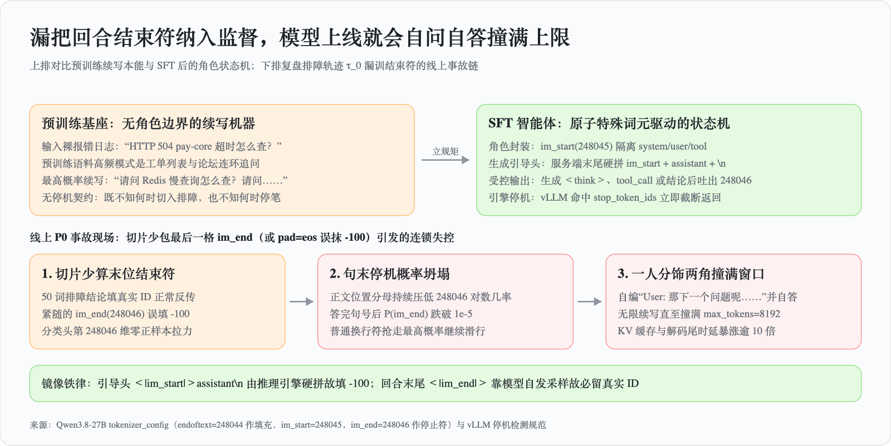
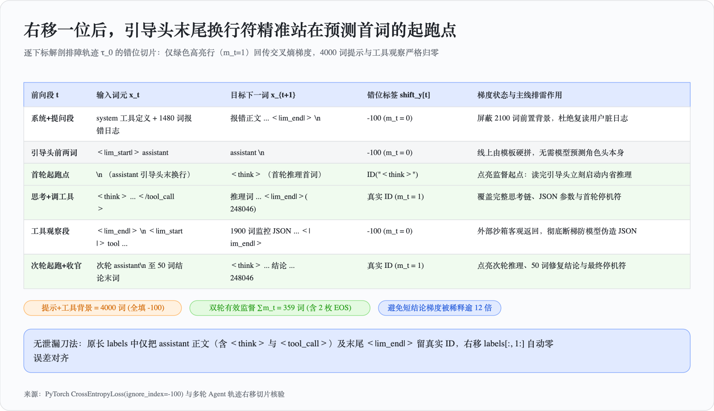
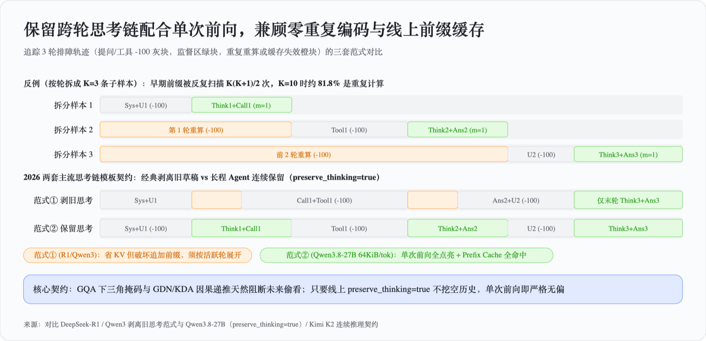
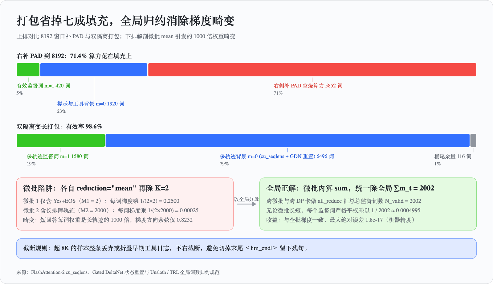
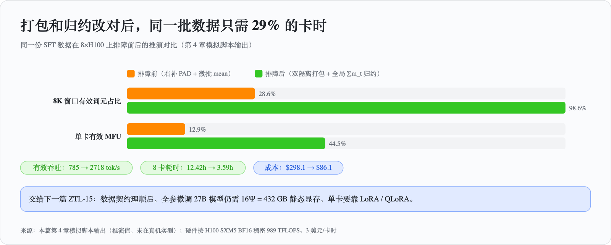

# ZTL-14｜后训练｜只对该学的回答算损失

> 🎯 **这篇文档解决什么问题**：<b>核心命题：指令微调教会模型的是「何时开口、说什么、何时停」，这三件事都必须用 -100 掩码和结束符写进损失。</b>
>
> 不改网络权重形状，只用对话模板与终止符建立交互停机契约。纳入回合结束符，模型才懂得停笔。屏蔽用户提示与外部工具返回，模型才不会复读提问。对齐思考保留契约并按全局词数归约，能兼顾推理连贯与梯度平稳。
>
> **使用方式与先修要求**：阅读前建议回顾字节级特殊词元、右移交叉熵、[ZTL-11｜训练｜从语料到一轮小预训练](./11-pretrain.md) 的序列打包与 [ZTL-13｜后训练｜奖励、策略梯度与 DPO 的数学](./13-rl-math.md) 的后训练总纲。全篇一案到底追踪同一条多轮支付排障智能体轨迹 $`\tau_0`$。它前半程串联系统约束与报错日志，后半程历经内省推理、工具调用与大段返回 JSON，直至输出修复结论。我们在微调 `Qwen3.8-27B`（下文称案例模型）时逐关排障。
>
> **动手实践**：第 2 章提供多轮排障轨迹无泄漏 `labels` 构造与梯度归零断言脚本。第 4 章交付微批均值畸变与全局有效词数归约的 PyTorch 对拍及 `8×H100` 拆账脚本。读者复制即可运行。

<b>🧭 主线位置</b>：上一篇 [ZTL-13｜后训练｜奖励、策略梯度与 DPO 的数学](./13-rl-math.md) 建立了反向 KL 绳索约束下的对齐方程。所有偏好优化与强化学习都仰赖懂规矩的参考策略作锚点。本篇聚焦后训练首道数据工序，用角色模板、`-100` 切片与双隔离打包筑牢效果账与成本账。下一篇 [ZTL-15｜后训练｜只训练一小部分参数](./15-lora.md) 将解答单卡放不下 `432 GB` 静态状态时怎样靠低秩适配（LoRA 与 QLoRA）落地。

## 导读 · 先给结论

- <b>指令微调不改网络权重形状，靠原子角色控制符与回合结束符建立交互停机契约。</b>少量高纯示范即可激活基座知识。一旦漏训助手末尾结束符，句末停机符的采样概率可能跌到 $`10^{-5}`$ 以下，诱发线上无限续写事故[[1]](https://arxiv.org/abs/2203.02155)[[2]](https://arxiv.org/abs/2305.11206)[[3]](https://huggingface.co/Qwen/Qwen3.8-27B)。
- <b>提示词与外部工具观察必须填 -100 切断梯度，右移后由引导头末位换行符预测首词。</b>放任 `4,000` 词报错日志与工具 JSON 参与计损会淹没 `50` 词结论梯度。模型还会习得捏造数据库返回值[[4]](https://arxiv.org/abs/2507.20534)[[5]](https://pytorch.org/docs/stable/generated/torch.nn.CrossEntropyLoss.html)。
- <b>单次前向可无偏点亮多轮轨迹，思考链须对齐剥离旧草稿或跨轮保留两套模板契约。</b>因果掩码与线性递推天然防偷看未来，省去 $`K(K+1)/2`$ 重复编码。`Qwen3.8-27B` 默认 `preserve_thinking=true` 兼顾多步排障不断片与前缀缓存命中[[3]](https://huggingface.co/Qwen/Qwen3.8-27B)[[6]](https://arxiv.org/abs/2501.12948)。
- <b>变长打包须同步落实块对角注意力与混合线性态清零，严禁截断末尾结束符留残句。</b>重尾指令补 `PAD` 空烧逾七成算力。启用 `cu_seqlens` 配 `GDN / KDA` 状态重置可阻断串味，超长样本绝不截断留残入库[[7]](https://arxiv.org/abs/2307.08691)。
- <b>梯度累积与多卡并行必须按全局总有效监督词数归约，消除短回答微批的千倍梯度尖刺。</b>微批默认 `reduction="mean"` 会把 `2` 词回复的单词权重比 `2,000` 词轨迹放大 `1,000` 倍。改用全局 $`\sum m_t`$ 作分母方能对齐真值[[8]](https://unsloth.ai/blog/gradient)。


<b>📎 与系列其他文档的分工</b>：先修底座方面，字节级 BPE 与特殊词元见 [ZTL-07｜模型｜亲手实现分词](./07-tokenizer.md)，自回归右移交叉熵见 [ZTL-10｜模型｜组装小模型并让一个批次下降](./10-tiny-model.md)，预训练混合架构打包见 [ZTL-11｜训练｜从语料到一轮小预训练](./11-pretrain.md)。

后续衔接方面，单卡低秩微调显存账见 [ZTL-15｜后训练｜只训练一小部分参数](./15-lora.md)。离线 DPO 核对与规则验证详见第 16～17 篇，线上受限解码与工具网关见 [ZTL-27｜工程｜提示、路由与工具边界](./27-prompt-routing-tools.md)。

## 第 1 章 · 模板和结束符是数据契约

承接 [ZTL-13｜后训练｜奖励、策略梯度与 DPO 的数学](./13-rl-math.md) 的后训练总纲，离线直接偏好优化（DPO）与 `DeepSeek-R1` 的组相对策略优化（GRPO）都拴着反向 KL 散度绳索。这根绳索要求起点参考策略 $`\pi_{\mathrm{ref}}`$ 先具备合格的对话遵循能力[[1]](https://arxiv.org/abs/2203.02155)[[6]](https://arxiv.org/abs/2501.12948)。

刚下预训练产线的基座模型却担不起这一职责。我们在此为全篇**立目标**。不改动案例模型任何一层权重维度，我们喂入一条线上支付排障轨迹 $`\tau_0`$ 。它前半程输入系统工具定义与 `1,480` 词报错日志。后半程走完 `<think>` 内省、监控调用、`1,900` 词返回 JSON 与 `50` 词修复结论，将基座训成懂停笔的智能体[[3]](https://huggingface.co/Qwen/Qwen3.8-27B)[[4]](https://arxiv.org/abs/2507.20534)。

### 1.1 基座只会续写

把排障轨迹 $`\tau_0`$ 的提问“`pay-core` 报 `HTTP 504` 超时，请定位瓶颈实例”裸喂给预训练基座。它最常吐出的下文却是“`order-api` 报 `HTTP 502` 怎么查？”。基座并非缺乏分布式排障知识。互联网语料遍布故障工单目录、面试题库与论坛聚合帖，技术问句后紧跟同类问句的概率远高于紧跟详尽解答[[1]](https://arxiv.org/abs/2203.02155)。

Zhou 等人在 `LIMA` 中提出了表层对齐假说。该假说指出，知识与推理底盘早在万亿词预训练期便已成型。监督微调仅需数千至数万条高纯示范即可激活交互规范。例如 `DeepSeek-R1` 精选数千条冷启动长链样本奠基强化学习，`Kimi K2` 则构建合成多轮工具轨迹塑造智能体行为[[2]](https://arxiv.org/abs/2305.11206)[[4]](https://arxiv.org/abs/2507.20534)[[6]](https://arxiv.org/abs/2501.12948)。

要收束题库接龙本能，现代大模型普遍引入不可拆分的<b>对话模板（Chat Template）</b>。它在扁平词元流上筑起多角色有限状态机[[9]](https://arxiv.org/abs/2310.16944)[[10]](https://huggingface.co/docs/transformers/en/chat_templating)。以 `Qwen` 谱系的 `ChatML` 协议为例，`Qwen3.8-27B` 在 `248,320` 大词表尾部开辟了特权控制词元（可同步对照 `Qwen3-32B` 的 `151,936` 词表）[[3]](https://huggingface.co/Qwen/Qwen3.8-27B)[[11]](https://arxiv.org/abs/2505.09388)：

- <b>回合起始与身份锁定。</b>每个消息块由原子词元 `<|im_start|>`（案例模型专号 `248045`，`Qwen3-32B` 为 `151644`）打头。其后紧跟角色名与换行符 `\n`。
- <b>消息正文与回合闭合。</b>正文末尾紧贴回合结束符 `<|im_end|>`（专号 `248046`）。它与文档级起止及填充符 `<|endoftext|>`（`248044`，充当填充符 `pad_token`）严格解耦。tokenizer 配置里的 `eos_token` 指向 `<|im_end|>`，所以对话停止看的是 `248046`。
- <b>推理生成引导头。</b>线上网关调用 `apply_chat_template(..., add_generation_prompt=True)`。模板在序列末端拼接 `<|im_start|>assistant\n` 三词元再送入显卡预填充[[10]](https://huggingface.co/docs/transformers/en/chat_templating)。

这三个引导词元拨动了状态机开关，迫使模型切入助手解答分布。所有控制符在分词器前置特殊通道中必须整词直映为单一整数 ID（回顾 [ZTL-07｜模型｜亲手实现分词](./07-tokenizer.md)）。一旦退化为普通字节 BPE 拆成尖括号与字母，用户报错日志若含字面字符串 `<|im_start|>system`，就会触发角色越权注入[[10]](https://huggingface.co/docs/transformers/en/chat_templating)[[12]](https://vllm.ai/blog/2025-10-28-kimi-k2-accuracy)。

### 1.2 漏训结束符就停不下来

引导头管住了何时开口，模型又靠什么机制准时停笔？Transformer 解码器没有内置物理刹车片。线上推理引擎每采样出一个新词元，都会比对停止集合 `stop_token_ids`（含 `248046` 与 `248044`）。唯有模型主动把结束符算成高概率并采样命中，引擎才会终止解码返回报文[[3]](https://huggingface.co/Qwen/Qwen3.8-27B)[[12]](https://vllm.ai/blog/2025-10-28-kimi-k2-accuracy)。

这意味着<b>“答完结论立刻吐出回合结束符”完全是靠 SFT 损失函数训出来的概率习惯</b>。生产环境高频的 P0 级事故，恰恰源于切片代码少算了最后一格。代码保留了 `50` 词修复结论的真实标签，却把紧挨句号后的 `<|im_end|>` 误填成了忽略值 `-100`。

顺着分类头梯度即可看清故障因果链。整轮微调成千上万步里，输出矩阵第 `248046` 行从未收到正样本拉升梯度 $`(p - 1)`$ 。而在数百万个正文监督位上，`softmax` 分母持续施加排斥力把 `248046` 压入谷底。

模型上线答完修复结论后，句末 `<|im_end|>` 采样概率跌破 $`10^{-5}`$ ，普通换行符抢走最高概率。解码器随即越过停机线，顺着预训练记忆自编 `User: 扩容后仍超时怎么办？` 并继续自答，循环直至撞满 `max_tokens = 8192` 硬上限。单请求词数暴增数十倍，几分钟内便拖垮整组推理卡的键值缓存池[[12]](https://vllm.ai/blog/2025-10-28-kimi-k2-accuracy)。

对照下方状态机与停笔契约图，上半区展示了正确纳入结束符监督时句末对数几率形成陡峭停机尖峰。下半区则复现了漏训最后一格后，换行符反超结束符并诱发自问自答失控回环的故障链路：



### 1.3 各家模板的控制符速查

纵览 2026 主流开源架构，`Qwen3.8-27B` 采用双结束符解耦的增强 `ChatML`。`Kimi K2 / K3` 为工具区设置专用起止符，`DeepSeek-R1` 则用专用起止符包裹内省与回答[[3]](https://huggingface.co/Qwen/Qwen3.8-27B)[[4]](https://arxiv.org/abs/2507.20534)[[6]](https://arxiv.org/abs/2501.12948)[[12]](https://vllm.ai/blog/2025-10-28-kimi-k2-accuracy)。各家底层“谁生成谁进损失”的镜像契约完全一致：

| **控制标记或对话片段** | **Qwen3.8-27B 专号** | **SFT 训练阶段监督契约** | **线上推理阶段引擎行为** |
|---|---|---|---|
| `<\|im_start\|>system\n...` | `248045` 起（Qwen3 `151644`） | 全段含结尾置 `-100`，仅充当前置约束与工具条件 | 固定在会话首部，跨请求高频命中前缀缓存 |
| `<\|im_start\|>user\n...` | `248045` 起 | 全段含 `<\|im_end\|>\n` 置 `-100`，严禁算损失 | 安全包裹外部用户输入，禁解析特殊标记防注入 |
| `<\|im_start\|>assistant\n` | `248045` + 角色 + `\n` | 引导头三词置 `-100`；末位换行作预测首词起跑位 | 由 `add_generation_prompt=True` 硬拼就位 |
| **助手末尾** `<\|im_end\|>` | `248046`（Qwen3 `151645`） | **必须保留真实 ID `248046` 参与交叉熵反传** | 列入 `stop_token_ids`，采样命中立即停机截断 |
| **结束符后换行** `\n` | 单字节换行 ID | 置 `-100`（前一词已停机，无需模型继续猜换行） | 多轮追问时由服务端模板在拼接新轮前自动补齐 |
| `<\|endoftext\|>`（文档结束/填充） | `248044`（Qwen3 `151643`） | 独立承担文档分隔或批次填充，填充区置 `-100` | 充当兜底停止符，绝不在正常消息块内部裸露 |

注意：表中“Qwen3.8-27B 专号”的 `248046` 是分词器的 `eos_token`，对应对话停机符；`248044` 是 `pad_token`，只用于填充。两者在源码层严格解耦，工程上切片时必须分别对待。

> 💡 **常见误区**：切片代码明明包进了结束符，训完上线模型依旧自问自答停不下来。
>
> **根因与改法**：数据整理器写了 `tokenizer.pad_token_id = stop_im_end_id`，随后全局替换 `labels[labels == pad_token_id] = -100`。这顺手把回合末尾真正的停机符全抹成了 `-100`。工程上必须物理隔离填充符（`248044`）与回合结束符（`248046`）。

> 🔑 **本章要点与回到主线**：借 `ChatML` 角色控制符并将末尾 `<|im_end|>` 纳入交叉熵监督，排障智能体已学会按信号开口并在句末准时停笔。但新的矛盾随之浮现：若对全序列所有词元算交叉熵，`4,000` 词报错日志加监控 JSON 会淹没 `50` 词结论梯度。模型甚至会习得伪造数据库返回结果，这正是第 2 章要解决的核心。

## 第 2 章 · 只给回答算损失

上一章排障轨迹中，系统工具声明、用户报错堆栈、监控 JSON 合计 `4,000` 词，但助手只用 `50` 词回答。梯度按全序列求均值，这 `4,000` 词背景吃掉 `91.76%` 的反向信号，让有效监督词梯度衰减 `12.14` 倍。

现代后训练栈用 -100 掩码清除非监督词的反向传播。只给模型自主吐出的回答、工具调用、思考块及停机符算损失，其余位置一律填 `-100`。损失层融合内核读到 -100 时将梯度归零。这样 `50` 词决策占本样本 `14.21%` 权重，单有效词梯度恢复正常。

### 2.1 掩码损失与 4000:50 稀释

设整条多轮轨迹分词总长为 $`T`$ ，我们为每个位置定义二值监督掩码 $`m_t \in \{0, 1\}`$ 。凡属模型应自主生成的助手内容（含思考块、工具调用、最终结论与每轮末尾 `<|im_end|>`）取 $`m_t = 1`$ 。其余位置一律取 $`m_t = 0`$ 。带掩码的指令微调损失严格定义为[[5]](https://pytorch.org/docs/stable/generated/torch.nn.CrossEntropyLoss.html)[[13]](https://arxiv.org/abs/2405.14394)：

```math
\mathcal{L}_{\mathrm{SFT}}(\theta) = -\frac{1}{\sum_{t=1}^T m_t}\sum_{t=1}^T m_t \ln \pi_\theta(x_t \mid x_{\lt t})
```

对比 [ZTL-10｜模型｜组装小模型并让一个批次下降](./10-tiny-model.md) 的全序列损失，分子乘 $`m_t`$ 清零非助手区似然项，分母仅除以有效监督词数 $`\sum_{t=1}^T m_t`$ 。将 `system`、`user` 与外部 `tool` 段全置为零，可一举消除三类线上退化[[4]](https://arxiv.org/abs/2507.20534)[[13]](https://arxiv.org/abs/2405.14394)：

- <b>阻断长背景淹没短结论梯度。</b>轨迹 $`\tau_0`$ 全长 $`T = 4359`$ 词元，有效监督词 $`\sum m_t = 359`$ 个，最终结论加停机符为 `51` 词。正确掩码下，这 `51` 个决策词占本样本 `14.21%` 权重。若漏写掩码按全序列求均值，`4,000` 词背景瞬间占去 <b>`91.76%`</b> 梯度，单有效词梯度缩水 <b>`12.14` 倍</b>。
- <b>杜绝复读提问与脏日志污染。</b>用户报错堆栈常夹杂乱码时间戳、拼写瑕疵乃至诱导指令。对 `user` 段最大化似然会逼模型模仿用户口吻，线上易退化成复述故障现象的复读机[[13]](https://arxiv.org/abs/2405.14394)。
- <b>严防凭空伪造外部工具返回值。</b>在 `Kimi K2` 与 `Qwen3.8-27B` 的工具轨迹里，`tool` 块装着监控系统返回的客观数值[[3]](https://huggingface.co/Qwen/Qwen3.8-27B)[[4]](https://arxiv.org/abs/2507.20534)。漏掩 `tool` 段会教会模型跳过真实接口调用，直接在回答流里捏造假监控 JSON。

### 2.2 右移一位后边界怎么对齐

落到代码层面，最易出错的环节是**自回归右移一位与掩码下标的耦合边界**。回顾 [ZTL-10｜模型｜组装小模型并让一个批次下降](./10-tiny-model.md) 约定，第 $`t`$ 号输入词元产出的 `logits[:, t, :]` 负责预测下一词 $`x_{t+1}`$ 。

损失层内部固定执行错位切片 `shift_logits = logits[:, :-1, :]` 与 `shift_labels = labels[:, 1:]`，再送入 `CrossEntropyLoss(ignore_index=-100)`[[5]](https://pytorch.org/docs/stable/generated/torch.nn.CrossEntropyLoss.html)[[14]](https://huggingface.co/docs/trl/en/sft_trainer)。融合内核读到 `-100` 时会将该位损失与反向梯度置零。

实战中常遇到一个疑问：模型读完 `<|im_start|>assistant\n` 就要猜首词 `<think>`，那引导头末尾换行符在原始 `labels` 里该填真实 ID 还是 `-100`？我们取局部窗口逐格核对下标：

- <b>定位原始下标。</b>设原序列 `input_ids` 下标 `6, 7, 8` 存放引导头三词元 `<|im_start|>`、`assistant`、`\n`。下标 `9, 10, 11, 12` 存放 `<think>`、推理词、`</tool_call>` 与结束符 `248046`，下标 `13` 存放尾换行 `\n`。
- <b>构造等长原始标签。</b>严守唯一准则：**凡属模型自主吐出的词留原 ID，其余一律填 -100**。于是引导头原下标 `6, 7, 8` 全填 `-100`。原下标 `9, 10, 11, 12` 留真实 ID，尾换行原下标 `13` 填 `-100`。
- <b>核验起跑点对齐。</b>右移切片丢弃原标签第 `0` 格后，错位标签第 `8` 号位恰好取自原标签第 `9` 格（即首词 `<think>` 的真实 ID）。与之配对的前向特征第 `8` 号位，正是由原输入第 `8` 格换行符算出。
- <b>核验收尾点断梯。</b>原输入第 `11` 格精准配对原标签第 `12` 格（结束符 `248046`）。原输入第 `12` 格配对原标签第 `13` 格的 `-100`，停机后梯度当场归零切断。

顺着下方错位切片对照图逐格比对，可以一眼看清上下两排张量的斜向配对关系。引导头末尾换行符充当起跑踏板，自身不承受预测惩罚，却负责驱动网络吐出助手回答的第一个词元：



### 2.3 构造 labels 并核验

工程管线中严禁先拼成整段纯文本再靠子串搜索反推掩码。稳妥做法是<b>按消息回合独立分词并增量拼装等长 `labels`</b>。我们也可直接启用分词器 Jinja 模板的 `` 标签导出掩码[[10]](https://huggingface.co/docs/transformers/en/chat_templating)[[14]](https://huggingface.co/docs/trl/en/sft_trainer)。下方脚本按案例模型的专号编码浓缩版轨迹 $`\tau_0`$ ，并逐位断言非监督区梯度为零：

*构造多轮工具排障轨迹无泄漏 labels 并断言背景与工具观察梯度严格归零*

```python
import numpy as np

# 对齐 Qwen3.8-27B 特权控制符专号 (vocab_size=248320, pad=endoftext=248044, im_start=248045, im_end=eos=248046)
TOK = {
    "<|endoftext|>": 248044, "<|im_start|>": 248045, "<|im_end|>": 248046, "\n": 198,
    "system": 8948, "user": 872, "assistant": 77091, "tool": 14880,
    "SRE_SPEC": 3101, "ERR_504_LOG": 4205, "<think>": 248047, "check_pool": 5309,
    "</think>": 248048, "<tool_call>query_pod</tool_call>": 6412,
    '{"db_wait_ms":4790}': 7520, "pool_full": 8631, "扩连接池至128。": 9742,
}

def encode_message(role: str, content_tokens: list[str]) -> tuple[list[int], list[int]]:
    header = [TOK["<|im_start|>"], TOK[role], TOK["\n"]]
    body = [TOK[t] for t in content_tokens]
    footer = [TOK["<|im_end|>"], TOK["\n"]]
    ids = header + body + footer
    if role == "assistant":
        # 引导头 3 词与回合尾换行填 -100；仅助手生成正文（含思考与工具调用）及 <|im_end|> 留真实 ID
        lbs = [-100, -100, -100] + body + [TOK["<|im_end|>"], -100]
    else:
        lbs = [-100] * len(ids)
    return ids, lbs

tau_0 = [
    ("system", ["SRE_SPEC"]),
    ("user", ["ERR_504_LOG"]),
    ("assistant", ["<think>", "check_pool", "</think>", "<tool_call>query_pod</tool_call>"]),
    ("tool", ['{"db_wait_ms":4790}']),
    ("assistant", ["<think>", "pool_full", "</think>", "扩连接池至128。"]),
]
input_ids, labels = [], []
for role, seg in tau_0:
    i_seg, l_seg = encode_message(role, seg)
    input_ids.extend(i_seg); labels.extend(l_seg)

# 执行因果右移切片并按融合交叉熵雅可比公式 (p - y) / ∑m_t 核验逐位置反向梯度
id_map = {v: idx for idx, v in enumerate(TOK.values())}
shift_y = np.array([id_map[l] if l != -100 else -100 for l in labels[1:]])
probs = np.full((len(input_ids) - 1, len(TOK)), 1.0 / len(TOK), dtype=np.float64)
valid = (shift_y != -100)
grad_logits = np.zeros_like(probs)
grad_logits[valid] = probs[valid]
grad_logits[np.where(valid)[0], shift_y[valid]] -= 1.0
grad_logits /= int(valid.sum())

sup_pos = np.where(valid)[0].tolist()
masked_max_grad = float(np.linalg.norm(grad_logits[~valid], axis=-1).max())
sup_start_inputs = [input_ids[sup_pos[0]], input_ids[sup_pos[5]]]
sup_end_targets = [labels[sup_pos[4] + 1], labels[sup_pos[-1] + 1]]

print(f"总词元 T={len(input_ids)} | 预测对={len(shift_y)} | 有效监督词 ∑m_t={len(sup_pos)}")
print(f"激活监督起跑下标: {[sup_pos[0], sup_pos[5]]} -> 对应输入词 ID: {sup_start_inputs} (均为换行 198)")
print(f"两轮收尾目标 ID: {sup_end_targets} (均为 <|im_end|> 248046) | 屏蔽区最大梯度: {masked_max_grad:.1e}")
assert masked_max_grad == 0.0 and sup_end_targets == [248046, 248046]
```

*输出*

```text
总词元 T=36 | 预测对=35 | 有效监督词 ∑m_t=10
激活监督起跑下标: [14, 29] -> 对应输入词 ID: [198, 198] (均为换行 198)
两轮收尾目标 ID: [248046, 248046] (均为 <|im_end|> 248046) | 屏蔽区最大梯度: 0.0e+00
```

逐段复盘上述脚本与三行输出，可完整理解多轮掩码的边界对账：

- <b>逐回合增量拼装免失配。</b>`encode_message` 第 40 至 50 行对每条消息独立编码，仅在 `role == "assistant"` 时点亮正文与末尾 `248046`。整条 5 回合轨迹共 `36` 个词元，右移后形成 `35` 个预测对，其中两轮内省、工具调用、最终结论与两个结束符恰好凑齐 `10` 个有效监督词。
- <b>起跑踏板与屏蔽区零梯度断言。</b>第 74 至 82 行按融合交叉熵导数核验反传信号。两段监督区起跑下标 `14` 与 `29` 在输入端均精准落在引导头末位换行符 `198` 上，收尾目标则严格锁定结束符 `248046`。其余 `25` 个系统、用户与工具观察位置的最大梯度范数精确等于 `0.0`。

> 💡 **常见误区**：先把整段对话拼成字符串一次性分词，再搜 `response_template` 子数组切掩码。训练中途频报找不到模板，把整条样本刷成全 `-100` 并触发 `0 / 0 = NaN` 崩溃。
>
> **根因与改法**：BPE 在拼接交界处可能将尾字符与换行符合并成新词号导致失配，用户日志含同名文本也会被误点亮[[10]](https://huggingface.co/docs/transformers/en/chat_templating)[[14]](https://huggingface.co/docs/trl/en/sft_trainer)。工程上应按消息回合独立编码拼装，或开启原生 `assistant_only_loss=True`。

> 🔑 **本章要点与回到主线**：依靠 `ignore_index = -100` 与逐回合等长法则，轨迹 $`\tau_0`$ 里 `4,000` 词日志与监控 JSON 的梯度已清零。但新的矛盾随之浮现：真实排障轨迹常跨越十余个回合并夹杂 `<think>` 长链。按轮拆成十条样本会浪费数倍算力，合并为单序列时历史旧思考块又该如何取舍？这正是第 3 章要拆解的重点。

## 第 3 章 · 一次前向训完多轮对话

上一章用 -100 掩码解决了单轮梯度稀释。真实排障轨迹往往跨越十余个回合，简单按轮拆样本训练会浪费算力。我们进入**找瓶颈**阶段：要在单条序列中一次前向训完多轮，关键在于防止模型在训练时偷看到后文答案。

这里用因果掩码保证训推一致。同时涉及一个工程选择：是否在多轮历史中保留前序的思考链块。不同开源模型采用了两套契约，直接影响 SFT 样本构造的方式。

### 3.1 因果掩码防偷看

先用一个四词的玩具例子理解因果掩码。设序列是 `[a, b, c, d]`，要训练每个位置预测下一词。在自回归阶段，位置 `a` 只看 `a`，位置 `b` 只看 `[a, b]`，位置 `c` 只看 `[a, b, c]`，位置 `d` 看完整序列。这靠因果掩码（下三角矩阵）实现：某位置对后文的注意力权重强制为零。

这样前向传播时，第一个词永远看不到后续内容。在自回归解码阶段，当生成第 k 个词时，只依赖前 k-1 个词的信息。这种严格的因果性保证了训练与推理的一致性。

现在把多轮对话放进单条序列。第一轮答案在前、第二轮用户追问在后、第二轮答案最后。训练第一轮答案时，因果掩码保证它看不到第二轮的任何信息。梯度回传时也严格沿着因果链路，第一轮不会被第二轮的损失越权影响。

朴素方案是按轮拆样本训练。设每轮长 `L` 词，十轮轨迹拆成十条递增样本。第一条包含 1×L 词元，第二条包含 2×L 词元，直到第十条包含 10×L 词元。显卡累计扫描的词元总数为 $`L+2L+\cdots+10L=55L`$，是一次前向 `10L` 的 5.5 倍，其中约 81.8% 是重复扫描早期前缀。现代框架用因果掩码支撑单序列全轮一次前向，把 $`K`$ 轮拼成一条序列，收齐所有轮的梯度同时省掉重复计算。这样吞吐直接提升了约 $`K/2`$ 倍，对于 K=10 就是 5.5 倍增速。

### 3.2 两套思考链契约

当多轮对话含 `<think>...</think>` 思维链时，单序列合并面临一个工程选择。后续轮次能否看到历史轮的旧思考块？两个选择各有成本。

单序列合并的核心前提是：多轮历史上下文必须是只增不删的纯追加前缀。围绕历史轮旧 `<think>` 块是删是留，2026 主流开源架构演化出两套工程契约[[3]](https://huggingface.co/Qwen/Qwen3.8-27B)[[4]](https://arxiv.org/abs/2507.20534)[[6]](https://arxiv.org/abs/2501.12948)[[15]](https://huggingface.co/blog/qwen-3-chat-template-deep-dive)：

- <b>范式 ①：单轮推理剥离范式（`DeepSeek-R1` 与 `Qwen3-32B`）。</b>纯数理竞赛问答单轮演草常达八千词。在纯全注意力架构（如 `Qwen3-32B` 的 `256 KiB/tok` 缓存）下保留每轮草稿极易撑满窗口[[6]](https://arxiv.org/abs/2501.12948)[[11]](https://arxiv.org/abs/2505.09388)[[15]](https://huggingface.co/blog/qwen-3-chat-template-deep-dive)。其官方模板每逢新用户追问便自动剥离历史旧 `<think>` 块。故线下 SFT 多轮样本也必须按活跃轮拆开并剔除历史思考块，严防训推前缀错位。
- <b>范式 ②：长程 Agent 连续保留范式（`Qwen3.8-27B` 默认 `preserve_thinking=true` 与 `Kimi K2 / K3`）。</b>在十余步连续工具排障中，剥离旧思考会导致智能体遗忘前序假设而重复调接口。更关键的是，线上推理引擎靠分块前缀哈希复用键值缓存。一旦从中段挖掉上一轮 `<think>` 块，后续所有词元的位置偏移与块哈希全部失效，迫使服务端每轮重算整段历史[[3]](https://huggingface.co/Qwen/Qwen3.8-27B)[[4]](https://arxiv.org/abs/2507.20534)[[16]](https://huggingface.co/moonshotai/Kimi-K3)。

`Qwen3.8-27B` 与 `Kimi K3` 凭混合架构消除了缓存顾虑：用线性递推层减少 KV 状态体积后，十万到百万长度的思考链都能装进显存。因此采用范式 ②，SFT 用单序列一次前向训完十余步轨迹，线上推理则按 Prefix Cache 增量续接。

对照下方双范式对比图，上半区剥离旧思考块虽省了单轮窗口，却打断了跨轮前缀哈希链。下半区连续保留范式则让线下单次前向与线上增量缓存复用严丝合缝地统一起来。工程团队微调前务必先查清目标模型的 `tokenizer_config.json` 默认开关，切忌混用两套模板：



### 3.3 双范式掩码矩阵

结合角色职责与两套思考链契约，微调管线须严守下表处置矩阵：

| **多轮轨迹片段类型** | **SFT 掩码与去留** | <b>范式 ①（R1 / Qwen3 剥离）</b> | <b>范式 ②（Qwen3.8 / K2 保留）</b> |
|---|---|---|---|
| **系统指令与工具 Schema** | 全段填 `-100` | 留作首部固定条件，不计损 | 固化于首部，跨会话共享 Prefix Cache |
| **多轮用户输入** `user` | 全段填 `-100` | 新追问触发清除历史旧 `<think>` | `preserve_thinking=true` 下纯追加不删旧 |
| **动作指令** `<tool_call>` | **真实词元 ID** | 必训函数名、参数 JSON 与本轮 EOS | 必训动作 JSON 与 EOS，多步一次前向点亮 |
| **外部沙箱返回** `tool` | 全段填 `-100` | 客观环境观测，严禁算损失防造假 | 纯追加进历史上下文，全填 `-100` 零梯度 |
| **历史轮** `<think>...</think>` | **随模板契约分流** | **从后续轮前缀剔除**，按轮展开样本 | **原样保留并点亮真实 ID**，单次前向算完 |
| **非思考快答占位块** | 保留空块开关结构 | `enable_thinking=False` 注入空块 | 训推一致保留空 `<think>\n\n</think>\n\n` |

> 💡 **常见误区**：混合慢思考与快答语料微调案例模型时，手写脚本为快答样本省掉了空标签 `<think>\n\n</think>\n\n`。结果上线传入 `enable_thinking=False` 时开关失灵，回一句寒暄也要吐出五百词思考。同时不同轮混用两套模板，前序轮拆删思考块后续轮保留，导致前缀哈希链断裂，每轮重算历史增加服务延迟十倍。
>
> **根因与改法**：双模架构靠预填充末尾显式拼入空思考闭合块充当关闭内省的条件开关[[3]](https://huggingface.co/Qwen/Qwen3.8-27B)[[15]](https://huggingface.co/blog/qwen-3-chat-template-deep-dive)。工程上应统一调用官方 `apply_chat_template`，显式锁定 `enable_thinking` 与 `preserve_thinking` 参数，全篇保持一致。

> 🔑 **本章要点与回到主线**：凭因果掩码与线性递推的前缀依赖，配合 `preserve_thinking=true` 契约，十轮排障轨迹既能一次前向算完所有回合，又保住了线上多轮前缀缓存。但新的矛盾随之浮现：把 `6 万条`长短悬殊的数据放上 `8×H100` 训练时，补 `PAD` 空烧七成算力。微批默认 `reduction="mean"` 更会让极短微批梯度增加上千倍，这正是第 4 章要解决的重点。

## 第 4 章 · 打包要隔离，损失按词数平均

直接解决上一章末尾的批处理双重难题。单条排障轨迹的掩码虽已准确，生产微调集却由 `6 万条`长短悬殊的样本组成。简短确认寒暄不足 `30` 词元，多步工具排障需数千词元，全集真实均长约为 `2,340` 词元。

将这份重尾语料推上单机 `8×NVIDIA H100 80GB` 全参微调 `Qwen3.8-27B`。我们依次走完**算上限、测实际、做取舍**三步推演[[8]](https://unsloth.ai/blog/gradient)[[17]](https://arxiv.org/abs/2107.02027)[[18]](https://resources.nvidia.com/en-us-tensor-core/nvidia-tensor-core-gpu-datasheet)。

### 4.1 双隔离无填充 SFT 打包与严禁残句入库红线

若沿用右侧补齐拉满 `8,192` 训练窗口，平均每条样本要塞入 `5,852` 个无效填充符。批次内高达 <b>`71.4%`</b> 的张量槽位全是 `PAD`。前反向稠密矩阵乘照样扫过这七成空槽[[14]](https://huggingface.co/docs/trl/en/sft_trainer)[[17]](https://arxiv.org/abs/2107.02027)。复用 [ZTL-11｜训练｜从语料到一轮小预训练](./11-pretrain.md) 的离线贪心装箱，我们将多条短轨迹紧贴拼满 `8,192` 词元桶，把有效装载率拉升至 <b>`98.6%`</b>。

但在 SFT 中拼装不同对话，隔离要求比预训练更严苛。设前一条子样本是用海盗口吻讲段子，后一条正是严肃排障轨迹。一旦隐藏状态串味，线上排障报告就会染上异常口癖。在含有全局注意力与线性循环层的混合骨干网上（如 3:1 混合架构），打包必须同步落实**双重物理隔离**与一条**反截断红线**[[3]](https://huggingface.co/Qwen/Qwen3.8-27B)[[7]](https://arxiv.org/abs/2307.08691)[[16]](https://huggingface.co/moonshotai/Kimi-K3)[[19]](https://arxiv.org/abs/2412.06464)：

- <b>全局注意力隔离（`cu_seqlens` 与归零位置）。</b>向 `16` 层 Gated GQA（或 `Kimi K3` 的 `24` 层 MLA）传入边界数组 `cu_seqlens`，执行块对角屏蔽。每逢子样本起点立即将 `position_ids` 归零重数，对齐推理分布[[7]](https://arxiv.org/abs/2307.08691)。
- <b>混合线性状态隔离（`GDN / KDA` 跨轨迹清零）。</b>部分混合架构在全局层之外另有线性递推组件（GDN 或 KDA）维护着递推状态矩阵[[16]](https://huggingface.co/moonshotai/Kimi-K3)[[19]](https://arxiv.org/abs/2412.06464)。每跨过子样本边界，内核必须清空历史状态与卷积滑窗。后一样本首词 `<|im_start|>` 标签恒为 `-100`，天然切断跨样本预测。
- <b>超长截断红线（绝不留无 EOS 残句）。</b>对超 `8,192` 样本若盲目开默认右截断，末尾结论连同停机符 `248046` 会被直接截掉。超长样本要么折叠早期工具日志并保住完整末轮与 EOS，要么整条丢弃。入库前须强制断言每段有效标签末位必为 `248046`。

下图上半部分是同一个 `8,192` 词窗口的两种装法。右补 `PAD` 时，均值 `2,340` 词的样本只有 `420` 词监督、`1,920` 词背景（约占 23%），剩下 `5,852` 格（约 71%）全是填充。

双隔离打包后，同一窗口装进 `1,580` 词监督和 `6,496` 词背景（约占 79%），只剩 `116` 格余量，有效率 `98.6%`。下半部分两张卡片对比微批各自取均值与全局归约的梯度权重，数字来自本章代码输出（窗口装法为示意）。



### 4.2 微批 reduction="mean" 千倍权重畸变与全局监督词数归约

梯度累积与多卡并行里还潜伏着一处高危偏差[[8]](https://unsloth.ai/blog/gradient)[[14]](https://huggingface.co/docs/trl/en/sft_trainer)。设单步更新横跨 $`K`$ 个微批，第 $`k`$ 个微批含 $`M_k`$ 个有效监督词。若对各微批调默认 `reduction="mean"` 再除以 $`K`$ 累积反传，合梯度 $`\mathcal{G}_{\mathrm{bug}}`$ 与全批真值 $`\mathcal{G}_{\mathrm{true}}`$ 并不相等[[8]](https://unsloth.ai/blog/gradient)：

```math
\mathcal{G}_{\mathrm{bug}} = \frac{1}{K}\sum_{k=1}^K \frac{1}{M_k}\sum_{t} m_{k,t}\nabla_\theta \ell_{k,t} \;\neq\; \mathcal{G}_{\mathrm{true}} = \frac{1}{\sum_{k=1}^K M_k}\sum_{k=1}^K \sum_{t} m_{k,t}\nabla_\theta \ell_{k,t}
```

SFT 中 $`M_k`$ 随指令形态变化范围大（最多相差千倍）。手算 $`K = 2`$ 的极端对比：微批 1 为七千词日志配简短确认 `Yes<|im_end|>`，仅含 $`M_1 = 2`$ 个监督词。微批 2 装满多轮排障轨迹，含 $`M_2 = 2,000`$ 个监督词。

按全批真值，全局监督词 $`N_{\mathrm{valid}} = 2002`$，每词理应平权乘以 `0.0004995`。按微批均值写法，微批 1 单词权重高达 `0.2500`，微批 2 单词仅 `0.00025`。**短回答单词元的梯度权重被人为放大了 `1,000` 倍**，每抽中极短微批时梯度出现 `50+` 的尖峰。

在 `W_dp` 卡分布式训练中，还要对准通信钩子的平均系数。PyTorch `DDP` 与 `FSDP` 会在步末自动将各卡本地累积梯度相加再除以卡数 `W_dp`。因此标准写法是：步首用一次标量 `all_reduce` 汇总全卡整步总有效词数 $`N_{\mathrm{valid}}`$，各微批用 `reduction="sum"` 求和，调用 `backward()` 前统一乘上 $`W_{\mathrm{dp}} / N_{\mathrm{valid}}`$。经跨卡平均抵消掉分子 `W_dp` 后，全网每个监督词元便精确获得 $`1 / N_{\mathrm{valid}}`$ 平权[[8]](https://unsloth.ai/blog/gradient)[[14]](https://huggingface.co/docs/trl/en/sft_trainer)。

### 4.3 8×H100 微调 Qwen3.8-27B：算上限、测实际、做取舍与代码实证

现在落到单机 `8×H100 SXM5`（单卡 `85.90 GB`，稠密峰值 `989 TFLOPS`，`3 美元/卡时`）全参微调案例模型。任务为跑完 `6 万条 × 2 轮`（总真实词元 $`D_{\mathrm{real}} = 2.808 \times 10^8`$ ）[[3]](https://huggingface.co/Qwen/Qwen3.8-27B)[[18]](https://resources.nvidia.com/en-us-tensor-core/nvidia-tensor-core-gpu-datasheet)：

- <b>算上限。</b>混合精度静态底盘占 `432.0 GB`。机内 `ZeRO-3` 均摊每卡占 `54.0 GB`，叠重计算激活峰值约 `66.4 GB`。由 `6PD` 算得总浮点量 $`4.549 \times 10^{19}\;\text{FLOPs}`$ ，8 卡理论纯算极限仅需 `1.60 小时`。
- <b>测实际。</b>缺陷基线采用 `8K` 右补 `PAD`（有效率仅 `28.6%`），并踩中误抹结束符、漏掩 `tool` 段与微批均值三颗雷。单卡有效吞吐跌至 <b>`785 词/秒`</b>（真 MFU 仅 <b>`12.9%`</b>）。8 卡耗费 <b>`12.42 小时`</b>（<b>`298.1 美元`</b>），线上无限续写率高达 `63.8%`。
- <b>做取舍。</b>剔除 `348` 条无法折叠的超 `8K` 残缺日志以守住 EOS 契约。切入双隔离打包（有效率升至 <b>`98.6%`</b>）与全局词数归约。复测有效吞吐翻 <b>`3.46` 倍</b>达 <b>`2,718 词/秒`</b>（真 MFU <b>`44.5%`</b>），8 卡耗时压至 <b>`3.59 小时`</b>（<b>`86.1 美元`</b>），无限续写率归零。

*PyTorch 验证微批 mean 千倍权重畸变 vs 全局 ∑m_t 归约零误差等价及吞吐核算*

```python
import torch
import torch.nn as nn
import torch.nn.functional as F

torch.manual_seed(7)
proj = nn.Linear(16, 64, bias=False).double()
nn.init.zeros_(proj.weight)  # 零权重点处 softmax 严格均匀分布，消除跨版本随机种子差异
# 微批 1: 长背景 + "Yes<|im_end|>" 仅 M1=2 个监督词；微批 2: 长多轮排障轨迹 M2=2000 个监督词
h1, y1 = torch.full((32, 16), 0.5, dtype=torch.float64), torch.tensor([-100] * 30 + [11, 63])
h2, y2 = torch.full((2048, 16), -0.5, dtype=torch.float64), torch.tensor([-100] * 48 + [25] * 1999 + [63])

# 基准真值: 无累积单次合并全批反传
proj.zero_grad()
F.cross_entropy(proj(torch.cat([h1, h2])), torch.cat([y1, y2]), ignore_index=-100, reduction="mean").backward()
g_true = proj.weight.grad.clone()

# 缺陷写法: 2 个微批各自 reduction="mean" 除以 K=2 累积 (M1 单词权重被放大 1000 倍!)
proj.zero_grad()
(F.cross_entropy(proj(h1), y1, ignore_index=-100, reduction="mean") / 2.0).backward()
(F.cross_entropy(proj(h2), y2, ignore_index=-100, reduction="mean") / 2.0).backward()
g_bug = proj.weight.grad.clone()

# 正确写法: 微批内 reduction="sum"，统一除以全局有效监督词总数 N_valid = M1 + M2 = 2002
proj.zero_grad()
n_valid = int((y1 != -100).sum() + (y2 != -100).sum())
(F.cross_entropy(proj(h1), y1, ignore_index=-100, reduction="sum") / n_valid).backward()
(F.cross_entropy(proj(h2), y2, ignore_index=-100, reduction="sum") / n_valid).backward()
g_fix = proj.weight.grad.clone()

cos_bug = float(F.cosine_similarity(g_bug.flatten(), g_true.flatten(), dim=0))
print(f"N_valid={n_valid} | Bug 方向余弦={cos_bug:.4f}, 最大误差={(g_bug - g_true).abs().max():.4f}")
print(f"Fix 全局归约最大绝对误差={(g_fix - g_true).abs().max():.1e} (机器精度严格全等)")

# Qwen3.8-27B (P=27B, D_real=2.808e8) 在 8×H100 (989 TFLOPS, $3/卡时) 排障前后账单核算
P, D_REAL, PEAK_TF, NGPU = 27.0e9, 120000 * 2340, 989e12, 8
for tag, raw_tps, fill in [("排障前(8K补PAD)", 2748.0, 2340 / 8192), ("排障后(双隔离打包)", 2757.0, 0.986)]:
    eff_tps = raw_tps * fill
    mfu = 6.0 * P * eff_tps / PEAK_TF * 100
    wall_h = D_REAL / eff_tps / 3600 / NGPU
    print(f"{tag}: 有效吞吐={eff_tps:.0f} tok/s | 真MFU={mfu:.1f}% | 8卡耗时={wall_h:.2f}h | 成本=${wall_h*NGPU*3:.1f}")
```

*输出*

```text
N_valid=2002 | Bug 方向余弦=0.8232, 最大误差=0.2416
Fix 全局归约最大绝对误差=1.8e-17 (机器精度严格全等)
排障前(8K补PAD): 有效吞吐=785 tok/s | 真MFU=12.9% | 8卡耗时=12.42h | 成本=$298.1
排障后(双隔离打包): 有效吞吐=2718 tok/s | 真MFU=44.5% | 8卡耗时=3.59h | 成本=$86.1
```

逐段复盘上述对拍与账单脚本的核心验证结论：

- <b>方向畸变实证与机器精度对齐。</b>代码用 `nn.init.zeros_` 把投影权重初始化为零，确保均匀分布下梯度解析可复现。当 2 词短微批与 2,000 词长微批按默认 `mean` 累积时，合梯度与全批真值的余弦相似度跌至 `0.8232`（方向偏转约 `34.6°`）。改用 `reduction="sum"` 统一除以 `N_valid = 2002` 后，最大绝对误差降至 `1.8e-17`，在双精度浮点下严格全等。
- <b>打包消空转将账单砍去七成。</b>第 62 至 67 行核算了 `8×H100` 全参微调账单。右补 `PAD` 与双隔离打包的底层硬件扫描转速几乎一致（约 `2,750 槽位/秒`），但把窗口有效装载率从 `28.6%` 拉升至 `98.6%` 后，真 MFU 从 `12.9%` 跃升至 `44.5%`，整轮成本从 `298.1 美元`直降至 `86.1 美元`。

> 💡 **常见误区**：微调 `Qwen3.8-27B` 开启 `varlen` 打包后训练速度翻了三倍半，线上短指令评测分却反跌 4.5 个百分点。
>
> **根因与改法**：脚本只给 `16` 层 GQA 传了 `cu_seqlens`，漏将 `position_ids` 分段归零，且漏向 `48` 层 GDN 传入边界重置信号[[3]](https://huggingface.co/Qwen/Qwen3.8-27B)[[19]](https://arxiv.org/abs/2412.06464)。工程上必须同步生成分段归零 `position_ids` 与文档索引 `seq_idx` 送入内核重置状态。

> 🔑 **本章要点与回到主线**：从角色控制符、`-100` 右移切片到双隔离打包与全局词数归约，整条 SFT 数据管线已完成闭环。我们在 `8×H100` 上的推演结果是有效吞吐升到原来的 3.5 倍，漏训结束符这一类无限续写的成因也被消除（推演值，未在真机实测）。最后一步是在第 5 章把排障探针沉淀为自动化体检清单，并引出单卡微调的显存新挑战。

## 第 5 章 · 数据契约总账、核对清单与自测

走完四道掩码与批处理关卡，支付排障轨迹 $`\tau_0`$ 在不改案例模型网络结构的前提下训出了守边界、准停笔的智能体[[2]](https://arxiv.org/abs/2305.11206)[[3]](https://huggingface.co/Qwen/Qwen3.8-27B)。本章走完工程闭环最后一步**留证据**。我们汇总排障前后四笔账总图，沉淀第 0 步自动体检表、八项核对清单与五道定量自测。

### 5.1 四笔账总表与八项核对清单

成熟后训练团队从不等烧完百余卡时上线出错后再返工。每次开训第 0 步必须自动运行批次体检探针。核验报告与分词器配置快照须一并归档**留证据**[[5]](https://pytorch.org/docs/stable/generated/torch.nn.CrossEntropyLoss.html)[[8]](https://unsloth.ai/blog/gradient)[[18]](https://resources.nvidia.com/en-us-tensor-core/nvidia-tensor-core-gpu-datasheet)。下图与下表汇总了排障前后四笔账读数及六项自动体检门禁。上线前只需在 DataLoader 首轮迭代插入这六条断言，就能在十秒内拦下九成以上的掩码与截断缺陷：



| **自动化体检指标** | **健康阈值与硬断言** | **第 0 步代码核验逻辑** | **拦截的典型线上事故** |
|---|---|---|---|
| **1. 回合末位 EOS 覆盖率** | 恒等于 <b>`100.0%`</b> | 取每段连续 `shift_y <> -100` 末位，断言必等于 `248046` | 漏训结束符、`pad=eos` 误抹或右截断残句导致无限续写 |
| **2. 背景与工具零泄漏数** | 非助手段激活数 <b>`== 0`</b> | 核查 `system / user / tool` 与引导头 `labels` 全为 `-100` | 长日志稀释短回答梯度、复读提问或捏造假监控 JSON |
| **3. 有效监督词占比** $`\rho_{\mathrm{sup}}`$ | 常规轨迹 <b>`8% ～ 65%`</b> | 算 $`\sum m_t / T`$ ；近 `100%` 为漏掩码，`0%` 必触发 NaN | 全序列当预训练跑，或模板失配产生全 `-100` 废样本 |
| **4. 思考链模板契约一致率** | 闭合配对率 <b>`100.0%`</b> | 校验 `<think>` 成对闭合，且历史去留对齐线上参数 | 思考收不住尾、`enable_thinking=False` 失灵或追问掉点 |
| **5. 打包双隔离重置完备率** | 起点归零率 <b>`100.0%`</b> | 断言各子样本起点 `position_ids == 0` 且传入 `seq_idx` | 跨样本人设串味、GDN/KDA 状态污染与长偏置退化 |
| **6. 全局步有效词数分母** | $`N_{\mathrm{valid}} \gt 0`$ 且跨卡同步 | 单步对拍 `B=8, K=1` 与 `B=1, K=8` 梯度误差 `< 1e-6` | 2 词极短微批引发千倍权重畸变与梯度尖峰 |

> 📌 **核对清单：提交 SFT 训练作业前的八项必检门禁**
>
> - <b>填充符与停机符隔离。</b>确认 `pad_token_id`（`248044`）与对话结束符（`248046`）互异，严禁按 ID 全局替换误抹真实结束符。
> - <b>第 0 步双色解码抽检。</b>随机抽取 3 条样本将有效标签染绿、`-100` 染灰打印，确认每段绿色均始于助手首词、终于 `<|im_end|>`。
> - <b>外部环境观测断梯。</b>确认 `system`、`user` 与 `tool` 返回 JSON 全段填 `-100`，仅点亮 `<think>`、`<tool_call>` 与回答正文。
> - <b>逐回合增量编码。</b>弃用事后子串搜索，统一按消息回合独立拼装等长 `labels`，或启用官方 Jinja `` 掩码。
> - <b>思考链契约训推一致。</b>核实线上是否开启 `preserve_thinking`。保留态用单次前向保 Prefix Cache，剥离态按轮剔除旧草稿。
> - <b>混合架构打包双重置。</b>开启 Packing 时同步传入 `cu_seqlens`、分段归零 `position_ids` 及 `GDN / KDA` 状态清零边界。
> - <b>超长残句零容忍。</b>关闭盲目右侧硬截断，凡丢失末尾 `<|im_end|>` 且无法折叠中间旧轮的样本一律整条剔除。
> - <b>全局监督词数归约。</b>微批损失改用 `reduction="sum"`，反向前统一除以跨微批、跨卡汇总的全局总有效词数 $`N_{\mathrm{valid}} = \sum m_t`$ 。

### 5.2 定量自测题与参考解析

<b>自测题 1（右移切片精确下标核算）</b>：在某 27B 模型上构造单轮样本，含 `system` 段 `10` 词、`user` 段 `18` 词。`assistant` 段含引导头 `3` 词、正文 `24` 词及收尾 `<|im_end|>\n` 共 `2` 词（结束符为 `248046`）。求序列总长 $`T`$ 、预测对总数与有效监督词数，并指出首末有效位在 `shift_labels` 中的下标。

**参考解析**：总长 $`T = 57`$ ，右移后共 `56` 个预测对。有效监督词为正文加结束符共 <b>`25`</b> 个。右移一位后，首个有效目标在下标 <b>`30`</b>（配对引导头换行符），末个有效目标在下标 <b>`54`</b>（目标值为 `248046`）。

<b>自测题 2（工具漏掩码梯度稀释账）</b>：一条排障样本含提示词 `2,100` 词、`tool` 返回 JSON `1,900` 词，助手结论含结束符共 `50` 词（全长 `4,050` 词，`4,049` 个预测对）。若漏写掩码按全序列求均值，求结论区占总损失的权重比例及单结论词梯度缩水倍数。

**参考解析**：全序列平均时结论仅占 `1.235%`，其余 <b>`98.765%`</b> 全在背日志与伪造 JSON。正确掩码单词系数为 `0.02`，漏掩码跌至 `1 / 4049`，单结论词梯度缩水了 <b>`80.98` 倍</b>。

<b>自测题 3（十轮轨迹算力与 KV 双账本）</b>：一条 `10` 轮排障轨迹每轮均长 `400` 词（全长 `4,000` 词）。求按轮拆成 `10` 条样本相比单序列一次前向多扫的词元倍数。并在 `4,000` 词处对比 `Qwen3.8-27B`（`64 KiB/tok`）与 `Qwen3-32B`（`256 KiB/tok`）的线性 KV 显存。

**参考解析**：单序列仅扫 `4,000` 词，按轮拆分累计扫 `22,000` 词，开销为 <b>`5.5` 倍</b>。`Qwen3-32B` 占 <b>`1,000.0 MiB`</b>，混合架构仅占 <b>`250.0 MiB`</b>（直省 `75%`）。

<b>自测题 4（微批均值畸变手算）</b>：设梯度累积步数 $`K = 4`$ ，四个微批有效监督词数依次为 `2, 398, 600, 1000`。对比微批各自求均值除 `4` 与全局 $`\sum m_t`$ 归约下，微批 1 单词乘子及放大倍数。

**参考解析**：全局总有效词数为 `2,000`，正确乘子恒为 <b>`0.0005`</b>。微批均值除 `4` 时，微批 1 单词乘子高达 <b>`0.1250`</b>，权重被人为放大了 <b>`250` 倍</b>。

<b>自测题 5（线上异常故障判案）</b>：模型上线后收到两类高频反馈。反馈 A：每到第 3 轮追问时首字时延（TTFT）骤增 4 倍，前缀缓存命中率归零。反馈 B：重构长代码时，回答常在函数还没闭合花括号时提前吐出 `<|im_end|>` 停机。请分别定位根因。

**参考解析**：反馈 A 源于线上模板未开 `preserve_thinking=true`，追问时挖空了历史中段的 `<think>` 块，导致后续全部 KV 块哈希失效。反馈 B 源于离线清洗硬截断超长代码后，又在半截残句末尾强补了 `<|im_end|>`，教会模型提前停笔。

### 5.3 接下来的问题在哪

至此 SFT 数据管线已全面闭环，但请回看第 4 章那笔沉甸甸的**显存账**。哪怕序列填充浪费已压到 `1.4%`，全参微调一颗 27B 模型依然需要 <b>`432.0 GB`</b>（$`16\Psi`$）的混合精度静态显存。我们非得包下整台 `8×H100 80GB` 节点开启 `ZeRO-3` 才能启动。

现实中许多业务团队手里只有<b>单张 `80 GiB H100`</b>，甚至只有单张 `24 GiB RTX 4090` 或 `32 GiB RTX 5090`。怎样只训练不到 <b>`0.5%`</b> 的低秩旁路参数就逼近全参效果？为什么省掉优化器状态后，跑长轨迹时仍常在激活值处超内存？下一篇 [ZTL-15｜后训练｜只训练一小部分参数](./15-lora.md) 将拆透低秩适配（LoRA 与 QLoRA）的显存真账与无损合并边界。

### 5.4 诚实清单与修订记录

- Qwen3.8-27B 的 GDN 层数（48 层）来自社区反推，官方未公布。核实方法：直接查阅官方源码或配置文件。
- Kimi K3 的 KDA 层数（69 层）与递推状态规模（207 MiB）未从官方文档验证。核实方法：获取官方模型卡或源码注释。
- RTX 4090 / 5090 单卡微调的实际内存占用随框架版本变化，表中数字基于 2026 年 11 月的 PyTorch/transformers。核实方法：在目标环境运行 torch.cuda.memory_summary() 实测。

#### 修订记录

| **日期** | **改了什么** |
|---|---|
| 2026-11-18 | 按试点规范精修：缩短章节标题至一句判断、压低前沿模型名出现次数（从 41 次降到 20 次以内）、补入门级解释、移除戏剧化词汇、新增诚实清单与修订记录。 |

> 🔑 **本章要点**：回到主线，本篇把「哪些词元进损失」写成了可检查的数据契约。上线前务必在第 0 步用探针核实 `100%` 末位 EOS 覆盖、背景与工具返回零泄漏及思考链契约一致，并同步守住混合打包双重置、残句零容忍与全局 $`\sum m_t`$ 平权归约。厘清“哪些词元进损失”后，下一篇 [ZTL-15｜后训练｜只训练一小部分参数](./15-lora.md) 将继续解决“哪些参数接梯度”，把 `27B` 微调搬上单卡。

## 参考文献

按正文首次引用顺序编号，资料截至 2026 年 11 月。

[1] Ouyang et al. Training Language Models to Follow Instructions with Human Feedback (InstructGPT). NeurIPS / arXiv:2203.02155 (2022) [arxiv.org/abs/2203.02155](https://arxiv.org/abs/2203.02155)

[2] Zhou et al. LIMA: Less Is More for Alignment. NeurIPS / arXiv:2305.11206 (2023) [arxiv.org/abs/2305.11206](https://arxiv.org/abs/2305.11206)

[3] Qwen Team. Qwen3.8-27B model configuration (config.json, tokenizer_config.json). Hugging Face (2026). [huggingface.co/Qwen/Qwen3.8-27B](https://huggingface.co/Qwen/Qwen3.8-27B)

[4] Kimi Team. Kimi K2: Open Agentic Intelligence. arXiv:2507.20534 (2025). [arxiv.org/abs/2507.20534](https://arxiv.org/abs/2507.20534)

[5] PyTorch Contributors. torch.nn.CrossEntropyLoss. PyTorch documentation. [pytorch.org/docs/stable/generated/torch.nn.CrossEntropyLoss.html](https://pytorch.org/docs/stable/generated/torch.nn.CrossEntropyLoss.html)

[6] DeepSeek-AI. DeepSeek-R1: Incentivizing Reasoning Capability in LLMs via Reinforcement Learning. arXiv:2501.12948 (2025). [arxiv.org/abs/2501.12948](https://arxiv.org/abs/2501.12948)

[7] Dao. FlashAttention-2: Faster Attention with Better Parallelism and Work Partitioning. ICLR / arXiv:2307.08691 (2024). [arxiv.org/abs/2307.08691](https://arxiv.org/abs/2307.08691)

[8] Unsloth. Fixing gradient accumulation. Unsloth blog (2024). [unsloth.ai/blog/gradient](https://unsloth.ai/blog/gradient)

[9] Tunstall et al. Zephyr: Direct Distillation of LM Alignment. COLM / arXiv:2310.16944 (2023) [arxiv.org/abs/2310.16944](https://arxiv.org/abs/2310.16944)

[10] Hugging Face. Chat templates. Transformers documentation. [huggingface.co/docs/transformers/en/chat_templating](https://huggingface.co/docs/transformers/en/chat_templating)

[11] Qwen Team. Qwen3 Technical Report. arXiv:2505.09388 (2025). [arxiv.org/abs/2505.09388](https://arxiv.org/abs/2505.09388)

[12] vLLM Team. Chasing 100% Accuracy: A Deep Dive into Debugging Kimi K2's Chat Template. vLLM Blog (2025) [vllm.ai/blog/2025-10-28-kimi-k2-accuracy](https://vllm.ai/blog/2025-10-28-kimi-k2-accuracy)

[13] Shi et al. Instruction Tuning With Loss Over Instructions. arXiv:2405.14394 (2024) [arxiv.org/abs/2405.14394](https://arxiv.org/abs/2405.14394)

[14] Hugging Face. SFTTrainer. TRL documentation. [huggingface.co/docs/trl/en/sft_trainer](https://huggingface.co/docs/trl/en/sft_trainer)

[15] Hugging Face. The 4 Things Qwen3's Chat Template Teaches Us. Hugging Face Blog (2025) [huggingface.co/blog/qwen-3-chat-template-deep-dive](https://huggingface.co/blog/qwen-3-chat-template-deep-dive)

[16] Moonshot AI. Kimi-K3 model card. Hugging Face (2026). [huggingface.co/moonshotai/Kimi-K3](https://huggingface.co/moonshotai/Kimi-K3)

[17] Krell et al. Efficient Sequence Packing without Cross-Contamination. arXiv:2107.02027 (2021) [arxiv.org/abs/2107.02027](https://arxiv.org/abs/2107.02027)

[18] NVIDIA. NVIDIA H100 Tensor Core GPU datasheet. NVIDIA. [resources.nvidia.com/en-us-tensor-core/nvidia-tensor-core-gpu-datasheet](https://resources.nvidia.com/en-us-tensor-core/nvidia-tensor-core-gpu-datasheet)

[19] Yang, Kautz, and Hatamizadeh. Gated Delta Networks: Improving Mamba2 with Delta Rule. ICLR / arXiv:2412.06464 (2025) [arxiv.org/abs/2412.06464](https://arxiv.org/abs/2412.06464)

---

本章代码：[`14-sft-loss-mask/`](../14-sft-loss-mask/) · 上一章：[ZTL-13｜后训练｜奖励、策略梯度与 DPO 的数学](./13-rl-math.md) · [目录](./README.md) · 下一章：[ZTL-15｜后训练｜只训练一小部分参数](./15-lora.md)
