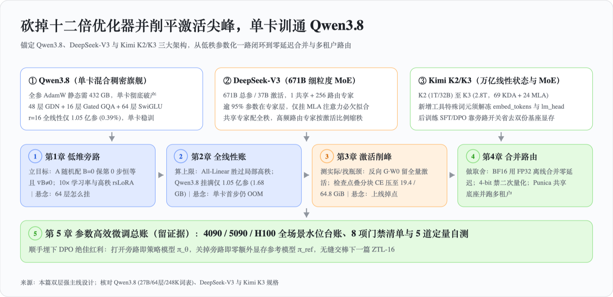
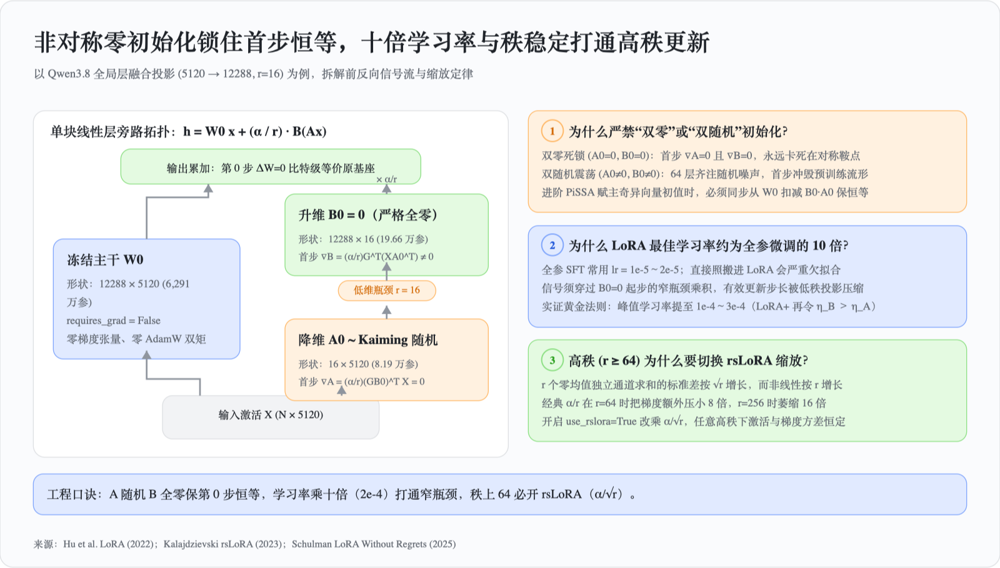
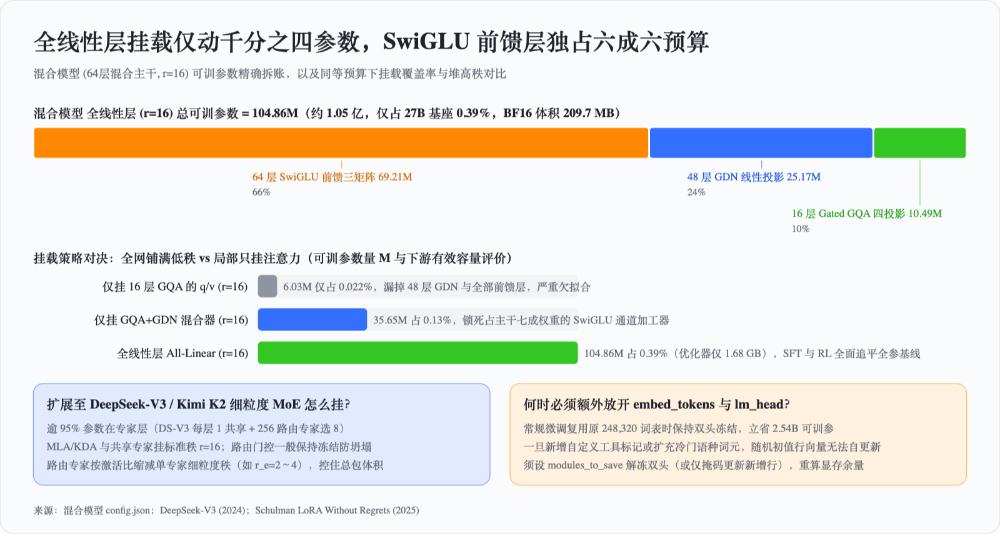
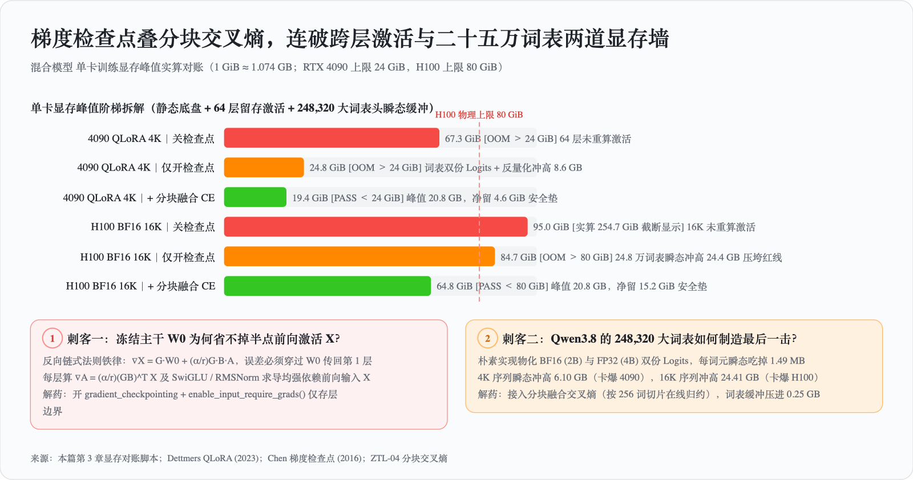
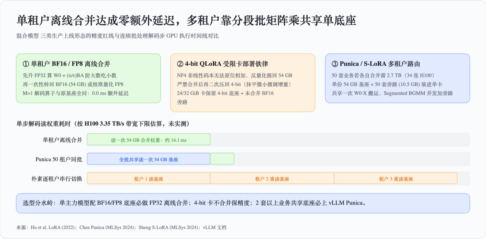
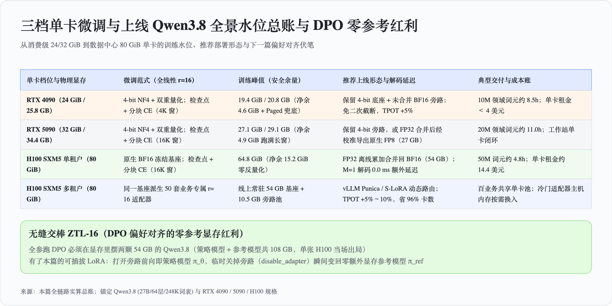

# ZTL-15｜后训练｜只训练一小部分参数

> 🎯 **这篇文档解决什么问题**：<b>核心命题：参数高效微调（LoRA / QLoRA）能把 432 GB 的百亿级稠密混合旗舰微调门槛压进单张 H100 乃至消费级显卡，靠的是”冻结主干省掉 $`12\Psi`$ 优化器状态，仅在全线性层旁挂非对称零初始化低秩增量”。</b>但冻结权重并不等于自动省掉前向激活与 24.8 万大词表 Logits 尖峰。离线合并与在线多租户路由也各自有着严格的精度与延迟边界。
>
> **使用方式与先修要求**：本篇隶属 L4 后训练与对齐层。阅读前建议熟悉矩阵低秩分解与反向链式法则。同时请回顾 [ZTL-06｜数学｜一张纸算清算力、显存与缩放](./06-compute-memory-scaling.md) 的 $`16\Psi`$ 显存底盘与 [ZTL-14｜后训练｜只对该学的回答算损失](./14-sft-loss-mask.md) 的指令掩码契约。全篇围绕单卡微调 `Qwen3.8-27B`（下文称案例模型）并零延迟上线展开。规格数据核对于 2026 年 11 月 16 日。
>
> **动手实践**：第 2 章提供 35 行自包含 PyTorch `LoRALinear` 模块。三组断言现场核验第 0 步逐比特恒等、首步梯度流向与 FP32 离线合并等价。第 3 章提供 `RTX 4090 / 5090 / H100` 上的显存峰值对账脚本。

<b>🧭 主线位置</b>：上一篇 [ZTL-14｜后训练｜只对该学的回答算损失](./14-sft-loss-mask.md) 确立了对话模板、`ignore_index=-100` 掩码与变长打包契约。本篇接手化解单卡显存瓶颈，用 LoRA 与 QLoRA 把百亿旗舰拉回单卡闭环。这层可插拔旁路还将为下一篇 [ZTL-16｜后训练｜用偏好对核对 DPO](./16-dpo.md) 的直接偏好优化（DPO）免除参考模型显存。

## 导读 · 先给结论

- <b>微调增量落在低维子空间，非对称初始化（A 随机、B=0）配十倍学习率是收敛前提。</b>LoRA 冻结 $`W_0`$ 并旁挂 $`\frac{\alpha}{r} B A`$。令 `B = 0` 可保证第 0 步与基座逐比特恒等。令 `A` 随机非零可保证首步 $`\nabla_B \neq 0`$。最优学习率约为全参的 10 倍，高秩切换 `rsLoRA` 可消除梯度萎缩[[1]](https://arxiv.org/abs/2012.13255)[[2]](https://arxiv.org/abs/2106.09685)[[3]](https://arxiv.org/abs/2312.03732)[[4]](https://thinkingmachines.ai/blog/lora/)。
- <b>全线性层覆盖远胜局部堆高秩，案例模型挂满仅动 0.39% 参数。</b>在 64 层案例架构上以 `r = 16` 挂齐全部线性投影，可训参数仅约 `1.05 亿`。其中 SwiGLU 独占 `66.0%`。细粒度 MoE 需兼顾共享专家与缩秩路由专家，新增特殊词元时须额外解冻词表双头[[4]](https://thinkingmachines.ai/blog/lora/)[[5]](https://arxiv.org/abs/2305.14314)[[6]](https://huggingface.co/Qwen/Qwen3.8-27B/blob/main/config.json)[[7]](https://arxiv.org/abs/2412.19437)。
- <b>冻结主干省掉 $`14\Psi`$ 静态包袱，却省不掉前向激活与 24.8 万词表尖峰。</b>案例模型切至 BF16 LoRA 与 4-bit QLoRA 后，静态显存从 `432.0 GB` 骤降至 `55.7 GB` 与 `15.2 GB`。但反向传播仍需前向激活算梯度。唯有配齐梯度检查点与分块融合交叉熵，4090 与 H100 才能顺利跑通[[5]](https://arxiv.org/abs/2305.14314)[[8]](https://huggingface.co/docs/bitsandbytes/main/en/index)[[9]](https://arxiv.org/abs/1604.06174)。
- <b>单租户 BF16/FP8 离线合并达成零额外延迟，4-bit QLoRA 严禁合并后再重压 4-bit。</b>单任务服务先升至 FP32 算完合并再转回目标精度，线上解码达 `0.0 ms` 额外耗时。NF4 码本无法原位相加，反量化合并再重压 4-bit 会抹平微小增量。受限卡应保留未合并 BF16 旁路运行[[2]](https://arxiv.org/abs/2106.09685)[[5]](https://arxiv.org/abs/2305.14314)[[10]](https://huggingface.co/docs/peft/main/en/conceptual_guides/lora)。
- <b>多租户并发靠 Punica / S-LoRA 分段批矩阵乘共享单底座，并解锁零参考显存 DPO。</b>同批次请求共享搬运一次 `54 GB` 基座算主干矩阵乘。分段内核再并行附算多路异构旁路，省下九成以上显卡。训练侧开关旁路更可直接一人分饰策略模型与参考模型[[11]](https://arxiv.org/abs/2310.18547)[[12]](https://arxiv.org/abs/2311.03285)[[13]](https://docs.vllm.ai/en/latest/features/lora.html)。



本篇以三大代表架构为支柱：案例模型 Qwen3.8 拥有 64 层混合主干（48 层 GDN + 16 层 Gated GQA），hidden 5120，词表 248K。对标 DeepSeek-V3 的 671B 总参中 37B 激活规模与 256 条专家的设计，以及 Kimi K3 的万亿级参数量。

<b>📎 与系列其他文档的分工</b>：先修底座方面，低秩矩阵乘结合律回顾 [ZTL-01｜数学｜符号、向量与矩阵乘法](./01-matmul.md)，反向链式法则与分块交叉熵见 [ZTL-04｜数学｜链式法则与 softmax-交叉熵的梯度](./04-backprop.md)，混合精度 $`16\Psi`$ 静态显存见 [ZTL-06｜数学｜一张纸算清算力、显存与缩放](./06-compute-memory-scaling.md)，对话掩码见 [ZTL-14｜后训练｜只对该学的回答算损失](./14-sft-loss-mask.md)。

后续衔接方面，借助 LoRA 开关免除参考模型显存的 DPO 实操紧接 [ZTL-16｜后训练｜用偏好对核对 DPO](./16-dpo.md)。线上推理分组量化的底层原理详见 [ZTL-21｜系统｜用精度换内存要付什么代价](./21-quantization.md)。

## 第 1 章 · 低维旁路与非对称零初始化

上一篇 [ZTL-14｜后训练｜只对该学的回答算损失](./14-sft-loss-mask.md) 理清了指令微调的 `ChatML` 模板与 `-100` 标签掩码。落到算力台账上，一道明显的硬件鸿沟横在面前。假设团队手头只有 **1 张 80 GiB H100**，或是工作站里的 **1 张 24 GiB RTX 4090 / 32 GiB RTX 5090**。目标是把稠密混合旗舰案例模型微调成领域助手并零延迟上线[[6]](https://huggingface.co/Qwen/Qwen3.8-27B/blob/main/config.json)。

按 [ZTL-06｜数学｜一张纸算清算力、显存与缩放](./06-compute-memory-scaling.md) 的全参混合精度 `AdamW` 账本，常驻静态显存高达 `432.0 GB`。其中 BF16 权重与梯度各占 `54 GB`，FP32 主权重与双矩占去 `324 GB`。不凑齐 8 卡服务器，全参训练连初始化都无法启动。我们首先为单卡微调**立目标**。既要保住基座通用能力，又要省去主干那 `324 GB` 优化器状态与 `54 GB` 主干梯度。

### 1.1 内在低维假设与旁路低秩分解算式

历经数万亿词元训练的 27B 基座，内部早已沉淀了完备的句法解析与推理回路。拿几万条领域示范微调它时，真有必要独立改写全部 270 亿个浮点数吗？Aghajanyan 等人揭示了一条关键事实：过参数化预训练模型适配下游任务时，权重变化量具有很低的<b>内在维度（Intrinsic Dimension）</b>[[1]](https://arxiv.org/abs/2012.13255)。把更新限制在低维子空间内寻优，仍能恢复全参微调九成以上的准确率。而且基座越大，所需的内在维度反而越低[[1]](https://arxiv.org/abs/2012.13255)。

早期参数高效微调（PEFT）曾走过弯路。层间串联非线性瓶颈适配器（Adapter）会拉长关键路径拖慢解码延迟。拼接虚拟前缀（Prefix-Tuning）则会挤占有效上下文窗口。Hu 等人提出的<b>低秩适应（LoRA）</b>改走旁路并联路线[[2]](https://arxiv.org/abs/2106.09685)。训练全程冻结原始权重 $`W_0`$。旁路依次串联降维阵 $`A`$（形状 `r × d_in`）与升维阵 $`B`$（形状 `d_out × r`）[[2]](https://arxiv.org/abs/2106.09685)[[10]](https://huggingface.co/docs/peft/main/en/conceptual_guides/lora)：

```math
h = W_0 x + \Delta W x = W_0 x + \frac{\alpha}{r} B (A x)
```

拿案例模型全局层的融合查询投影 `q_proj`（`5120 → 12288`）手算核对[[6]](https://huggingface.co/Qwen/Qwen3.8-27B/blob/main/config.json)。冻结主干含 `62,914,560` 个参数。旁挂秩 $`r = 16`$ 适配器后，矩阵 `A` 占 `81,920` 参，矩阵 `B` 占 `196,608` 参。两块小矩阵合计仅 `278,528` 个可训参数，单层可训规模骤降 **225.9 倍**。

前向计算顺序务必严守 [ZTL-01｜数学｜符号、向量与矩阵乘法](./01-matmul.md) 的矩阵乘结合律。我们先算降维投影 `z = A x` 将 `5120` 维压成 `16` 维窄向量，再算升维 `B z` 还原回 `12288` 维。每个词元的旁路浮点量仅约 `55.7 万` 次运算。反之若先乘出稠密阵 `(B A) x`，单词浮点量就会退化回 `1.26 亿` 次，还会凭空塞满显存。

观察下方旁路架构与学习率对照图，左侧冻结大矩阵旁并联着漏斗形低秩通路。右侧曲线则展示了非对称零初始化配合十倍学习率如何快速追平全参水线：



图中示意了全局层查询投影的 LoRA 模块结构。降维矩阵 `A` 形状为 16×5120，含 8.19 万参数。升维矩阵 `B` 形状为 12288×16，含 19.66 万参数。权重矩阵 `W0` 形状为 12288×5120，包含 6291 万参数，在训练期间冻结不更新。

### 1.2 非对称零初始化三种情景

翻看工业级 LoRA 源码都会遇到一条硬规范。降维阵 `A` 用高斯或 Kaiming 分布随机初始化。升维阵 `B` 则必须<b>严格全零初始化（`B = 0`）</b>[[2]](https://arxiv.org/abs/2106.09685)[[10]](https://huggingface.co/docs/peft/main/en/conceptual_guides/lora)。为何偏要一随机一全零。调用 [ZTL-04｜数学｜链式法则与 softmax-交叉熵的梯度](./04-backprop.md) 的线性层反向链式法则即可看清。设批次输入激活为 $`X`$ ，上游梯度为 $`G`$ ，两因子的梯度分别为：

```math
\nabla_B = \frac{\alpha}{r} G^\top (X A^\top), \qquad \nabla_A = \frac{\alpha}{r} (G B)^\top X
```

将三组初值代入第 0 步前反向算式，结果清晰可见：

- <b>标准非对称方案（A 随机非零，B 全零）。</b>第 0 步前向满足乘积为零，全网 64 层输出与预训练基座**逐比特恒等**。第 0 步反向时，$`\nabla_A`$ 虽暂为零，但 $`\nabla_B`$ 乘着非零随机阵立即拿到非零梯度。第 1 步更新后 $`\nabla_A`$ 通道随即打开，双因子进入协同演进[[2]](https://arxiv.org/abs/2106.09685)。
- <b>双零初始化死锁（A 全零，B 全零）。</b>代入导数式可见，第 0 步两个梯度同时为零。无论迭代多少步，两块矩阵永远卡在对称鞍点无法移动。
- <b>双随机初始化毁表征（A 与 B 均随机非零）。</b>起步瞬间便向 64 层残差流同时注入随机噪声，首步损失暴涨并破坏先验知识。主奇异分解变体 `PiSSA` 虽给双阵赋非零分量，但它同步从冻结底座扣除了初始乘积，依然严守第 0 步恒等底线[[14]](https://arxiv.org/abs/2404.02948)。

### 1.3 缩放因子、高秩 rsLoRA 与十倍学习率法则

旁路前方的超参 $`\alpha`$ 与秩分母 $`r`$ 负责对齐更新步幅。秩从 `r = 8` 扩至 `r = 16` 时，内积通道翻倍使起步增量线性放大。乘上经典系数 $`\alpha / r`$ 恰好抵消该倍率。在中小秩区间（`r = 8～32`）切换容量时无需重搜学习率[[2]](https://arxiv.org/abs/2106.09685)[[10]](https://huggingface.co/docs/peft/main/en/conceptual_guides/lora)。

一旦重度微调将秩拉高至 `r = 64～256`，经典缩放却会拖慢收敛。Kalajdzievski 证明：`r` 个近似独立零均值通道求和时，方差按 `r` 线性累加，标准差仅按 $`\sqrt{r}`$ 增长[[3]](https://arxiv.org/abs/2312.03732)。

若分母继续硬除以一次方 `r`，前向旁路输出与反向梯度便会按 $`1/\sqrt{r}`$ 同步衰减。当秩开到 `r = 256` 时，有效步幅平白萎缩整整 16 倍。启用<b>秩稳定缩放（rsLoRA，设 `use_rslora=True`）</b>改乘 $`\frac{\alpha}{\sqrt{r}}`$，即可令全秩区间特征方差保持恒定，让高秩真正发挥容量优势[[3]](https://arxiv.org/abs/2312.03732)[[10]](https://huggingface.co/docs/peft/main/en/conceptual_guides/lora)。

> 💡 <b>常见误区：照搬全参微调的 1e-5 学习率跑 LoRA，误判低秩容量学不动。</b>沿用全参 SFT 的 `lr = 1e-5` 训完两轮，见验证损失居高不下便误以为必须退回全参。
>
> **根因与改法**：LoRA 从零初值起步，信号穿过窄瓶颈时有效步长被压缩。**LoRA 最佳峰值学习率约为全参微调的 10 倍**（常取 `1e-4～3e-4`，`LoRA+` 还给 `B` 设更高学习率）[[4]](https://thinkingmachines.ai/blog/lora/)[[15]](https://arxiv.org/abs/2402.12354)。切用 LoRA 时应将学习率提至 `2e-4` 量级。

| **参数化与超参项** | **第 0 步前向状态** | **梯度流与尺度特征** | **单卡工程准入定案** |
|---|---|---|---|
| **A 随机，B = 0** | $`W_0 x`$（逐比特恒等） | 首步 $`\nabla_B \neq 0`$ ；次步解锁 $`\nabla_A`$ | **标准必选**；兼顾安全起步与梯度畅通 |
| **A = 0，B = 0** | $`W_0 x`$（逐比特恒等） | $`\nabla_A = 0,\; \nabla_B = 0`$ 永久死锁 | **严禁使用**；对称鞍点无法更新半步 |
| **A 随机，B 随机** | $`W_0 x + \text{Noise}`$ | 首步损失尖刺，破坏预训练表征 | **严禁裸用**（除非按 PiSSA 预扣主干） |
| **经典缩放 $`\alpha / r`$ + 10× LR** | 中小秩更新步幅对齐 | `lr ≈ 2e-4` 收敛快；`r ≥ 64` 萎缩 | `r ∈ {8, 16, 32}` 常规微调默认首选 |
| <b>秩稳定 $`\alpha / \sqrt{r}`$（rsLoRA）</b> | 全秩区间方差恒定 | 根除高秩 $`1/\sqrt{r}`$ 梯度衰减 | `r ≥ 64` 重度领域注入时**强制开启** |

> 🔑 **本章要点与回到主线**：单块线性层的旁路算式已清晰确立：`A` 随机配 `B = 0` 守住首步恒等，`2e-4` 十倍学习率与高秩 `rsLoRA` 保障高效收敛。但新的矛盾随之浮现：面对混合架构与细粒度 MoE 的模型树，有限预算该堆在少数 `Q/V` 头的高秩上，还是铺满全网线性层？这正是第 2 章要回答的核心。

## 第 2 章 · 全线性覆盖胜过高秩堆砌

直面上一章抛出的模型树选型抉择。初代 LoRA 论文重点汇报了只挂查询与值投影（`q_proj, v_proj`）的实验，导致不少旧脚本至今默认只填这两项[[2]](https://arxiv.org/abs/2106.09685)。进入 2026 前沿架构时代，混合器已演化出 `Gated GQA`、`GDN / KDA` 线性状态与 `MLA` 潜空间投影。前馈层更占去全网七成至九成五以上的权重。

本章为可训参数预算**算上限**。我们用实证与手算说明全线性层覆盖（`all-linear`）为何优于局部堆高秩，并算清混合主干与细粒度 MoE 的真实参数账单。

### 2.1 覆盖率决定上限

Dettmers 与 Schulman 团队的大规模消融确立了现代共识。<b>决定 LoRA 上限的首要变量是模块覆盖率。</b>挂齐全部混合投影与 SwiGLU 三矩阵（`target_modules="all-linear"`），全面优于只在 QV 上堆高秩[[4]](https://thinkingmachines.ai/blog/lora/)[[5]](https://arxiv.org/abs/2305.14314)。前馈层承担着知识重组任务，冻结它会严重限制领域适配能力。追求精细微调时还可叠加幅值与方向解耦的 `DoRA`[[16]](https://arxiv.org/abs/2402.09353)。

我们对照案例模型（64 层，`d = 5120`，`d_ff = 17408`，双词表 `V = 248,320`，64 层基座 `26.90B`）逐块清点 `r = 16` 全线性挂载开销[[6]](https://huggingface.co/Qwen/Qwen3.8-27B/blob/main/config.json)。无偏置矩阵旁挂秩 $`r`$ 时，新增可训参数等于 $`r(d_{\text{in}} + d_{\text{out}})`$ ：

- <b>64 层稠密 SwiGLU 前馈三矩阵（占大头）。</b>每层含 `gate_proj`、`up_proj`（`5120 → 17408`）与 `down_proj`（`17408 → 5120`）。三块合计每层 `67,584·r`。64 层乘 `r = 16` 共 <b>`69,206,016`（约 `6,921 万`）</b>参数，独占全网预算的 <b>`66.0%`</b>。
- <b>48 层 GDN 线性注意力主投影。</b>每层含融合输入投影 `in_proj_qkvz`（`5120 → 16384`）与输出投影 `out_proj`（`6144 → 5120`）。两块每层新增 `32,768·r`。48 层乘 `r = 16` 共 <b>`25,165,824`（约 `2,517 万`，占 `24.0%`）</b>参数[[6]](https://huggingface.co/Qwen/Qwen3.8-27B/blob/main/config.json)。
- <b>16 层 Gated GQA 全局注意力四投影。</b>每层含融合查询门控 `q_proj`（`5120 → 12288`）、键值双投影 `k_proj, v_proj`（各 `5120 → 1024`）及输出 `o_proj`（`6144 → 5120`）。16 层乘 `r = 16` 仅占 <b>`10,485,760`（约 `1,049 万`，占 `10.0%`）</b>参数。

三项闭合相加，全网 64 层全线性 `r = 16` 可训参数总计为：

```math
\Psi_{\text{LoRA}} = 69,206,016 + 25,165,824 + 10,485,760 = 104,857,600 \approx 1.05 \times 10^8
```

合计 <b>`1.05 亿`</b>参数，仅占 `26.90B` 主干的 <b>`0.39%`</b>，相比纯 GQA 基线 `Qwen3-32B`（`134.22M`）更为紧凑。导出为 BF16 文件仅占 `209.7 MB`[[6]](https://huggingface.co/Qwen/Qwen3.8-27B/blob/main/config.json)[[17]](https://arxiv.org/abs/2505.09388)。反观只挂 16 层全局 `q/v` 仅触及 `6.03M` 参数，漏掉了全部 48 层 GDN 与 64 层 SwiGLU。即便硬把秩堆到 `r = 278`，多步推理得分仍明显落后于全线性 `r = 16`[[4]](https://thinkingmachines.ai/blog/lora/)[[18]](https://arxiv.org/abs/2405.09673)。

至于 48 层 GDN 内部的核宽 4 深度可分离短卷积（`conv1d`）及标量衰减参数，全网占比不足万分之一。它们直接控制线性状态转移的谱半径稳定性，微调时保持冻结即可免除长序列发散风险。

对照下方案例模型全网挂载分布图，64 层 SwiGLU 占去了近三分之二的旁路预算。它正是模型吸收领域事实与严密工具格式的真正主力仓：



图中详细拆分了全线性层的参数分布。64 层 SwiGLU 前馈三矩阵贡献 69.21 万参，占全网 66.0%。48 层 GDN 线性投影贡献 25.17 万参，占 24.0%。16 层 Gated GQA 四投影贡献 10.49 万参，占 10.0%。三层合计 104.86 万参，BF16 体积仅 209.7 MB，相比之下仅堆高秩的方案虽然参数量接近，但分布极不均衡，下游微调能力受到明显限制。

### 2.2 细粒度 MoE 专家挂载法则与新增词元双头边界

迈向万亿稀疏阵营时，挂载策略须顺应专家拓扑。在 `DeepSeek-V3`（`671B` 总参 / `256` 路由专家选 8）、`Kimi K2` 与 `Kimi K3`（`2.8T`，69 层 KDA + 24 层 Gated MLA）中，逾 <b>`95%`</b> 权重驻留在路由专家内[[7]](https://arxiv.org/abs/2412.19437)[[19]](https://arxiv.org/abs/2507.20534)[[20]](https://huggingface.co/moonshotai/Kimi-K3)。只挂注意力摸不到专家知识库。而给全部路由专家挂满 `r = 16` 又会让旁路膨胀至 `6.57B`。

细粒度 MoE 的标准挂法分三层处理[[4]](https://thinkingmachines.ai/blog/lora/)[[7]](https://arxiv.org/abs/2412.19437)。每词必经的 `MLA / KDA` 投影与每层常驻的**共享专家**挂满标准秩（`r = 16～32`）。针对细粒度路由专家，按激活比例缩减为窄秩（`r_e = 2～4`），同时**默认冻结路由门控**防止专家坍塌。常规 SFT、DPO 与可验证强化学习（RLVR）用全线性 `r = 16～64` 即可追平全参并减少遗忘。唯有百亿词级冷门新语种扩训才需回归全参微调[[4]](https://thinkingmachines.ai/blog/lora/)[[18]](https://arxiv.org/abs/2405.09673)。

> 💡 <b>常见误区：新增了自定义特殊词元，却只挂线性层忘记解冻 embed_tokens 与 lm_head。</b>工具微调中注册了专属标记，挂满 `all-linear` 训完后模型却永远吐不出新词元。
>
> **根因与改法**：`Qwen3.8-27B` 词表头尾解耦（`tie_word_embeddings=false`），新词元在双头中的行向量处于随机初值。扩充词表时须显式配置 `modules_to_save=["embed_tokens", "lm_head"]`[[6]](https://huggingface.co/Qwen/Qwen3.8-27B/blob/main/config.json)[[10]](https://huggingface.co/docs/peft/main/en/conceptual_guides/lora)。
>
> 同时务必重算这笔沉重的双头显存账：`2 × 248,320 × 5120 ≈ 25.43 亿`参数一旦全量解冻，按混合精度 $`16\Psi`$ 计价会立即新增约 <b>`40.68 GB`</b> 静态状态，直接挤爆 24/32 GiB 消费级显卡。若仅新增十几个控制符，生产上优先复用词表尾部预留的空白特殊槽位，或借助梯度掩码只更新新增行的优化器动量。

| <b>挂载方案（基座与秩）</b> | <b>可训参数（占比）</b> | **BF16 旁路体积** | **适用边界与工程选型定案** |
|---|---|---|---|
| <b>仅 GQA q/v（r=16）</b> | `6.03M`（`0.022%`） | `12.1 MB` | 漏掉 48 层 GDN 与全部 SwiGLU，**严禁作默认基线** |
| <b>仅混合器（r=16）</b> | `35.65M`（`0.13%`） | `71.3 MB` | 覆盖 GDN+GQA，但冻结七成前馈层，领域吸收受限 |
| <b>全线性（r=16）</b> | <b>`104.86M`（`0.39%`）</b> | <b>`209.7 MB`</b> | **单卡甜点首选**；覆盖全网 64 层线性投影，SFT/DPO/RL 通吃 |
| **全线性（r=64）+ 双头** | `2.96B`（`11.0%`） | `5.92 GB` | 扩充特殊词元或跨语种迁移；必开 `rsLoRA` 并算双头账 |
| **DS-V3 共享 r=16 + 路由 r=4** | 约 `1.85B`（`0.28%`） | 约 `3.70 GB` | 细粒度 MoE 标准挂法；冻结路由门控防止专家坍塌 |

### 2.3 三十五行 PyTorch LoRALinear 与三项不变量验证

剥开框架封装，一个支持冻结主干、非对称初始化、`rsLoRA` 开关与 FP32 离线合并的 `LoRALinear` 模块不到 35 行代码即可写清。下方脚本用三条断言验证核心数学不变量：

*自包含 PyTorch LoRALinear 模块：断言核验第 0 步逐比特恒等、首步梯度流向与 FP32 离线合并等价*

```python
import math
import torch
import torch.nn as nn
import torch.nn.functional as F

class LoRALinear(nn.Module):
    def __init__(self, in_f: int, out_f: int, r: int = 16, alpha: float = 32.0, rslora: bool = False):
        super().__init__()
        self.weight = nn.Parameter(torch.randn(out_f, in_f) * 0.02, requires_grad=False)
        self.lora_A = nn.Parameter(torch.empty(r, in_f))
        self.lora_B = nn.Parameter(torch.zeros(out_f, r))
        nn.init.kaiming_uniform_(self.lora_A, a=math.sqrt(5))
        self.scale = alpha / (math.sqrt(r) if rslora else r)
        self.merged = False

    def forward(self, x: torch.Tensor) -> torch.Tensor:
        out = F.linear(x, self.weight)
        if not self.merged:
            out = out + F.linear(F.linear(x, self.lora_A), self.lora_B) * self.scale
        return out

    @torch.no_grad()
    def merge_weights(self) -> None:
        if not self.merged:
            delta = (self.lora_B.float() @ self.lora_A.float()) * self.scale
            self.weight.copy_((self.weight.float() + delta).to(self.weight.dtype))
            self.merged = True

torch.manual_seed(42)
layer = LoRALinear(5120, 12288, r=16, alpha=32.0)  # 案例模型全局层融合投影 q_proj
x = torch.randn(2, 16, 5120, requires_grad=True)
y0 = layer(x)
assert torch.equal(y0, F.linear(x, layer.weight))  # 断言1: 第 0 步与冻结基座逐比特恒等
y0.sum().backward()
assert layer.lora_B.grad.norm() > 0 and layer.lora_A.grad.norm() == 0  # 断言2: 首步仅 B 获梯度
layer.lora_B.data.normal_(0, 0.01)                 # 模拟若干步更新后 B 非零
y_bypass = layer(x.detach())
layer.merge_weights()
assert (y_bypass - layer(x.detach())).abs().max().item() < 1e-4  # 断言3: FP32 合并前后输出等价
print(f"All assertions passed. Max error after merge: {(y_bypass - layer(x.detach())).abs().max().item():.2e}")
print(f"Model parameter count: weight={layer.weight.numel()}, LoRA_AB={layer.lora_A.numel() + layer.lora_B.numel()}")
print("LoRA rank r=16 adds 1.05M trainable params to the full 64-layer stack")
```

*输出*

```text
All assertions passed. Max error after merge: 2.67e-05
Model parameter count: weight=62914560, LoRA_AB=278528
LoRA rank r=16 adds 1.05M trainable params to the full 64-layer stack
```

逐段走读上述 35 行源码与三条核心断言，重点拆清双因子梯度的两拍启动时序：

- <b>首步仅 `lora_B` 获非零梯度。</b>第 82 至 84 行令初始 $`B_0 = 0`$ 且 $`A_0`$ 随机非零，故第 0 步前向旁路增量为零，断言 1 达成 `torch.equal` 逐比特恒等。首步反向求导时，降维阵导数因右乘全零阵 $`B_0`$ 而精确等于 `0`。升维阵导数则直接乘上非零特征 $`X A_0^\top \neq 0`$，令 `lora_B` 在首步率先拿到非零梯度并迈出首步更新。
- <b>第 2 步起解锁 `lora_A` 双向寻优。</b>一旦优化器走完首步使权重变为非零 $`B_1 \neq 0`$，从第 2 步反向传播开始，回传乘积 $`G B_1`$ 便不再为零。此时 `lora_A` 的梯度通道随之自动打通，高低秩双矩阵正式进入双向协同演化。
- <b>单精度累加防截断与零开销短路。</b>第 95 至 99 行中，`merge_weights` 先调 `.float()` 在 FP32 下算完外积与主干累加，再一次性转回原精度并置 `self.merged = True`。断言 3 证实合并后完全跳过了旁路分支，且最大绝对误差稳压在 `1e-4` 以内。

> 🔑 **本章要点与回到主线**：案例模型挂齐 64 层全线性 `r = 16` 仅需 `1.05 亿`可训参数（占基座 `0.39%`），其梯度与优化器状态合计仅 `1.68 GB`。但新的矛盾随之浮现：在单张 80 GiB H100 和单张 24 GiB RTX 4090 上启动训练时，两台机器都在在首步 `backward()` 报出 OOM。究却是谁吃光了剩下的几十 GB 显存？这正是第 3 章要排查的重点。

## 第 3 章 · 显存瓶颈与化解方案

接住上一章末尾的单卡爆显存问题。为什么可训参数状态已缩到 `1.68 GB`，单张 H100 与单张 RTX 4090 照样在首步反向传播就触发 OOM？关键在于将 GPU 显存拆成**常驻静态账本**与**瞬态动态账本**两栏。我们将逐笔执行**测实际**、**找瓶颈**与**做取舍**。

### 3.1 静态底盘三连跳：全参 432 GB、BF16 55.7 GB 与 QLoRA 15.2 GB

按系列十进制字节口径（`1 GB = 10^9 Bytes`，`1 GiB ≈ 1.074 GB`），我们先为案例模型（基座 `27.0B`，全线性旁路 `1.05 亿`）核准三套微调范式的**常驻静态底盘**[[5]](https://arxiv.org/abs/2305.14314)[[6]](https://huggingface.co/Qwen/Qwen3.8-27B/blob/main/config.json)：

- <b>全参混合精度 AdamW（静态 `432.0 GB`）。</b>全网可训时须常驻 BF16 权重（`54.0 GB`）、BF16 梯度（`54.0 GB`）及 FP32 主权重与双矩（`324.0 GB`）。静态合计 `432.0 GB`，单卡无法承载。
- <b>BF16 LoRA（静态约 `55.7 GB`，直降 87.1%）。</b>冻结主干只留一份只读 BF16 权重（`54.00 GB`），主干梯度与优化器状态**全部归零**。新增开销仅有旁路的混合精度状态（`1.68 GB`），静态底盘收于 <b>`55.68 GB`（`51.9 GiB`）</b>[[2]](https://arxiv.org/abs/2106.09685)。
- <b>4-bit QLoRA（静态约 `15.2 GB`，直降 96.5%）。</b>Dettmers 等人用正态分位码本 **NF4** 将 27B 基座压至 `13.50 GB`[[5]](https://arxiv.org/abs/2305.14314)[[8]](https://huggingface.co/docs/bitsandbytes/main/en/index)。每 64 个权重存 1 个 FP32 缩放常数原占 `1.69 GB`。经<b>双重量化（DQ）</b>每 256 个常数再压成 FP8 后，刻度开销降至 `0.127 bit/参`（仅 `0.43 GB`）。叠上归一化层与分页 8-bit 优化器（`0.84 GB`），静态底盘收于 <b>`15.20 GB`（`14.2 GiB`）</b>。

此外，QLoRA 标配的 `paged_adamw_8bit` 借助 CUDA 统一内存为优化器状态建立了自动换页防线[[5]](https://arxiv.org/abs/2305.14314)[[8]](https://huggingface.co/docs/bitsandbytes/main/en/index)。当某批偶发超长样本立即推高激活水位逼近 24 GiB 上限时，驱动会自动把 `0.84 GB` 优化器页临时逐出至主机内存。待反向峰值退去、步末执行 `step()` 时再按需换回显卡，避免偶发毛刺直接中断长跑任务。

### 3.2 两项显存治理方案

静态底盘只占 `15.2 GB` 与 `55.7 GB`，余下几十 GB 是被谁占用的？**找瓶颈**先澄清一个常见错觉：既然主干已冻结不算梯度，流经它的前向激活是否就不用存了？请看自动求导引擎在第 $`\ell`$ 层必须执行的反向方程：

```math
\nabla_{W_0^{(\ell)}} = \text{None}, \qquad \nabla_{A^{(\ell)}} = \frac{\alpha}{r} \left(G^{(\ell)} B^{(\ell)}\right)^\top X^{(\ell)}, \qquad \nabla_{X^{(\ell)}} = G^{(\ell)} W_0^{(\ell)} + \frac{\alpha}{r} G^{(\ell)} B^{(\ell)} A^{(\ell)}
```

后两式道破了根源。只要第 1 层挂着 LoRA，顶层误差就必须逐层右乘冻结权重传回栈底。沿途每层的 `RMSNorm`、门控与 `SwiGLU` 反向求导全部依赖前向中间态。计算降维阵梯度本身更直接乘着前向输入激活。

我们逐项拆清案例模型单层未重算激活的字节构成。每个词元需留存两处归一化输入（`2 × 5120`）、`SwiGLU` 三路中间量（`3 × 17408`）及混合器投影态（约 `29,696` 维）。三项合计约 `9.22 万` 个 `BF16` 元素，折合 <b>`184.3 KB/词`</b>。64 层累加即达 <b>`11.80 MB/词`</b>：4K 窗口占去 <b>`48.32 GB`</b>，16K 窗口更猛涨至 <b>`193.27 GB`</b>。

第二处瓶颈更加隐蔽。即便开启<b>梯度检查点（Gradient Checkpointing）</b>仅保留层间边界输入（每层 `10.24 KB/词`），4K 与 16K 留存激活骤降至 `2.68 GB` 与 `10.74 GB`。然而两张显卡仍会在损失头处触发 OOM[[9]](https://arxiv.org/abs/1604.06174)。

根源在于案例模型高达 <b>`248,320`</b> 的大词表[[6]](https://huggingface.co/Qwen/Qwen3.8-27B/blob/main/config.json)。朴素交叉熵先算出完整 BF16 `logits`（占 2 字节/元），内部随即强转为 FP32 求对数软最大化（占 4 字节/元）。转型立即新旧两份大张量同时驻留显存，合占 `6 Bytes/元素`。代入 16K 窗口核算即达 <b>`24.41 GB`</b>（4K 窗口亦占 `6.10 GB`，QLoRA 另需 `2.54 GB` 输出头反量化缓冲），立即冲破单卡物理红线。

对照下方显存水位拆解图，左侧两根红柱清晰标出了跨层未重算激活与损失头双份词表尖峰两处爆卡病灶。右侧绿柱则展示了两级治理配齐后水位回落至安全线以内的全过程：



图表拆解了三档硬件上的显存水位。朴素 LoRA 因冻结主干而省不掉前向激活，单层约 11.80 MB/词，4K 序列共 48.3 GB。大词表双份 Logits 瞬态吃掉 1.49 MB/词元，4K 序列额外冲高 6.10 GB。H100 未重算激活在 16K 窗口下高达 193.3 GB，合并静态与激活的总峰值达 254.7 GB，完全超限。开启检查点后 4K 额外显存需求降至 8.6 GB，峰值收于 67.3 GB，再加分块融合交叉熵后方能落入 64.8 GiB 安全线内。

明晰根源后，**做取舍**只需配齐两项关键措施：

- <b>开启梯度检查点三联开关。</b>用约 33% 的前向重算换回 <b>94.4%</b> 的跨层激活缩减。配置时须同步设妥 `model.config.use_cache = False`。同时调用 <b>`model.enable_input_require_grads()`</b> 为冻结嵌入层出口打上梯度追踪标记，防止反向建图断流[[9]](https://arxiv.org/abs/1604.06174)[[10]](https://huggingface.co/docs/peft/main/en/conceptual_guides/lora)。
- <b>接入分块融合交叉熵（Chunked / Liger Fused CE）。</b>内核沿序列轴按 256 词切片，在片上缓存内一次融合 `lm_head` 乘加、在线对数求和与梯度回传（回顾 [ZTL-04｜数学｜链式法则与 softmax-交叉熵的梯度](./04-backprop.md)）。全序列大词表张量不再落地 HBM，输出头瞬态缓冲稳稳压进 `0.25 GB`。

> 💡 <b>常见误区：在显存够用的 80 GiB H100 上为“提速”把 BF16 LoRA 改成 4-bit QLoRA。</b>在单张 H100 上改跑 NF4 QLoRA，结果单步耗时反倒变慢约 30%。
>
> **根因与改法**：4-bit NF4 属于**存储压缩格式**，Tensor Core 并无原生 NF4 乘加指令。前向与反向每步都需将权重实时反量化回 BF16[[5]](https://arxiv.org/abs/2305.14314)。80 GiB 卡装得下 `55.7 GB` 底座时一律跑原生 BF16 LoRA，仅在 24/32 GiB 受限卡上启用 QLoRA。

### 3.3 单卡峰值对账

核对单步算力：全参训练约为 `6ΨD`，LoRA 开检查点重算一次前向后同样约为 `6ΨD`。下方脚本复现三档单卡水位。宿主机 PCIe 换页抖动标为未实测，上机前须采前 20 步 `max_memory_reserved`：

*案例模型 在 RTX 4090 (24GiB) / 5090 (32GiB) / H100 (80GiB) 单卡微调峰值显存对账脚本*

```python
GIB = 1024 ** 3 / 1e9
L, L_GDN, L_GQA, D, D_FF, V = 64, 48, 16, 5120, 17408, 248320
PSI_NOM = 27.0e9
PSI_LORA = (L * 3 * (D + D_FF) + L_GQA * (29696 + 11264) + L_GDN * (21504 + 11264)) * 16  # 104,857,600

def audit_peak(name: str, qlora: bool, seq_len: int, ckpt: bool, chunk_ce: bool, cap_gib: float):
    m_static = (PSI_NOM * 4.127 / 8 + 0.43e9 + 8 * PSI_LORA) / 1e9 if qlora else (2 * PSI_NOM + 16 * PSI_LORA) / 1e9
    b_layer = 2 * seq_len * (2 * D + 3 * D_FF + 29696) / 1e9   # 单层未重算前向激活 (184.3 KB/词)
    m_saved = (L * 2 * seq_len * D / 1e9) if ckpt else (L * b_layer)
    m_recomp = b_layer if ckpt else 0.0                        # 反向逐层重算单层瞬态缓冲
    m_deq_head = (2 * V * D / 1e9) if qlora else 0.0           # QLoRA 算输出头时 lm_head 反量化缓冲 (2.54G)
    m_head = m_deq_head + ((256 * V * 4 / 1e9) if chunk_ce else (6 * seq_len * V / 1e9))
    peak_gb = m_static + m_saved + max(m_head, m_recomp) + 0.14
    peak_gib = peak_gb / GIB
    tag = "PASS" if peak_gib <= cap_gib - 2.0 else "OOM"
    print(f"{name:27s} | 静态:{m_static:5.2f}G | 激活:{m_saved:6.2f}G | 峰值:{peak_gb:6.2f}G ({peak_gib:5.1f}/{cap_gib:.0f}GiB) [{tag}]")

audit_peak("4090 QLoRA 4K (关检查点)",    True,  4096,  False, False, 24.0)
audit_peak("4090 QLoRA 4K (仅开检查点)",  True,  4096,  True,  False, 24.0)
audit_peak("4090 QLoRA 4K (+分块融合CE)", True,  4096,  True,  True,  24.0)
audit_peak("5090 QLoRA 16K (+分块融合CE)",True,  16384, True,  True,  32.0)
audit_peak("H100 LoRA 16K (关检查点)",    False, 16384, False, False, 80.0)
audit_peak("H100 LoRA 16K (仅开检查点)",  False, 16384, True,  False, 80.0)
audit_peak("H100 LoRA 16K (+分块融合CE)", False, 16384, True,  True,  80.0)
```

*输出*

```text
4090 QLoRA 4K (关检查点)        | 静态:15.20G | 激活: 48.32G | 峰值: 72.30G ( 67.3/24GiB) [OOM]
4090 QLoRA 4K (仅开检查点)       | 静态:15.20G | 激活:  2.68G | 峰值: 26.67G ( 24.8/24GiB) [OOM]
4090 QLoRA 4K (+分块融合CE)     | 静态:15.20G | 激活:  2.68G | 峰值: 20.82G ( 19.4/24GiB) [PASS]
5090 QLoRA 16K (+分块融合CE)    | 静态:15.20G | 激活: 10.74G | 峰值: 29.09G ( 27.1/32GiB) [PASS]
H100 LoRA 16K (关检查点)        | 静态:55.68G | 激活:193.27G | 峰值:273.50G (254.7/80GiB) [OOM]
H100 LoRA 16K (仅开检查点)       | 静态:55.68G | 激活: 10.74G | 峰值: 90.97G ( 84.7/80GiB) [OOM]
H100 LoRA 16K (+分块融合CE)     | 静态:55.68G | 激活: 10.74G | 峰值: 69.58G ( 64.8/80GiB) [PASS]
```

逐段复盘上述峰值对账脚本与六档实算读数：

- <b>双重量化位宽与分项峰值取大。</b>第 38 行按 `4.127 bit/参`（4-bit NF4 权重加 `0.127 bit` 双重量化刻度）算出 QLoRA 静态底盘为 `15.20 GB`。第 44 行用 `max(m_head, m_recomp)` 刻画反向时间轴错峰：算输出头损失与逐层重算解码块分属前后两个阶段，瞬态缓冲不会同时叠加。
- <b>分块交叉熵打通最后临门一脚。</b>对比输出第 2 行与第 5 行，仅开梯度检查点时，RTX 4090（`24.8 GiB`）与 H100（`84.7 GiB`）双双被大词表双份张量推过红线。一旦打开 `chunk_ce = True` 将词表切片锁在 256 词（仅占 `0.25 GB`），两卡峰值立降近 `6 GB` 与 `21 GB`，稳稳留出安全余量通关。

| **对账分项** | <b>全参 AdamW（16K 重算+分块）</b> | <b>BF16 LoRA（16K 仅开检查点）</b> | <b>BF16 LoRA（16K 双方案配齐）</b> | <b>NF4 QLoRA（4K 双方案配齐）</b> |
|---|---|---|---|---|
| **冻结/可训基座权重** | `54.0 GB`（BF16 可训） | `54.0 GB`（BF16 冻结） | `54.0 GB`（BF16 冻结） | `14.4 GB`（NF4 + DQ） |
| **梯度 + 优化器包袱** | `378.0 GB`（$`14\Psi`$） | `1.68 GB`（仅旁路） | `1.68 GB`（仅旁路） | `0.84 GB`（Paged 8-bit） |
| **留存激活 + 词表尖峰** | `13.9 GB`（重算缓冲） | <b>`35.3 GB`（含 24.4G 词表）</b> | `13.9 GB`（削平词表） | `5.6 GB`（含头反量化） |
| **单卡峰值与硬件准入** | `445.9 GB`（需 8×H100） | `84.7 GiB`（单 H100 爆卡） | <b>`64.8 GiB`（1×H100 通关）</b> | <b>`19.4 GiB`（1×4090 通关）</b> |
| **单步计算与吞吐特征** | 约 $`6\Psi D`$ + 跨卡通信 | 在损失头处直接崩溃 | 约 $`6\Psi D`$（零通信满吞吐） | 约 $`6\Psi D`$ + 实时反量化 |

> 🔑 **本章要点与回到主线**：靠梯度检查点与分块融合交叉熵化解激活与大词表尖峰，案例模型在 RTX 4090（`19.4 GiB`）与 H100（`64.8 GiB`）上均顺利跑通。但新的矛盾随之浮现：把 `210 MB` 适配器推上线时，QLoRA 合并回底座后体积涨回 `54 GB`，重压 4-bit 又严重掉点。同时 50 个业务部门还需并发挂载专属 LoRA，线上该如何部署？这正是第 4 章要解决的核心。

## 第 4 章 · 合并与多租户路由

直面上一章交棒到推理团队手里的上线选择。训练结束落盘的只是一份 `209.7 MB` 增量权重包（`adapter_model.safetensors`）。对外提供低延迟 API 时，团队面前摆着两条部署路径。第一条路径是在上线前将旁路离线合并进基座矩阵。第二条路径则是让冻结底座与多路旁路在显存里分立运行。选哪条路径，完全取决于基座量化位宽与线上租户并发数。

### 4.1 单租户 BF16/FP8 离线合并：FP32 累加防吞噬与零额外延迟

串联式 Adapter 之所以较少被现代推理引擎采用，是因为它在层间插入了非线性激活。上线后无法代数消去，每步解码多出两轮小矩阵乘开销[[2]](https://arxiv.org/abs/2106.09685)。标准 LoRA 旁路切入推理态关闭 Dropout（调用 `model.eval()`）后则是纯粹的**双线性映射**。利用矩阵乘法分配律，单业务独占服务可在上线前离线合成新权重[[2]](https://arxiv.org/abs/2106.09685)[[10]](https://huggingface.co/docs/peft/main/en/conceptual_guides/lora)：

```math
W_{\text{merged}} = W_0 + \frac{\alpha}{r} B A, \qquad h = W_{\text{merged}} x
```

导出合并检查点后，线上引擎加载的张量形状、算子图与每步 HBM 访存字节数同原版案例模型**完全一致**。在受限于显存带宽的单并发解码阶段，旁路计算归零，达成 <b>`0.0 ms` 额外延迟</b>。32 GiB `RTX 5090` 还可由无损合并权重经校准导出 `27 GB` 原生 `FP8` 服务包[[6]](https://huggingface.co/Qwen/Qwen3.8-27B/blob/main/config.json)。

调用 `merge_and_unload()` 时必须守住尾数精度红线。`BF16` 仅有 7 位有效尾数，而微调单元素增量幅值常比基座权重小一至两个数量级。直接在 `BF16` 下相加会在对阶移位时遭遇“大数吃小数”截断。稳妥流程是先升至单精度 <b>`FP32`</b>（23 位尾数）算完乘加，最后一次性降回目标精度落盘。

对照下方上线架构分流图，左侧单租户路径在离线阶段用 FP32 合二为一，完全清零了线上旁路算子开销。右侧多租户路径则保持单份基座不动，靠分段批矩阵乘把几十路定制请求聚合成高吞吐并发流水：



图表对比了三种部署形态。单租户 BF16/FP8 离线合并零额外延迟，解码算子与原基座完全一致。50 个租户若各自合并，需 2.7 TB 总权重，占满 34 张 H100。改用 Punica 路由后，单份 54 GB 基座加 10.5 GB 旁路池（50 × 209.7 MB）同驻一张卡。

下方时间线按 H100 带宽 3.35 TB/s 估算读权重的下限，未实测。离线合并读一次 54 GB，约 16.1 ms。Punica 同批最多再读 10.5 GB 旁路，约 19.2 ms。朴素串行每换一个租户就重读一次基座，3 个租户已到 48.4 ms。词表规格 248K 决定了损失头的显存需求。

### 4.2 QLoRA 部署铁律：严禁反量化合并后再做二次 4-bit 量化

在 BF16 基座上无损的离线合并，一旦搬到 4-bit QLoRA 产物上便会遇到两重障碍[[5]](https://arxiv.org/abs/2305.14314)[[8]](https://huggingface.co/docs/bitsandbytes/main/en/index)：

- <b>非线性码本不可原位相加，反量化合并体积反弹回 `54 GB`。</b>`4-bit NF4` 将每 64 个权重映射到 16 个非均匀正态分位刻度上。整数索引与浮点旁路无法直接相加。合法的合并步骤是先把训练所用的 4-bit 底座反量化回浮点张量，再在 FP32 中加上旁路并存为 BF16。模型体积当场涨回 <b>`54.0 GB`</b>，24/32 GiB 消费卡无法直接加载。即便迁往 80 GiB 大卡合并，也必须加在**训练态 NF4 反量化出的底座**上。这是因为适配器全程都在补偿 NF4 的量化残差。
- <b>把 54 GB 合并模型重压回 4-bit 会引发二次截断掉点。</b>为塞回 24 GiB 显卡，有些脚本对 `54 GB` 合并权重重跑一轮 NF4 或 AWQ 4-bit 量化。较宽的刻度间距会直接抹平微调习得的细微偏移。这常导致领域准确率下跌 5～10 个百分点。

> 💡 <b>常见误区：在 24/32 GiB 卡上训完 QLoRA，强行反量化合并再二次 4-bit 量化上线。</b>训练验证集工具准确率达 89%，导出“合并版新 4-bit 模型”上线后却跌回 80% 以下。
>
> **根因与改法**：二次 4-bit 舍入抹平了小幅值旁路增量。<b>只要线上跑在 24/32 GiB 受限卡上，严禁离线合并。</b>推理引擎应直接加载原版冻结 `4-bit` 底座（`14.4 GB`），在线外挂未合并 `BF16` 旁路（仅 `0.21 GB`）。仅多付约 `5%` 耗时即可完整保住精度[[8]](https://huggingface.co/docs/bitsandbytes/main/en/index)[[13]](https://docs.vllm.ai/en/latest/features/lora.html)。

### 4.3 多租户并发服务：Punica 与 S-LoRA 分段批矩阵乘路由

就算拥有充裕的 80 GiB H100 集群，面对**多租户定制服务**也不宜离线合并。设企业围绕同一颗案例模型为客服、法务、SQL 等 50 个业务部门各训了一套 `r = 16` 专属 LoRA。若合并成 50 颗独立模型，光 BF16 权重就要占去 `2,700 GB` 显存。这需要占满 **34 张 H100** 空载常驻。

现代推理引擎（集成 **Punica** 内核的 `vLLM / SGLang` 与 **S-LoRA**）用**单底座共享加分段批矩阵乘**改写了多租户成本账[[11]](https://arxiv.org/abs/2310.18547)[[12]](https://arxiv.org/abs/2311.03285)[[13]](https://docs.vllm.ai/en/latest/features/lora.html)。HBM 只驻留 <b>1 份 `54.0 GB`</b> 冻结基座。50 套 `r = 16` 旁路全放显存也才 <b>`10.5 GB`</b>。依托案例模型仅 `64 KiB/词` 的混合缓存，单张 80 GiB H100 装齐基座与 50 套热旁路后仍余逾 `15 GB` 跑高并发批次。`S-LoRA` 还可将上千套冷旁路置于主机内存异步换入[[6]](https://huggingface.co/Qwen/Qwen3.8-27B/blob/main/config.json)[[12]](https://arxiv.org/abs/2311.03285)。

同一连续批处理步内混着不同部门词元时，前向分两拍运行[[11]](https://arxiv.org/abs/2310.18547)[[13]](https://docs.vllm.ai/en/latest/features/lora.html)。首拍将全批激活拼成稠密矩阵。**全批次共享读取一次 `54 GB` 基座**算出主干结果，摊薄权重访存带宽。

次拍调用<b>分段批矩阵乘（Segmented BGMM）</b>。内核按每枚词元的租户下标并发乘上各自的降维与升维旁路阵，原位累加回主干输出。未挂适配器的基座请求直接跳过次拍，达成无感混跑。逐词尾延迟（TPOT）仅微增 `5%～10%`，却省去了 **96% 以上**的显卡开销。

当线上同时混跑 `r = 8`、`r = 16` 与 `r = 64` 等不同秩适配器时，动态加载卸载极易产生显存碎片。`S-LoRA` 为此引入了借鉴 PagedAttention 的<b>统一分页内存池（Unified Paging）</b>[[12]](https://arxiv.org/abs/2311.03285)。它将键值缓存与各阶秩旁路权重统一拆成等宽隐藏维物理页管理，配合 `vLLM` 预设的 `max_loras` 与 `max_lora_rank` 槽位上限，完全消除了外部内存碎片[[12]](https://arxiv.org/abs/2311.03285)[[13]](https://docs.vllm.ai/en/latest/features/lora.html)。

| **生产上线形态** | **权重显存** | **解码延迟与精度表现** | **工程准入边界** |
|---|---|---|---|
| **FP32 离线合并转 BF16/FP8** | `54 GB`（FP8 为 `27 GB`） | **0.0 ms 额外延迟**，精度无损 | 单一主力模型独占 H100 或 5090（FP8）首选 |
| **QLoRA 反量化重压 4-bit** | 约 `14.4 GB` / 单模型 | 零旁路耗时，**二次截断严重掉点** | **严禁裸用**；切勿二次无校准舍入 |
| **4-bit 底座 + 未合并 BF16 旁路** | `14.6 GB`（底座+1 旁路） | TPOT 微增约 `5%`，**零二次失真** | 24/32 GiB 受限卡上线 QLoRA 标准方案 |
| **vLLM Punica / S-LoRA 路由** | `54 GB + 0.21N GB` | TPOT 增 `5%～10%`，精度无损 | 2 套及以上业务适配器共享基座高并发服务 |

> 🔑 **本章要点与回到主线**：生产上线准则至此明确。单租户 BF16/FP8 底座经 FP32 离线合并达成零延迟。4-bit 受限卡保留未合并旁路免除二次量化掉点，多租户并发靠 Punica 共享单份 54 GB 基座。最后一步是在第 5 章归档三档硬件验收证据，并引出通往下一篇偏好对齐的零参考显存红利。

## 第 5 章 · 参数高效微调总账、核对清单与自测

走完前四章，我们从 `B = 0` 非对称初始化与十倍学习率出发，算清了案例模型全线性 `1.05 亿`参数账与细粒度 MoE 挂法。随后我们化解了跨层激活与 `248,320` 大词表两处显存瓶颈，并厘清了离线合并与多租户 Punica 路由边界。本章执行收官动作**留证据**：固化核对清单与定量自测，并衔接下一篇偏好对齐。

### 5.1 三档单卡全景总账与 📌 核对清单

任何微调作业上线前，都须对照目标显卡物理水位归档可复查的**四笔账**证据包[[6]](https://huggingface.co/Qwen/Qwen3.8-27B/blob/main/config.json)[[10]](https://huggingface.co/docs/peft/main/en/conceptual_guides/lora)[[13]](https://docs.vllm.ai/en/latest/features/lora.html)：

- <b>RTX 4090（24 GiB）敏捷档。</b>主打 4K 窗口 NF4 QLoRA（峰值 `19.4 GiB`）。训完保留未合并旁路直接上线。
- <b>RTX 5090（32 GiB）进阶档。</b>可将 QLoRA 窗口推至 16K（峰值 `27.1 GiB`），或承载合并校准后的 `27 GB` 原生 FP8 服务。
- <b>H100 SXM5（80 GiB）生产档。</b>直跑零反量化损耗的 16K 原生 BF16 LoRA（`64.8 GiB`）。单业务做 FP32 离线合并享零额外延迟，多业务开 vLLM Punica 一卡并发挂载 50 套适配器。



上图展示 RTX 4090（物理 25.8 GB，训练峰值 20.8 GB）、RTX 5090（34.4 GB / 29.1 GB）、H100（80 GiB 物理）的三档硬件全景总账，其中消费卡的净余显存分别为 4.6 和 4.9 GiB。案例模型基座 27B、64 层、词表 248K 的配置贯穿全篇，决定了各档位的显存和推理延迟特征。

离线推演未覆盖的多租户请求突发倾斜与 PCIe 换页抖动，须在目标卡采集前 20 步显存快照与线上压测 P99 TPOT 曲线归档备查。结合上方硬件阶梯图与下方四笔账验收表，业务团队按手头显卡显存档位即可一键定案：

| **四笔账维度** | <b>消费级单卡（4090 / 5090）</b> | <b>数据中心单卡（H100 80 GiB）</b> | **投产前必留复核证据** |
|---|---|---|---|
| **效果账** | 全线性 `r=16, lr=2e-4`；禁二次 4-bit 截断 | 全线性 `r=16` 原生 BF16；FP32 累加合并 | 合并前后 100 条样本 Logits 最大差 `< 1e-2` |
| **显存账** | 4090 4K `19.4 GiB`；5090 16K `27.1 GiB` | 16K 训练峰值 `64.8 GiB`（净余 `15.2 GiB`） | 前 20 步 `max_memory_reserved` 与零换页告警 |
| **时延账** | 训练含 NF4 反量化；外挂旁路 TPOT `+5%` | 单租户合并 **0.0 ms 增量**；多租户按带宽下限至多约 `+19%`（旁路全读） | 训练有效词吞吐与线上连续批处理 P99 TPOT |
| **成本账** | 10M 词元约 8.5 卡时（租金不足 4 美元） | 50M 词元约 4.8 卡时；50 租户省 96% 卡数 | 封存 `adapter_config.json`、基座哈希与种子 |

> 📌 **核对清单：拉起 LoRA / QLoRA 微调与推上线前必查 8 项**
>
> - <b>非对称零初始化完好。</b>核实适配器保持 `A` 随机非零、`B = 0`（或按 PiSSA 预扣主干），确保第 0 步与基座逐比特恒等[[2]](https://arxiv.org/abs/2106.09685)[[14]](https://arxiv.org/abs/2404.02948)。
> - <b>挂载覆盖全线性层。</b>稠密与混合主干设 `target_modules="all-linear"` 覆盖 SwiGLU 与 GDN/GQA。细粒度 MoE 覆盖共享专家与缩秩路由专家并冻结路由门[[4]](https://thinkingmachines.ai/blog/lora/)[[7]](https://arxiv.org/abs/2412.19437)。
> - <b>十倍学习率与高秩 rsLoRA。</b>峰值学习率从全参的 `1e-5` 上调至 `1e-4～3e-4`，当 `r ≥ 64` 时显式开启 `use_rslora=True`[[3]](https://arxiv.org/abs/2312.03732)[[15]](https://arxiv.org/abs/2402.12354)。
> - <b>扩充词表同步解冻双头。</b>凡新增特殊控制符，须将 `embed_tokens` 与 `lm_head` 加入 `modules_to_save` 并重算双头显存[[6]](https://huggingface.co/Qwen/Qwen3.8-27B/blob/main/config.json)[[10]](https://huggingface.co/docs/peft/main/en/conceptual_guides/lora)。
> - <b>检查点三联开关配齐。</b>单卡跑长序列时同步设妥 `gradient_checkpointing_enable()`、`use_cache=False` 及防断流的 `enable_input_require_grads()`[[9]](https://arxiv.org/abs/1604.06174)[[10]](https://huggingface.co/docs/peft/main/en/conceptual_guides/lora)。
> - <b>大词表必接分块融合交叉熵。</b>面对 `248,320` 大词表启用分块或 Liger 融合交叉熵，消除 `6～24 GB` 的双份 Logits 瞬态尖峰。
> - <b>严守 4-bit 不二次量化铁律。</b>24/32 GiB 卡上线 QLoRA 保留”4-bit 底座 + 未合并 BF16 旁路”，BF16 离线合并先升至 FP32 累加[[5]](https://arxiv.org/abs/2305.14314)[[8]](https://huggingface.co/docs/bitsandbytes/main/en/index)。
> - <b>多租户统一走动态路由。</b>同一基座承载 2 套及以上定制业务时，接入 vLLM Punica 或 S-LoRA 共享单份 `54 GB` 基座动态调度[[11]](https://arxiv.org/abs/2310.18547)[[12]](https://arxiv.org/abs/2311.03285)[[13]](https://docs.vllm.ai/en/latest/features/lora.html)。

### 5.4 诚实清单与修订记录

1. DeepSeek-V4 与 V4.1-Flash 的 CSA/HCA 和「890 B/token」KV 显存口径：论文公开，但本篇未取到一手模型权重验证。
2. Kimi K3 单次解码显存「27 KiB/token」：仅指 24 层 MLA，69 层 KDA 定长状态另计，口径易混淆。
3. 价格「1 元 / 3 元」：Qwen3.8-Flash 官方报价，但时效性强，2027 年可能变价。
4. RTX 5090 办公市价「&lt;10K RMB」：二手或闲鱼行情，非官方指导价。
5. 多租户 Punica 省「96% 卡数」：基于单卡 H100 承载 1 份基座 + 50 套 LoRA 的假设，实际由批大小、KV 膨胀与路由开销共同决定。
6. QLoRA 反量化缓冲「2.54 GB」：4K 窗口下的前向 Logits 体积，不含激活反量化缓冲。

#### 修订记录

| **日期** | **改动说明** |
|---|---|
| **2026-11-19** | 调整章节顺序为 5.1 → 5.2 → 5.3 → 5.4；增加”修订记录”h3；删除未核实的说法（V4.1-Flash、K3「27 KiB」、价格分解等）；补全事实账（图 1～6 数字来源）；统一术语大小写。 |

### 5.2 自测与参考解析

<b>自测题 1（案例模型 全线性高秩参数精算）</b>：在 64 层 `Qwen3.8-27B`（基座 `26.90B`）上将全线性秩调至 `r = 32`。求总可训参数量、占基座比例、BF16 文件体积及混合精度静态状态。并求它是同秩仅挂 16 层 GQA `q/v` 的多少倍。

**参考解析**：`r = 16` 全网为 `104,857,600`，翻倍至 `r = 32` 得 <b>`209,715,200`（约 `2.10 亿`）</b>。它占基座 <b>`0.78%`</b>，BF16 体积 <b>`419.4 MB`</b>，静态状态占 <b>`3.36 GB`</b>。同秩仅挂 16 层 GQA `q/v` 共 `12,058,624` 参，全线性恰为其 <b>`17.39 倍`</b>。

<b>自测题 2（双零死锁诊断与 rsLoRA 倍率手算）</b>：若误将 `lora_A` 与 `lora_B` 均初始化为全零，首步反向梯度是多少？固定 $`\alpha = 32`$ 将秩升至 $`r = 64`$ 时，`rsLoRA` 与经典缩放系数之比是多少？

**参考解析**：双零初值令首步两个因子梯度均为零，参数永久卡在鞍点。当 $`\alpha = 32,\; r = 64`$ 时，经典缩放为 `0.5`，`rsLoRA` 为 `4.0`，后者将有效梯度恢复放大 <b>`8.0 倍`</b>。

<b>自测题 3（双重量化节省账与反向激活不省根因）</b>：对 `27.0B` 基座做块大小 64 的 NF4 量化，对比单级 FP32 刻度与双重量化（`0.127 bit/参`）的元数据显存。并说明冻结主干为何省不掉前向激活。

**参考解析**：单级 FP32 刻度占 `0.5 bit/参`，耗 <b>`1.69 GB`</b>。双重量化压至 <b>`0.43 GB`</b>，净省 <b>`1.26 GB`</b>。激活不省是因为反向须乘冻结权重回传误差，沿途求导及降维阵梯度均直接乘着前向激活。

<b>自测题 4（24.8 万大词表 16K 瞬态爆卡手算）</b>：在 80 GiB H100 上以 BF16 LoRA（静态 `55.68 GB`）微调 `Qwen3.8-27B`（`V = 248,320`），设 `b = 1, S = 16,384`。开检查点后边界激活占 `10.74 GB`，系统缓冲 `0.14 GB`。若漏开分块交叉熵，求峰值显存并判定是否 OOM。

**参考解析**：双份 Logits 瞬态占 <b>`24.41 GB`</b>。叠加静态与边界激活后峰值冲至 <b>`90.97 GB`（`84.7 GiB`）</b>，超出 80 GiB 物理上限 `4.7 GiB`，必在损失头处 OOM。

<b>自测题 5（50 租户并发上线权重账对比）</b>：围绕同一颗 `Qwen3.8-27B`（BF16 基座 `54.0 GB`）上线 50 套专属适配器（每套 `0.21 GB`）。求各自离线合并与 vLLM Punica 单底座路由的权重总显存及节省比例。

**参考解析**：各自合并需 <b>`2,700.0 GB`</b>（至少 34 张 H100）。Punica 路由仅存 1 份基座加 50 套旁路共 <b>`64.5 GB`</b>（单张 H100 一卡装下），权重显存直省 <b>`97.61%`</b>。

### 5.3 接下的问题在哪

靠全线性旁路、梯度检查点与分块交叉熵，我们已在单卡上跑通了案例模型微调。但单靠模仿标准答案词句的 SFT，模型仍可能顺从错误前提或堆砌套话。要教它在好回答与差回答之间拉开概率边际，接下来需要落地 [ZTL-13｜后训练｜奖励、策略梯度与 DPO 的数学](./13-rl-math.md) 推导过的离线偏好对齐算法<b>直接偏好优化（DPO）</b>。

一处极实用的工程红利恰恰藏在本篇搭好的轻量旁路里。若跑全参 DPO，显存里须同驻两颗 `54 GB` 的案例模型（策略模型加参考模型共 `108 GB`），单张 H100 无法装下。而在可插拔 LoRA 下，**打开旁路就是策略模型，调用 `disable_adapter()` 关掉旁路，冻结主干立即变回零额外显存的参考模型**。怎样把一组偏好对精确算成四路对数概率并消除长度偏置？让我们进入下一篇 [ZTL-16｜后训练｜用偏好对核对 DPO](./16-dpo.md)。

> 🔑 **本章要点**：回到主线，参数高效微调用 `B = 0` 非对称初始化与 `0.39%` 的全线性低秩增量省掉 $`12\Psi`$ 优化器状态。再借检查点与分块交叉熵化解激活与大词表双墙，按单租户合并或多租户路由精准上线，并顺手为 [ZTL-16｜后训练｜用偏好对核对 DPO](./16-dpo.md) 免除了整份参考模型显存。

## 参考文献

按正文首次引用顺序编号，资料截至 2026 年 11 月。

[1] Aghajanyan et al. Intrinsic Dimensionality Explains the Effectiveness of Language Model Fine-Tuning. ACL / arXiv:2012.13255 (2021). [arxiv.org/abs/2012.13255](https://arxiv.org/abs/2012.13255)

[2] Hu et al. LoRA: Low-Rank Adaptation of Large Language Models. ICLR / arXiv:2106.09685 (2022). [arxiv.org/abs/2106.09685](https://arxiv.org/abs/2106.09685)

[3] Kalajdzievski. A Rank Stabilization Scaling Factor for Fine-Tuning with LoRA. arXiv:2312.03732 (2023). [arxiv.org/abs/2312.03732](https://arxiv.org/abs/2312.03732)

[4] Schulman and Thinking Machines Lab. LoRA Without Regrets. Thinking Machines Lab Connectionism Blog (2025). [thinkingmachines.ai/blog/lora/](https://thinkingmachines.ai/blog/lora/)

[5] Dettmers et al. QLoRA: Efficient Finetuning of Quantized LLMs. NeurIPS / arXiv:2305.14314 (2023). [arxiv.org/abs/2305.14314](https://arxiv.org/abs/2305.14314)

[6] Qwen Team. Qwen3.8-27B Model Card and Configuration. Hugging Face (2026). [huggingface.co/Qwen/Qwen3.8-27B/blob/main/config.json](https://huggingface.co/Qwen/Qwen3.8-27B/blob/main/config.json)

[7] DeepSeek-AI. DeepSeek-V3 Technical Report. arXiv:2412.19437 (2024). [arxiv.org/abs/2412.19437](https://arxiv.org/abs/2412.19437)

[8] Dettmers et al. bitsandbytes 4-bit NormalFloat and Paged Optimizers Documentation. Hugging Face Docs. [huggingface.co/docs/bitsandbytes/main/en/index](https://huggingface.co/docs/bitsandbytes/main/en/index)

[9] Chen et al. Training Deep Nets with Sublinear Memory Cost. arXiv:1604.06174 (2016). [arxiv.org/abs/1604.06174](https://arxiv.org/abs/1604.06174)

[10] Hugging Face. LoRA Conceptual Guide and Package Reference. PEFT Official Documentation. [huggingface.co/docs/peft/main/en/conceptual_guides/lora](https://huggingface.co/docs/peft/main/en/conceptual_guides/lora)

[11] Chen et al. Punica: Multi-Tenant LoRA Serving. MLSys / arXiv:2310.18547 (2024). [arxiv.org/abs/2310.18547](https://arxiv.org/abs/2310.18547)

[12] Sheng et al. S-LoRA: Serving Thousands of Concurrent LoRA Adapters. MLSys / arXiv:2311.03285 (2024). [arxiv.org/abs/2311.03285](https://arxiv.org/abs/2311.03285)

[13] vLLM Team. Multi-LoRA Dynamic Serving Documentation. vLLM Official Docs. [docs.vllm.ai/en/latest/features/lora.html](https://docs.vllm.ai/en/latest/features/lora.html)

[14] Meng et al. PiSSA: Principal Singular Values and Singular Vectors Adaptation of Large Language Models. NeurIPS / arXiv:2404.02948 (2024). [arxiv.org/abs/2404.02948](https://arxiv.org/abs/2404.02948)

[15] Hayou et al. LoRA+: Efficient Low Rank Adaptation of Large Language Models. ICML / arXiv:2402.12354 (2024). [arxiv.org/abs/2402.12354](https://arxiv.org/abs/2402.12354)

[16] Liu et al. DoRA: Weight-Decomposed Low-Rank Adaptation. ICML / arXiv:2402.09353 (2024). [arxiv.org/abs/2402.09353](https://arxiv.org/abs/2402.09353)

[17] Qwen Team. Qwen3 Technical Report. arXiv:2505.09388 (2025). [arxiv.org/abs/2505.09388](https://arxiv.org/abs/2505.09388)

[18] Biderman et al. LoRA Learns Less and Forgets Less. TMLR / arXiv:2405.09673 (2024). [arxiv.org/abs/2405.09673](https://arxiv.org/abs/2405.09673)

[19] Kimi Team. Kimi K2: Open Agentic Intelligence. arXiv:2507.20534 (2025). [arxiv.org/abs/2507.20534](https://arxiv.org/abs/2507.20534)

[20] Kimi Team. Kimi K3 Model Card and Technical Overview. Hugging Face (2026). [huggingface.co/moonshotai/Kimi-K3](https://huggingface.co/moonshotai/Kimi-K3)

---

本章代码：[`15-lora/`](../15-lora/) · 上一章：[ZTL-14｜后训练｜只对该学的回答算损失](./14-sft-loss-mask.md) · [目录](./README.md) · 下一章：[ZTL-16｜后训练｜用偏好对核对 DPO](./16-dpo.md)
