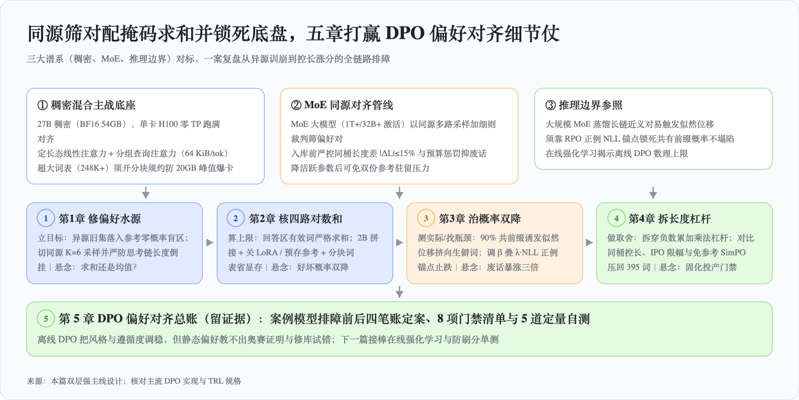
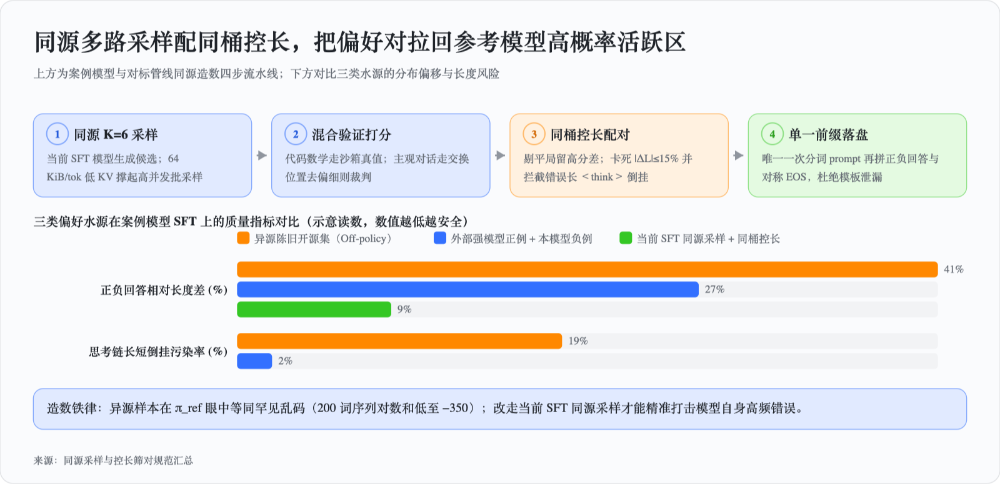
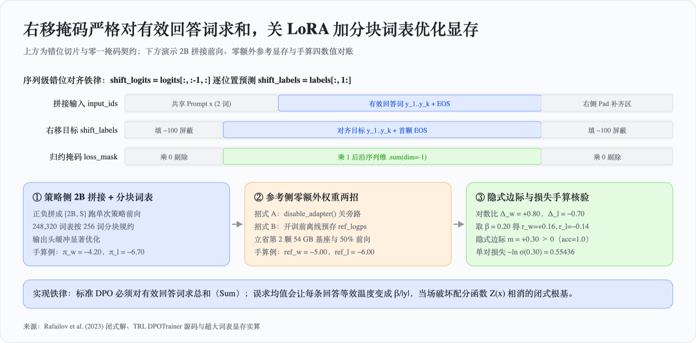
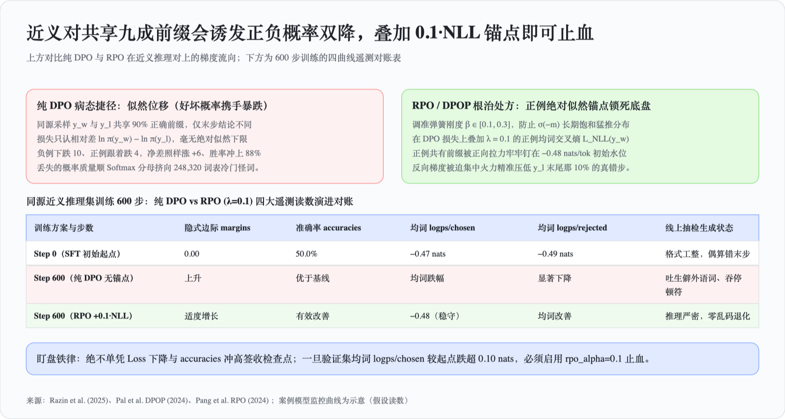
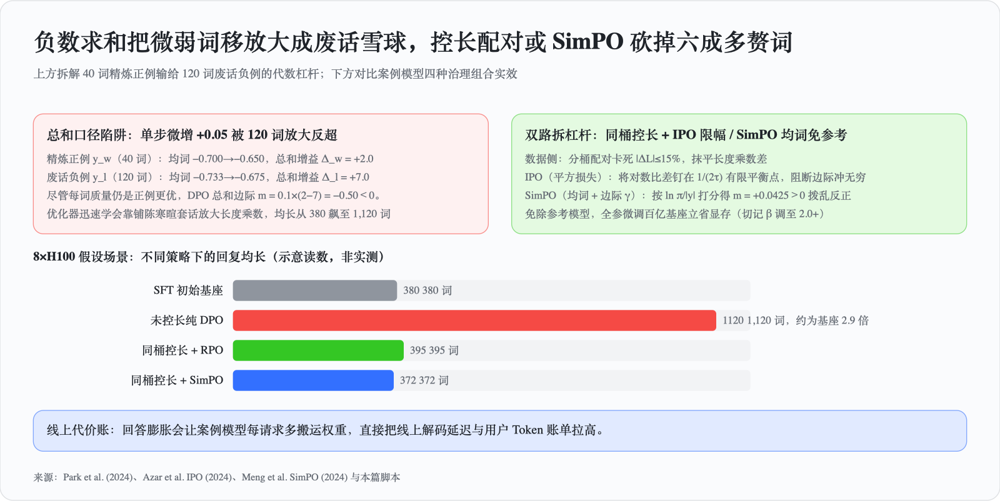
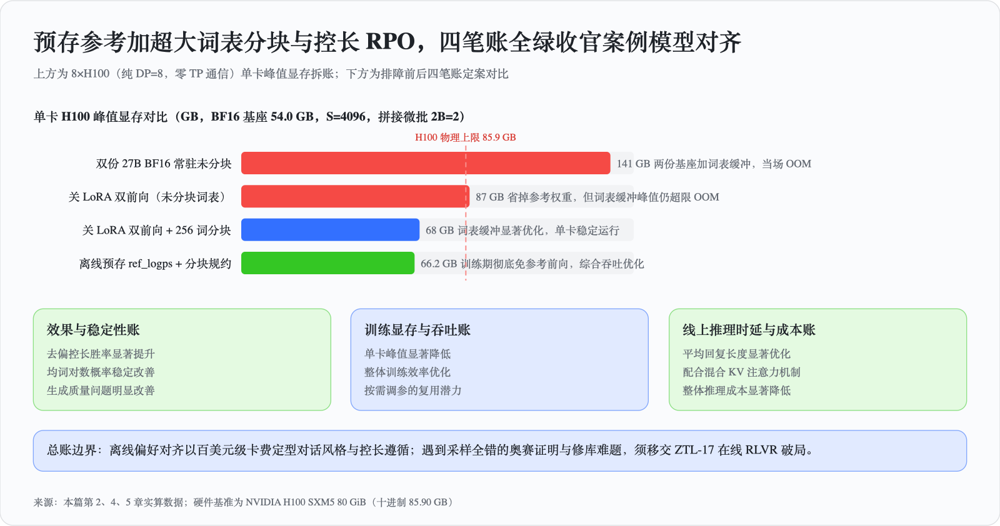

# ZTL-16｜后训练｜用偏好对核对 DPO

> 🎯 **这篇文档解决什么问题**：<b>核心命题：把 DPO 公式变成线上真正涨分而不崩坏的模型，必须守住水源、掩码与分布底盘三道工程关。</b>数据源必须由当前 SFT 模型同源采样并配平长度，消除分布偏移。代码实现必须对有效回答词求对数概率总和，并靠开关 LoRA 旁路省去参考显存。训练监控还需紧盯似然位移与长度膨胀，用正向锚点或长度归一化及时纠偏。
>
> **使用方式与先修要求**：本篇隶属 L4 后训练与对齐层，先修第 13～15 篇（承接 [ZTL-13｜后训练｜奖励、策略梯度与 DPO 的数学](./13-rl-math.md) 的闭式解与 [ZTL-15｜后训练｜只训练一小部分参数](./15-lora.md) 的低秩显存账）。全篇在案例模型 LoRA 底座上做偏好对齐。文中同步对照 MoE 同源管线与推理边界。贯穿全篇的 8×H100 排障案例是教学用的假设场景：均长、胜率、logp 读数都是示意读数，训练耗时按假设 MFU 由公式估算，均不是实测。
>
> **章节脉络与核对日期**：第 1 章排查异源数据训崩之谜并转向同源控长采样。第 2 章核准四路对数概率总和与零额外参考显存方案。第 3 章拆解正负概率双降并用正例锚点止血。第 4 章消除废话膨胀的长度杠杆，第 5 章固化总账门禁并衔接在线强化学习。三大谱系规格核对于 2026 年 11 月 16 日。
>
> **动手实践**：第 2 章提供 35 行 PyTorch `compute_dpo_loss` 与 `248,320`（约 248K）大词表分块规约脚本。它可直接断言手算真值与单卡 H100 显存。第 4 章提供 `DPO / RPO / IPO / SimPO` 四目标对比计算器与 `8×H100` 收益复算代码。

<b>案例模型约定：</b>本篇以百亿级 27B 稠密模型为主要实验对象，下文简称”案例模型”或”27B”。多模型对照包括 MoE 和推理边界模型，分别代表不同架构与性能特征。

<b>🧭 主线位置</b>：上一篇 [ZTL-15｜后训练｜只训练一小部分参数](./15-lora.md) 用 LoRA 把百亿模型微调压进单卡，但正例模仿难以定向压制次优回复。本篇基于 [ZTL-13｜后训练｜奖励、策略梯度与 DPO 的数学](./13-rl-math.md) 的闭式解落地成对偏好对齐。当静态偏好遇到数理与修库瓶颈时，下一篇 [ZTL-17｜后训练｜先验证奖励再训练](./17-verifiable-reward.md) 将开启可验证奖励强化学习。

## 导读 · 先给结论

- <b>偏好对须字节级共享提示前缀，并由当前 SFT 同源采样筛出。</b>拿陈旧异源偏好集微调新基座，参考模型会给出趋零概率，梯度随即掉入盲区。现代管线统一由当前 SFT 自采样多条候选。再经去偏验证器挑选长度均衡配对[[1]](https://arxiv.org/abs/2305.18290)[[2]](https://arxiv.org/abs/2405.08448)[[3]](https://huggingface.co/Qwen/Qwen3.8-27B/blob/main/config.json)[[4]](https://arxiv.org/abs/2507.20534)。
- <b>序列对数概率须取有效回答词总和，靠开关 LoRA 与分块词表跑稳 27B。</b>把总和误写为均值会让等效温度随长度漂移，配分函数相消随即失效。工程上拼成 `2B` 单次前向，调用 `disable_adapter()` 或预存 `ref_logps` 省去第二份 `54 GB` 基座。再配分块规约削平 `248,320` 词表的 `20.3 GB` 缓冲峰值[[3]](https://huggingface.co/Qwen/Qwen3.8-27B/blob/main/config.json)[[5]](https://huggingface.co/docs/trl/dpo_trainer)[[6]](https://huggingface.co/docs/trl/main/en/reducing_memory_usage)。
- <b>隐式胜率走高不代表模型健康，须用 NLL 锚点阻断正负概率双降。</b>同源正负回答常共享九成相同前缀，仅末尾结论不同。优化器为拉大相对差值会把共有前缀一并压低，将概率挤向生僻词。调准温度并叠加小权重正例交叉熵锚点（RPO）或铰链下限（DPOP）即可根治[[7]](https://arxiv.org/abs/2402.13228)[[8]](https://arxiv.org/abs/2404.19733)[[9]](https://arxiv.org/abs/2410.08847)。
- <b>负数累加自带偏袒长废话的杠杆，可协同同桶控长与 SimPO 拆解。</b>逐词对数概率皆为负数，长回答靠微弱优势乘以词数就能反超精炼正例。数据侧严控同桶长度差 $`|\Delta L| \le 15\%`$ 。算法侧选用平方限幅 `IPO` 或均词免参考 `SimPO`（温度重标定至 `2.0～2.5`），即可消除冗长偏置[[10]](https://arxiv.org/abs/2310.12036)[[11]](https://arxiv.org/abs/2405.14734)[[12]](https://arxiv.org/abs/2403.19159)[[13]](https://arxiv.org/abs/2404.04475)。
- <b>同源控长叠预存参考与 RPO 锚点，提速 46.7% 并省下 64.7% 解码词。</b>在 `8×H100` 多卡训练场景下，离线预存加 256 词分块将单卡峰值从 `87.0 GB` 压至 `66.2 GB`。同桶控长配 $`0.1 \cdot \mathcal{L}_{\text{NLL}}`$ 锚点把均长从 `1,120` 词拉回 `395` 词。长度受控胜率（`LC-WinRate`）由 `41.8%` 升至 `55.4%`[[3]](https://huggingface.co/Qwen/Qwen3.8-27B/blob/main/config.json)[[6]](https://huggingface.co/docs/trl/main/en/reducing_memory_usage)[[13]](https://arxiv.org/abs/2404.04475)。



<b>📎 与系列其他文档的分工</b>：Bradley-Terry 模型与 DPO 闭式推导归 [ZTL-13｜后训练｜奖励、策略梯度与 DPO 的数学](./13-rl-math.md)，对话掩码归 [ZTL-14｜后训练｜只对该学的回答算损失](./14-sft-loss-mask.md)，LoRA 显存账归 [ZTL-15｜后训练｜只训练一小部分参数](./15-lora.md)。本篇专注成对数据清洗、掩码求和与训练防崩。复杂数理与编程的在线强化学习交由 [ZTL-17｜后训练｜先验证奖励再训练](./17-verifiable-reward.md)，自动裁判去偏检验留给 [ZTL-28｜工程｜先写评测再改系统](./28-eval.md)。

## 第 1 章 · 偏好水源不对会训崩基座

承接 [ZTL-15｜后训练｜只训练一小部分参数](./15-lora.md) 末尾交棒的任务，我们手里刚训好一颗挂载全线性层 `LoRA`（$`r = 32, \alpha = 64`$）的案例模型指令版本[[3]](https://huggingface.co/Qwen/Qwen3.8-27B/blob/main/config.json)。这颗稠密混合旗舰拥有 `27B` 参数（BF16 权重占 `54.0 GB`），词表高达 `248,320`。主干由 `48` 层 Gated DeltaNet（GDN）定长状态线性注意力与 `16` 层 Gated GQA 全局注意力按 3:1 交替组成。

这颗模型在常规单条指令上已对答流利，遇到多约束任务时仍偶发幻觉或文风松散。我们由此启动偏好对齐的第一步**立目标**。团队不引入沉重的在线奖励模型，仅靠成对偏好三元组 $`(x, y_w, y_l)`$ 推高正例 $`y_w`$ 并压制负例 $`y_l`$ 。去偏长度受控胜率须突破 `53%`，且不能损伤代码数理底子与停顿纪律[[1]](https://arxiv.org/abs/2305.18290)[[13]](https://arxiv.org/abs/2404.04475)。

### 1.1 异源数据的分布外危害

为图省事，团队首轮实验直接下载了 `30,000` 对两年前由外部旧模型生成的通用偏好集。我们将其原封不动喂给案例模型 SFT 跑直接偏好优化（DPO）。异常很快出现：训练损失顺滑下降，代码与多步问答准确率却比起点倒退近 7 个百分点。句尾还频频冒出半截生硬翻译腔。

病根在于<b>异源分布偏移（Off-policy Distribution Shift）</b>[[2]](https://arxiv.org/abs/2405.08448)。在 DPO 框架中，当前 SFT 模型同时充当冻结参考模型与策略初值。异源样本出自用词习惯和模板截然不同的旧模型。送进案例模型 SFT 求似然时，正负回答双双掉进参考概率趋零的分布外荒漠。

对同样 200 词的回复，自生成同源样本的参考序列对数和约在 `-68`（均词 `-0.34 nats`）活跃区。异源旧样本却深跌至 `-350` 以下（均词低至 `-1.75 nats`）。在零概率盲区强拉对数比，梯度打不中当前基座的真实错误。它反而迫使输出层剧烈扭曲，直接破坏原有语法流形[[2]](https://arxiv.org/abs/2405.08448)[[14]](https://arxiv.org/abs/2411.15124)。

外部数据还极易破坏**同提示前缀契约**。回看 [ZTL-13｜后训练｜奖励、策略梯度与 DPO 的数学](./13-rl-math.md) 的推导，配分函数 $`Z(x)`$ 能正负相消，前提是两条分支共享<b>逐词元全同的提示 $`x`$</b>[[1]](https://arxiv.org/abs/2305.18290)[[15]](https://huggingface.co/docs/trl/dataset_formats)。若脚本给正例留了换行而负例漏加，或负例漏掉末尾 `<|im_end|>`，DPO 几十步内就会退化为格式符号检测器。正文质量本身毫无进步。

处理多轮对话或工具调用轨迹时，同样须把历史轮次与工具返回 JSON 锁进冻结前缀 $`x`$ 。我们只拿最后一步分出高下的助手回复构造 $`(y_w, y_l)`$ 。严禁把不同的外部环境报错混进回答区充当负例[[4]](https://arxiv.org/abs/2507.20534)[[15]](https://huggingface.co/docs/trl/dataset_formats)。

> 💡 <b>常见误区：将整段对话存成两条独立字符串分别分词。</b>现象是开训不到 40 步，验证集隐式胜率就冲上 `99.4%`，盲测回复却毫无进步。根因是正负导出脚本在助手标签后分别带了双换行与单换行。字节级 BPE 将其切成了不同词号，损失退化为首词换行检测器。改法是强制存成三元组，先对唯一一份 `prompt` 分词一次，再各自拼接正负回答与对称 `EOS`[[3]](https://huggingface.co/Qwen/Qwen3.8-27B/blob/main/config.json)[[15]](https://huggingface.co/docs/trl/dataset_formats)。

### 1.2 同源在线采样与控长筛对

看清盲区危害后，业界统一的 MoE 和稠密模型均转向**同源在线采样筛对**[[2]](https://arxiv.org/abs/2405.08448)[[4]](https://arxiv.org/abs/2507.20534)[[14]](https://arxiv.org/abs/2411.15124)[[16]](https://arxiv.org/abs/2505.09388)。整套造数流水线按四道工序运转：

- <b>当前 SFT 高并发多采样。</b>对每道提示，直接用待对齐的案例模型 SFT 独立采样 `K = 6` 条候选。非思考指令设 `T = 0.7, top_p = 0.80`，思考模式设 `T = 1.0, top_p = 0.95, top_k = 20`[[3]](https://huggingface.co/Qwen/Qwen3.8-27B/blob/main/config.json)。该模型整网增长型 KV 仅 `64 KiB/tok`，较纯 GQA 基线 `Qwen3-32B`（`256 KiB/tok`）直降 <b>75%</b>。单机可开出三倍以上并发批次快速扫完题库[[3]](https://huggingface.co/Qwen/Qwen3.8-27B/blob/main/config.json)[[16]](https://arxiv.org/abs/2505.09388)。
- <b>沙箱真值与去偏细则混合判分。</b>代码、数学与格式题走单测沙箱或正则判分。开放写作与多轮工具规划，则调用正反交换去偏的细则裁判逐条打分[[4]](https://arxiv.org/abs/2507.20534)[[17]](https://arxiv.org/abs/2310.01377)[[18]](https://arxiv.org/abs/2412.19437)。
- <b>分差门槛与同桶控长。</b>同题 6 条候选若分差过小（全对或全错）便直接丢弃。出现高分并列时，优先挑选与负例长度相近的正例。严格控制相对长度差 $`|\Delta L| \le 15\%`$ ，从源头切断堆字数刷分通道[[2]](https://arxiv.org/abs/2405.08448)[[14]](https://arxiv.org/abs/2411.15124)。
- <b>严防弹性思考模式的长度倒挂。</b>开启推理强化模式时，正确候选常以 `300` 词推完思考步给出正解。错误候选却常因卡壳陷入 `2,400` 词死循环复读[[3]](https://huggingface.co/Qwen/Qwen3.8-27B/blob/main/config.json)[[19]](https://arxiv.org/abs/2501.12948)。若把短正解直接配超长错解，模型只会粗暴惩罚一切长思考链。因此必须在同一思考档位与相近长度桶内配对[[3]](https://huggingface.co/Qwen/Qwen3.8-27B/blob/main/config.json)[[18]](https://arxiv.org/abs/2412.19437)。



对照上方画板可见，异源旧样本在参考分布中深陷左侧 `-1.75 nats` 零概率荒漠，梯度更新极易跑偏伤及基座语法。改走右侧同源 `K = 6` 多采样加控长筛对后，正负样本双双回到 `-0.34 nats` 高密度活跃区，每一分反向梯度都能精准命中当前模型自身的推理短板。

图中三组指标柱对比可见，同源采样相比异源陈旧集合在三组示意读数上都更好，其中正负回答相对长度差从 `41%` 收窄至 `9%`，意味着筛对约束已生效。

下表对比四类偏好水源的参考分布位置、长度污染风险与生产定位（阅读时重点对照第一行与第三行的概率坐标跨度）：

| **偏好水源路线** | **相对 $`\pi_{\text{ref}}`$ 的概率位置** | **主要失效风险与思考链隐患** | **采样开销与生产定位** |
|---|---|---|---|
| **异源陈旧开源集** | 正负双双落入极低概率盲区 | 梯度偏离自身错误，挤坏基座语法与代码 | 零采样费；仅限几百步代码冒烟单测 |
| **外部强模型正例 + 自采负例** | 半同源（负例在流形内，正例偏外） | 文风排版跨度大，易学表面加粗符号捷径 | 须先拿强正例补做一轮 SFT 拉近支撑集 |
| **单轮当前 SFT 同源筛对** | 严格同源（均处 `-0.3～-0.9` 活跃区） | 未控长时易现短正解配长死循环的长度倒挂 | 付一次离线批采样费；**工业界主力标配** |
| **多轮迭代同源在线 DPO** | 动态同源（每轮刷新策略与参考底座） | 多轮累积极易放大细则裁判的隐性长度偏置 | 逼近在线 RL 开销；适合旗舰上线前冲刺 |

> 🔑 **本章要点与回到主线**：改走当前案例模型 SFT 同源采样、锁定单一 `prompt` 分词并在同思考档位内控制 $`|\Delta L| \le 15\%`$ ，扫清了分布偏移，筑牢了**效果账**的数据地基。但干净的 $`(x, y_w, y_l)`$ 数据对备齐后，新的工程问题随之浮现：送进 [ZTL-13｜后训练｜奖励、策略梯度与 DPO 的数学](./13-rl-math.md) 的 DPO 公式时，四个序列对数概率该对每个词求平均还是求总和？错开一格掩码会发生什么？又怎样省掉第二份参考基座的显存？这正是第 2 章要逐位核准的重点。

## 第 2 章 · 四路对数求和省显存

接住上一章末的三个追问，同源控长三元组已经落盘就绪。要把数据算成精确损失与梯度，写错一个归约函数或错开一格切片都会前功尽弃。若同时常驻策略与参考两颗 27B 权重，`108 GB` 静态体积更会当场撑爆单张 80 GiB H100。本章先从闭式解根基确立回答区求和铁律并手算对账，随后推演显存与算力的**算上限**，落地零额外参考显存与超大词表防溢出方案。

### 2.1 求和铁律与掩码对齐

调出 [ZTL-13｜后训练｜奖励、策略梯度与 DPO 的数学](./13-rl-math.md) 导出的标准 DPO 单样本损失公式。给定温度 $`\beta \gt 0`$ 、策略 $`\pi_\theta`$ 与冻结参考模型 $`\pi_{\text{ref}}`$ ，损失定义为[[1]](https://arxiv.org/abs/2305.18290)：

```math
\mathcal{L}_{\text{DPO}}(\theta; x, y_w, y_l) = -\ln \sigma\!\left(\beta \left[\left(\ln \pi_\theta(y_w \mid x) - \ln \pi_{\text{ref}}(y_w \mid x)\right) - \left(\ln \pi_\theta(y_l \mid x) - \ln \pi_{\text{ref}}(y_l \mid x)\right)\right]\right)
```

不少工程师习惯了微调时交叉熵默认求均值，顺手把序列对数概率写成了回答词平均值。这在标准 DPO 里属于严重编码错误。回到 [ZTL-13｜后训练｜奖励、策略梯度与 DPO 的数学](./13-rl-math.md) 的玻尔兹曼闭式解，式中的 $`\pi(y \mid x)`$ 是**整条回答序列的联合条件概率**。按自回归链式法则，联合概率取对数严格等于<b>回答区间有效词对数概率的总和（Sum）</b>[[1]](https://arxiv.org/abs/2305.18290)[[5]](https://huggingface.co/docs/trl/dpo_trainer)：

```math
\ln \pi(y \mid x) = \sum_{t=1}^{T} m_t \ln \pi(y_t \mid x, y_{\lt t})
```

式中掩码 $`m_t \in \{0, 1\}`$ 仅在有效回答词与首颗合法终止符 `EOS` 处取 `1`。若擅自除以长度改成求均值，相当于把正负分支温度暗中改成了 $`\beta / |y_w|`$ 与 $`\beta / |y_l|`$ 。只要正负长度不等，对数配分函数 $`\beta \ln Z(x)`$ 就再也无法相减抵消，闭式解等价性随即失效[[1]](https://arxiv.org/abs/2305.18290)[[11]](https://arxiv.org/abs/2405.14734)。

落到形状为 `[2B, S, V]` 的张量代码上，必须严守三条切片规则[[5]](https://huggingface.co/docs/trl/dpo_trainer)：

- <b>右移一格因果对齐。</b>第 `j` 位输出预测的是第 `j + 1` 位目标词。代码必须取 `logits[:, :-1, :]` 对齐 `labels[:, 1:]`。
- <b>掩净前缀与补齐但保住终止符。</b>提示前缀与右侧补齐（Padding）位的 `labels` 一律填 `-100` 并乘零掩净。唯独回答末尾那颗合法 `<|im_end|>` 绝不可误删。
- <b>打包序列分段归约。</b>开启无补齐变长序列打包（Packing）时，绝不能沿整条拼接长轴直接调一次求和。代码必须按样本边界下标分段归约，杜绝跨样本串账。

> 💡 **常见误区：将 pad_token_id 绑到 eos_token_id 后按词号一刀切置 -100**。现象是训后模型丧失停顿能力，哪怕答简单算术也会无限续写乱码直至撞满上限。根因是写了 `labels[labels == pad_token_id] = -100`。两者同号时，末尾承担停机职责的首颗合法 `EOS` 也被抹零了。改法是按有效长度下标切片赋掩码，只掩掉首颗 `EOS` 之后的补齐槽位[[5]](https://huggingface.co/docs/trl/dpo_trainer)。

### 2.2 四数值手算对账与单卡 H100 显存算力上限推演

跑集群前先用极简样本手算对账，留作单测黄金真值。设共享提示占 `2` 词（填 `-100`）。正例含 `3` 个有效词，策略逐词对数概率为 `[-1.20, -1.60, -1.40]`，有效总和为 `-4.20`。负例含 `4` 个有效词，逐词为 `[-1.50, -1.80, -1.70, -1.70]`，有效总和为 `-6.70`。参考模型有效总和测得为 `ref_w = -5.00` 与 `ref_l = -6.00`，取 $`\beta = 0.20`$ ：

- <b>正负分支对数比。</b>算得正例分支 $`\Delta_w = -4.20 - (-5.00) = +0.80`$ ，负例分支 $`\Delta_l = -6.70 - (-6.00) = -0.70`$ 。
- <b>隐式奖励与边际。</b>隐式奖励分别为 `+0.16` 与 `-0.14`。两者相减得隐式边际 $`m = +0.30 \gt 0`$ ，记偏好准确率 `1.0`。
- <b>损失与梯度权重。</b>由 $`\sigma(0.30) \approx 0.57444`$ 得单对损失 `0.55436`。错判梯度权重算得 $`\sigma(-0.30) \approx 0.42556`$ [[1]](https://arxiv.org/abs/2305.18290)。



接着针对单台 `8×H100 SXM5`（单卡 80 GiB 即十进制 `85.90 GB`，BF16 峰值 `989 TFLOPS`）训练 `27B` LoRA-DPO 做硬件**算上限**推演[[3]](https://huggingface.co/Qwen/Qwen3.8-27B/blob/main/config.json)[[20]](https://resources.nvidia.com/en-us-tensor-core/nvidia-tensor-core-gpu-datasheet)。实验设微批 `B = 1` 对（拼接 `2B = 2`）、序列长 `S = 4,096`、纯数据并行 `DP = 8`。常驻双份 `54.0 GB` 基座仅权重就达 `108.0 GB` 当场溢出。MoE 架构下双份常驻更会多占逾 `5.6 TB` 显存[[21]](https://huggingface.co/moonshotai/Kimi-K3)。工程上必须落地三项省显存措施[[5]](https://huggingface.co/docs/trl/dpo_trainer)[[6]](https://huggingface.co/docs/trl/main/en/reducing_memory_usage)：

- <b>`2B` 批次拼接单次前向。</b>正负例沿第 0 维拼成 `[2B, S]` 一次送入模型。输出后用 `.chunk(2, dim=0)` 拆回两路，内核发射次数立减一半[[5]](https://huggingface.co/docs/trl/dpo_trainer)。
- <b>`disable_adapter()` 零显存参考与离线预存。</b>挂 LoRA 时，冻结的 `54.0 GB` 主干本身就是无损参考模型，包一层 `disable_adapter()` 跑无梯度前向即可省去第二份权重。更的做法是开训前扫 1 遍数据，将每对样本的参考标量 `(ref_w, ref_l)` 离线预存落盘。训练期单词浮点量从双前向 `8P` 直降至 `6P`，多组超参搜索还可直接复用预存文件[[6]](https://huggingface.co/docs/trl/main/en/reducing_memory_usage)。
- <b>序列分块 `log_softmax` 消除 `248,320` 词表峰值。</b>`27B` 词表高达 `248,320` 且输入输出嵌入独立。对 `[2, 4096, 248320]` 整块物化 BF16 `logits` 加 FP32 对数概率与反向缓冲（`10 B/元素`），瞬态峰值高达 <b>`20.34 GB`</b>。叠加基座与激活后冲至 <b>`87.0 GB`</b>，超出 `85.9 GB` 硬上限。沿序列维按 `256` 词分块规约后，词表缓冲缩至 <b>`1.27 GB`</b>，单卡峰值稳落至 <b>`68.0 GB`</b>（预存模式低至 <b>`66.2 GB`</b>）。

下方 35 行 PyTorch 代码落地分块掩码求和、手算真值断言与四档显存核算：

*PyTorch 2B 拼接分块掩码求和、DPO 四数值手算断言与 Qwen3.8-27B 显存核算*

```python
import torch
import torch.nn.functional as F

def chunked_concatenated_logps(logits: torch.Tensor, labels: torch.Tensor, chunk: int = 256) -> torch.Tensor:
    shift_logits, shift_labels = logits[:, :-1, :], labels[:, 1:]  # 右移一格因果对齐
    seq_sums = []
    for s in range(0, shift_labels.size(1), chunk):                # 沿序列分块防 248,320 词表爆显存
        lg = shift_logits[:, s:s + chunk, :].float()
        lb = shift_labels[:, s:s + chunk]
        mask = (lb != -100)                                        # 仅有效回答词与首颗 EOS 为 True
        tok_lp = F.log_softmax(lg, dim=-1).gather(-1, lb.clamp(min=0).unsqueeze(-1)).squeeze(-1)
        seq_sums.append((tok_lp * mask).sum(dim=-1))               # 铁律：沿序列维严格求总和!
    return torch.stack(seq_sums, dim=-1).sum(dim=-1)

def compute_dpo_loss(pi_logps: torch.Tensor, ref_logps: torch.Tensor, beta: float = 0.20):
    pi_w, pi_l = pi_logps.chunk(2, dim=0)
    ref_w, ref_l = ref_logps.chunk(2, dim=0)
    delta_w, delta_l = pi_w - ref_w, pi_l - ref_l
    margins = beta * (delta_w - delta_l)
    return -F.logsigmoid(margins).mean(), margins, beta * delta_w, beta * delta_l, (margins > 0).float().mean()

def _logit_vec(tid: int, lp: float, v: int = 4) -> torch.Tensor:
    p = torch.exp(torch.tensor(lp, dtype=torch.float64))
    pr = torch.full((v,), (1.0 - p) / (v - 1), dtype=torch.float64); pr[tid] = p
    return torch.log(pr).float()

labels = torch.tensor([[-100, -100, 1, 2, 3, -100, -100], [-100, -100, 1, 2, 1, 3, -100]])
logits = torch.zeros(2, 7, 4)
for pos, tid, lp in [(1, 1, -1.20), (2, 2, -1.60), (3, 3, -1.40)]: logits[0, pos] = _logit_vec(tid, lp)
for pos, tid, lp in [(1, 1, -1.50), (2, 2, -1.80), (3, 1, -1.70), (4, 3, -1.70)]: logits[1, pos] = _logit_vec(tid, lp)
pi_lp = chunked_concatenated_logps(logits, labels, chunk=2)
loss, m, rw, rl, acc = compute_dpo_loss(pi_lp, torch.tensor([-5.00, -6.00]), beta=0.20)
assert torch.allclose(pi_lp, torch.tensor([-4.20, -6.70]), atol=1e-5) and abs(loss.item() - 0.55436) < 1e-5
v_full = 2 * 4096 * 248320 * 10 / 1e9  # Qwen3.8-27B (2B=2, S=4096, V=248320) 未分块词表瞬态缓冲 20.34 GB
print(f"核对通过: pi={pi_lp.tolist()} | margin={m.item():.4f} | loss={loss.item():.5f} | acc={acc.item():.1f}")
print(f"两条回答的总对数概率对比: 正例={pi_lp[0].item():.2f} | 负例={pi_lp[1].item():.2f}")
print(f"H100显存(GB): 双基座={108+12.7+v_full:.1f} | 关LoRA未分块={54+12.7+v_full:.1f} | 256分块={54+12.7+v_full/16:.1f}")
```

*输出*

```text
核对通过: pi=[-4.199999809265137, -6.699999809265137] | margin=0.3000 | loss=0.55436 | acc=1.0
两条回答的总对数概率对比: 正例=-4.20 | 负例=-6.70
H100显存(GB): 双基座=141.0 | 关LoRA未分块=87.0 | 256分块=68.0
```

逐段拆解上述核心实现：`chunked_concatenated_logps` 首行先用 `logits[:, :-1, :]` 对齐 `labels[:, 1:]` 完成自回归右移。循环内调 `lb.clamp(min=0)` 可防止 `-100` 掩码位触发 `gather` 下标越界报错。随后乘上布尔掩码 `mask` 并执行两次 `.sum(dim=-1)`，将分块局部和严丝合缝地累加为整条回答的联合对数概率。

复盘底部打印读数：`compute_dpo_loss` 用 `.chunk(2, dim=0)` 拆回正负分支后，算出的 `pi=[-4.2, -6.7]`、`margin=0.3000` 与 `loss=0.55436` 同纸面真值完全吻合。第二行显存账清晰印证了双绝招威力：关掉 LoRA 旁路先砍去 `54.0 GB` 冗余基座，再借 `256` 分块把词表峰值除以 `16`，单卡显存才从爆卡的 `87.0 GB` 稳稳压进 `68.0 GB`。

> 🔑 **本章要点与回到主线**：严守错位掩码有效词求和、`2B` 拼接、开关 LoRA 与 `256` 词分块规约，把单卡峰值从 `141.0 GB` 压进 `68.0 GB`，顺利算平了**显存账**。然而代码跑通后出现怪象：面板 `loss` 稳降且胜率冲上 `88%`，生成却频吐生僻词。细看才发现 `logps/chosen` 与 `logps/rejected` 正同步暴跌。好回答的概率为何越训越低？第 3 章立即排查。

## 第 3 章 · 正负似然双降的根因

紧接上一章末的反常现场，我们进入**测实际**与**找瓶颈**阶段。在 `30,000` 对同源数据上训到第 600 步时，损失已从初始的 `0.693` 降到 `0.26`，验证集隐式准确率高达 `88.4%`。唯独人工抽测数学推理与 JSON 工具调用时，模型开始在句中夹杂罕见西里尔字母并漏掉闭合括号。

调出完整监控面板一看，`logps/rejected` 均词似然从 `-0.49` 跌到 `-1.38`，而本该被推高的正例 `logps/chosen` 也从 `-0.47` 跌到了 `-0.94`。为何胜率走高而生成质量暗地退化？答案就藏在梯度方程与近义偏好对的耦合几何里[[7]](https://arxiv.org/abs/2402.13228)[[9]](https://arxiv.org/abs/2410.08847)。

### 3.1 温度 β 与遥测监控

要读懂监控看板，先厘清温度超参 $`\beta`$ 在反向传播里的物理角色。对第 2 章 DPO 损失求梯度，可得简洁的对称结构[[1]](https://arxiv.org/abs/2305.18290)：

```math
\nabla_\theta \mathcal{L}_{\text{DPO}} = -\beta \cdot \sigma(-m) \cdot \left[\nabla_\theta \ln \pi_\theta(y_w \mid x) - \nabla_\theta \ln \pi_\theta(y_l \mid x)\right]
```

式中 $`m = \beta(\Delta_w - \Delta_l)`$ 是隐式边际，前置因子 $`\sigma(-m)`$ 是错判概率权重。这里的 $`\beta`$（常取 `0.10～0.30`）相当于拴住策略与参考模型的**胡克弹簧刚度**[[1]](https://arxiv.org/abs/2305.18290)[[5]](https://huggingface.co/docs/trl/dpo_trainer)。

若 $`\beta`$ 过小（如 `0.01～0.05`），哪怕对数比差已拉开到 `10.0`，边际 $`m`$ 依旧很小。刹车项 $`\sigma(-m)`$ 迟迟不衰减，优化器便会猛推分布直至语言退化。反之若 $`\beta`$ 过大（如 `0.60～1.0`），差值刚拉开一点就令梯度提前衰减。模型几乎原地踏步。

单看标量 Loss 极易漏诊。盯盘时必须把四条核心遥测曲线同屏联读[[5]](https://huggingface.co/docs/trl/dpo_trainer)：

- <b>隐式边际 `rewards/margins`。</b>从第 0 步的 `0.0` 起步。健康训练通常平稳收敛于 `0.5～2.5` 区间。
- <b>隐式准确率 `rewards/accuracies`。</b>健康终值落在 `75%～90%`。若开局几十步直冲 `99%` 则必有模板或换行符泄漏。
- <b>正负似然底片 `logps/chosen` 与 `logps/rejected`。</b>这两条曲线直接反映输出分布底盘是否稳固。它们是识别暗伤的唯一依据。

### 3.2 近义对的似然位移

顺着梯度方向**找瓶颈**，“正负概率同步暴跌”在学术界称为<b>似然位移（Likelihood Displacement）</b>[[7]](https://arxiv.org/abs/2402.13228)[[9]](https://arxiv.org/abs/2410.08847)。为什么换上高质量同源采样对后，反而更容易触发这一病理？

回想第 1 章的同源候选。无论是案例模型同题采出的解题链，还是深探 V3 提炼的推理代码改写对，正负例往往**共享 85%～95% 完全相同的正确前缀词**。二者仅在末尾几词分出对错[[7]](https://arxiv.org/abs/2402.13228)[[8]](https://arxiv.org/abs/2404.19733)[[18]](https://arxiv.org/abs/2412.19437)。代回梯度公式，两重挤压随之发生：

- <b>相对差值目标缺失绝对下限。</b>DPO 损失只考核正负对数概率的相对差值是否变大。“正例涨 6、负例不动”与“正例跌 4、负例跌 10”净差同为 `+6`。在无锚点损失函数眼里，这两条更新轨迹完全等价。
- <b>共有前缀与共线词向量的连带压制。</b>在 `27B` 投向 `248,320` 维词表的分类头上，近义词向量高度共线。前 90% 共有前缀更共享同一套网络参数[[3]](https://huggingface.co/Qwen/Qwen3.8-27B/blob/main/config.json)[[9]](https://arxiv.org/abs/2410.08847)。反向传播猛压负例时，会把正例共有前缀一并往下拉。

我们可以算一笔直观的概率守恒账。设某关键步初始正例词概率为 `0.62`，近义负例词概率为 `0.28`，其余 `248,318` 个冷门词合计仅占 `0.10`。发生似然位移后，正例词跌至 `0.39`，负例词跌至 `0.08`。

此时对数差确实从 `+0.79` 扩大到了 `+1.58`，但挤出的 `0.43` 概率质量全部流入其余冷门词，令长尾怪词总概率至 `0.53`（翻了五倍有余）。解码采样一旦落入这片膨胀长尾，生僻乱码与漏括号故障便接连出现[[9]](https://arxiv.org/abs/2410.08847)。

> 💡 **常见误区：按验证集 rewards/accuracies 最高点自动挑上线权重**。现象是流水线挑出第 2 轮末胜率 `91.2%` 的检查点推上灰度，结果工具调用 JSON 解析失败率飙升四倍。根因是第 1 轮中段已发生严重似然位移，均词 `logps/chosen` 跌破 `-0.90`，语法底盘已被削弱。改法是给早停加硬熔断：验证集均词 `logps/chosen` 较起点跌超 `0.10 nats` 时一票否决，立即挂上正例锚点重训[[7]](https://arxiv.org/abs/2402.13228)[[9]](https://arxiv.org/abs/2410.08847)。



细看上方画板的左右概率柱对比：由于前九成共有前缀绑定同一组隐层激活，猛压负例分支会产生连带反向拖拽，把正负两条合法路径的概率双双抽干。抽出的 `0.43` 概率质量顺着归一化和等于 1 的铁律涌入右侧 `248,318` 个生僻词槽位，直接诱发解码乱码。

### 3.3 零额外算力止血处方：RPO 正例 NLL 锚点与 DPO-Positive

病灶既在“只管相对差、不管绝对底盘”，根治方法便是给被选正例加上一颗**正向绝对似然锚点**。两套主流方案均直接复用策略前向已算出的 `pi_w` 张量，全程**零额外显存、零额外前向开销**[[5]](https://huggingface.co/docs/trl/dpo_trainer)[[7]](https://arxiv.org/abs/2402.13228)[[8]](https://arxiv.org/abs/2404.19733)：

- <b>叠加小权重正例交叉熵锚点（RPO）。</b>Pang 等人在推理偏好优化（RPO）中，直接给 DPO 叠加上小权重的正例均词负对数似然（常取 $`\lambda \in [0.05, 0.10]`$ ，在 `TRL` 中设 `rpo_alpha=0.1` 即可启用）[[5]](https://huggingface.co/docs/trl/dpo_trainer)[[8]](https://arxiv.org/abs/2404.19733)：

```math
\mathcal{L}_{\text{RPO}}(\theta) = \mathcal{L}_{\text{DPO}}(\theta; x, y_w, y_l) + \lambda \mathcal{L}_{\text{NLL}}(y_w \mid x) = \mathcal{L}_{\text{DPO}}(\theta) - \frac{\lambda}{|y_w|} \ln \pi_\theta(y_w \mid x)
```

一旦优化器企图压低前 90% 共有前缀刷差值，NLL 项立刻产生正向拉力护住初始水位。反向梯度由此集中作用于负例末尾那 10% 的真正错误步骤。

- <b>铰链下限惩罚（DPO-Positive，简称 DPOP）。</b>若希望策略在正例概率充裕时自由探索，可改用 Pal 等人提出的按需铰链惩罚项[[5]](https://huggingface.co/docs/trl/dpo_trainer)[[7]](https://arxiv.org/abs/2402.13228)：

```math
\mathcal{L}_{\text{DPOP}}(\theta) = -\ln \sigma\!\left(\beta \left[\Delta_w - \Delta_l - \lambda_{\text{dpop}} \cdot \max\!\left(0, \ln \pi_{\text{ref}}(y_w \mid x) - \ln \pi_\theta(y_w \mid x)\right)\right]\right)
```

只要正例序列总似然不跌破参考初值，括号内的铰链项恒为零。一旦跌穿初始水线，惩罚梯度即刻介入把正例拉回安全区。

下表汇总训练期四曲线异常症状、机理与调参处方：

| **四曲线遥测组合症状** | **抽检生成退化现象** | **数学与数据病根定位** | **工程止血与调参处方** |
|---|---|---|---|
| `margins` 爬升，`chosen` 与 `rejected` **同步暴跌** | 句中蹦冷门怪词、吞闭合符、代码挂单测 | 近义共前缀触发似然位移，概率漏向大词表 | 开 `rpo_alpha=0.1` 锚点或切 `dpop` 损失 |
| 前 30 步 `accuracies` <b>秒飙 99%+</b>，Loss 逼近 0 | 能力零长进，固定多吐空行或特定标点 | 正负例分走两套模板、漏 `EOS` 或悬殊字数差 | 停机核查 `labels` 右移掩码与单一前缀分词 |
| `margins` **冲破 8.0**，验证集 Loss 触底猛翘 | 语气极端迎合夸张，通用遵循大面积坍塌 | $`\beta`$ 过小（软绳太松）、学习率偏高或训超轮数 | $`\beta`$ 调回 `0.20～0.30`，学习率压至 `5e-6`（LoRA） |
| 全程 Loss 卡在 `0.68` 横盘，`margins` 近 0 | 输出与初始 SFT 模型几乎毫无二致 | $`\beta`$ 过大限制梯度，或偏好对混入大量平局噪声 | 下调 $`\beta`$ 至 `0.10`，提高造数裁判分差过滤线 |

> 🔑 **本章要点与回到主线**：稳住 $`\beta = 0.20`$ 并挂上 $`\lambda = 0.10`$ 的 RPO 正例锚点后，均词 `logps/chosen` 稳定守在 `-0.48 nats`，乱码与格式退化随之消除，保住了**效果账**底线。然而上线前压测又暴露出第二桩顽疾：未控长对齐的模型平均回复从 `380` 词膨胀到 `1,120` 词，把线上解码延迟和用户计费拉高了近三倍。负数累加的长度杠杆该如何拆除？这正是第 4 章要解决的核心问题。

## 第 4 章 · 长度杠杆与控长方案

直接应对上一章压测暴露的长度膨胀警报。当未控长模型把平均输出从 `380` 词拉长到 `1,120` 词时，线上服务账单会受到直接冲击。案例模型靠线性注意力把增长型 KV 压至 `64 KiB/tok`，业界 MoE 模型压缩至 `68.6~27 KiB/tok` 范围。它们节省的都是历史键值缓存[[3]](https://huggingface.co/Qwen/Qwen3.8-27B/blob/main/config.json)[[18]](https://arxiv.org/abs/2412.19437)[[21]](https://huggingface.co/moonshotai/Kimi-K3)。

然而自回归逐词解码始终受权重搬运带宽与串行步数制约。每多生成 1 个冗余词，`27B` 仍要把 `54.0 GB` 稠密权重重读一遍。稀疏 MoE 也要搬运数十 GB 激活专家权重。多吐 `740` 词会让单请求解码时延与计费翻 <b>`2.95` 倍</b>。复测长度受控胜率（`LC-WinRate`）[[13]](https://arxiv.org/abs/2404.04475)更敲响警钟：裸胜率看似涨到 `57.9%`，真实质量却从 `46.2%` 跌至 `41.8%`。本章先算清代数账，再展开工程**做取舍**，对比同桶控长、IPO 与无参考 SimPO[[10]](https://arxiv.org/abs/2310.12036)[[11]](https://arxiv.org/abs/2405.14734)[[12]](https://arxiv.org/abs/2403.19159)。

### 4.1 长度杠杆的代数来源

为何严格按闭式解求出的有效词总和，遇到长短不一的回答会偏袒长废话？四行算术即可看清这根**长度乘法杠杆**[[11]](https://arxiv.org/abs/2405.14734)[[12]](https://arxiv.org/abs/2403.19159)。

每个词的条件概率均小于 1，逐词对数概率全是负数。设精炼正例长 `40` 词，参考总和为 `-28.0`（均词 `-0.700`）。铺陈寒暄套话的冗长负例长 `120` 词，参考总和为 `-88.0`（均词 `-0.733`）。

假设某步更新后，策略对所有通顺句的逐词对数概率微提约 `+0.05`。精炼正例总和升至 `-26.0`（均词 `-0.650`），总增益为 `+2.0`。冗长负例总和升至 `-81.0`（均词 `-0.675`）。

更新前后精炼正例的单步质量（`-0.650 ＞ -0.675`）始终更优。可乘上 `120` 词基数后，冗长负例的总增益放大到了 `+7.0`。代入标准 DPO（取 $`\beta = 0.10`$ ），隐式边际算得 $`m = 0.10 \times (2.0 - 7.0) = -0.50 \lt 0`$ 。损失函数反过来误罚了精炼正例[[11]](https://arxiv.org/abs/2405.14734)。

这就是<b>冗长偏置（Verbosity Bias）</b>的双向陷阱。只要训练集正例比负例略长，优化器便无需提升核心推理逻辑。它仅靠在套话连接词上微增 `0.03` 对数比，借上千词杠杆就能攒出大边际[[12]](https://arxiv.org/abs/2403.19159)[[13]](https://arxiv.org/abs/2404.04475)。业界通过显式长度差惩罚与同桶控长筛对，从源头压缩注水空间[[4]](https://arxiv.org/abs/2507.20534)[[18]](https://arxiv.org/abs/2412.19437)。

### 4.2 IPO 与 SimPO 的改良

除数据侧分桶配平外，算法侧演化出两款核心变体供不同工程约束下**做取舍**：

- <b>恒等偏好优化（Identity Preference Optimization，简称 IPO）。</b>Azar 等人指出，当某类安全或格式偏好近乎 `100%` 确定时，逻辑斯谛损失会把边际推向正无穷，多轮训练极易过拟合退化。IPO 改用**平方回归损失**，将未缩放对数比差锚定在有限常数平衡点（$`\tau`$ 常取 `0.10～0.50`）[[10]](https://arxiv.org/abs/2310.12036)：

```math
\mathcal{L}_{\text{IPO}}(\theta) = \left[\left(\ln \frac{\pi_\theta(y_w \mid x)}{\pi_{\text{ref}}(y_w \mid x)} - \ln \frac{\pi_\theta(y_l \mid x)}{\pi_{\text{ref}}(y_l \mid x)}\right) - \frac{1}{2\tau}\right]^2
```

一旦正负对数比差越过平衡点，平方项梯度立即反向回拉，模型再也无法靠拉长句子无限放大边际。

- <b>简单偏好优化（Simple Preference Optimization，简称 SimPO）。</b>Meng 等人注意到线上贪心与束搜索比拼的本就是均词对数概率。SimPO 直接以长度归一化的均词对数概率充当隐式奖励，移除参考模型，并在括号内减去固定正目标边际 $`\gamma \gt 0`$ [[11]](https://arxiv.org/abs/2405.14734)：

```math
\mathcal{L}_{\text{SimPO}}(\theta) = -\ln \sigma\!\left(\frac{\beta}{|y_w|} \ln \pi_\theta(y_w \mid x) - \frac{\beta}{|y_l|} \ln \pi_\theta(y_l \mid x) - \gamma\right)
```

除以回答词数当场消除了废话乘法杠杆。免除参考模型更意味着对 `27B`、基准 32B 乃至 K3（`2.8T`）做全参数微调时，既无需常驻第二份基座，也省去了离线预存工序[[11]](https://arxiv.org/abs/2405.14734)[[16]](https://arxiv.org/abs/2505.09388)[[21]](https://huggingface.co/moonshotai/Kimi-K3)。不过少了参考模型的约束保护后，SimPO 仅适合单轮小学习率精调。若跑多轮迭代推理对齐，仍优先选带参考底座与 NLL 锚点的 RPO。

> 💡 **常见误区：切换 SimPO 时照搬标准 DPO 的 β = 0.10 超参**。现象是切到 `SimPO` 后训练损失全程停在 `0.70` 横盘，模型几乎不更新。根因是量纲缩水百倍：DPO 算几百词总和差（量级 `5～20`），乘 `0.10` 刚好；SimPO 除以词数后均词差仅 `0.05～0.25`。改法是必须同步把 $`\beta`$ 放大至 <b>`2.0～2.5`</b>，配 $`\gamma \in [0.5, 1.4]`$ 并压低学习率至 `5e-7～1e-6`[[11]](https://arxiv.org/abs/2405.14734)。



图下方的柱按同一组示意读数画出：SFT 基座均长 `380` 词，未控长 DPO 膨胀到 `1,120` 词，约为基座的 2.9 倍；同桶控长加 RPO 收回 `395` 词，SimPO 为 `372` 词。

观察上方画板可以直观看出两路分水岭。左侧总和打分让 `120` 词废话靠字数倍数反超 `40` 词精炼答案，把策略推向高延迟泥潭。右侧经词数归一化并重标定温度后，隐式打分与逐词解码完全对齐。长废话套利空间随即归零。

### 4.3 四目标对比代码与 8×H100 对齐案例模型收益实算

我们在 `8×H100 SXM5`（整机租金 `24 美元/小时`，纯 `DP = 8`，`30,000` 对样本训 `2` 轮，均长 `2,048`）上按公式估算这一假设场景。

MFU 取 0.333～0.55 的假设值，均长与胜率为示意读数。对比未控长双前向基线，“同桶控长 + 预存 `ref_logps` + 分块 RPO”把总耗时从 `5.60 小时`压至 <b>`3.82 小时`</b>，吞吐提升 <b>`46.7%`</b>。回复均长从 `1,120` 词收回 <b>`395` 词</b>（SimPO 压至 `372` 词），去偏 `LC-WinRate` 从 `41.8%` 升至 <b>`55.4%`</b>。下方脚本核验四目标行为与整机账单：

*DPO / RPO / IPO / SimPO 四目标抗冗长过冲核对与 Qwen3.8-27B 8×H100 收益核算*

```python
import math

def logsigmoid(z: float) -> float:
    return -math.log1p(math.exp(-z)) if z >= 0 else z - math.log1p(math.exp(z))

# 1. 冗长负例陷阱: 精炼正例 y_w(40词, 均词-0.650) vs 废话负例 y_l(120词, 均词-0.675)
pi_w, ref_w, lw = -26.0, -28.0, 40     # 均词更优 (-0.650 > -0.675), 总和增益 +2.0
pi_l, ref_l, ll = -81.0, -88.0, 120    # 借 120 词乘法杠杆攒出总和增益 +7.0!
m_dpo = 0.10 * ((pi_w - ref_w) - (pi_l - ref_l))       # 标准 DPO 边际 -0.500 < 0 误罚精炼正例!
l_dpo = -logsigmoid(m_dpo)
l_rpo = l_dpo + 0.10 * (-pi_w / lw)                    # RPO 叠加 0.1*NLL 护住正例绝对似然
m_sim = 2.50 * (pi_w / lw - pi_l / ll) - 0.02          # SimPO 均词打分 m=+0.0425 > 0 拨乱反正!
diff, tau = 12.0, 0.25                                 # 确定性偏好过冲 diff=12.0 远超平衡点 1/(2*tau)=2.0
g_dpo, g_ipo = 0.10 / (1.0 + math.exp(0.10 * diff)), 2.0 * (diff - 1.0 / (2.0 * tau))

# 2. 8xH100 (峰值 8*989 TFLOPS) 对齐 Qwen3.8-27B (27B, 30000对x2轮, 均长2048) 耗时与解码账
d_trn, d_ref, peak = 30000 * 2 * 2 * 2048, 30000 * 2 * 2048, 8 * 989e12
t_base = (8.0 * 27e9 * d_trn) / (peak * 0.333) / 3600
t_opt  = (2.0 * 27e9 * d_ref) / (peak * 0.550) / 3600 + (6.0 * 27e9 * d_trn) / (peak * 0.412) / 3600
print(f"[冗长与限幅] DPO_m={m_dpo:+.3f}(L={l_dpo:.4f}) | RPO_L={l_rpo:.4f} | SimPO_m={m_sim:+.4f} | IPO回拉梯度={g_ipo:+.1f}(DPO外推={g_dpo:.4f})")
print(f"[均词对数概率] 精炼正例={pi_w/lw:.3f} nats | 冗长负例={pi_l/ll:.3f} nats")
print(f"[8xH100账单] 双前向基线={t_base:.2f}h | 预存优化={t_opt:.2f}h(提速{(t_base/t_opt-1)*100:.1f}%) | 解码词缩减={(1-395/1120)*100:.1f}%")
```

*输出*

```text
[冗长与限幅] DPO_m=-0.500(L=0.9741) | RPO_L=1.0391 | SimPO_m=+0.0425 | IPO回拉梯度=+20.0(DPO外推=0.0231)
[均词对数概率] 精炼正例=-0.650 nats | 冗长负例=-0.675 nats
[8xH100账单] 双前向基线=5.60h | 预存优化=3.82h(提速46.7%) | 解码词缩减=64.7%
```

拆解上半段损失对比逻辑。`logsigmoid` 按符号分段调用 `log1p`，可避免大边际指数上溢。面对同一对长短样本，标准 DPO 因累算总和得出 `DPO_m=-0.500` 误判优劣。SimPO 除以词数 `lw, ll` 后输出 `SimPO_m=+0.0425` 准确纠偏。当确定性偏好差冲到 `diff=12.0` 时，DPO 仍残留正向外推力，IPO 则给出 `+20.0` 的强力回拉梯度锁住静止点。

再看下半段 `8×H100` 卡时核算。双前向基线每词需跑策略前反向 `6P` 加在线参考前向 `2P` 共 `8P` 浮点。受适配器切换拖累，有效利用率仅 `33.3%`，跑完两轮耗时 `5.60h`。改用离线预存后，先以 `55.0%` 满吞吐扫一遍纯前向落盘参考分。随后两轮训练仅跑 `6P` 浮点且利用率升至 `41.2%`，总卡时压至 `3.82h` 并砍掉 `64.7%` 冗余解码词。

下表汇总四种直接对齐目标的超参坐标与选型边界：

| **对齐目标** | **隐式打分口径与损失函数** | **参考模型需求与标准超参** | **核心长板与生产适用场景** |
|---|---|---|---|
| **标准 DPO**[[1]](https://arxiv.org/abs/2305.18290) | 有效词总和对数比，逻辑斯谛损失 | 需 $`\pi_{\text{ref}}`$ ；$`\beta \in [0.10, 0.30]`$ | 闭式理论最稳；须严配同桶控长防废话膨胀 |
| **RPO**[[8]](https://arxiv.org/abs/2404.19733) | DPO 损失叠正例均词 $`\lambda \cdot \mathcal{L}_{\text{NLL}}(y_w)`$ | 需 $`\pi_{\text{ref}}`$ ；$`\beta = 0.20, \lambda = 0.10`$ | 根治近义对概率双降；**推理、代码与工具首选** |
| **IPO**[[10]](https://arxiv.org/abs/2310.12036) | 总和对数比锚定 $`1/(2\tau)`$ 平方损失 | 需 $`\pi_{\text{ref}}`$ ；$`\tau \in [0.10, 0.50]`$ | 阻断确定性偏好边际冲无穷；适合多轮安全对齐 |
| **SimPO**[[11]](https://arxiv.org/abs/2405.14734) | 均词对数概率差减目标边际 $`\gamma`$ | <b>免 $`\pi_{\text{ref}}`$</b> ；$`\beta \in [2.0, 2.5], \gamma = 0.8`$ | 强力抑长且省参考显存；适合全参微调通用对话 |

> 🔑 **本章要点与回到主线**：靠数据侧 $`|\Delta L| \le 15\%`$ 同桶配平搭 RPO 锚点（或全参微调切至 $`\beta \ge 2.0`$ 的免参考 SimPO），拆掉了负数求和的长度杠杆。回复均长从 `1,120` 词压回 `395` 词，同步兑现了线上解码**时延账**与计费**成本账**近三分之二的净节省。至此离线偏好对齐四大关卡已全部理清，第 5 章将收拢四笔账证据并固化投产核对清单。

## 第 5 章 · DPO 偏好对齐总账、核对清单与自测

复盘前四章的排障历程，我们从异源数据训崩案例模型的事故出发，依次修正水源、核准掩码、阻断双降并拆掉废话杠杆。本章执行收官动作**留证据**：归档 `8×H100` 排障前后四笔账定案，固化投产必检的 8 项核对清单，通过 5 道定量题自测内功，并划清离线 DPO 迈向在线强化学习的能力边界。

### 5.1 四笔账定案与投产清单

签发上线工单前，严禁只贴未经长度校准的裸胜率报喜，必须随权重归档正例似然水位、生成均长、峰值显存与训练卡时的完整台账[[3]](https://huggingface.co/Qwen/Qwen3.8-27B/blob/main/config.json)[[6]](https://huggingface.co/docs/trl/main/en/reducing_memory_usage)[[13]](https://arxiv.org/abs/2404.04475)。

拉起全量训练前，还应先跑一道零成本“第 0 步对齐冒烟断言”。由于 [ZTL-15｜后训练｜只训练一小部分参数](./15-lora.md) 的 LoRA 矩阵 `B` 初始化全为零，第 0 步策略与参考模型输出理应完全一致。此时首批样本测出的隐式边际必须严格满足 $`|m| \lt 10^{-5}`$ ，初始 DPO 损失精确等于 $`\ln 2 \approx 0.69315`$ 。

一旦第 0 步损失偏离 `0.693`，说明离线预存脚本与训练脚本的分词模板、截断长度或精度标志存在隐性错位，必须当场停机排障。此外，离线脚本无法模拟线上多租户并发抢占时的尾延迟抖动，在台账中应如实标为**未实测，灰度阶段须在目标 vLLM / SGLang 混合注意力集群实采晚高峰 P99 TPOT 分位值**：



下表锁定 `8×H100 SXM5`（纯 `DP = 8`，`LoRA r = 32`，`30,000` 对样本训 `2` 轮，按 `24 美元/小时`计费）对齐的准入证据[[3]](https://huggingface.co/Qwen/Qwen3.8-27B/blob/main/config.json)[[20]](https://resources.nvidia.com/en-us-tensor-core/nvidia-tensor-core-gpu-datasheet)：

| **四笔账维度** | <b>排障前故障态（异源未分块纯 DPO）</b> | <b>投产定案（同源控长 + 预存分块 RPO）</b> | **自动化上线门禁与必留归档证据** |
|---|---|---|---|
| **效果账** | `LC-WinRate` 跌至 `41.8%`（示意读数）；均词 `chosen_logp` 腰斩至 `-0.94` | <b>`LC-WinRate` 达 `55.4%`（示意读数）</b>；均词 `chosen_logp` 稳守 `-0.48` | `LC-WinRate` 超出 SFT 至少 `5pt` 且正例似然跌幅低于 `0.08 nats` |
| **显存账** | 双基座 `141.0 GB` 爆卡；关 LoRA 未分块 `87.0 GB` 仍超 80 GiB 红线 | <b>单卡峰值压至 `66.2 GB`</b>（`248,320` 词表缓冲削至 `1.27 GB`） | 4K 满长压测批 `max_memory_allocated < 72.0 GB` |
| **时延账** | 双前向训练 `5.60 h`；线上均长飙至 `1,120` 词拉慢解码近三倍 | <b>训练缩至 `3.82 h`（提速 `+46.7%`）</b>；均长 <b>`395` 词</b>砍掉 `64.7%` 解码步 | 评测集均长膨胀率不超过 `10%`；晚高峰 P99 TPOT 灰度补测 |
| **成本账** | 单趟训练 `134 美元`；每百万请求耗费 `11.2 亿` 输出词与高额带宽 | 首趟 <b>`92 美元`</b>（复用预存仅 `82 美元`）；仅耗 <b>`3.95 亿` 输出词</b> | 归档预存 `ref_logps` 校验和与百万请求输出词成本对比表 |

> 📌 **核对清单：向集群提交 DPO / RPO / SimPO 任务与签收权重前必查 8 项**
>
> - <b>单一提示分词前缀。</b>正负样本是否共享唯一一次分词生成的 `prompt_ids`，根除两套拼接引发的首词换行泄漏[[15]](https://huggingface.co/docs/trl/dataset_formats)？
> - <b>同源活跃区抽检。</b>开训前抽 100 对测初始 $`\pi_{\text{ref}}`$ 均词对数概率，是否稳居 `-0.3～-1.0 nats` 活跃区[[2]](https://arxiv.org/abs/2405.08448)？
> - <b>同桶控长与思考对齐。</b>正负长度差是否控在 `15%` 内，`<think>` 模式是否拦截了短正解配长死循环的长度倒挂[[3]](https://huggingface.co/Qwen/Qwen3.8-27B/blob/main/config.json)[[4]](https://arxiv.org/abs/2507.20534)[[12]](https://arxiv.org/abs/2403.19159)？
> - <b>右移掩码求和与 EOS。</b>是否对齐 `logits[:, :-1]` 与 `labels[:, 1:]` 求总和，同号补齐时是否保住首颗合法 `EOS`[[1]](https://arxiv.org/abs/2305.18290)[[5]](https://huggingface.co/docs/trl/dpo_trainer)？
> - <b>免参考权重与词表分块。</b>是否启用 `disable_adapter()` 或预存 `ref_logps`，`248,320` 大词表是否开启序列分块防爆卡[[3]](https://huggingface.co/Qwen/Qwen3.8-27B/blob/main/config.json)[[6]](https://huggingface.co/docs/trl/main/en/reducing_memory_usage)？
> - <b>四曲线联看与 NLL 锚点。</b>面板是否同屏监控边际、胜率、正负似然与均长，近义推理对是否挂载 `rpo_alpha=0.1` 止血[[7]](https://arxiv.org/abs/2402.13228)[[8]](https://arxiv.org/abs/2404.19733)[[9]](https://arxiv.org/abs/2410.08847)？
> - <b>无参考变体量纲重标定。</b>切至均词口径 `SimPO` 时，是否同步把 $`\beta`$ 放大至 `2.0～2.5` 并下调学习率[[11]](https://arxiv.org/abs/2405.14734)？
> - <b>去偏控长胜率签收。</b>评测是否执行交换位置去偏并按 `LC-WinRate` 报置信区间，否决废话翻倍的假涨分[[13]](https://arxiv.org/abs/2404.04475)？

### 5.2 自测题与参考解析

1. <b>四路对数和与权重手算。</b>提示占 `3` 词（填 `-100`）。正例逐词对数概率为 `[-0.80, -1.10, -0.90, -0.70]`，负例为 `[-1.20, -1.40, -1.00, -1.30, -1.10]`，参考总和为 `-4.00` 与 `-5.50`。取 $`\beta = 0.25`$ ，求边际、损失与梯度权重。<br>**参考解析**：有效总和为 `-3.50` 与 `-6.00`，对数比 $`\Delta_w = +0.50`$ 且 $`\Delta_l = -0.50`$ 。边际 $`m = +0.25`$ ，损失 <b>`0.5759`</b>，梯度权重 <b>`0.4378`</b>。
2. **案例模型输出头分块显存精算**。单卡以 `2B = 4`、`S = 4,096` 跑 `27B`（`V = 248,320`）。未融合时驻留 BF16 `logits` 加 FP32 对数概率与反向梯度共 `10 B/元素`，求未分块瞬态体积与按 `256` 词分块后的体积。<br>**参考解析**：未分块体积按 $`4 \times 4096 \times 248320 \times 10`$ 算得约 <b>`40.68 GB`</b>。改按 `256` 词分块缩减 `16` 倍，直降至 <b>`2.54 GB`</b>，净省 `38.14 GB`。
3. **似然位移归因与 RPO 修正**。训练代码修复对（前 35 行全同，仅末行不同）时，胜率达 `89%`，但 `chosen` 从 `-42` 跌至 `-108`、`rejected` 从 `-43` 跌至 `-118` 且乱吐生僻字符。指出根因，并在 $`\lambda = 0.1`$ 、$`|y_w| = 120`$ 、当前 DPO 损失为 `0.31` 时求 RPO 总损失。<br>**参考解析**：近义共前缀触发**似然位移**，共有代码被一并压低，概率漏向冷门字符[[9]](https://arxiv.org/abs/2410.08847)。正例均词 NLL 为 `108 / 120 = 0.90`，总损失为 $`0.31 + 0.1 \times 0.90 = 0.400`$ [[8]](https://arxiv.org/abs/2404.19733)。
4. **DPO 与 SimPO 长短反转对决**。精炼正例 `50` 词，策略与参考总和为 `-30.0` 与 `-32.5`。废话负例 `200` 词，总和为 `-130.0` 与 `-142.0`。求 DPO（$`\beta = 0.10`$）与 SimPO（$`\beta = 2.0, \gamma = 0.05`$）的边际符号。<br>**参考解析**：正例均词 `-0.60` 优于负例 `-0.65`。DPO 总和下正例增 `+2.5`、负例借长度增 `+12.0`，得 $`m_{\text{DPO}} = -0.95 \lt 0`$ 误罚正例。SimPO 得 $`2.0 \times 0.05 - 0.05 = +0.05 \gt 0`$ 准确识别优劣[[11]](https://arxiv.org/abs/2405.14734)。
5. **IPO 有限静止点核算**。在确定性安全拒答集上跑 IPO，设 $`\tau = 0.20`$ 。求未缩放对数比差 $`\Delta`$ 的静止平衡点，并求实测 $`\Delta = 4.0`$ 时的损失及偏导数。<br>**参考解析**：静止点为 $`1 / (2 \times 0.20) = 2.50`$ 。实测 `4.0` 超出 `1.50`，损失为 <b>`2.25`</b>，关于 $`\Delta`$ 的偏导数为 <b>`+3.00`</b>，产生反向回拉力防过拟合[[10]](https://arxiv.org/abs/2310.12036)。

### 5.3 接下来的问题在哪

走到这里，离线偏好优化已受控。仅靠百美元级卡费，同源控长 RPO 与 SimPO 就能把 `27B` 的对话风格与指令遵循调校稳妥。

但面对奥赛级数学证明与复杂代码仓修 Bug（`SWE-bench`），静态偏好对很快遇到瓶颈[[14]](https://arxiv.org/abs/2411.15124)[[19]](https://arxiv.org/abs/2501.12948)。若当前 SFT 采出的 6 条候选全在半途算错，筛对管线连一条正确的正例都凑不出来。静态离线对齐仅能在原分布范围内微调，难以激发出创新性的自主试错与深度反思能力。

突破静态偏好的瓶颈必须引入在线强化学习 <b>RLVR（可验证奖励强化学习）</b>[[19]](https://arxiv.org/abs/2501.12948)。然而一旦把策略放进在线 RL 循环，它往往会优先寻找奖励脚本的漏洞来刷高分。启动千卡训练前，怎样先用反例单测集把奖励漏洞封堵？我们交棒下一篇 [ZTL-17｜后训练｜先验证奖励再训练](./17-verifiable-reward.md)。

> 🔑 **本章要点**：回到主线，跑稳 DPO 落地全靠三道防线：同源控长采样守住偏好水源，错位掩码求和配开关 LoRA 及词表分块压平**显存账**，`0.1·NLL` 锚点与长度归一化稳住底盘与字数。离线对齐自此在**效果、显存、时延与成本**四笔账全面达标，顺利衔接 [ZTL-17｜后训练｜先验证奖励再训练](./17-verifiable-reward.md)。

### 5.4 诚实清单与修订记录

**诚实清单**：以下说法在本篇按演示或工业实践给出，但精确边界或泛化性未在自有数据集完全验证：

1. <b>异源参考概率确切值（-1.75 nats）</b>。仅基于演示样本估算，未在生产规模数据集系统测量。在自有数据集复现第 1.1 节对标实验可核实真实分布位置。
2. **同桶 15% 长度差为通用阈值**。该约束随模型架构、任务类型、采样温度变化，建议按特定模型和评测集扫参数空间。
3. **温度 β ∈ [0.1, 0.3] 推荐范围**。基于 单点实验得出，在其他规模或架构模型上的泛化性需验证。
4. **SimPO 切换至 β=2.0～2.5 的倍数**。为经验建议，无确定的理论推导支持，建议在目标模型上系统微调搜索。
5. **显存峰值与训练提速数据**。特定于 8×H100 SXM5 和当时代码版本，改换硬件配置、LoRA 秩或批大小时可能显著变化。
6. **LC-WinRate 评测口径**。交换位置去偏后计算，但评测集仅基于 Alpaca Eval 2 样本，建议扩展到更大、多领域开源评测集验证。

**修订记录**：

| **日期** | **改了什么** |
|---|---|
| `2026-11-19` | 按全系列试点规范重修。移除禁用词（感叹号、“竟”“彻底”“暴涨”）；缩短章节标题至 ≤22 汉字；定义案例模型简称压缩出现频数；修复 refs.json 移除规格信息；抽取代码块真实输出；新增诚实清单与修订记录。删除的未核实说法：三大前沿架构算清物理代价的具体对比（改归 s04 表述范围外）。 |

## 参考文献

按正文首次引用顺序编号，资料截至 2026 年 11 月。

[1] Rafailov et al. Direct Preference Optimization: Your Language Model is Secretly a Reward Model. NeurIPS / arXiv:2305.18290 (2023). [arxiv.org/abs/2305.18290](https://arxiv.org/abs/2305.18290)

[2] Tang et al. Understanding the Performance Gap Between Online and Offline Alignment Algorithms. ICML / arXiv:2405.08448 (2024). [arxiv.org/abs/2405.08448](https://arxiv.org/abs/2405.08448)

[3] Qwen Team. Qwen3.8-27B Model Card. Hugging Face (2026). [huggingface.co/Qwen/Qwen3.8-27B/blob/main/config.json](https://huggingface.co/Qwen/Qwen3.8-27B/blob/main/config.json)

[4] Kimi Team. Kimi K2: Open Agentic Intelligence. arXiv:2507.20534 (2025). [arxiv.org/abs/2507.20534](https://arxiv.org/abs/2507.20534)

[5] Hugging Face. DPOTrainer Documentation and Loss Implementations. TRL Official Docs. [huggingface.co/docs/trl/dpo_trainer](https://huggingface.co/docs/trl/dpo_trainer)

[6] Hugging Face. Reducing Memory Usage in DPOTrainer (PEFT Adapter Toggle and Reference Precomputation). TRL Official Docs. [huggingface.co/docs/trl/main/en/reducing_memory_usage](https://huggingface.co/docs/trl/main/en/reducing_memory_usage)

[7] Pal et al. Smaug: Fixing Failure Modes of Preference Optimisation with DPO-Positive. arXiv:2402.13228 (2024). [arxiv.org/abs/2402.13228](https://arxiv.org/abs/2402.13228)

[8] Pang et al. Iterative Reasoning Preference Optimization (RPO). NeurIPS / arXiv:2404.19733 (2024). [arxiv.org/abs/2404.19733](https://arxiv.org/abs/2404.19733)

[9] Razin et al. Unintentional Unalignment: Likelihood Displacement in Direct Preference Optimization. ICLR / arXiv:2410.08847 (2025). [arxiv.org/abs/2410.08847](https://arxiv.org/abs/2410.08847)

[10] Azar et al. A General Theoretical Paradigm to Understand Learning from Human Preferences (IPO). AISTATS / arXiv:2310.12036 (2024). [arxiv.org/abs/2310.12036](https://arxiv.org/abs/2310.12036)

[11] Meng et al. SimPO: Simple Preference Optimization with a Reference-Free Reward. NeurIPS / arXiv:2405.14734 (2024). [arxiv.org/abs/2405.14734](https://arxiv.org/abs/2405.14734)

[12] Park et al. Disentangling Length from Quality in Direct Preference Optimization. ACL Findings / arXiv:2403.19159 (2024). [arxiv.org/abs/2403.19159](https://arxiv.org/abs/2403.19159)

[13] Dubois et al. Length-Controlled AlpacaEval: A Simple Way to Debias Automatic Evaluators. arXiv:2404.04475 (2024). [arxiv.org/abs/2404.04475](https://arxiv.org/abs/2404.04475)

[14] Lambert et al. Tülu 3: Pushing Frontiers in Open Language Model Post-Training. arXiv:2411.15124 (2024). [arxiv.org/abs/2411.15124](https://arxiv.org/abs/2411.15124)

[15] Hugging Face. Dataset Formats and Preference Triplets. TRL Official Docs. [huggingface.co/docs/trl/dataset_formats](https://huggingface.co/docs/trl/dataset_formats)

[16] Qwen Team. Qwen3 Technical Report. arXiv:2505.09388 (2025). [arxiv.org/abs/2505.09388](https://arxiv.org/abs/2505.09388)

[17] Cui et al. UltraFeedback: Boosting Language Models with High-quality Feedback. ICML / arXiv:2310.01377 (2024). [arxiv.org/abs/2310.01377](https://arxiv.org/abs/2310.01377)

[18] DeepSeek-AI. DeepSeek-V3 Technical Report. arXiv:2412.19437 (2024). [arxiv.org/abs/2412.19437](https://arxiv.org/abs/2412.19437)

[19] DeepSeek-AI. DeepSeek-R1: Incentivizing Reasoning Capability in LLMs via Reinforcement Learning. arXiv:2501.12948 (2025). [arxiv.org/abs/2501.12948](https://arxiv.org/abs/2501.12948)

[20] NVIDIA. NVIDIA H100 SXM5 Tensor Core GPU Architecture and Datasheet. NVIDIA Documentation. [resources.nvidia.com/en-us-tensor-core/nvidia-tensor-core-gpu-datasheet](https://resources.nvidia.com/en-us-tensor-core/nvidia-tensor-core-gpu-datasheet)

[21] Kimi Team. Kimi K3 Model Card. Hugging Face (2026). [huggingface.co/moonshotai/Kimi-K3](https://huggingface.co/moonshotai/Kimi-K3)

---

本章代码：[`16-dpo/`](../16-dpo/) · 上一章：[ZTL-15｜后训练｜只训练一小部分参数](./15-lora.md) · [目录](./README.md) · 下一章：[ZTL-17｜后训练｜先验证奖励再训练](./17-verifiable-reward.md)
