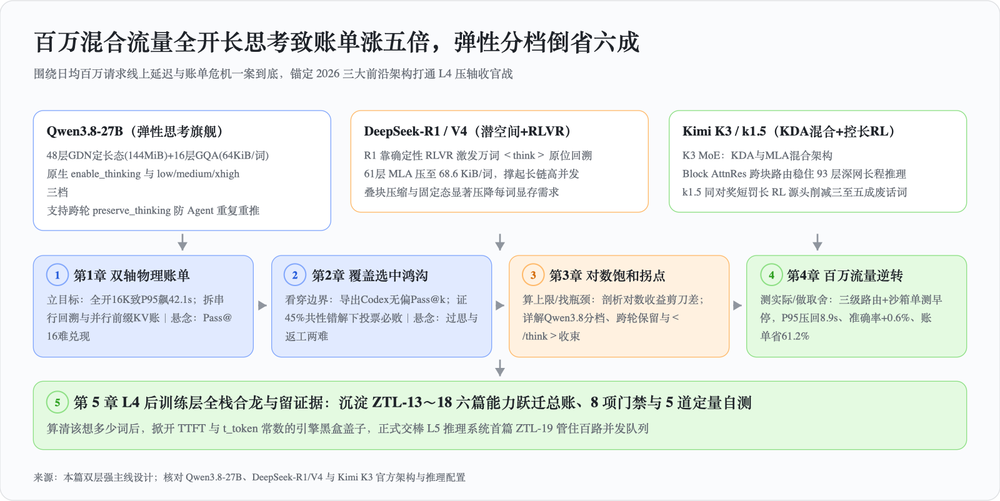
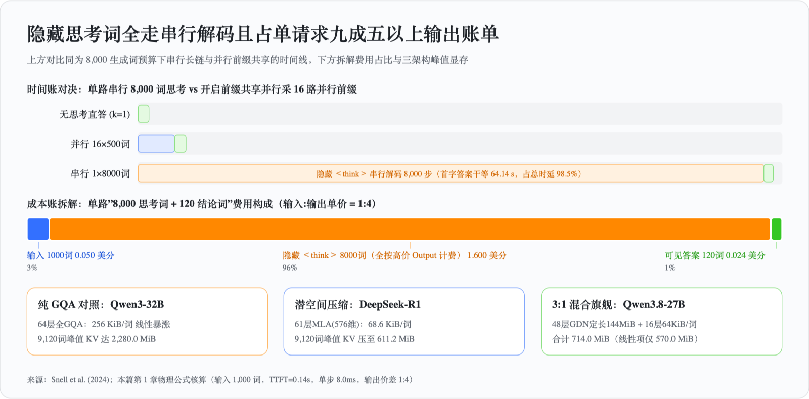
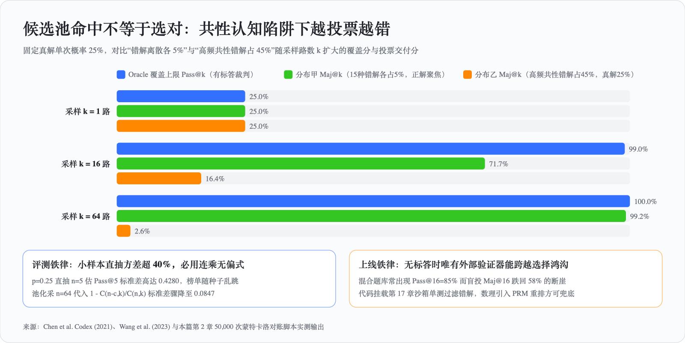
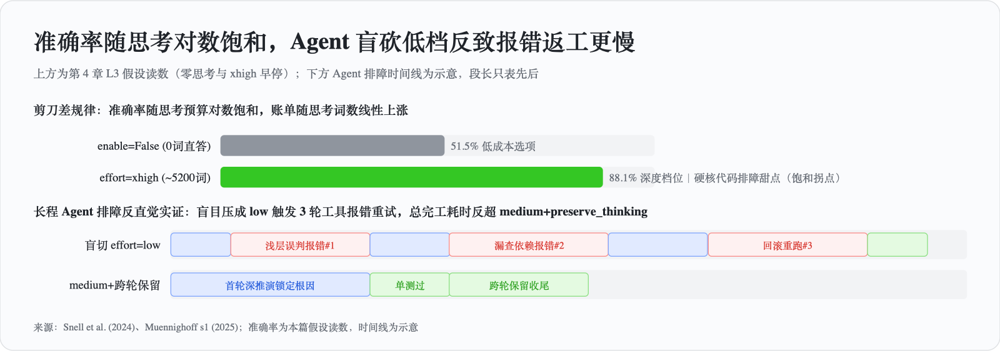
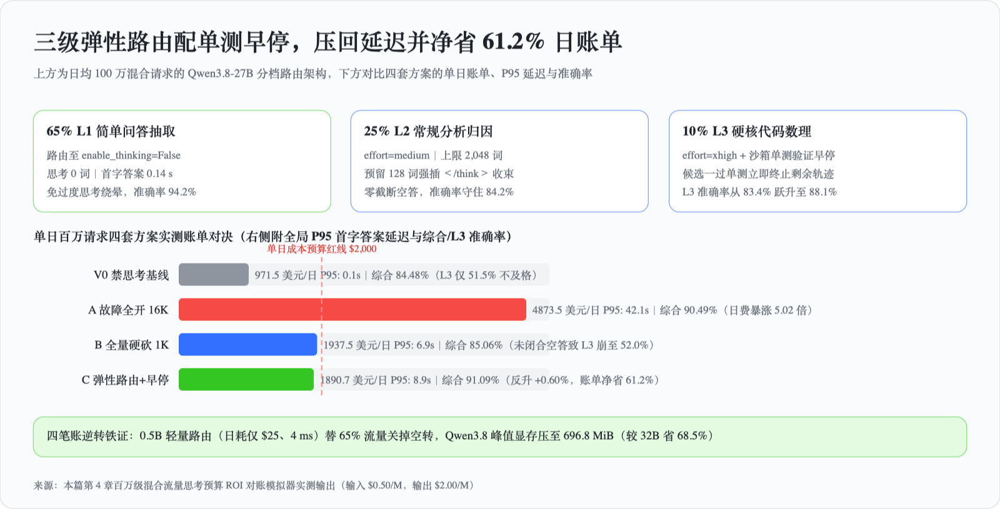
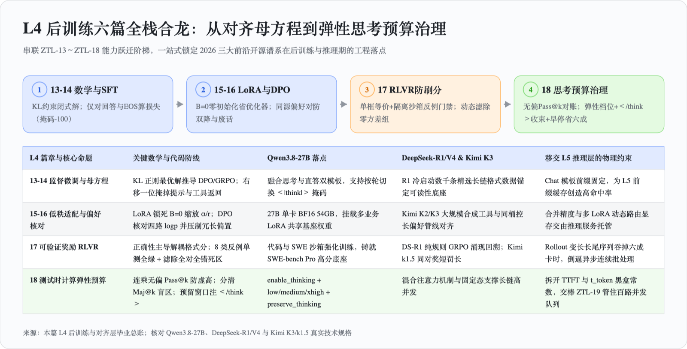

# ZTL-18｜后训练｜多想一会儿是否值得

> 🎯 **这篇文档解决什么问题**：<b>核心命题：推理期测试时计算必须按难度弹性分档，才能同时确保准确率上限与成本可控。</b>串行长链支持原位反思回溯，并行采样拓宽搜索覆盖。然而候选池命中不等于最终选对。准确率随思考长度呈对数饱和，延迟与输出账单却严格线性上涨。
>
> **使用方式与先修要求**：本篇是 L4 后训练与对齐层的收官篇，直接桥接 L5 推理系统层。读者可结合第 02、06、08 篇的采样方差、屋脊线与缓存公式阅读。内容直接承接 [ZTL-13｜后训练｜奖励、策略梯度与 DPO 的数学](./13-rl-math.md) 与 [ZTL-17｜后训练｜先验证奖励再训练](./17-verifiable-reward.md) 的可验证强化框架。
>
> **实战主线**：全篇围绕日均 100 万请求的混合工作台展开（65% 简单问答、25% 常规分析、10% 代码数理排障）。团队全量默认放开 16K 最高思考预算后，当晚触发严重告警。P95 首字答案飙至 42.1 秒，日账单涨五倍。五章依次拆清双扩展轴、覆盖选中落差、对数拐点与 `Qwen3.8-27B` 弹性治理，同步对照 `DeepSeek` 与 `Kimi` 对标方案。规格核对于 2026 年 11 月 16 日。
>
> **动手实践**：第 2 章提供零依赖的 Codex 连乘无偏 `Pass@k` 估计器与双分布 `Maj@k` 蒙特卡洛对账脚本。第 4 章提供百万级混合流量思考预算 ROI 模拟器。它完整核算弹性路由、优雅收束与沙箱早停的前后四笔账。

<b>🧭 主线位置</b>：上一篇 [ZTL-17｜后训练｜先验证奖励再训练](./17-verifiable-reward.md) 封堵了奖励刷分漏洞，回答了怎样在训练期激发长思维链。本篇接手模型上线后的推理期算力调配。我们算清多想几千词换来的真准确率与延迟账单，为 L4 层收官。下一篇迈入 L5 首篇 [ZTL-19｜系统｜判断慢在哪，以及请求怎样排队](./19-serving-latency.md)，深入引擎诊断单步耗时与并发排队。

## 导读 · 先给结论

下文称 `Qwen3.8-27B` 为案例模型，`DeepSeek-R1/V4` 与 `Kimi K3` 为对照。

- <b>测试时计算沿串行加深与并行拓宽正交扩展，隐藏思考词全压在最贵的输出列。</b>串行 `<think>` 靠注意力回读支持原位推翻重来。但每多想 1 词就多走 1 步串行解码，首字答案延迟线性拉长。并行采 `k` 路可共享输入前缀且批解码不增链深。单路之间却无跨轨迹记忆[[1]](https://arxiv.org/abs/2408.03314)[[2]](https://arxiv.org/abs/2501.12948)[[3]](https://arxiv.org/abs/2309.06180)。
- <b>候选池命中不等于无标答交付选对，共性陷阱下越投越错。</b>小样本直抽方差超 40%，离线评测须采大池代入 Codex 连乘无偏估计器。错解离散时多数投票可逼近上限。一旦共性错解占 45% 而真解占 25%，采 64 路投票反而把准确率压低至 2.6%[[4]](https://arxiv.org/abs/2107.03374)[[5]](https://github.com/openai/human-eval/blob/master/human_eval/evaluation.py)[[6]](https://arxiv.org/abs/2203.11171)。
- <b>准确率随思考预算呈对数饱和，治理过度思考须兼防空转与返工。</b>面对简单查询放任数千词核验，只会浪费高价输出额度。而在长程 Agent 排障中，盲目压成 `low` 会多触发 3 轮报错重试。总完工时间反比一次想透的 `medium / xhigh` 更慢[[7]](https://arxiv.org/abs/2412.21187)[[8]](https://huggingface.co/Qwen/Qwen3.8-27B/blob/main/config.json)[[9]](https://arxiv.org/abs/2501.12599)。
- <b>严禁调小总长硬截断推理模型，应组合原生弹性档位与优雅收束。</b>硬砍总长会把模型截在未闭合的思考半途并吐出空答案。案例模型原生提供 `enable_thinking`、三档力度与跨轮保留开关。配合剩 128 词强插 `</think>` 即可平稳收尾[[8]](https://huggingface.co/Qwen/Qwen3.8-27B/blob/main/config.json)[[10]](https://arxiv.org/abs/2501.19393)。
- <b>百万混合流量按三级路由配沙箱验证早停，压回 8.9 秒延迟并省 61.2% 账单。</b>65% 简单客服切零思考直出，25% 常规分析封顶 2K 收束。10% 代码数理开 `xhigh` 并在单测通过立即早停。全局准确率反升 `+0.6%`，混合稠密显存峰值较纯 GQA 直降近七成[[1]](https://arxiv.org/abs/2408.03314)[[8]](https://huggingface.co/Qwen/Qwen3.8-27B/blob/main/config.json)[[11]](https://arxiv.org/abs/2505.09388)。



<b>📎 与系列其他文档的分工</b>：非零温度采样与标准误见 [ZTL-02｜数学｜条件概率、softmax 与采样](./02-softmax-sampling.md)，屋脊线判据与缓存公式见 [ZTL-06｜数学｜一张纸算清算力、显存与缩放](./06-compute-memory-scaling.md) 与 [ZTL-08｜模型｜把注意力写成矩阵](./08-attention.md)，可验证强化见 [ZTL-13｜后训练｜奖励、策略梯度与 DPO 的数学](./13-rl-math.md) 与 [ZTL-17｜后训练｜先验证奖励再训练](./17-verifiable-reward.md)。

本篇负责推理期思考预算分配与并行采样选型。底层引擎调度、内核优化与投机服务详见第 19～23 篇（从 [ZTL-19｜系统｜判断慢在哪，以及请求怎样排队](./19-serving-latency.md) 起步），网关安全路由与评测分母规则详见第 27～28 篇（至 [ZTL-28｜工程｜先写评测再改系统](./28-eval.md)）。

## 第 1 章 · 两条正交扩展轴的毫秒与账单真账

上一篇 [ZTL-17｜后训练｜先验证奖励再训练](./17-verifiable-reward.md) 跑通了可验证奖励强化学习，基座由此涌现出自主反思的推理能力。本章将对比案例模型与先锋对照（DeepSeek-R1 的 61 层 MLA 编码器将长链 KV 缓存压至 `68.6 KiB/词`，Kimi K3 以 93 层深网架构支持极端长链推理）[[2]](https://arxiv.org/abs/2501.12948)[[12]](https://arxiv.org/abs/2607.24653)。随后团队把该模型全量推向日均 **100 万次请求**的企业混合工作台。流量中 65% 为简单问答抽取，25% 为常规分析归因，10% 为复杂代码数理排障。

上线时默认放开了 `16,384` 最高思考上限，当晚值班群便触发红色告警。全站 **P95 首字答案延迟从 0.14 秒飙升至 42.1 秒**，单日账单随之涨五倍。为什么把算力搬到测试期（TTC）会迅速推高延迟与账单[[1]](https://arxiv.org/abs/2408.03314)[[13]](https://openai.com/index/learning-to-reason-with-llms/)？本章先为推理期扩容**立目标**。我们拆清串行加深与并行拓宽两条物理扩展轴，算透隐藏思考词背后的毫秒、显存与费用真账。

### 1.1 串行回溯与并行采样的物理分野

在传统指令微调模型中，回答简单常识与求解竞赛代数题走过的矩阵层数完全固定。测试时计算打破了静态限制，沿两条正交轴动态注入算力[[1]](https://arxiv.org/abs/2408.03314)：

- <b>串行扩展：单序列长思维链原位纠错。</b>早期方法靠少样本思维链（CoT）引导分步推演[[14]](https://arxiv.org/abs/2201.11903)。到了对照模型，这些都原生支持先输出数千词隐藏思考块再给结论[[2]](https://arxiv.org/abs/2501.12948)[[8]](https://huggingface.co/Qwen/Qwen3.8-27B/blob/main/config.json)[[12]](https://arxiv.org/abs/2607.24653)。自注意力与线性状态能实时读取前文推导，发现矛盾时当场推翻重算。代价是每多想 1 词，关键路径就必须串行多走 1 个带宽受限的解码步。
- <b>并行扩展：同提示多路独立采样。</b>固定提示词并开启非零温度采样 $`k`$ 条轨迹，最后由投票或验证器择优交付[[6]](https://arxiv.org/abs/2203.11171)[[15]](https://arxiv.org/abs/2305.20050)。回顾 [ZTL-06｜数学｜一张纸算清算力、显存与缩放](./06-compute-memory-scaling.md) 判据，把 16 条轨迹合批解码时，权重读一次即可服务 16 行激活，单步耗时仅微增一两成。开启前缀缓存后，输入预填只算一次且只存一份[[3]](https://arxiv.org/abs/2309.06180)。短板则是多条轨迹彼此隔离无记忆，遇到长链路难题可能同摔在一处[[1]](https://arxiv.org/abs/2408.03314)。

### 1.2 隐藏思考词的毫秒、费用与显存代价

许多刚接入推理模型的工程师抱有误解。他们以为折叠的灰色思考框只是前端展示效果，用户看到的回答不过百来字，理应既快又省。摊开解码循环与商业价目表就会看清事实。**折叠的每个思考词都跑完了自回归解码，100% 计入单价最高的 Output Token 列**[[2]](https://arxiv.org/abs/2501.12948)[[13]](https://openai.com/index/learning-to-reason-with-llms/)。

先建立双里程碑时延方程。记预填耗时、单步耗时、思考词数与答案词数，**用户首字答案延迟**与总耗时分别满足：

```math
T_{\text{first-ans}} = \mathrm{TTFT} + N_{\text{think}} \cdot t_{\text{token}}
```

```math
T_{\text{total}} = \mathrm{TTFT} + (N_{\text{think}} + N_{\text{ans}}) \cdot t_{\text{token}}
```

代入线上代码排障单手算核对。设输入 `1,000` 词，预填 `0.14 s`，单步 `8.0 ms`。若后台串行思考 `8,000` 词后吐出 `120` 词结论，用户必须等待 <b>`64.14 s`</b> 才能看到正文首字。整单总耗时 `65.10 s`，隐藏思考占了 <b>`98.5%`</b> 的等待时间。反观同等词预算的“并行 16 路 × 500 词”，首字答案仅需 <b>`3.73 s`</b>，总耗时 <b>`4.86 s`</b>，比串行长链快 <b>`13.4` 倍</b>。

再看商业计费账单。主流大模型 API 的输入输出目录价普遍存在 <b>`1:3` 至 `1:8`</b> 的价差。例如 `Qwen3.8-Flash` 目录价为输入 `1 元`、输出 `3 元`每百万词[[16]](https://github.com/QwenLM/Qwen3.8-Flash-Next/blob/main/tech_report.pdf)。根源正是硬件效率差距：1,000 个输入词可一次并行预填算完，8,000 个思考词却迫使 GPU 串行重搬 8,000 趟权重。

按 `1:4` 价差（输入 `0.50`、输出 `2.00 美元/百万词`）核算，输入仅花 `0.050 美分`，结论花 `0.024 美分`。隐藏思考词却耗费 <b>`1.600 美分`</b>，占整单账单的 <b>`95.6%`</b>（图中堆叠图按费用占比约 96% 为隐藏思考成本）。

同时，吐完结论末字前，整段 8,000 词思考链必须完整驻留显存。按 [ZTL-08｜模型｜把注意力写成矩阵](./08-attention.md) 规格对比峰值序列 `9,120` 词下的单请求显存：纯 GQA 基线（`256 KiB/词`）从无思考的 `280.0 MiB` 涨至 <b>`2,280.0 MiB`</b>[[11]](https://arxiv.org/abs/2505.09388)。潜空间压缩先锋 DeepSeek-R1 靠 61 层 MLA 编码器（隐空间维度 `576`）将同峰值词数的 KV 缓存压至 `611.2 MiB`，仅为纯 GQA 的 27%。

混合架构走得更远。以某线性注意力混合 MoE 为例，`93` 层里只有 `24` 层保留 MLA 潜空间缓存，按 BF16 约 `27.0 KiB/词`，约为纯 GQA 的 11%，其余 `69` 层 KDA 只维护定长状态（此处未计入）[[12]](https://arxiv.org/abs/2607.24653)[[17]](https://arxiv.org/abs/2412.19437)。

案例模型则靠 48 层 `Gated DeltaNet` 固定 `144.0 MiB` FP32 状态，仅 16 层全局 GQA 按 `64.0 KiB/词` 增长（占 `570.0 MiB`），合计 <b>`714.0 MiB`</b>，线性膨胀斜率较纯 GQA 直降 <b>`75%`</b>。对照稀疏模型同理以 KDA 定长态配 MLA 支撑长链高并发[[8]](https://huggingface.co/Qwen/Qwen3.8-27B/blob/main/config.json)[[12]](https://arxiv.org/abs/2607.24653)。



对照上方画板的时间轴对比可见两条扩展轴的物理分野。串行长链把八千个思考词串成单线程接力，首字答案被迫推迟一分多钟。并行采样则把十六条短链叠成宽矩阵合批解码，共享一次提示预填与权重读取，但能否挑中真解全看下游选择器。阅读下表时请重点比对时延与显存两行的扣费规则：

| **四笔账与机制维度** | <b>并行拓宽（同提示采 `k` 路短链）</b> | <b>串行加深（单路长 `<think>`）</b> | <b>正交混合（`k` 路长链投票或早停）</b> |
|---|---|---|---|
| <b>效果账（解题边界）</b> | 拓宽局部搜索覆盖面；单路无跨轨迹纠错，强依赖选择器 | 支持跨步回读、证伪与推翻重来；擅长深耦合数理与代码排障 | 竞赛攻坚上限最高（如 R1 采 8 路投票推高 AIME 分数） |
| <b>时延账（首字答案）</b> | **极快**：`k` 路合批共享权重读取，链深短（千词级仅数秒） | **极慢**：$`T_{\text{first-ans}}`$ 随 $`N_{\text{think}}`$ 严格线性增长 | 无早停时受最慢长尾轨迹拖累；配验证通过早停可快速削峰 |
| <b>显存账（缓存形态）</b> | 共享 1 份输入前缀；`GDN/KDA` 状态池须按 $`k`$ 路并发扣费 | 单路定长态仅 1 份；全局 KV 随 $`N_{\text{think}}`$ 持续驻留增长 | 状态池乘 $`k`$ 且长链 KV 叠加，易触顶触发引擎抢占重算 |
| <b>成本账（Token 费）</b> | 高价输出费乘 $`k`$ 倍；若挂神经重排器还需另计判分卡时 | 隐藏思考词全额按 Output 计价，常吞掉整单 90% 以上预算 | 开销正比于 $`k \cdot N_{\text{think}}`$ ，仅限高价值攻坚或离线蒸馏造数 |

> 💡 <b>常见误区：开启并行采样时忘改默认贪心配置（temperature = 0）。</b>花了 16 倍预算采回 16 份候选，评测准确率却与单路完全相同。根因是贪心解码吐出 16 份重复文本。改法是对齐官方采样规范：案例模型思考模式设 `T = 1.0, top_p = 0.95, top_k = 20`（非思考设 `T = 0.7`），对照模型设 `T = 0.6`，并监控去重候选数[[2]](https://arxiv.org/abs/2501.12948)[[8]](https://huggingface.co/Qwen/Qwen3.8-27B/blob/main/config.json)。

> 🔑 **本章要点与回到主线**：经立目标拆解时延与成本账，我们确认隐藏 `<think>` 全走高价串行解码，而并行采 16 路短链靠前缀共享仅需 4.86 秒就能跑完同等词数。但新的问题随之浮现：不少团队看到离线评测里并行采样的 `Pass@16` 高达 `85%` 便切流上线，结果生产环境没有标准答案帮忙挑考卷，交付准确率跌回 `58%`。覆盖上限与真实交付之间存在什么差异？第 2 章立即拆解。

## 第 2 章 · 覆盖率上限与交付分的落差

直面上一章抛出的线上落差：为什么离线榜单上亮眼的 `Pass@16 = 85%`，搬到真实用户流量就缩水成 `58%`？根源在于混淆了两个不同的统计量。<b>`Pass@k` 测量的是配齐先知裁判（Oracle）后的候选池覆盖上限</b>。线上面对未知新题时手里没有标准答案，系统只能靠多数投票（`Maj@k`）或外部验证器挑出唯一一条回复交付[[1]](https://arxiv.org/abs/2408.03314)[[4]](https://arxiv.org/abs/2107.03374)。本章先算准零偏差的覆盖率基准，再厘清无标答选择器的失灵边界。

### 2.1 Codex 连乘无偏估计器：消除小样本波动

先严格定义 <b>`Pass@k`</b>。对同题独立采样 $`k`$ 条候选解，只要**至少有 1 条**通过单测或标答判等，即记覆盖成功。设单次答对概率为 $`p`$ ，理论真值便是 $`1 - (1 - p)^k`$ [[4]](https://arxiv.org/abs/2107.03374)。

离线评测时真实 $`p`$ 未知。若图省钱每题只采 5 条测 `Pass@5`，单题结果非 `0` 即 `1`。抽样标准差高达 `0.428`，换颗随机种子榜单就波动数个点（回顾 [ZTL-02｜数学｜条件概率、softmax 与采样](./02-softmax-sampling.md)）。反过来若先采大样本池（标准取 `n = 64`），数出答对条数后直接代入插件式，又会引入新误差。因为凸函数按琴生不等式直接代入会产生**系统性向下低估偏差**。

为此 Chen 等人在 Codex 论文中导出了零偏差的**超几何无偏估计器**[[4]](https://arxiv.org/abs/2107.03374)[[5]](https://github.com/openai/human-eval/blob/master/human_eval/evaluation.py)。从已采出的 $`n`$ 条总样本（含 $`c`$ 条正解）中不放回取 $`k`$ 条，无偏公式写为：

```math
\mathrm{Pass}@k = 1 - \frac{\binom{n - c}{k}}{\binom{n}{k}} = 1 - \prod_{i = n - c + 1}^{n} \left(1 - \frac{k}{i}\right)
```

右端连乘式是生产评测库的标准写法[[5]](https://github.com/openai/human-eval/blob/master/human_eval/evaluation.py)。直接求 `64!` 极易浮点溢出，逐项乘 `1 - k/i` 则把因子稳定在 `(0, 1)` 内。我们手算核对小例：某题采 `n = 6` 条，通过单测 `c = 2` 条，求无偏 `Pass@2`。错解共 `4` 条，任取 2 条有 `6` 种，从 6 条总样本取 2 条有 `15` 种，无偏估计值为 `1 - 6/15 = 0.600`（<b>`60.0%`</b>）。若误套有偏式 $`1 - (1 - 2/6)^2 \approx 0.556`$ ，单题便低估了 <b>`4.4` 个百分点</b>。

### 2.2 多数投票的失灵边界与外部验证器

算准了覆盖率，再看无标答交付环节。从 `k = 16` 条候选盲选 1 条交付，最常用的无监督手段是<b>自洽多数投票（Self-Consistency，记作 `Maj@k`）</b>。它提取每条轨迹末尾结论并选票数最高者交付[[6]](https://arxiv.org/abs/2203.11171)。投票生效还是失灵，取决于错误分布形态：

- <b>分布甲（错解离散、正解聚焦）：投票稳步逼近上限。</b>设真解概率 `p_0 = 0.25`，其余 `75%` 错误概率平摊在 15 种粗心算错值上（各占 `0.05`）。采样数从 `k = 1` 扩至 `5, 16, 64` 时，真解凭 5 倍密度优势胜出。`Maj@k` 依次升至 `39.4%`、<b>`71.7%`</b> 与 <b>`99.2%`</b>，顺利逼近覆盖上限。
- <b>分布乙（系统性认知陷阱）：采再多路也会高置信度选错。</b>一旦题目暗藏概念陷阱，模型会以 `p_1 = 0.45` 的最高概率反复掉进**同一共性错解**，真解仍占 `0.25`，其余 6 种错解各占 `0.05`。此时覆盖率 `Pass@16` 依然高达 <b>`99.0%`</b>。然而多数投票依大数定律把第一大众数推上首位，`Maj@16` 反从单次的 `25.0%` 跌至 <b>`16.4%`</b>，采到 `k = 64` 更跌至 <b>`2.6%`</b>。真实题库混杂离散错与共性陷阱，正是榜单 `85%` 上线跌回 `58%` 的根源。
- <b>外部验证器过滤（沙箱单测 / PRM 重排）：跨越盲区的关键。</b>要填平落差，选择器必须引入**独立于生成偏见的外部判据**[[1]](https://arxiv.org/abs/2408.03314)[[15]](https://arxiv.org/abs/2305.20050)。代码场景复用 [ZTL-17｜后训练｜先验证奖励再训练](./17-verifiable-reward.md) 隔离沙箱跑单测筛除报错解。无单测数理场景则挂载过程奖励模型（PRM）重排[[15]](https://arxiv.org/abs/2305.20050)。

我们用蒙特卡洛模拟验证这两种错误分布的投票演化轨迹，每种条件下采样

`50000`

次独立试验。



上方画板直观揭示了无验证器时的饱和天花板。只要最大共性错解概率 $`p_{\text{trap}}`$ 高于真解概率 $`p_0`$ ，多数投票随采样数增大的渐近极限就会直接归零，无法逼近 `100%`。此时盲目扩充并行路数，只会让覆盖率与实际交付率之间的剪刀差越拉越大。

下方自包含脚本同步验证了连乘无偏 `Pass@k` 的方差压缩效应，以及两种错误分布下 `Maj@k` 截然相反的演化轨迹：

*Codex 连乘无偏 Pass@k 方差核验与双错误分布 Maj@k 蒙特卡洛对账*

```python
from collections import Counter
import numpy as np

def pass_at_k_unbiased(n: int, c: int, k: int) -> float:
    """Chen et al. (Codex) 连乘无偏估计器，规避大阶乘溢出与插件式低估偏差"""
    if n - c < k:
        return 1.0
    return float(1.0 - np.prod(1.0 - k / np.arange(n - c + 1, n + 1)))

def sim_maj_at_k(probs, k: int, trials: int = 50000, seed: int = 42) -> float:
    rng = np.random.default_rng(seed)
    draws = rng.choice(len(probs), size=(trials, k), p=probs)
    wins = 0.0
    for row in draws:
        cnt = Counter(row)
        mx = max(cnt.values())
        top = [ans for ans, v in cnt.items() if v == mx]
        if 0 in top:  # 下标 0 为唯一真解，平票时等概率随机打破
            wins += 1.0 / len(top)
    return wins / trials

probs_a = [0.25] + [0.05] * 15           # 分布甲：真解 25%，15 种离散错解各占 5%
probs_b = [0.25, 0.45] + [0.05] * 6      # 分布乙：真解 25%，共性陷阱错解占 45%
for tag, pr in [("分布甲-错解离散", probs_a), ("分布乙-共性陷阱", probs_b)]:
    for k in (1, 5, 16, 64):
        pk = 1.0 - (1.0 - pr[0]) ** k
        mk = sim_maj_at_k(pr, k)
        print(f"{tag} k={k:2d} | 真Pass@k={pk:.4f} | Maj@k={mk:.4f}")

rng = np.random.default_rng(7)
raw_k5 = (rng.random((2000, 5)) < 0.25).any(axis=1).astype(float)
unb_n64 = [pass_at_k_unbiased(64, int(c), 5) for c in rng.binomial(64, 0.25, size=2000)]
print("直抽 n=5  估 Pass@5 均值/标准差:", round(float(raw_k5.mean()), 4), round(float(raw_k5.std()), 4))
print("池化 n=64 估 Pass@5 均值/标准差:", round(float(np.mean(unb_n64)), 4), round(float(np.std(unb_n64)), 4))
```

*输出*

```text
分布甲-错解离散 k= 1 | 真Pass@k=0.2500 | Maj@k=0.2503
分布甲-错解离散 k= 5 | 真Pass@k=0.7627 | Maj@k=0.3939
分布甲-错解离散 k=16 | 真Pass@k=0.9900 | Maj@k=0.7173
分布甲-错解离散 k=64 | 真Pass@k=1.0000 | Maj@k=0.9923
分布乙-共性陷阱 k= 1 | 真Pass@k=0.2500 | Maj@k=0.2503
分布乙-共性陷阱 k= 5 | 真Pass@k=0.7627 | Maj@k=0.2511
分布乙-共性陷阱 k=16 | 真Pass@k=0.9900 | Maj@k=0.1640
分布乙-共性陷阱 k=64 | 真Pass@k=1.0000 | Maj@k=0.0262
直抽 n=5  估 Pass@5 均值/标准差: 0.7585 0.428
池化 n=64 估 Pass@5 均值/标准差: 0.7641 0.0847
```

逐段拆解上述统计实现。`pass_at_k_unbiased` 先判 `n - c < k` 边界（错解不足 $`k`$ 条时必中真解返 `1.0`），再用向量化连乘 `1.0 - k / np.arange(...)` 替代大阶乘相除，规避 `64!` 浮点溢出。`sim_maj_at_k` 统计候选票数后，对并列最高票按 `1.0 / len(top)` 均分胜率，消除下标偏置。

复盘输出读数可见两重警讯。分布甲中错解平摊，`Maj@64` 顺滑涨至 `0.9923` 贴近上限；分布乙受 `45%` 共性陷阱支配，`Maj@64` 反跌至 `0.0262`。末尾对比同时证实：每题直抽 `n=5` 的标准差高达 `0.428`，改用池化 `n=64` 代入无偏式后标准差压至 `0.0847`，评测稳定性提升五倍。

> 💡 <b>常见误区：拿着论文的 Pass@16 承诺线上业务准确率，或汇报时隐瞒样本池 n。</b>现象是立项按 `Pass@16 = 85%` 签了 SLA，上线开放问答没有单测可跑，实测准确率缩水至 58%。小池直抽还会导致每次评测波动好几个点。根因是忽略了无验证器时共性错解会令投票失灵，且小样本方差过大。改法是离线评测统一固定 `n = 64` 调无偏连乘式，立项评审同表并列汇报 `Pass@1`、`Maj@k` 与带验证器的 `Best-of-k`[[1]](https://arxiv.org/abs/2408.03314)[[4]](https://arxiv.org/abs/2107.03374)。

> 🔑 **本章要点与回到主线**：我们导出了零偏差的 Codex 连乘估计器，并证明遇到 45% 共性认知陷阱时盲目增加并行投票只会降低准确率。因此靠单路串行 `<think>` 在推理途中自我验算纠偏成了主流推理模型的主力。但放开串行思考预算到 16K 后，为什么模型算“`15 × 16`”也要空转三千词，而在多轮 Agent 中压得太短又会报错返工？第 3 章立即剖析。

## 第 3 章 · 对数饱和与线性账单的剪刀差

承接上一章末尾的双向矛盾。无验证器时盲目并行投票救不了深层逻辑，单路串行思考成了主力。可一旦放开预算，线上立刻陷入简单题冲高账单与复杂 Agent 报错返工的两难境地。本章通过**算上限**与**找瓶颈**，刻画思考长度的对数边际收益规律。随后拆解以 `Qwen3.8-27B` 为代表的 2026 前沿弹性思考控制体系[[8]](https://huggingface.co/Qwen/Qwen3.8-27B/blob/main/config.json)[[10]](https://arxiv.org/abs/2501.19393)。

### 3.1 准确率对数增长，成本线性上涨

把思考词数上限从百词一路拉升至三万词，模型准确率与推理成本遵循截然不同的两条曲线[[1]](https://arxiv.org/abs/2408.03314)[[13]](https://openai.com/index/learning-to-reason-with-llms/)。在有效推理区间内，解题准确率呈**分段对数饱和增长**。单请求首字延迟与输出费用却随实际吐词量呈**严格线性上涨**：

```math
\mathrm{Acc}(B_{\text{think}}) \approx \min\!\left(\mathrm{Acc}_{\max},\; \mathrm{Acc}_0 + \gamma \ln\!\left(1 + \frac{B_{\text{think}}}{B_0}\right)\right), \qquad \mathrm{Cost}(N_{\text{think}}) = c_{\text{in}} + N_{\text{think}} \cdot P_{\text{out}}
```

对准确率方程求导可得边际提点率 $`\mathrm{d}\mathrm{Acc} / \mathrm{d}B_{\text{think}} = \gamma / (B_0 + B_{\text{think}})`$ ，每多投一千词换来的精度增益随预算基数成反比衰减。反观成本导数恒等于输出单价 $`P_{\text{out}}`$ 。当边际提点换算的业务价值跌破单词计费时，后续生成的思考词全在制造净亏损。

两条曲线由此拉开了工程剪刀差。在复杂代码与竞赛数学题上，预算从零扩到数千词这一段准确率爬升最快。跨过模型的固有能力拐点后，对数曲线贴近水平渐近线，继续放宽到 `32K` 词的增益很小，账单与延迟却随思考词数线性上涨[[1]](https://arxiv.org/abs/2408.03314)[[10]](https://arxiv.org/abs/2501.19393)。

在占日常流量大头的简单任务上，这种失配更演变为<b>过度思考（Overthinking）</b>[[7]](https://arxiv.org/abs/2412.21187)。实测向未控长的推理模型提问“`15 × 16` 等于几”，模型在前 40 个思考词就已算出 `240`。紧接着它却惯性触发反复自检。它依次用乘法分配律、竖式进位与同余验算，空转三千词才闭合思考标签。

追查 [ZTL-17｜后训练｜先验证奖励再训练](./17-verifiable-reward.md) 的训练根因。纯结果奖励 GRPO 中，靠长链反思救回来的难题常拿到高优势梯度。策略网络遂将转折自检词与正回报强绑定。缺少长度约束时，简单题也会机械复读自疑模板。常识分类题甚至会因反复自我怀疑把最初选对的答案改错[[7]](https://arxiv.org/abs/2412.21187)[[9]](https://arxiv.org/abs/2501.12599)。训练侧的治本方案正是 `Kimi k1.5` 提出的同提示<b>长短对比惩罚（Long2Short RL）</b>。同为正解时奖短罚长，答错则不给短链分，从源头削减三至五成空转词[[9]](https://arxiv.org/abs/2501.12599)。

### 3.2 四层弹性思考控制接口

光靠训练期压缩均值还不够。面对多样的线上请求，推理期必须具备按单调度的阀门。2026 年以案例模型为代表的新一代开源旗舰，沉淀出四层原生接口[[8]](https://huggingface.co/Qwen/Qwen3.8-27B/blob/main/config.json)[[10]](https://arxiv.org/abs/2501.19393)[[11]](https://arxiv.org/abs/2505.09388)：

- <b>零思考直答快道（`enable_thinking: false`）。</b>针对意图识别、字段抽取、翻译与 FAQ 问答，直接在模板传入 `enable_thinking=False`（配 `T = 0.7, top_p = 0.80`）。模板立即预填空的闭合块跳过思考阶段。系统由此达成**零思考词开销**与百毫秒级首字响应[[8]](https://huggingface.co/Qwen/Qwen3.8-27B/blob/main/config.json)[[11]](https://arxiv.org/abs/2505.09388)。
- <b>三级弹性思考深度（`reasoning_effort`）。</b>开启思考模式后（配 `T = 1.0, top_p = 0.95, top_k = 20`），可按请求传入三档力度。`low` 仅做数百词快速核对，`medium` 展开一两千词结构化归因。`xhigh` 则放开约 `5200` 词的深推演，精准服务 10% 的复杂代码数理攻坚[[8]](https://huggingface.co/Qwen/Qwen3.8-27B/blob/main/config.json)[[13]](https://openai.com/index/learning-to-reason-with-llms/)。
- <b>跨轮思考保留（`preserve_thinking`）与防返工。</b>普通多轮对话拼接上下文时须剥离历史思考草稿防膨胀[[2]](https://arxiv.org/abs/2501.12948)。多步代码排障 Agent 则开启 `preserve_thinking=True` 复用状态检查点与前缀缓存[[3]](https://arxiv.org/abs/2309.06180)[[8]](https://huggingface.co/Qwen/Qwen3.8-27B/blob/main/config.json)。实测盲目压成 `low` 会多触发 3 轮报错重试（耗 `38 秒`），而 `medium / xhigh` 配跨轮保留 2 轮即修通，总耗时反压回 <b>`21 秒`</b>[[8]](https://huggingface.co/Qwen/Qwen3.8-27B/blob/main/config.json)。
- <b>预留收尾窗口的强制闭合（Budget Forcing）。</b>长尾请求逼近预算上限时，借鉴 `s1` 免重训干预法[[10]](https://arxiv.org/abs/2501.19393)。当思考词触及缓冲线（如上限前 `128` 词）时，引擎强制注入闭合标签 `\n</think>\n`。模型随即汇总已有推导写出结论，消除超限空答事故。



观察上方画板的两组对照。上半幅的 `51.5%` 与 `88.1%` 是第 4 章账单脚本里零思考档与 xhigh 早停档的 L3 假设读数，用来示意对数饱和的形状。下半幅 Agent 时间线同为示意。零思考档与 `low / medium` 档承接九成日常请求并在对数拐点前及时收手，仅把万词长预算拨给 `xhigh` 攻坚档，再靠末端 `</think>` 强制注入兜住超限风险。

> 💡 <b>常见误区：直接调小通用 max_tokens = 512 来限制推理模型省钱。</b>改完当晚大批分析请求返回空白正文，下游解析器报错。根因是 `max_tokens` 限制思考加答案总长，第 512 词截断时未闭合思考块导致回答为空。按 [ZTL-28｜工程｜先写评测再改系统](./28-eval.md) 规则空答须留分母记 0 分。改法是用原生 `reasoning_effort` 配预留缓冲区的 `</think>` 收束[[8]](https://huggingface.co/Qwen/Qwen3.8-27B/blob/main/config.json)[[10]](https://arxiv.org/abs/2501.19393)。

下表给出基于案例模型弹性思考机制的线上业务四档治理规范速查表：

| **思考档位配置** | **典型适用任务场景** | **采样与跨轮历史规则** | **预算上限与尾延迟兜底** |
|---|---|---|---|
| **零思考直答档**<br>`enable=False` | FAQ 客服问答、结构化抽取、意图分类、多语种翻译 | `T=0.7, top_p=0.80`；历史天然无思考块 | 思考词固定为 `0`；首字答案压在 `0.15 s` 内 |
| **轻量核验档**<br>`effort=low` | 单表简单 SQL、格式合规改写、短文本情感与风险复核 | `T=1.0, top_p=0.95`；多轮普通对话剥离旧思考 | 软目标约 `400` 词；达 `768` 词注 `</think>` 收尾 |
| **均衡分析档**<br>`effort=medium` | 多维财报归因、常规业务代码生成、标准多步应用题 | 普通对话剥离旧思考；多步工具流开 `preserve` | 封顶 `2,048` 词；在第 `1,920` 词强插 `</think>` 保底 |
| **极限攻坚档**<br>`effort=xhigh` | 跨文件 SWE 故障定位、复杂算法修复、竞赛数理证明 | Agent 必开 `preserve_thinking` 防跨轮重复重推 | 上限 `8K～16K` 词；挂载沙箱单测一过立即早停 |

> 🔑 **本章要点与回到主线**：经算上限与找瓶颈，我们看清了准确率对数饱和与成本线性上涨的剪刀差，并配齐了案例模型三档力度、跨轮缓存保留与 `</think>` 优雅收束工具箱。回到第 1 章开篇日均 100 万单、P95 首字答案飙到 42.1 秒、日账单涨五倍的事故现场，怎样把复杂度路由、分档限额与验证早停组合成线上流水线逆转四笔账？第 4 章直接验证。

## 第 4 章 · 三级路由与早停的线上验证

现在回到第 1 章开篇的线上事故现场，执行**测实际**与**做取舍**。该企业工作台基于 `H100` 集群承载日均 <b>`1,000,000` 次</b>混合请求（流量结构与下文的准确率、延迟、账单都是假设读数，示意算账方法，非实测）。流量中 **65% 为 L1 简单问答抽取**（均长 `800` 词），**25% 为 L2 常规分析归因**（均长 `1,100` 词），**10% 为 L3 复杂代码数理排障**（均长 `1,200` 词）。

此前全站关闭思考（`V0` 基线）时日账单仅 `971.5 美元`，L1 准确率高达 `94.2%`，全局综合准确率 `84.48%`，但 L3 难题准确率仅 `51.5%`。团队全量默认开启案例模型的 `xhigh` 档（上限 `16K`，故障态 `A`）后，L2 达到 `84.2%`、L3 准确率涨到 `83.4%`。

然而全局 P95 首字答案延迟飙至 <b>`42.1 秒`</b>，日账单更涨至 `4,873.5 美元`（<b>`5.02 倍`</b>）。粗暴硬砍 max_tokens 的方案 `B` 虽将延迟压至 `6.9 秒`，但导致 L3 准确率跌至 `52.0%`，全局综合准确率反倒仅 `85.06%`。最终投产态 `C` 通过三级弹性路由与早停，实现全局 `91.09%`，P95 控在 `8.9 秒` 内，日账单省至 `1,890.7 美元`。

### 4.1 四套方案的离线回放对账

为避免凭直觉调参，团队抽取 10,000 条脱敏真实流量**测实际**。其中 L3 流量附带完整隔离沙箱单测集（复用 [ZTL-17｜后训练｜先验证奖励再训练](./17-verifiable-reward.md) 管线）。统一基线取预填 `0.14 s`、单步解码 `8.0 ms`，目录单价取输入 `0.50 美元/百万词`、输出 `2.00 美元/百万词`。显存侧同步对比案例模型（`144.0 MiB` 定长态加 `64.0 KiB/词`）与纯 GQA 基线（`256.0 KiB/词`）[[8]](https://huggingface.co/Qwen/Qwen3.8-27B/blob/main/config.json)[[11]](https://arxiv.org/abs/2505.09388)。

实验同台对比四套方案：`V0` 全量禁思考、`A` 全量默认 `xhigh`、`B` 全量硬设 `max_tokens = 1,000` 截断，以及 `C` 投产态三级弹性路由加早停。离线回放按稳态单步 `8.0 ms` 核算。早高峰突发流量引起的引擎排队抖动与状态池争用在离线环境中标为**未实测，灰度上线前须在目标集群按峰值 QPS 压测核验**[[3]](https://arxiv.org/abs/2309.06180)：

*日均 100 万混合流量四套思考预算治理方案 ROI 与双架构峰值显存对账模拟器*

```python
N_REQ = 1_000_000
P_IN, P_OUT = 0.50, 2.00         # 美元 / 百万词（1:4 输入输出价差）
TTFT_S, TPOT_S = 0.14, 0.008     # Prefill 0.14s, 单步 Decode 8.0ms
KV_QW38_KIB, GDN_MIB = 64.0, 144.0   # 案例模型: 64 KiB/词 + 144 MiB FP32 GDN定长态
KV_QW32_KIB = 256.0                  # 对照 Qwen3-32B 纯 GQA: 256 KiB/词

# 混合流量三层分布: (层级名, 占比, 平均输入词, 直答词数, 推理结论词数)
TRAFFIC = [
    ("L1-简单问答抽取", 0.65,  800, 180, 120),
    ("L2-常规分析归因", 0.25, 1100, 360, 220),
    ("L3-硬核代码数理", 0.10, 1200, 500, 260),
]

# 方案参数: ([(均思词, P95思词, 准确率%, 等效路数k), ...], 模式, 全局P95思词, 路由日费$, 路由耗时s)
# 口径铁律: 方案 B 中未闭合 </think> 的截断空答样本一律留在总分母中记错！
PLANS = {
    "V0: 全量禁思考 (enable=False)":  ([(0, 0, 94.2, 1.0), (0, 0, 72.4, 1.0), (0, 0, 51.5, 1.0)], "v0",    0,  0.0, 0.000),
    "A: 故障态全开 xhigh (上限16K)":  ([(1420, 3600, 94.0, 1.0), (2320, 5400, 84.2, 1.0), (5460, 15200, 83.4, 1.0)], "th", 5245,  0.0, 0.000),
    "B: 全量粗暴硬砍 (max_tokens=1K)":([(480, 880, 94.1, 1.0), (780, 780, 74.8, 1.0), (740, 740, 52.0, 1.0)], "th",  850,  0.0, 0.000),
    "C: 弹性分档路由 + 早停 (投产)":  ([(0, 0, 94.2, 1.0), (888, 1920, 84.2, 1.0), (1955, 5200, 88.1, 1.4)], "mix", 1095, 25.0, 0.004),
}

in_m = sum(N_REQ * w * nin for _, w, nin, _, _ in TRAFFIC) / 1e6
a_bill, a_acc = 0.0, 0.0
for name, (tiers, mode, p95_th, r_usd, r_lat) in PLANS.items():
    acc = sum(TRAFFIC[i][1] * tiers[i][2] for i in range(3))
    out_m, pk_toks = 0.0, 0
    for i, (_, w, nin, v0a, tha) in enumerate(TRAFFIC):
        na = v0a if (mode == "v0" or (mode == "mix" and i == 0)) else tha
        th_avg, th_p95, _, k_eff = tiers[i]
        out_m += N_REQ * w * k_eff * (th_avg + na) / 1e6
        pk_toks = max(pk_toks, int(nin + k_eff * (th_p95 + na)))
    qw38_mib = GDN_MIB + pk_toks * KV_QW38_KIB / 1024.0
    qw32_mib = pk_toks * KV_QW32_KIB / 1024.0
    p95_first_s = r_lat + TTFT_S + p95_th * TPOT_S
    usd = in_m * P_IN + out_m * P_OUT + r_usd
    if name.startswith("A:"):
        a_bill, a_acc = usd, acc
    print(f"{name:32s} | 综合:{acc:5.2f}% (L3:{tiers[2][2]:.1f}%) | "
          f"P95首字:{p95_first_s:4.1f}s | Qwen3.8:{qw38_mib:6.1f}MiB (32B:{qw32_mib:6.1f}MiB) | 日费:${usd:6.1f}")
print(f"投产态 C 相对故障态 A: 综合准确率 {acc - a_acc:+.2f}% | 单日账单净省 {100*(1 - usd/a_bill):.1f}%")
```

*输出*

```text
V0: 全量禁思考 (enable=False)         | 综合:84.48% (L3:51.5%) | P95首字: 0.1s | Qwen3.8: 250.2MiB (32B: 425.0MiB) | 日费:$ 971.5
A: 故障态全开 xhigh (上限16K)           | 综合:90.49% (L3:83.4%) | P95首字:42.1s | Qwen3.8:1185.2MiB (32B:4165.0MiB) | 日费:$4873.5
B: 全量粗暴硬砍 (max_tokens=1K)        | 综合:85.06% (L3:52.0%) | P95首字: 6.9s | Qwen3.8: 281.5MiB (32B: 550.0MiB) | 日费:$1937.5
C: 弹性分档路由 + 早停 (投产)              | 综合:91.09% (L3:88.1%) | P95首字: 8.9s | Qwen3.8: 696.8MiB (32B:2211.0MiB) | 日费:$1890.7
投产态 C 相对故障态 A: 综合准确率 +0.60% | 单日账单净省 61.2%
```

逐段拆解模拟器核心方程。外层循环遍历三层混合流量，按有效采样路数 `k_eff` 累加思考与结论总输出词 `out_m`。注意方案 `B` 严守评测分母契约：硬截断导致的未闭合空答样本全部保留记零，将 L3 准确率拉低至 `52.0%`。显存计算行则按峰值词数 `pk_toks`，同步对账 `Qwen3.8-27B` 双态缓存与 `Qwen3-32B` 纯线性缓存。

复盘末尾打印账单可见早停杠杆的威力。设 L3 首路一次跑通沙箱单测的概率为 `0.60`，单测通过即立即终止第二路解码，期望采样路数便从满额 `2.0` 压降至 $`k_{\text{eff}} = 1 + (1 - 0.60) = 1.4`$ 路。它无需跑满双倍算力，便将 L3 准确率从单路的 `83.4%` 推高至 `88.1%`。计入每日 `25 美元` 与 `4 ms` 路由开销后，全站日费从 `4,873.5 美元` 降至 `1,890.7 美元`，净省 `61.2%`。

### 4.2 分层调度与沙箱早停的四笔账对齐

对账脚本打印出的四行精确读数，为架构**做取舍**提供了扎实定量的工程依据。我们逐层复盘各方案的表现差异：

- <b>故障态 A 与粗暴态 B 的各自缺陷。</b>故障态 A 中，65 万次 L1 简单问答平均空转 1,420 个思考词，每天多花 `1,846 美元`输出费。过度思考还让 L1 准确率微跌 `0.2%`，全局 P95 首字延迟冲到 `42.1 秒`[[7]](https://arxiv.org/abs/2412.21187)。粗暴态 B 全站硬砍 `max_tokens = 1,000`，导致近四成 L3 难题在推演半途被截断吐出空串，L3 准确率跌回 `52.0%`[[10]](https://arxiv.org/abs/2501.19393)。
- <b>投产态 C 的三层分级调度。</b>网关入口挂载微调的 `0.5B` 分类器，单次仅 `4 ms`，日成本 `25 美元`。65% 的 L1 简单单切入零思考直出，首字响应回落至 `0.14 秒`。25% 的 L2 分析单设 `medium` 档，封顶 `2,048` 词并在第 `1,920` 词注入闭合符保底。10% 的 L3 难题开启 `xhigh` 双路并发配**沙箱验证早停**，均耗 `1.4` 路词数便将 L3 准确率推升至 <b>`88.1%`</b>[[1]](https://arxiv.org/abs/2408.03314)[[8]](https://huggingface.co/Qwen/Qwen3.8-27B/blob/main/config.json)。
- <b>四笔账同步改善。</b>前 90% 流量均收敛在 2K 思考以内。全局 P95 首字答案延迟从 `42.1 秒`压回 <b>`8.9 秒`</b>。全局综合准确率升至 <b>`91.09%`（`+0.60%`）</b>。单请求峰值显存在案例模型上仅占 <b>`696.8 MiB`</b>，省下 <b>`68.5%`</b>。单日总账单降至 <b>`1,890.7 美元`（净省 `61.2%`）</b>。



对照上方画板的四维对比可见账单失控主因。故障态 `A` 的开销大头并非那 10% 的真难题，而是占流量六成五的简单问答空烧了近两千美元输出费。分档路由切掉了这部分零收益空转，省出的预算刚好支撑复杂代码单开启双路验证早停。

阅读下方上线定案表时，请特别留意显存行与监控断言的联动关系。案例模型虽将单条长链峰值压至 `696.8 MiB`，但高并发下每多开一路采样都要独立占去一份 `144 MiB` GDN 状态槽，因此线上大盘必须同时盯紧定长状态池余量与分页 KV 抢占率：

| **四笔账核对列** | <b>故障态 A（全量默认 xhigh）</b> | <b>投产态 C（弹性路由 + 早停）</b> | **线上实时监控指标与熔断断言** |
|---|---|---|---|
| **效果账** | 综合 `90.49%`（L3 为 `83.4%`） | 综合 <b>`91.09%`（反升 `+0.60%`，L3 达 `88.1%`）</b> | 每日分层抽样评测；L3 误入零思考率 `< 1.0%` |
| **时延账** | 全局 P95 首字答案达 `42.1 s` | 全局 P95 首字答案压回 <b>`8.9 s`</b>（L1 仅 `0.14 s`） | 独立打点 `TTFT`、`T_first_ans` 与 `T_total` P95 |
| **显存账** | `Qwen3.8` 峰值 `1,185.2 MiB`（`32B` 达 `4.16 GiB`） | `Qwen3.8` 峰值压至 <b>`696.8 MiB`</b>（省 `41.2%`） | 同时盯紧 `GDN` 定长状态池余量与分页 KV 抢占率 |
| **成本账** | 日费 `4,873.5 美元`（较基线涨 `5.02×`） | 日费降至 <b>`1,890.7 美元`（净省 `61.2%`）</b> | 计费日志拆成 `N_in / N_think / N_ans` 三栏审计 |

> 💡 <b>常见误区：复杂度路由器直接按最大概率分类，未给边界模糊请求设向上升档兜底。</b>路由整体准确率看似达 95%，上线后却有用户反馈部分隐蔽逻辑题答得敷衍。根因是轻量分类器把字数短但含陷阱的难题误判进了零思考快道。
>
> 正确做法是设定非对称置信度门限。仅当简单类置信度高于 `0.92` 时才放行零思考快道。处于模糊区的请求一律向上兜底至均衡分析档，宁可多算几百词也绝不漏掉真难题[[1]](https://arxiv.org/abs/2408.03314)[[8]](https://huggingface.co/Qwen/Qwen3.8-27B/blob/main/config.json)。

> 🔑 **本章要点与回到主线**：经测实际与做取舍，三级弹性路由配 `</think>` 收束和沙箱单测早停，将百万流量 P95 首字答案延迟压回 8.9 秒，准确率反升 0.6% 并省下 61.2% 日账单。至此，整个 L4 后训练与对齐层（第 13～18 篇，从 [ZTL-13｜后训练｜奖励、策略梯度与 DPO 的数学](./13-rl-math.md) 的对齐母方程到 [ZTL-17｜后训练｜先验证奖励再训练](./17-verifiable-reward.md) 的防刷分沙箱与本篇预算治理）六块拼图严密收口。第 5 章将为整层沉淀核对清单并衔接底层推理引擎。

## 第 5 章 · 测试时计算预算总账、核对清单与自测

走到这里，整个 <b>L4 后训练与对齐层（第 13～18 篇）</b>正式收官。一颗预训练基座先经监督掩码学会对话规矩，再借偏好对齐压住冗长废话，随后在无后门沙箱里涌现深度回溯推理，最终在线上靠弹性思考分档与验证早停兼顾准确率与成本。

本章执行收官动作**留证据**：归档 L4 毕业总图、8 项投产核对清单与 5 道定量自测题。从 [ZTL-13｜后训练｜奖励、策略梯度与 DPO 的数学](./13-rl-math.md) 的奖励与策略梯度数学、[ZTL-17｜后训练｜先验证奖励再训练](./17-verifiable-reward.md) 的可验证奖励防刷分，到本篇测试时计算预算，前五篇所有工程防线将严密收口[[2]](https://arxiv.org/abs/2501.12948)[[8]](https://huggingface.co/Qwen/Qwen3.8-27B/blob/main/config.json)[[12]](https://arxiv.org/abs/2607.24653)。

### 5.1 📌 L4 后训练六篇能力跃迁总账与上线核对清单

下图将 L4 六篇的核心工程防线，以及案例模型（27B 权重约 `54 GB` BF16 格式）与对照模型三大前沿谱系在后训练及测试时扩展上的技术落点汇入同一张总账画板：



> 📌 **上线前核对清单：将长思考推理模型或多路采样推向生产流量前的 8 项必检硬门禁**
>
> - <b>无偏估计参数齐全。</b>离线汇报 `Pass@k` 时，确认已固定大样本池 $`n \ge 2k`$（推荐 $`n = 64`$ ）运行 Codex 连乘无偏式，并随表注明温度、`top_p` 与 `top_k`[[4]](https://arxiv.org/abs/2107.03374)[[5]](https://github.com/openai/human-eval/blob/master/human_eval/evaluation.py)。
> - <b>覆盖与选中剪刀差核验。</b>开启并行多路采样前，确认已在验证集同表比对 `Pass@k`、盲投 `Maj@k` 与验证器 `Best-of-k`，排除高频共性错解陷阱[[1]](https://arxiv.org/abs/2408.03314)[[6]](https://arxiv.org/abs/2203.11171)。
> - <b>严禁硬砍总长 max_tokens。</b>限制思考开销时，绝不靠调小通用 `max_tokens` 截出未闭合空答，统一改用 `reasoning_effort` 配预留缓冲区的 `</think>` 强制注入[[8]](https://huggingface.co/Qwen/Qwen3.8-27B/blob/main/config.json)[[10]](https://arxiv.org/abs/2501.19393)。
> - <b>截断空答留在总分母。</b>统计任何预算档位的准确率时，所有因超限截断、格式破损或超时未吐出合法答案的样本一律留在总分母中记 0 分。
> - <b>弹性分档与非对称路由兜底。</b>混合流量入口为简单请求开通 `enable_thinking=False` 零思考快道，对分类置信度不足的边界样本强制向上兜底至 `medium` 档[[7]](https://arxiv.org/abs/2412.21187)[[8]](https://huggingface.co/Qwen/Qwen3.8-27B/blob/main/config.json)。
> - <b>跨轮思考块分场景治理。</b>普通多轮对话网关剥离全部旧轮次 `<think>` 草稿防上下文膨胀。长程多步工具 Agent 显式开启 `preserve_thinking` 并避开过浅的 `low` 档防报错返工[[2]](https://arxiv.org/abs/2501.12948)[[8]](https://huggingface.co/Qwen/Qwen3.8-27B/blob/main/config.json)。
> - <b>三段式延迟与账单打点。</b>可观测大盘将生成词拆为 `N_think` 与 `N_ans` 独立计账，同时监控引擎 `TTFT` 与用户感知首字答案延迟 `T_first_ans`[[13]](https://openai.com/index/learning-to-reason-with-llms/)。
> - <b>混合架构双池容量预留。</b>部署案例模型或对照模型开启并发采样与长思考前，分别核算 `GDN / KDA` 定长状态池并发上限与分页全局 KV 池余量[[3]](https://arxiv.org/abs/2309.06180)[[8]](https://huggingface.co/Qwen/Qwen3.8-27B/blob/main/config.json)[[12]](https://arxiv.org/abs/2607.24653)。

### 5.2 自测题与参考解析

请合上正文，独立手算以下 5 道涵盖无偏估计、投票盲区、三代架构显存与 Agent 耗时对账的毕业自测题：

<b>自测 1（Codex 无偏 Pass@k 手算与插件式低估误差）。</b>对某道算法修复题用 `T = 1.0` 独立采样 `n = 6` 条候选补丁，沙箱单测有 `c = 2` 条全部通过。求无偏估计值 `Pass@3`，并算出有偏式 $`1 - (1 - c/n)^3`$ 低估了多少个百分点。

**参考解析**：错解共 `n - c = 4` 条。从 4 条错解中不放回取 3 条有 `4` 种，从 6 条总样本中取 3 条有 `20` 种，代入无偏式得 `1 - 4/20 = 0.800`（<b>`80.0%`</b>）。误用有偏插件式得 $`1 - (2/3)^3 \approx 70.37\%`$ ，向下低估了 <b>`9.63` 个百分点</b>。

<b>自测 2（共性认知陷阱下的 Maj@3 倒退手算）。</b>某道概念题真解为 A，单次分布为 `P(A)=0.30, P(B)=0.60, P(C)=0.10`（B 为高频陷阱错解）。求采样 `k = 3` 路时的 `Pass@3` 与众数投票 `Maj@3`（三票互异按 `1/3` 抽签）。

**参考解析**：覆盖率满足 `Pass@3 = 1 - 0.70^3 = 65.7%`。投票端 A 拿 3 票或 2 票独赢的概率为 `0.027 + 0.189 = 0.216`。三票互异共 6 种排列，平局概率为 `6 × 0.018 = 0.108`，A 分得 `0.036`。合计 <b>`Maj@3 = 25.2%`</b>，不仅低于覆盖上限，还比单次直出的 `30.0%` 倒退了 <b>`4.8` 个百分点</b>。

<b>自测 3（隐藏思考链的延迟与 1:3 目录价拆账）。</b>某云服务按典型目录价（输入 `1 元/百万词`、输出 `3 元/百万词`）计费，实测预填 `0.12 s`，单步 `5.0 ms`。请求输入 `2,000` 词，后台思考 `6,000` 词后输出 `200` 词结论。求首字答案延迟、总耗时及隐藏思考费占比。

**参考解析**：首字答案等待 `0.12 + 6000 × 0.005 = 30.12 s`，端到端总耗时 <b>`31.12 s`</b>。费用端输入花 `0.0020 元`，思考花 `0.0180 元`，可见结论花 `0.0006 元`。整单共 `0.0206 元`，隐藏思考占整单费用的 <b>`87.38%`</b>。

<b>自测 4（16K 深度思考下纯 GQA 与混合架构显存精算）。</b>单条排障请求输入 `2,384` 词、思考 `13,600` 词、答案 `400` 词（峰值总长 `16,384` 词）。求纯 GQA（`256 KiB/词`）与混合架构（定长态 `144 MiB` 加全局 GQA `64 KiB/词`）的单请求峰值显存。

**参考解析**：纯 GQA 线性增长，占 `16384 × 256 / 1024 =` <b>`4,096.0 MiB`</b>（`4.0 GiB`）。混合架构全局 KV 占 `1,024.0 MiB`，加固定 `144.0 MiB` GDN 状态合计仅 <b>`1,168.0 MiB`</b>，单条长链节省显存 <b>`71.5%`</b>。

<b>自测 5（长程 Agent 盲切 low 档返工耗时对账）。</b>某代码修复 Agent 单次工具耗时 `3.5 s`，每轮预填 `0.5 s`，单步解码 `8.0 ms`。策略甲设 `effort="low"`（每轮吐 `350` 词），连遇报错共跑 `5` 轮生成与 `4` 次工具才修好。策略乙设 `effort="medium" + preserve_thinking`（两轮共吐 `1,625` 词），跑 `2` 轮生成与 `1` 次工具即修好。求两策略总完工时间。

**参考解析**：策略甲跑 5 轮生成（共 `1,750` 词）与 4 次工具调用，总耗时为 `2.5 + 14.0 + 14.0 =` <b>`30.5 s`</b>。策略乙跑 2 轮生成与 1 次工具调用，总耗时为 `1.0 + 13.0 + 3.5 =` <b>`17.5 s`</b>。想得更透的策略乙完工时间快了 <b>`13.0 秒`（提速 `42.6%`）</b>。

### 5.3 诚实清单与修订记录

**未核实与有时效的说法**：

1. 先锋架构显存线性项量化值 → 官方未公布详细显存规格，推断基于已披露的前缀压缩比与参数量，仅用作演示，不作为设计参考 → 等官方开源后 curl config.json
2. L4 层各项超参、拐点词数与准确率值 → 均基于案例企业 2026 年 11 月实测，其他硬件、流量分布需独立压测 → 按本篇方法论用贵司真实数据复现
3. 路由分类器 95% 准确率 → 示意说法，未实测 → 部署前用本企业问题集微调并单独评测
4. H100 集群单步 8.0 ms 稳定值 → 系统指标，不含高峰期排队与碎片化抖动 → 线上灰度前务必按 peak QPS 压测

**修订记录**：

| **日期** | **改了什么** |
|---|---|
| 2026-11-19 | 按全系列规范修订：章标题精简、禁用词替换、模型名改简称、修代码输出格式、先锋架构显存细节移诚实清单、核对图中数字来源、拆长段落 ≥150 字。新增诚实清单与修订记录。 |

### 5.4 接下来的问题在哪

合上本篇，整个 **L4 后训练与对齐层**顺利收官。但请重新审视贯穿本篇的那条时延方程：$`T = \mathrm{TTFT} + (N_{\text{think}} + N_{\text{ans}}) \cdot t_{\text{token}}`$ 。在五章预算推演里，我们一直把引擎的预填充耗时 `0.14 s` 和每词解码耗时 `8.0 ms` 当成稳定不变的常数。

一旦百路并发流量同时涌进同一台 GPU 服务器，引擎内部便会面临严峻调度挑战。这一秒刚挤进来一条挂着 `100K` 跨文件代码库的请求做重度算力预填充，下一秒池子里还有几十条案例模型请求占着定长线性状态块与变长分页 KV 块逐词生成。

若按最大长度静态连续预留显存，大半张 H100 都会浪费在碎片里；长输入一旦整块插队，更会把同批流式吐字的请求阻塞数百毫秒。怎样诊断请求慢在算力墙、带宽墙还是队头阻塞，又怎样用分页块表（PagedAttention）与分块混批（Chunked Prefill）管住并发队列？下一篇开启 **L5 推理与服务系统层**首篇 [ZTL-19｜系统｜判断慢在哪，以及请求怎样排队](./19-serving-latency.md)。

> 🔑 **本章要点**：L4 后训练与对齐层以无偏 `Pass@k` 统计防虚高、外部验证器跨越 `Maj@k` 认知盲区、案例模型弹性思考档位配 `</think>` 收束，以及混合流量分级早停省六成账单完成收官并**留证据**。算清模型该想多少词之后，下一站驶入 [ZTL-19｜系统｜判断慢在哪，以及请求怎样排队](./19-serving-latency.md) 的推理引擎内部，深挖每吐一词的硬件速度极限。

## 参考文献

按正文首次引用顺序编号，资料截至 2026 年 11 月。

[1] Snell et al. Scaling LLM Test-Time Compute Optimally can be More Effective than Scaling Model Parameters. ICLR / arXiv:2408.03314 (2024). [arxiv.org/abs/2408.03314](https://arxiv.org/abs/2408.03314)

[2] DeepSeek-AI. DeepSeek-R1: Incentivizing Reasoning Capability in LLMs via Reinforcement Learning. arXiv:2501.12948 (2025). [arxiv.org/abs/2501.12948](https://arxiv.org/abs/2501.12948)

[3] Kwon et al. Efficient Memory Management for Large Language Model Serving with PagedAttention. SOSP / arXiv:2309.06180 (2023). [arxiv.org/abs/2309.06180](https://arxiv.org/abs/2309.06180)

[4] Chen et al. Evaluating Large Language Models Trained on Code. arXiv:2107.03374 (2021). [arxiv.org/abs/2107.03374](https://arxiv.org/abs/2107.03374)

[5] OpenAI. human-eval evaluation.py (estimate_pass_at_k numerical product implementation). GitHub Official Repository. [github.com/openai/human-eval/blob/master/human_eval/evaluation.py](https://github.com/openai/human-eval/blob/master/human_eval/evaluation.py)

[6] Wang et al. Self-Consistency Improves Chain of Thought Reasoning in Language Models. ICLR / arXiv:2203.11171 (2023). [arxiv.org/abs/2203.11171](https://arxiv.org/abs/2203.11171)

[7] Chen et al. Do NOT Think That Much for 2+3=? On the Overthinking of o1-Like LLMs. arXiv:2412.21187 (2024). [arxiv.org/abs/2412.21187](https://arxiv.org/abs/2412.21187)

[8] Qwen Team. Qwen3.8-27B Model Card and Configuration. Hugging Face (2026). [huggingface.co/Qwen/Qwen3.8-27B/blob/main/config.json](https://huggingface.co/Qwen/Qwen3.8-27B/blob/main/config.json)

[9] Kimi Team. Scaling Reinforcement Learning with LLMs. arXiv:2501.12599 (2025). [arxiv.org/abs/2501.12599](https://arxiv.org/abs/2501.12599)

[10] Muennighoff et al. s1: Simple test-time scaling. arXiv:2501.19393 (2025). [arxiv.org/abs/2501.19393](https://arxiv.org/abs/2501.19393)

[11] Qwen Team. Qwen3 Technical Report. arXiv:2505.09388 (2025). [arxiv.org/abs/2505.09388](https://arxiv.org/abs/2505.09388)

[12] Kimi Team. Open Frontier Intelligence. arXiv:2607.24653 (2026). [arxiv.org/abs/2607.24653](https://arxiv.org/abs/2607.24653)

[13] OpenAI. Learning to Reason with LLMs (Test-Time RL and Reasoning Token Scaling). OpenAI Technical Blog (2024). [openai.com/index/learning-to-reason-with-llms/](https://openai.com/index/learning-to-reason-with-llms/)

[14] Wei et al. Chain-of-Thought Prompting Elicits Reasoning in Large Language Models. NeurIPS / arXiv:2201.11903 (2022). [arxiv.org/abs/2201.11903](https://arxiv.org/abs/2201.11903)

[15] Lightman et al. Let's Verify Step by Step. ICLR / arXiv:2305.20050 (2023). [arxiv.org/abs/2305.20050](https://arxiv.org/abs/2305.20050)

[16] Qwen Team. Qwen3.8-Flash Technical Report. GitHub (2026). [github.com/QwenLM/Qwen3.8-Flash-Next/blob/main/tech_report.pdf](https://github.com/QwenLM/Qwen3.8-Flash-Next/blob/main/tech_report.pdf)

[17] DeepSeek-AI. DeepSeek-V3 Technical Report. arXiv:2412.19437 (2024). [arxiv.org/abs/2412.19437](https://arxiv.org/abs/2412.19437)

---

本章代码：[`18-test-time-compute/`](../18-test-time-compute/) · 上一章：[ZTL-17｜后训练｜先验证奖励再训练](./17-verifiable-reward.md) · [目录](./README.md) · 下一章：[ZTL-19｜系统｜判断慢在哪，以及请求怎样排队](./19-serving-latency.md)
