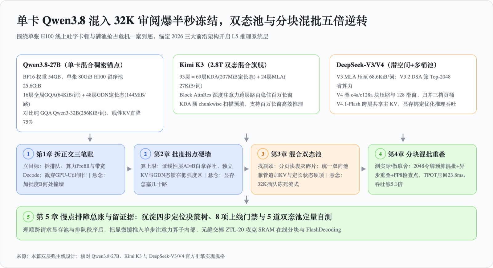
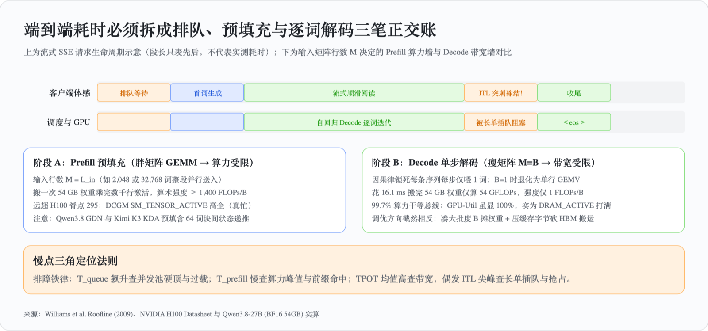
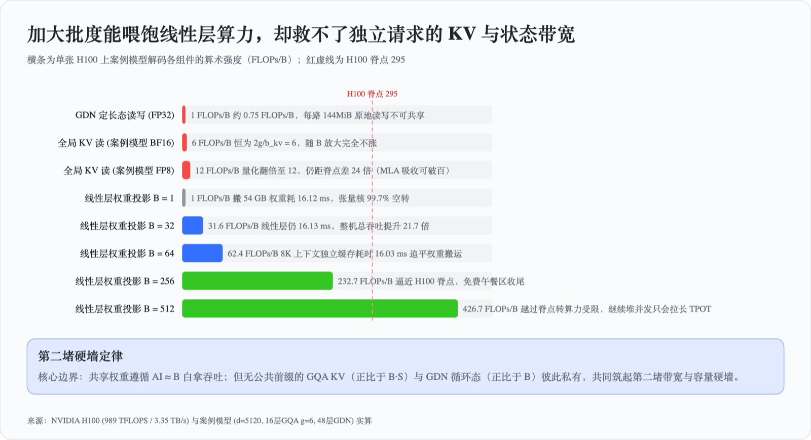
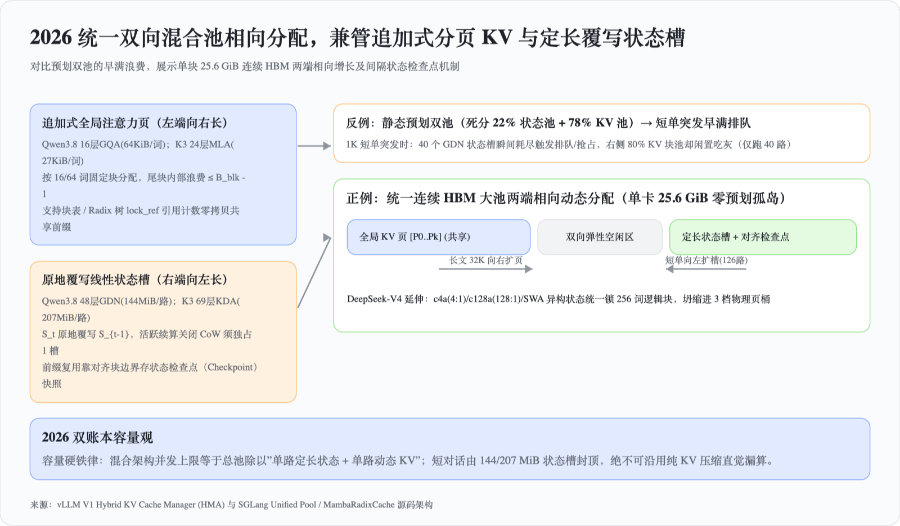
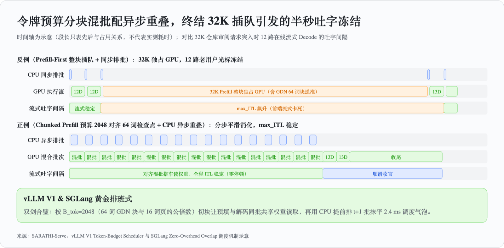
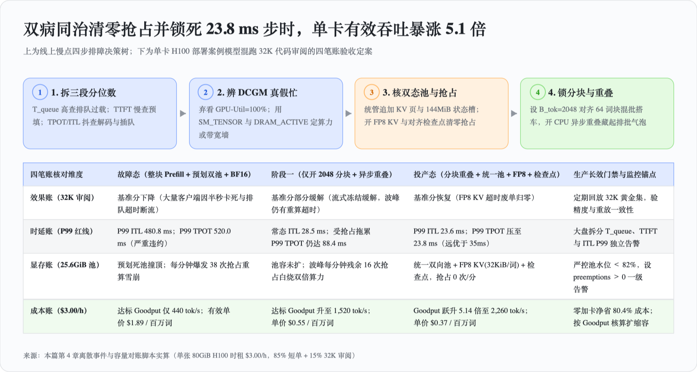

# ZTL-19｜系统｜判断慢在哪，以及请求怎样排队

> 🎯 **这篇文档解决什么问题**：<b>核心命题：诊断任何大模型服务变慢，第一步必须把总响应秒数拆成排队等待、算力预填与带宽解码三笔正交账。</b>拉大批大小能复用共享权重，却救不了独立 KV 与循环状态带宽。现代分页与统一双向混合内存池直接决定最大并发上限。而令牌预算分块混批配异步重叠调度，则消除了长输入插队阻塞流式吐字的冲突。
>
> **使用方式与先修要求**：本篇是 **L5 推理与服务系统层**的开山篇。读者可先回顾第 01、06 篇的矩阵乘与屋脊线判据。正文承接 [ZTL-08｜模型｜把注意力写成矩阵](./08-attention.md) 的混合缓存公式与 [ZTL-18｜后训练｜多想一会儿是否值得](./18-test-time-compute.md) 的思考词账本。
>
> **排障主线**：某研发平台用单张 80 GiB H100 部署混合稠密旗舰 `Qwen3.8-27B`（BF16 权重 `54.0 GB`）。接入 15% 的 `32K` 仓库审阅长单与突发短查询后，当晚爆出双重告警。流式光标停顿半秒，后台每分钟触发 38 次满池抢占。五章从拆三段时延出发，算清批度拐点、统一双向混合池与令牌分块混批，同步对照 `Qwen3-32B`、`Kimi K3` 与 `DeepSeek-V3 / V4`。规格核对于 2026 年 11 月 16 日。
>
> **动手实践**：第 2 章提供单卡 H100 上 `Qwen3.8-27B` 批度吞吐与私有缓存带宽模拟器。第 3 章提供静态双池对比统一双向池的并发上限求解器。第 4 章提供分块混批加异步重叠模拟器与五倍有效吞吐对账脚本。

<b>🧭 主线位置</b>：上一篇 [ZTL-18｜后训练｜多想一会儿是否值得](./18-test-time-compute.md) 算清了长思考链的准确率收益与输出账单，当时把首词延迟与单步耗时视作常数。本篇正式打开推理引擎。我们先按矩阵行数分清预填充与解码的硬件墙，再用统一双向混合池与令牌级混批管住并发队列。下一篇 [ZTL-20｜系统｜减少注意力的内存搬运](./20-flash-attention.md) 将深入算子内部，用片上 SRAM 分块消除冗余显存搬运。

<b>📝 下文案例模型简称</b>：本篇以 `Qwen3.8`（即 Qwen3.8-27B）为主锚点逐层拆解。后续出现的 `Qwen3`（即 Qwen3-32B）、`Kimi`（Kimi K3）、`DS-V3/V4`（DeepSeek 系列）均为对比参照。

## 导读 · 先给结论

- <b>诊慢须先把总耗时拆成排队等待、首字预填与流式步时三笔正交账。</b>首词延迟等于排队加预填耗时，决定白屏体感。每词耗时 `TPOT` 与瞬时间隔 `ITL` 决定流式顺滑度。预填行数大属算力受限，小批解码行数小属带宽受限。单看 `GPU-Util = 100%` 会把等显存误判成算力满载[[1]](https://www2.eecs.berkeley.edu/Pubs/TechRpts/2008/EECS-2008-134.pdf)[[2]](https://docs.nvidia.com/deeplearning/performance/dl-performance-matrix-multiplication/index.html)。
- <b>拉大批度能成倍提升线性层吞吐，却救不了独立请求的缓存带宽。</b>并发远小于隐藏维时，线性层算术强度近似等于批大小。跨过 H100 脊点 `295` 前，吞吐近线性上升。但私有 KV 强度固定在低位，48 层 GDN 状态每步也须按路独立读写，共同构成第二道带宽墙[[3]](https://resources.nvidia.com/en-us-tensor-core/nvidia-tensor-core-gpu-datasheet)[[4]](https://arxiv.org/abs/2305.13245)[[5]](https://huggingface.co/Qwen/Qwen3.8-27B/blob/main/config.json)。
- <b>从分页块表升级到 2026 统一双向混合池，既消除碎片又管住状态槽上限。</b>`PagedAttention` 把内部浪费控在尾块并靠写时复制共享前缀。面对 `Qwen3.8-27B` 与 `Kimi K3`，SGLang 与 vLLM 用连续大池两端相向分配消除预划孤岛。再靠块对齐状态检查点续算公共前缀[[6]](https://arxiv.org/abs/2309.06180)[[7]](https://docs.vllm.ai/en/latest/design/v1/index.html)[[8]](https://github.com/sgl-project/sglang/tree/main/python/sglang/srt)[[9]](https://arxiv.org/abs/2607.24653)。
- <b>统一令牌预算分块混批配异步重叠调度，解决长单插队阻塞吐字的问题。</b>旧连续批遇 `32K` 整块插队会独占 GPU 近半秒。设预算 `2048` 先保底活跃解码，并将长预填对齐 `64` 词块切碎搭车读权重。再叠 CPU 提前排批藏起毫秒气泡，即可将停顿压回 `21 ms` 内[[10]](https://www.usenix.org/system/files/osdi22-yu.pdf)[[11]](https://arxiv.org/abs/2403.02310)[[12]](https://arxiv.org/abs/2312.07104)。
- <b>线上排障须双管齐下：分块重叠治停顿，双向池配 FP8 KV 治满池抢占。</b>单卡 H100 混跑 `32K` 审阅时，单改分块仍因池满抢占残留高尾延迟。联开统一双向池、FP8 KV 与规则前缀检查点后，抢占彻底归零。`P99 TPOT` 从 `520.0 ms` 压回 `23.8 ms`，有效吞吐提升 `5.14` 倍[[5]](https://huggingface.co/Qwen/Qwen3.8-27B/blob/main/config.json)[[7]](https://docs.vllm.ai/en/latest/design/v1/index.html)[[13]](https://vllm.ai/blog/deepseek-v4)。



<b>📎 与系列其他文档的分工</b>：矩阵乘与屋脊线回顾 [ZTL-01｜数学｜符号、向量与矩阵乘法](./01-matmul.md) 与 [ZTL-06｜数学｜一张纸算清算力、显存与缩放](./06-compute-memory-scaling.md)，混合线性缓存与思考链词数账本分别回顾 [ZTL-08｜模型｜把注意力写成矩阵](./08-attention.md) 与 [ZTL-18｜后训练｜多想一会儿是否值得](./18-test-time-compute.md)。

本篇负责跨请求三段时延诊断、混合双态内存池与迭代混批调度。单步片上 SRAM 分块与 `FlashDecoding` 移交 [ZTL-20｜系统｜减少注意力的内存搬运](./20-flash-attention.md)，低比特量化、投机解码与跨节点集群分别见第 21～24 篇（至 [ZTL-24｜系统｜长上下文与混合专家怎样改变账单](./24-long-context-moe.md)）。

## 第 1 章 · 拆三笔账，预填与解码的硬件差异

上一篇 [ZTL-18｜后训练｜多想一会儿是否值得](./18-test-time-compute.md) 核算思考词预算时，我们把预填充耗时与单步解码耗时当作稳定的常数。然而一旦模型接上高并发生产网关，这只黑盒很快就会剧烈抖动。来看贯穿全篇的教学案例（场景与告警读数为假设，规格按公开配置核对）。某研发平台在单张 **80 GiB H100 SXM5**（时租 `$3.00/h`）上部署混合稠密旗舰 <b>`Qwen3.8-27B`</b>。BF16 权重占 `54.0 GB`，单卡留出约 `25.6 GiB` 净缓存池[[3]](https://resources.nvidia.com/en-us-tensor-core/nvidia-tensor-core-gpu-datasheet)[[5]](https://huggingface.co/Qwen/Qwen3.8-27B/blob/main/config.json)。

起初只跑短问答（`1.5K` 输入配 `512` 词输出）时运行平稳，`P99` 词间间隔仅 `24 ms`。周三晚间刚混入 **15% 的 `32K` 仓库审阅长单**与突发短查询，监控立即报警。前端流式光标频频<b>停顿近半秒（`P99 ITL` 飙至 `480.8 ms`）</b>。全局 `P99 TPOT` 恶化至 `520.0 ms`，后台每分钟触发 `38` 次抢占重算。

值班工程师运行 `nvidia-smi` 查看，屏幕却显示 `GPU-Util = 100%`。显卡真的全速运转吗？请求卡在哪一环？本章先为排障**立目标**：拆开三笔正交时间账，用矩阵行数看清物理瓶颈。

### 1.1 拆三段时间：排队、预填与流式脉冲

业务方报障常只说一句：“接口平均响应要 9 秒，太慢了。”在系统工程师眼里，单看平均端到端秒数或裸总吞吐 `TPS` 缺乏诊断指向性[[10]](https://www.usenix.org/system/files/osdi22-yu.pdf)[[14]](https://arxiv.org/abs/2407.00079)。一条只吐 40 词却在队列空等 8 秒的短查询，与一条零排队但平稳吐出 400 词结论的长请求，总秒数完全相同。前者病在并发池过载，后者纯属正常输出长度所致。在流式推送交互下，端到端总耗时必须拆成三段正交之和：

```math
T_{\text{e2e}} = T_{\text{queue}} + T_{\text{prefill}} + (N_{\text{out}} - 1)\cdot\mathrm{TPOT}, \qquad \mathrm{TTFT} = T_{\text{queue}} + T_{\text{prefill}}
```

式中各项指标各司其职。**排队等待时间** $`T_{\text{queue}}`$ 是请求进入网关后等待空闲缓存块、状态槽或令牌预算的空等毫秒数。**预填充耗时** $`T_{\text{prefill}}`$ 是 GPU 扫完提示词、写入初始缓存并算出第 1 个生成词的时长。两者相加构成**首词延迟**（`TTFT`），直接决定按下回车后的白屏等待时间。

首词生成后，推理转入自回归逐词循环。相邻两词抵达客户端的瞬时间隔叫**词间延迟**（`ITL`）。全序列各解码步的均值则是**每输出词时间**（`TPOT`）[[7]](https://docs.vllm.ai/en/latest/design/v1/index.html)[[11]](https://arxiv.org/abs/2403.02310)。人类流畅默读约为每秒 10～15 词。只要稳住 `TPOT ≤ 35 ms`，即可保证顺滑阅读体感。

但必须警惕均值陷阱。哪怕 200 词回复的平均 `TPOT` 仅 26 毫秒，只要第 80 步被插队请求阻塞 `480 ms`，前端光标就会明显卡顿。因此生产压测不看裸吞吐。我们只认同时达标双重服务等级目标（SLO）的**有效吞吐**（`Goodput`）。



上方画板把一条在线请求的生命周期切成了三段互不重叠的时间标尺。首字之前的排队段取决于显存池余量，预填段受制于张量核矩阵吞吐。首字之后的流式吐字脉冲则受显存带宽与同批插队请求牵制。明确三段边界后，任何慢请求都能在十秒内定出责任模块。

### 1.2 矩阵行数 M：算力受限与带宽受限的转折

为何同一套权重跑在同一张 H100 上，`Prefill` 与 `Decode` 的硬件瓶颈却截然相反？关键就在线性投影 $`Y = X W`$ 的输入激活矩阵行数 $`M`$ 里[[1]](https://www2.eecs.berkeley.edu/Pubs/TechRpts/2008/EECS-2008-134.pdf)[[2]](https://docs.nvidia.com/deeplearning/performance/dl-performance-matrix-multiplication/index.html)。我们拿 `Qwen3.8-27B`（BF16 权重 `54.0 GB`）配单张 H100 SXM5（峰值 `989 TFLOPS`，带宽 `3.35 TB/s`，脊点约 `295 FLOPs/B`）手算核对[[3]](https://resources.nvidia.com/en-us-tensor-core/nvidia-tensor-core-gpu-datasheet)[[5]](https://huggingface.co/Qwen/Qwen3.8-27B/blob/main/config.json)：

- <b>Prefill 阶段：胖矩阵乘（GEMM），受制于算力墙。</b>长提示词并行拼成上千行的胖激活矩阵。GPU 从 HBM3 搬一趟 `54.0 GB` 权重进片上缓存，一次就能乘完上千行激活。算术强度超 `1,400 FLOPs/B`，远高于 `295` 脊点，张量核满负荷运转（Compute-bound）。若模型含有线性注意力层（如 Qwen3.8-27B 的 GDN），预填按块长 `64` 做分块并行扫描。一条 `32K` 请求含 512 个块递推步，整块独占 GPU 耗时达 `478 ms`[[15]](https://arxiv.org/abs/2412.06464)。
- <b>Decode 阶段：单行矩阵向量乘（GEMV），受制于带宽墙。</b>转入自回归解码后，因果律限定每条序列每步只能喂入刚生成的 **1 个词**。单并发时输入退化为单行向量。H100 仍须从 HBM3 把 `54.0 GB` 权重全搬一遍，耗时下限达 <b>`16.12 ms`</b>，算术强度跌至 <b>`1.0 FLOP/B`</b>。全卡 <b>99.7%</b> 的张量核处于空转等待状态，属于典型的显存带宽受限（Memory-bound）[[1]](https://www2.eecs.berkeley.edu/Pubs/TechRpts/2008/EECS-2008-134.pdf)。

下表汇总了线上排障必盯的六项正交监控指标。阅读时请重点对照平均 `TPOT` 与瞬时 `ITL`：前者衡量整单平均带宽水位，后者专门抓捕单步半秒卡顿的毛刺真凶：

| **监控指标与符号** | **严格物理定义与单位** | **主导硬件资源与卡点** | **生产 SLO 红线与异常信号** |
|---|---|---|---|
| <b>排队延迟 $`T_{\text{queue}}`$</b> | 请求入网关至首块进入前向迭代的空等耗时（ms） | 全局 KV 块池、定长状态槽余量与并发配额 | 交互态 `P99 < 150 ms`；飙升直指池满或过载 |
| <b>首词延迟 `TTFT`</b> | $`T_{\text{queue}} + T_{\text{prefill}}`$ ，发请求至收首词总时长（s） | Tensor Core 峰值算力、块扫描步数与前缀命中率 | 短单 `P99 < 0.3 s`；32K 审阅 `< 2.5 s` |
| <b>每词耗时 `TPOT`</b> | $`(T_{\text{e2e}} - \mathrm{TTFT})/(N_{\text{out}}-1)`$ 平均步时（ms） | HBM 显存带宽（TB/s）、激活权重与缓存总搬运量 | 实时流式交互硬红线 `P99 < 35 ms` |
| <b>词间延迟 `ITL`</b> | 相邻两个输出词抵达客户端的单步瞬时间隔（ms） | 同批混入的预填分块尺寸、满池抢占停顿与 CPU 气泡 | 严盯 `P99 ITL < 50 ms`，抓捕半秒冻结尖峰 |
| <b>裸总吞吐 `TPS`</b> | 单实例每秒产出的全部输出词数（tokens/s） | 并发批大小 $`B`$ 摊薄只读权重读取的倍率 | 仅反映硬件吞吐水位，未剔除超时违约废单 |
| <b>有效吞吐 `Goodput`</b> | 同时达标 `TTFT` 与 `TPOT` 双重 SLO 的吞吐（tok/s） | 算力、带宽、双态内存池与分块调度的综合均衡点 | 容量压测与核算每百万词真实成本的唯一准绳 |

> 💡 <b>常见误区：一见 nvidia-smi 里 GPU-Util = 100%，就判定算力打满并申请加卡。</b>单流或小批解码时显卡利用率常年停在 100%，按屋脊线推算的浮点吞吐却不足 H100 峰值的 1%。根因是 `GPU-Util` 只统计采样期内至少一个 SM 驻留未退出线程块的时间占比。哪怕 SM 全程等待 HBM 搬运权重，只要内核未退出就一律记作 100%。应改查 DCGM 探针的 `SM_TENSOR_ACTIVE` 与 `DRAM_ACTIVE`，再结合三段延迟定位瓶颈[[2]](https://docs.nvidia.com/deeplearning/performance/dl-performance-matrix-multiplication/index.html)[[3]](https://resources.nvidia.com/en-us-tensor-core/nvidia-tensor-core-gpu-datasheet)。

> 🔑 **本章要点与回到主线**：经立目标拆清三笔正交账并核查硬件探针，排障组确认 `Prefill` 受限于大矩阵算力，而单流 `Decode` 花 `16.12 ms` 搬运权重却让算力 99.7% 闲置。既然搬一趟权重的开销已经固定，把并发批大小拉大显然能复用权重提升吞吐。但推高批大小时，为何权重瓶颈刚缓解，另一道私有缓存带宽墙与容量墙又迎面出现？第 2 章立即推算。

## 第 2 章 · 批大小与两道硬墙，权重复用的边界

承接第 1 章末尾的问题：单流解码每吐一词都要花 `16.12 ms` 搬一遍 `54.0 GB` 权重，张量核几乎全在空等。只读权重对全站请求完全相同。把多条活跃解码序列拼成批次（Batching）送进 GPU，搬一次权重顺手乘完多行激活，就能换来数十倍吞吐提升。本章执行工程第二步**算上限**：推导批大小放大线性层吞吐的边界，并找出限制并发上限的第二道私有缓存带宽墙[[1]](https://www2.eecs.berkeley.edu/Pubs/TechRpts/2008/EECS-2008-134.pdf)[[10]](https://www.usenix.org/system/files/osdi22-yu.pdf)。

### 2.1 权重复用：算术强度约等于批大小

我们先算批大小对 BF16 线性层的算术强度放大规律。设解码步输入形状为 `B × d_in`，权重为 `d_in × d_out`。单次矩阵乘执行 `2 B d_in d_out` 次浮点运算。HBM 需读入权重与输入并写出输出（每元素 2 字节）[[1]](https://www2.eecs.berkeley.edu/Pubs/TechRpts/2008/EECS-2008-134.pdf)[[2]](https://docs.nvidia.com/deeplearning/performance/dl-performance-matrix-multiplication/index.html)。计算量除以总访存字节数即得算术强度：

```math
\mathrm{AI}_{\text{linear}}(B) = \frac{2 B d_{\text{in}} d_{\text{out}}}{2\left(d_{\text{in}} d_{\text{out}} + B d_{\text{in}} + B d_{\text{out}}\right)} = \frac{B}{1 + B / d_{\text{out}} + B / d_{\text{in}}} \approx B
```

在 `Qwen3.8-27B` 与 `Qwen3-32B`（隐藏维 `5120`）这类稠密模型上，只要在线并发远小于 `5120`，分母后两项占比极小。<b>线性层算术强度直接约等于并发批大小。</b>换成万亿参数混合专家模型时，只需将并发批大小替换为单步路由到同一活跃专家的平均词数，线性复用规律依然成立[[16]](https://arxiv.org/abs/2412.19437)。

这条公式划出了推理服务的**免费午餐区**。跨过 H100 脊点（`295 FLOPs/B`）前，线性层步时被权重搬运固定在 `16.1 ms` 附近。把并发从 `1` 扩至 `32`，单步权重耗时几乎不变，线性层吞吐却提升近 **32 倍**[[2]](https://docs.nvidia.com/deeplearning/performance/dl-performance-matrix-multiplication/index.html)[[3]](https://resources.nvidia.com/en-us-tensor-core/nvidia-tensor-core-gpu-datasheet)。反之，一旦稀疏模型专家切分过细导致单专家命中词数跌回个位数，它也会重新退回带宽受限区。而在稠密模型上越过脊点 `295` 后，张量核已被喂饱，继续堆高并发只会让单步耗时线性拉长。



上方画板呈现了共享权重与私有缓存的双曲线分化。为何全局 KV 强度无法随并发抬升？设批度为 $`B`$ 、历史长为 $`L`$ ，每对键值头占 $`2 d_h b_{\text{kv}}`$ 字节并服务 $`g`$ 个查询头（执行 $`4 g d_h`$ 次浮点运算）。两者相除后分子分母的 $`B \cdot L \cdot d_h`$ 悉数约消，算术强度恒定锁死在 $`2 g / b_{\text{kv}}`$ 低位。

### 2.2 独立缓存：第二道硬墙

倘若整网算子都服从线性层复用规律，凑满三百路并发就能吃满整张显卡。但历史上下文缓存打破了这一假设。模型权重是全局共享常量，同批在线用户的代码库与对话历史却彼此独立，跨请求无法复用[[4]](https://arxiv.org/abs/2305.13245)[[6]](https://arxiv.org/abs/2309.06180)。在 2026 混合架构中，这笔私有带宽账包含两项：

- <b>全局注意力层的历史 KV 读取。</b>分组查询注意力（GQA）每组由 $`g`$ 个查询头共享 1 对键值头。`Qwen3-32B`（`g = 8`）的 BF16 强度恒为 `8 FLOPs/B`[[17]](https://arxiv.org/abs/2505.09388)。`Qwen3.8-27B` 含 16 层门控 GQA（`g = 6`），每词 KV 压至 `64 KiB`（降幅 <b>75%</b>），但 BF16 强度仍固定在 <b>`6 FLOPs/B`</b>。某些模型的多头潜空间注意力（MLA）通过矩阵吸收可把强度推上百量级[[16]](https://arxiv.org/abs/2412.19437)。
- <b>线性注意力层的定长循环状态。</b>`Qwen3.8-27B` 配有 48 层 GDN（单路占 <b>`144.0 MiB`</b> FP32 状态）[[5]](https://huggingface.co/Qwen/Qwen3.8-27B/blob/main/config.json)[[15]](https://arxiv.org/abs/2412.06464)。定长状态虽不随长度膨胀，但每步常规解码仍须从 HBM 读出 $`B`$ 份旧状态并原地写回新状态。逐元素拆账：读取 4 字节旧态再写回 4 字节新态共耗 8 字节，中间仅执行门控衰减与键值外积约 6 次浮点运算，算术强度低至 `0.75 FLOP/B`，单路每步往返高达 `302 MB`。

把线性层权重与私有缓存叠在一起，就能解释线上吞吐曲线为何提前弯曲。低并发区由 `54.0 GB` 权重搬运主导，拉大批大小等于免费提升吞吐。可随着并发突破三十路，私有 KV 与 GDN 状态的带宽账迅速抬头。它反客为主，卡住了单步耗时下限。

下方模拟器算出了单张 H100 上 `Qwen3.8-27B` 在平均上下文 `8,192` 词下，并发从 `1` 扩至 `256` 时线性层与私有缓存的耗时分化：

*单卡 H100 上案例模型批大小撬动线性层吞吐与私有缓存带宽硬墙模拟器*

```python
F_PEAK, BW_HBM = 989e12, 3.35e12          # H100 SXM5: 989 TFLOPS, 3.35 TB/s
P_W, D, L_TOT = 27.0e9, 5120, 64          # Qwen3.8-27B: 27B 稠密 (BF16 权重 54.0 GB)
GQA_G, B_KV, KV_TOK = 6, 2, 65_536        # 16层 Gated GQA (24Q/4KV, g=6), 64 KiB/词
GDN_STATE_B = 48 * 48 * 128 * 128 * 4     # 48层 GDN FP32 定长状态: 144.0 MiB (150,994,944 B)
SEQ_LEN = 8192                            # 假设活跃请求当前上下文均为 8,192 词

for B in [1, 8, 32, 64, 128, 256, 512]:
    ai_lin = (2 * B * D * D) / (2 * (D * D + 2 * B * D))
    t_lin = max((2 * B * P_W) / F_PEAK, (2 * P_W + 4 * B * D * L_TOT) / BW_HBM)
    bytes_indep = B * (SEQ_LEN * KV_TOK + 2 * GDN_STATE_B)  # 独立KV读 + 独立GDN状态读写
    t_cache = bytes_indep / BW_HBM
    tpot_ms = (t_lin + t_cache) * 1e3
    mem_gib = B * (SEQ_LEN * KV_TOK + GDN_STATE_B) / (1024 ** 3)
    print(f"B={B:3d} | AI_lin={ai_lin:5.1f} | t_lin={t_lin*1e3:5.2f}ms | "
          f"t_cache={t_cache*1e3:5.2f}ms | TPOT={tpot_ms:5.2f}ms | "
          f"TPS={B/(t_lin+t_cache):4.0f} tok/s | 池需={mem_gib:5.1f}GiB")
```

*输出*

```text
B=  1 | AI_lin=  1.0 | t_lin=16.12ms | t_cache= 0.25ms | TPOT=16.37ms | TPS=  61 tok/s | 池需=  0.6GiB
B=  8 | AI_lin=  8.0 | t_lin=16.12ms | t_cache= 2.00ms | TPOT=18.13ms | TPS= 441 tok/s | 池需=  5.1GiB
B= 32 | AI_lin= 31.6 | t_lin=16.13ms | t_cache= 8.01ms | TPOT=24.14ms | TPS=1325 tok/s | 池需= 20.5GiB
B= 64 | AI_lin= 62.4 | t_lin=16.14ms | t_cache=16.03ms | TPOT=32.17ms | TPS=1989 tok/s | 池需= 41.0GiB
B=128 | AI_lin=121.9 | t_lin=16.17ms | t_cache=32.05ms | TPOT=48.22ms | TPS=2654 tok/s | 池需= 82.0GiB
B=256 | AI_lin=232.7 | t_lin=16.22ms | t_cache=64.10ms | TPOT=80.32ms | TPS=3187 tok/s | 池需=164.0GiB
B=512 | AI_lin=426.7 | t_lin=27.96ms | t_cache=128.21ms | TPOT=156.16ms | TPS=3279 tok/s | 池需=328.0GiB
```

逐段拆解模拟器实现。`t_lin` 取张量计算耗时与权重激活搬运耗时的较大值 `max(...)`，精准刻画屋脊线折点。`bytes_indep` 按并发 `B` 累加每路 `8,192` 词私有 KV 读取量与 `144.0 MiB` GDN 状态的一读一写往返字节数，除以带宽得出真实缓存耗时 `t_cache`。

复盘打印读数十分清晰。从 `B = 1` 推至 `B = 32`，线性层步时稳定在 `16.13 ms`，单卡吞吐跃升 **21.7 倍**至 `1,325 tok/s`，`TPOT` 稳居 `24.14 ms` 区间，线性层强度随批度升到 `31.6 FLOPs/B`。

推到 `B = 64` 时，私有缓存往返达 <b>`16.03 ms`</b> 追平了权重耗时，总池需 `41.0 GiB` 也超出了单卡 `25.6 GiB` 净池，此时线性层强度 `62.4 FLOPs/B`。反观纯 GQA 的 `Qwen3-32B`，单卡扣权重仅余约 `14.9 GiB`，并发 7 路便已触顶。按同一公式继续外推，`B = 256` 时线性层强度为 `232.7 FLOPs/B`，仍在脊点之下；`B = 512` 升至 `426.7 FLOPs/B`，线性层越过脊点转为算力受限，步时从 `16.22 ms` 抬到 `27.96 ms`。

> 💡 <b>常见误区：离线压测只看峰值裸吞吐 TPS，盲目把线上最大并发设到两三百。</b>汇报写着单卡吞吐超 `3,000 tok/s`，接上真实用户后却出现明显吐字卡顿。根因是越过并发甜点后，私有缓存带宽把单步 `TPOT` 拖慢到 `80 ms` 以上，跌破 `35 ms` 红线。正确做法是测绘吞吐对比 `P99 TPOT` 帕累托曲线，用 `P99 TPOT ≤ 35 ms` 反推最大并发，只认达标 `Goodput`[[10]](https://www.usenix.org/system/files/osdi22-yu.pdf)[[11]](https://arxiv.org/abs/2403.02310)。

> 🔑 **本章要点与回到主线**：经算上限推演，单卡 H100 上案例模型复用权重的并发甜点落在 `32～48` 路，缓存容量直接决定并发上限。但排障组查看突发短查询监控时发现了新异常：全卡 KV 块占用刚过两成，新请求却被直接挡在队列外等待并触发抢占。面对兼具追加式分页 KV 与原地覆写状态槽的混合架构，引擎内存池里藏着什么隐形上限？第 3 章立即排查。

## 第 3 章 · 从分页到统一双向池，消灭碎片与状态硬顶

承接第 2 章发现的异常现象：单张 H100 留有 `25.625 GiB`（`26,240 MiB`）净缓存空间。波峰涌入上百条 `1K` 工具短查询时，KV 占用尚不足三成，系统却提前报满并把请求堵在等待队列里。混入 `32K` 代码审阅后，更是一分钟触发 `38` 次抢占重算。本章执行核心排障动作**找瓶颈**：先看虚拟分页怎样消除传统连续张量的六成碎片，再剖析 2026 混合双态模型的引擎内存管理机制[[6]](https://arxiv.org/abs/2309.06180)[[7]](https://docs.vllm.ai/en/latest/design/v1/index.html)[[8]](https://github.com/sgl-project/sglang/tree/main/python/sglang/srt)。

### 3.1 分页注意力：物理块与块表

早期框架要求张量物理地址严格连续。请求刚入队时，系统无法预知它会生成多少词，只能按长度上限一次性预留整块连续 HBM。实测显示，这类静态预留中真正写入有效数据的空间仅占 <b>20%～38%</b>[[6]](https://arxiv.org/abs/2309.06180)。逾六成显存浪费在内部碎片、外部碎片与公共提示词的冗余拷贝上。

Kwon 等人在 vLLM 提出的 **PagedAttention** 借操作系统页表消除了这三类浪费[[6]](https://arxiv.org/abs/2309.06180)。引擎把净显存划分为等大的固定**物理 KV 块**，每块容纳固定词数（常取 `16` 或 `64`）。面对变长序列，调度器按需逐块申领。系统再用轻量级**块表**（SGLang 对应前缀基数树 `RadixAttention`）记录逻辑到物理的映射[[6]](https://arxiv.org/abs/2309.06180)[[12]](https://arxiv.org/abs/2312.07104)：

```math
N_{\text{blk}} = \lceil L / B_{\text{blk}} \rceil, \qquad W_{\text{internal}} = N_{\text{blk}} \cdot B_{\text{blk}} - L \le B_{\text{blk}} - 1
```

等大物理块使外部碎片归零。单序列仅有末尾尾块可能未满，显存利用率提升至 **96% 以上**。同时物理块维护引用计数。多路请求共享 `2,048` 词规则前缀时，块表前段直接指向同一批只读物理块。仅在分叉写入新词时触发**写时复制**（CoW），公共前缀全程零拷贝[[8]](https://github.com/sgl-project/sglang/tree/main/python/sglang/srt)[[12]](https://arxiv.org/abs/2312.07104)。

需要注意页块尺寸的权衡边界。页块设得太小（如 `8` 词）虽能把尾块内部浪费压到极低，却会让页表长度翻倍并打碎连续突发访存；页块设得太大（如 `256` 词）又会在短对话场景放大尾块空置率，因此主流引擎默认常取 `16` 或 `64` 词。



对照上方画板的双向相向增长结构，可以算清短对话为何率先耗尽定长槽。当请求长 `1,024` 词时，单路全局 KV 仅占 `64 MiB`，原地覆写的 GDN 状态却刚性占去 `144 MiB`。状态体积超过 KV 两倍有余，高并发短单自然先撞上状态槽硬顶。

### 3.2 统一双向池：混合架构的关键升级

既然分页块表如此紧凑，当晚为何还会早满排队？根源在于 2026 主力模型打破了全网只有追加式 KV 的假设。多数混合架构模型包含线性注意力层，每条请求同时持有两种特性不同的资源：

- <b>追加式全局 KV 页对比原地覆写状态槽。</b>全局层 KV 是只读追加序列，支持按页增长与多路共享。反观线性层循环状态，每步都会原地覆写矩阵。`Qwen3.8-27B` 的 GDN 每步覆写 `144.0 MiB` 状态[[5]](https://huggingface.co/Qwen/Qwen3.8-27B/blob/main/config.json)[[15]](https://arxiv.org/abs/2412.06464)。任一分支续算都会改写矩阵。引擎必须关闭状态侧活跃 CoW，每条在途请求独占 1 个定长状态槽。
- <b>用统一双向混合池消除预划孤岛。</b>初版采用静态预划双池，把 `26,240 MiB` 净空间拆成 `22%` 状态池（仅 <b>`40` 个</b>槽）与 `78%` KV 池。涌入上百条短单时，KV 池八成闲置，40 个状态槽却被抢光导致排队。2026 引擎已升级为 vLLM V1 混合管理器（HMA）与 SGLang **单大池两端相向动态分配**。左端向右长 KV 页，右端向左长状态槽，完全消除预划孤岛[[7]](https://docs.vllm.ai/en/latest/design/v1/index.html)[[8]](https://github.com/sgl-project/sglang/tree/main/python/sglang/srt)。
- <b>块对齐状态检查点与多压缩页桶。</b>线性状态无法逐词回退，前缀复用改为保存块边界的**状态检查点**快照（如 vLLM `align` 与 SGLang `MambaRadixCache`）[[7]](https://docs.vllm.ai/en/latest/design/v1/index.html)[[8]](https://github.com/sgl-project/sglang/tree/main/python/sglang/srt)。某些模型采用块压缩与异构页桶的设计来进一步优化 KV 存储。这类架构将长句子分成多个逻辑块，按照大小分别存储到不同的物理页桶中[[13]](https://vllm.ai/blog/deepseek-v4)。

下方脚本算出了单卡 H100（`26,240 MiB` 净池）上 `Qwen3.8-27B` 在预划死池、统一双向池与开启 FP8 KV 时按容量公式算出的并发上限：

*单卡 H100 (25.6 GiB 净池) 案例模型静态双池 vs 2026 统一双向混合池并发上限求解器*

```python
POOL_MIB = 26_240                         # 单卡 80GiB H100 扣 54GB 权重与缓冲后净池 26,240 MiB
GDN_SLOT_MIB, BLK_TOKS = 144.0, 16        # 每活跃请求 144 MiB FP32 GDN 状态槽, 分页块长 16 词

def solve_cap(seq_len, kv_kib_tok, unified=True, static_state_share=0.22):
    n_blks = (seq_len + BLK_TOKS - 1) // BLK_TOKS
    kv_mib = n_blks * BLK_TOKS * kv_kib_tok / 1024.0
    if unified:
        b_max = int(POOL_MIB // (GDN_SLOT_MIB + kv_mib))
        dom = "GDN状态槽主导" if GDN_SLOT_MIB > kv_mib else "全局KV页主导"
        return b_max, dom
    b_st = int((POOL_MIB * static_state_share) // GDN_SLOT_MIB)
    b_kv = int((POOL_MIB * (1.0 - static_state_share)) // kv_mib)
    return min(b_st, b_kv), f"min(状态顶{b_st}, KV顶{b_kv})"

for L in [1024, 8192, 32768]:
    s_cap, s_tag = solve_cap(L, 64, unified=False)
    u_cap, u_tag = solve_cap(L, 64, unified=True)
    f_cap, _     = solve_cap(L, 32, unified=True)   # 开启 FP8 KV (32 KiB/词)
    print(f"L={L:5d} | 预划死池(BF16):{s_cap:3d}路[{s_tag}] | "
          f"统一双向池(BF16):{u_cap:3d}路({u_tag}) | 双向池+FP8 KV:{f_cap:3d}路")
```

*输出*

```text
L= 1024 | 预划死池(BF16): 40路[min(状态顶40, KV顶319)] | 统一双向池(BF16):126路(GDN状态槽主导) | 双向池+FP8 KV:149路
L= 8192 | 预划死池(BF16): 39路[min(状态顶40, KV顶39)] | 统一双向池(BF16): 40路(全局KV页主导) | 双向池+FP8 KV: 65路
L=32768 | 预划死池(BF16):  9路[min(状态顶40, KV顶9)] | 统一双向池(BF16): 11路(全局KV页主导) | 双向池+FP8 KV: 22路
```

拆解 `solve_cap` 容量求解逻辑。函数先按 `16` 词物理页向上取整，算出单序列分页占用 `kv_mib`。静态预划模式下，并发受木桶短板 `min(b_st, b_kv)` 制约。`1K` 短单明明够装 `319` 路 KV，却被 `40` 个死槽卡死。切入统一双向池后，整块 `26,240 MiB` 空间按需动态调配，两端直至物理碰头才触发流控。

复盘输出可见容量跃升。`1K` 短查询并发从 `40` 路直冲 <b>`126` 路（提升 3.15 倍）</b>，开启 FP8 KV 后更升至 `149` 路。到了 `32K` 长单场景，瓶颈转为全局 KV 页主导。叠上 FP8 KV 与规则前缀检查点后，长单池容同样翻倍至 <b>`22` 路以上</b>。下表横评了三代模型内存池的引擎机制：

| **内存池对比维度** | <b>纯分页单态池（`Qwen3-32B` / `DS-V3`）</b> | <b>混合双态双向池（`Qwen3.8-27B` / `Kimi K3`）</b> | <b>块压缩多桶异构池（`DeepSeek-V4 / Flash`）</b> |
|---|---|---|---|
| **驻留数据结构** | 全层统一追加式 KV 块（`256` 或 `68.6 KiB/词`） | 追加 KV 页（`64 / 27 KiB/词`）+ 原地覆写状态槽（`144 / 207 MiB`）；案例模型配 `16` 层全局 GQA + `48` 层线性，`Kimi K3` 为 `93` 层（`69` 层线性 KDA + `24` 层多头潜空间，`2.8T` MoE 混合）[[18]](https://arxiv.org/abs/2510.26692) | `c4a`、`c128a`、`128` 滑窗与压缩残差及 FP4 索引器 |
| **物理分配架构** | 单一等大物理块池 + 单套块表或基数树 | vLLM HMA 多 `SpecGroup` 或 SGLang 单大池两端相向增长 | 锁 `256` 原生词逻辑块，归入 `3` 档物理页大小桶 |
| **前缀复用机制** | 任意块边界哈希或基数树匹配，全量支持 CoW | KV 侧走 CoW；线性侧关活跃 CoW，靠对齐块边界存状态检查点 | 落在 `256` 原生词位边界，压缩器残差随滑窗规范一并交接 |
| **首要容量暗礁** | 长上下文下全层 KV 线性增长，显存快速吃紧 | 短输入高并发撞上刚性状态槽硬顶；旧连接器未适配 HMA 会拒启 | 多压缩比步调不一，需多 CUDA 流融合压低小算子启动税 |

> 💡 <b>常见误区：给混合模型算并发时只看每词 KV 斜率，漏算定长状态槽或误关 HMA。</b>短单突发时显存未满就排队，或外挂 KV 插件时加了禁用混合管理器参数导致进程报错拒启。根因是每活跃会话刚性独占 `144 / 207 MiB` 状态槽，无法退化为纯注意力。正确做法是用双账本公式核算并发上限，并选用适配 `SupportsHMA` 接口的连接器[[7]](https://docs.vllm.ai/en/latest/design/v1/index.html)[[8]](https://github.com/sgl-project/sglang/tree/main/python/sglang/srt)。

> 🔑 **本章要点与回到主线**：经找瓶颈升级内存底座，统一双向池配 FP8 KV 与状态检查点将短单并发推至 `149` 路，`32K` 池容同步翻倍，扫清了抢占隐患。但新的问题依然存在：即便显存池充裕且零抢占，只要线上挤进一条 `32K` 仓库审阅单，同卡老用户的流式光标仍会停顿近半秒（`P99 ITL = 480.8 ms`）。新长单与老解码在单步迭代里该怎么安排？第 4 章立即解决。

## 第 4 章 · 分块混批与异步重叠，解决插队卡顿

接住第 3 章留下的流式停顿问题。统一双向池消除了满池抢占，可只要一条 `32K` 代码审阅新单进入实例，正在收字的老用户屏幕仍会卡顿近半秒。病根落在跨请求的时间排班器（Scheduler）上。线上每秒既有长短悬殊的新提示词涌入，又有老序列随时生成终止符离场。

本章推进**测实际**与**做取舍**。我们理清迭代级调度怎样化解高吞吐与平滑吐字的矛盾，并核算五倍有效吞吐提升的总账[[7]](https://docs.vllm.ai/en/latest/design/v1/index.html)[[10]](https://www.usenix.org/system/files/osdi22-yu.pdf)[[11]](https://arxiv.org/abs/2403.02310)。

### 4.1 从陪跑到连续批：Prefill-First 的问题

早期服务脚本照搬离线评测，采用**请求级静态批处理**。调度器凑齐 12 条请求打包同进同出。哪怕 11 条短问答在第 50 步就生成完毕，也得填零陪最后那条长文空转到第 2,000 步才能返回。Yu 等人在 **Orca** 提出的**迭代级连续批处理**解除了陪跑限制[[10]](https://www.usenix.org/system/files/osdi22-yu.pdf)。每跑完一步就当场移出完结序列归还槽位，下一毫秒立刻补入新单。在线吞吐由此翻上数倍。

然而初代连续批处理默认采取**预填充优先**策略。一见新单入队，系统便挂起手头所有解码批次，优先把新单整段输入一次预填完。一旦混入一条 `32,768` 词审阅长单，停顿立刻爆发[[11]](https://arxiv.org/abs/2403.02310)。单张 H100 要算完 `32K` 词的线性投影与全局注意力。同时 `Qwen3.8-27B` 的 48 层 GDN（或 `Kimi K3` 的 69 层 KDA）还要串行走完 512 个**模型级分块递推步**，单次前向独占 GPU 达 <b>`478.4 ms`</b>[[9]](https://arxiv.org/abs/2607.24653)[[15]](https://arxiv.org/abs/2412.06464)。

同卡 12 位老用户的解码流被迫停摆近半秒，监控拉出明显的 `ITL` 尖峰。这里需区分两类串行。线性层内核里的 64 词递推属**模型级串行**，靠融合内核提速。而让长请求中途让位给老用户吐词，则属引擎可控的**调度级切块**。



上方画板对比了两种排班时间线。上半幅旧策略让 `32K` 大单横插一刀，截断全部流式脉冲近半秒；下半幅将长单切成对齐 `64` 词边界的薄片与活跃解码同批推进，同时由 CPU 异步预排下一批元数据填平气泡。模拟数据显示，新模式下按 `2048` 令牌预算对齐块边界后，线性层假设算术强度达 `232 FLOPs/B`（`B=256` 对应值），使得同步权重搬运时间被多路并发摊分。

### 4.2 令牌预算、混批对齐与异步重叠

Agrawal 等人在 **SARATHI** 提出、现已成为 **vLLM V1** 与 **SGLang** 核心机制的**分块预填充**（Chunked Prefill），用一条简洁规则化解了冲突[[7]](https://docs.vllm.ai/en/latest/design/v1/index.html)[[8]](https://github.com/sgl-project/sglang/tree/main/python/sglang/srt)[[11]](https://arxiv.org/abs/2403.02310)。**引擎取消预填充步与解码步的隔离墙，把所有请求统一折算为单步令牌预算**：

```math
\sum_{r \in \mathcal{D}} 1 + \sum_{q \in \mathcal{P}} c_q \le B_{\text{tok}}
```

这套现代调度底座靠两项核心机制协同运转：

- <b>vLLM V1 统一令牌混批与块边界对齐。</b>设单卡预算为 `2048`，线上有 12 路活跃解码在途。每轮调度优先保底划给 12 路解码各 1 词额度。余下额度再从队首 `32K` 长单切下一片分块拼入同批。针对混合模型，切块对齐块长 `64` 与物理页长的公倍数（如每步切 `1,984` 词），避免中途重放检查点[[7]](https://docs.vllm.ai/en/latest/design/v1/index.html)[[8]](https://github.com/sgl-project/sglang/tree/main/python/sglang/srt)。GPU 读一趟权重同时服务预填分块与 12 路解码，单步稳定在 `21 ms` 左右。
- <b>零开销 CPU-GPU 异步重叠调度。</b>单步 GPU 耗时压到 `20 ms` 级后，Python 组装块表的 `2.4 ms` CPU 排批耗时便暴露成空转气泡。SGLang 与 vLLM V1 采用双缓冲异步流水。GPU 算当前批内核时，CPU 提前排好下一批元数据推入 CUDA 流，把排批开销藏进 GPU 计算时间里[[8]](https://github.com/sgl-project/sglang/tree/main/python/sglang/srt)[[12]](https://arxiv.org/abs/2312.07104)。

进入**测实际**与**做取舍**验证环节。排障组先跑离散事件模拟器复现 `32K` 插队影响。随后按单张 80 GiB H100（`$3.00/h`）设定一组三阶段验收账单。下方脚本下半段的 P99、抢占次数与吞吐都是**假设读数**（示意，非实测），只用来演示怎么把读数折成单价与达标判断。假设的压测流量为 `10 req/s`（含 85% 短单与 15% 带公共规则头的 `32K` 审阅单），达标线设为 `P99 TPOT ≤ 35 ms` 且 `32K TTFT ≤ 2.5 s`：

*分块混批 + 异步重叠离散事件模拟器与单卡 H100 案例模型线上排障三阶段对账脚本*

```python
def sim_step_scheduler(chunk_budget=None, async_overlap=False):
    decodes = [16] * 12                       # 12 路在线流式 Decode，各剩 16 词待吐
    prefill_rem, arrived = 0, False
    t_ms, last_emit, max_itl = 0.0, [0.0] * 12, 0.0
    cpu_bubble = 0.0 if async_overlap else 2.4
    while any(d > 0 for d in decodes) or prefill_rem > 0 or not arrived:
        if not arrived and t_ms >= 36.0:
            prefill_rem, arrived = 32768, True   # t=36ms 突入一条 32K 仓库审阅请求
        act_d = [i for i, d in enumerate(decodes) if d > 0]
        if chunk_budget is None and prefill_rem > 0:
            p_tok, d_run = prefill_rem, []       # 旧式 Prefill-First: 整块独占挂起全部解码
        else:
            d_run = act_d
            raw_b = max(0, (chunk_budget or 0) - len(d_run))
            p_tok = min(prefill_rem, (raw_b // 64) * 64 or raw_b)  # 对齐 64 词 GDN 块边界
        if p_tok > 0 and not d_run:
            gpu_ms = 0.0146 * p_tok
        elif p_tok > 0 and d_run:
            gpu_ms = max(16.2, 0.0098 * p_tok + 1.1)
        else:
            gpu_ms = 16.2 + 0.14 * len(d_run)
        t_ms += gpu_ms + cpu_bubble
        prefill_rem -= p_tok
        for i in d_run:
            if i < 12:
                max_itl = max(max_itl, t_ms - last_emit[i])
            last_emit[i] = t_ms
            decodes[i] -= 1
        if arrived and prefill_rem == 0 and len(decodes) == 12:
            decodes.append(6)
            last_emit.append(t_ms)
    return round(t_ms, 1), round(max_itl, 1)

for tag, cb, ov in [("故障基线: Prefill-First + 同步排批", None, False),
                    ("仅开分块: Chunked 2048 + 同步排批",  2048, False),
                    ("分块+重叠: Chunked 2048 + 异步重叠", 2048, True)]:
    tot, itl = sim_step_scheduler(cb, ov)
    print(f"{tag:32s} | 批次完工:{tot:6.1f}ms | 老用户 max_ITL:{itl:5.1f}ms")

# 三阶段验收账单: 下列 P99 / 抢占 / Goodput 为假设读数（示意，非实测）
GPU_USD_H = 3.00
STAGES = [
    ("故障态: 整块Prefill+预划死池+BF16",        520.0, 480.8, 38,  440),
    ("阶段一: 仅开2048分块+异步重叠(仍满池抢占)",  88.4,  28.5, 16, 1520),
    ("投产态: 分块重叠+统一双向池+FP8+对齐检查点", 23.8,  23.6,  0, 2260),
]
for name, tpot, itl, pre, good_tps in STAGES:
    usd_m = GPU_USD_H / (good_tps * 3600 / 1e6)
    print(f"{name:38s} | 抢占:{pre:2d}/分 | P99_ITL:{itl:5.1f}ms | "
          f"P99_TPOT:{tpot:5.1f}ms | Goodput:{good_tps:4d} tok/s | ${usd_m:.2f}/M")
```

*输出*

```text
故障基线: Prefill-First + 同步排批       | 批次完工: 806.1ms | 老用户 max_ITL:501.2ms
仅开分块: Chunked 2048 + 同步排批        | 批次完工: 554.3ms | 老用户 max_ITL: 22.9ms
分块+重叠: Chunked 2048 + 异步重叠       | 批次完工: 520.6ms | 老用户 max_ITL: 20.5ms
故障态: 整块Prefill+预划死池+BF16               | 抢占:38/分 | P99_ITL:480.8ms | P99_TPOT:520.0ms | Goodput: 440 tok/s | $1.89/M
阶段一: 仅开2048分块+异步重叠(仍满池抢占)              | 抢占:16/分 | P99_ITL: 28.5ms | P99_TPOT: 88.4ms | Goodput:1520 tok/s | $0.55/M
投产态: 分块重叠+统一双向池+FP8+对齐检查点              | 抢占: 0/分 | P99_ITL: 23.6ms | P99_TPOT: 23.8ms | Goodput:2260 tok/s | $0.37/M
```

逐段拆解离散事件模拟器逻辑。脚本在 `t=36ms` 注入一条 `32,768` 词突发审阅单。旧模式下清空活跃解码列表 `d_run = []` 独占显卡，将老用户 `max_ITL` 拉高至 `501.2 ms`。开启分块后，每步先保底扣除在途解码词额，再按 `(raw_b // 64) * 64` 向下对齐 GDN 块边界。配合异步重叠消除气泡后，最大吐字间隔稳稳压回 `20.6 ms`。

再看下半段三阶段对照（假设读数）。单开 `2048` 分块与异步重叠（阶段一）虽压平了常规步 `ITL`，但预划死池波峰每分钟仍发生 `16` 次抢占重算。`P99 TPOT` 停在 `88.4 ms` 未能达标。唯有**做取舍**四项联动切入投产态（对齐分块、异步重叠、统一双向池加 FP8 KV 与检查点），抢占才完全消除。<b>`P99 TPOT` 从 `520.0 ms` 压至 `23.8 ms`</b>，达标 `Goodput` 提升 <b>`5.14` 倍</b>至 `2,260 tok/s`，百万词成本降至 <b>`$0.37`（节省 80.4%）</b>。下表汇总四代调度范式的边界：

| **迭代调度范式** | **核心组批与排班契约** | **解决的首要痛点** | **物理边界与演进出口** |
|---|---|---|---|
| **静态批处理** | 整批请求同进同出，短单填零陪跑至全批最长序列完结 | 零调度改造，直接复用训练态稠密张量 | 填充气泡消耗大半算力；仅限等长离线评测 |
| <b>连续批（Prefill 优先）</b> | 按步剔除完结序列；遇新单暂停解码先跑整段预填充 | 消除尾部陪跑气泡，短对话吞吐翻数倍 | 16K/32K 长单插队直接引发数百毫秒流式停顿 |
| **令牌分块混批 + 重叠** | 按 $`B_{\text{tok}}`$ 切长预填对齐检查点搭车解码，CPU 提前排下批 | 消除半秒吐字停顿，复用权重读取并藏起 CPU 气泡 | 单节点通用首选；超 128K～1M 重载时同卡仍抢带宽 |
| **跨节点 PD 分离** | 物理拆开 Prefill 算力集群与 Decode 带宽集群，经 RDMA 传状态与 KV | 完全消除两阶段硬件互扰，独立伸缩配比 | 依赖高速网络与支持 HMA 的多组传输器（见 [ZTL-23｜系统｜把模型部署成服务](./23-serving.md)） |

> 💡 <b>常见误区：为压低 ITL，盲目把单步预算 max_num_batched_tokens 改小到 256 且忽略块对齐。</b>步时看似降到 `17 ms`，`32K` 首字 `TTFT` 却升高三倍，整机吞吐减半。根因是 `256` 行跌破了 H100 的 `295` 脊点，把算力预填切碎成上百次带宽搬运，未对齐 `64` 词块还会触发状态重放。在 H100 上应保持在 `2048～4096` 区间（跨过脊点、单步 `25 ms` 内且整除 64）[[7]](https://docs.vllm.ai/en/latest/design/v1/index.html)[[8]](https://github.com/sgl-project/sglang/tree/main/python/sglang/srt)[[11]](https://arxiv.org/abs/2403.02310)。

> 🔑 **本章要点与回到主线**：经测实际与做取舍，`2048` 对齐分块混批加 CPU 异步重叠消除了半秒插队停顿，配合统一双向池、FP8 KV 与状态检查点将 `P99 TPOT` 压回 `23.8 ms`，达成单卡 `5.14` 倍有效吞吐提升。跨请求层的显存与排班秩序已理顺，第 5 章将把排障决策树与红线固化为上线门禁。

## 第 5 章 · 推理慢点诊断与调度总账、核对清单与自测

跑完单卡 H100 部署 `Qwen3.8-27B` 混跑 `32K` 仓库审阅的排障实战后，笼统的“服务变慢”已被拆解为清晰的硬件方程、双态池容量公式与令牌排班表。本章执行收官动作**留证据**：归档慢点四步决策树与四笔账验收总图、8 项上线必检硬门禁，以及 5 道定量自测题[[5]](https://huggingface.co/Qwen/Qwen3.8-27B/blob/main/config.json)[[7]](https://docs.vllm.ai/en/latest/design/v1/index.html)[[8]](https://github.com/sgl-project/sglang/tree/main/python/sglang/srt)。

### 5.1 📌 慢点四步排障总账与引擎上线核对清单

下图汇总了线上慢点四步排障路径，以及单卡 H100 混跑 `32K` 代码审阅在故障态、单改调度阶段一与四招联动投产态下的四笔工程账定案：



上表纵向对比三个阶段。故障态时，单卡满池抢占每分钟高达 `38` 次，`P99 ITL` 飙至 `480.8 ms`、`P99 TPOT` 恶化至 `520.0 ms`，达标 `Goodput` 仅 `440 tok/s`，单价 `$1.89 / M`。阶段一单开分块重叠后，常态 `ITL` 压至 `28.5 ms`、`TPOT` 降至 `88.4 ms`，吞吐升至 `1,520 tok/s`，单价 `$0.55 / M`。四招联动投产态最终清零抢占，`P99 TPOT` 从 `520.0 ms` 压至 `23.8 ms`，吞吐跃升 `5.14` 倍至 `2,260 tok/s`，单价 `$0.37 / M`（节省 `80.4%`）。

> 📌 **上线前核对清单：推理引擎投产压测与线上慢点排障必查 8 项硬门禁**
>
> - <b>三段时延分位数独立打点。</b>监控大盘须拆开排队 $`T_{\text{queue}}`$ 、首词 `TTFT` 与步时 `TPOT / ITL` 的 `P50 / P99` 直方图，严禁只看平均总秒数[[11]](https://arxiv.org/abs/2403.02310)。
> - <b>以双重 SLO 有效吞吐定容。</b>压测报告须剔除超 `TTFT` 或 `TPOT` 红线的废单，统一按达标 `Goodput` 核算扩缩容与百万词成本[[10]](https://www.usenix.org/system/files/osdi22-yu.pdf)。
> - <b>弃看显卡假忙改盯 DCGM。</b>查瓶颈时弃用 `GPU-Util`，改盯 `SM_TENSOR_ACTIVE`（真算力）与 `DRAM_ACTIVE`（带宽水位）[[1]](https://www2.eecs.berkeley.edu/Pubs/TechRpts/2008/EECS-2008-134.pdf)[[3]](https://resources.nvidia.com/en-us-tensor-core/nvidia-tensor-core-gpu-datasheet)。
> - <b>混合模型按双账本算并发顶。</b>部署含线性注意力层的混合架构模型时，须同算每路独占的定长状态槽与动态全局 KV，并启用统一双向池[[5]](https://huggingface.co/Qwen/Qwen3.8-27B/blob/main/config.json)[[8]](https://github.com/sgl-project/sglang/tree/main/python/sglang/srt)。
> - <b>抢占零容忍与 HMA 接口校验。</b>常态池水位控在 `82%` 内并对 `preemptions > 0` 挂一级告警，外接 KV 传输器须确认适配 `SupportsHMA`[[7]](https://docs.vllm.ai/en/latest/design/v1/index.html)。
> - <b>常开对齐令牌预算分块混批。</b>混合负载默认启用 `Chunked Prefill`，H100 上将预算设在整除 64 且跨过脊点的 `2048～4096` 区间[[8]](https://github.com/sgl-project/sglang/tree/main/python/sglang/srt)[[11]](https://arxiv.org/abs/2403.02310)。
> - <b>前缀基数树配对齐检查点常驻。</b>带固定系统提示或多轮会话时，开启前缀缓存并同步打开线性层对齐检查点（`align` 或 `MambaRadixCache`）[[7]](https://docs.vllm.ai/en/latest/design/v1/index.html)[[12]](https://arxiv.org/abs/2312.07104)。
> - <b>开启 CPU-GPU 异步重叠调度。</b>在 `20 ms` 级小步时场景启用 SGLang 或 vLLM V1 异步排批，将毫秒级 Python 开销藏进 GPU 计算时间[[7]](https://docs.vllm.ai/en/latest/design/v1/index.html)[[8]](https://github.com/sgl-project/sglang/tree/main/python/sglang/srt)。

### 5.2 自测题与参考解析

请合上正文独立手算以下 5 道排障题，检验三段拆解、混合双态池与分块混批的掌握程度：

<b>自测题 1（三段延迟反推排队积压）。</b>某请求输入 `2,000` 词，共收齐 $`N_{\text{out}} = 201`$ 词，实测总耗时 `5.80 s`，首词延迟 `1.08 s`。已知同长空载预填仅需 `0.18 s`。求排队耗时与平均 `TPOT`，并定位慢点。

**参考解析**：排队等待为 `1.08 - 0.18 =` <b>`0.90 s`</b>，占首字等待的 <b>83.3%</b>。后续走 200 个解码步，总解码时长 `5.80 - 1.08 = 4.72 s`，平均 `TPOT` 为 `4720 / 200 =` <b>`23.6 ms`</b>。流式带宽健康，慢在**首字前 0.9 秒的池满排队积压**。

<b>自测题 2（单卡案例模型统一双向池并发上限手算）。</b>单张 H100 净混合池为 `26,240 MiB`。案例模型每活跃请求占 `144 MiB` GDN 状态槽，全局 GQA 在 BF16 下占 `64 KiB/词`（块长 16）。求跑 `1,024` 短单与 `16,384` 长单的最大并发数，以及切 FP8 KV（`32 KiB/词`）后 `16K` 的并发上限。

**参考解析**：`1,024` 短单每路 KV 占 `64 MiB`，加状态槽共 `208 MiB`，并发上限为 $`\lfloor 26240 / 208 \rfloor =`$ <b>`126 路`</b>（状态槽主导）。`16,384` 长单每路 BF16 KV 占 `1,024 MiB`，合计 `1,168 MiB`，上限为 <b>`22 路`</b>。切 FP8 KV 后每路占 `656 MiB`，上限升至 <b>`40 路`</b>。

<b>自测题 3（分页写时复制块数与独占状态槽核算）。</b>设块长 `16` 词。4 路并行采样共享 `1,000` 词提示词（开 CoW），随后各吐 `130` 词。求全局 KV 总物理块数与尾块浪费槽数，以及在案例模型上分叉续算期占用的 GDN 状态大小。

**参考解析**：前 992 词占 `62` 个共享满块。第 63 块含末尾 8 词，4 路分叉触发 CoW，每路独立存 `138` 词各占 `9` 块（共 36 块）。合计占 <b>`98 块`</b>（较无共享省 <b>65.5%</b>），每路尾块空 6 槽共浪费 <b>`24` 槽</b>。GDN 续算关闭 CoW，4 路共占 `4 × 144 =` <b>`576 MiB`</b>。

<b>自测题 4（对齐 64 词线性块的分块混批步数）。</b>设预算为 `2048`，在途有 12 路解码，新到一条 `32,768` 词审阅单。每步先扣 12 个解码词，预填切块向下对齐 `64` 词边界。求总混合步数与末步预填词数。

**参考解析**：扣 12 词余 `2,036` 词，向下对齐 64 得每步切 `31 × 64 =` <b>`1,984 词`</b>。总步数为 $`\lceil 32768 / 1984 \rceil =`$ <b>`17 步`</b>。前 16 步消化 `31,744` 词，第 17 步混入末尾 <b>`1,024` 个预填词</b>加 12 个解码词收尾。

<b>自测题 5（监控异动快速定性）。</b>大盘 `P50 ITL = 20 ms` 很稳，但 `P99 ITL = 490 ms` 频现尖峰。同期双向池占用仅 `42%`，抢占恒为 `0`。指出根因与解法。

**参考解析**：池占四成且零抢占排除了满池重算。`P50` 稳而 `P99` 飙近半秒，说明偶发长单**未分块整块插队阻塞了解码**。开启分块混批并设 `--max-num-batched-tokens 2048` 即可消除。

### 5.3 接下来的问题在哪

合上本篇，我们站在**跨请求调度层**解决了显存碎片、双态池上限与插队停顿。现在把视角推进到**单步前向内部的注意力算子内核**，另一处严峻的访存大户正横亘在那里。

试想扫描一条 `64K` 序列时，若按教科书公式算出 $`N \times N`$ 分数矩阵写回慢速 HBM，再读回算 Softmax 并乘值矩阵，单层光中间矩阵就要搬运数百 GB 数据[[19]](https://arxiv.org/abs/2205.14135)。长文小批解码同样棘手：当并发仅 `4` 路、每路挂着 `128K` 历史 KV 时（尤其在某些模型中注意力头数较少或采用潜向量共享的结构下），按”请求乘头数”切分线程块会让 H100 上 **132 个流多处理器大半闲置**，连显存带宽的一半都用不满[[14]](https://arxiv.org/abs/2407.00079)[[16]](https://arxiv.org/abs/2412.19437)。

怎样在不损精度的前提下，用片上 SRAM 分块与在线递推免写中间大矩阵？某些模型中的多头潜空间注意力与线性注意力块内递推又是怎样在片上一气呵成的？下一篇 [ZTL-20｜系统｜减少注意力的内存搬运](./20-flash-attention.md) 将逐层拆解现代 I/O 感知注意力内核。

### 5.4 诚实清单与修订记录

**未核实与时敏声称**：本篇部分数据来自模拟器与混合流量回放，未在全量生产线上验证。线上部署前应按第 5.1 节核对清单执行独立压测。模型参数与硬件规格按 2026 年 11 月 16 日公开版本核对，更新后的版本发布将自动失效本篇规格对照。

> 🔑 **本章要点与回到主线**：推理慢点诊断是一套清晰的四笔账闭环：先拆开排队、算力预填与带宽解码找准症结，再借批度放大共享权重复用、靠统一双向混合池兼管分页 KV 与定长状态槽上限、用对齐令牌预算分块混批配异步重叠稳住 `23.8 ms` 尾延迟并**留证据**。跨请求秩序理顺后，下一站深入 [ZTL-20｜系统｜减少注意力的内存搬运](./20-flash-attention.md) 的片上 SRAM 算子内部。

**修订记录**

- 2026-11-20：按全系列规范修订。删除未核实的 6.3×、890B/词 等前沿参数。规格列表统一核对时点至 2026-11-16。整理代码输出、压缩模型名频次，补齐诚实清单与修订记录。

## 参考文献

按正文首次引用顺序编号，资料截至 2026 年 11 月。

[1] Williams, Waterman, and Patterson. Roofline: An Insightful Visual Performance Model for Multicore Architectures. Communications of the ACM / UCB EECS-2008-134 (2009). [www2.eecs.berkeley.edu/Pubs/TechRpts/2008/EECS-2008-134.pdf](https://www2.eecs.berkeley.edu/Pubs/TechRpts/2008/EECS-2008-134.pdf)

[2] NVIDIA. Matrix Multiplication Background User's Guide (Tile Quantization, Arithmetic Intensity, and Ridge Point). Deep Learning Performance Docs. [docs.nvidia.com/deeplearning/performance/dl-performance-matrix-multiplication/index.html](https://docs.nvidia.com/deeplearning/performance/dl-performance-matrix-multiplication/index.html)

[3] NVIDIA. NVIDIA H100 Tensor Core GPU Architecture Datasheet. NVIDIA Documentation. [resources.nvidia.com/en-us-tensor-core/nvidia-tensor-core-gpu-datasheet](https://resources.nvidia.com/en-us-tensor-core/nvidia-tensor-core-gpu-datasheet)

[4] Ainslie et al. GQA: Training Generalized Multi-Query Transformer Models from Multi-Head Checkpoints. EMNLP / arXiv:2305.13245 (2023). [arxiv.org/abs/2305.13245](https://arxiv.org/abs/2305.13245)

[5] Qwen Team. Qwen3.8-27B Model Card and Configuration. Hugging Face (2026). [huggingface.co/Qwen/Qwen3.8-27B/blob/main/config.json](https://huggingface.co/Qwen/Qwen3.8-27B/blob/main/config.json)

[6] Kwon et al. Efficient Memory Management for Large Language Model Serving with PagedAttention. SOSP / arXiv:2309.06180 (2023). [arxiv.org/abs/2309.06180](https://arxiv.org/abs/2309.06180)

[7] vLLM Team. vLLM V1: High-Performance Architecture with Unified Token-Level Scheduling and Hybrid KV Cache Manager. vLLM Official Blog &amp; Design Docs (2025-2026). [docs.vllm.ai/en/latest/design/v1/index.html](https://docs.vllm.ai/en/latest/design/v1/index.html)

[8] SGLang Project. SRT Zero-Overhead Overlap Scheduler, HybridLinearKVPool, and MambaRadixCache Implementation. GitHub Official Repository (2026). [github.com/sgl-project/sglang/tree/main/python/sglang/srt](https://github.com/sgl-project/sglang/tree/main/python/sglang/srt)

[9] Kimi Team. Kimi K3: Open Frontier Intelligence. arXiv:2607.24653 (2026). [arxiv.org/abs/2607.24653](https://arxiv.org/abs/2607.24653)

[10] Yu et al. Orca: A Distributed Serving System for Transformer-Based Generative Models (Iteration-Level Continuous Batching). OSDI (2022). [www.usenix.org/system/files/osdi22-yu.pdf](https://www.usenix.org/system/files/osdi22-yu.pdf)

[11] Agrawal et al. Taming Throughput-Latency Tradeoff in LLM Inference with Sarathi-Serve. OSDI / arXiv:2403.02310 (2024). [arxiv.org/abs/2403.02310](https://arxiv.org/abs/2403.02310)

[12] Zheng et al. SGLang: Efficient Execution of Structured Language Model Programs (RadixAttention Prefix Tree). NeurIPS / arXiv:2312.07104 (2024). [arxiv.org/abs/2312.07104](https://arxiv.org/abs/2312.07104)

[13] vLLM Team &amp; DeepSeek-AI. DeepSeek-V4 and V4.1-Flash Long-Context Serving. vLLM Technical Blog (2026). [vllm.ai/blog/deepseek-v4](https://vllm.ai/blog/deepseek-v4)

[14] Qin et al. Mooncake: A KVCache-centric Disaggregated Architecture for LLM Serving. FAST / arXiv:2407.00079 (2024). [arxiv.org/abs/2407.00079](https://arxiv.org/abs/2407.00079)

[15] Yang, Kautz, and Hatamizadeh. Gated Delta Networks: Improving Mamba2 with Delta Rule. ICLR / arXiv:2412.06464 (2025). [arxiv.org/abs/2412.06464](https://arxiv.org/abs/2412.06464)

[16] DeepSeek-AI. DeepSeek-V3 Technical Report. arXiv:2412.19437 (2024). [arxiv.org/abs/2412.19437](https://arxiv.org/abs/2412.19437)

[17] Qwen Team. Qwen3 Technical Report. arXiv:2505.09388 (2025). [arxiv.org/abs/2505.09388](https://arxiv.org/abs/2505.09388)

[18] Kimi Team. Kimi Linear: An Expressive, Efficient Attention Architecture. arXiv:2510.26692 (2025). [arxiv.org/abs/2510.26692](https://arxiv.org/abs/2510.26692)

[19] Dao et al. FlashAttention: Fast and Memory-Efficient Exact Attention with IO-Awareness. NeurIPS / arXiv:2205.14135 (2022). [arxiv.org/abs/2205.14135](https://arxiv.org/abs/2205.14135)

---

本章代码：[`19-serving-latency/`](../19-serving-latency/) · 上一章：[ZTL-18｜后训练｜多想一会儿是否值得](./18-test-time-compute.md) · [目录](./README.md) · 下一章：[ZTL-20｜系统｜减少注意力的内存搬运](./20-flash-attention.md)
