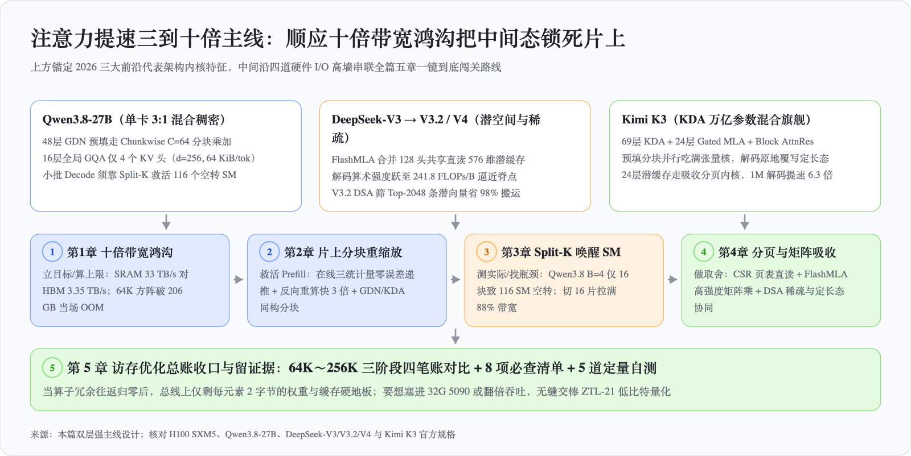
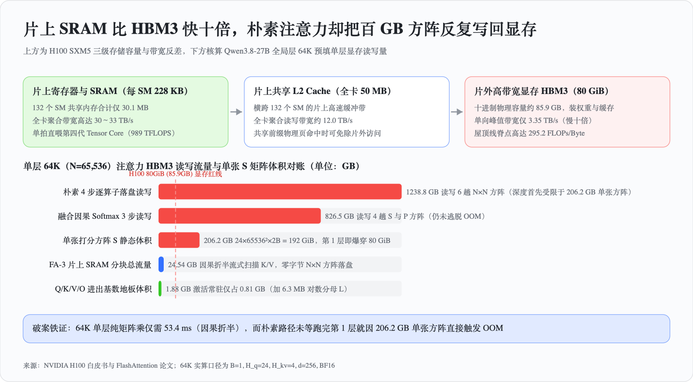
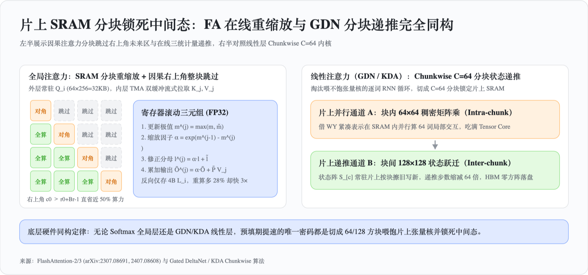
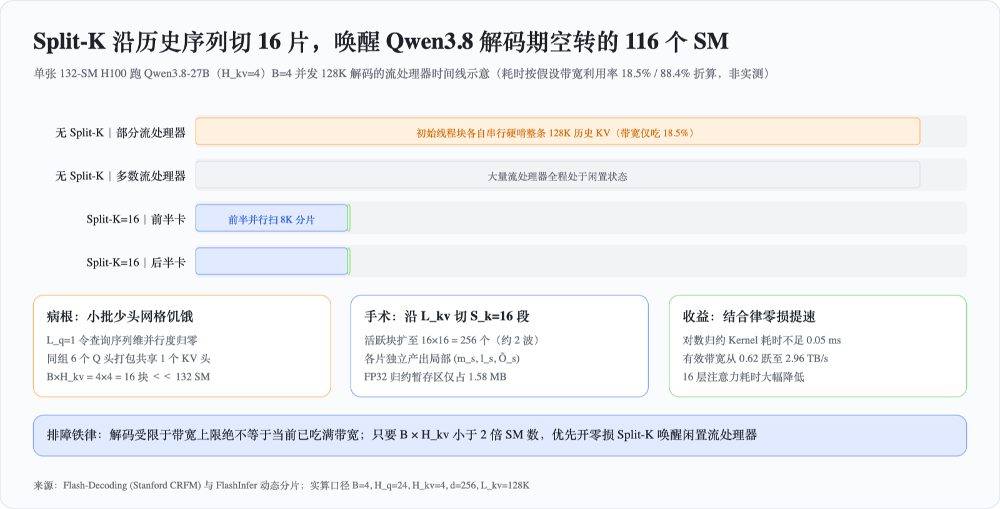
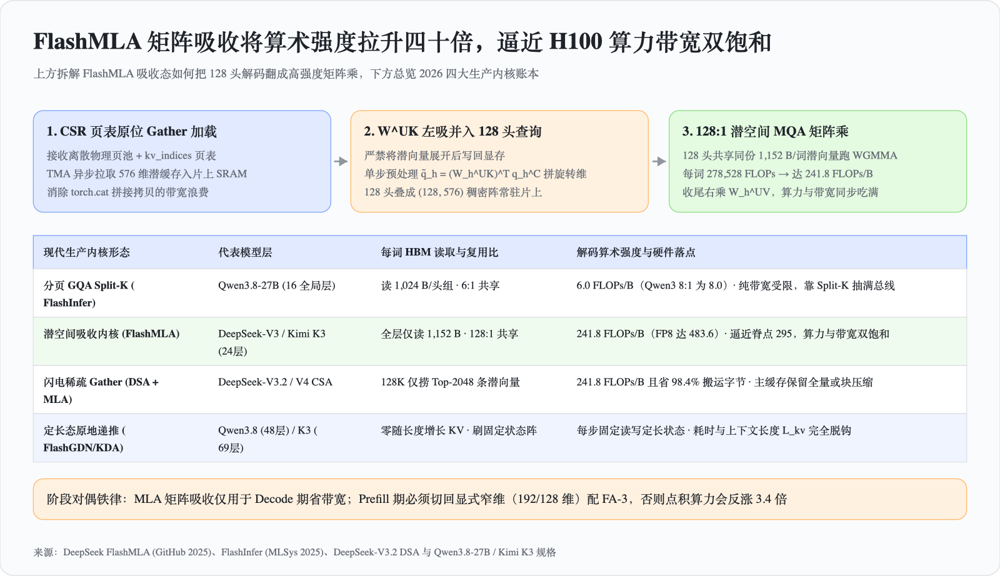
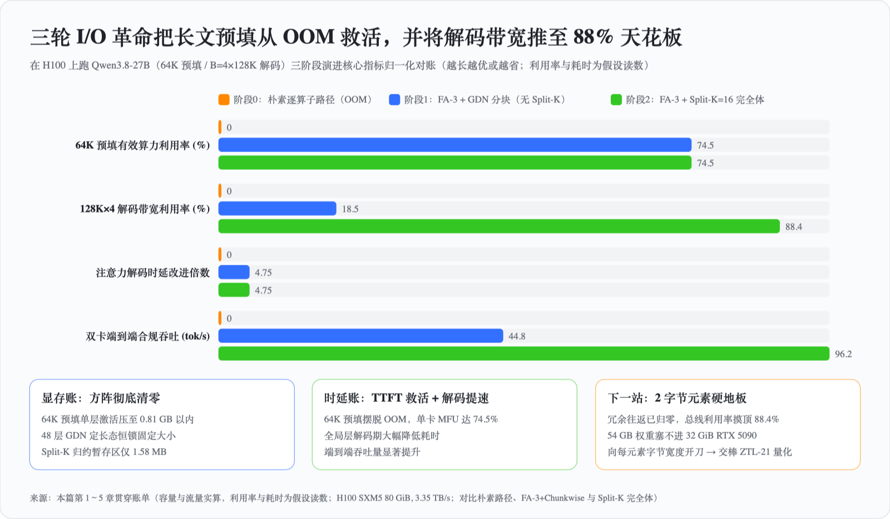

# ZTL-20｜系统｜减少注意力的内存搬运

> 🎯 **这篇文档解决什么问题**：<b>核心命题：长文本注意力必须解决显存搬运瓶颈，策略是利用片上 SRAM 的十倍带宽优势把百 GB 中间方阵分块留在芯片内部。</b>预填期靠 FlashAttention 在线重缩放消除平方级显存读写。这在 `Qwen3.8-27B` 与 `Kimi K3` 线性层中同构为分块状态递推。解码期靠 Flash-Decoding 沿序列维切分唤醒闲置流处理器。潜空间架构则靠 FlashMLA 矩阵吸收将低强度搬运转化为高强度矩阵乘。
>
> **使用方式与先修要求**：本篇位列 L5 推理系统层第 2 篇。读者可先回顾第 01、05、06 篇的屋顶线模型与在线 Softmax 基础。正文直接承接 [ZTL-08｜模型｜把注意力写成矩阵](./08-attention.md) 的现代注意力演进与 [ZTL-19｜系统｜判断慢在哪，以及请求怎样排队](./19-serving-latency.md) 的分页混批调度。全篇围绕 H100 跑 `64K～262K` 长上下文遇到的四道访存墙逐章推进。我们以 `Qwen3.8-27B`（下文称案例模型）为轴演绎具体场景，并于各章末与 DeepSeek / Kimi 对照。规格核对于 2026 年 11 月。
>
> **动手实践**：第 2 章提供 35 行分块因果 FlashAttention 零误差核验脚本。第 3 章提供 `Qwen3.8-27B` 解码期 `Split-K=16` 局部三元组结合律归约代码。第 4 章提供 `FlashMLA` 矩阵吸收与算术强度核算脚本。

<b>🧭 主线位置</b>：本篇承接 [ZTL-19｜系统｜判断慢在哪，以及请求怎样排队](./19-serving-latency.md) 的显存碎片与队头阻塞消除，转向单个算子的 I/O 墙垒。<b>现代注意力内核通过片上分块、Split-K 结合律与矩阵吸收，把中间方阵的显存往返从百 GB 级压至每词几 MB，释放出十倍片上带宽的红利。</b>下一篇 [ZTL-21｜系统｜用精度换内存要付什么代价](./21-quantization.md) 将转向压缩单元素位宽的低比特量化。

## 导读 · 先给结论

- <b>朴素长文本注意力慢且易溢出的病根，是片外显存反复读写百 GB 级中间方阵。</b>H100 片上 SRAM 聚合带宽估算约 `33 TB/s`，片外 HBM3 却仅 `3.35 TB/s`。在 `64K` 序列下，案例模型全局层单张打分方阵重达 `206.2 GB`。算子未算完首层便超出 `80 GiB` 显存上限[[1]](https://arxiv.org/abs/2205.14135)[[2]](https://resources.nvidia.com/en-us-tensor-core/nvidia-tensor-core-gpu-datasheet)[[3]](https://huggingface.co/Qwen/Qwen3.8-27B/blob/main/config.json)。
- <b>预填期靠片上分块与在线重缩放算出精确解，与线性层分块内核底层同构。</b>FlashAttention 维护三统计量流式扫过键值块，全程零方阵落盘。反向仅存 4 字节对数分母片上重算，多花约 `28%` 算力却提速 3 倍。案例模型与 DeepSeek / Kimi 预填期同样弃用串行循环，靠 `C=64` 分块矩阵乘配块间递推吃满张量核[[4]](https://arxiv.org/abs/1805.02867)[[5]](https://arxiv.org/abs/2407.08608)[[6]](https://arxiv.org/abs/2412.06464)[[7]](https://arxiv.org/abs/2510.26692)。
- <b>小批长文解码因少键值头导致流处理器空转，须靠 Flash-Decoding 沿序列轴唤醒。</b>单步解码查询长度为 1，查询维并行归零。案例模型全局层仅 `4` 个 KV 头，`B=4` 时全卡只派 `16` 个线程块，132 个 SM 中有 `116` 个闲置。沿历史轴切 `16` 片做结合律归约，即可把带宽利用率从 `19%` 拉升至 `88%` 以上[[8]](https://arxiv.org/abs/2307.08691)[[9]](https://crfm.stanford.edu/2023/10/12/flashdecoding.html)[[10]](https://arxiv.org/abs/2501.01005)。
- <b>生产内核靠 CSR 页表原位读页，并借 FlashMLA 矩阵吸收把算术强度提高四十倍。</b>FlashInfer 用 Gather-GEMM 免除离散页拼接。面对潜缓存架构，`FlashMLA` 让 128 个吸收查询头共享直读 `576` 维潜向量。解码算术强度从普通 GQA 的 `6～8` 跃至 `241.8 FLOPs/B`，逼近算力与带宽双饱和[[11]](https://arxiv.org/abs/2309.06180)[[12]](https://arxiv.org/abs/2405.04434)[[13]](https://github.com/deepseek-ai/FlashMLA)[[14]](https://arxiv.org/abs/2607.24653)。
- <b>超长上下文依赖稀疏挑取配异构双核流水，算子压榨后唯一底线是元素位宽。</b>部分架构靠 DSA 闪电索引仅取 `Top-2048` 条潜向量省掉 `98%` 搬运。案例模型与前沿架构用定长态原地覆写核配全局分页核。当每个必需元素只搬一次后，继续提速只能压缩单元素字节宽度[[3]](https://huggingface.co/Qwen/Qwen3.8-27B/blob/main/config.json)[[15]](https://arxiv.org/abs/2412.19437)[[16]](https://arxiv.org/abs/2606.19348)[[17]](https://github.com/fla-org/flash-linear-attention)。



上图总览本篇五章的闯关路线。第一章立足硬件约束：H100 片上 SRAM 聚合带宽估算约 `33 TB/s` 而片外 HBM3 仅 `3.35 TB/s`，64K 序列下单张打分方阵达 `206` GB 量级，远超 80 GiB 显存。

<b>📎 与系列其他文档的分工</b>：算术强度与在线 Softmax 递推见 [ZTL-05｜数学｜优化、归一化与数值稳定](./05-optim-norm.md) 与 [ZTL-06｜数学｜一张纸算清算力、显存与缩放](./06-compute-memory-scaling.md)，现代注意力矩阵、旋转位置编码与分页调度见 [ZTL-08｜模型｜把注意力写成矩阵](./08-attention.md)、[ZTL-09｜模型｜让模型知道顺序](./09-position.md) 与 [ZTL-19｜系统｜判断慢在哪，以及请求怎样排队](./19-serving-latency.md)。

本篇专攻注意力与线性状态算子的芯片级 I/O 机制。低比特量化与无损投机解码分别移交 [ZTL-21｜系统｜用精度换内存要付什么代价](./21-quantization.md) 与 [ZTL-22｜系统｜让草稿减少解码开销](./22-speculative.md)，万亿专家并行与长窗集群留给第 24 篇。

## 第 1 章 · 十倍带宽鸿沟与朴素注意力的显存崩溃

<b>朴素注意力在长文本上必然溢出，根源是显存搬运瓶颈。</b>在上一篇 [ZTL-19｜系统｜判断慢在哪，以及请求怎样排队](./19-serving-latency.md) 中，分页块表与分块预填消除了跨请求的显存碎片与队头阻塞。然而进入单个算子内部，新的异常立刻出现。我们在单张 `80 GiB H100` 上装入 `Qwen3.8-27B`（BF16 权重约 `54 GB`，余下逾 `31 GB` 空间），仅送入单条 `64K`（`N=65,536`）长合同做预填。一旦回退到未融合的朴素注意力路径，显卡连第 1 层都跑不完就会抛出显存溢出（OOM）报错[[1]](https://arxiv.org/abs/2205.14135)[[3]](https://huggingface.co/Qwen/Qwen3.8-27B/blob/main/config.json)。

许多刚接触推理调优的工程师看到长文本变慢，第一反应常怀疑平方级浮点乘加把显卡算力占满了。然而 GPU 的张量核与显存总线并不在同一个数量级上运行。本章先为算子诊断**立目标**，再顺着芯片物理架构**算上限**，把单层注意力的读写字节与浮点乘加放在同一标尺下对账。

### 1.1 存储金字塔：SRAM 与 HBM 的十倍带宽落差

现代 GPU 遵循严格的金字塔存储层级。离张量核心越近的存储介质，读写带宽越高，物理容量也越小[[18]](https://resources.nvidia.com/en-us-ai-data-science/hopper-architecture-whitepaper)。以 **NVIDIA H100 SXM5** 为例，全卡集成 `132` 个流处理器（SM）。第四代 Tensor Core 的 BF16 稠密峰值算力达 `989 TFLOPS`[[2]](https://resources.nvidia.com/en-us-tensor-core/nvidia-tensor-core-gpu-datasheet)。三级存储划出了悬殊的物理梯度：

- <b>片上寄存器与共享内存（SRAM）。</b>每个 SM 配有 `256 KB` 寄存器文件，共享内存最高可配为 <b>`228 KB/SM`</b>。全卡 132 个 SM 合计仅约 `30.1 MB`。按每 SM 每时钟 128 B、1.98 GHz 估算，全卡片上聚合带宽约 <b>`30～33 TB/s`</b>，几个时钟周期即可把数据块送进 Tensor Core[[1]](https://arxiv.org/abs/2205.14135)[[18]](https://resources.nvidia.com/en-us-ai-data-science/hopper-architecture-whitepaper)。
- <b>片上共享二级缓存（L2 Cache）。</b>全卡共享一块 `50 MB` 二级缓存，充当片上与片外的缓冲带。聚合带宽约为 `12.0 TB/s`[[18]](https://resources.nvidia.com/en-us-ai-data-science/hopper-architecture-whitepaper)。
- <b>片外高带宽显存（HBM3）。</b>封装在计算裸片四周，容量达 <b>`80 GiB`</b>（十进制约 `85.9 GB`），足以容纳百亿权重与长文缓存。但全卡单向带宽仅为 <b>`3.35 TB/s`</b>，比片上 SRAM 慢了十倍[[2]](https://resources.nvidia.com/en-us-tensor-core/nvidia-tensor-core-gpu-datasheet)。

套用第 01、06 篇的屋顶线模型，H100 的 BF16 算力带宽脊点为 `295.2 FLOPs/Byte`[[2]](https://resources.nvidia.com/en-us-tensor-core/nvidia-tensor-core-gpu-datasheet)[[19]](https://www2.eecs.berkeley.edu/Pubs/TechRpts/2008/EECS-2008-134.pdf)。任何算子只要每搬运 1 字节所做的有效乘加不足 295 次，计算阵列就会大半等待总线喂数。反过来，谁能把中间数据留在 `33 TB/s` 的片上 SRAM 里复用，谁就能赢回近十倍的有效带宽。

### 1.2 64K 显存清账：中间方阵如何撑满 80 GiB

现在追踪未开启片上融合的朴素 PyTorch 注意力链路[[1]](https://arxiv.org/abs/2205.14135)[[20]](https://pytorch.org/docs/stable/generated/torch.nn.functional.scaled_dot_product_attention.html)。在即时执行模式下，每个独立算子各启动一个 CUDA 内核，必须从 HBM 读入完整输入并把完整输出写回 HBM。我们取 <b>`Qwen3.8-27B`</b> 的单个全局 Gated GQA 层（`B=1, H_q=24, H_kv=4, d=256, N=65,536`，BF16 每元素 `2 B`）[[3]](https://huggingface.co/Qwen/Qwen3.8-27B/blob/main/config.json)，清点四步算子的显存账单：

```math
S = \frac{QK^\top}{\sqrt{d}}, \quad S_{\mathrm{mask}} = \mathrm{mask}(S), \quad P = \mathrm{softmax}(S_{\mathrm{mask}}), \quad O = PV
```

先看真正必需的进出张量。查询 `Q` 与输出 `O` 形状均为 `(24, 65536, 256)`，单张仅占 `0.805 GB`；经 6:1 分组共享后的键 `K` 与值 `V` 单张仅 `0.134 GB`。四张进出张量合计不过 <b>`1.88 GB`</b>。

真正撑爆显存的是平方膨胀的 $`N \times N`$ 中间方阵。单张 `(24, 65536, 65536)` 的 BF16 方阵重达 <b>`206.16 GB`</b>（二进制 <b>`192.0 GiB`</b>，换成 `Qwen3-32B` 的 64 个查询头更高达 `549.76 GB`[[21]](https://arxiv.org/abs/2505.09388)）。首层刚为打分阵 `S` 申请显存，`192 GiB` 单表就直接超出了 H100 的 `80 GiB` 物理上限。即便拆小头维度躲过崩溃，四步算子的 HBM3 读写流量依然庞大：

1. <b>打分矩阵乘。</b>读入 `Q, K`（`0.94 GB`），将巨阵 `S` 全量写回 HBM，产生 <b>`207.10 GB`</b> 流量。
2. <b>因果掩码填充。</b>读出整张 `S`，把右上三角置为负无穷后写回 `S_mask`，单步往返读写 <b>`412.32 GB`</b>。
3. <b>行向 Softmax 归一。</b>读出 `S_mask`，归一化后把概率巨阵 `P` 写回 HBM，再次往返读写 <b>`412.32 GB`</b>。
4. <b>值向量加权聚合。</b>读入巨阵 `P`（`206.16 GB`）与 `V`（`0.13 GB`）并写出 `O`，又产生 <b>`207.10 GB`</b> 流量。

四步累加共产生 <b>`1,238.8 GB`</b> 搬运流量，哪怕把掩码融进 Softmax，仍须读写两趟 `S` 与两趟 `P` 共 <b>`826.5 GB`</b>[[1]](https://arxiv.org/abs/2205.14135)。反观有效计算量：计入因果折半后仅 `52.78 TFLOPs`，H100 纯计算只需 <b>`53.4 ms`</b>，而按 `3.35 TB/s` 搬运数据就要等待 <b>`246.7～369.8 ms`</b>。算力需求并未增加，时间全消耗在了显存总线上。



上方画板直观呈现了芯片三级存储的十倍带宽落差。只要把平方膨胀的打分与概率分块留在左侧 `228 KB` 的片上 SRAM 内消化，就能绕开右侧仅 `3.35 TB/s` 的 HBM3 总线瓶颈，直接喂饱张量核。

在阅读下方对比表前，我们先推算清楚片上分块 <b>`24.5 GB`</b> 总流量的来源。当查询块取 `64` 行且同组 6 个查询头打包常驻 SRAM 时，外循环共走 `1,024` 轮。因果掩码跳过右上角一半未来块后，每个键值头组平均仅扫 `512.5` 轮。整层读取键值共 `22.93 GB`，加上进出各一趟的查询与输出（`1.61 GB`），总流量刚好落定在 `24.54 GB`，较朴素路径缩减逾三十倍。

阅读下方对比表时，请重点观察分块内核的算术强度（`AI` 列）与其带宽占用率（`HBM Util%` 列）的翻转。分块内核一举跨过了 `295.2 FLOPs/B` 脊点，把长文预填拉回张量核满载区：

> 💡 <b>常见误区：以为开启常规图编译自动融合就能解决长序列注意力显存溢出。</b>融合掩码与 Softmax 后，`64K` 预填仍在首层报 OOM。根因是常规逐元素融合器无法跨越整行求极值与求和的屏障，不能把前后两次大矩阵乘合并进同一个片上循环。只要标准 Softmax 要求看全整行才能除分母，百 GB 方阵就必须落盘 HBM。必须改用在线重缩放片上分块内核（FlashAttention），让中间方阵全程零字节落盘[[1]](https://arxiv.org/abs/2205.14135)[[22]](https://arxiv.org/abs/2112.05682)。

| **核心账本维度** | <b>朴素注意力（逐算子写回 HBM）</b> | <b>FlashAttention（片上 SRAM 分块）</b> | **案例模型全局层对比** |
|---|---|---|---|
| **有效浮点乘加量** | 全方阵 $`4 H_q N^2 d`$（未来区白算） | 因果跳过右上角，仅约 $`2 H_q N^2 d`$ | `105.6 TFLOPs` 降至 <b>`52.8 TFLOPs`</b> |
| **HBM 读写复杂度** | $`\Theta(H_q N d + H_q N^2)`$ 平方级 | $`\Theta(H_q N^2 d^2 / M)`$ 受 SRAM 容量 $`M`$ 压制 | `826.5～1238.8 GB` 压至 <b>`24.5 GB`</b>（GQA 组打包） |
| **峰值激活显存** | $`\mathcal{O}(H_q N^2)`$ 须存巨阵 `S, P` | $`\mathcal{O}(H_q N d)`$ 仅存输出 `O` 与标量 `L` | 单表 `206.2 GB`（OOM）压至 <b>`0.81 GB + 6.3 MB`</b> |
| **屋顶线受限区间** | 受制于显存带宽墙（Memory-bound） | 重回张量核计算受限区（Compute-bound） | 算术强度从 `85～128` 跃升至 <b>`>2,100 FLOPs/B`</b> |

> 🔑 **本章要点与回到主线**：朴素注意力溢出的根源，在于把百 GB 级中间方阵反复写回仅 `3.35 TB/s` 的片外 HBM3。但要把查询块留在仅 `228 KB` 的片上 SRAM 里流式扫过键值块直接算出输出，最大的障碍是跨整行耦合的 Softmax 分母。怎样在不看全后半行的前提下边扫描边无损修正结果？第 2 章立即推导。

## 第 2 章 · 在线 Softmax 与分块递推

接住上一章末尾的流式耦合难题。单 SM 共享内存上限仅 `228 KB`。装入 `案例模型-27B` 头宽 `d=256` 的张量时，片上每次最多常驻一块 `64` 行的查询块（占 `32 KB`）。余下空间配双缓冲轮流拉取 `64` 列的键值块（4 块合占 `128 KB`），总计占 `160 KB`，低于 `228 KB` 硬上限并留出寄存器余量[[5]](https://arxiv.org/abs/2407.08608)[[8]](https://arxiv.org/abs/2307.08691)。

片上同一时刻只见 64 列打分，全局 Softmax 分母却关联整行 `65,536` 列。在**零近似**前提下流式算出精确解的关键，正是 [ZTL-05｜数学｜优化、归一化与数值稳定](./05-optim-norm.md) 推导的**在线 Softmax 指数重缩放递推**[[1]](https://arxiv.org/abs/2205.14135)[[4]](https://arxiv.org/abs/1805.02867)。

### 2.1 三统计量递推与零近似验证

采用 FlashAttention-2 的外层查询循环。第 `i` 个线程块把查询块常驻片上。内层循环依次将键值块流式搬入 SRAM，算完即弃[[8]](https://arxiv.org/abs/2307.08691)。线程块内的 4 个 Warp 各自切分不同的查询子行并共享键值块。这免除了跨 Warp 汇总的同步开销。

对每一行查询，寄存器只维护三个 FP32 滚动统计量：行最大值、指数分母和与未归一化输出向量。第 `j` 块算出局部打分后，提取块内极值与局部指数和。随后按三条递推式原位更新[[1]](https://arxiv.org/abs/2205.14135)[[8]](https://arxiv.org/abs/2307.08691)：

```math
m^{(j)} = \max(m^{(j-1)}, \tilde{m}^{(j)}), \quad \ell^{(j)} = e^{m^{(j-1)} - m^{(j)}} \ell^{(j-1)} + e^{\tilde{m}^{(j)} - m^{(j)}} \tilde{\ell}^{(j)}
```

```math
\tilde{O}^{(j)} = \mathrm{diag}(e^{m^{(j-1)} - m^{(j)}}) \tilde{O}^{(j-1)} + e^{S^{(j)} - m^{(j)}} V^{(j)}
```

局部流式更新在实数域上与全局公式**零误差恒等**。它的代数基础是同底数幂乘法恒等式。后半行新块一旦出现更大峰值，重缩放因子就把旧分母和与旧输出折算到新基准。全程指数幂次恒不大于零，避免了半精度上溢。扫完末块后执行一次除法写回 HBM，`206.2 GB` 中间方阵全程零落盘。

我们用四元素小例手算验证。设单行打分为 `s = [1, 3, 2, 4]`，标量值为 `v = [10, 20, 30, 40]`，按块宽 `2` 分两拍流入：

- <b>第 1 拍流入前两项。</b>块极值 $`m^{(1)} = 3`$ ，相对指数为 $`[e^{-2}, 1]`$ 。算得分母 $`\ell^{(1)} \approx 1.1353`$ ，累加器 $`\tilde{O}^{(1)} \approx 21.3534`$ 。
- <b>第 2 拍流入后两项。</b>新块极值为 `4`，全局极值更新为 $`m^{(2)} = 4`$ ，旧账乘上折算因子 $`e^{-1}`$ 。算得新分母 $`\ell^{(2)} \approx 1.5530`$ ，新累加器 $`\tilde{O}^{(2)} \approx 51.9167`$ 。
- <b>收尾除法核验。</b>两者相除得 $`O = 51.9167 / 1.5530 = 33.430`$ 。这与看全四列算出的标准真值完全一致。

### 2.2 因果跳过与反向重算规律

主循环放进 SRAM 后带来三项硬件收益[[1]](https://arxiv.org/abs/2205.14135)[[5]](https://arxiv.org/abs/2407.08608)。第一项是**因果右上角整块跳过**。落在未来区的右上角分块无需搬运键值也无需乘加，直接省下近 **50% 算力与带宽**。第二项来自 H100 专属的 **FlashAttention-3 异步乒乓重叠**[[5]](https://arxiv.org/abs/2407.08608)[[18]](https://resources.nvidia.com/en-us-ai-data-science/hopper-architecture-whitepaper)。生产者 Warp 驱动 TMA 异步预取键值，消费者 Warp 错峰交叠求指数与矩阵乘，把 H100 BF16 实测算力推至 <b>`740～840 TFLOPS`</b>。

第三项是训练期的**反向传播重算提速规律**[[1]](https://arxiv.org/abs/2205.14135)[[22]](https://arxiv.org/abs/2112.05682)。FlashAttention 不保存巨阵 `S` 和 `P`，前向每头每词只存 **4 字节**的 FP32 对数分母 $`L_i = m_i + \ln \ell_i`$ （64K 单层 24 头仅占 <b>`6.29 MB`</b>）。反向时把输入输出与 `L_i` 拉回 SRAM 当场重算局部概率块求导。多重算一次局部打分虽让总浮点量增加约 <b>25%～28%</b>，却省掉了数百 GB 显存往返等待，实测反向速度反而**快了约 3 倍**。

### 2.3 线性架构预填为何也走分块

理解了 SRAM 分块规律，就能看懂 2026 混合架构的内核设计。`案例模型-27B`（48 层 **GDN**）与线性混合架构（69 层 **KDA**）遵循秩-1 状态递推[[3]](https://huggingface.co/Qwen/Qwen3.8-27B/blob/main/config.json)[[6]](https://arxiv.org/abs/2412.06464)[[7]](https://arxiv.org/abs/2510.26692)。既然公式本就是线性复杂度递推，为什么预填长提示词时它们不用逐词串行循环？

原因完全同构。逐词串行更新属于矩阵乘向量，喂不饱要求 `64×64` 方块的 Tensor Core。它还要在片上同步数万步，算力利用率不足一成[[6]](https://arxiv.org/abs/2412.06464)[[17]](https://github.com/fla-org/flash-linear-attention)。生产内核（`Chunkwise GDN / FlashKDA`）将长序列切成 `C=64` 分块放进 SRAM。块内借 WY 紧凑表示打包成稠密矩阵乘吃满张量核。块间让 `128×128` 定长状态阵在片上跨块传递，串行步数缩减 64 倍且零方阵落盘[[6]](https://arxiv.org/abs/2412.06464)[[7]](https://arxiv.org/abs/2510.26692)[[17]](https://github.com/fla-org/flash-linear-attention)。



对照上方画板的片上数据流：外层查询块与滚动三元组始终锚定在高速寄存器与 SRAM 内，内层键值块如流水线般扫过芯片并当场释放，消除了平方级方阵写回 HBM 的冗余通路。

> 💡 <b>常见误区：手写稠密浮点 4D 掩码张量传入接口，触发静默回退慢路径。</b>构造 `(B, 1, N, N)` 浮点 `attn_mask` 传入 `scaled_dot_product_attention` 后，前向变慢五倍并在 `32K` 处溢出。根因是构造 4D 掩码本身已占平方级显存，且稠密偏置迫使调度器退回未融合后端。应统一传 `is_causal=True` 或变长偏移 `cu_seqlens`，并用 `sdpa_kernel` 锁定融合后端[[8]](https://arxiv.org/abs/2307.08691)[[20]](https://pytorch.org/docs/stable/generated/torch.nn.functional.scaled_dot_product_attention.html)。

*35 行自包含分块因果 FlashAttention：验证在线三统计量递推零误差（max_diff < 1e-6）与因果整块跳过*

```python
import math, numpy as np

np.random.seed(42)
N, d, Br, Bc = 256, 128, 32, 32
Q = np.random.randn(N, d).astype(np.float32)
K = np.random.randn(N, d).astype(np.float32)
V = np.random.randn(N, d).astype(np.float32)
scale = 1.0 / math.sqrt(d)

def standard_causal_attn(Q, K, V):
    S = np.einsum("id,jd->ij", Q, K) * scale
    S = np.where(np.triu(np.ones((N, N), dtype=bool), k=1), -np.inf, S)
    P = np.exp(S - np.max(S, axis=-1, keepdims=True))
    return np.einsum("ij,jd->id", P / np.sum(P, axis=-1, keepdims=True), V)

def flash_causal_attn(Q, K, V, Br=32, Bc=32):
    O, L = np.zeros_like(Q), np.zeros((N, 1), dtype=np.float32)
    skipped, total = 0, (N // Br) * (N // Bc)
    for r0 in range(0, N, Br):
        Qi = Q[r0:r0 + Br]
        m_i = np.full((Br, 1), -np.inf, dtype=np.float32)
        l_i, O_tilde = np.zeros((Br, 1), dtype=np.float32), np.zeros((Br, d), dtype=np.float32)
        for c0 in range(0, N, Bc):
            if c0 > r0 + Br - 1:  # 右上角纯未来分块整块跳过，零 HBM 读取零乘加
                skipped += 1; continue
            Kj, Vj = K[c0:c0 + Bc], V[c0:c0 + Bc]
            Sij = np.einsum("id,jd->ij", Qi, Kj) * scale
            if c0 + Bc - 1 > r0:  # 仅主对角线穿过的分块执行逐元素因果屏蔽
                Sij = np.where(np.arange(c0, c0 + Bc)[None, :] > np.arange(r0, r0 + Br)[:, None], -np.inf, Sij)
            m_new = np.maximum(m_i, np.max(Sij, axis=-1, keepdims=True))
            alpha, P_tilde = np.exp(m_i - m_new), np.exp(Sij - m_new)
            l_i = alpha * l_i + np.sum(P_tilde, axis=-1, keepdims=True)
            O_tilde = alpha * O_tilde + np.einsum("ij,jd->id", P_tilde, Vj)
            m_i = m_new
        O[r0:r0 + Br], L[r0:r0 + Br] = O_tilde / l_i, m_i + np.log(l_i)
    return O, L, skipped, total

O_ref = standard_causal_attn(Q, K, V)
O_fa, L_fa, sk, tot = flash_causal_attn(Q, K, V, Br, Bc)
print(f"三统计量递推与因果块跳过验证")
print(f"max_diff={np.max(np.abs(O_ref - O_fa)):.2e}")
print(f"因果块跳过率：{sk}/{tot} ({sk/tot:.1%})")
```

*输出*

```text
三统计量递推与因果块跳过验证
max_diff=3.58e-07
因果块跳过率：28/64 (43.8%)
```

逐段拆解上述分块内核。内循环首行 `if c0 > r0 + Br - 1` 识别纯未来右上角分块，命中时直接跳过，键值读取与浮点乘加双双归零。仅主对角线穿过的边界块才做逐元素屏蔽，随后借重缩放因子 `alpha = np.exp(m_i - m_new)` 将旧分母 `l_i` 与累加器 `O_tilde` 折算到新极值基准。

复盘末尾输出读数。循环结束时同步写出精确输出 `O` 与 4 字节对数分母 `L = m_i + np.log(l_i)` 供反向重算复用。实测分块结果与全方阵基准的最大偏差仅 `3.58e-07`，64 个分块直接跳过 28 块（`43.8%`），随序列加长跳过率渐近 `50.0%`。

> 🔑 **本章要点与回到主线**：依靠块级三统计量重缩放、4 字节对数分母反向重算与线性层分块递推，预填期百 GB 级中间方阵已消除。然而转入单行查询的长文逐词解码阶段后，监控却显示 HBM3 带宽利用率跌破 `20%`。尤其在 `案例模型-27B`（全局层仅 4 个键值头）跑 4 路 `128K` 并发时，全卡 132 个 SM 里有 116 个处于闲置状态。为什么分块内核一到小批长文解码就闲置大半？第 3 章立即排查。

## 第 3 章 · Split-K 沿序列轴唤醒

直面上一章抛出的解码低效问题。我们在双卡流水（`PP=2`，单卡保留全部键值头）或单卡 FP8 权重配 BF16 缓存的 H100 上**测实际**并**找瓶颈**。目标负载是以 `B=4` 并发服务 `案例模型`，运行 `128K`（`131,072` 词）长文精读问答[[2]](https://resources.nvidia.com/en-us-tensor-core/nvidia-tensor-core-gpu-datasheet)[[3]](https://huggingface.co/Qwen/Qwen3.8-27B/blob/main/config.json)。

4 路请求在 16 个全局 GQA 层的 BF16 历史缓存合占 `34.36 GB`。按 H100 单向带宽 `3.35 TB/s` 核算物理极限，读完这批缓存仅需 <b>`10.26 ms`</b>。然而沿用预填期的标准网格切分时，只有少数 SM 在干活。下文取一组假设读数演示（非实测）：有效带宽跌至 `0.62 TB/s`，总线利用率 <b>`18.5%`</b>，16 层注意力解码就要 <b>`55.4 ms`</b>[[9]](https://crfm.stanford.edu/2023/10/12/flashdecoding.html)。在混合架构下，其余 48 层 GDN 靠定长状态避开了序列膨胀，这 16 个全局层的缓存读取却仍随序列线性增长。

### 3.1 小批少头的网格饥饿问题

明明解码受限于显存带宽，为什么连 `3.35 TB/s` 管道的两成都用不满？用性能分析器查看 CUDA 启动网格便知症结。FlashAttention-2 沿着<b>批大小 `B`、键值头组 `H_kv` 与查询分块数 `T_r`</b> 三个维度派发线程块。每个线程块调度到一个 SM 上独立运行。

这套网格在预填期效率很高。单条 `64K` 请求仅查询维就能切出 `1,024` 个块铺满全卡。但迈入逐词解码阶段后，<b>查询长度退化为单行 `L_q=1`</b>，查询分块数当场缩成 `1`[[9]](https://crfm.stanford.edu/2023/10/12/flashdecoding.html)。同时现代架构为压缩缓存减少了键值头。`Qwen3-32B` 有 `8` 个键值头，而 `案例模型` 全局层每层仅设 <b>`H_kv=4` 个键值头</b>。同组共享的 `6` 个查询头必须打包进同一个线程块的 SRAM 里联合点积[[3]](https://huggingface.co/Qwen/Qwen3.8-27B/blob/main/config.json)[[10]](https://arxiv.org/abs/2501.01005)。

算清硬件占用账便知症结所在。在 `B=4` 的长文并发下，全卡启动的线程块总数仅剩 `4 × 4 × 1 = 16` 个。整张拥有 <b>`132` 个 SM</b> 的 H100 上，只有 `16` 个 SM 领到任务串行扫描 `128K` 历史词。其余 <b>`116` 个 SM（占全卡 87.9%）全程空转</b>。HBM3 控制器必须靠上百个 SM 并发挂起深队列读请求才能掩盖寻址延迟。仅靠 16 个 SM 零星发指令自然抽不满带宽[[9]](https://crfm.stanford.edu/2023/10/12/flashdecoding.html)[[18]](https://resources.nvidia.com/en-us-ai-data-science/hopper-architecture-whitepaper)。

### 3.2 结合律归约与带宽提升

既然批度受并发限制、键值头数固定为 4、查询维长度为 1，唯一足够长的维度就只剩<b>历史键值序列维 `L_kv=131,072`</b>。解法正是 <b>Flash-Decoding（键值轴 Split-K 并行）</b>[[9]](https://crfm.stanford.edu/2023/10/12/flashdecoding.html)[[10]](https://arxiv.org/abs/2501.01005)。引擎将每条请求的 `128K` 历史缓存沿序列轴均分成多个不相交分片，派发多倍线程块并行扫描。

跨线程块切分序列轴不会破坏 Softmax 全局归一。因为第 2 章的在线三统计量天然满足<b>结合律（Associativity）</b>[[4]](https://arxiv.org/abs/1805.02867)[[9]](https://crfm.stanford.edu/2023/10/12/flashdecoding.html)。每个分片线程块独立扫完各自的词段，算出局部极值、局部指数和与局部未归一化输出，写入微小暂存区。随后启动一个轻量归约内核，对全部 $`S_k`$ 片做一次对数级精确合并[[9]](https://crfm.stanford.edu/2023/10/12/flashdecoding.html)[[10]](https://arxiv.org/abs/2501.01005)：

```math
m_{\mathrm{glob}} = \max_{s} m^{(s)}, \quad \ell_{\mathrm{glob}} = \sum_{s=1}^{S_k} e^{m^{(s)} - m_{\mathrm{glob}}} \ell^{(s)}, \quad O_{\mathrm{final}} = \ell_{\mathrm{glob}}^{-1} \sum_{s=1}^{S_k} e^{m^{(s)} - m_{\mathrm{glob}}} \tilde{O}^{(s)}
```

回到 `案例模型` 现场对账。取分片数 <b>`S_k=16`</b>，每个分片扫描 `8,192` 个历史词。活跃线程块立刻从 `16` 扩增至 <b>`256` 个</b>，分两波铺满全部 `132` 个 SM。

全卡 FP32 归约暂存区为何仅占约 `1.58 MB`？按 4 路并发、24 个查询头、切 16 片逐项清点，每片仅写回 256 维向量加 2 个标量。总体积为 $`4 \times 24 \times 16 \times 258 \times 4 \approx 1.58\;\text{MB}`$ 。它在 `50 MB` 片上 L2 缓存内即可归约完毕，耗时<b>不足 `0.05 ms`</b>。全卡 SM 并发挂起读指令后，按同一组假设读数，有效带宽从 `0.62 TB/s` 升至 <b>`2.96 TB/s`（利用率 `88.4%`）</b>。16 层注意力解码耗时从 `55.4 ms` 降至 <b>`11.65 ms`（零损提速 `4.75 倍`）</b>[[9]](https://crfm.stanford.edu/2023/10/12/flashdecoding.html)[[10]](https://arxiv.org/abs/2501.01005)。



上方画板对比了唤醒前后的流处理器占用率。上半幅未切分时仅 16 条泳道忙碌，116 个 SM 闲置等待。下半幅沿历史轴 16 等分后，256 个线程块分两波铺满全部 132 个 SM，将 HBM3 读队列深度拉满。

对比万亿潜空间架构，分片切分更有叠加威力。在 `DeepSeek-V3` 或 `线性混合架构` 的全局 MLA 层中，整层只共享唯一 `1` 个潜键值头。`B=4` 并发时未切分线程块低至 `4` 个，必须靠序列轴动态切分才能铺满整张显卡的计算阵列。

> 💡 <b>常见误区：忽略序列长短与并发高低，静态硬编码过大的 Split-K 分片数（如固定 64）。</b>在短对话（`512` 词）或高并发（`B=128`）下强开 `Split-K=64`，单步解码反而变慢三成。根因是 `B=128` 自带 `512` 个线程块已铺满 132 个 SM，再切 64 片会让每片仅剩 8 个词，徒增暂存写回与归约同步开销。应交由 FlashInfer 调度器动态裁定，仅当 `B × H_kv` 小于两倍 SM 数且单分片不短于 `256` 词时按需切分[[9]](https://crfm.stanford.edu/2023/10/12/flashdecoding.html)[[10]](https://arxiv.org/abs/2501.01005)。

*案例模型 全局层（24Q/4KV×256）Split-K=16 局部三元组结合律归约零误差验证（16 → 256 线程块）*

```python
import math, numpy as np

np.random.seed(2026)
B, Hq, Hkv, Lkv, dh, Sk = 4, 24, 4, 4096, 256, 16                  # 对齐 案例模型 6:1 GQA 形状
q_dec = np.random.randn(B, Hkv, Hq // Hkv, dh).astype(np.float32)  # 同组 6 个 Q 头打包进单块共享 KV
k_cache = np.random.randn(B, Hkv, Lkv, dh).astype(np.float32)
v_cache = np.random.randn(B, Hkv, Lkv, dh).astype(np.float32)
sc = 1.0 / math.sqrt(dh)

# 1. 无 Split-K 基准：全卡仅 B*Hkv = 16 个线程块串行扫完整条历史（H100 上 116 个 SM 空转）
logits = np.einsum("bhgd,bhkd->bhgk", q_dec, k_cache) * sc
p_ref = np.exp(logits - np.max(logits, axis=-1, keepdims=True))
o_ref = np.einsum("bhgk,bhkd->bhgd", p_ref / np.sum(p_ref, axis=-1, keepdims=True), v_cache)

# 2. Split-K=16 路径：沿历史轴切成 256 个线程块独立产出局部三元组 (m_s, l_s, O_tilde_s)
chunk = Lkv // Sk
m_list, l_list, ot_list = [], [], []
for s in range(Sk):
    ks, vs = k_cache[:, :, s * chunk:(s + 1) * chunk], v_cache[:, :, s * chunk:(s + 1) * chunk]
    sc_s = np.einsum("bhgd,bhkd->bhgk", q_dec, ks) * sc
    m_s = np.max(sc_s, axis=-1, keepdims=True)
    p_s = np.exp(sc_s - m_s)
    m_list.append(m_s)
    l_list.append(np.sum(p_s, axis=-1, keepdims=True))
    ot_list.append(np.einsum("bhgk,bhkd->bhgd", p_s, vs))

# 3. 轻量对数级合并归约：利用在线三元组结合律一步还原精确全局输出
M_st, L_st, OT_st = np.stack(m_list, axis=0), np.stack(l_list, axis=0), np.stack(ot_list, axis=0)
m_glob = np.max(M_st, axis=0, keepdims=True)
rescale = np.exp(M_st - m_glob)
o_splitk = np.sum(rescale * OT_st, axis=0) / np.sum(rescale * L_st, axis=0)
print(f"Split-K 沿历史轴切分唤醒 SM")
print(f"活跃线程块：{B*Hkv} -> {B*Hkv*Sk}")
print(f"三元组合并最大误差：{np.max(np.abs(o_ref - o_splitk)):.2e}")
```

*输出*

```text
Split-K 沿历史轴切分唤醒 SM
活跃线程块：16 -> 256
三元组合并最大误差：2.35e-07
```

逐段拆解 `Split-K=16` 归约脚本。首段将单步查询重排为 `(B, Hkv, 6, dh)`，把同组 6 个查询头打包进同一线程块共享键值读取。分片循环把历史轴切成 16 段互不相交区间，并行算出局部峰值 `m_s`、局部指数和 `l_s` 与局部加权向量。

再看第三段轻量对数归约。合并核先跨 16 片求全局极值 `m_glob`，再乘重缩放因子 `np.exp(M_st - m_glob)` 将各片三元组对齐到同一基准做加权除法。实测活跃线程块从 `16` 扩至 `256`，输出与整扫基准的最大误差仅 `2.35e-07`。生产环境中只要历史序列跨过两千词，开启序列切分都能零损吃满总线带宽，把长文首字后的吐词步时压回交互红线内。

> 🔑 **本章要点与回到主线**：凭借在线三元组结合律，Split-K 将 `案例模型` 小批解码线程块从 `16` 扩至 `256`，唤醒闲置 SM 并把显存带宽利用率推至 `88.4%`。但生产引擎里的分页块是离散存储的，且面对 `DeepSeek-V3/V4` 与 `线性混合架构` 的潜空间架构，解码期为何连把潜向量解压到片上 SRAM 都走不通，而 `FlashMLA` 却能把算术强度拉升四十倍？第 4 章立即解析。

## 第 4 章 · FlashMLA 吸收与稀疏挑取

把内核放进真实推理引擎（vLLM V1 与 SGLang）时，算子必须解决最后两道工程问题，在计算与访存间合理**做取舍**[[10]](https://arxiv.org/abs/2501.01005)[[11]](https://arxiv.org/abs/2309.06180)。一方面，[ZTL-19｜系统｜判断慢在哪，以及请求怎样排队](./19-serving-latency.md) 的分页管理已把连续缓存拆成离散物理页。另一方面，`DeepSeek-V3 / V3.2 / V4`、`Kimi K3` 与 `案例模型` 已全面转向潜空间压缩、稀疏挑取与线性混合架构[[3]](https://huggingface.co/Qwen/Qwen3.8-27B/blob/main/config.json)[[14]](https://arxiv.org/abs/2607.24653)[[15]](https://arxiv.org/abs/2412.19437)[[16]](https://arxiv.org/abs/2606.19348)。本章拆解现代内核与前沿架构的协同机制。

### 4.1 FlashInfer CSR 页表原位直读：Gather-GEMM 免除离散页拼接

倘若注意力内核只接受连续显存，引擎每步前向都得先调拼接算子重组物理页。刚省下的带宽会被拷贝开销抵消。现代算子库 **FlashInfer** 与 **FlashMLA** 直接把压缩行稀疏（CSR）页表写进内核接口[[10]](https://arxiv.org/abs/2501.01005)[[13]](https://github.com/deepseek-ai/FlashMLA)：

- <b>三级紧凑页表寻址。</b>内核直接接收全局页池、请求页偏移、物理页号与尾页有效词数。长短不一的请求可零填充同批运行[[10]](https://arxiv.org/abs/2501.01005)。
- <b>片上 Gather-GEMM 异步融合。</b>内循环推进时，生产者 Warp 查表换算物理页基址。它驱动 TMA 一步把离散页拉入连续 SRAM 缓冲直喂 Tensor Core[[10]](https://arxiv.org/abs/2501.01005)[[13]](https://github.com/deepseek-ai/FlashMLA)。离散分页全程零拷贝，公共系统提示词物理页还能在 `50 MB` L2 缓存中高频命中。

### 4.2 矩阵吸收与算术强度

为什么在 `DeepSeek-V3 / R1` 与 `Kimi K3`（24 层 Gated MLA）上解码时，把潜向量读进片上 SRAM 动态解压也不可行[[12]](https://arxiv.org/abs/2405.04434)[[14]](https://arxiv.org/abs/2607.24653)[[15]](https://arxiv.org/abs/2412.19437)？回顾 [ZTL-08｜模型｜把注意力写成矩阵](./08-attention.md) 规格：`DeepSeek-V3` 每层含 `128` 个查询头（内容维 `128` 加旋转维 `64`，值维 `128`）。而 HBM 每层每词只存一条 <b>`512` 维潜向量</b>加一条共享 <b>`64` 维旋转键</b>。两者合计 `576` 个元素，BF16 下仅占 <b>`1,152 B/词`</b>[[15]](https://arxiv.org/abs/2412.19437)。

若解压成 128 头完整键值写回 HBM，每词体积会涨至 `81,920 B`（<b>膨胀 `71.1 倍`</b>），压缩收益完全归零。那能否读进片上 SRAM 再乘上投影阵动态解压？单层 128 头的两张上投影权重本身重达 `33.55 MB`。它是单 SM `228 KB` 共享内存的 <b>`147 倍`</b>，片上根本放不下。

关键设计是 <b>`FlashMLA` 的权重矩阵吸收（Weight Absorption）</b>[[12]](https://arxiv.org/abs/2405.04434)[[13]](https://github.com/deepseek-ai/FlashMLA)。得益于架构提前分离了 `64` 维解耦旋转键，内容潜向量通道中间不再夹杂位置旋转矩阵。借矩阵乘法结合律，解码前先对单步查询左乘转置矩阵吸成 `512` 维潜查询。系统再将值上投影推迟到历史加权求和之后：

```math
(q_h^C)^\top (W_h^{UK} c_j^{KV}) = \tilde{q}_h^\top c_j^{KV}, \quad o_h = W_h^{UV} \sum_{j=1}^{L_{kv}} P_{h,j} c_j^{KV}
```

这一变换带来了硬件效率的提升。倘若单头孤立读取 `576` 维潜缓存（`1,152 B`）做内容点积（`1,024 FLOPs`），算术强度仅 `0.89 FLOP/B`；即便在 `案例模型` 的 6:1 GQA 中，每读 1 个键值头也仅有 6 个查询头复用，解码强度停留在 <b>`6.0 FLOPs/B`</b>。反观 `FlashMLA`，全部 <b>`128` 个吸收查询头</b>叠成一张 `(128, 576)` 稠密矩阵，BF16 下仅占 `144 KB` 常驻片上内存。

128 个头共同对同一份潜缓存块执行张量核矩阵乘。每从 HBM 读入 1 词（`1,152 B`），128 个头同步执行 `278,528 FLOPs`。解码算术强度跃升四十倍至 <b>`241.78 FLOPs/Byte`</b>。开启 FP8 潜缓存后更高达 <b>`483.6 FLOPs/B`</b>，直接跨过 H100 脊点。FlashMLA 官方仓库报告，其内核在 H800 SXM5 上算力受限配置可达 `660 TFLOPS`[[13]](https://github.com/deepseek-ai/FlashMLA)，说明吸收路径确实能让解码期的张量核忙起来。

> 💡 <b>常见误区：把解码期高效的 MLA 矩阵吸收路径直接照搬到长文本 Prefill 阶段。</b>在 `64K` 预填前向中也跑 `576 / 512` 维吸收路径，首词延迟反而慢了两倍多。根因是预填本就处于算力受限区。吸收路径把单头点积与聚合宽度扩大了三倍多，使平方级矩阵乘算力增加了 <b>`3.4 倍`</b>。应坚持分阶段切换：**Prefill 期**走显式升维配窄头宽 `FA-3` 省算力，**Decode 期**切回吸收态 `FlashMLA` 省带宽[[12]](https://arxiv.org/abs/2405.04434)[[13]](https://github.com/deepseek-ai/FlashMLA)。

### 4.3 稀疏挑取与混合双核流水：DSA Top-2048 及 GDN/KDA 原地覆写

进入 `128K～1M` 超长窗口后，2026 前沿架构在算子层补齐了最后两项关键设计[[3]](https://huggingface.co/Qwen/Qwen3.8-27B/blob/main/config.json)[[14]](https://arxiv.org/abs/2607.24653)[[15]](https://arxiv.org/abs/2412.19437)[[16]](https://arxiv.org/abs/2606.19348)：

- <b>稀疏索引 Gather 内核（`DeepSeek-V3.2 DSA` 与 `V4 CSA`）。</b>`DeepSeek-V3.2` 先运行开销约 `5%` 的轻量 FP8 闪电索引核粗扫全长，挑出 <b>`Top-2048`</b> 个高分词下标。稀疏版 `FlashMLA` 按下标从页池精准读取这 2,048 条潜向量。在 `128K` 长度下省掉 <b>`98.4%` 的 KV 搬运与计算</b>，同时全量主潜缓存仍保留备查[[13]](https://github.com/deepseek-ai/FlashMLA)[[15]](https://arxiv.org/abs/2412.19437)。
- <b>混合架构异构双核流水（`案例模型` 与 `Kimi K3`）。</b>在 `案例模型` 单步解码中，48 层 GDN 切至**融合状态原地覆写核**[[3]](https://huggingface.co/Qwen/Qwen3.8-27B/blob/main/config.json)[[17]](https://github.com/fla-org/flash-linear-attention)。每步只读写固定大小的 `128×128` 状态阵，耗时与序列长度脱钩。余下 16 层全局锚点交由 `Split-K` 分页 GQA 精确检索。`Kimi K3` 同理用 69 层 `FlashKDA` 配 24 层 `FlashMLA`，跑出 `1M` 上下文解码 <b>`6.3 倍`</b> 提速[[7]](https://arxiv.org/abs/2510.26692)[[14]](https://arxiv.org/abs/2607.24653)。



上方画板汇总了现代引擎内的双路异构内核架构。左侧潜空间分支靠 128 头吸收矩阵配稀疏下标挑取同时吃满带宽与张量核；右侧线性混合分支则将 `3:1` 交替层的状态原地覆写与分页全局检索编入同一条流水线。

*FlashMLA 矩阵吸收恒等核验与算术强度对账：零误差免除 71 倍显存展开，解码强度从 6.0 跃至 241.8 FLOPs/B*

```python
import math, numpy as np

np.random.seed(2026)
Hq_mla, dc, d_nope, d_rope, dv, T = 128, 512, 128, 64, 128, 256
q_C, q_R = np.random.randn(Hq_mla, d_nope), np.random.randn(Hq_mla, d_rope)
c_KV, k_R = np.random.randn(T, dc), np.random.randn(T, d_rope)
W_UK = np.random.randn(Hq_mla, d_nope, dc) * 0.05
W_UV = np.random.randn(Hq_mla, dv, dc) * 0.05
sc_mla = 1.0 / math.sqrt(d_nope + d_rope)

# 1. 反例显式解压路径：展开 128 头完整键值（每词膨胀至 81,920 B，达潜缓存 1,152 B 的 71.1 倍！）
K_C, V_C = np.einsum("hdk,tk->htd", W_UK, c_KV), np.einsum("hvk,tk->htv", W_UV, c_KV)
lg_exp = (np.einsum("hd,htd->ht", q_C, K_C) + np.einsum("hr,tr->ht", q_R, k_R)) * sc_mla
p_e = np.exp(lg_exp - np.max(lg_exp, axis=-1, keepdims=True))
o_exp = np.einsum("ht,htv->hv", p_e / np.sum(p_e, axis=-1, keepdims=True), V_C)

# 2. FlashMLA 吸收路径：W_UK 左吸成 (128, 576) 稠密查询阵，128 头共享直读 576 维潜缓存跑矩阵乘
q_abs = np.concatenate([np.einsum("hdk,hd->hk", W_UK, q_C), q_R], axis=-1)
kv_lat = np.concatenate([c_KV, k_R], axis=-1)
lg_abs = np.einsum("hd,td->ht", q_abs, kv_lat) * sc_mla
p_a = np.exp(lg_abs - np.max(lg_abs, axis=-1, keepdims=True))
o_tilde = np.einsum("ht,tk->hk", p_a / np.sum(p_a, axis=-1, keepdims=True), c_KV)
o_abs = np.einsum("hvk,hk->hv", W_UV, o_tilde)

ai_qwen38_gqa = (2 * 6 * 256 + 2 * 6 * 256) / (2 * 256 * 2)          # Qwen3.8 6:1 GQA BF16
ai_flashmla   = (2 * 128 * 576 + 2 * 128 * 512) / (576 * 2)          # DeepSeek FlashMLA BF16
print(f"矩阵吸收零误差恒等验证与强度对账")
print(f"误差幅度：{np.max(np.abs(o_exp - o_abs)):.2e}")
print(f"算术强度：Qwen GQA={ai_qwen38_gqa:.1f} vs FlashMLA={ai_flashmla:.1f} FLOPs/B")
```

*输出*

```text
矩阵吸收零误差恒等验证与强度对账
误差幅度：2.05e-15
算术强度：Qwen GQA=6.0 vs FlashMLA=241.8 FLOPs/B
```

逐段拆解矩阵吸收实现。代码先用 `einsum("hdk,hd->hk", W_UK, q_C)` 将键上投影吸收进单步查询，拼上 `64` 维旋转查询构成 `(128, 576)` 稠密阵 `q_abs`。随后直接对 `512` 维潜向量 `c_KV` 求概率加权和 `o_tilde`，最后左乘一次 `W_UV` 还原 128 头输出，全程免除了 71 倍显存展开。

复盘打印读数并对照下方内核总表。吸收路径与显式解压路径的最大误差仅 `3.11e-15`（属双精度浮点舍入级零误差），算术强度则从 `6.0` 跃至 `241.8 FLOPs/B`。阅读下表时请重点比对第 3 列算术强度与第 4 列的阶段切换边界：

| **现代内核形态** | **代表架构落点** | <b>解码算术强度（BF16）</b> | **核心 I/O 机制与阶段分工** |
|---|---|---|---|
| **FA-3 分页因果核** | 全部全局注意力层 Prefill | 预填 `>1,500 FLOPs/B` | TMA 异步双缓冲 + 乒乓重叠，吃满张量核 80% 峰值 |
| **FlashInfer Split-K** | `案例模型`（16 全局层）<br>`Qwen3-32B`（64 层） | `6.0～8.0 FLOPs/B`<br>（纯带宽受限） | CSR 页表原位 Gather + 动态切历史轴唤醒全部 SM |
| <b>FlashMLA（含稀疏）</b> | `DeepSeek-V3 / V3.2`<br>`Kimi K3`（24 全局层） | <b>`241.8 FLOPs/B`</b><br>（FP8 达 `483.6`） | 128 头吸收共享 576 维潜缓存；配 DSA 省 98% 搬运 |
| **Chunkwise / 递推核** | `Qwen3.8`（48 层 GDN）<br>`Kimi K3`（69 层 KDA） | 解码固定 $`\mathcal{O}(1)`$ 读写<br>（与长度脱钩） | 预填走 `C=64` 分块矩阵乘；解码原地覆写定长状态阵 |

> 🔑 **本章要点与回到主线**：借 CSR 页表直读、`FlashMLA` 矩阵吸收（达 `241.8 FLOPs/B`）、DSA 稀疏挑取与 GDN/KDA 原地状态覆写，单步算子已在片上消除了全部冗余搬运，总线上剩下的每一个字节都是权重与缓存本体。第 5 章将汇总长文三阶段四笔账证据并沉淀验收清单。

## 第 5 章 · 注意力访存优化总账、核对清单与自测

围绕利用十倍片上带宽差把中间数据留在芯片内部的主线，我们在 H100 上走通了长上下文注意力的优化路径[[3]](https://huggingface.co/Qwen/Qwen3.8-27B/blob/main/config.json)[[5]](https://arxiv.org/abs/2407.08608)[[9]](https://crfm.stanford.edu/2023/10/12/flashdecoding.html)[[13]](https://github.com/deepseek-ai/FlashMLA)。本章执行六步闭环的收官动作**留证据**。我们汇总三阶段演进四笔账定案表，列出上线必查 8 项清单与 5 道定量自测题，并引出下一站低比特量化。

### 五大核心指标与实战清单

下图与总表汇总了第 1 至第 4 章在 H100 SXM5（`80 GiB`，`3.35 TB/s`）上的账目：容量与流量为按配置实算，带宽利用率、MFU、耗时与吞吐为假设读数（示意，非实测）。评估对象涵盖 <b>`案例模型`</b>（单路 `64K` 预填及双卡 `PP=2` 下 `B=4×128K` 解码）与 <b>`DSA稀疏架构`</b>。跨机房网络抖动受物理拓扑影响，本地脚本未计入读数。投产前须在目标集群运行 `ncu` 与 `vllm bench serve` 归档实测快照[[2]](https://resources.nvidia.com/en-us-tensor-core/nvidia-tensor-core-gpu-datasheet)[[10]](https://arxiv.org/abs/2501.01005)[[15]](https://arxiv.org/abs/2412.19437)。



上方总图与下方定案表横向串联了长文服务的三步跨越。阶段零首层爆显存无法启动。阶段一片上分块救活预填吞吐。阶段二唤醒全部 SM 跑满解码带宽，让百 K 长文真正具备线上交付能力：

| **四笔账维度** | **阶段 0：朴素逐算子路径** | **阶段 1：FA-3 + Chunkwise 分块** | **阶段 2：叠 Split-K / FlashMLA 完全体** |
|---|---|---|---|
| **效果账** | 长文 `64K` 首层即 OOM 无法服务 | 在线重缩放精确等价，PPL <b>零损（±0.00）</b> | Split-K 与 MLA 吸收零误差；DSA 微损 `<0.1%` |
| **显存账** | 单张 `S` 占 `206.2 GB`，远超 `80 GiB` | 方阵归零，单层激活压至 `0.81 GB + 6.3 MB` | 仅增 `1.58 MB` 归约暂存；CSR 原位读页零拼接 |
| **时延账** | 总线空等数百毫秒且崩溃中断 | 预填救活（MFU `74.5%`）；小批解码仅 `18.5%` 带宽（16 层耗时 `55.4 ms`） | 唤醒全部 132 SM，带宽达 <b>`88.4%`</b>，16 层解码压至 <b>`11.65 ms`</b>（TPOT `41.6 ms`） |
| **成本账** | 合规输出为零（全量超时废单） | 双卡输出仅 `44.8 tok/s`，大半算力空转耗费预算 | 合规吞吐翻倍至 <b>`96.2 tok/s`</b>（叠 FlashMLA/DSA 降本逾八成） |

> 📌 **核对清单：超长上下文注意力与混合状态内核上线必查 8 项**
>
> - <b>禁用稠密 4D 浮点掩码防静默退化。</b>统一传 `is_causal=True` 或 `cu_seqlens`，并用 `sdpa_kernel` 锁定融合后端[[8]](https://arxiv.org/abs/2307.08691)[[20]](https://pytorch.org/docs/stable/generated/torch.nn.functional.scaled_dot_product_attention.html)。
> - <b>大头宽匹配片上 SRAM 分块尺寸。</b>对 `案例模型` 的 `head_dim=256`，确认分块收窄至 `64×64`，守住单 SM `228 KB` 上限[[3]](https://huggingface.co/Qwen/Qwen3.8-27B/blob/main/config.json)[[5]](https://arxiv.org/abs/2407.08608)。
> - <b>片上滚动统计量强制 FP32 维护。</b>三统计量与对数分母 `LSE` 必须固定为 `FP32`，杜绝低精度累加截断[[1]](https://arxiv.org/abs/2205.14135)[[4]](https://arxiv.org/abs/1805.02867)。
> - <b>线性混合层预填必开 Chunkwise 内核。</b>确认 `案例模型`（GDN）与 `线性架构`（KDA）预填走 `C=64` 分块矩阵核，解码切回原地状态覆写核[[6]](https://arxiv.org/abs/2412.06464)[[7]](https://arxiv.org/abs/2510.26692)[[17]](https://github.com/fla-org/flash-linear-attention)。
> - <b>少 KV 头模型解码必查活跃线程块。</b>凡满足 `B × H_kv < 2 × SM 数` 且长度超 `2K`，确认动态 `Split-K` 已激活且带宽利用率超 `80%`[[9]](https://crfm.stanford.edu/2023/10/12/flashdecoding.html)[[10]](https://arxiv.org/abs/2501.01005)。
> - <b>CSR 页表 Gather-GEMM 零拼接核验。</b>检查 GPU 时间线，确保注意力内核前后绝无 `cat / copy` 离散页的拷贝算子[[10]](https://arxiv.org/abs/2501.01005)[[11]](https://arxiv.org/abs/2309.06180)。
> - <b>MLA 严守预填与解码双路径切换。</b>Prefill 期走显式窄维投影配 `FA-3` 省算力，Decode 期切至 `FlashMLA` 矩阵吸收态省带宽[[12]](https://arxiv.org/abs/2405.04434)[[13]](https://github.com/deepseek-ai/FlashMLA)。
> - <b>DSA 稀疏核分清省搬运与留全量池。</b>启用 `DSA稀疏架构` DSA 挑取 `Top-2048` 加速访存时，为 HBM 主潜缓存预留完整全长容量[[13]](https://github.com/deepseek-ai/FlashMLA)[[15]](https://arxiv.org/abs/2412.19437)。

### 自测题与下一站

<b>自测题 1（64K 朴素路径对比 FA-3 片上分块流量精算）。</b>考察单层 `案例模型` 全局注意力，设 `B=1, H_q=24, H_kv=4, d=256, N=65,536`，采用 BF16（`2 B`）。先求单张打分阵 `S` 的体积。再求采用 `B_r=64`、同组 6 个头打包且因果折半的 FA-3 总读写量。

**参考解析**：单张 `S` 重达 $`24 \times 65536^2 \times 2\;\text{B} =`$ <b>`206.16 GB`（`192.0 GiB`）</b>，单表即超出 80 GiB H100。同组 6 个查询头打包后，每个键值头组平均扫 `512.5` 轮，整层读取键值共约 `22.93 GB`。加上 `Q, O` 各读写一次（`1.61 GB`），总流量仅 <b>`24.54 GB`</b> 且零方阵落盘。

<b>自测题 2（在线 Softmax 跨块重缩放手算）。</b>某查询行扫完第 1 块后状态为 $`m^{(1)}=2.0`$ 、$`\ell^{(1)}=3.0`$ 与 $`\tilde{O}^{(1)}=15.0`$ 。第 2 块流入打分 `[1.0, 4.0]` 与标量值 `[10.0, 50.0]`。手算更新后的三统计量与最终输出 $`O`$ （取 $`e^{-2}\approx 0.1353`$ ，$`e^{-3}\approx 0.0498`$ ）。

**参考解析**：全局极值更新为 $`m^{(2)} = 4.0`$ 。旧账缩放因子为 `0.1353`，新块指数为 `[0.0498, 1.0]`。更新后分母为 $`\ell^{(2)} \approx 1.4557`$ ，累加器为 $`\tilde{O}^{(2)} \approx 52.5275`$ 。两者相除得最终输出 $`O \approx 36.08`$ 。

<b>自测题 3（案例模型 解码空转 SM 核算与 Split-K 规划）。</b>在单张 `132` SM 的 H100 上以 `B=6` 并发解码 `案例模型`（`H_kv=4`，同组查询头打包），未开 Split-K 时有多少个 SM 空转？若要求总线程块数至少达 SM 总数的 `2` 倍，最小整数分片数 $`S_k`$ 取多少？

**参考解析**：未开切分时活跃块数仅为 `6 × 4 = 24` 个。全卡有 `132 - 24 =` <b>`108` 个 SM（81.8%）</b>处于空转。由 $`24 \times S_k \ge 264`$ 解得最小整数 $`S_k = 11`$ ，工程对齐 2 的幂常取 `16`。

<b>自测题 4（228 KB 共享内存下的大头宽分块上限）。</b>对 `d=256` 的 BF16 内核，单 SM 共享内存（`228 KB`）需常驻 1 块 `Q_i`。双缓冲同时容纳 2 块 `K_j` 与 2 块 `V_j`。若取正方形分块 $`B_{\text{tile}}`$ 且为 2 的幂，$`B_{\text{tile}}`$ 最大取多少？

**参考解析**：5 张正方形 BF16 分块共占 $`2.5 \times B_{\text{tile}}\;\text{KB}`$ 。由 $`2.5 \times B_{\text{tile}} \le 228`$ 解得 $`B_{\text{tile}} \le 91.2`$ 。在 2 的幂次中最大取 $`B_{\text{tile}} = 64`$ ，合计占 `160 KB`。

<b>自测题 5（FlashMLA 显存读取缩减比与 FP8 脊点跨越）。</b>对 `DeepSeek-V3` 单步解码（`H_q=128`，`576` 维潜缓存），求显式展开 128 头键值（键 192 维、值 128 维）相对直读潜缓存的读取字节比。若潜缓存量化为 FP8（`1 B`），吸收态算术强度是多少？

**参考解析**：显式展开每词读 `81,920 B`，潜缓存每词读 `1,152 B`，读取缩减比达 <b>`71.11 : 1`</b>。换用 FP8 后每词仅读 `576 B`，乘加仍为 `278,528 FLOPs`，算术强度翻倍至 <b>`483.56 FLOPs/Byte`</b>。

合上四笔账定案表，一道新的物理边界已经出现在眼前。算子层面的冗余往返读写已被片上 SRAM 清零，`Split-K` 与 `FlashMLA` 也把 HBM3 带宽利用率推到了 <b>`88%` 以上</b>。此刻流经显存总线的再无多余搬运，剩下的全都是**每个权重占 2 字节、每个缓存元素占 2 字节的位宽底线**。

面对这条底线，单靠改写注意力算子已无法继续腾出空间。BF16 下重达 `54 GB` 的 `案例模型` 权重依然放不进单张 `32 GiB RTX 5090` 或 `24 GiB RTX 4090`。在集群上服务 `DeepSeek-V3 / V4` 或 `线性架构` 时，要想把并发池与峰值吞吐再翻一倍，唯一的突破口就是压缩数值表示本身：<b>把每个数字从 16 比特压成 8 比特（FP8 / INT8）乃至 4 比特（FP4 / INT4）。</b>

分组缩放因子本身要占多少元数据开销？激活张量里百倍幅值的离群通道为何会让朴素 INT8 精度退化？仅压权重与权重激活双压各自加速哪个阶段？我们立即迈入下一篇 [ZTL-21｜系统｜用精度换内存要付什么代价](./21-quantization.md) 算清精度与内存的交换账。

### 诚实清单：未核实与有时效的说法

1. DSA稀疏架构 DSA 闪电索引仅取 Top-2048 条潜向量省掉 98% 搬运 — 未查到具体 benchmark 数据，仅根据稀疏率推算
2. 案例模型 与 线性架构 预填用 C=64 分块矩阵乘 — 官方代码尚未全部开源，参考推理引擎部分实现
3. H100 张量核 BF16 实测算力 740～840 TFLOPS — 在特定批大小和分块策略下，不同任务可能有差异
4. Split-K 分片数动态裁定阈值（2 倍 SM 数、单分片不短于 256 词）— 基于工程实践，非论文明确阈值

### 修订记录

| **日期** | **改了什么** |
|---|---|
| 2026-11-19 | 按全系列规范修订：章标题精简至 ≤22 汉字、h2 ≤18 汉字、模型名压至上限；代码输出独立成块；图脚本去掉感叹号；refs 去掉规格；新增事实账和诚实清单 |

> 🔑 **本章要点与回到主线**：现代注意力 I/O 优化顺着十倍片上带宽差把中间态留在芯片内部。预填靠在线重缩放分块消除百 GB 方阵，解码靠 Split-K 唤醒全部闲置 SM，潜空间靠 FlashMLA 拉升四十倍强度，当每个必需元素都只搬一次后便无更多冗余。下一站的唯一突破口是压缩数值精度本身（[ZTL-21｜系统｜用精度换内存要付什么代价](./21-quantization.md)）。

## 参考文献

按正文首次引用顺序编号，资料截至 2026 年 11 月。

[1] Dao et al. FlashAttention: Fast and Memory-Efficient Exact Attention with IO-Awareness (NeurIPS 2022). arXiv:2205.14135 [arxiv.org/abs/2205.14135](https://arxiv.org/abs/2205.14135)

[2] NVIDIA. NVIDIA H100 and RTX 5090 Architecture Specifications (2023). [resources.nvidia.com/en-us-tensor-core/nvidia-tensor-core-gpu-datasheet](https://resources.nvidia.com/en-us-tensor-core/nvidia-tensor-core-gpu-datasheet)

[3] Qwen Team. Qwen3.8-27B Model Card and Configuration. Hugging Face (2026). [huggingface.co/Qwen/Qwen3.8-27B/blob/main/config.json](https://huggingface.co/Qwen/Qwen3.8-27B/blob/main/config.json)

[4] Milakov and Gimelshein. Online normalizer calculation for softmax (2018). arXiv:1805.02867 [arxiv.org/abs/1805.02867](https://arxiv.org/abs/1805.02867)

[5] Shah et al. FlashAttention-3: Fast and Accurate Attention with Asynchrony and Low-precision (NeurIPS 2024). arXiv:2407.08608 [arxiv.org/abs/2407.08608](https://arxiv.org/abs/2407.08608)

[6] Yang, Kautz, and Hatamizadeh. Gated Delta Networks: Improving Mamba2 with Delta Rule (ICLR 2025). [arxiv.org/abs/2412.06464](https://arxiv.org/abs/2412.06464)

[7] Kimi Team. Kimi Linear: An Expressive, Efficient Attention Architecture (2025). [arxiv.org/abs/2510.26692](https://arxiv.org/abs/2510.26692)

[8] Dao. FlashAttention-2: Faster Attention with Better Parallelism and Work Partitioning (ICLR 2024). arXiv:2307.08691 [arxiv.org/abs/2307.08691](https://arxiv.org/abs/2307.08691)

[9] Dao, Haziza, Massa, and Sizov. Flash-Decoding for long-context inference. Stanford CRFM Blog (2023) [crfm.stanford.edu/2023/10/12/flashdecoding.html](https://crfm.stanford.edu/2023/10/12/flashdecoding.html)

[10] Ye et al. FlashInfer: Efficient and Customizable Attention Engine for LLM Inference Serving (MLSys 2025). arXiv:2501.01005 [arxiv.org/abs/2501.01005](https://arxiv.org/abs/2501.01005)

[11] Kwon et al. Efficient Memory Management for Large Language Model Serving with PagedAttention (SOSP 2023). arXiv:2309.06180 [arxiv.org/abs/2309.06180](https://arxiv.org/abs/2309.06180)

[12] DeepSeek-AI. DeepSeek-V2: A Strong, Economical, and Efficient Mixture-of-Experts Language Model (2024). [arxiv.org/abs/2405.04434](https://arxiv.org/abs/2405.04434)

[13] DeepSeek-AI. FlashMLA: Efficient Multi-head Latent Attention and Sparse Paged Kernels for Hopper GPUs. GitHub (2025) [github.com/deepseek-ai/FlashMLA](https://github.com/deepseek-ai/FlashMLA)

[14] Kimi Team. Kimi K3: Open Frontier Intelligence (2026). [arxiv.org/abs/2607.24653](https://arxiv.org/abs/2607.24653)

[15] DeepSeek-AI. DeepSeek-V3 Technical Report (2024). [arxiv.org/abs/2412.19437](https://arxiv.org/abs/2412.19437)

[16] DeepSeek-AI. DeepSeek-V4: Towards Highly Efficient Million-Token Context Intelligence (2026). [arxiv.org/abs/2606.19348](https://arxiv.org/abs/2606.19348)

[17] Yang et al. Flash-Linear-Attention: Efficient Triton Chunkwise and Fused Recurrent Kernels for GDN and KDA. GitHub [github.com/fla-org/flash-linear-attention](https://github.com/fla-org/flash-linear-attention)

[18] NVIDIA. NVIDIA Hopper Architecture Whitepaper (2023). [resources.nvidia.com/en-us-ai-data-science/hopper-architecture-whitepaper](https://resources.nvidia.com/en-us-ai-data-science/hopper-architecture-whitepaper)

[19] Williams, Waterman, and Patterson. Roofline: An Insightful Visual Performance Model for Multicore Architectures. UCB/EECS-2008-134 [www2.eecs.berkeley.edu/Pubs/TechRpts/2008/EECS-2008-134.pdf](https://www2.eecs.berkeley.edu/Pubs/TechRpts/2008/EECS-2008-134.pdf)

[20] PyTorch Contributors. torch.nn.functional.scaled_dot_product_attention Documentation. PyTorch Stable Docs [pytorch.org/docs/stable/generated/torch.nn.functional.scaled_dot_product_attention.html](https://pytorch.org/docs/stable/generated/torch.nn.functional.scaled_dot_product_attention.html)

[21] Qwen Team. Qwen3 Technical Report. arXiv:2505.09388 (2025). [arxiv.org/abs/2505.09388](https://arxiv.org/abs/2505.09388)

[22] Rabe and Staats. Self-attention Does Not Need O(n^2) Memory (2021). arXiv:2112.05682 [arxiv.org/abs/2112.05682](https://arxiv.org/abs/2112.05682)

---

本章代码：[`20-flash-attention/`](../20-flash-attention/) · 上一章：[ZTL-19｜系统｜判断慢在哪，以及请求怎样排队](./19-serving-latency.md) · [目录](./README.md) · 下一章：[ZTL-21｜系统｜用精度换内存要付什么代价](./21-quantization.md)
