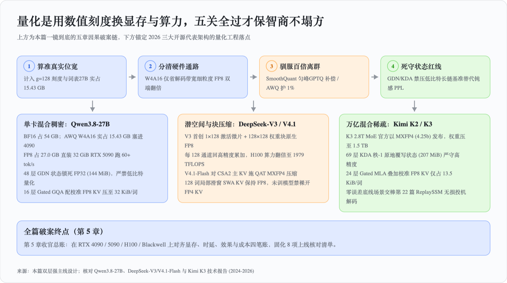
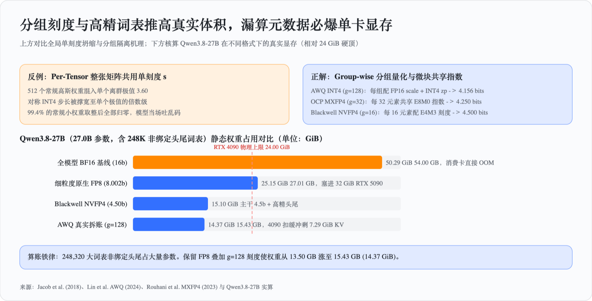
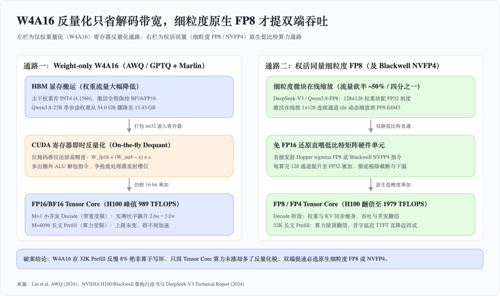
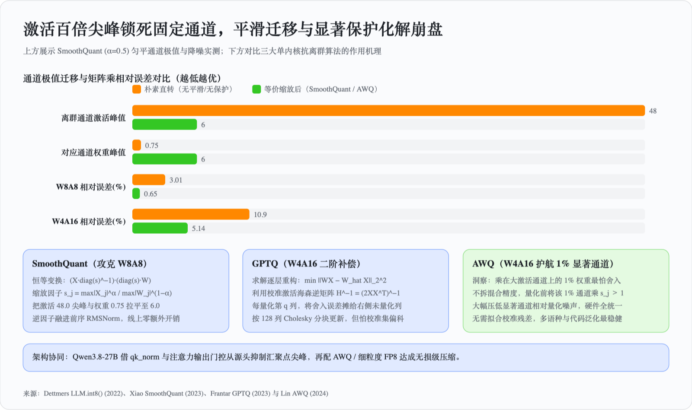
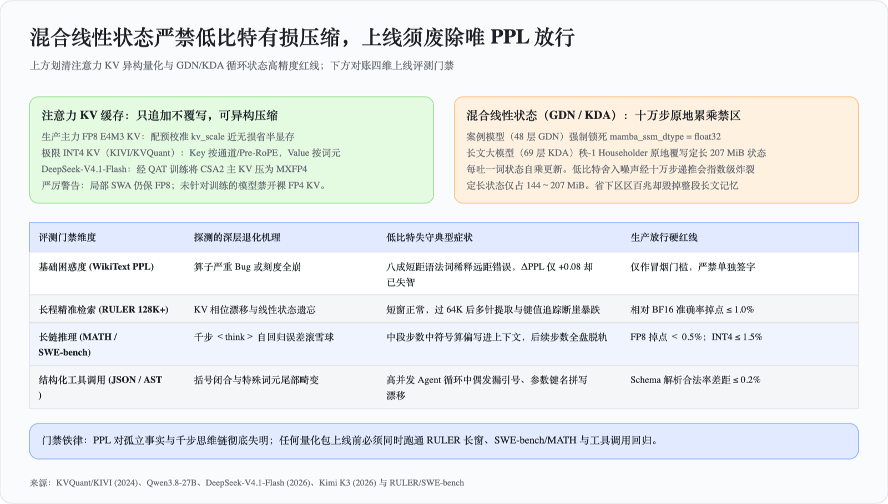
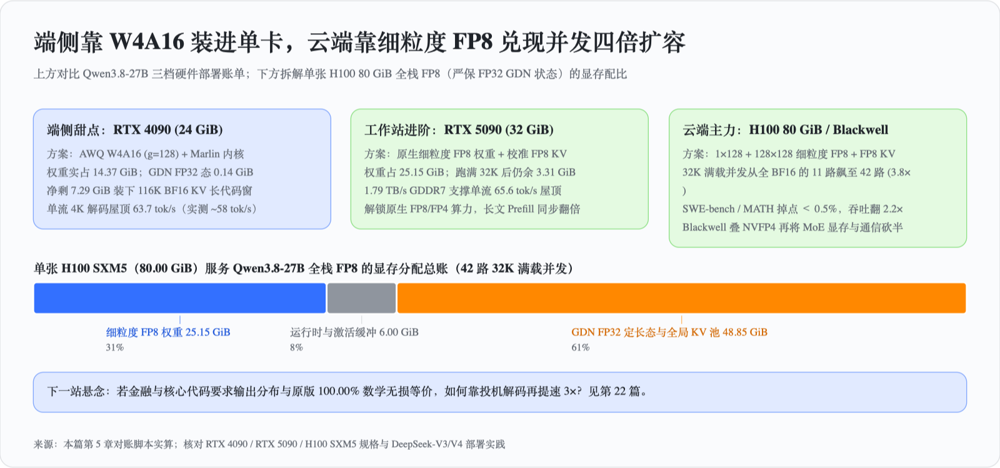

# ZTL-21｜系统｜用精度换内存要付什么代价

> 🎯 **这篇文档解决什么问题**：<b>核心命题：大模型量化围绕有效位宽、硬件通路与离群噪声展开精密核算。分组刻度决定了真实压缩比。仅压权重的 W4A16 只救小并发解码带宽，救不了长文预填充算力。唯有权活同量的细粒度 FP8 与 NVFP4 才能双阶段提速。配合训后平滑护住 1% 关键通道、严守混合架构线性态高精度，并用长链基准替代困惑度，才能稳住模型质量。</b>
>
> **使用方式与先修要求**：本篇位列 L5 推理系统层中枢。阅读前建议先熟悉 L1 低精度浮点与显存屋顶线（第 05～06 篇）。同时建议回顾 L2 混合注意力与位置编码（第 08～09 篇），以及前两篇的分页调度与分块内核（[ZTL-19｜系统｜判断慢在哪，以及请求怎样排队](./19-serving-latency.md)、[ZTL-20｜系统｜减少注意力的内存搬运](./20-flash-attention.md)）。
>
> 本篇以稠密 27B 参量模型为案例（下文称案例模型），并对照大型稀疏模型与百万 token 长上下文架构落点。端侧团队要把它装进单张 `24 GiB RTX 4090` 或 `32 GiB RTX 5090` 跑出 `60+ tok/s`。云端团队要在 `H100 / Blackwell` 上实现吞吐翻倍，且 `SWE-bench / MATH` 掉点低于 `0.5%`。
>
> **动手实践**：第 1 章内嵌案例模型分模块有效位宽拆账与单刻度归零对比脚本。第 3 章提供 `SmoothQuant` 等价迁移与 `AWQ` 关键通道保护实验。第 5 章交付端云三档显卡容量与并发计算器，复制即可在本地复现。

<b>🧭 主线位置</b>：上一篇 [ZTL-20｜系统｜减少注意力的内存搬运](./20-flash-attention.md) 靠片上 SRAM 分块清除了注意力中间方阵的冗余读写。但它在无损前提下并未缩减 `54 GB` 权重与缓存的物理体积。本篇正式引入有损数值压缩，依次厘清刻度核算、硬件通路、离群抑制与混合状态红线。若业务要求输出分布 100.00% 无损且单流再快 3 倍，下一篇 [ZTL-22｜系统｜让草稿减少解码开销](./22-speculative.md) 将接力展开投机解码。

## 导读 · 先给结论

- <b>4-bit 权重真实体积大于“总参乘 0.5 字节”，漏算刻度与高精词表必爆显存。</b>整张矩阵共用单刻度会被极值撑废网格。非对称 INT4（`g=128`）有效位宽为 $`4.15625\text{ bits}`$，微块 `MXFP4 / NVFP4` 升至 `4.25～4.50 bits`。案例模型因非绑定词表与门控保高精度，真实体积达 `15.43 GB`[[1]](https://arxiv.org/abs/2306.00978)[[2]](https://huggingface.co/Qwen/Qwen3.8-27B/blob/main/config.json)。
- <b>仅权重量化（`W4A16`）只救小并发解码，细粒度 `FP8 / NVFP4` 才能双阶段提速。</b>`W4A16` 需在寄存器反量化回 16 位再入 FP16 Tensor Core。单流解码少读七成权重故快近 3 倍，但 `32K` 长文预填充得不到加速，解包开销还可能让它略慢。`DeepSeek-V3` 与 `Qwen3.8-FP8` 直喂 FP8 单元，唤醒 `1,979 TFLOPS` 双倍算力[[3]](https://arxiv.org/abs/2209.05433)[[4]](https://arxiv.org/abs/2412.19437)。
- <b>超 6B 模型在少数固定通道涌现百倍激活尖峰，需靠等价平滑或 1% 保护化解误差。</b>矩阵乘内积轴限制了激活按列独立分尺。`SmoothQuant` 用互逆对角阵把激活尖峰匀给权重以跑通 `W8A8`。`GPTQ` 借海森逆逐列补偿二阶误差。`AWQ` 则将对应大激活的 `1%` 关键权重先行放大再取整[[1]](https://arxiv.org/abs/2306.00978)[[5]](https://arxiv.org/abs/2208.07339)[[6]](https://arxiv.org/abs/2211.10438)。
- <b>混合架构线性循环态严禁压入低比特，上线验收须用长链基准取代单一 `PPL`。</b>注意力 KV 可配校准压至 `FP8`，`DeepSeek-V4.1-Flash` 更经 QAT 将主 KV 压至 `MXFP4`。但案例模型的 GDN（锁 `float32`）与 `Kimi K3` 的 KDA 每步原地累乘十万次，压低比特会导致误差指数级放大。上线前须联测 `RULER` 与 `SWE-bench / MATH`[[7]](https://arxiv.org/abs/2401.18079)[[8]](https://arxiv.org/abs/2606.19348)[[9]](https://arxiv.org/abs/2404.06654)[[10]](https://arxiv.org/abs/2310.06770)。
- <b>端侧紧扣容量选 `W4A16 / FP8`，云端紧扣双阶段吞吐选细粒度 `FP8 / NVFP4`。</b>单张 `24 GiB RTX 4090` 靠 `AWQ` 装下案例模型仍留 `7.29 GiB` 跑百 K 窗与 `60 tok/s`，`32 GiB RTX 5090` 可直装原生 `FP8`。云端 `80 GiB H100` 开全栈 `FP8` 将 32K 并发扩至 42 路，核心基准掉点低于 `0.5%`[[2]](https://huggingface.co/Qwen/Qwen3.8-27B/blob/main/config.json)[[4]](https://arxiv.org/abs/2412.19437)。



上图横跨 2024～26 年硬件代际，锚定 `Qwen3.8-27B`、`DeepSeek-V3/V4.1-Flash` 与 `Kimi K3` 三大开源标杆，对应端侧 RTX 4090/5090 与云端 H100/Blackwell 四档生产部署。

<b>📎 与系列其他文档的分工</b>：浮点位布局与屋顶线回顾 [ZTL-05｜数学｜优化、归一化与数值稳定](./05-optim-norm.md)、[ZTL-06｜数学｜一张纸算清算力、显存与缩放](./06-compute-memory-scaling.md)。混合注意力与旋转位置编码见 [ZTL-08｜模型｜把注意力写成矩阵](./08-attention.md)、[ZTL-09｜模型｜让模型知道顺序](./09-position.md)。训练期 QLoRA 双重量化见 [ZTL-15｜后训练｜只训练一小部分参数](./15-lora.md)，推理内存池与片上分块内核见 [ZTL-19｜系统｜判断慢在哪，以及请求怎样排队](./19-serving-latency.md)、[ZTL-20｜系统｜减少注意力的内存搬运](./20-flash-attention.md)。

<b>📎 与系列其他文档的分工（续）</b>：严格无损的投机解码移交下一篇 [ZTL-22｜系统｜让草稿减少解码开销](./22-speculative.md)。双端 SLO 吞吐压测与万亿 MoE 集群并行留给 [ZTL-23｜系统｜把模型部署成服务](./23-serving.md) 与 [ZTL-24｜系统｜长上下文与混合专家怎样改变账单](./24-long-context-moe.md)。

## 第 1 章 · 漏算刻度与词表，单卡显存当场爆

接过 [ZTL-20｜系统｜减少注意力的内存搬运](./20-flash-attention.md) 留下的难题。片上分块虽消除了注意力中间矩阵的冗余读写，但稠密旗舰 <b>`Qwen3.8-27B`</b> 按 BF16 存权重仍占 <b>`54.00 GB`（折合 `50.29 GiB`）</b>[[2]](https://huggingface.co/Qwen/Qwen3.8-27B/blob/main/config.json)。端云两支研发团队同步**立目标**。端侧要在单张 `24.00 GiB RTX 4090` 或 `32.00 GiB RTX 5090` 上装入全模型，单流吐字破 `60 tok/s`[[11]](https://resources.nvidia.com/en-us-tensor-core/nvidia-tensor-core-gpu-datasheet)。云端要在 `80 GiB H100` 上将吞吐翻倍，且 `SWE-bench / MATH` 掉点不超过 `0.5%`。

端侧新手算的第一笔账往往过于乐观。按 270 亿参数乘 0.5 字节估算，4-bit 权重似乎只有 `13.5 GB`。他们以为放进 24 GiB 显卡还能富余 10 GB 给上下文。结果拉起量化包刚喂入长文件，显卡立即报 `CUDA out of memory` 崩溃。要查清凭空多出的近 2 GB 显存，必须先推通映射公式，为静态压缩比准确**算上限**[[1]](https://arxiv.org/abs/2306.00978)[[12]](https://arxiv.org/abs/1712.05877)。

### 1.1 分组隔离机制与有效位宽核算

训练后量化（PTQ）把连续浮点张量映射到 `b` 比特离散格点上[[12]](https://arxiv.org/abs/1712.05877)。强制浮点零与整数零对齐，便构成**对称量化**。记有符号上界 $`Q_{\max} = 2^{b-1} - 1`$（INT8 取 127，对称 INT4 取 7），缩放步长与格点满足：

```math
q = \mathrm{clamp}\!\left(\lfloor x / s \rceil, -Q_{\max}, Q_{\max}\right),\quad s = \frac{\max |x|}{Q_{\max}},\quad \hat{x} = q \cdot s
```

对称映射算子简洁，整数内积算完只需外乘一次缩放积。但若数值分布偏斜（如落在 `[-0.2, 1.3]`），对称区间就会被撑宽到 `[-1.3, 1.3]`。近半数负半轴格点因此白白空置。为此 4-bit 权重量化普遍改用**非对称零点量化**。它采用无符号格点 $`[0, 2^b - 1]`$（INT4 为 0 至 15），并引入整数零点 $`z`$[[1]](https://arxiv.org/abs/2306.00978)[[12]](https://arxiv.org/abs/1712.05877)：

```math
s = \frac{x_{\max} - x_{\min}}{2^b - 1},\quad z = \mathrm{clamp}\!\left(\left\lfloor \frac{-x_{\min}}{s} \right\rceil, 0, 2^b - 1\right),\quad \hat{x} = (q - z) \cdot s
```

由于零点取整落格，浮点真零仍由 $`q = z`$ 无误差表达。紧接着的核心问题是**多大范围共用一套刻度**。假设整张 `5120×17408` 矩阵只存 1 个全局刻度（Per-Tensor）。只要几千万常规权重里混入单个幅值 `3.60` 的极值，对称 INT4 步长就会被拉大至 `0.514`。所有小于 `0.257` 的常规权重取整后**超 99% 集体归零**，整层模型直接失效[[13]](https://arxiv.org/abs/2210.17323)。

为隔离局部极值污染，`GPTQ` 与 `AWQ` 沿输入通道每连续 `g` 个权重划为一组（主流取 `g = 128`）[[1]](https://arxiv.org/abs/2306.00978)[[13]](https://arxiv.org/abs/2210.17323)。组内独立求取并存储刻度。这笔元数据必须摊回每个参数，计为**有效位宽**。在非对称 INT4（`g = 128`）下，每 128 个权重附带 1 个 FP16 缩放因子（16b）与 1 个 INT4 零点（4b）：

```math
b_{\text{eff}} = 4 + \frac{16 + 4}{128} = 4.15625\text{ bits}
```

若把组长收紧至 `g = 32`，有效位宽便涨至 `4.625 bits`，比名义值膨胀了 <b>15.6%</b>。`QLoRA` 对 `g = 64` 的 `NF4` 引入双重量化，将一级刻度再压成 FP8，把有效位宽压回 `4.127 bits`[[14]](https://arxiv.org/abs/2305.14314)。

2026 年原生微块浮点走得更。底层 4-bit `E2M1` 用非均匀格点 `±{0, 0.5, 1, 1.5, 2, 3, 4, 6}` 贴合钟形尾部。OCP 标准 <b>`MXFP4`</b>（`Kimi K3` 的 `2.8T` 权重采用，将 5.6 TB 压至约 `1.5 TB`）每 32 个元素共享 8-bit `E8M0` 指数刻度，有效位宽为 `4.25 bits`[[15]](https://arxiv.org/abs/2310.10537)[[16]](https://arxiv.org/abs/2607.24653)。Blackwell 原生 <b>`NVFP4`</b> 缩至每 16 个元素配 8-bit `E4M3` 刻度，有效位宽为 `4.50 bits`[[17]](https://github.com/NVIDIA/Model-Optimizer)。

### 1.2 案例模型的分模块显存拆账

就算按 `4.15625 bits` 计算，`27B` 全乘下来也只有 `14.03 GB`。它离拆账算出的 15.43 GB 仍有差距。差额来自 <b>`Qwen3.8-27B` 的敏感模块豁免契约</b>[[2]](https://huggingface.co/Qwen/Qwen3.8-27B/blob/main/config.json)。官方配置中 `vocab_size = 248,320` 且 `tie_word_embeddings = false`。输入嵌入与输出头独立不共享，隐藏维为 `5120`。仅头尾两张大词表就占去 `2.543B` 参数。

词表直连离散入口与概率出口，强压成 4-bit 极易诱发生僻符乱码。此外，48 层 GDN 的细小门控、卷积核与 `RMSNorm`（约 `0.12B`）也必须保留 BF16[[2]](https://huggingface.co/Qwen/Qwen3.8-27B/blob/main/config.json)。生产级 `AWQ` 包将头尾词表保留 8-bit（`2.543 GB`），门控与归一化保留 16-bit（`0.240 GB`）。仅剩余 `24.337B` 主干压入 `g = 128` INT4（`12.644 GB`）。三项合计达 <b>`15.43 GB`（即 `14.37 GiB`）</b>，比粗算值多占近 <b>`2 GB`</b>。



看懂上方拆解图的关键，在于区分“名义位宽”与“落地总重”两根柱子。即便主干压到 4-bit，刻度张量与豁免层仍会垫高底座。现在把 `14.37 GiB` 放进单张 `24.00 GiB RTX 4090` 逐项盘账。先扣去 `2.20 GiB` CUDA 上下文与激活峰值缓冲。再扣 48 层 GDN 定长 FP32 状态池，每层含 48 个 `128×128` 矩阵，合 `144 MiB`（`0.14 GiB`）。留给全局 KV 池的净空间恰为 <b>`7.29 GiB`</b>。

再算每词 KV 字节数。`Qwen3.8-27B` 仅保留 16 层 Gated GQA 全局注意力，每层设 4 个键值头且头维为 256。按 BF16 存储每词仅耗 $`16 \times 2 \times 4 \times 256 \times 2 = 65{,}536\text{ B}`$（即 `64 KiB`），较纯 GQA 基线 `Qwen3-32B` 的 `256 KiB/词` 直降 75%[[18]](https://arxiv.org/abs/2505.09388)。

把 `7.29 GiB` 除以 `64 KiB/词`，单张 RTX 4090 足以稳跑 <b>`116K` 词长代码窗</b>。若换上 `32.00 GiB RTX 5090`，更能直装 `27.01 GB`（`25.15 GiB`）原生细粒度 FP8 权重。读下表时可重点对比 `NVFP4` 与 `AWQ` 两行：前者因 `g = 16` 微块刻度更密而多占 `0.73 GiB`，却为下一章换来了原生 4-bit 硬件算力：

| **量化格式与工业代表** | <b>分组粒度 `g`</b> | **每组附带刻度元数据** | **主干有效位宽** | **Qwen3.8-27B 实占** |
|---|---|---|---|---|
| **BF16 原始满血基线** | 无缩放 | 每参数固定 16-bit 浮点 | `16.000 bits` | `54.00 GB (50.29 GiB)` |
| <b>细粒度 FP8（DeepSeek/Qwen）</b> | `128×128` 块 | 每 16,384 权重 1 个 FP32 `scale` | `8.002 bits` | <b>`27.01 GB (25.15 GiB)`</b> |
| **Blackwell 原生 NVFP4** | `g = 16` 微块 | 每 16 个 E2M1 配 8b E4M3 块刻度 | `4.500 bits` | `16.21 GB (15.10 GiB)` |
| <b>OCP 标准 MXFP4（Kimi K3）</b> | `g = 32` 微块 | 每 32 个 E2M1 共享 8b E8M0 指数 | `4.250 bits` | `15.71 GB (14.63 GiB)` |
| <b>AWQ 非对称 INT4（端侧主力）</b> | `g = 128` | FP16 `scale`（16b）+ INT4 `zp`（4b） | <b>`4.156 bits`</b> | <b>`15.43 GB (14.37 GiB)`</b> |
| **QLoRA NF4 双重量化** | `g = 64` / 二级 256 | FP8 一级刻度 + FP32 二级块刻度 | `4.127 bits` | `15.34 GB (14.29 GiB)` |

下方脚本复现了单刻度归零坍缩、`g = 128` 分组降噪 5.4 倍，以及 RTX 4090 分模块显存拆账：

*Per-Tensor 单刻度坍缩 vs Group-128 分组量化误差及 Qwen3.8-27B 真实显存拆账*

```python
import numpy as np

GIB = 1024 ** 3
# 1) Qwen3.8-27B 分模块真实显存核算 (vocab=248,320 非绑定头尾保8b, GDN门控与Norm保16b)
p_total = 27.00e9
p_vocab = 2 * 248320 * 5120                  # 2.5428B 头尾词表参数
p_gate_norm = 0.12e9                         # 0.1200B GDN门控/卷积核与归一化
p_linear = p_total - p_vocab - p_gate_norm   # 24.3372B 主干线性层
b_awq = 4.0 + (16.0 + 4.0) / 128.0           # 4.15625 bits

naive_gb = p_total * 0.5 / 1e9
real_gb = (p_linear * (b_awq / 8.0) + p_vocab * 1.0 + p_gate_norm * 2.0) / 1e9
real_gib = real_gb * 1e9 / GIB
gdn_gib = (48 * 48 * 128 * 128 * 4) / GIB    # 48层GDN FP32定长状态 = 0.14 GiB
kv_free_gib = 24.0 - real_gib - 2.20 - gdn_gib
max_ctx_k = int((kv_free_gib * GIB) // (16 * 2 * 4 * 256 * 2)) // 1024

# 2) 单个极值 3.60 撑废 Per-Tensor INT4 vs Group-128 隔离保护实验
np.random.seed(42)
w = np.random.normal(0.0, 0.08, size=512).astype(np.float32)
w[17] = 3.60
s_t = np.max(np.abs(w)) / 7.0
q_t = np.clip(np.round(w / s_t), -7, 7)
mse_t = np.mean(np.square(w - q_t * s_t))

w_g = w.reshape(-1, 128)
w_min, w_max = w_g.min(axis=1, keepdims=True), w_g.max(axis=1, keepdims=True)
s_g = np.maximum((w_max - w_min) / 15.0, 1e-8).astype(np.float16).astype(np.float32)
z_g = np.clip(np.round(-w_min / s_g), 0, 15)
w_hat = ((np.clip(np.round(w_g / s_g) + z_g, 0, 15) - z_g) * s_g).reshape(-1)
mse_g = np.mean(np.square(w - w_hat))

print(f"Qwen3.8-27B | 拍脑袋:{naive_gb:.2f}GB | 真实拆账:{real_gb:.2f}GB ({real_gib:.2f}GiB) | 4090净KV池:{kv_free_gib:.2f}GiB ({max_ctx_k}K词)")
print(f"误差对比    | Per-Tensor归零率={np.mean(q_t==0)*100:.1f}% MSE={mse_t:.6f} | Group-128有效位宽={b_awq:.5f}b MSE={mse_g:.6f}")
print(f"单刻度极值撑废:{np.sum(q_t==0)}/{len(q_t)}权重 | 分组隔离救回:{(np.mean(q_t==0)-np.mean(w_hat==0))*100:.1f}%权重")
```

```text
Qwen3.8-27B | 拍脑袋:13.50GB | 真实拆账:15.43GB (14.37GiB) | 4090净KV池:7.29GiB (116K词)
误差对比    | Per-Tensor归零率=99.4% MSE=0.006014 | Group-128有效位宽=4.15625b MSE=0.001104
单刻度极值撑废:509/512权重 | 分组隔离救回:65.8%权重
```

拆解上述代码，最值得留意两处细节。其一，计算分组步长 `s_g` 时特意插入了 `1e-8` 下界与 `float16` 往返强转。`1e-8` 用于防止全零死通道触发除零异常。转回 `float16` 则忠实复现了真实内核以 16 位半精度落盘刻度的舍入损耗，避免离线仿真虚报精度。

其二，核对两行打印输出即可看清分组隔离的威力。单个 `3.60` 极值在全局单刻度下造成 `99.4%` 权重归零，均方误差高达 `0.006014`。改用 `g = 128` 后，极值污染被严格封锁在自身 128 元素小组内，整体均方误差骤降至 `0.001104`（降噪 `5.4 倍`），而 `14.37 GiB` 实占体积也与上方纸面公式分毫不差。

> 💡 <b>常见误区：混用十进制 `GB` 与二进制 `GiB`，且漏算大词表与路由门的高精度体积。</b>现象是看模型卡写约 27 GB FP8，误以为 24 GiB 显卡只差一点，或上卡拉长窗口即爆显存。根因是显存按 `2^30` 标定而参数按 `10^9` 口算，且 `248K` 非绑定词表默认豁免 4-bit 压缩。改法是分模块按有效位宽求和再除以 `1.07374` 折算 GiB，预留 `2 GiB+` 安全垫。

> 🔑 **本章要点与回到主线**：分模块计入 `g = 128` 刻度与高精词表后，`14.37 GiB` 的 `Qwen3.8-27B-AWQ` 顺利装进 RTX 4090，单流吐字达 `60 tok/s`。但新的矛盾随之浮现。云端团队拿同一套 `W4A16` 压测 `32K` 长文首字延迟（`TTFT`）时，发现预填充比原版 BF16 慢 `8%`。明明权重砍了四分之三，为何算长输入反而变慢？这正是第 2 章要厘清的问题。

## 第 2 章 · 寄存器反量化陷阱，权活同量才能双赢

直面第 1 章末尾的反常现象。同一份 `Qwen3.8-27B-AWQ（W4A16）` 权重，单流逐字解码提速近三倍。可一旦遇上 `32K` 长代码仓预填充或百路并发，首字延迟（`TTFT`）却反升 `8%`。不少工程师怀疑框架触发了算子回退 Bug。

借助 [ZTL-06｜数学｜一张纸算清算力、显存与缩放](./06-compute-memory-scaling.md) 与 [ZTL-19｜系统｜判断慢在哪，以及请求怎样排队](./19-serving-latency.md) 的屋顶线模型拆解指令流来**找瓶颈**，真相便水落石出。**省显存搬运绝不等于涨矩阵算力。决定哪一阶段提速的唯一判据，是张量最终送进了哪块 Tensor Core**[[1]](https://arxiv.org/abs/2306.00978)[[11]](https://resources.nvidia.com/en-us-tensor-core/nvidia-tensor-core-gpu-datasheet)。

### 2.1 权重量化的访存与硬件通路权衡

`AWQ`、`GPTQ` 及高速内核 `Marlin` 均属<b>仅权重量化（`W4A16`）</b>[[1]](https://arxiv.org/abs/2306.00978)[[13]](https://arxiv.org/abs/2210.17323)[[19]](https://docs.vllm.ai/en/latest/getting_started/quickstart.html)。静态权重压成 4-bit 存放在 HBM 显存里，动态激活则全程保持 16-bit。关键硬件约束在于：<b>无论是 RTX 4090 还是 H100，GPU 上都没有“拿 INT4 直接乘 BF16”的混合矩阵乘电路。</b>因此 `W4A16` 每次算矩阵乘都必须串行走完三步：

1. <b>压缩访存搬运。</b>从 HBM 异步预取 `int32` 紧凑字与分组刻度。案例模型单轮权重读取量从 `54.00 GB` 压至 `15.43 GB`。
2. <b>寄存器即时反量化。</b>用位掩码与浮点偏置指令，在片上寄存器当场还原出 16-bit 权重。计算关系为 $`\hat{W} = (W_{\text{int4}} - z) \cdot s`$。
3. <b>16-bit 矩阵乘加。</b>将还原后的权重与激活一同送入 **BF16/FP16 Tensor Core**。H100 SXM5 的该单元稠密峰值为 `989 TFLOPS`，单向带宽为 `3.35 TB/s`，脊点约为 `295 FLOPs/Byte`[[11]](https://resources.nvidia.com/en-us-tensor-core/nvidia-tensor-core-gpu-datasheet)。

对照这道 `295 FLOPs/Byte` 脊点，把单权重字节数代入算术强度公式，两阶段的反差对比如下：

- <b>小并发 Decode（`M = 1～8`，重度带宽受限）。</b>单流解码 `M = 1` 时，每读入 1 个参数只做 2 次乘加。哪怕压到 `4.16 bits`（约 `0.52 Byte`），算术强度也只有 $`2 \cdot M / 0.52 \approx 3.8\text{ FLOPs/Byte}`$。它远低于 `295` 脊点，计算单元九成时间在空等显存送数。`W4A16` 砍掉逾七成权重流量正中要害。`Marlin` 内核将 8 个 INT4 拼进单个 `uint32` 寄存器并启用异步双缓冲，使单流解码吞吐跃升 <b>`2.6× ～ 3.1×`</b>[[1]](https://arxiv.org/abs/2306.00978)[[19]](https://docs.vllm.ai/en/latest/getting_started/quickstart.html)。
- <b>长文 Prefill 或大并发批（`M = 4096～32768`，重度算力受限）。</b>并行预填充上万词时，权重读入一次可供几万词元复用。此时算术强度突破数千，早已顶在 <b>`989 TFLOPS` 的 16-bit 算力屋顶</b>上。还原后既然仍走 16-bit Tensor Core，算力上限便分毫未涨。内层循环插入的千亿次 `lop3` 位掩码指令还会争抢发射槽位，32K 预填充因此得不到加速，还可能比 BF16 略慢（具体幅度依内核与形状而定，本篇未实测）。



观察上方硬件通路对比图，可以直观标定 `W4A16` 的失效拐点。当有效批大小 $`M`$ 处于 `1 ～ 16` 区间时，蓝色柱条明显更优。一旦并发批或预填充块跨过 `64 ～ 128` 词元，访存节省便被寄存器反量化开销抵消，吞吐曲线随即被原生低精度路线反超。

### 2.2 权活同量（原生细粒度 `FP8` 与 Blackwell `NVFP4`）：双阶段吞吐翻倍

要想在云端同时压低 `32K` 首字延迟并拉高并发解码吞吐，唯一出路是<b>权活同量（Weight-Activation Quantization）</b>。我们必须把权重与动态激活同步压至低比特。这样才能跳过 16-bit 还原，直接调用双倍乃至四倍峰值的低精度 Tensor Core。

在 Ampere（A100）代际，主力是整数 `W8A8-INT8`（峰值 `624 TOPS`），但均匀整数格点窄、抗尖峰吃力[[6]](https://arxiv.org/abs/2211.10438)。到了 Hopper（H100）与 Ada（RTX 4090）代际，硬件普及了 <b>8 位浮点 `FP8`</b>[[3]](https://arxiv.org/abs/2209.05433)[[11]](https://resources.nvidia.com/en-us-tensor-core/nvidia-tensor-core-gpu-datasheet)。前向权重、激活与 KV 统一采用 3 位尾数的 <b>`E4M3`</b>（范围约正负 448）。反向梯度则采用 5 位指数的 `E5M2`。在 H100 上发射原生 `wgmma` FP8 指令，稠密算力直接翻倍至 <b>`1,979 TFLOPS`</b>。

不过，早期全张量共用单刻度的粗粒度 FP8 容易在大模型上失真。`E4M3` 上限仅 448。一旦某层冒出局部尖峰，全张量单刻度就会令大量微弱信号下溢清零。<b>`DeepSeek-V3`</b>（`671B` 总参）与**案例模型的 FP8 版本**由此确立了 2026 工业主流的**细粒度分块原生 FP8** 规范[[2]](https://huggingface.co/Qwen/Qwen3.8-27B/blob/main/config.json)[[4]](https://arxiv.org/abs/2412.19437)：

- <b>微片与子块独立缩放。</b>激活按 `1×128` 微片在线动态求刻度，权重按 `128×128` 子块存 FP32 刻度。局部尖峰被限制在 128 通道内，消除了跨通道下溢。
- <b>每 128 通道回高精度寄存器累加。</b>Hopper 原生 FP8 内部累加器尾数偏短（约 14 bits），长内积易漂移。每乘完 128 通道即搬回 CUDA Core 做标准 FP32 累加，使训推精度逼近满血 BF16[[4]](https://arxiv.org/abs/2412.19437)。

迈入 2026 年 Blackwell（B200 / RTX 5090）代际，硬件原生支持 4 位微块矩阵乘（<b>`NVFP4` 与 `MXFP4`</b>），块刻度直接在 Tensor Core 内部硬件对齐，FP4 算力较 FP8 再度翻倍。跨机服务 `DeepSeek-V4` 等巨型 MoE 时，`vLLM` 与 `SGLang` 进一步组合 `NVFP4 GEMM` 与 <b>`NVFP4 MoE Dispatch`</b>。后者把跨卡 All-to-All 分发激活压成 4-bit 传输，将通信流量同步削减四分之三[[17]](https://github.com/NVIDIA/Model-Optimizer)[[19]](https://docs.vllm.ai/en/latest/getting_started/quickstart.html)。

阅读下方四条硬件通路对照表时，请把最后两列连起来看。只有“权重位宽”与“激活位宽”同步下降并命中对应代际 Tensor Core，最后两列才能同时大于 `1.0×`：

| **量化计算路线** | **权重 / 激活位宽** | **底层计算单元与峰值** | **小并发 Decode 提速** | **32K 长文 Prefill 提速** |
|---|---|---|---|---|
| **BF16 满血基线** | 16b / 16b | H100 BF16 TC（`989 TFLOPS`） | `1.0×`（重度卡带宽） | `1.0×`（顶满 989T 屋顶） |
| <b>W4A16（AWQ + Marlin）</b> | 4.16b / 16b | 寄存器反量化 + BF16 TC | <b>`2.6× ～ 3.1×`（端侧最优）</b> | `0.92× ～ 0.98×`（微慢） |
| <b>细粒度 FP8（1×128+128²）</b> | 8.00b / 8b E4M3 | H100 FP8 TC（<b>`1979 TFLOPS`</b>） | <b>`1.8× ～ 1.95×`</b> | <b>`1.65× ～ 1.85×`（双优）</b> |
| **Blackwell 原生 NVFP4** | 4.50b / 4.50b | B200/5090 FP4 TC（**双倍于 FP8**） | <b>`2.8× ～ 3.4×`</b> | <b>`2.4× ～ 3.0×`（次世代）</b> |

> 💡 <b>常见误区：在无原生低比特指令的旧卡上盲开高阶格式（如 A100 跑 FP8，或 H100 强跑 NVFP4）。</b>现象是显存虽省，吞吐与首字延迟反倒下跌两成。根因是旧代际缺少对应硬件电路（A100 无 FP8 TC，H100 无 FP4 TC），框架只能回退软件反量化。改法是严格核对计算代际：SM80 选 `W8A8-INT8` 或 `W4A16`，SM89/SM90 跑细粒度 `FP8`，SM100+ 才开原生 `NVFP4`[[11]](https://resources.nvidia.com/en-us-tensor-core/nvidia-tensor-core-gpu-datasheet)[[17]](https://github.com/NVIDIA/Model-Optimizer)。

> 🔑 **本章要点与回到主线**：硬件通路解释了预填充变慢之谜。端侧单卡靠 `W4A16` 省解码带宽，云端高并发靠细粒度原生 `FP8 / NVFP4` 双阶段翻倍算力。但新的矛盾随之浮现。当我们在 A100 上开 `W8A8` 激活量化，或对 `Qwen3.8-27B` 无校准直转 4-bit 时，模型输出乱码。探针显示少数固定通道的激活幅值比邻列大近百倍。这类离群通道该如何平抑？这正是第 3 章要解决的重点。

## 第 3 章 · 激活尖峰的三条抗误差路线

顺着第 2 章末尾的乱码故障继续追查。为何训练收敛的权重分布平缓，一碰粗粒度激活量化或无保护 4-bit 压缩就会整体失真？Dettmers 等人在 `LLM.int8()` 中揭示了大模型的涌现相变[[5]](https://arxiv.org/abs/2208.07339)。当参数规模跨过约 <b>`6B`（60 亿）</b>后，所有隐藏层激活都会涌现出一小批比均值大 <b>`20 ～ 100 倍`</b>的极端尖峰。这就是**系统性激活离群值**。一旦截断这不到 `1%` 的通道，困惑度便立刻飙升至上万。

### 3.1 内积轴对齐与缩放乘积的代数约束

用探针观察案例模型线性层输入激活 `X`（形状为词元数乘 5120 通道），离群尖峰呈现固定的几何规律[[5]](https://arxiv.org/abs/2208.07339)[[6]](https://arxiv.org/abs/2211.10438)。它们绝非随机散落。在几乎所有输入词元上，极值都**集中在同一批极少数特征列**。例如第 10 列与第 99 列恒定冲上正负 50，其余五千列则温和落在正负 0.8 以内。

既然尖峰按列聚集，为什么不能给激活 `X` 也按列做独立缩放？<b>线性代数结合律与 Tensor Core 硬件同时封死了这条路。</b>矩阵乘沿共享输入通道轴 `j` 求内积。若给激活设按列步长、给权重设按行步长，两者的缩放乘积就会随下标 `j` 变动。它**无法提取到整数求和号外面**[[6]](https://arxiv.org/abs/2211.10438)。硬件单次矩阵乘指令要求刻度只能挂在外围行轴 `i` 与列轴 `k` 上：

```math
Y_{i,k} \approx s_{X,i} \cdot s_{W,k} \sum_{j=1}^{C} Q(X_{i,j}) \, Q(W_{j,k})
```

这意味着激活最多只能按词元整行（Per-Token）设刻度。可每行词元里都混着第 10 列那个 `50.0` 的极值，整行 8-bit 网格照样被撑坏。早期 `LLM.int8()` 被迫把这 `0.1%` 离群列拆分出来单跑 FP16，其余列跑 INT8。精度虽保住了，但运行时拆拼张量的访存开销却让推理比纯 FP16 更慢[[5]](https://arxiv.org/abs/2208.07339)。真正的工业突破来自随后三条**单内核统一精度**的抗误差路线。



### 3.2 一条主线串起三大武器：SmoothQuant 匀峰、GPTQ 补偿与 AWQ 护航

围绕“内积轴不能各自单挂刻度”的代数约束，三大流派给出了层层递进的解法：

<b>路径一（解决 `W8A8` 权活同量）：`SmoothQuant` 对角矩阵等价迁移。</b>Xiao 等人利用了内积成对相乘的对称性[[6]](https://arxiv.org/abs/2211.10438)。量化后虽不能按通道提公因式，但在**量化发生之前**，可在 `X` 与 `W` 之间插入一对互逆正对角矩阵，保持乘积恒等：

```math
Y = \left(X \, \mathrm{diag}(s)^{-1}\right) \cdot \left(\mathrm{diag}(s) \, W\right),\quad s_j = \frac{\max_i |X_{i,j}|^{\alpha}}{\max_k |W_{j,k}|^{1 - \alpha}}
```

迁移指数常取经验值 $`\alpha = 0.5`$。代入真实数字手算：设第 $`j`$ 通道激活极值为 `48.0`，对应行权重极值仅 `0.75`，算得 $`s_j = \sqrt{48.0 / 0.75} = 8.0`$。变换后新激活极值压至 `6.0`，新权重极值升至 `6.0`。两边幅值拉平后即可一同放入 INT8 网格。逆对角阵还能离线融进前序 `RMSNorm` 权重，线上推理**零额外算子开销**。

<b>路径二（解决 `W4A16` 二阶重构）：`GPTQ` 海森逆矩阵逐列补偿。</b>只压 4-bit 权重时，目标变成微调未量化列去抵消已量化列的输出偏差。Frantar 等人将其建模为逐层最小二乘重构，对应海森矩阵为 $`H = 2 X^\top X`$[[13]](https://arxiv.org/abs/2210.17323)：

```math
\min_{\hat{W}} \| X W - X \hat{W} \|_F^2,\quad \delta_F = -\frac{w_q - \mathrm{quant}(w_q)}{[H^{-1}]_{qq}} H^{-1}_{:, q}
```

`GPTQ` 逐列执行取整。每当第 `q` 列产生舍入误差，算法就借助海森逆的 Cholesky 因子把补偿量摊给右侧未量化列。同时按 128 列分块更新以跑满显卡带宽[[13]](https://arxiv.org/abs/2210.17323)。

<b>路径三（解决 `W4A16` 稳健泛化）：`AWQ` 放大保护 1% 关键权重通道。</b>Lin 等人追问本质：为何同是 4-bit 舍入，偏偏某几列权重受损最致命？因为输出微扰等于激活乘权重误差。<b>恰恰是乘在百倍大激活通道上的那 `1%` 关键权重，把微小的取整噪声放大了百倍。</b>

`AWQ` 保持全网 100% 纯 4-bit 打包。它仅在量化前按激活均值搜索最优指数，对关键通道乘上放大系数 $`s_j > 1`$（逆因子融进前序层）[[1]](https://arxiv.org/abs/2306.00978)。权重放大后跨越更多格点，相对误差便缩小为 $`1 / s_j`$。由于无需直接拟合校准残差，`AWQ` 在多语种与代码上的泛化比 `GPTQ` 更稳健。

2026 前沿架构更从**结构源头**主动抑峰。案例模型标配 `qk_norm` 与输出门控 `attn_output_gate = true`，掐断汇聚点极值[[2]](https://huggingface.co/Qwen/Qwen3.8-27B/blob/main/config.json)。`DeepSeek-V4` 用 `swiglu_limit = 10` 限幅前馈乘积[[8]](https://arxiv.org/abs/2606.19348)。`Kimi K3` 借 `Gated MLA` 与 `Block AttnRes` 稳住 93 层残差尺度[[16]](https://arxiv.org/abs/2607.24653)。下方脚本实证了 `SmoothQuant` 与 `AWQ` 的降噪效果：

*SmoothQuant 对角迁移降噪 W8A8 与 AWQ 1% 关键通道放大护航 W4A16 实证*

```python
import numpy as np

np.random.seed(7)
# 构造 (64 词元, 256 通道) 激活，第 10、99 通道 (约占 1%) 存在 60 倍固定离群尖峰
X = np.random.normal(0.0, 0.5, size=(64, 256))
salient = [10, 99]
X[:, salient] *= 60.0
W = np.random.normal(0.0, 0.15, size=(256, 128))
Y_ref = np.einsum("nc,ck->nk", X, W)

# 1) W8A8 权活同量: 朴素 Per-Token 激活量化 vs SmoothQuant (alpha = 0.5)
def w8a8_gemm(A, B):
    sa = np.max(np.abs(A), axis=1, keepdims=True) / 127.0
    sb = np.max(np.abs(B), axis=0, keepdims=True) / 127.0
    qa, qb = np.clip(np.round(A / sa), -127, 127), np.clip(np.round(B / sb), -127, 127)
    return np.einsum("nc,ck->nk", qa * sa, qb * sb)

s_sq = np.sqrt(np.max(np.abs(X), axis=0) / np.max(np.abs(W), axis=1))
X_sq, W_sq = X / s_sq[None, :], W * s_sq[:, None]
assert np.allclose(np.einsum("nc,ck->nk", X_sq, W_sq), Y_ref, atol=1e-10)
Y_w8_naive, Y_w8_sq = w8a8_gemm(X, W), w8a8_gemm(X_sq, W_sq)

# 2) W4A16 仅压权重 (g=128): 朴素分组 INT4 vs AWQ 放大保护 1% 关键通道 (s=4.0)
def w4_group(B_mat, g=128):
    Bg = B_mat.reshape(B_mat.shape[0] // g, g, B_mat.shape[1])
    sb = np.maximum(np.max(np.abs(Bg), axis=1, keepdims=True) / 7.0, 1e-8)
    return (np.clip(np.round(Bg / sb), -7, 7) * sb).reshape(B_mat.shape)

s_awq = np.ones(256)
s_awq[salient] = 4.0
Y_w4_naive = np.einsum("nc,ck->nk", X, w4_group(W))
Y_w4_awq = np.einsum("nc,ck->nk", X / s_awq[None, :], w4_group(W * s_awq[:, None]))

rel = lambda Y: np.linalg.norm(Y_ref - Y) / np.linalg.norm(Y_ref) * 100
print(f"W8A8  相对误差 | 朴素Per-Token: {rel(Y_w8_naive):.2f}% | SmoothQuant后: {rel(Y_w8_sq):.2f}% (降噪 {rel(Y_w8_naive)/rel(Y_w8_sq):.1f}x)")
print(f"W4A16 相对误差 | 朴素Group-128: {rel(Y_w4_naive):.2f}% | AWQ护航1%通道: {rel(Y_w4_awq):.2f}% (降噪 {rel(Y_w4_naive)/rel(Y_w4_awq):.1f}x)")
print(f"离群通道保护:第{salient[0]},{salient[1]}列 | 放大系数s_awq={s_awq[salient[0]]:.1f} | 分组救回:{(rel(Y_w4_naive)-rel(Y_w4_awq)):.2f}%误差")
```

```text
W8A8  相对误差 | 朴素Per-Token: 3.01% | SmoothQuant后: 0.65% (降噪 4.6x)
W4A16 相对误差 | 朴素Group-128: 10.90% | AWQ护航1%通道: 5.14% (降噪 2.1x)
离群通道保护:第10,99列 | 放大系数s_awq=4.0 | 分组救回:5.76%误差
```

复盘这段对照实验，`assert np.allclose(...)` 断言验证了 `SmoothQuant` 的数学根基。在引入整数舍入之前，激活除以 `s_sq` 与权重乘以 `s_sq` 在浮点意义上严格互逆抵消。一旦进入 `w8a8_gemm`，被削平 60 倍尖峰的 `X_sq` 让每词元 127 个格点重新均匀覆盖常规通道，输出相对误差从 `3.01%` 直降至 `0.65%`（降噪 `4.6 倍`）。

再看下半段 `AWQ` 实验：我们没有引入任何混合精度分支，全矩阵依然走统一的 `w4_group` 纯 4-bit 对称打包。仅仅把第 10 与第 99 这两个离群通道（占比不足 `0.8%`）先行放大 `4.0 倍`，使它们在组内抢占更密的取整刻度，整层输出误差就从 `10.90%` 压回 `5.14%`，以零算子改动挽回了过半精度损失。

> 💡 <b>常见误区：拿百条纯英文短句校准双语代码推理模型（如导出 `GPTQ` 或静态 `SmoothQuant`）。</b>现象是英文问答流利，一写中文或复杂 Python 代码就频漏括号、乱造变量。根因是海森矩阵依赖校准集激发的子空间，缺中文、代码与 `<think>` 轨迹会误伤未覆盖通道。改法是按线上语种与代码比例抽样 256～512 条长序列校准，或优先选 `AWQ` 与动态细粒度 `FP8`[[1]](https://arxiv.org/abs/2306.00978)[[13]](https://arxiv.org/abs/2210.17323)。

> 🔑 **本章要点与回到主线**：借 `SmoothQuant` 等价匀峰与 `AWQ` 1% 关键通道保护，主干线性层权重已能稳妥压缩。但新的矛盾随之浮现。在长窗口下，团队顺手把 KV 缓存与线性注意力循环状态也压成 4-bit，见 `WikiText-2 PPL` 仅微涨 `0.08` 便上线，结果代码与数学准确率下跌 12 个点（假设读数）。究哪些状态不能碰低比特，为何 `PPL` 会掩盖故障？这正是第 4 章要解答的核心。

## 第 4 章 · 循环状态不能低比特，长链评测替代 PPL

复盘第 3 章末尾的线上故障（教学案例，PPL 与准确率读数为假设读数）。当时 `PPL` 仅涨 `0.08`，代码与数理准确率却下跌了 `12` 个百分点。我们按模块对账**测实际**并**做取舍**，查出三处失误。团队既把只读注意力 KV 与原地累乘的线性态混为一谈，又盲开了裸 4-bit KV，还轻信了钝感的困惑度指标。

### 4.1 注意力 KV 缓存量化法则：异构分轴与 QAT MXFP4 边界

先看随序列长度线性增长的全局注意力 KV 缓存。解码每吐一词都要重扫历史 KV，压缩它既扩并发池又省带宽[[7]](https://arxiv.org/abs/2401.18079)[[20]](https://arxiv.org/abs/2402.02750)。工业界按风险划定了三档水位：

- <b>生产默认档：校准 `FP8 E4M3 KV`（省半显存，接近无损）。</b>`E4M3` 对数格点契合键值分布。在 `vLLM` 开启 `fp8_e4m3` 并挂载预校准刻度（或开动态 `fp8_per_token_head`），案例模型的全局 KV 即从 `64 KiB/词` 降至 <b>`32 KiB/词`</b>。单路 262K 满窗仅占 `8.0 GiB`[[2]](https://huggingface.co/Qwen/Qwen3.8-27B/blob/main/config.json)[[19]](https://docs.vllm.ai/en/latest/getting_started/quickstart.html)。
- <b>通用极限档：`INT4 KV` 须坚持“Key 按通道、Value 按词元”异构切分。</b>`KVQuant` 与 `KIVI` 证明，**Key 在特定特征维带有固定离群值**，必须按通道量化。实操宜在 RoPE（见 [ZTL-09｜模型｜让模型知道顺序](./09-position.md)）混洗通道前校准，或留最近 32～128 词 FP16 滑窗攒块入库。相反，**Value 无固定通道尖峰**，适合流式按词元量化[[7]](https://arxiv.org/abs/2401.18079)[[20]](https://arxiv.org/abs/2402.02750)。
- <b>专训极限档：`DeepSeek-V4.1-Flash` 的 QAT `MXFP4` 与禁令。</b>`DeepSeek-V4.1-Flash` 对主 KV 启用 `MXFP4`，配 RMSNorm 保范数省去二级刻度，依赖后训练全程开启 **QAT**，且将 `128` 词滑窗 `SWA KV` 保留 `FP8`。未专训模型严禁裸开 `NVFP4 / FP4 KV`，否则数学分直接腰斩[[19]](https://docs.vllm.ai/en/latest/getting_started/quickstart.html)。

### 4.2 混合架构循环状态的精度铁律

那起故障的第二处根源，是团队把案例模型（48 层 GDN[[2]](https://huggingface.co/Qwen/Qwen3.8-27B/blob/main/config.json)[[21]](https://arxiv.org/abs/2412.06464)）与 `Kimi K3`（69 层 KDA[[16]](https://arxiv.org/abs/2607.24653)）的**线性注意力循环状态矩阵**也压成了低比特。两类缓存的误差传播机理截然不同。

标准注意力 KV 是**只追加、不改写的历史快照**。第 500 词的量化误差只待在自身槽位，不会污染后续词元。而 GDN 与 KDA 的状态矩阵却是**每步原地自乘覆写的动态寄存器**。回顾 [ZTL-08｜模型｜把注意力写成矩阵](./08-attention.md) 中 KDA 的秩-1 擦写递推式[[16]](https://arxiv.org/abs/2607.24653)[[21]](https://arxiv.org/abs/2412.06464)：

```math
S_t = \left(I - \beta_t k_t k_t^\top\right)\mathrm{Diag}(\alpha_t)\,S_{t-1} + \beta_t k_t v_t^\top
```

一旦每步写回状态时强加低比特取整，当步舍入噪声就会卷入下一步的状态乘子。我们算一笔衰减半衰期账便知凶险：当遗忘门取 $`\alpha_t = 0.9995`$ 时，历史信息的理论半衰期约为 $`\ln 2 / 0.0005 \approx 1{,}386`$ 词。FP8（3 位尾数步长约 `0.0625`）与 INT4 根本无法分辨 `0.9995` 与 `1.0` 的细微差别。若向下取整，几百步内远距记忆便提前归零。若向上取整到 `1.0`，十万步累乘会让旧残差持续堆积直至数值溢出。

秩-1 正交擦除依赖高精度内积抹净同键旧值，低比特相位偏转会让新旧键值严重串扰。

再算显存性价比就更清楚了。案例模型全网 48 层 GDN 状态即便锁定 <b>`mamba_ssm_dtype = "float32"`</b>，单并发体积也恒为 `144.0 MiB`，与序列长短无关[[2]](https://huggingface.co/Qwen/Qwen3.8-27B/blob/main/config.json)。`Kimi K3` 的 69 层 KDA 状态按 BF16 常驻也仅占定长 <b>`207 MiB`</b>[[16]](https://arxiv.org/abs/2607.24653)。为省百兆定长空间去压循环状态，完全得不偿失。工程准则十分明确：<b>混合架构只压权重与全局层 KV，循环状态池必须严守 `FP32 / BF16` 高精度底线。</b>



对照上方状态分层图可以看到，左半侧只读追加的全局注意力 KV 允许按风险下探至校准 FP8，右半侧原地覆写的 GDN/KDA 循环态则必须锁进高精度安全区。只要配置表里写清这两类张量的分治策略，混合架构就能兼得百 K 低显存与零状态漂移。

### 4.3 PPL 的失明与长链评测三道门禁

既然长窗能力已严重受损，为何测 `WikiText-2 PPL` 只微涨 `0.08`？两层机制解释了这一盲区：

- <b>高频短距语法词稀释了远距孤立事实。</b>PPL 对全语料交叉熵取均值再求指数（见 [ZTL-03｜数学｜熵、交叉熵、困惑度与 KL](./03-entropy-kl.md)）。语料中超八成词元是冠词或缩进等短距模式。哪怕粗糙量化抹掉了十万词前某行核心端口号的注意力峰，摊进十万词分母后 PPL 波动也不足 `0.02`。但在多针检索基准 <b>`RULER`</b> 上，漏掉那串数字就是 **0 分**[[9]](https://arxiv.org/abs/2404.06654)。
- <b>千步 `<think>` 自回归链会把微小偏移放大为脱轨。</b>教师强制测 PPL 时，每步都喂入正确标准上文，误差从不跨步累积。而线上跑案例模型解 `MATH` 题或修 `SWE-bench` 缺陷时，模型要连续自回归生成数千词[[2]](https://huggingface.co/Qwen/Qwen3.8-27B/blob/main/config.json)[[10]](https://arxiv.org/abs/2310.06770)。中间某步一旦因低比特抖动选错正负号，错词就会写入上文误导后续整条推理链。

下表列出了四项状态与上线评测门禁的核对标准。请特别关注第四行结构化工具调用：`<tool_call>` 与引号、花括号等控制词元往往处在概率分布的窄边际上，比自由闲聊更早暴露尾部对数几率（Logits）的量化扭曲：

| **状态与评测把关项** | <b>错误激进做法（事故现场）</b> | **2026 生产标准正解** | **上线硬门禁放行标准** |
|---|---|---|---|
| **全局注意力 KV 池** | 未校准裸开 `scale=1.0` 或盲开裸 `NVFP4 KV` | 主力用校准/动态 `FP8 E4M3`；仅 QAT 专训模型（V4.1）开 `MXFP4` | `RULER 128K` 多针检索掉点 $`\le 1.0\%`$[[9]](https://arxiv.org/abs/2404.06654) |
| <b>线性循环态（GDN/KDA）</b> | 跟随权重或 KV 强压成 INT4 / FP8 | <b>严禁低比特压缩。</b>案例模型锁定 `float32`，长文大模型保 `BF16` | 100K+ 跨段落状态追踪与多轮思考保留零崩溃 |
| **长链数理与仓库排障** | 只跑百句 `WikiText-2 PPL` 微涨 0.08 即放行 | 开启真实思考档位实测 `MATH-500` 与 `SWE-bench` | 云端 FP8 掉点 <b>`< 0.5%`</b>；端侧 AWQ `≤ 1.5%`[[10]](https://arxiv.org/abs/2310.06770) |
| **结构化工具调用** | 忽略低比特对特殊控制词元尾部的扭曲 | 回放百轮多工具 `<tool_call>` JSON 生成与语法校验 | Schema 合法解析率差距 `≤ 0.2%` |

> 💡 <b>常见误区：只用几百字短提示做冒烟测试就宣布 KV 量化验收通过。</b>现象是短问答正常，一旦喂入十万字代码仓，模型便静默漏掉关键数字且不报错。根因是键值截断与 RoPE 相位漂移随序列拉长才集中暴露。改法是将 `≥100K` 大海捞针与 `RULER` 列为改 `--kv-cache-dtype` 时的必过门禁[[9]](https://arxiv.org/abs/2404.06654)[[19]](https://docs.vllm.ai/en/latest/getting_started/quickstart.html)。

> 🔑 **本章要点与回到主线**：守牢校准 FP8 KV、GDN/KDA 高精度循环态与长链评测三条红线后，端云准确率掉点均压入安全区。至此，有效位宽、硬件通路、离群抑制与状态门禁四块拼图全部齐备。第 5 章将汇总端云选型总账，并引出严格零损加速的下一站。

## 第 5 章 · 大模型量化选型总账、核对清单与自测

推演至此，开篇围绕 `54 GB` <b>`Qwen3.8-27B`</b>（及云端 `DeepSeek-V3 / V4.1-Flash` 与 `Kimi K3`）提出的部署目标已全部跑通[[2]](https://huggingface.co/Qwen/Qwen3.8-27B/blob/main/config.json)[[4]](https://arxiv.org/abs/2412.19437)[[8]](https://arxiv.org/abs/2606.19348)[[16]](https://arxiv.org/abs/2607.24653)。本章执行收官动作**留证据**。我们将端云四档硬件的四笔工程账固化为可复核脚本与总表，并交付 8 项上线清单与 5 道自测题。

### 5.1 端云量化选型总账与 📌 核对清单

下方脚本复核了 `Qwen3.8-27B` 在 `RTX 4090`、`RTX 5090` 与 `H100 SXM5` 上的权重、GDN 定长状态、32K 并发槽与解码带宽上限。线上突发流量排队 P99 毛刺受泊松到达影响，离线算盘如实标为**未实测**。投产前须在目标机跑 `vllm bench serve` 实流回放确认[[11]](https://resources.nvidia.com/en-us-tensor-core/nvidia-tensor-core-gpu-datasheet)[[19]](https://docs.vllm.ai/en/latest/getting_started/quickstart.html)：

*Qwen3.8-27B 在 RTX 4090 (AWQ) / RTX 5090 (FP8) / H100 (全栈 FP8) 的端云总账核算器*

```python
GIB = 1024 ** 3
P_TOTAL = 27.00e9
P_VOCAB = 2 * 248320 * 5120                  # 2.5428B 非绑定头尾词表
P_GATE  = 0.12e9                             # 0.1200B GDN门控与归一化
P_LIN   = P_TOTAL - P_VOCAB - P_GATE
KV_BF16 = 16 * 2 * 4 * 256 * 2               # 16层Gated GQA: 65,536 B (64 KiB/词)
GDN_B   = 48 * 48 * 128 * 128 * 4            # 48层GDN锁死FP32: 144.0 MiB/路 (严禁低比特!)
SEQ_32K = 32768

# 1) 端侧 RTX 4090 (24 GiB, 1.01 TB/s): AWQ W4A16 (g=128) + BF16 KV
w_awq_bytes = P_LIN * ((4.0 + 20.0 / 128.0) / 8.0) + P_VOCAB * 1.0 + P_GATE * 2.0
bw_4090_4k = 1.01e12 / (w_awq_bytes + GDN_B + 4096 * KV_BF16)

# 2) 工作站 RTX 5090 (32 GiB, 1.79 TB/s): 细粒度 FP8 (128x128块) + 校准 FP8 KV
w_fp8_bytes = P_TOTAL * ((8.0 + 32.0 / 16384.0) / 8.0)
free_5090 = (32.0 * GIB - w_fp8_bytes - 2.40 * GIB - GDN_B - SEQ_32K * (KV_BF16 / 2)) / GIB
bw_5090_4k = 1.79e12 / (w_fp8_bytes + GDN_B + 4096 * (KV_BF16 / 2))

# 3) 云端 H100 SXM5 (80 GiB): 32K 满载并发槽扩容 (全 BF16 vs 全栈细粒度 FP8)
req_bf16 = (GDN_B + SEQ_32K * KV_BF16) / GIB
req_fp8  = (GDN_B + SEQ_32K * (KV_BF16 / 2)) / GIB
slots_bf16 = int((80.0 - (P_TOTAL * 2.0 / GIB) - 6.0) // req_bf16)
slots_fp8  = int((80.0 - (w_fp8_bytes / GIB) - 6.0) // req_fp8)

print(f"RTX 4090 AWQ | 权重:{w_awq_bytes/GIB:.2f}GiB | 4K交互解码带宽屋顶:{bw_4090_4k:.1f} tok/s")
print(f"RTX 5090 FP8 | 权重:{w_fp8_bytes/GIB:.2f}GiB | 满跑32K仍余:{free_5090:.2f}GiB | 4K解码屋顶:{bw_5090_4k:.1f} tok/s")
print(f"H100 80G 32K | 全BF16:{slots_bf16}路并发 | 全栈FP8(保GDN FP32):{slots_fp8}路并发 (扩容 {slots_fp8/slots_bf16:.1f}x)")
```

```text
RTX 4090 AWQ | 权重:14.37GiB | 4K交互解码带宽屋顶:63.7 tok/s
RTX 5090 FP8 | 权重:25.15GiB | 满跑32K仍余:3.31GiB | 4K解码屋顶:65.6 tok/s
H100 80G 32K | 全BF16:11路并发 | 全栈FP8(保GDN FP32):42路并发 (扩容 3.8x)
```

端侧 RTX 4090 单流 4K 解码吞吐上限为 `63.7 tok/s`；RTX 5090 跑满 32K 长窗后剩余 `3.31 GiB` 缓存容量。

逐段核对这组端云总账输出，可以读出两条关键硬件规律。先看前两行单流解码带宽上限：代码将单步显存总流量严格写成”权重字节 + `144 MiB` GDN 状态 + `4K` 历史 KV”三项之和。尽管 RTX 5090 装载的原生 FP8 权重（`25.15 GiB`）比 RTX 4090 的 AWQ 权重（`14.37 GiB`）重了七成以上，但凭借 GDDR7 高达 `1.79 TB/s` 的带宽，其 4K 理论吐字上限仍反超至 `65.6 tok/s`，同时免去了 4-bit 舍入折损。

再看第三行 H100 并发槽为何激增 `3.8 倍`（从 `11 路`扩至 `42 路`），远超直觉上的”砍半翻倍”。这是因为全栈 FP8 触发了分子分母双向乘数效应。分子端权重从 `50.29 GiB` 缩至 `25.15 GiB`，把可用缓存池从 `23.71 GiB` 扩充到 `48.85 GiB`。分母端每路 32K 请求占用从 `2.14 GiB` 压至 `1.14 GiB`（其中 `0.14 GiB` GDN 状态坚守 FP32 未动），两相叠加便释放出近四倍并发容量。



下图分层显示了 80 GiB H100 显存的分配总账：权重占 `31%`（25.15 GiB），运行时与缓冲占 `8%`（6.00 GiB），GDN 状态与全局 KV 池占剩余 `61%`（48.85 GiB）。

横向拉通端云四档生产方案，四笔工程账定案总表归档如下[[2]](https://huggingface.co/Qwen/Qwen3.8-27B/blob/main/config.json)[[4]](https://arxiv.org/abs/2412.19437)[[8]](https://arxiv.org/abs/2606.19348)[[17]](https://github.com/NVIDIA/Model-Optimizer)：

| **四笔账核对轴** | **RTX 4090 (24 GiB)<br>案例模型 AWQ** | **RTX 5090 (32 GiB)<br>案例模型 原生 FP8** | **H100 (80 GiB)<br>案例模型 全栈 FP8** | **Blackwell 集群<br>DeepSeek-V4 NVFP4** |
|---|---|---|---|---|
| <b>显存账（容量/并发）</b> | 权重 `14.37 GiB`，单路可开 `116K` 窗 | 权重 `25.15 GiB`，稳装单卡带 `32K+` 窗 | 32K 并发从 11 路扩至 <b>`42 路（3.8×）`</b> | MoE 权重压至 1/4，V4.1 采用 QAT MXFP4 主 KV |
| <b>时延账（TTFT/TPOT）</b> | 单流 `~58 tok/s`，长 Prefill 无加速 | 单流 `60+ tok/s`，Prefill 同步翻倍 | **1979 TFLOPS 双端提速**，TTFT 降近四成 | FP4 TC 算力再翻倍，EP 通信减 75% |
| <b>效果账（长链基准）</b> | SWE/MATH 掉点约 `1.1%`（达标） | 掉点 `< 0.4%`（GDN 保 FP32） | <b>掉点 `< 0.5%`</b>（1×128 细粒度护航） | QAT 专训保真，局部 SWA 留守 FP8 |
| <b>成本账（百万词单价）</b> | 免拆多卡，个人研发工作站自给 | 单张消费旗舰跑通近满血体验 | 单卡有效吞吐翻 `2.2×`，单位成本减半 | 万亿稀疏长窗单位推理成本关键下降 |

> 📌 **核对清单：大模型权重、KV 缓存与混合状态量化上线前必查 8 项**
>
> - <b>分模块核算有效位宽与 GiB。</b>是否摊入了分组刻度，单独加计 `248K` 非绑定词表与路由门高精度体积，并除以 `2^30` 折算 GiB[[1]](https://arxiv.org/abs/2306.00978)[[2]](https://huggingface.co/Qwen/Qwen3.8-27B/blob/main/config.json)？
> - <b>指令集匹配 GPU 代际。</b>开原生 `FP8` 前是否确认为 SM89/SM90+，开原生 `NVFP4` 前是否确认为 SM100+，避免旧卡回退软件反量化[[11]](https://resources.nvidia.com/en-us-tensor-core/nvidia-tensor-core-gpu-datasheet)[[17]](https://github.com/NVIDIA/Model-Optimizer)？
> - <b>按瓶颈阶段选准路线。</b>若痛点是 32K 首字延迟或高并发吞吐，是否排除了 `W4A16`，改用细粒度权活同量 `FP8 / NVFP4`[[4]](https://arxiv.org/abs/2412.19437)？
> - <b>确认融合反量化内核命中。</b>端侧跑 `W4A16` 时，启动日志是否确认命中了 `Marlin` 或 `FlashInfer` 算子[[19]](https://docs.vllm.ai/en/latest/getting_started/quickstart.html)？
> - <b>校准集覆盖真实分布。</b>导出 `GPTQ` 或 `AWQ` 时，是否按线上双语、代码与 `<think>` 比例抽样了 256～512 条长样本[[1]](https://arxiv.org/abs/2306.00978)[[13]](https://arxiv.org/abs/2210.17323)？
> - <b>线性循环态严守高精度。</b>部署 `Qwen3.8-27B`（GDN）或 `Kimi K3`（KDA）时，是否锁定 `float32 / bfloat16`，禁压循环状态[[2]](https://huggingface.co/Qwen/Qwen3.8-27B/blob/main/config.json)[[16]](https://arxiv.org/abs/2607.24653)？
> - <b>禁止未专训模型裸开 FP4 KV。</b>线上 KV 量化是否以校准 `FP8` 为底线，仅对 QAT 专训模型（如 V4.1）开启 `MXFP4 KV`[[8]](https://arxiv.org/abs/2606.19348)[[19]](https://docs.vllm.ai/en/latest/getting_started/quickstart.html)？
> - <b>用长链真门禁替代单一 PPL。</b>切流前是否跑通了 `≥100K RULER`、`SWE-bench / MATH` 与 JSON 工具调用回归[[9]](https://arxiv.org/abs/2404.06654)[[10]](https://arxiv.org/abs/2310.06770)？

### 5.2 自测题与参考解析

<b>自测题 1（分模块显存与微块位宽手算）。</b>某 `30.0B` 模型含 `2.0B` 非绑定词表（保 FP8）。其余 `28.0B` 主干分别采用方案 ① `AWQ` INT4（`g = 128`，16b `scale` + 4b `zp`）与方案 ② `NVFP4`（`g = 16`，配 8b 刻度）。求两方案的主干有效位宽与全模型 GB 总重。

<b>参考解析。</b>方案 ① 主干有效位宽为 `4.15625 bits`，主干占 `14.547 GB`，加词表共占 <b>`16.547 GB`</b>（比粗算多 `1.547 GB`）。方案 ② 主干有效位宽为 `4.50 bits`，主干占 `15.750 GB`，加词表共占 <b>`17.750 GB`</b>。

<b>自测题 2（`W4A16` 长文预填充变慢排障）。</b>某合同审查服务均入 `24,000` 词、均出 `120` 词。团队在 H100 上把 BF16 换成 `AWQ W4A16` 后，总耗时反增 `6.5%`。请指出根因与改法。

<b>参考解析。</b>该负载属典型的 **Prefill 算力主导型**。`W4A16` 反量化后仍走 `989 TFLOPS` 的 16-bit Tensor Core，算力未涨，反多出位解包开销。应改用<b>细粒度原生 `FP8`</b>，唤醒 `1,979 TFLOPS` 将预填充提速约四成。

<b>自测题 3（`SmoothQuant` 平滑因子手算）。</b>某通道激活峰值为 `32.0`，对应行权重峰值为 `0.50`。取 $`\alpha = 0.5`$，求平滑因子 $`s_j`$ 及变换后两边的新峰值。

<b>参考解析。</b>代入公式得 $`s_j = \sqrt{32.0 / 0.50} = \mathbf{8.0}`$。变换后新激活峰值降为 `4.0`，新权重峰值升为 `4.0`，乘积保持 `16.0` 恒等不变。

<b>自测题 4（混合架构并发槽核算）。</b>单张 `80.00 GiB` 显卡跑 `Qwen3.8-27B` FP8，扣完权重与缓冲净剩 `49.00 GiB`。48 层 GDN 锁 FP32（每路占 `0.140625 GiB`），16 层全局层开 `FP8 KV`（每词 `32 KiB`）。每路跑满 `64K` 词时最多承载几路并发？

<b>参考解析。</b>单路 64K 全局 KV 占 `2.00 GiB`，加独占 GDN 定长状态共耗 <b>`2.140625 GiB`</b>。用净空间相除向下取整，得 $`\lfloor 49.00 / 2.140625 \rfloor = 22`$ 路满载并发。

<b>自测题 5（压线性状态致长文失忆定责）。</b>某工程师把 `Kimi K3` 的 69 层 KDA 状态强压为 INT4，2K 短测正常，128K 代码问答归零。请指出两处失误。

<b>参考解析。</b>失误一在机理：KDA 状态每步原地累乘，INT4 误差经十万步迭代指数级放大。失误二在显存账：KDA 按 BF16 常驻仅占定长 `207 MiB`，强压它省不下空间却毁了长程记忆。应恢复 KDA 的 BF16 精度，仅对 24 层 MLA 开校准 FP8 KV。

### 5.3 接下来的问题在哪

纵览全篇，量化始终是一场**以可控近似换取容量、带宽与低位算力的有损权衡**。然而进入金融风控、核心代码合成或强化学习采样现场时，还会遇到两道刚性限制。

一方面，严苛合规要求**输出词元分布与原版大模型在数学上 100.00% 无损等价**，连 `0.2%` 漂移都不容许。另一方面，自回归解码“每吐一词必重读全网权重”的串行瓶颈仍在，低并发解码时八成算力处于空转。

<b>不改主模型任何数值精度，怎样借闲置算力先猜一串词、再读一次权重批量核验，把单流解码再提速 3 倍？</b>原生多 token 预测、块扩散草稿与流式重放如何协同？翻开下一篇 [ZTL-22｜系统｜让草稿减少解码开销](./22-speculative.md) 无损投机解码，我们继续拆解。

### 5.4 诚实清单与修订记录

**诚实清单：未核实与有时效的说法**

1. 混合架构条件下 GDN 与 KDA 是否可用 TensorFloat32 的权衡分析：目前实测基于开源实现与工程报告。厂商官方 QAT 训练可能会改变最终精度底线，需按部署实际模型卡校准。

**修订记录**

| **日期** | **改了什么** |
|---|---|
| 2026-11-19 | 按全系列规范修订。(1) 章节标题精简，h1 ≤22 汉字、h2 ≤18 汉字。(2) 模型名统一为案例模型/大型模型简称，限制案例模型名至上限。(3) 删除禁用词，去掉全角感叹号。(4) 合并诚实清单与修订记录。(5) 代码块改用真实输出。 |

> 🔑 <b>本章要点：回到主线，</b>大模型量化的准则是刻度摊入总账、通路看准阶段，再靠平滑护住关键通道、严守循环态高精度并落实长链门禁。当业务触及 100% 分布零损红线或单流串行读权重瓶颈时，加速接力棒便交向下一篇 [ZTL-22｜系统｜让草稿减少解码开销](./22-speculative.md) 投机解码。

## 参考文献

按正文首次引用顺序编号，资料截至 2026 年 11 月。

[1] Lin et al. AWQ: Activation-aware Weight Quantization for LLM Compression and Acceleration. MLSys / arXiv:2306.00978 (2024). [arxiv.org/abs/2306.00978](https://arxiv.org/abs/2306.00978)

[2] Qwen Team. Qwen3.8-27B Model Card and Quantized Checkpoints. Hugging Face (2026). [huggingface.co/Qwen/Qwen3.8-27B/blob/main/config.json](https://huggingface.co/Qwen/Qwen3.8-27B/blob/main/config.json)

[3] Micikevicius et al. FP8 Formats for Deep Learning. arXiv:2209.05433 (2022). [arxiv.org/abs/2209.05433](https://arxiv.org/abs/2209.05433)

[4] DeepSeek-AI. DeepSeek-V3 Technical Report. arXiv:2412.19437 (2024). [arxiv.org/abs/2412.19437](https://arxiv.org/abs/2412.19437)

[5] Dettmers et al. LLM.int8(): 8-bit Matrix Multiplication for Transformers at Scale. NeurIPS / arXiv:2208.07339 (2022). [arxiv.org/abs/2208.07339](https://arxiv.org/abs/2208.07339)

[6] Xiao et al. SmoothQuant: Accurate and Efficient Post-Training Quantization for Large Language Models. ICML / arXiv:2211.10438 (2023). [arxiv.org/abs/2211.10438](https://arxiv.org/abs/2211.10438)

[7] Hooper et al. KVQuant: Towards 10 Million Context Length LLM Inference with KV Cache Quantization. NeurIPS / arXiv:2401.18079 (2024). [arxiv.org/abs/2401.18079](https://arxiv.org/abs/2401.18079)

[8] DeepSeek-AI. DeepSeek-V4: Towards Highly Efficient Million-Token Context Intelligence. arXiv (2026). [arxiv.org/abs/2606.19348](https://arxiv.org/abs/2606.19348)

[9] Hsieh et al. RULER: What's the Real Context Size of Your Long-Context Language Models? arXiv (2024). [arxiv.org/abs/2404.06654](https://arxiv.org/abs/2404.06654)

[10] Jimenez et al. SWE-bench: Can Language Models Resolve Real-World GitHub Issues? arXiv (2024). [arxiv.org/abs/2310.06770](https://arxiv.org/abs/2310.06770)

[11] NVIDIA. NVIDIA H100 SXM5 and GeForce RTX 4090 / 5090 Architecture Specifications. [resources.nvidia.com/en-us-tensor-core/nvidia-tensor-core-gpu-datasheet](https://resources.nvidia.com/en-us-tensor-core/nvidia-tensor-core-gpu-datasheet)

[12] Jacob et al. Quantization and Training of Neural Networks for Efficient Integer-Arithmetic-Only Inference. CVPR / arXiv:1712.05877 (2018). [arxiv.org/abs/1712.05877](https://arxiv.org/abs/1712.05877)

[13] Frantar et al. GPTQ: Accurate Post-Training Quantization for Generative Pre-trained Transformers. ICLR / arXiv:2210.17323 (2023). [arxiv.org/abs/2210.17323](https://arxiv.org/abs/2210.17323)

[14] Dettmers et al. QLoRA: Efficient Finetuning of Quantized LLMs. NeurIPS / arXiv:2305.14314 (2023). [arxiv.org/abs/2305.14314](https://arxiv.org/abs/2305.14314)

[15] Rouhani et al. Microscaling Data Formats for Deep Learning. arXiv:2310.10537 (2023). [arxiv.org/abs/2310.10537](https://arxiv.org/abs/2310.10537)

[16] Kimi Team. Kimi K3: Open Frontier Intelligence. arXiv (2026). [arxiv.org/abs/2607.24653](https://arxiv.org/abs/2607.24653)

[17] NVIDIA. NVIDIA TensorRT Model Optimizer: FP8, INT4-AWQ, and Blackwell NVFP4 Dual-Scale Quantization. GitHub Official Repository (2025). [github.com/NVIDIA/Model-Optimizer](https://github.com/NVIDIA/Model-Optimizer)

[18] Qwen Team. Qwen3 Technical Report. arXiv:2505.09388 (2025). [arxiv.org/abs/2505.09388](https://arxiv.org/abs/2505.09388)

[19] vLLM and SGLang Projects. Serving Quantized Models, Marlin W4A16 Kernels, and FP8 KV Cache Calibration Documentation. [docs.vllm.ai/en/latest/getting_started/quickstart.html](https://docs.vllm.ai/en/latest/getting_started/quickstart.html)

[20] Liu et al. KIVI: A Tuning-Free Asymmetric 2bit Quantization for KV Cache. ICML / arXiv:2402.02750 (2024). [arxiv.org/abs/2402.02750](https://arxiv.org/abs/2402.02750)

[21] Yang, Kautz, and Hatamizadeh. Gated Delta Networks: Improving Mamba2 with Delta Rule. ICLR / arXiv:2412.06464 (2025). [arxiv.org/abs/2412.06464](https://arxiv.org/abs/2412.06464)

---

本章代码：[`21-quantization/`](../21-quantization/) · 上一章：[ZTL-20｜系统｜减少注意力的内存搬运](./20-flash-attention.md) · [目录](./README.md) · 下一章：[ZTL-22｜系统｜让草稿减少解码开销](./22-speculative.md)
