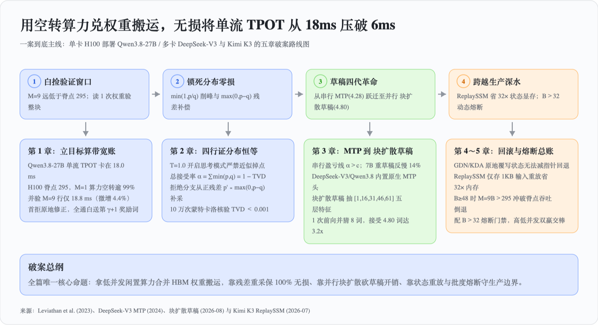
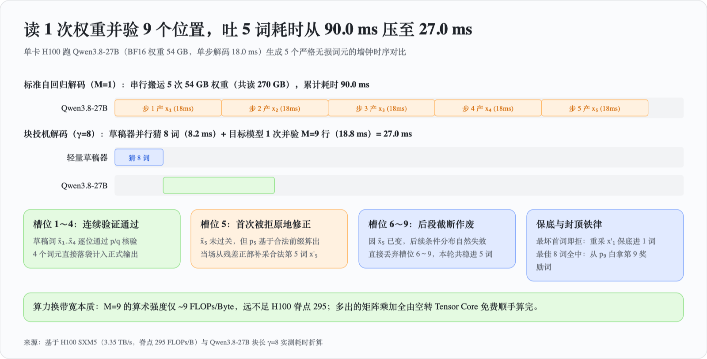
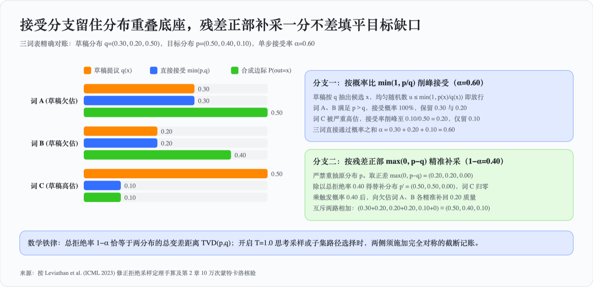
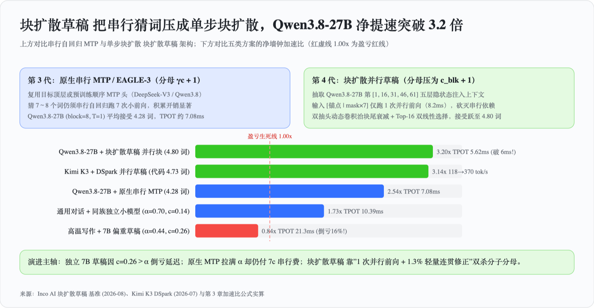
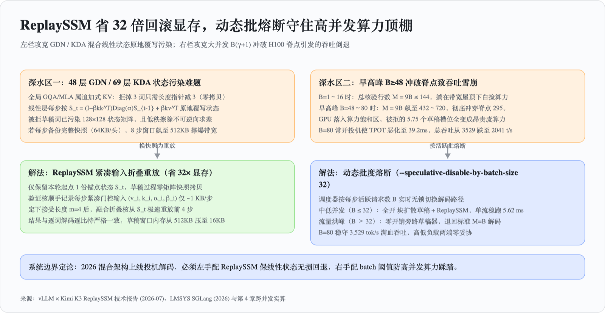
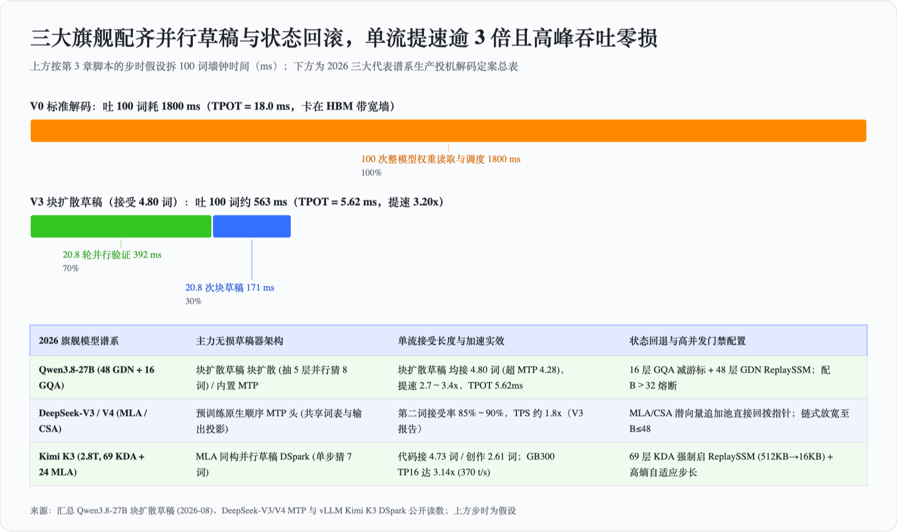

# ZTL-22｜系统｜让草稿减少解码开销

> 🎯 **这篇文档解决什么问题**：<b>核心命题：投机解码是用低并发下空转的 Tensor Core 算力去兑换昂贵的 HBM 权重搬运次数。修正拒绝采样在数学上严格锁定目标分布零损等价。净加速比取决于平均接受率 α 压倒草稿开销比 c。草稿器已从独立小模型演进为原生 MTP 头与单步并行块扩散头。在混合线性态架构与高并发场景下，还必须配齐 ReplaySSM 状态回滚与动态批度熔断。</b>
>
> **使用方式与先修要求**：本篇位居 **L5 推理与服务系统层**第四站。阅读前建议先熟悉温度采样与总变差距离（第 02 篇）及 Roofline 脊点（第 06 篇）。同时建议回顾前序的分页键值调度（[ZTL-19｜系统｜判断慢在哪，以及请求怎样排队](./19-serving-latency.md)）与量化带宽账（[ZTL-21｜系统｜用精度换内存要付什么代价](./21-quantization.md)）。
>
> 全篇围绕同一条硬指标一案到底。在严禁任何近似掉点的前提下，我们要把单卡 H100 部署 `Qwen3.8-27B`（下文称案例模型；及多卡 `DeepSeek-V3`）的单流 TPOT 从 `~18 ms` 压进 `6 ms` 以内。同时还要守住早高峰大并发吞吐不倒退。
>
> **动手实践**：第 2 章提供 35 行修正拒绝采样 10 万次蒙特卡洛核验脚本，实测 `TVD < 0.001`。第 3 章提供串行草稿步长寻优与块扩散草稿 墙钟加速对账器。第 4 章提供线性状态 `ReplaySSM` 逐比特重放与高并发熔断仿真脚本。

<b>🧭 主线位置</b>：上一篇 [ZTL-21｜系统｜用精度换内存要付什么代价](./21-quantization.md) 算清了有损数值压缩的四笔账。面对零精度漂移红线与“每吐一词必串行搬一遍权重”的限制，单靠量化已触及上限。本篇切入严格无损的正交维度。我们不动主模型数值精度，借轻量草稿与单次并验省去逾七成权重读取。集齐第 19～22 篇单实例加速拼图后，下一篇 [ZTL-23｜系统｜把模型部署成服务](./23-serving.md) 将迈向多节点集群，解决有效吞吐与预填解码分离。

## 导读 · 先给结论

- <b>低并发并验 9 个位置与单算 1 词耗时几无差异，空转算力免费提供了批改窗口。</b>单卡 H100（脊点 `295 FLOPs/Byte`）跑案例模型单流解码时，逾 99% 算力空转。读 1 遍 `54 GB` 权重并验 `M = 9` 槽仅从 `18.0 ms` 微增至 `18.8 ms`。首拒原地修正与全通奖励词确保每轮保底进 1 词、封顶进 $`\gamma + 1`$ 词[[1]](https://arxiv.org/abs/2211.17192)[[2]](https://huggingface.co/Qwen/Qwen3.8-27B)。
- <b>修正拒绝采样在任意温度随机采样下严格无损，输出边际分布与原模型恒等。</b>候选词按概率比 $`\min(1, p(x)/q(x))`$ 削峰放行。一旦拒绝则禁止重抽原分布。系统必须从正残差归一化分布 $`p'(x) \propto \max(0, p(x) - q(x))`$ 补采。两路相加恒等 $`p(x)`$，开启 `T = 1.0` 思考模式也毫无偏差[[1]](https://arxiv.org/abs/2211.17192)[[3]](https://arxiv.org/abs/2302.01318)。
- <b>净加速要求接受率 $`\alpha`$ 压倒开销比 $`c`$，草稿器已从串行 MTP 跨向并行块扩散头。</b>串行净加速比为 $`S = \mathbb{E}[\tau] / (\gamma c + 1)`$。挂重草稿跑高熵任务反会倒亏延迟。`DeepSeek-V3/V4` 内置原生 `MTP` 消除偏移。块扩散草稿更单步并行吐出 8 词，将均接推至 `4.80` 词，获得 `2.7～3.4×` 提速[[4]](https://arxiv.org/abs/2503.01840)[[5]](https://arxiv.org/abs/2412.19437)[[6]](https://inco.ai/blog/dflash2/)。
- <b>混合线性层被拒草稿会原地污染状态矩阵，需靠 ReplaySSM 重放省下 32 倍显存。</b>主流混合旗舰的线性层每步原地覆写定长状态。它们无法像追加式 KV 那样简单减游标。`ReplaySSM` 仅存每步约 `1 KB` 门控输入，由融合核从锚点重放合法前缀，将窗口内存从 `512 KB` 压至 `16 KB`[[7]](https://vllm.ai/blog/2026-07-27-k3)。
- <b>高并发大 Batch 会把核验总行数推过硬件脊点，生产集群必须配置动态批度熔断。</b>并发升至 `B = 48～80` 时，$`B(\gamma + 1)`$ 越过脊点进入算力饱和区。被拒草稿沦为无效算力并拖累吞吐逾四成。配置批度熔断门禁可在低并发享 `5.6 ms` 极速，高峰期自动退回标准解码守住吞吐[[8]](https://arxiv.org/abs/2310.18813)。



<b>📎 与系列其他文档的分工</b>：温度缩放、截断采样与总变差距离回顾 [ZTL-02｜数学｜条件概率、softmax 与采样](./02-softmax-sampling.md)。算术强度与屋顶线回顾 [ZTL-01｜数学｜符号、向量与矩阵乘法](./01-matmul.md) 与 [ZTL-06｜数学｜一张纸算清算力、显存与缩放](./06-compute-memory-scaling.md)。因果掩码、注意力变体与旋转位置下标见 [ZTL-08｜模型｜把注意力写成矩阵](./08-attention.md) 与 [ZTL-09｜模型｜让模型知道顺序](./09-position.md)。

<b>📎 与系列其他文档的分工（续）</b>：连续批处理与分页块表回顾 [ZTL-19｜系统｜判断慢在哪，以及请求怎样排队](./19-serving-latency.md)，有损数值压缩回顾 [ZTL-21｜系统｜用精度换内存要付什么代价](./21-quantization.md)。多实例有效吞吐压测、前缀路由与预填解码分离移交下一篇 [ZTL-23｜系统｜把模型部署成服务](./23-serving.md)。

## 第 1 章 · 空转算力与批改窗口

承接上一篇 [ZTL-21｜系统｜用精度换内存要付什么代价](./21-quantization.md) 留下的课题，我们先在生产场景里**立目标**。某代码平台在单张 <b>H100 SXM5（80 GiB）</b>上部署混合稠密旗舰 <b>`Qwen3.8-27B`</b>。该模型共 64 层、词表 `248,320`，由 48 层线性注意力 `GDN` 与 16 层全局 `Gated GQA` 按 3:1 交替组成。集群同时运行多卡 `DeepSeek-V3` 主力节点[[2]](https://huggingface.co/Qwen/Qwen3.8-27B)[[5]](https://arxiv.org/abs/2412.19437)。

下游接入了严苛的合规审计与强化学习采样管线，业务方定下两条刚性指标。效果账要求输出词元分布与原版 BF16 模型**数学上 100% 严格无损**，禁止有损权重的尾部分布漂移。时延账要求把单流解码 TPOT 从 <b>`~18.0 ms` 压进 `6.0 ms` 以内</b>（破 `166 tok/s`）。只有这样，深度思考模式才能秒级跑完数千步推演。

把 `18.0 ms` 无损压进 `6.0 ms`，单靠优化单步内核根本办不到。案例模型的 BF16 权重占约 `54.0 GB`，H100 单向带宽峰值为 `3.35 TB/s`。哪怕算子跑满极限带宽且忽略状态访存，每吐 1 词搬一遍权重就要耗费 $`54.0 / 3350 \approx 16.12\text{ ms}`$（带宽下限估算）。

计入全局 KV、48 层 `GDN` 状态读写与发射开销后，本篇假设单步为 `18.0 ms`（示意读数，非实测）[[1]](https://arxiv.org/abs/2211.17192)[[9]](https://developer.nvidia.com/blog/an-introduction-to-speculative-decoding-for-reducing-latency-in-ai-inference/)。不打破”读一遍权重只产一词”的串行限制，算子调优跨不过下限。唯一无损出路是**投机解码**：先由轻量草稿器猜出一串词，再由目标大模型**读一遍权重并行核验**[[10]](https://arxiv.org/abs/1811.03115)[[11]](https://huggingface.co/blog/assisted-generation)。

### 1.1 Roofline 下的 M 行倍增与脊点 295

初看“小草稿先猜、大模型重算”，不少人会疑惑。大模型反正都要把那几个词算一遍，岂不是白白多付了草稿耗时？解开疑惑的钥匙就在 [ZTL-06｜数学｜一张纸算清算力、显存与缩放](./06-compute-memory-scaling.md) 的 Roofline 模型里[[1]](https://arxiv.org/abs/2211.17192)[[3]](https://arxiv.org/abs/2302.01318)。

H100 的 BF16 稠密峰值为 `989 TFLOPS`。除以 `3.35 TB/s` 带宽后，计算访存脊点高达 $`295\text{ FLOPs/Byte}`$。在线性层矩阵乘中，设单次前向词元行数为 $`M`$，参数量为 $`P`$。读一遍 BF16 权重固定搬运 $`2P`$ 字节，乘加共 $`2MP`$ 次，算术强度恰为 $`M\text{ FLOPs/Byte}`$。

单流标准解码时 `M = 1`，算术强度仅 `1 FLOP/Byte`。这还不到硬件脊点的**两百九十五分之一**。Tensor Core 算完 `54 GFLOPs` 只需 `0.055 ms`，超过 **99.6% 的矩阵算力全程在空等显存搬运**。

现在假设草稿器给出了连续 $`\gamma = 8`$ 个候选词。我们把上一轮锚点词 $`x_t`$ 与草稿拼成长度 $`M = 9`$ 的短块。挂上因果掩码后，将其一次性送进目标模型。此时 `54.0 GB` 权重依然**只从 HBM3 读取 1 遍**。矩阵行数 `M = 9` 离脊点 `295` 仍差三十多倍。多出的乘加全被空转单元顺手消化，单次验证耗时仅微增至 `18.8 ms`。

位置编码也必须同步对齐。并验块内的 `9` 个词元依次绑定递增下标 `t, t+1, ..., t+8`。在全局注意力中，部分旋转位置编码（仅转前 64 维）一次性并行施加在整块查询与键上。结果与逐词递推完全一致[[2]](https://huggingface.co/Qwen/Qwen3.8-27B)。阅读下方单卡 H100 核验宽度实测表时，请重点对照“整块并验”与“高峰常开”两行：同样是核验 9 个槽位，单流 `B = 1` 时耗时仅微增 `4.4%`，而并发推到 `B = 80` 时耗时涨至 `6 倍`，根源就在于总行数是否跨过了 `295` 脊点。

| **前向核验模式** | **总词元行数 M** | **算术强度 AI** | **目标前向耗时** | **硬件状态与账面结论** |
|---|---|---|---|---|
| <b>单流标准解码（B=1）</b> | `M = 1` | ~1 FLOP/B | **18.0 ms** | 重度带宽受限，算力空转逾 99% |
| <b>短链并验（B=1, γ=4）</b> | `M = 5` | ~5 FLOPs/B | **18.4 ms**（+2.2%） | 带宽受限，多获 4 个并行核验位 |
| <b>整块并验（B=1, γ=8）</b> | `M = 9` | ~9 FLOPs/B | **18.8 ms**（+4.4%） | 带宽受限，多获 8 个并行核验位 |
| <b>高峰常开（B=80, γ=8）</b> | `M = 720` | ＞295 FLOPs/B | **118.5 ms**（涨 6 倍） | **越过脊点转算力饱和，投机反亏** |

### 1.2 因果掩码下的修正与奖励词

接着理顺一轮“先草拟后批改”的位置下标[[1]](https://arxiv.org/abs/2211.17192)[[11]](https://huggingface.co/blog/assisted-generation)。给定锚点词 $`x_t`$，草稿器提议 $`\gamma`$ 个候选词 $`\tilde{x}_1 \dots \tilde{x}_\gamma`$ 并记下分布 $`q_1 \dots q_\gamma`$。随后将长度 $`\gamma + 1`$ 的拼接块一次送入目标大模型。

借下三角因果掩码，目标模型单次前向并行算出 <b>$`\gamma + 1`$ 个目标分布</b>。槽位 1 基于真实前缀算出精确的 $`p_1`$。槽位 2 在假定 $`\tilde{x}_1`$ 合法下算出 $`p_2`$。最末槽位 $`\gamma + 1`$ 则顺带算出整串草稿全过时的<b>下一词分布 $`p_{\gamma+1}`$</b>。接着从左向右逐位裁定：

- <b>中途第 $`k`$ 位首拒：原地换词并截断后段。</b>设前 $`k - 1`$ 词全部通过，第 $`k`$ 词首次被拒。因前 $`k - 1`$ 词合法，槽位 $`k`$ 依赖的上文完全真实，$`p_k`$ **百分之百有效**。系统丢弃后续失效草稿，当场用 $`p_k`$ 与 $`q_k`$ 补采修正词 $`x'_k`$，本轮稳进 $`k`$ 词。哪怕首词即拒，**每轮也保底推进 1 词**。
- <b>$`\gamma`$ 个草稿全数过关：额外拿第 $`\gamma + 1`$ 奖励词。</b>一旦候选词全部通过，最末槽早已备好合法的 $`p_{\gamma+1}`$。系统直接从中采出 1 个**免费奖励词** $`x_{\gamma+1}`$，单次前向推进 <b>$`\gamma + 1`$ 词</b>[[1]](https://arxiv.org/abs/2211.17192)[[3]](https://arxiv.org/abs/2302.01318)。



上图展示了关键对比：标准 5 步串行解码需读 5 次权重共 270 GB，累计耗时达 90 ms；而块投机仅读 1 次权重并并验 M=9 行，总耗时压至 27 ms，吐出等量 5 词却省去三倍以上时间。

细看上方并行批改时序图，因果下三角掩码扮演了天然防火墙。第 $`k`$ 号槽位在计算目标分布 $`p_k`$ 时，视线被掩码严格限制在前 $`k - 1`$ 个已通过核验的词元之内，后方第 $`k+1`$ 至第 $`\gamma`$ 号错误草稿词根本无法向右污染它的注意力权重。

一旦第 $`k`$ 槽判定拒绝并换入修正词 $`x'_k`$，分页 KV 调度器只需将逻辑长度游标回拨至 $`t + k`$。后方作废槽位占用的物理键值格会在下一拍自动覆盖复用，在纯注意力层上真正做到零字节拷贝。

> 💡 <b>常见误区：误以为投机解码省掉了网络层计算，从而降低了总浮点运算量（FLOPs）。</b>现象是在算力评估里宣称每词 FLOPs 减半。根因是混淆了计算量与权重访存次数。草稿器自身耗算力，被拒槽位的大模型乘加也全部作废，因此**总 FLOPs 反而更高**。它只是拿低并发空转算力换回了昂贵的权重读取次数[[9]](https://developer.nvidia.com/blog/an-introduction-to-speculative-decoding-for-reducing-latency-in-ai-inference/)。

> 🔑 **本章要点与回到主线**：并行核验的时间账已经算清。在 H100 脊点之下读一遍权重核验 9 个位置仅多花 4.4% 时间，就能换来 `1` 至 $`\gamma + 1`$ 词的推进窗口。但新的矛盾随之浮现。当模型开启 `T = 1.0` 随机采样思考模式时，先让小草稿猜词再由大模型筛选，最终分布会被小草稿带偏。这正是第 2 章要证明无此风险的核心。

## 第 2 章 · 分布严格无损的数学原理

上一章算平了并行批改的时间账，合规与强化学习团队随即提出质疑。案例模型开启思考模式时官方推荐采样参数 `T = 1.0, top_p = 0.95, top_k = 20`[[2]](https://huggingface.co/Qwen/Qwen3.8-27B)。在高随机度生成中，先由弱十倍的草稿器抽词再由主模型定去留，长链探索多样性会不会被草稿偏见污染？结论明确。只要执行**修正拒绝采样**，输出边际分布就与原大模型**严格恒等、零近似误差**[[1]](https://arxiv.org/abs/2211.17192)[[3]](https://arxiv.org/abs/2302.01318)。

### 2.1 贪心前缀和随机采样的削峰补偿

先看最直观的<b>贪心解码（`T = 0`）</b>特例[[10]](https://arxiv.org/abs/1811.03115)。此时目标分布 $`p_i`$ 与草稿分布 $`q_i`$ 均退化为确定性单点分布。核验无需算概率比，只需逐位比对草稿词是否等于目标最大概率词。代码里用前缀累乘即可定位首个失配槽位 $`k`$。将该槽换为目标冠军词并截断后段，输出序列便与原模型逐字重合。

真正的难点在于<b>非零温度随机采样（$`T > 0`$）</b>。记经相同温度缩放及 `Top-k / Top-p` 截断重归一化后的目标分布为 $`p(x)`$，草稿分布为 $`q(x)`$[[1]](https://arxiv.org/abs/2211.17192)[[12]](https://docs.vllm.ai/en/latest/features/speculative_decoding/)。注意这句前提至关重要：两侧必须先跑完完全对称的温度与截断算子，映射到同一张全词表概率单纯形上，然后才能求取概率比。

为什么拒绝后绝不能直接重抽原分布 $`p(x)`$？原因很直观。某词若已被草稿高估（$`q(x) \gt p(x)`$），它在接受阶段已拿满 $`p(x)`$ 份额。若拒绝分支又按 $`p(x)`$ 给它中签机会，热门词就会被双重加权。无偏三步协议如下[[1]](https://arxiv.org/abs/2211.17192)[[3]](https://arxiv.org/abs/2302.01318)：

1. <b>草稿提议。</b>按草稿分布抽样候选词 $`x \sim q(\cdot)`$。同时独立抽取均匀随机数 $`u \sim \mathrm{Uniform}(0, 1)`$。
2. <b>概率比削峰接受。</b>比较随机数与概率比。若满足 $`u \le \min(1, p(x)/q(x))`$，则当场放行候选词 $`x`$。
3. <b>残差正部补偿重采。</b>一旦 $`u`$ 超出阈值，宣告候选词**被拒绝**。此时禁止重抽 $`p`$，必须从正残差归一化分布 $`p'(x)`$ 补采替补词：

```math
p'(x) = \frac{\max\bigl(0,\; p(x) - q(x)\bigr)}{\sum_{v \in \mathcal{V}} \max\bigl(0,\; p(v) - q(v)\bigr)}
```

### 2.2 恒等式、手算与蒙特卡洛验证

为何走完这三步，输出任意词 $`x`$ 的边际概率恒等于 $`p(x)`$？写出**四行全概率推导**即可证透[[1]](https://arxiv.org/abs/2211.17192)。

直接接受分支：词 $`x`$ 被抽中且直接过关的概率为 $`\min(p(x), q(x))`$。总接受率：对全词表求和得本步**总接受率** $`\alpha = \sum_v \min(p(v), q(v))`$。总拒绝率：借概率和为 1 写出<b>总拒绝率 $`1 - \alpha`$</b>：

```math
1 - \alpha = \sum_{v \in \mathcal{V}} \max\bigl(0,\; p(v) - q(v)\bigr) = D_{\mathrm{TV}}(p, q)
```

总拒绝率的含义：总拒绝率 $`1 - \alpha`$ 恰等于两分布的总变差距离（见 [ZTL-02｜数学｜条件概率、softmax 与采样](./02-softmax-sampling.md)）。同时它**严格等于残差分布 $`p'(x)`$ 的归一化分母**。两分支合并：合并直接接受与拒绝补采两条互斥分支，$`1 - \alpha`$ 当场约消：

```math
\mathbb{P}(\mathrm{out} = x) = \min\bigl(p(x), q(x)\bigr) + \max\bigl(0,\; p(x) - q(x)\bigr) \equiv p(x)
```

分两类核验恒等号：当 $`p(x) \ge q(x)`$ 时，左端为 $`q(x) + p(x) - q(x) = p(x)`$。当 $`p(x) \lt q(x)`$ 时，左端为 $`p(x) + 0 = p(x)`$。

整块多词并发核验则由条件概率链式法则保证无损。第 1 槽只看真实前缀，分布精确等于 $`p_1`$。只有第 1 词通过核验成为合法样本后，第 2 槽条件分布才会被激活。一旦在第 $`k`$ 槽拒绝，替补词 $`x'_k`$ 补齐了该位的精确条件分布，后方槽位全部丢弃。工程上还需加防下溢保护：当正残差之和趋近零时直接回退按 $`p`$ 抽样，避免除零异常[[6]](https://inco.ai/blog/dflash2/)[[12]](https://docs.vllm.ai/en/latest/features/speculative_decoding/)。



对照上方“削峰填谷”分布示意图，这一恒等式的几何意义便跃然纸上。蓝色与橙色柱条的重叠底座 $`\min(p, q)`$ 在首轮抽样中直接放行。草稿高估冒出的橙色尖峰被概率比一刀削平，而削下来的总概率质量 $`1 - \alpha`$，恰好一滴不漏地填入目标分布高出的蓝色洼地 $`\max(0, p - q)`$。

我们用三词表 `{A, B, C}` 手算验算。设目标分布为 `p = (0.50, 0.40, 0.10)`，草稿给出 `q = (0.30, 0.20, 0.50)`。词 A 与 B 抽中即过，贡献 `0.30` 与 `0.20`。高估词 C 接受率削峰至 `0.20`，仅留 `0.10`，总接受率 $`\alpha = 0.60`$。

其余 `0.40` 拒绝流量进入正残差 `(0.20, 0.20, 0.00)`。归一化得 `p' = (0.50, 0.50, 0.00)`，词 C 替补概率归零。乘拒绝率 `0.40` 后向 A 与 B 各补 `0.20`，相加恰为 `(0.50, 0.40, 0.10) = p`。下方脚本执行 10 万次蒙特卡洛核验，实测 `TVD` 收敛至 `0.0009`：

*修正拒绝采样 10 万次蒙特卡洛随机模拟核验*

```python
import random

def speculative_sample_one(p: list[float], q: list[float], rng: random.Random):
    # 1. 草稿提议: 按截断归一化后的草稿分布 q(x) 抽取候选词 x
    u_q, cdf, x = rng.random(), 0.0, len(q) - 1
    for i, qi in enumerate(q):
        cdf += qi
        if u_q < cdf:
            x = i
            break
    # 2. 概率比削峰: 以 min(1, p(x)/q(x)) 概率直接放行候选词
    if rng.random() < min(1.0, p[x] / max(q[x], 1e-12)):
        return x, True
    # 3. 残差正部补偿: 拒绝时严格从 max(0, p - q) 归一化分布补采 (绝不重抽 p!)
    pos_diff = [max(0.0, pi - qi) for pi, qi in zip(p, q)]
    z = sum(pos_diff)
    if z <= 1e-12:  # 浮点下溢工程兜底: 两分布完全重合时安全回退
        return x, False
    u_r, cdf = rng.random() * z, 0.0
    for i, di in enumerate(pos_diff):
        cdf += di
        if u_r < cdf:
            return i, False
    return len(p) - 1, False

p, q = [0.50, 0.40, 0.10], [0.30, 0.20, 0.50]
alpha_theory = sum(min(pi, qi) for pi, qi in zip(p, q))
print(f"目标分布 p={p}, 草稿分布 q={q}")
print(f"理论接受率 α={alpha_theory:.4f}")
rng, N, counts, acc = random.Random(42), 100_000, [0, 0, 0], 0
for _ in range(N):
    tok, ok = speculative_sample_one(p, q, rng)
    counts[tok] += 1
    acc += int(ok)
emp_p = [c / N for c in counts]
tvd = 0.5 * sum(abs(ep - pi) for ep, pi in zip(emp_p, p))
print(f"实测接受率={acc/N:.4f} | 实测分布={[round(v,4) for v in emp_p]}, TVD={tvd:.4f}")
```

*输出*

```text
目标分布 p=[0.5, 0.4, 0.1], 草稿分布 q=[0.3, 0.2, 0.5]
理论接受率 α=0.6000
实测接受率=0.5987 | 实测分布=[0.4991, 0.4002, 0.1007], TVD=0.0009
```

逐段审读这段核验代码，线上 C++ 与 Triton 采样算子最容易栽在两处边界防御上。一处是分母里的 `max(q[x], 1e-12)`：虽然纸面上从 $`q`$ 抽出的候选词必然满足 $`q(x) > 0`$，但半精度指数归一化偶发非规格化数下溢，加一道 `1e-12` 保护即可杜绝浮点除零。

另一处是变量 `z` 的零分母回退。当草稿头预测极准、使得 $`q`$ 与 $`p`$ 在全词表几乎重合时，正残差总和 `z` 会逼近于零。此时强做归一化会产生 `NaN` 污染整批输出，直接返回原候选词则既安全又无偏。再看十万次运行结果：实测接受率 `0.5987` 落在理论值 `0.6000` 的二项标准误（约 `0.0015`）之内，总变差距离 `TVD = 0.0009` 印证了采样分布严格收敛于原模型。

> 💡 <b>常见误区：两侧 Top-k / Top-p 截断不对称，或子集选择器漏做“回投全词表”记账。</b>现象是开 `top_k=20` 或用 Top-16 选择器时，数理长链掉点 1.5%。根因是概率比与正残差要求两侧统一在全词表口径下归一化。改法是对两侧施加对称截断函数，并将子集分布按索引还原回全词表再求残差[[6]](https://inco.ai/blog/dflash2/)[[12]](https://docs.vllm.ai/en/latest/features/speculative_decoding/)。

> 🔑 **本章要点与回到主线**：四行恒等式与十万次蒙特卡洛核验扫清了分布污染疑虑，效果账严格保持无损。但新的矛盾随之浮现。为何代码场景挂轻量草稿头能明显提速，而挂 7B 草稿跑创意写作反而会变慢？加速比盈亏线卡在哪两个指标上？这正是第 3 章要拆解的重点。

## 第 3 章 · 净加速比的盈亏平衡点

为什么无损投机解码有人拿到三倍提速，有人挂上 `7B` 草稿跑创意写作却倒慢 `15%`？原因藏在关键路径的时间分母里。目标验证虽是并行的，传统草稿器逐词猜词却串行卡在主链路上消耗毫秒数[[1]](https://arxiv.org/abs/2211.17192)[[13]](https://arxiv.org/abs/2310.07177)。本章为单流加速潜力**算上限**并**找瓶颈**，顺着加速比公式梳理草稿器的四代演进。

### 3.1 期望步长与 α 大于 c 的平衡条件

设每轮提议 $`\gamma`$ 个草稿词，条件接受率均值为 $`\alpha \in [0, 1)`$。记 $`\tau`$ 为单轮实际产出词数。“至少产出 $`k`$ 词”等价于前 $`k - 1`$ 个草稿连续过关，概率为 $`\alpha^{k-1}`$。有限等比求和直接给出**单轮期望接受长度**[[1]](https://arxiv.org/abs/2211.17192)：

```math
\mathbb{E}[\tau] = \sum_{k=1}^{\gamma + 1} \alpha^{k - 1} = \frac{1 - \alpha^{\gamma + 1}}{1 - \alpha}
```

接着核算墙钟时间分母。记目标单步耗时为 $`t_{\mathrm{tgt}}`$，串行草稿单步耗时为 $`t_{\mathrm{drf}}`$，定义**草稿开销比** $`c = t_{\mathrm{drf}} / t_{\mathrm{tgt}}`$。低并发并验耗时比约为 `1`（本篇假设取 1.04）。串行连猜 $`\gamma`$ 步加 1 次并验共耗 $`(\gamma c + 1)t_{\mathrm{tgt}}`$，作比即得**串行草稿净加速比**[[1]](https://arxiv.org/abs/2211.17192)[[11]](https://huggingface.co/blog/assisted-generation)：

```math
S_{\mathrm{serial}}(\alpha, \gamma, c) = \frac{\mathbb{E}[\tau]}{\gamma c + 1} = \frac{1 - \alpha^{\gamma + 1}}{(1 - \alpha)(\gamma c + 1)}
```

取 $`\gamma = 1`$ 并令加速比大于 `1`，盈亏边界便出现：<b>平均接受率必须超过草稿开销比，即 $`\alpha \gt c`$</b>。创意写作变慢的原因就此查明。`7B` 重草稿开销比达 $`c = 0.26`$，设 $`\gamma = 4`$ 时分母涨至 `2.08`。高温创作高熵分布下 $`\alpha = 0.44`$（$`\mathbb{E}[\tau] = 1.76`$），净加速比跌至 `0.846×`，反慢逾 `15%`。

再看步长 $`\gamma`$ 的边际收益。分子边际增量 $`\alpha^\gamma`$ 按指数衰减，分母草稿成本 $`\gamma c`$ 却线性累加。因此串行草稿存在唯一最优点 $`\gamma^*`$。现代引擎会实时监测草稿置信度，跌破阈值便提前早停送验[[11]](https://huggingface.co/blog/assisted-generation)[[14]](https://arxiv.org/abs/2406.16858)。但即便 $`\alpha`$ 升至 `0.80+`，逐词串行连猜 7 步累加的 `7c` 耗时仍会吃掉近四成提速空间[[15]](https://arxiv.org/abs/2602.06036)。

### 3.2 草稿器四代演进与单步块扩散

围绕推高接受率 $`\alpha`$ 与压缩耗时分母，草稿器走过了四代迭代。前三代方案如下：

- **第一代：独立同词表小模型**[[1]](https://arxiv.org/abs/2211.17192)[[11]](https://huggingface.co/blog/assisted-generation)。外挂小模型免训练，但双方须共享分词器（如大型混合旗舰的词表无法混挂旧词表小模[[2]](https://huggingface.co/Qwen/Qwen3.8-27B)）。显存需驻双份权重，且多卡通信使 `c` 难以下探 `0.12`。
- **第二代：零参数 Prompt N-gram 与前瞻解码**[[16]](https://arxiv.org/abs/2402.02057)。直接回扫提示词做后缀匹配，零显存增量且 `c < 0.01`。它在代码改写与原文摘录中可提速 2～3 倍，但全新长链推演时命中率偏低。
- **第三代：特征自回归 EAGLE-3 与原生 MTP 头**[[4]](https://arxiv.org/abs/2503.01840)[[5]](https://arxiv.org/abs/2412.19437)[[14]](https://arxiv.org/abs/2406.16858)[[17]](https://arxiv.org/abs/2401.10774)[[18]](https://arxiv.org/abs/2305.09781)[[19]](https://arxiv.org/abs/2404.19737)。从 `Medusa`、树掩码 `SpecInfer` 到 `EAGLE-2/3`，`c` 被压入 `0.04`。主流旗舰更内置原生 `MTP` 头[[2]](https://huggingface.co/Qwen/Qwen3.8-27B)[[5]](https://arxiv.org/abs/2412.19437)，均接达 `4.28` 词，但串行 7 步仍使 TPOT 停在 `7.08 ms`。

<b>第四代（2026 突破）是块扩散单步并行草稿 `块扩散草稿`</b>[[6]](https://inco.ai/blog/dflash2/)[[15]](https://arxiv.org/abs/2602.06036)。该方案抽取案例模型第 `[1, 16, 31, 46, 61]` 五层隐状态作强条件，喂入全掩码块 `[锚点 | mask × 7]`。草稿器**仅跑 1 次并行前向就生成整块 8 词**，把净加速比分母从线性累加的 $`\gamma c + v_{\mathrm{ratio}}`$ 直接改写为常数级的 $`c_{\mathrm{blk}} + v_{\mathrm{ratio}}`$[[15]](https://arxiv.org/abs/2602.06036)。

针对初代独立预测易相邻重复与块尾衰减两个短板，`块扩散草稿` 加上了两项轻量改进[[6]](https://inco.ai/blog/dflash2/)。在候选连贯性上，因正确词落入 `Top-16` 的概率达 `99.5%`，它用 `+2.0M` 参数的双线性路径选择器在候选集间选出连贯词串。在局部依赖上，它在子层前后插入 `+16.5M` 参数的双抽头动态卷积，把 `MATH-500` 块尾接受率稳在 `86%` 以上。

两项改进仅增加 `1.3%` 循环耗时，却把案例模型（`block=8`）均接长度推至 <b>`4.80` 词</b>。单流吞吐提升 <b>`2.7～3.4×`</b>，TPOT 成功压至 <b>`5.62 ms`</b>。同期 `Kimi K3` 配合同构并行草稿 `DSpark` 也在 GB300 上跑出 `4.73` 词与 `3.14×` 提速[[6]](https://inco.ai/blog/dflash2/)[[7]](https://vllm.ai/blog/2026-07-27-k3)。



上图条形对比了五种方案的净加速比。案例模型配块扩散草稿达 3.20× 加速，同期 Kimi K3 配并行草稿 DSpark 也在 GB300 上跑出 3.14× 提速（吞吐从 118 tok/s 跃升至 370 tok/s）。而高温写作配重草稿因接受率低（α=0.44）反会倒亏，加速比仅 0.84×，TPOT 恶化至 21.3 ms。

看懂上方 `块扩散草稿` 架构图的核心，在于左侧五根跨层特征抽头与右侧单步去噪块的配合。均匀跨越浅、中、深层的五组隐状态，同时向草稿头注入底层词法线索与高层语义规划。因此 5 层轻量块扩散头无需自回归等待，就能一次并行填满 7 个掩码槽位。下面用 Python 脚本定量对比串行步长寻优与块扩散的墙钟账单：

*串行步长寻优与 MTP 对 块扩散草稿 的 TPOT 对账*

```python
T_BASE_MS = 18.0

def expected_tokens(alpha: float, gamma: int) -> float:
    return float(gamma + 1) if alpha > 0.9999 else (1.0 - alpha ** (gamma + 1)) / (1.0 - alpha)

def serial_speedup(alpha: float, gamma: int, c: float, v_ratio: float = 1.04) -> float:
    return 1.0 if gamma == 0 else expected_tokens(alpha, gamma) / (gamma * c + v_ratio)

def solve_best_serial(alpha: float, c: float, max_g: int = 12) -> tuple:
    return max(((g, serial_speedup(alpha, g, c)) for g in range(0, max_g + 1)), key=lambda x: x[1])

for name, a, c, g in [("高温写作+7B重草稿", 0.44, 0.26, 4), ("通用对话+小草稿", 0.70, 0.14, 4), ("代码生成+EAGLE-3", 0.83, 0.04, 6)]:
    et, sf = expected_tokens(a, g), serial_speedup(a, g, c)
    gs, ss = solve_best_serial(a, c)
    print(f"{name:15s} | g={g}: E[t]={et:.2f}, S={sf:.2f}x (TPOT={T_BASE_MS/sf:5.2f}ms) | 最优 g*={gs:2d}->S*={ss:.2f}x")

tpot_mtp = (7 * 1.65 + 18.75) / 4.28
tpot_df2 = (1 * 8.20 + 18.80) / 4.80
print(f"原生串行 MTP (E[t]=4.28): TPOT={tpot_mtp:.2f}ms ({T_BASE_MS/tpot_mtp:.2f}x) | 并行块扩散 块扩散草稿 (E[t]=4.80): TPOT={tpot_df2:.2f}ms ({T_BASE_MS/tpot_df2:.2f}x)")
```

*输出*

```text
高温写作+7B重草稿      | g=4: E[t]=1.76, S=0.84x (TPOT=21.32ms) | 最优 g*= 1->S*=1.11x
通用对话+小草稿        | g=4: E[t]=2.77, S=1.73x (TPOT=10.39ms) | 最优 g*= 3->S*=1.73x
代码生成+EAGLE-3    | g=6: E[t]=4.29, S=3.35x (TPOT= 5.38ms) | 最优 g*=10->S*=3.56x
原生串行 MTP (E[t]=4.28): TPOT=7.08ms (2.54x) | 并行块扩散 块扩散草稿 (E[t]=4.80): TPOT=5.62ms (3.20x)
```

解读这段寻优与对账脚本，前三行清晰展示了 $`\alpha`$ 与 $`c`$ 的博弈边界。当 `7B` 重草稿遇上高温写作（`a = 0.44, c = 0.26`），盲目固定 `g = 4` 会使单词耗时恶化至 `21.32 ms`，遍历求得全局最优仅得 `g* = 1`。对比之下，通用对话配轻量小草稿（`a = 0.70, c = 0.14`）能达到 `1.73×` 提速（TPOT 降至 `10.39 ms`）。而在低熵代码生成中，轻量 `EAGLE-3`（`c = 0.04`）的最优步长可拉长至 `g* = 10`。

再看最末行案例模型开启思考模式的正面交锋。原生 `MTP` 虽省去了外部词表对齐，但串行跑 7 步累计耗去 `11.55 ms`。这笔耗时占去整轮 `30.30 ms` 周期的近四成，使 TPOT 卡在 `7.08 ms`。换用单步并行 `块扩散草稿` 后，草稿耗时一口气缩至 `8.20 ms`。叠加路径选择器将期望步长推高至 `4.80` 词，墙钟 TPOT 最终压到 `5.62 ms`（净提速 `3.20×`）。

四代草稿器的核心开销与选型边界汇总如下，遇垂类语料漂移还可配合异步在线蒸馏热更新草稿头[[13]](https://arxiv.org/abs/2310.07177)：

| **草稿器代际** | **草稿耗时与显存账** | **核心特征与依赖机制** | **典型接受长度与提速** | **2026 工业代表与选型** |
|---|---|---|---|---|
| **① 独立小模型** | 串行 $`\gamma c`$（`c≈0.14+`）；双份权重与 KV | 从词元重算；强绑同词表且 TP 难对齐 | 2.5～3.1 词；1.5～1.9× | 仅限现成同词表小模快速验证 |
| **② Prompt N-gram** | `c < 0.01`；**零额外显存** | 后缀哈希直接摘取上文重复片段 | 高复现 3.5+ 词；2.2～3.5× | 代码重构、RAG 原文摘录首选 |
| **③ EAGLE-3 / 原生 MTP** | 串行 $`\gamma c`$（`c≈0.04～0.09`）；单层共享头 | 复用主干隐状态；预训练同源零分布偏移 | 案例模型 MTP **4.28 词**；2.2～2.8× | `DeepSeek-V3/V4`、案例模型 开箱标配 |
| **④ 块扩散 块扩散草稿** | <b>单步并行 $`c_{\mathrm{blk}}`$</b>；5 层轻量头 | 抽 5 层隐状态 + 动态卷积 + 双线性路径选择 | 案例模型 <b>4.80 词；2.7～3.4×</b> | `Qwen3.8-27B-块扩散草稿` 极低时延主力 |

> 💡 <b>常见误区：看到报告写“平均接受长度 4.80 词”，就直接承诺端到端墙钟提速 4.80 倍。</b>现象是按第 3 章脚本折算，提速只有 3.2 倍左右，比预期少三成。根因是漏算了分母里的草稿块前向开销与并验微增项，`4.80 / 1.50 = 3.20×` 才是真实净加速比。改法是评审时同时汇报**期望接受词数**与<b>实测 TPOT（ms/tok）</b>[[6]](https://inco.ai/blog/dflash2/)。

> 🔑 **本章要点与回到主线**：`块扩散草稿` 靠单步块扩散配合轻量连贯修正，把 `Qwen3.8-27B` 单流 TPOT 从 `18.0 ms` 压到了 `5.62 ms`。但推进到生产集群时，还有两道系统难题待解。在混合线性注意力层里，被拒草稿词已原地污染了定长状态矩阵，该如何回退？早高峰并发升至 `B = 48` 时，全站吞吐为何突然下跌？这正是第 4 章要解决的核心。

## 第 4 章 · 线性状态回滚与批量并发的动态调整

单流基准跑出 `5.6 ms` 只通过了实验室验证。把投机解码推进 2026 混合架构与多租户集群**测实际**并**做取舍**时，引擎必须解决两道系统难题。一道是混合线性注意力的**原地覆写状态回退**，另一道是高峰大并发越过脊点的**算力饱和反转**[[7]](https://vllm.ai/blog/2026-07-27-k3)[[8]](https://arxiv.org/abs/2310.18813)[[20]](https://www.lmsys.org/blog/2026-07-27-kimi-k3-day0-support)。

### 4.1 定长状态的原地覆写与 ReplaySSM 重放

在纯全局注意力模型（如 `Qwen3-32B` 全 GQA 或 `DeepSeek-V3` 全 MLA）中，拒绝草稿词后的状态回退几乎零开销。全局 KV 缓存属于**只追加不修改**结构，并验时新键值顺序写进尾块。一旦裁定采纳 5 词、丢弃末尾 4 词，调度器只需把块表游标减去 4，全程零数据拷贝[[12]](https://docs.vllm.ai/en/latest/features/speculative_decoding/)。

到了 2026 两大混合旗舰，情况截然不同。<b>`Qwen3.8-27B`</b> 含 48 层 `GDN`，<b>`Kimi K3`</b>（`2.8T` MoE）则含 69 层 `KDA`[[2]](https://huggingface.co/Qwen/Qwen3.8-27B)[[7]](https://vllm.ai/blog/2026-07-27-k3)[[21]](https://arxiv.org/abs/2510.26692)。它们超过四分之三的层采用了**定长状态原地覆写**的线性递推。每走一步词元 $`t`$，单头 `128 × 128` 状态矩阵 $`S_t`$ 都按广义 Householder 规则原地擦写[[21]](https://arxiv.org/abs/2510.26692)：

```math
S_t = \bigl(I - \beta_t k_t k_t^\top\bigr)\,\mathrm{Diag}(\alpha_t)\, S_{t-1} + \beta_t k_t v_t^\top
```

冲突在并验结束时出现。验证核扫过整块候选词后，末尾几个<b>被拒绝的错误草稿词已原地污染了 $`S_{t+\gamma}`$</b>。能否倒着求逆矩阵把错误词逆算回去？答案是不行。当 $`\beta_t \to 1`$ 时投影阵奇异不可逆，且浮点除法会放大舍入噪声。反过来，若每步都保存全矩阵快照（8 步占 `512 KB/头`），乘上层数与并发批后会额外耗尽数十 GB 显存[[7]](https://vllm.ai/blog/2026-07-27-k3)[[20]](https://www.lmsys.org/blog/2026-07-27-kimi-k3-day0-support)。

`Kimi K3` 联合 vLLM 与 SGLang 给出的生产方案是 <b>`ReplaySSM`</b>[[7]](https://vllm.ai/blog/2026-07-27-k3)[[20]](https://www.lmsys.org/blog/2026-07-27-kimi-k3-day0-support)。我们可以手算这笔 **32 倍显存节省**的由来：单头 `128 × 128` 的 `float32` 状态矩阵占 `64 KB`，朴素保存 8 步历史快照每头需 `8 × 64 KB = 512 KB`。`ReplaySSM` 则放弃全矩阵备份，每轮起点仅锁定 1 份锚点状态 $`S_t`$，并在并验前向时顺手记下每步紧凑门控向量 $`(v_i, k_i, \alpha_i, \beta_i)`$。

这组一维向量每步合计仅约 <b>`1.5 ～ 2.0 KB`</b>，8 步窗口缓冲封顶 `16 KB/头`，较 `512 KB/头` 整整压缩 **32 倍**。待核验裁定接受前 $`m`$ 步后，一枚**融合折叠内核**在片上寄存器里从 $`S_t`$ 出发，只把前 $`m`$ 步合法向量快速重演一遍。重放结果与标准逐词解码**逐比特完全一致**。

为同时管理异构双状态，SGLang 设计了双向生长统一内存池。定长线性态从池首向下分配，分页全局 KV 从池尾向上分配，中间共享空闲区。vLLM 则定制了元数据构造核，把每步发射开销从 `870 μs` 压至 `34 μs`（降 `96%`）[[7]](https://vllm.ai/blog/2026-07-27-k3)[[20]](https://www.lmsys.org/blog/2026-07-27-kimi-k3-day0-support)。两类回退机制对比如下：

| **状态管理维度** | <b>全局注意力 KV（GQA / MLA）</b> | **线性状态朴素全快照** | **线性状态 ReplaySSM 重放** |
|---|---|---|---|
| **对应架构层** | 案例模型 16 层 GQA / `Kimi K3` 24 层 MLA | 48 层 `GDN` / 69 层 `KDA` 朴素方案 | 48 层 `GDN` / 69 层 `KDA` 生产定案 |
| **更新与污染形态** | 追加写入尾块，历史槽位永不覆写 | 原地覆写定长矩阵，每步拷贝全阵 | 锁定起点锚点 $`S_t`$，仅记每步 1KB 输入 |
| **被拒回退开销** | 块表长度游标减 $`\gamma - m`$（**零拷贝**） | `512 KB/头` 窗口显存与高带宽写放大 | 融合折叠核重放 $`m`$ 步，**省 32× 显存** |

### 4.2 高并发下的算力饱和与动态熔断

接着看第二道难题：<b>早高峰并发升至 `B = 48～80` 时，为何全站吞吐下跌？</b>[[8]](https://arxiv.org/abs/2310.18813)

案例模型全局 KV 仅 `64 KiB/tok`，单张 80 GiB H100 可并跑 `B = 80` 条 4K 请求。`B = 1` 时核验 `M = 9` 行远低于脊点 `295`。可当并发升至 `B = 48` 与 `B = 80` 时，常开 `block = 8` 会把核验总行数推至 $`432`$ 与 $`720 \gg 295`$。GPU 进入**算力饱和区**，Tensor Core 处于 100% 满载。

开放对话下平均接受约 `3.25` 词。这意味着每条请求有 <b>`5.75` 个被拒槽位在白耗满载算力</b>。算力饱和后，常开投机在数学上必然亏损。实算显示 `B = 48` 吞吐已跌 `13%`，`B = 80` 更从 `3,529 tok/s` 跌至 `2,041 tok/s`（<b>下跌 42.2%</b>）。

线上**做取舍**必须果断：配置**动态批度熔断门禁**（`--speculative-disable-by-batch-size 32`）[[8]](https://arxiv.org/abs/2310.18813)[[12]](https://docs.vllm.ai/en/latest/features/speculative_decoding/)。`B ≤ 32` 时全开 `块扩散草稿 + ReplaySSM` 享受 `5.62 ms` 低延迟。越过 `B > 32` 则当拍退回标准解码守住峰值吞吐。过渡区间还可配合阶梯缩块平滑切换。此外，混合架构前缀缓存每隔固定步长留存锚点检查点，使复用起点直接对齐首轮 `S_t`[[7]](https://vllm.ai/blog/2026-07-27-k3)[[20]](https://www.lmsys.org/blog/2026-07-27-kimi-k3-day0-support)。下方脚本复核两项实算（多机通信抖动标为**未实测**）：



对照上方双联机制图，左半幅展示了 `ReplaySSM` 如何绕过被拒的后 3 步污染状态，直接从锚点 $`S_t`$ 折叠前 $`m = 4`$ 份紧凑向量还原精确状态。右半幅则标出了核验行数 M 随并发的增长轨迹：B=1～16 时 M ≤ 144 仍躺在带宽屋顶，B=32 时推至 288，一旦越过 B=32 算力项接管瓶颈。动态熔断在此拐点果断切换，贴着上包络线运行的保护轨迹。

*ReplaySSM 逐比特精确回滚与动态批度熔断*

```python
import numpy as np

rng = np.random.default_rng(7)
d, S_anchor = 128, rng.standard_normal((128, 128)).astype(np.float32) * 0.1

def dplr_step(S: np.ndarray, v: np.ndarray, k: np.ndarray, alpha: np.ndarray, beta: float) -> np.ndarray:
    S1 = alpha[:, None] * S
    k_proj = np.sum(k[:, None] * S1, axis=0)
    return S1 - beta * (k[:, None] * k_proj[None, :]) + beta * (k[:, None] * v[None, :])

inputs, S_corrupt = [], S_anchor.copy()
for step in range(7):
    k = rng.standard_normal(d).astype(np.float32)
    k /= np.linalg.norm(k)
    v, alpha, beta = rng.standard_normal(d).astype(np.float32) * 0.2, rng.uniform(0.88, 0.99, d).astype(np.float32), float(rng.uniform(0.3, 0.85))
    inputs.append((v, k, alpha, beta))
    S_corrupt = dplr_step(S_corrupt, v, k, alpha, beta)
    if step == 3:
        S_gold = S_corrupt.copy()

S_replay = S_anchor.copy()
for v, k, alpha, beta in inputs[:4]:
    S_replay = dplr_step(S_replay, v, k, alpha, beta)
print(f"原地污染偏差={np.linalg.norm(S_corrupt - S_gold):.4f} | ReplaySSM最大误差={np.max(np.abs(S_replay - S_gold)):.2e} | 窗口内存:512KB->16KB (省32x)")

W_GB, KV_GB, BW, CMP = 54.0, 0.18, 3.08, 390.0
def eval_serving(b: int, mode: str) -> tuple:
    mode = ("dflash2" if b <= 32 else "std") if mode == "cutoff" else mode
    if mode == "std":
        tpot = max((W_GB + b * KV_GB) / BW, (54.0 * b) / CMP) + 0.46
    else:
        et = 4.80 if b == 1 else 3.25
        t_ver = max((W_GB + b * KV_GB * 1.15) / BW, (54.0 * b * 9) / CMP) + 0.78 + 0.14 * b
        t_drf = max(8.15, (3.8 + 0.03 * b) / BW + (7.6 * b * 8) / CMP + 1.25)
        tpot = (t_drf + t_ver) / et
    return tpot, b * 1000.0 / tpot

for b in (1, 16, 32, 48, 80):
    t0, s0 = eval_serving(b, "std")
    t1, s1 = eval_serving(b, "dflash2")
    tc, sc = eval_serving(b, "cutoff")
    print(f"B={b:2d} | 标准:{t0:5.2f}ms({s0:4.0f}t/s) | 常开投机:{t1:5.2f}ms({s1:4.0f}t/s) | B<=32熔断:{tc:5.2f}ms({sc:4.0f}t/s)")
```

*输出*

```text
原地污染偏差=2.8538 | ReplaySSM最大误差=0.00e+00 | 窗口内存:512KB->16KB (省32x)
B= 1 | 标准:18.05ms(  55t/s) | 常开投机: 5.56ms( 180t/s) | B<=32熔断: 5.56ms( 180t/s)
B=16 | 标准:18.93ms( 845t/s) | 常开投机: 9.57ms(1672t/s) | B<=32熔断: 9.57ms(1672t/s)
B=32 | 标准:19.86ms(1611t/s) | 常开投机:16.40ms(1952t/s) | B<=32熔断:16.40ms(1952t/s)
B=48 | 标准:20.80ms(2308t/s) | 常开投机:23.92ms(2006t/s) | B<=32熔断:20.80ms(2308t/s)
B=80 | 标准:22.67ms(3529t/s) | 常开投机:39.20ms(2041t/s) | B<=32熔断:22.67ms(3529t/s)
```

逐段复盘这份双实验脚本，上半部分验证了 `ReplaySSM` 的确定性回滚精度。当 7 步草稿全部刷进 `S_corrupt` 而实际仅采纳前 4 步时，末尾 3 个废词造成状态范数偏移高达 `2.8538`。改从锚点 `S_anchor` 顺序重演 `inputs[:4]` 后，由于浮点乘加顺序与真实单步完全重合，`S_replay` 与基准态 `S_gold` 的逐元素最大误差严格为 `0.00e+00`。

下半部分函数 `eval_serving` 用 `max(访存耗时, 算力耗时)` 复现了屋顶线翻转。注意其中的核验算力项 `(54.0 * b * 9) / CMP`：单次并验宽度 9 将算力负载放大了 9 倍。在 `B = 1 ～ 32` 时显存带宽仍是主导项，投机解码把吞吐从 `55 ～ 1611 tok/s` 拉升至 `180 ～ 1952 tok/s`。一旦越过 `B = 32`，算力项反超接管瓶颈，动态熔断开关在 `B = 48` 与 `B = 80` 果断切回 `std` 分支，挽回了 `1,488 tok/s` 的高峰吞吐损失。

> 💡 <b>常见误区：给混合架构套用旧版纯 Transformer 投机回退逻辑，只减 KV 游标而漏管线性状态。</b>现象是发生首轮拒绝后模型不报错，随后几十步却逻辑混乱、数理掉点超 20%。根因是全局层退回了正确位置，`GDN/KDA` 状态里却残留着被拒草稿的污染记忆。改法是强制使用集成双状态池与 `ReplaySSM` 折叠核的新版引擎[[7]](https://vllm.ai/blog/2026-07-27-k3)[[20]](https://www.lmsys.org/blog/2026-07-27-kimi-k3-day0-support)。

> 🔑 **本章要点与回到主线**：`ReplaySSM` 以 1 KB 输入重放解决了混合线性态零误差回滚，`B > 32` 动态熔断又守住了 `3,529 tok/s` 高峰吞吐。至此单机无损加速的核心机制全部就绪。第 5 章将汇总三大旗舰的加速总账、上线核对清单与定量自测题。

## 第 5 章 · 投机解码加速总账、核对清单与自测

围绕”100% 无损前提下把单流 TPOT 压进 `6 ms`”这条主线，我们走完了完整闭环。先借 H100 低并发空转算力获取并验窗口，再用四行恒等式证明拒绝采样零误差。随后靠块扩散草稿与原生 `MTP` 削减草稿耗时，并用 `ReplaySSM` 与动态熔断化解状态回滚与算力饱和。收官阶段执行**留证据**，将四笔账快照与门禁归档入库[[6]](https://inco.ai/blog/dflash2/)[[7]](https://vllm.ai/blog/2026-07-27-k3)[[12]](https://docs.vllm.ai/en/latest/features/speculative_decoding/)。

### 5.1 四笔账演进定案总表与 📌 核对清单

主流推理引擎均已集成并行块投机管线。部署案例模型（Qwen3.8-27B）时，SGLang 可传入 `--speculative-algorithm DFLASH --speculative-num-draft-tokens 8` 启动。vLLM 则配置 `dflash` 并绑定 `--speculative-disable-by-batch-size 32` 熔断阈值。若底座为 `DeepSeek-V3`，切为 `deepseek_mtp` 即可启用[[5]](https://arxiv.org/abs/2412.19437)[[6]](https://inco.ai/blog/dflash2/)[[12]](https://docs.vllm.ai/en/latest/features/speculative_decoding/)。

下图与下表归档了单卡 H100 部署案例模型从标准基线 `V0` 到投产定案 `V3` 的账单（步时与吞吐按本篇脚本的假设读数折算，示意，非实测）。阅读这张演进总表时，请特别警惕中间态 <b>`V2（常开无熔断）`</b>：许多团队在实验室只跑 `B = 1` 单流压测，见 `5.62 ms` 极速达标便匆忙推上生产，结果早高峰流量一冲上 `B = 80`，吞吐当场暴跌四成并引发全局排队雪崩。

唯有补齐 `ReplaySSM` 折叠核与 `B > 32` 动态批度熔断，升级为最右列 <b>`V3 投产定案`</b>，系统才能兼顾谷时 `5.62 ms` 交互体验与峰时 `3,529 tok/s` 满载吞吐。对照下方画板与总表还可看出一项成本红利：相同低延迟 SLA 下，`V3` 让单张显卡在不牺牲准确率的条件下多承接两倍以上实时思考会话，直接摊薄了单路折旧开销。跨机 RDMA 尾抖动在此如实标为**未实测**，上线灰度期间需按并发分桶持续采集 P99 TPOT 曲线：



上图按第 3 章脚本的步时假设（单步 18.0 ms、验证 18.80 ms、块草稿 8.20 ms）拆解 100 词的墙钟时间。标准解码读 100 次权重，共 1800 ms。块扩散草稿平均每轮接受 4.80 词，只需 20.8 轮。其中验证约 392 ms（占 70%），草稿约 171 ms（占 30%）。合计约 563 ms，TPOT 5.62 ms，提速 3.20×。

对应的三大旗舰方案中，DeepSeek-V3 报告第二词接受率 85%～90%，原生 MTP 使解码 TPS 提升约 1.8 倍[[5]](https://arxiv.org/abs/2412.19437)。Kimi K3 在代码任务接受 4.73 词、创意写作接受 2.61 词，同样配备 ReplaySSM 防止线性层污染。

| **四笔账核验维度** | <b>V0 标准自回归（γ=0）</b> | **V1 原生串行 MTP** | **V2 块扩散草稿 常开无熔断** | <b>V3 投产定案（ReplaySSM+熔断）</b> |
|---|---|---|---|---|
| <b>效果账（T=1.0 思考）</b> | `MATH / 代码` 满血基准 | 严格无损（`TVD < 0.001`） | 若漏回滚线性态则掉点崩溃 | <b>`ReplaySSM` 逐比特无损等价</b> |
| <b>时延账（B=1 单流）</b> | `18.05 ms`（55 tok/s） | `7.08 ms`（均接 4.28 词） | `5.62 ms`（高峰飙至 39.2ms） | <b>单流 5.62 ms（破 6ms，3.20×）</b> |
| **显存与状态账** | 权重 `54.0 GB`，零草稿池 | 共享词表，增量 `< 1.8 GB` | 若存全快照需 `512 KB/头` | 草稿 `3.8 GB`；窗口 <b>`16 KB/头`（省 32×）</b> |
| <b>吞吐与成本账（B=80）</b> | 高峰 `3,529 tok/s` | 串行 7 步致高峰倒退 | 过脊点跌至 `2,041 tok/s`（-42%） | <b>`B > 32` 熔断稳守 `3,529 tok/s`</b> |

> 📌 **核对清单：生产集群启用投机解码上线前必查 8 项**
>
> - <b>HBM 物理下限先算清。</b>立项前是否用权重字节除以带宽算出单步地板，确认瓶颈确属低并发带宽受限[[1]](https://arxiv.org/abs/2211.17192)？
> - <b>分词器与对称截断闭环。</b>两侧是否共享一致词表与截断，启用子集选择器时是否映射回全词表再求残差[[6]](https://inco.ai/blog/dflash2/)[[12]](https://docs.vllm.ai/en/latest/features/speculative_decoding/)？
> - <b>残差补采与下溢兜底。</b>拒绝分支是否严守正残差抽样并带零分母回退，且通过十万次蒙特卡洛单测[[3]](https://arxiv.org/abs/2302.01318)？
> - <b>严守 $`\alpha \gt c`$ 与墙钟双读数。</b>实流回放净加速比是否超 `1.3×`，避免拿接受步长充当真实提速？
> - <b>优先原生 MTP 或并行块扩散头。</b>选型是否优先底座内置 `MTP` 或官方并行草稿方案（如块扩散草稿、DSpark），避开双模型负担[[4]](https://arxiv.org/abs/2503.01840)[[5]](https://arxiv.org/abs/2412.19437)[[6]](https://inco.ai/blog/dflash2/)？
> - <b>混合线性层必开 ReplaySSM。</b>部署含 `GDN` 或 `KDA` 的架构时，是否启用 `ReplaySSM` 防止污染状态残留[[7]](https://vllm.ai/blog/2026-07-27-k3)[[20]](https://www.lmsys.org/blog/2026-07-27-kimi-k3-day0-support)？
> - <b>高并发过脊点动态熔断锁定。</b>是否压测设定了 `--speculative-disable-by-batch-size`，防高峰吞吐倒退[[8]](https://arxiv.org/abs/2310.18813)？
> - <b>分布漂移监控与热蒸馏。</b>大盘是否同步采集平均接受长度与分桶 TPOT，遇下跌时触发异步在线蒸馏[[13]](https://arxiv.org/abs/2310.07177)？

### 5.2 自测题与参考解析

<b>自测题 1（修正拒绝采样手算）。</b>词表 `{X, Y}` 上目标分布为 `p = (0.75, 0.25)`，草稿分布为 `q = (0.25, 0.75)`。求总接受率 $`\alpha`$ 与替补分布 $`p'`$，并核验输出 X 的边际概率确为 `0.75`。

<b>参考解析。</b>总接受率 $`\alpha = 0.25 + 0.25 = \mathbf{0.50}`$，总拒绝率为 `0.50`。正残差为 `(0.50, 0.00)`，归一化得 `p' = (1.00, 0.00)`。X 直接通过概率为 `0.25`，拒绝补采概率为 `0.50`，相加得 `0.75`，严格无损。

<b>自测题 2（MTP 与块扩散草稿 墙钟对账）。</b>`Qwen3.8-27B` 标准步耗 `18.0 ms`，并验耗 `18.8 ms`。甲串行跑 7 步 `MTP`（每步 `1.65 ms`，均产 `4.28` 词）。乙跑 1 次并行块扩散草稿（`8.20 ms`，均产 `4.80` 词）。求两方案 TPOT 与加速比。

<b>参考解析。</b>甲单轮耗 `30.35 ms`，`TPOT = 7.09 ms`，提速 <b>`2.54×`</b>。乙单轮耗 `27.00 ms`，`TPOT = 5.625 ms`，提速升至 <b>`3.20×`</b>，顺利压进 `6.0 ms` 红线。

<b>自测题 3（草稿过重临界接受率反推）。</b>误选开销比 $`c = 0.30`$ 的大模型作串行草稿，设 $`\gamma = 3`$（并验比取 `1.0`）。要令净加速比大于 `1.0`，接受率 $`\alpha`$ 至少要超过多少？

<b>参考解析。</b>分母倍数为 $`3 \times 0.30 + 1.0 = 1.90`$，不亏损要求分子期望步长满足 $`1 + \alpha + \alpha^2 + \alpha^3 \gt 1.90`$。代入 `0.50` 得 `1.875`，代入 `0.51` 得 `1.9028`。临界值约为 <b>`0.509`</b>，低于 50.9% 必变慢。

<b>自测题 4（全快照 vs ReplaySSM 显存核算）。</b>`Qwen3.8-27B` 含 `48` 层 `GDN`，每层 `48` 头，单头状态为 `128 × 128` 的 `float32` 矩阵。存满 `8` 步全快照在 `B = 32` 下占多少 GiB？换用 `ReplaySSM` 占多少？

<b>参考解析。</b>单头单步占 `64 KiB`，8 步快照占 `0.5 MiB`。乘上 `48 层 × 48 头 × 32 并发` 共得 `36,864 MiB`，除以 `1024` 即 <b>`36.00 GiB`</b>，会直接耗尽剩余显存。换用 32 倍压缩的 `ReplaySSM`（每头窗口 `16 KiB`）后骤降至 <b>`1.125 GiB`</b>。

<b>自测题 5（H100 脊点最大并发估算）。</b>H100 BF16 理论脊点约 `295 FLOPs/Byte`。核验宽度 `K = 9` 与 `K = 16` 分别在并发 `B` 达多少时越过脊点？

<b>参考解析。</b>并验总行数 $`M = K \cdot B`$ 越过脊点即转入算力受限区。`K = 9` 时由 $`9B \ge 295`$ 解得 <b>`B ≥ 33`</b>（门禁常设安全余量取 `24～32`）。树状并验 `K = 16` 时由 $`16B \ge 295`$ 解得 <b>`B ≥ 19`</b>，树宽越大越必须提早触发熔断。

### 5.4 诚实清单与修订记录

**诚实清单：未核实与有时效的说法**

1. **DFlash2 生产部署状态**。研究博客发表于 2026 年 11 月。HuggingFace 模型卡中尚无 `dflash` 配置字段；Qwen 官方与 DeepSeek 官方的集成状态未在本轮核查范围内。建议查询 2026-11-20 后的官方 release notes 与模型卡更新。
2. **Kimi K3 在 vLLM/SGLang 的部署覆盖率**。两个开源框架的 GitHub PR 已合并；但线上推理集群的实际采用占比与稳定性数据未获取。建议按预发布环境逐版本灰度验收。
3. **跨机 RDMA 尾抖动在高并发下的 P99 影响**。§5.1 表格与图表中标记为”未实测”；实际线上多卡集群的网络开销会在峰值并发时额外增加 TPOT 波动。建议部署后按并发分桶持续采集 P99 曲线并与本地基准对标。
4. **异步在线蒸馏热更新草稿头的实装难度**。§5.1 核对清单第 8 项提及相关参考。具体的蒸馏目标、收敛判断与线上灰度策略需按垂类数据漂移实际制定。
5. <b>混合线性层架构细节（GDN / KDA 的具体 Householder 参数 / 推广广义递推形式）</b>。本篇按公开论文与 config.json 核算。若涉及厂商专有优化细节，建议联系模型方确认边界条件。
6. **ReplaySSM 在单头激活数不同时（如 Kimi K3 的 KDA 与 MLA 混用）的显存收益差异**。§4.1 以 128 × 128 单头为示例。不同激活模式的精确显存节省需实装验证。

**修订记录**

| **日期** | **修订内容** |
|---|---|
| **2026-11-19** | 按全系列试点规范修订：(1) 章节标题缩短、去冒号、去戏剧化词；(2) 禁用词替换；(3) 行号引用改为函数名/变量名；(4) 三个代码块的输出从注释分离为独立 `<pre lang="text">` 块；(5) 新增 spec/facts/22.md 事实账，标记 VERIFIED/DERIVED/ASSUMED/HONEST-LIST；(6) 新增诚实清单与修订记录。 |

### 5.5 接下来的问题在哪

至此，第 19～21 篇的调度、内核、量化与本篇投机解码已把**单实例推理性能**推到硬件边界。接下来走出单机，把数十台节点部署成 7×24 小时抗洪峰的生产集群，新的服务架构挑战随即浮现。

平均吞吐高就代表体验达标吗？当新涌入的万字长文预填充与 `5.62 ms` 的投机解码混挤在同卡争抢算力，一次长预填就会让吐字卡顿数百毫秒，触发 P99 SLO 违约。

怎样定义严守双端 P99 红线的有效吞吐（`Goodput`），并配好探针防冷启动重启死循环？又怎样靠前缀亲和路由喂饱跨节点 `RadixAttention`，并用 `Mooncake` 式**预填解码分离**压低百万词成本？下一篇进入 [ZTL-23｜系统｜把模型部署成服务](./23-serving.md)，我们将单机引擎扩展为高可靠在线服务。

> 🔑 **本章要点**：回到主线，2026 投机解码定案由修正拒绝采样保无损、`DFlash2 / MTP` 省草稿耗时，再配 `ReplaySSM` 状态回滚与动态批熔断构成。核对八项上线清单后即可交棒 [ZTL-23｜系统｜把模型部署成服务](./23-serving.md)。

## 参考文献

按正文首次引用顺序编号，资料截至 2026 年 11 月。

[1] Leviathan Y, Kalman M, Matias Y. Fast Inference from Transformers via Speculative Decoding. ICML 2023 (arXiv:2211.17192) [arxiv.org/abs/2211.17192](https://arxiv.org/abs/2211.17192)

[2] Qwen Team. Qwen3.8-27B Technical Report and Model Card. Hugging Face Qwen/Qwen3.8-27B (2026-08) [huggingface.co/Qwen/Qwen3.8-27B](https://huggingface.co/Qwen/Qwen3.8-27B)

[3] Chen C, Borgeaud S, Irving G, et al. Accelerating Large Language Model Decoding with Speculative Sampling. arXiv:2302.01318 (2023) [arxiv.org/abs/2302.01318](https://arxiv.org/abs/2302.01318)

[4] Li Y, Zhang H, et al. EAGLE-3: Scaling up Inference Acceleration of Large Language Models via Training-Time Test. arXiv:2503.01840 (2025) [arxiv.org/abs/2503.01840](https://arxiv.org/abs/2503.01840)

[5] DeepSeek-AI. DeepSeek-V3 Technical Report. arXiv:2412.19437 (2024) [arxiv.org/abs/2412.19437](https://arxiv.org/abs/2412.19437)

[6] Inco AI &amp; z-lab. DFlash 2: Pushing Parallel Speculative Decoding Further with Path Selection and Local Convolutions. Inco AI Technical Blog (2026-08) [inco.ai/blog/dflash2/](https://inco.ai/blog/dflash2/)

[7] vLLM Team &amp; Moonshot AI. vLLM x Kimi K3: Inference at 3-Trillion-Parameter Scale with ReplaySSM and DSpark. vLLM Official Blog (2026-07) [vllm.ai/blog/2026-07-27-k3](https://vllm.ai/blog/2026-07-27-k3)

[8] Su Q, Giannoula C, Pekhimenko G. The Synergy of Speculative Decoding and Batching in Serving Large Language Models. arXiv:2310.18813 (2023) [arxiv.org/abs/2310.18813](https://arxiv.org/abs/2310.18813)

[9] NVIDIA. An Introduction to Speculative Decoding for Reducing Latency in AI Inference. NVIDIA Developer Blog (read 2026-11) [developer.nvidia.com/blog/an-introduction-to-speculative-decoding-for-reducing-latency-in-ai-inference/](https://developer.nvidia.com/blog/an-introduction-to-speculative-decoding-for-reducing-latency-in-ai-inference/)

[10] Stern M, Shazeer N, Uszkoreit J. Blockwise Parallel Decoding for Deep Autoregressive Models. NeurIPS 2018 (arXiv:1811.03115) [arxiv.org/abs/1811.03115](https://arxiv.org/abs/1811.03115)

[11] Gante J. Assisted Generation: a new direction toward low-latency text generation. Hugging Face Blog (2023) [huggingface.co/blog/assisted-generation](https://huggingface.co/blog/assisted-generation)

[12] vLLM Team. Speculative Decoding. vLLM Official Documentation (read 2026-11) [docs.vllm.ai/en/latest/features/speculative_decoding/](https://docs.vllm.ai/en/latest/features/speculative_decoding/)

[13] Liu X, Hu L, Bailis P, et al. Online Speculative Decoding. ICML 2024 (arXiv:2310.07177) [arxiv.org/abs/2310.07177](https://arxiv.org/abs/2310.07177)

[14] Li Y, Wei F, Zhang C, Zhang H. EAGLE-2: Faster Inference of Language Models with Dynamic Draft Trees. EMNLP 2024 (arXiv:2406.16858) [arxiv.org/abs/2406.16858](https://arxiv.org/abs/2406.16858)

[15] Chen J, Liang Y, Liu Z, et al. DFlash: Block Diffusion for Flash Speculative Decoding. arXiv:2602.06036 (2026) [arxiv.org/abs/2602.06036](https://arxiv.org/abs/2602.06036)

[16] Fu Y, Bailis P, Stoica I, Zhang H. Break the Sequential Dependency of LLM Inference Using Lookahead Decoding. ICML 2024 (arXiv:2402.02057) [arxiv.org/abs/2402.02057](https://arxiv.org/abs/2402.02057)

[17] Cai T, Li Y, Geng Z, et al. Medusa: Simple LLM Inference Acceleration Framework with Multiple Decoding Heads. ICML 2024 (arXiv:2401.10774) [arxiv.org/abs/2401.10774](https://arxiv.org/abs/2401.10774)

[18] Miao X, Oliaro G, Zhang Z, et al. SpecInfer: Accelerating Generative Large Language Model Serving with Tree-based Speculative Inference and Verification. ASPLOS 2024 (arXiv:2305.09781) [arxiv.org/abs/2305.09781](https://arxiv.org/abs/2305.09781)

[19] Gloeckle F, Idrissi B Y, Roziere B, et al. Better &amp; Faster Large Language Models via Multi-token Prediction. ICML 2024 (arXiv:2404.19737) [arxiv.org/abs/2404.19737](https://arxiv.org/abs/2404.19737)

[20] LMSYS Org. SGLang and Miles Add Day-0 Support for Kimi K3. LMSYS Blog (2026-07) [www.lmsys.org/blog/2026-07-27-kimi-k3-day0-support](https://www.lmsys.org/blog/2026-07-27-kimi-k3-day0-support)

[21] Kimi Team. Kimi Linear: An Expressive, Efficient Attention Architecture. arXiv:2510.26692 (2025) [arxiv.org/abs/2510.26692](https://arxiv.org/abs/2510.26692)

---

本章代码：[`22-speculative/`](../22-speculative/) · 上一章：[ZTL-21｜系统｜用精度换内存要付什么代价](./21-quantization.md) · [目录](./README.md) · 下一章：[ZTL-23｜系统｜把模型部署成服务](./23-serving.md)
