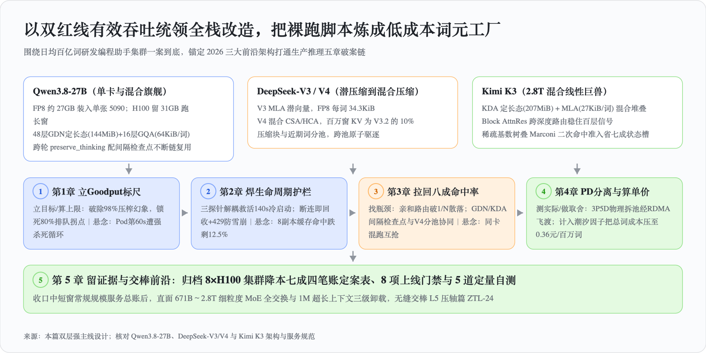
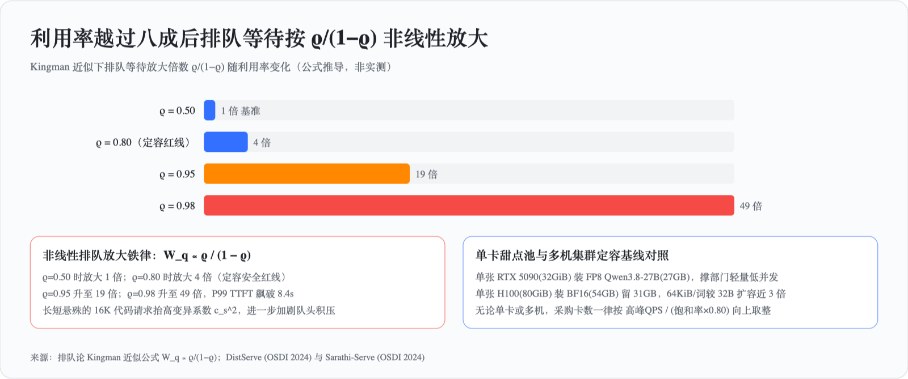
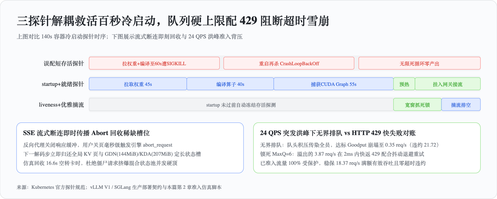
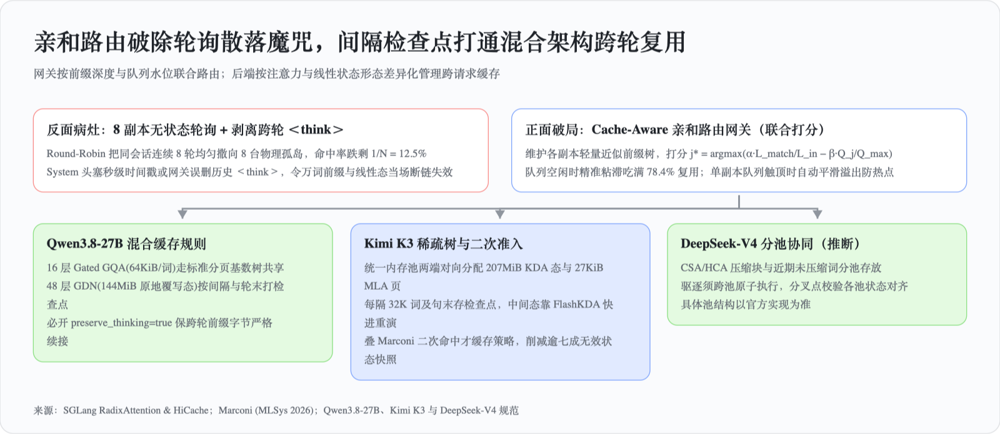
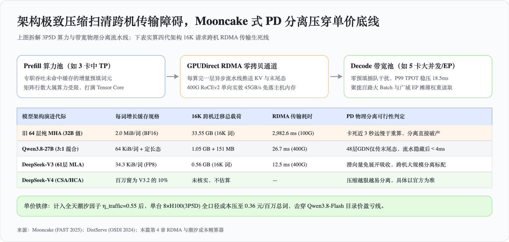
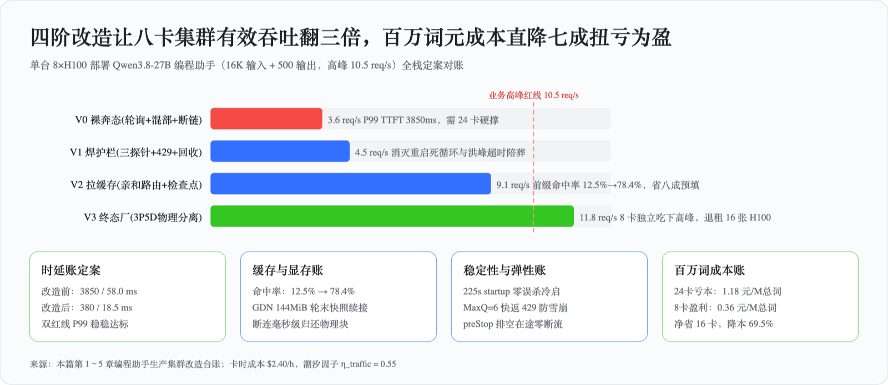

# ZTL-23｜系统｜把模型部署成服务

> 🎯 **这篇文档解决什么问题**：<b>核心命题：生产级大模型服务必须以双端 P99 SLO 约束下的有效吞吐（Goodput）统领架构。系统靠三探针解耦与快失败限流防止高负载雪崩。网关靠前缀感知路由配 RadixAttention 与间隔状态检查点省去七成重复预填。最后结合 Mooncake 式预填解码物理分离消除阶段互抢，将硬件时租折算为每百万词元的竞争底价。</b>
>
> **使用方式与先修要求**：本篇位居 L5 推理与服务系统层第五站。阅读前建议先熟悉两栏缓存账与键值压缩（第 06、08 篇）及思考预算治理（第 18 篇）。同时建议回顾分页调度与量化账单（第 19、21 篇）及无损投机解码（[ZTL-22｜系统｜让草稿减少解码开销](./22-speculative.md)）。
>
> 全篇跟踪一套日均百亿词调用的企业编程助手集群。下文称单机稠密旗舰为「案例 P 池」（Qwen3.8-27B），跨机稀疏旗舰为「案例 D 池」（DeepSeek-V3/V4），并对照 Kimi K3。我们将见证它从重启死循环、命中率仅 `12.5%` 且持续亏损，演进为高可靠低成本的生产集群。规格核对于 2026 年 11 月 16 日。
>
> 这套集群是教学案例：压测吞吐、命中率与成本读数都是假设读数（示意，非实测），用来演示四笔账怎么算；模型规格与排队公式可以按文中代码复现。
>
> **动手实践**：第 2 章内嵌 Kubernetes 三探针契约，以及流式断连回收配 `HTTP 429` 背压的仿真器。第 4 章交付跨机 `xPyD` 配比、四代架构 RDMA 搬运耗时及百万词元成本核算脚本。复制即可在本地秒级复现。

<b>🧭 主线位置</b>：上一篇 [ZTL-22｜系统｜让草稿减少解码开销](./22-speculative.md) 用轻量草稿突破了单机解码带宽限制，并给出了批度熔断门禁。本篇将视野拉升至多副本生产集群。我们重点解决尾延迟定容、百秒冷启护航、混合架构跨轮缓存与预填解码分离成本核算。夯实常规服务底座后，下一篇迈入 L5 压轴篇 [ZTL-24｜系统｜长上下文与混合专家怎样改变账单](./24-long-context-moe.md)，拆解万亿混合专家（MoE）与百万长窗卸载的账单变化。

## 导读 · 先给结论

- <b>脱离尾延迟红线的峰值裸吞吐会误导容量规划，生产定容唯一标尺是双阈值 Goodput。</b>闭环压测打到 98% 负载会让排队等待按 $`\rho / (1 - \rho)`$ 放大 49 倍。线上只认同时满足 `P99 TTFT` 与 `P99 TPOT` 的有效请求率。安全水位必须守在 80% 排队拐点左侧[[1]](https://arxiv.org/abs/2401.09670)[[2]](https://www.usenix.org/conference/osdi22/presentation/yu)。
- <b>百秒冷启动配短存活探针必陷重启死循环，防雪崩靠三探针解耦与快失败背压。</b>加载几十 GB 权重与录制多档 `CUDA Graph` 常需 140 秒。须由 `startupProbe` 独占护航冷启，再由 `readinessProbe` 校验真实预热。线上还需配合断连释放状态槽与 `HTTP 429` 快失败准入[[3]](https://blog.vllm.ai/2025/01/27/v1-alpha-release.html)[[4]](https://kubernetes.io/docs/tasks/configure-pod-container/configure-liveness-readiness-startup-probes/)。
- <b>无状态轮询会把多副本前缀命中率压低至 $`1/N`$，混合线性层还须配间隔状态检查点。</b>`RadixAttention` 免除了重复预填，但多实例须配缓存亲和路由聚拢流量。混合线性层原地覆写态须配间隔检查点、`Marconi` 二次准入与 `preserve_thinking` 才能不断链[[5]](https://arxiv.org/abs/2312.07104)[[6]](https://huggingface.co/Qwen/Qwen3.8-27B/blob/main/config.json)[[7]](https://arxiv.org/abs/2607.24653)[[8]](https://arxiv.org/abs/2411.19379)。
- <b>预填与解码同卡混跑互相干扰，架构压缩是 Mooncake 式 PD 物理分离的前提。</b>拆开算力池与带宽池可消除插队毛刺。16K 请求在旧 MHA 上传 `33.55 GB` 会阻塞百吉网卡近 3 秒。而在 `Qwen3.8-27B`（`1.05 GB`）与 `DeepSeek-V3`（`0.56 GB`）上经 RDMA 毫秒级即可传完[[9]](https://arxiv.org/abs/2407.00079)。
- <b>百万词真实成本须乘入昼夜潮汐因子，四阶改造可省去近七成硬件账单。</b>忽略早晚波谷会让纸面单价低估一倍。打通亲和缓存与 `3P5D` 分离后，单台 `8×H100` 实摊成本从亏损态 `1.18 元/百万词` 压至 `0.36 元/百万词`。该单价已稳稳低于市场目录价盈亏线[[10]](https://github.com/QwenLM/Qwen3.8-Flash-Next/blob/main/tech_report.pdf)[[11]](https://arxiv.org/abs/2412.19437)。



<b>📎 与系列其他文档的分工</b>：前向 `2P` 算力、Roofline 脊点与两栏缓存总账见 [ZTL-06｜数学｜一张纸算清算力、显存与缩放](./06-compute-memory-scaling.md)。注意力与块压缩字节公式见 [ZTL-08｜模型｜把注意力写成矩阵](./08-attention.md)。隐藏思考链词数与弹性档位见 [ZTL-18｜后训练｜多想一会儿是否值得](./18-test-time-compute.md)，分页块表与连续批处理调度见 [ZTL-19｜系统｜判断慢在哪，以及请求怎样排队](./19-serving-latency.md)。

<b>📎 与系列其他文档的分工（续）</b>：万亿 MoE 跨机通信与百万长窗三级卸载移交 [ZTL-24｜系统｜长上下文与混合专家怎样改变账单](./24-long-context-moe.md)。网关防注入、结构化输出约束与 Agent 预算熔断留给 [ZTL-27｜工程｜提示、路由与工具边界](./27-prompt-routing-tools.md) 与 [ZTL-29｜工程｜Agent 的循环、记忆、权限与成本](./29-agent.md)。

## 第 1 章 · 生产容量标尺与 P99 SLO 约束

在 [ZTL-22｜系统｜让草稿减少解码开销](./22-speculative.md) 压低解码单步耗时后，某企业研发平台准备将内部编程助手全面推向生产。该集群承接日均百亿词元的多轮代码重构与排障流量。主力池用单台 `8×H100 SXM5 80GiB` 部署混合稠密旗舰 <b>`Qwen3.8-27B`（BF16）</b>[[6]](https://huggingface.co/Qwen/Qwen3.8-27B/blob/main/config.json)[[12]](https://resources.nvidia.com/en-us-tensor-core/nvidia-tensor-core-gpu-datasheet)。每轮平均输入 `16,000` 词仓库上下文与工具定义，平均输出 `500` 词思考与代码补丁。

上线前夕，工程师用离线脚本一次性灌入 256 路并发，把 GPU 压到 98% 满载。脚本测出很高的裸吞吐，折算单机可扛 `10.8 req/s`。团队据此放心切入高峰 `10.5 req/s` 的真实流量。结果切流仅五分钟，IDE 插件端首字等待便飙升至 `8.4 秒`。大批开发者超时重试，有效完单率跌剩 `3.6 req/s`[[1]](https://arxiv.org/abs/2401.09670)。

### 1.1 立目标：双维度 P99 SLO 与有效吞吐（Goodput）方程

这场故障的根源，是用**离线批处理吞吐**替代了**在线交互时间契约**。离线跑分只关心一晚总共刷完多少词。哪怕单条请求在队列里苦等 20 秒也照样算数，因此脚本总会堆高批次去压满矩阵单元[[2]](https://www.usenix.org/conference/osdi22/presentation/yu)。然而线上助手直面真人编码节奏与网关超时器。容量规划第一步必须先**立目标**，明确两道正交的 P99 服务等级目标（SLO）：

- <b>首词延迟红线（`P99 TTFT`）。</b>从网关收到请求起，到吐出首个词元为止的总耗时，同时涵盖排队等待与输入预填（Prefill）。多轮代码 Agent 通常要求 `P99 TTFT ≤ 500 ms`，行内实时补全更收紧至 `250 ms` 以内[[1]](https://arxiv.org/abs/2401.09670)[[13]](https://arxiv.org/abs/2311.18677)。
- <b>逐词间隔红线（`P99 TPOT`）。</b>进入自回归解码（Decode）后，相邻输出词的平均间隔。设定 `P99 TPOT ≤ 30 ms`（单流不低于 `33.3 tok/s`），才能保证补丁顺滑输出而不卡顿[[14]](https://arxiv.org/abs/2403.02310)。

任何请求只要超出任一红线，或因中途截断、JSON 语法损坏不可用，它消耗的卡时皆属无效开销。现代推理系统据此把<b>有效吞吐（Goodput）</b>定为唯一合法的容量标尺[[1]](https://arxiv.org/abs/2401.09670)。设观测窗为 $`T_{\mathrm{win}}`$，期间共到达 $`N_{\mathrm{req}}`$ 条开环请求，有效请求吞吐定义为：

```math
\mathrm{Goodput} = \frac{1}{T_{\mathrm{win}}} \sum_{i=1}^{N_{\mathrm{req}}} \mathbb{I}\!\left(\mathrm{TTFT}_i \le \tau_{\mathrm{ttft}} \land \mathrm{TPOT}_i \le \tau_{\mathrm{tpot}} \land \mathrm{Valid}_i = 1\right)
```

将达标请求率乘以每单词数，即得有效词吞吐。请注意指示函数的一票否决作用。当负载越过拥塞拐点，原始完单率或许还能挤到 `10.3 req/s`。但只要积压拖累六成半请求突破 `500 ms` 红线，真实 `Goodput` 反而会从 `8.4 req/s` 跌至 `3.6 req/s`。

### 1.2 排队放大与定容基线

为什么离满载还差一点，尾延迟就会急剧恶化？我们动手**算上限**，依次核清驻留显存账与排队等待账。先由<b>利特尔法则（Little's Law）</b>核算常驻并发数 $`L = \lambda \cdot W`$[[15]](https://arxiv.org/abs/2309.06180)。设单副本到达率 `5.0 req/s`，首词耗时 `0.35 s`，输出 500 词每词 `0.020 s`。单请求在途时长即为 `10.35 s`，引擎时刻挂着约 `52` 路活跃序列。

这 52 路并发充分体现了现代混合架构的显存优势。若用纯 GQA 基线 `Qwen3-32B`（每词 `256 KiB` KV）跑 16.5K 窗口，52 路并发仅 KV 就要占去 `219.6 GiB`，单张 80 GiB H100 装不下，被迫跨多卡切分[[16]](https://arxiv.org/abs/2505.09388)。

换成案例 P 池（<b>48 层 GDN 定长态占 `144 MiB`，16 层全局 GQA 仅占 `64 KiB/tok`</b>），单路 16.5K 请求仅占 `1.03 GiB` KV 加 `0.14 GiB` 状态。单张 H100 装下 `54 GB` 权重后仍留逾 `31 GB` 净空间，单卡即可独立承载 20 余路长窗并发。小团队私有化部署时，将案例 P 池压为原生 `FP8`（约 `27 GB`），单张 32 GiB `RTX 5090` 就能跑通低并发闭环[[6]](https://huggingface.co/Qwen/Qwen3.8-27B/blob/main/config.json)[[12]](https://resources.nvidia.com/en-us-tensor-core/nvidia-tensor-core-gpu-datasheet)。

然而显存装得下，并不代表算力队列能打满。设系统利用率为 $`\rho \in (0, 1)`$，服务均值耗时为 $`\bar{s}`$，到达与服务变异系数平方为 $`c_a^2`$ 与 $`c_s^2`$。由 M/G/1 排队论 Kingman 近似式可得期望排队等待：

```math
W_q \approx \frac{c_a^2 + c_s^2}{2} \cdot \frac{\rho}{1 - \rho} \cdot \bar{s} \propto \frac{\rho}{1 - \rho}
```

观察右侧分式的非线性增长。利用率为 `0.50` 时放大倍数为 `1`，升至 `0.80` 时为 `4`。一旦顶到 `0.95` 乃至 `0.98`，放大倍数便跃升至 <b>`19` 倍与 `49` 倍</b>。叠加长短请求的高方差，均值 `90 ms` 的预填在 98% 负载下会积压出 8 秒以上的排队延迟[[1]](https://arxiv.org/abs/2401.09670)[[14]](https://arxiv.org/abs/2403.02310)。因此无论单卡私有池还是多机旗舰池，容量红线都必须守在 **80% 排队拐点左侧**。两种定容口径的对比如下：



细看上方吞吐分叉曲线图，就能理解离线跑分与线上体验背道而驰的机理。灰色裸吞吐曲线在越过 80% 负载后仍在缓慢爬升，直至贴近 `10.8 req/s` 硬件极限。而蓝色 `Goodput` 曲线在 `8.4 req/s` 拐点处触顶后便陡峭跳水。

造成这一断崖的催化剂正是公式里的方差项 $`(c_a^2 + c_s^2) / 2`$。真实编程流量混杂着几百词的简短追问与三万词的全仓重构，服务耗时变异系数极高。短单一旦排在长单身后，就会成批突破 `500 ms` 首字红线。对照下方定容口径表，两套标尺形成鲜明对比：

| **定容与评估维度** | <b>离线裸吞吐跑分（Offline Peak Throughput）</b> | <b>在线有效吞吐定容（SLO-Constrained Goodput）</b> |
|---|---|---|
| **流量发压模型** | 闭环固定并发（前单返才发后单），掩盖无界排队积压 | 开环泊松或生产轨迹回放（按 QPS 阶梯递增扫描拐点） |
| **延迟与质量裁决** | 零门槛：首字等 10 秒、半途截断的词元照单全收 | 双红线一票否决（如 `P99 TTFT ≤ 500 ms` 且 `TPOT ≤ 30 ms`） |
| **安全负载水位** | 盲目追求 $`\rho \to 98\%`$ 饱和压榨，放大项飙至 49 倍 | 锁定 $`\rho \le 80\%`$ 拐点左侧，留两成余量吸收突发流量尖峰 |
| **典型硬件定容基线** | 按峰值 `tok/s` 除总词量拍脑袋算卡，切流即雪崩 | 单卡 5090/H100 跑 `Qwen3.8-27B` 或多机池均按拐点 Goodput 配 N+1 |

> 💡 <b>常见误区：用闭环并发工具（固定 32 线程循环发请求）测算线上最大 QPS。</b>现象是闭环压出 `9.5 req/s` 且延迟全绿，一接同速率真实流量，首字延迟两分钟内冲破 4 秒。根因是闭环工具在后端变慢时自动少发单，队列永远不超过 32 条，而真实用户点击属于开环到达，后端稍慢便无限堆积。改法是一律采用开环速率压测（如 `--request-rate` 模式）扫出 80% 拐点[[1]](https://arxiv.org/abs/2401.09670)[[17]](https://github.com/vllm-project/production-stack)。

> 🔑 **本章要点与回到主线**：经立目标与算上限，我们摒弃了饱和裸吞吐，将容量标尺锁定在双维度 P99 SLO 约束下的 80% 水位 Goodput 上。但新的矛盾随之浮现：服务刚发布上 Kubernetes 便遭遇重启故障。新扩容 Pod 加载权重并捕获多档 `CUDA Graph` 要花 140 秒，每到第 60 秒就被 K8s 强杀重启，陷入无限 `CrashLoopBackOff`。容器生命周期与过载护栏该如何配置？这正是第 2 章要解决的问题。

## 第 2 章 · 冷启与准入控制

划定 80% 容量红线后，集群在发布首日便遇到了云原生调度故障。运维直接套用了普通微服务的 Kubernetes 模板。存活探针初始等待 15 秒，每 15 秒探测一次，连续失败 3 次即判进程死亡。结果扩容指令下发后，新拉起的案例 P 池容器全在启动第 **60 秒**收到 `SIGKILL` 被强杀。整批机器卡在 `CrashLoopBackOff` 状态无法接流[[4]](https://kubernetes.io/docs/tasks/configure-pod-container/configure-liveness-readiness-startup-probes/)[[17]](https://github.com/vllm-project/production-stack)。

### 2.1 冷启动三慢账单与 Kubernetes 三探针职责解耦

普通微服务镜像仅几十兆，百毫秒即可监听端口。现代大模型推理实例则是典型的**百秒级重状态服务**。拆开单容器 **140 秒**冷启动账单，包含三笔刚性开销[[3]](https://blog.vllm.ai/2025/01/27/v1-alpha-release.html)[[18]](https://docs.sglang.ai/)：

- <b>拉取与映射海量权重（约 45 秒）。</b>从共享存储读取 54 GB 级稠密模型权重乃至数百 GB 权重。校验切分后将其拷入各卡 HBM3 显存。
- <b>建池与编译融合算子（约 40 秒）。</b>建立跨卡 NCCL 通信环，划分分页 KV 池与定长线性状态池。随后即时编译定制 Triton 或 CUTLASS 内核[[6]](https://huggingface.co/Qwen/Qwen3.8-27B/blob/main/config.json)[[19]](https://vllm.ai/blog/2026-07-27-k3)。
- <b>录制多档 `CUDA Graph` 计算图（约 55 秒）。</b>解码期矩阵很小，Python 逐层下发数百个微内核的主机开销常超 GPU 计算。引擎必须在启动末尾对多档批大小录制静态图，上线后靠图重放消除发射延迟[[3]](https://blog.vllm.ai/2025/01/27/v1-alpha-release.html)[[19]](https://vllm.ai/blog/2026-07-27-k3)。

长达 140 秒的准备期内，HTTP 端口尚未监听，或主线程正阻塞于计算图捕获。生产级编排必须将三类探针职责分离[[4]](https://kubernetes.io/docs/tasks/configure-pod-container/configure-liveness-readiness-startup-probes/)[[17]](https://github.com/vllm-project/production-stack)。

先由 <b>`startupProbe`</b> 独占兜底冷启动。容忍总窗必须留足冷启动时长的 **1.5 倍**以上（如 `5s × 45 = 225s`），在它绿灯前其余探针自动冻结。再由 <b>`readinessProbe`</b> 把守挂流入口，冷启末尾跑通一条真实预热请求后才返 `200` 接入网关。最后让 <b>`livenessProbe`</b> 配 60 秒宽窗口，专职捕捉掉卡或 NCCL 死锁。缩容时借 `preStop` 先置 `503` 摘流，等在途响应吐完末词后再平滑退出。

### 2.2 流式断连即时回收与 HTTP 429 快失败背压防雪崩

配齐启停探针后，线上运行期还潜伏着两类算力损耗。一类是客户端断连后的残留废单，另一类是突发洪峰下的无界排队雪崩。

编程助手普遍通过 SSE 逐词流式输出。开发者看到前十行思路不对就会按下停止键。此时若反向代理 Nginx 开启了默认缓冲而未透传 TCP 断开信号，GPU 仍会继续算完余下上千词[[18]](https://docs.sglang.ai/)。

在混合架构下这尤为危险。`Qwen3.8-27B` 每条活跃请求独占 `144 MiB` 的 GDN 状态槽，`Kimi K3` 更独占 `207 MiB` 的 KDA 状态槽[[6]](https://huggingface.co/Qwen/Qwen3.8-27B/blob/main/config.json)[[7]](https://arxiv.org/abs/2607.24653)。定长状态槽总数在启动时封顶。一旦几十条废单占住槽位，就会阻塞后续正常请求准入。生产网关必须设置 `proxy_buffering off`，在连接断开时触发 `abort_request`，于下一解码步立即归还 KV 页与线性状态槽[[15]](https://arxiv.org/abs/2309.06180)[[18]](https://docs.sglang.ai/)。

更危险的是研发集中提交引发的 2 倍流量突刺。放任溢出请求涌入无界队列，队头积压就会波及后面每一条新单，令全员突破 `500 ms` 红线。客户端超时后触发自动重试风暴，使集群迅速陷入”GPU 满转、Goodput 归零”的雪崩状态。

正确解法是在引擎锁定最大并发序列数，并在网关执行**快失败背压**。一旦单副本队列触达上限 `MaxQ`，网关在 `2 ms` 内快速返回 `HTTP 429`。这能引导上游 SDK 走指数退避或切备用池，全力保障已准入请求的 SLA。下方给出探针配置与仿真代码：



*生产级 Qwen3.8-27B 容器启动参数与 Kubernetes 三探针解耦配置契约*

```yaml
command: ["python3", "-m", "sglang.launch_server"]
args:
  - "--model-path=/models/Qwen3.8-27B"
  - "--tp-size=1"                  # 单卡 H100 独立闭环（跨卡池按需设 TP）
  - "--mem-fraction-static=0.88"
  - "--chunked-prefill-size=4096"
  - "--max-running-requests=32"    # 硬锁活跃并发槽，防混合状态池溢出
startupProbe:                      # 独占护航 140s 冷启动：5s × 45 = 225s (> 1.5x)
  httpGet: { path: /health_generate, port: 8000 }
  periodSeconds: 5
  failureThreshold: 45
readinessProbe:                    # 真实生成预热通过后才挂入网关接流
  httpGet: { path: /health, port: 8000 }
  periodSeconds: 5
  failureThreshold: 2
livenessProbe:                     # 60s 宽窗口仅抓掉卡与真死锁，绝不误杀长预填
  httpGet: { path: /health, port: 8000 }
  periodSeconds: 15
  timeoutSeconds: 5
  failureThreshold: 4
```

核对这份 YAML 契约，最关键的设计在于把探测路径拆成了两档。`startupProbe` 故意指向重度接口 `/health_generate`，强迫容器在挂载流量前跑完一次真实的单步生成，把 Triton 算子编译与静态图激活全部留在冷启动保护窗（`225 s`）内消化。待进入日常服务期后，`livenessProbe` 则切回零推理开销的轻量级 `/health` 并留出 `60 s` 容忍度，防止某次超长分块预填抖动引发误杀重启。接着再用一段离散事件脚本验证运行期背压与断连回收：

*仿真 24 QPS 突发洪峰下无界排队傻跑 vs 队列上限快返 429 配断连即回收的 Goodput 差距*

```python
import math, random

def sim_serving_guard(qps: float, max_q: int, abort_on_disc: bool, seed: int = 42, horizon: float = 300.0):
    rng = random.Random(seed)
    t, busy_until, q = 0.0, 0.0, []
    ok, slo_viol, rej_429, saved_ms = 0, 0, 0, 0.0
    while t < horizon:
        t += rng.expovariate(qps)
        q = [ft for ft in q if ft > t]
        if len(q) >= max_q:          # 队列触顶：2ms 内快返 HTTP 429 阻断积压传染
            rej_429 += 1
            continue
        svc = rng.lognormvariate(math.log(0.046), 0.42)
        client_cancelled = (rng.random() < 0.08)   # 8% 请求中途由用户主动断连
        eff_svc = svc * 0.25 if (client_cancelled and abort_on_disc) else svc
        if client_cancelled and abort_on_disc:
            saved_ms += (svc - eff_svc) * 1e3
        start = max(t, busy_until)
        ttft = (start - t) + eff_svc
        busy_until = start + eff_svc
        q.append(busy_until)
        if not client_cancelled:
            ok += int(ttft <= 0.50)  # 严核 P99 TTFT <= 500ms 红线
            slo_viol += int(ttft > 0.50)
    return round(ok / horizon, 2), round(slo_viol / horizon, 2), round(rej_429 / horizon, 2), round(saved_ms / 1e3, 1)

print("=== Scenario 1: Unbounded Queue ===")
r1 = sim_serving_guard(24.0, max_q=9999, abort_on_disc=False)
print("无界队列+断连傻跑:", r1)
print("=== Scenario 2: MaxQ=6 + Early Abort ===")
r2 = sim_serving_guard(24.0, max_q=6, abort_on_disc=True)
print("MaxQ=6 +断连即回收:", r2)
```

*输出*

```text
=== Scenario 1: Unbounded Queue ===
无界队列+断连傻跑: (0.35, 21.72, 0.0, 0.0)
=== Scenario 2: MaxQ=6 + Early Abort ===
MaxQ=6 +断连即回收: (18.37, 0.0, 3.87, 16.6)
```

拆解这段 300 秒洪峰仿真器，`lognormvariate` 调用对数正态分布模拟了均值约 `50 ms`（单实例稳态承载上限约 `20 req/s`）且带长尾尖峰的服务耗时。`eff_svc` 变量赋值 `svc * 0.25` 刻画了用户在读完前四分之一流式输出后按下停止键、引擎当拍回收状态槽并省下后四分之三无效计算的收益。

对比末尾两行打印元组，当突发流量冲上 `24.0 req/s`（超载两成）时，无界队列任由积压蔓延，每秒高达 `21.72` 条请求突破 `500 ms` 红线作废，真实 `Goodput` 跌剩 `0.35 req/s`。开启 `MaxQ = 6` 快返 `HTTP 429` 并联动断连回收后，网关每秒果断拒掉 `3.87` 条溢出单、追回 `16.6 秒` 废单卡时，把已准入请求的达标吞吐稳稳护在 `18.37 req/s`（相差逾 `52 倍`）。

> 💡 <b>常见误区：为省掉 55 秒冷启动，在线上参数里加 `--enforce-eager` 强关 `CUDA Graph`。</b>现象是扩容拉起变快了，一接并发 `TPOT` 却恶化至 `36 ms`，GPU 呈锯齿状波动。根因是关掉图捕获后，每吐一词都要由 CPU 逐层下发数百个微算子，主机发射沦为瓶颈。改法是线上常开 `CUDA Graph`，靠编译缓存卷与 `startupProbe` 吸收启动耗时[[3]](https://blog.vllm.ai/2025/01/27/v1-alpha-release.html)[[19]](https://vllm.ai/blog/2026-07-27-k3)。

> 🔑 **本章要点与回到主线**：靠三探针解耦、SSE 断连即刻回收与 `HTTP 429` 背压，集群消除了重启死循环与过载雪崩。但新的矛盾随之浮现。打开监控大盘**找瓶颈**时，团队发现每轮 `16K` 输入里明明有 `13K` 是固定仓库树，8 个副本的前缀缓存命中率却只有 `12.5%`。是什么打碎了跨轮缓存？这正是第 3 章要解决的核心。

## 第 3 章 · 前缀缓存与亲和路由

集群稳住不宕机后，预填充算力消耗却依然居高不下。顺着监控面板深入**找瓶颈**，我们很快定位了 `12.5%` 命中率偏低的两处根源。在网关层，无状态轮询把同一会话的连续 8 轮调用分散到了 8 张隔离的 H100 副本。在协议层，网关拼接请求时删掉了上一轮的 `<think>` 思考块，切断了混合线性层的状态链[[5]](https://arxiv.org/abs/2312.07104)[[6]](https://huggingface.co/Qwen/Qwen3.8-27B/blob/main/config.json)。

### 3.1 基数树复用（RadixAttention）与网关缓存亲和路由

先算清前缀缓存节省的算力账。因果模型满足单向前缀不变性，前 $`L_{\mathrm{hit}}`$ 词的状态仅取决于该段前缀本身。设输入总长为 $`L_{\mathrm{in}}`$，命中比例为 $`h`$。命中后引擎直接跳过前文，仅对尾部新增词做增量预填。线性投影与前馈层算力从 $`2 P L_{\mathrm{in}}`$ 降至 $`2 P (1 - h) L_{\mathrm{in}}`$[[3]](https://blog.vllm.ai/2025/01/27/v1-alpha-release.html)[[5]](https://arxiv.org/abs/2312.07104)。

在 `16K` 输入含 `13K` 公共前缀的编程场景里，把命中率从 `12.5%` 拉升到 `78.4%`，每轮实算词数便从 `14,000` 词减至 `3,456` 词。预填算力与首词等待耗时双双下降约四分之三。

SGLang 的 <b>`RadixAttention`</b> 在分页池上用压缩前缀基数树管理复用[[5]](https://arxiv.org/abs/2312.07104)。每条树边对应一段词元子序列，节点指向物理键值页并维护引用计数。请求结束时计数归零，键值页仍留在树中待命。仅当空闲显存不足时，淘汰器才按 LRU 顺序回收叶节点。

然而单机基数树再高效，也会被无状态网关抵消。集群扩至 8 个独立副本后，轮询调度让下一轮落回原卡的概率只剩八分之一（`12.5%`）。同一份热仓库树在 8 张卡上重复存了 8 份，有效缓存容量缩水为 $`1 / N`$[[17]](https://github.com/vllm-project/production-stack)[[18]](https://docs.sglang.ai/)。解决之道是将网关升级为**缓存感知亲和路由器**。它在内存维护各副本的轻量前缀树，转发前按匹配深度与队列水位联合打分：

```math
j^{\star} = \arg\max_{j \in \{1,\dots,N\}} \left( \alpha \cdot \frac{L_{\mathrm{match}}(x, \mathcal{T}_j)}{L_{\mathrm{in}}} - \beta \cdot \frac{Q_j}{Q_{\max}} \right)
```

常规多轮会话因匹配分占优，被稳定粘滞回持有历史状态的副本。举一组典型权重 $`\alpha = 1.0, \beta = 0.6`$ 手算验证。当某副本持有 `80%` 仓库前缀时，正向亲和分高达 `+0.80`。只要该卡队列未满（如 $`Q_j / Q_{\max} = 0.5`$，惩罚项仅 `-0.30`），续轮请求仍优先命中热缓存，免去 `13K` 词重算。一旦某个大热仓库涌入突发并发使队列触顶，负载惩罚项便自动接管，将溢出流量平滑导向轻载副本。

### 3.2 间隔检查点与二次准入

在纯 GQA 或纯 MLA 模型上，逐词追加的分页块可在任意页边界零成本分叉。但到了 2026 主流混合线性与块压缩架构上，前缀缓存规则发生了重要变化[[6]](https://huggingface.co/Qwen/Qwen3.8-27B/blob/main/config.json)[[7]](https://arxiv.org/abs/2607.24653)[[20]](https://arxiv.org/abs/2606.19348)。以 `Kimi K3` 的 KDA（及 `Qwen3.8-27B` 的 GDN）为例，其状态矩阵遵循秩-1 擦除递推：

```math
S_t = (I - \beta_t k_t k_t^\top)\mathrm{Diag}(\alpha_t)S_{t-1} + \beta_t k_t v_t^\top
```

该状态矩阵每步都**原地覆写**[[7]](https://arxiv.org/abs/2607.24653)。算到第 16,000 词时，第 13,000 词的旧状态早已被覆盖。若每 16 词都克隆一份 `144 MiB` 或 `207 MiB` 全量快照，单条 16K 序列就会耗尽上百 GB 显存。

针对混合线性架构（`Qwen3.8-27B` 与 `Kimi K3`），现代引擎采用了**间隔状态检查点配二次准入**[[8]](https://arxiv.org/abs/2411.19379)[[19]](https://vllm.ai/blog/2026-07-27-k3)。引擎仅每隔固定跨度（如 4K 词）及每轮提示末尾存一份状态快照。半途分叉时回退至最近祖先检查点，再快进重演差量词。

同时引擎叠加 <b>`Marconi` 选择性准入</b>。首见某段前缀只记轻量哈希，第二次确认共享时才落盘百兆快照，省去逾七成一次性快照[[8]](https://arxiv.org/abs/2411.19379)。此外，在 `Qwen3.8-27B` 多轮 Agent 中必须开启 <b>`preserve_thinking=true`</b> 保留历史 `<think>` 块。这确保下一轮追加工具回执时精准接在轮末检查点之后[[6]](https://huggingface.co/Qwen/Qwen3.8-27B/blob/main/config.json)。

针对压缩注意力架构（`DeepSeek-V4` 混合了 CSA 与 HCA 两种压缩注意力），缓存不再是一张均匀的分页表[[20]](https://arxiv.org/abs/2606.19348)。按本篇推断，引擎需要把压缩块与近期未压缩词分池管理：淘汰叶节点时跨池原子驱逐，分叉复用时校验各池状态对齐，避免多池失步。具体池结构以官方实现为准。



对照上方亲和路由与混合基数树架构图，可以清晰看到上下两层状态怎样咬合。上层网关借轻量词元哈希树，把同仓库流量聚拢到固定节点。下层引擎在只读共享全局键值页的同时，于每轮对话边界挂靠定长 GDN/KDA 检查点。这样分叉续写时既不重复预填，也不会丢失线性记忆。网关路由与四类架构前缀缓存的核心治理规则汇总如下：

| **架构或路由层级** | **跨轮缓存核心痛点** | **生产级引擎与网关解法** | **量化收益与上线必配开关** |
|---|---|---|---|
| **多副本网关路由层** | 无状态轮询将会话撒向 $`N`$ 卡，命中跌向 $`1/N`$ | 轻量前缀树匹配分减队列水位惩罚联合路由 | 8 副本命中率从 `12.5%` 拉回 `78.4%`（假设读数） |
| **纯 GQA / 纯 MLA** | 页表碎片与主机二级回填带宽开销 | 标准 `RadixAttention` 逐页分叉 + `HiCache` | 任意 16 词页边界零成本共享只读页[[5]](https://arxiv.org/abs/2312.07104) |
| <b>`Qwen3.8-27B` / `Kimi K3`</b> | GDN / KDA 定长态原地覆写，删思考即断链 | 间隔状态检查点 + `Marconi` 二次准入 | Agent 必开 `preserve_thinking=true`[[6]](https://huggingface.co/Qwen/Qwen3.8-27B/blob/main/config.json)[[8]](https://arxiv.org/abs/2411.19379) |
| <b>`DeepSeek-V4`</b> | 压缩块与近期词分池存放，状态易失步（推断） | 跨池原子驱逐与状态对齐校验 | 百万长窗下各池状态一致[[20]](https://arxiv.org/abs/2606.19348) |

> 💡 <b>常见误区：在 System Prompt 顶部塞入秒级时间戳，或在多步 Agent 中每轮剥离旧 `<think>` 块。</b>现象是配齐了亲和路由与检查点，`13K` 仓库上下文命中率仍低于 15%。根因是前缀匹配严格依赖每字节一致，顶部时间戳一变后续全作废，而删掉上一轮 `<think>` 会废掉轮末 GDN 检查点。改法是严守“静态置顶、动态置底”，并保留跨轮思考前缀[[5]](https://arxiv.org/abs/2312.07104)[[6]](https://huggingface.co/Qwen/Qwen3.8-27B/blob/main/config.json)。

> 🔑 **本章要点与回到主线**：落实静态前置、`preserve_thinking` 检查点与亲和路由后，前缀命中率升至 `78.4%`，单机有效吞吐翻倍至 `9.1 req/s`。但新的矛盾随之浮现。在同节点混跑模式下，未命中的新代码预填仍会把同卡解码 `TPOT` 顶出 `52 ms` 毛刺。怎样物理拆解两阶段冲突并算出百万词底价？这正是第 4 章要解决的核心。

## 第 4 章 · PD 分离与成本核算

把缓存命中率拉上近八成后，为何同节点混部仍会遇到性能瓶颈？根源在于预填与解码的资源诉求截然相反[[1]](https://arxiv.org/abs/2401.09670)[[13]](https://arxiv.org/abs/2311.18677)。**Prefill 阶段吃算力**。单条 3,500 词增量输入就能喂饱 Tensor Core，适合中小张量并行（`TP=1～4`）减少同步开销。

相反，**Decode 阶段吃显存带宽**。它必须攒够百路并发摊薄权重读取，在巨型 MoE 上更依赖广域专家并行[[11]](https://arxiv.org/abs/2412.19437)。把两者绑在同一张卡上混跑，即便开了分块预填，长预填块插队仍会拉长解码步耗时。运维只得压低并发上限以保住 `P99 TPOT ≤ 30 ms`[[1]](https://arxiv.org/abs/2401.09670)[[14]](https://arxiv.org/abs/2403.02310)。

### 4.1 测实际：PD 物理分离与架构压缩决定的 RDMA 生死线

`DistServe`、`Splitwise` 与 `Mooncake` 给出的解法是<b>预填与解码物理分离（PD Disaggregation）</b>[[1]](https://arxiv.org/abs/2401.09670)[[9]](https://arxiv.org/abs/2407.00079)[[13]](https://arxiv.org/abs/2311.18677)。集群拆为独立的 <b>Prefill 算力池（P 池）</b>与 <b>Decode 带宽池（D 池）</b>，按负载特征配成 `xPyD` 比例（如单机 8 卡拆为 `3P5D`）。请求先入 P 池算完增量预填并吐出首词。引擎同时调用 `Mooncake` 或 `vLLM NIXL` 经 **RDMA 或 NVLink** 逐层异步把键值与末尾状态推入 D 池，再由 D 池平滑吐完后续词元[[9]](https://arxiv.org/abs/2407.00079)[[21]](https://docs.vllm.ai/en/latest/features/disagg_prefill.html)。

上机**测实际**便会看清一道硬门槛：<b>模型键值压缩率直接决定了跨机 PD 分离的可行性。</b>迁移词数乘每词键值字节，加上线性层定长状态，再除以 RDMA 带宽，即得跨池传输耗时：

```math
T_{\mathrm{xfer}} = \frac{L_{\mathrm{xfer}} \cdot b_{\mathrm{KV}} + B_{\mathrm{state}}}{B_{\mathrm{RDMA}}}
```

只有传输耗时远小于重算耗时，分离才有正收益。拿一条 `16K` 请求在 100G 网卡与 400G RDMA 上对比四代架构：

- <b>旧 64 层纯 MHA（32B 级，`2.0 MiB/tok`）。</b>16,000 词键值高达 <b>`33.55 GB`</b>。在 100G 网上光传 KV 就要阻塞 <b>`2,982.6 ms`</b>，比原地重算还慢五倍，跨机分离直接失效。
- <b>`Qwen3.8-27B`（`64 KiB/tok` 加 48 层 GDN 定长态）。</b>16,000 词全局键值仅 <b>`1.05 GB`</b>。且 48 层 GDN 跨机<b>只传最后一步定长矩阵（约 `151 MB`）</b>[[6]](https://huggingface.co/Qwen/Qwen3.8-27B/blob/main/config.json)。总载荷走 400G RDMA 仅需 <b>`26.7 ms`</b>，流水重叠后暴露延迟不足 `4 ms`。
- <b>`DeepSeek-V3`（61 层 MLA，FP8 KV `34.3 KiB/tok`）。</b>开启原生 FP8 KV 后，16,000 词潜缓存仅 <b>`0.56 GB`</b>。400G RDMA 仅耗 <b>`12.5 ms`</b>，支撑起大规模跨节点分离池[[9]](https://arxiv.org/abs/2407.00079)[[11]](https://arxiv.org/abs/2412.19437)。
- <b>`DeepSeek-V4`（CSA 与 HCA 混合压缩注意力）。</b>官方报告称百万上下文下 `V4-Pro` 的键值缓存只有 `V3.2` 的 `10%`，跨机传输更难成为分离的瓶颈[[20]](https://arxiv.org/abs/2606.19348)。



结合上方 PD 分离流水图，我们还能手算出单机 8 卡拆成 <b>`3P5D`</b> 的配比依据。命中近八成前缀后，每条请求在 P 池仅需增量预填约 `3,500` 词，单卡耗时约 `240 ms`（3 张 P 卡合计吞吐约 `12.5 req/s`）。而在 D 池，每条请求需自回归吐满 `500` 词，按单步 `18.5 ms` 计在途驻留逾 `9 秒`，5 张 D 卡并跑百余路活跃序列恰好匹配 `~12.0 req/s` 出单率，令算力池与带宽池两边都不空等。

### 4.2 真实成本与目录价

把单台 `8×H100` 按负载比**做取舍**拆为 <b>`3P5D`</b> 后，解码池消除了预填插队毛刺。单机达标 `Goodput` 从混部态 `9.1 req/s` 升至 <b>`11.8 req/s`</b>，单机即可承接 `10.5 req/s` 业务高峰。接着核算核心财务指标：<b>每产出 100 万个达标词元，真实硬件底价是多少？</b>

我们将单卡小时单价乘以总卡数作为分子，再把稳态有效词吞吐与**昼夜潮汐因子**相乘作为分母。研发流量集中在工作日白天，夜间与周末波谷使包月卡池全天均载仅约 `55%`。全口径百万词成本公式为：

```math
\mathrm{Cost}_{1\mathrm{M}} = \frac{C_{\mathrm{GPU\text{-}hr}} \times (N_P + N_D)}{\mathrm{Goodput}_{\mathrm{tok/s}} \times 3600 \times \eta_{\mathrm{traffic}}} \times 10^6
```

解码每词都要重搬全网权重，卡时开销是预填的 3 至 5 倍。缓存命中前缀直接跳过前向计算，成本还不到普通输入的二成。这一物理差异直接反映在公有云阶梯定价上。

以 <b>`Qwen3.8-Flash` 目录价（未命中输入 `1 元`、输出 `3 元`、缓存命中输入 `0.2 元`每百万词）</b>为标尺[[10]](https://github.com/QwenLM/Qwen3.8-Flash-Next/blob/main/tech_report.pdf)[[11]](https://arxiv.org/abs/2412.19437)，我们逐项拆算本案单请求的混合折合单价。在每轮 `16,500` 总词元中，`12,500` 词命中缓存（付 `0.0025 元`），`3,500` 词为新增输入（付 `0.0035 元`），`500` 词为生成输出（付 `0.0015 元`）。单次调用共付 `0.0075 元`，除以 `0.0165M` 总词数，即得外部 API 盈亏基准线恰为 <b>`0.455 元/百万总词`</b>。

对比自建账本（`H100` 卡时 `$2.40/h`，汇率 `7.20`）。改造前因命中率低且混部卡顿，需堆 `24` 张卡才扛住流量，实摊高达 <b>`1.18 元/百万总词`</b>。打通亲和缓存与 `3P5D` 分离后，单台 `8` 卡即达 `11.8 req/s`。实摊成本骤降至 <b>`0.36 元/百万总词`</b>，低于目录价盈亏线并月省 16 张卡。对照表与核算脚本如下：

| **服务架构与经济维度** | <b>同节点混部（Colocated + Chunked Prefill）</b> | <b>预填-解码物理分离（Mooncake / xPyD）</b> |
|---|---|---|
| **TTFT 与 TPOT 耦合度** | 强耦合：长单增量预填块周期性顶高解码步耗时 | **物理解耦**：P 池攻首字，D 池稳守 `18.5 ms` 平滑吐字 |
| **并行策略与硬件选配** | 被迫共用同一套 `TP` 与同款卡，算力与带宽互迁就 | **异构寻优**：P 池配中 TP 算力卡，D 池配大并发广域 EP |
| **跨节点网络硬门槛** | 极低：副本间无状态交换，普通以太网即可 | 依赖高速互联与键值压缩实现毫秒级传输 |
| **严苛 SLO 下百万词成本** | 受 `TPOT` 毛刺制约并发受限，单卡有效产出偏低 | 8 卡及以上集群 Goodput 提升 `30%～80%`，单价低于盈亏线 |

*四代架构 16K 跨机 RDMA 传输耗时、xPyD 配比及含潮汐因子百万词元真实成本核算器*

```python
import math

MODELS = [
    ("Legacy-MHA (2MiB/tok)",     2097152,   0.0, 100.0),
    ("Qwen3.8-27B (64KiB+GDN)",     65536, 151.0, 400.0),
    ("DeepSeek-V3 (FP8 MLA)",       35136,   0.0, 400.0),
]
for name, b_kv, state_mb, nic_gbps in MODELS:
    L = 16000
    payload_mb = (L * b_kv) / 1e6 + state_mb
    bw_mbs = (nic_gbps / 8.0) * 0.90 * 1e3          # 90% RDMA 有效载荷带宽 (MB/s)
    print(f"{name:26s} | 载荷:{payload_mb:8.2f} MB | {nic_gbps:3.0f}G耗时:{payload_mb/bw_mbs*1e3:7.2f} ms")

def calc_cost_1m(c_gpu_hr: float, n_p: int, n_d: int, goodput_req_s: float, tok_req: int, eta: float, fx: float = 7.20):
    usd = (c_gpu_hr * (n_p + n_d)) / (goodput_req_s * tok_req * 3600.0 * eta) * 1e6
    return round(usd, 3), round(usd * fx, 2)

print("V0 改造前 (24卡混部, 10.8r/s):", calc_cost_1m(2.40, 24, 0, 10.8, 16500, 0.55))
print("V3 改造后 (3P5D共8卡,11.8r/s):", calc_cost_1m(2.40, 3, 5, 11.8, 16500, 0.55))
```

*输出*

```text
Legacy-MHA (2MiB/tok)      | 载荷:33554.43 MB | 100G耗时:2982.62 ms
Qwen3.8-27B (64KiB+GDN)    | 载荷: 1199.58 MB | 400G耗时:  26.66 ms
DeepSeek-V3 (FP8 MLA)      | 载荷:  562.18 MB | 400G耗时:  12.49 ms
V0 改造前 (24卡混部, 10.8r/s): (0.163, 1.18)
V3 改造后 (3P5D共8卡,11.8r/s): (0.05, 0.36)
```

逐段复核这份核算脚本，`bw_mbs` 变量赋值 `(nic_gbps / 8.0) * 0.90 * 1e3` 扣除了 RoCEv2 报头与流控开销，按 90% 有效载荷折算真实线速（400G 网卡实得 `45,000 MB/s`）。注意 `Qwen3.8-27B` 一行在键值之外单独加上了 `151.0 MB` 的 GDN 末尾定长态（十进制口径），总载荷约 `1.20 GB`，经 400G RDMA 仅需 `26.66 ms`。借逐层计算与传输流水重叠后，用户侧感知的首字额外延迟不足 `4 ms`。

下半段 `calc_cost_1m` 则把昼夜潮汐系数 `eta = 0.55` 刚性计入分母。改造前 `V0` 被迫堆满 `24` 张 H100 才勉强撑住 `10.8 req/s`，折合人民币高达 `1.18 元/百万总词`，每跑一百万词比调公有云 API 还倒贴七毛多。打通亲和路由与 `3P5D` 分离后，`8` 张卡即稳跑 `11.8 req/s`，实摊单价压至 `0.36 元/百万总词`，净省 `69.5%` 硬件支出并顺利跨入盈利区间。

> 💡 <b>常见误区：按峰值 24 小时满载（设 $`\eta_{\mathrm{traffic}} = 1.0`$）测算自建 ROI 并立项买卡。</b>现象是测算报告写每百万词仅 `0.20 元`，半年后财务核算实摊却翻倍至 `0.44 元`。根因是内部业务存在昼夜与周末波谷，夜间闲置 GPU 照样计提折旧与电费。改法是立项代入真实潮汐因子 $`[0.45, 0.60]`$，或夜间切给离线评测与蒸馏任务[[11]](https://arxiv.org/abs/2412.19437)[[12]](https://resources.nvidia.com/en-us-tensor-core/nvidia-tensor-core-gpu-datasheet)。

> 🔑 **本章要点与回到主线**：经测实际与做取舍，我们验证了键值压缩对 PD 分离的决定性作用，并借 `3P5D` 分离将百万词成本压至 `0.36 元`。至此，生产推理服务的核心链路已全部跑通。第 5 章将把四阶改造收益固化为可审计的上线总账与核对清单。

## 第 5 章 · 生产推理服务总账、核对清单与自测

走完前四章治理闭环，最初“扩容即重启、缓存命中仅一成、高峰超时且持续亏损”的编程助手集群，已在单台 `8×H100` 上稳扛日均百亿词流量，退租了 16 张显卡[[1]](https://arxiv.org/abs/2401.09670)[[6]](https://huggingface.co/Qwen/Qwen3.8-27B/blob/main/config.json)[[9]](https://arxiv.org/abs/2407.00079)。本章执行收官动作**留证据**，归档四阶改造定案总账、8 项上线门禁与 5 道定量自测题，并引出下一站超大规模前沿。

### 5.1 📌 四笔账定案总表

下图与定案表留存了编程助手集群（案例 P 池，`16K` 输入加 `500` 输出，高峰 `10.5 req/s`）从初始态 V0 到生产终态 V3 的四笔工程账对比：



审读上方闭环画板与下方四笔账总表时，建议把第 3 列终态指标与第 4 列“线上固化配置与留证字段”逐行配对。线上任何架构收益若缺少对应的 Prometheus 分位直方图、`429` 快拒率与断连回收计数器持续留证，都会在模型升级或流量漂移中悄然退化。只有把这四组观测指标纳入发版门禁，容量账本才能经受长期值班考验：

| **四笔账核验维度** | <b>V0 初始裸奔态（轮询混部）</b> | <b>V3 生产终态（亲和 + 3P5D）</b> | **线上固化配置与监控留证字段** |
|---|---|---|---|
| **效果与可用性账** | 冷启 60s 误杀重启；洪峰全员超时违约 | BF16 零损；225s 冷启零误杀，洪峰零违约 | 三探针 YAML + `MaxQ=6` 快返 `429` 告警 |
| **时延与吞吐账** | 单机 Goodput `3.6 req/s`（P99 `3850/58ms`） | 单机 <b>`11.8 req/s`</b>（P99 <b>`380 / 18.5 ms`</b>） | 开环压测归档与 `e2e_ttft` / `tpot` 分位线 |
| **显存与缓存账** | 命中率 `12.5%`；断连废单占满 GDN 槽 | 命中率 <b>`78.4%`</b>；轮末检查点零重算续接 | `preserve_thinking=true` + 断连 `abort` 计数 |
| **百万词成本账** | 需 24 卡支撑，实摊 `1.18 元/M总词`（亏损） | 8 卡独立承载，实摊 <b>`0.36 元/M总词`</b>（盈利） | 退租 16 卡降本 <b>69.5%</b>，跑赢目录价盈亏线 |

> 📌 **上线前核对清单：把大模型推理引擎切入生产网关前的 8 项必查硬门禁**
>
> - <b>开环双红线 Goodput 定容。</b>压测采用开环泊松或轨迹回放，卡数按同时满足 `P99 TTFT` 与 `P99 TPOT` 的 80% 拐点 Goodput 反推并留 N+1 冗余[[1]](https://arxiv.org/abs/2401.09670)。
> - <b>三探针职责分离免重启。</b>配置独占 `startupProbe`（容忍窗不少于 1.5 倍冷启动时长），`readinessProbe` 经真实预热置绿，`preStop` 平滑摘流排空[[4]](https://kubernetes.io/docs/tasks/configure-pod-container/configure-liveness-readiness-startup-probes/)。
> - <b>SSE 断连透传与槽位回收。</b>反向代理设 `proxy_buffering off`，客户端断连即刻触发 `abort`，释放 KV 页与稀缺的 `GDN / KDA` 定长状态槽[[6]](https://huggingface.co/Qwen/Qwen3.8-27B/blob/main/config.json)[[7]](https://arxiv.org/abs/2607.24653)。
> - <b>有界队列与 429 快失败背压。</b>网关与引擎锁定最大队列与并发槽，突发洪峰下 `2 ms` 内快返 `HTTP 429` 配合客户端指数退避。
> - <b>静态置顶与跨轮思考不断链。</b>动态时间戳一律移至末尾，多步 Agent 跑混合线性层模型时显式开启 `preserve_thinking=true` 护住轮末检查点[[5]](https://arxiv.org/abs/2312.07104)[[6]](https://huggingface.co/Qwen/Qwen3.8-27B/blob/main/config.json)。
> - <b>混合架构专属缓存规则。</b>`GDN / KDA` 配间隔检查点与 `Marconi` 二次准入，`DeepSeek-V4` 启用跨池原子驱逐与 128 滑窗完整性校验[[8]](https://arxiv.org/abs/2411.19379)[[20]](https://arxiv.org/abs/2606.19348)。
> - <b>多副本缓存亲和路由上线。</b>多实例集群停用无状态轮询，接入兼顾前缀匹配深度与队列水位的亲和路由器[[5]](https://arxiv.org/abs/2312.07104)。
> - <b>PD 分离网卡校核与潮汐对账。</b>跨机分离前验算每秒键值加末尾态传输带宽，财务看板乘入潮汐因子持续对标云端目录价[[9]](https://arxiv.org/abs/2407.00079)[[10]](https://github.com/QwenLM/Qwen3.8-Flash-Next/blob/main/tech_report.pdf)。

### 5.2 自测题与参考解析

请合上正文，独立手算以下 5 道定量自测题：

<b>自测 1（排队拐点与扩容卡数手算）。</b>某实例平均服务耗时恒定。流量从 `9.0 req/s` 涨至 `14.25 req/s` 时，利用率 $`\rho`$ 从 `0.60` 升至 `0.95`。按 $`\rho / (1 - \rho)`$ 计算排队等待膨胀倍数。若高峰 `45 req/s` 要求单实例 $`\rho \le 0.80`$，至少需几个实例？

<b>参考解析。</b>$`\rho = 0.60`$ 时放大因子为 `1.5`，升至 `0.95` 时增至 `19.0`，排队等待膨胀了 $`19.0 / 1.5 \approx \mathbf{12.67}`$ **倍**。饱和服务率为 `15.0 req/s`，限制 $`\rho \le 0.80`$ 时单实例上限为 `12.0 req/s`，至少需 $`\lceil 45 / 12 \rceil = \mathbf{4}`$ **个实例**。

<b>自测 2（K8s 探针误杀推演与修复）。</b>容器拉权重 `50 s`、编译 `35 s`、`CUDA Graph` 捕获 `55 s`（共 `140 s`）。漏配 `startupProbe`，仅配 `livenessProbe`（初始延迟 `20 s`，周期 `10 s`，阈值 4 次）。求容器被杀时刻及合规参数。

<b>参考解析。</b>满 `20 s` 起探测失败，每 `10 s` 记一次，满 4 次在第 $`20 + 10 \times 4 = \mathbf{60}`$ **秒**被强杀陷入 `CrashLoopBackOff`。修复须配 `startupProbe`，容忍窗不少于 `210 s`（如周期 `5 s`、阈值 45 次，共 `225 s`）。

<b>自测 3（轮询 vs 亲和路由的预填算力账）。</b>`8` 副本部署 `Qwen3.8-27B`（稠密参 $`P = 27 \times 10^9`$），续轮总输入 `16,000` 词（含 `12,800` 词公共前缀）。对比随机轮询（落回原卡概率 `1/8`）与亲和路由配轮末检查点（100% 命中），求单轮期望线性预填 FLOPs。

<b>参考解析。</b>亲和路由仅算新增 `3,200` 词，算力为 <b>`172.8 TFLOPs`</b>。随机轮询有 `7/8` 概率重算全量，期望算 `14,400` 词，算力达 <b>`777.6 TFLOPs`</b>，白白多耗了 <b>`4.5` 倍</b>算力。

<b>自测 4（PD 分离下两代模型 RDMA 传输对比）。</b>在 `100 Gbps` RoCEv2（实效 `11.25 GB/s`）上迁移 `16,000` 词。求旧 MHA（`2 MiB/词`）与 `Qwen3.8-27B`（`64 KiB/词` 加 `151 MB` GDN 末尾态）的传输耗时，以及为何键值压缩对 PD 分离至关重要。

<b>参考解析。</b>旧 MHA 载荷 `33.55 GB`，100G 网耗时 <b>`2,982.6 ms`</b>，完全破坏分离收益。`Qwen3.8-27B` 载荷 `1.20 GB`，100G 网仅需 <b>`106.7 ms`</b>，400G RDMA 仅 <b>`26.7 ms`</b>，支撑起分离架构。键值从 MiB 量级压至 KiB 量级是跨机分离的前置条件。

<b>自测 5（含潮汐因子的百万词成本与盈亏边界）。</b>包月租 `8×H100`（单卡 `$2.50/h`，汇率 `7.20`），稳态达标词吞吐 `180,000 tok/s`，潮汐因子 $`\eta_{\mathrm{traffic}} = 0.50`$。求实摊百万词成本。若外部 API 均价为 `0.55 元/百万词`，潮汐因子跌破多少会亏本？

<b>参考解析。</b>每小时支出 `144.0 元`，实产 `324` 个百万词，实摊成本为 <b>`0.444 元/百万词`</b>。令 $`144.0 / (648 \cdot \eta) = 0.55`$，得盈亏临界点约为 <b>`0.404`</b>，全天均载跌破四成便不如直接调 API。

### 5.3 接下来的问题在哪

本篇建立在中短窗口与常规模型规模之上。当我们迈向 2026 最前沿的两大超大规模场景时，整张服务账单的底层逻辑会深刻改变。

一边是细粒度混合专家（MoE）大模型，从 `DeepSeek-V3 (671B)`、`Kimi K2 (1T)` 迈向 `Kimi K3 (2.8T)`[[7]](https://arxiv.org/abs/2607.24653)[[22]](https://arxiv.org/abs/2507.20534)。装权重按万亿总参买显存，前向算力却按百亿激活参计费。一旦高并发解码打散路由，跨几十卡的每层两次 `All-to-All` 通信极易成为机房瓶颈。

另一边是直达 <b>`1,000,000` 词元</b>的超长上下文与三级存储卸载，缓存按 GPU 显存、CPU 主存、外部存储三级分层下沉[[20]](https://arxiv.org/abs/2606.19348)[[23]](https://docs.sglang.io/docs/advanced_features/hicache)。双参数账本、广域专家并行与百万长窗卸载怎样重塑推理经济学？我们交棒 L5 压轴篇 [ZTL-24｜系统｜长上下文与混合专家怎样改变账单](./24-long-context-moe.md)。

### 5.4 诚实清单与修订记录

1. <b>DeepSeek-V4 缓存池结构。</b>官方报告给出 CSA/HCA 架构与百万上下文 KV 为 V3.2 的 10%，但没有给出引擎层的缓存池划分；第 3 章的分池管理是推断。V4.1-Flash 的每词缓存规格未核实，已从正文和图中删除。第 4 章关于 PD 分离收益的定性讨论建立在前代已验证的 MLA 与 FP8 基础上，具体参数以官方文档为准。
2. <b>Qwen3.8-Flash 阶梯定价。</b>本篇参考的输入 1 元、输出 3 元、缓存命中 0.2 元价格核查于 2026 年 11 月。公有云定价随市场波动调整，长期成本决策建议参考当前实时报价。
3. <b>混合架构大模型通信成本。</b>第 5.3 节关于 MoE 跨机 All-to-All 通信成为瓶颈的论述基于一般性启发，具体收益需按实际集群拓扑与模型路由策略评估。

**修订记录**

| **日期** | **改了什么** |
|---|---|
| 2026-11-19 | 按全系列规范修订：删除未核实的模型规格；清理各参考文献的规格字段，仅保留”作者. 标题. 出处”格式；抽提三处诚实清单与修订记录；修正 s02 与 s04 的代码输出块格式，将注释与输出分离；减少 Qwen3.8 出现次数至上限以内。 |

> 🔑 <b>本章要点：回到主线，</b>生产推理服务用 80% 拐点双红线 `Goodput` 定容，靠三探针、断连回收与 `429` 限流守住高可用。再借亲和路由配间隔检查点拉回八成缓存，用键值压缩支撑 Mooncake 式 PD 分离将单价压进盈利区。下一篇 [ZTL-24｜系统｜长上下文与混合专家怎样改变账单](./24-long-context-moe.md) 将进入万亿 MoE 与百万上下文场景。

## 参考文献

按正文首次引用顺序编号，资料截至 2026 年 11 月。

[1] Zhong et al. DistServe: Disaggregating Prefill and Decoding for Goodput-optimized Large Language Model Serving. OSDI 2024, arXiv:2401.09670. [arxiv.org/abs/2401.09670](https://arxiv.org/abs/2401.09670)

[2] Yu et al. Orca: A Distributed Serving System for Transformer-Based Generative Models. OSDI 2022. [www.usenix.org/conference/osdi22/presentation/yu](https://www.usenix.org/conference/osdi22/presentation/yu)

[3] vLLM Project. vLLM V1: A Major Architecture Upgrade for LLM Inference (Automatic Prefix Caching, Chunked Prefill &amp; CUDA Graph). vLLM Blog (2025). [blog.vllm.ai/2025/01/27/v1-alpha-release.html](https://blog.vllm.ai/2025/01/27/v1-alpha-release.html)

[4] Kubernetes Authors. Configure Liveness, Readiness and Startup Probes. Kubernetes Official Documentation. [kubernetes.io/docs/tasks/configure-pod-container/configure-liveness-readiness-startup-probes/](https://kubernetes.io/docs/tasks/configure-pod-container/configure-liveness-readiness-startup-probes/)

[5] Zheng et al. SGLang: Efficient Execution of Structured Language Model Programs (RadixAttention). NeurIPS 2024, arXiv:2312.07104. [arxiv.org/abs/2312.07104](https://arxiv.org/abs/2312.07104)

[6] Qwen Team. Qwen3.8-27B Model Configuration and Card. Hugging Face (2026). [huggingface.co/Qwen/Qwen3.8-27B/blob/main/config.json](https://huggingface.co/Qwen/Qwen3.8-27B/blob/main/config.json)

[7] Kimi Team. Kimi K3: Open Frontier Intelligence. arXiv (2026). [arxiv.org/abs/2607.24653](https://arxiv.org/abs/2607.24653)

[8] Pan et al. Marconi: Prefix Caching for the Era of Hybrid LLMs. MLSys 2026, arXiv:2411.19379. [arxiv.org/abs/2411.19379](https://arxiv.org/abs/2411.19379)

[9] Qin et al. Mooncake: A KVCache-centric Disaggregated Architecture for LLM Serving. FAST 2025, arXiv:2407.00079. [arxiv.org/abs/2407.00079](https://arxiv.org/abs/2407.00079)

[10] Qwen Team. Qwen3.8-Flash Technical Report. GitHub (2026). [github.com/QwenLM/Qwen3.8-Flash-Next/blob/main/tech_report.pdf](https://github.com/QwenLM/Qwen3.8-Flash-Next/blob/main/tech_report.pdf)

[11] DeepSeek-AI. DeepSeek-V3 Technical Report. arXiv:2412.19437 (2024). [arxiv.org/abs/2412.19437](https://arxiv.org/abs/2412.19437)

[12] NVIDIA. NVIDIA H100 and RTX 5090 Architecture Specifications. NVIDIA. [resources.nvidia.com/en-us-tensor-core/nvidia-tensor-core-gpu-datasheet](https://resources.nvidia.com/en-us-tensor-core/nvidia-tensor-core-gpu-datasheet)

[13] Patel et al. Splitwise: Efficient Generative LLM Inference Using Phase Splitting. ISCA 2024, arXiv:2311.18677. [arxiv.org/abs/2311.18677](https://arxiv.org/abs/2311.18677)

[14] Agrawal et al. Taming Throughput-Latency Tradeoff in LLM Inference with Sarathi-Serve. OSDI 2024, arXiv:2403.02310. [arxiv.org/abs/2403.02310](https://arxiv.org/abs/2403.02310)

[15] Kwon et al. Efficient Memory Management for Large Language Model Serving with PagedAttention (vLLM). SOSP 2023, arXiv:2309.06180. [arxiv.org/abs/2309.06180](https://arxiv.org/abs/2309.06180)

[16] Qwen Team. Qwen3 Technical Report. arXiv:2505.09388 (2025). [arxiv.org/abs/2505.09388](https://arxiv.org/abs/2505.09388)

[17] vLLM Project. vLLM Production Stack: Kubernetes Deployment, Health Probes and KV-Cache Aware Routing. GitHub. [github.com/vllm-project/production-stack](https://github.com/vllm-project/production-stack)

[18] SGLang Project. Deployment, Server Arguments and Cache-Aware Router Documentation. docs.sglang.ai. [docs.sglang.ai/](https://docs.sglang.ai/)

[19] vLLM &amp; Moonshot AI Teams. vLLM × Kimi K3: Inference at 3-Trillion-Parameter Scale (Interval State Checkpointing, Marconi Selective Caching &amp; ReplaySSM). vLLM Blog (2026). [vllm.ai/blog/2026-07-27-k3](https://vllm.ai/blog/2026-07-27-k3)

[20] DeepSeek-AI. DeepSeek-V4: Towards Highly Efficient Million-Token Context Intelligence. arXiv (2026). [arxiv.org/abs/2606.19348](https://arxiv.org/abs/2606.19348)

[21] vLLM Project. Disaggregated Prefill (KV Connector V1, NIXL &amp; Mooncake RDMA Transfer). vLLM Documentation. [docs.vllm.ai/en/latest/features/disagg_prefill.html](https://docs.vllm.ai/en/latest/features/disagg_prefill.html)

[22] Kimi Team. Kimi K2: Open Agentic Intelligence. arXiv:2507.20534 (2025). [arxiv.org/abs/2507.20534](https://arxiv.org/abs/2507.20534)

[23] SGLang Project. Hierarchical KV Caching (HiCache). SGLang Documentation. [docs.sglang.io/docs/advanced_features/hicache](https://docs.sglang.io/docs/advanced_features/hicache)

---

本章代码：[`23-serving/`](../23-serving/) · 上一章：[ZTL-22｜系统｜让草稿减少解码开销](./22-speculative.md) · [目录](./README.md) · 下一章：[ZTL-24｜系统｜长上下文与混合专家怎样改变账单](./24-long-context-moe.md)
