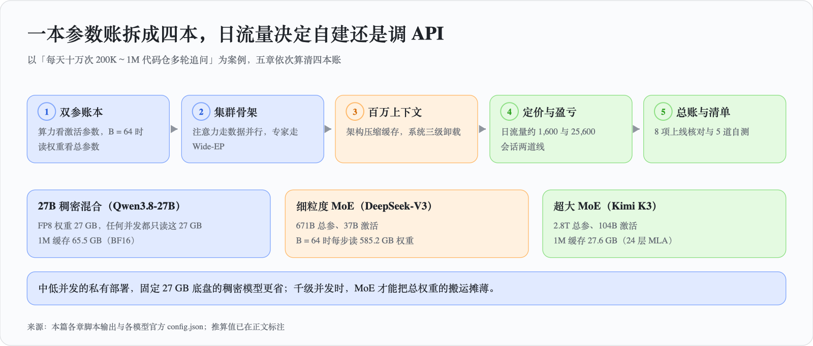
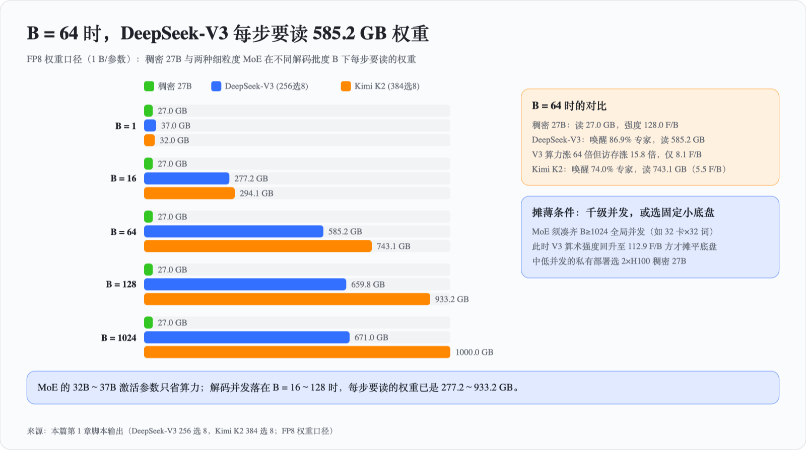
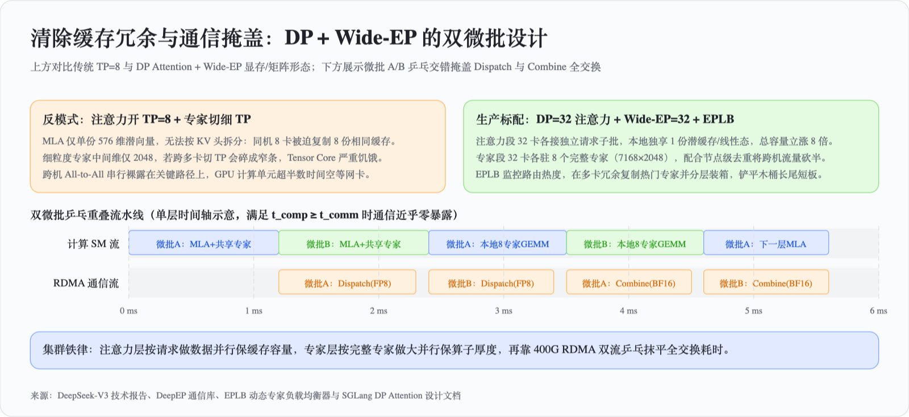
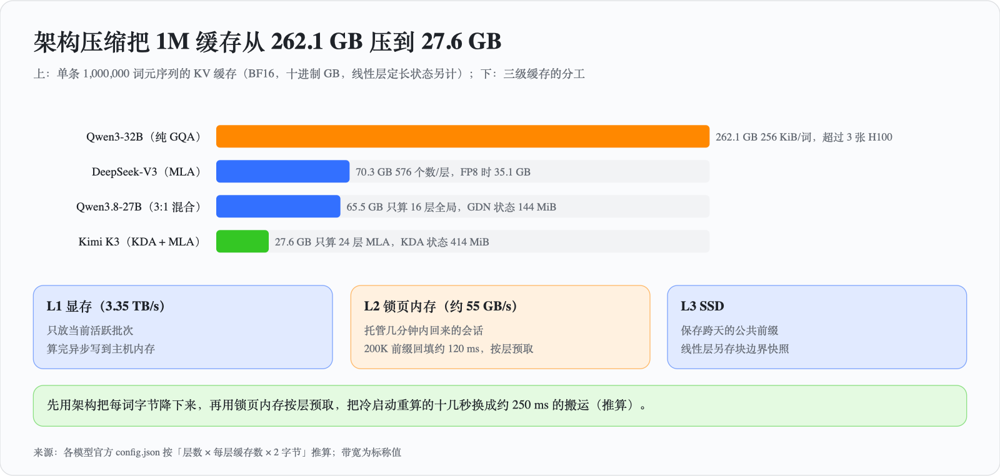
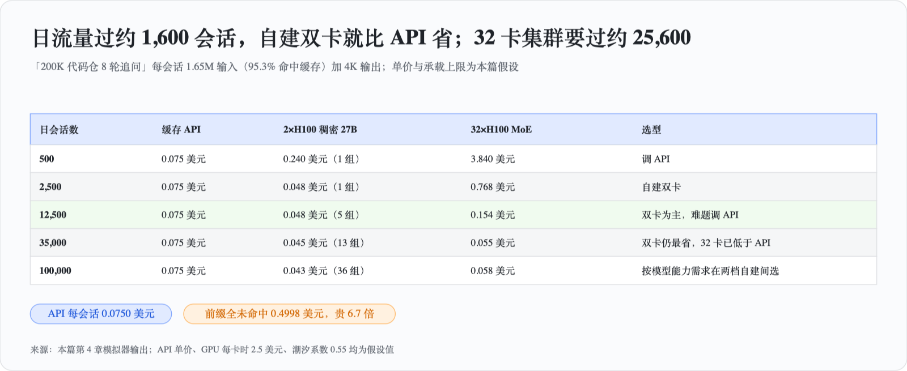
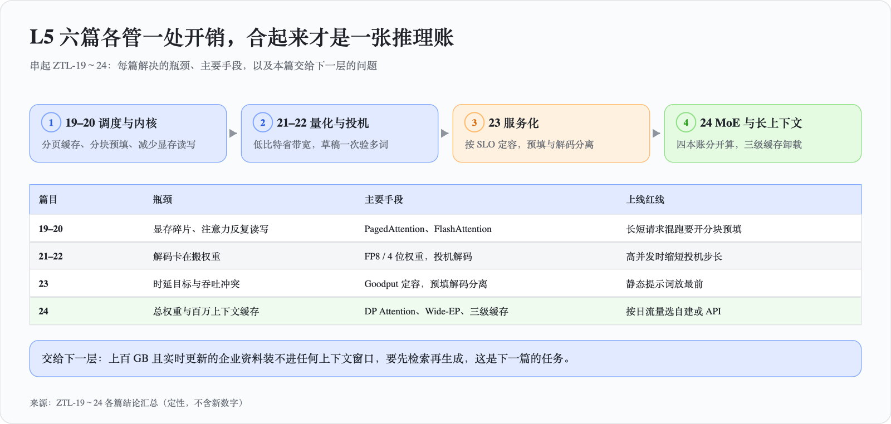

# ZTL-24｜系统｜长上下文与混合专家怎样改变账单

> 🎯 **这篇文档解决什么问题**：<b>核心命题：混合专家（MoE）和百万上下文把稠密模型的一本参数账拆成了四本，选型前必须分开算。总参数决定显存底盘，激活参数决定单步算力，并发度决定每步要搬多少权重，上下文长度决定缓存有多大。四本账算清以后，日流量决定该自建还是调 API。</b>
>
> **使用方式与先修要求**：本篇是 **L5 推理与服务系统层**的收官篇。阅读前建议先熟悉算力显存算盘与键值压缩（第 06、08 篇）。同时建议回顾跨机通信阶梯（[ZTL-12｜训练｜多卡的账和中断后续上](./12-multi-gpu.md)）与分离式推理服务（[ZTL-23｜系统｜把模型部署成服务](./23-serving.md)）。
>
> 全篇围绕同一道生产选型题展开。<b>支撑每天十万次携带 `200K～1M` 代码仓的多轮追问，该自建双卡的 27B 稠密模型 `Qwen3.8-27B`、上 32 卡万亿 MoE 集群，还是按量调用缓存 API？</b>我们依次核算双参访存规律、集群并行拓扑、百万窗三级卸载与商业定价底牌。
>
> **动手实践**：第 1 章提供路由专家覆盖率与解码算术强度的蒙特卡洛核验脚本。第 4 章提供「200K 代码仓 8 轮追问」的经济账模拟器，算出三套方案的盈亏交点。

<b>🧭 主线位置</b>：上一篇 [ZTL-23｜系统｜把模型部署成服务](./23-serving.md) 打通了有效吞吐定容、前缀亲和路由与分离式服务。它留下了万亿稀疏参数与百万词上下文的成本问题。本篇将 MoE 路由、广域专家并行与三级缓存纳入统一算盘，收束 L5 推理系统层。面对超百 GB 且实时更新的企业动态知识库，下一篇 [ZTL-25｜工程｜先把相关材料找出来](./25-retrieval.md) 将开启 L6 工程层，构建三级高召回检索漏斗。

## 导读 · 先给结论

- <b>混合专家拆分了单参数账本，算力只认激活参，中等并发解码却需读遍总权重。</b>`DeepSeek-V3` 与 `Kimi K2` 的单步算力取决于激活参。但解码并发升至 `B=64` 时，路由分散使专家覆盖率升至七到九成。单步需搬运 `585～743 GB` 权重。千级并发才能摊平万亿底盘，中低并发的私有部署反而是 27B 稠密模型更经济[[1]](https://arxiv.org/abs/1701.06538)[[2]](https://arxiv.org/abs/2412.19437)[[3]](https://huggingface.co/Qwen/Qwen3.8-27B/blob/main/config.json)[[4]](https://arxiv.org/abs/2507.20534)。
- <b>细粒度专家忌用张量并行切碎矩阵，万亿集群标配 DP Attention 加 Wide-EP 重叠。</b>注意力层开 `TP=8` 会迫使同机 8 卡克隆 8 份相同的潜缓存。改走 `DP Attention` 让各卡独享请求，缓存容量直接扩增 8 倍。专家层用 `Wide-EP` 托管完整专家，靠双微批乒乓掩盖全交换，并配 `EPLB` 复制热门专家[[5]](https://github.com/deepseek-ai/DeepEP)[[6]](https://github.com/deepseek-ai/EPLB)[[7]](https://github.com/sgl-project/sglang/blob/main/python/sglang/srt/layers/dp_attention.py)。
- <b>架构压缩缓存，系统分层卸载，两者合起来才扛得住百万上下文。</b>越过约 `60K` 的拐点后，二次方注意力的算力反超前馈层。单条 1M 序列的 BF16 缓存在纯 GQA8 下达 `262.1 GB`，混合架构降到 `65.5 GB`（Qwen3.8-27B）和 `27.6 GB`（Kimi K3）。再配锁页内存按层预取，`200K` 续轮首字可压到约 `250 ms`（本篇推算）[[3]](https://huggingface.co/Qwen/Qwen3.8-27B/blob/main/config.json)[[8]](https://arxiv.org/abs/2607.24653)[[9]](https://github.com/sgl-project/sglang/blob/main/docs/docs/advanced_features/hicache_design.mdx)[[10]](https://arxiv.org/abs/2407.00079)。
- <b>商业 API 十倍阶梯价差与三年 140 倍降幅，均对应底层硬件公式。</b>Output 比 Input 贵 3～8 倍源于串行占带宽与显存久占。Cache Hit 打 1～2 折源于省去二次方预填。从 2023 年 `GPT-4` 输出每百万词 60 美元，降到 2026 年 `Qwen3.8-Flash` 输出每百万词 3 元（约 0.43 美元），降幅来自稀疏、低比特、缓存与硬件代际的叠加[[2]](https://arxiv.org/abs/2412.19437)[[11]](https://github.com/QwenLM/Qwen3.8-Flash-Next/blob/main/tech_report.pdf)[[12]](https://resources.nvidia.com/en-us-tensor-core/nvidia-tensor-core-gpu-datasheet)。
- <b>自建与调 API 的盈亏平衡线，取决于日请求量能否喂饱集群固定底盘。</b>在 `200K` 代码仓 8 轮追问下，日低于 `1,600` 会话调缓存 API 最省。日达十万次追问（`12,500` 会话）时，双卡 27B 稠密模型加 API 混合分流，比低负载的 `32×H100` 省约 68% 预算。日超 `25,600` 会话才跨过万亿 MoE 自建线[[3]](https://huggingface.co/Qwen/Qwen3.8-27B/blob/main/config.json)[[9]](https://github.com/sgl-project/sglang/blob/main/docs/docs/advanced_features/hicache_design.mdx)[[12]](https://resources.nvidia.com/en-us-tensor-core/nvidia-tensor-core-gpu-datasheet)。



<b>📎 与系列其他文档的分工</b>：算术强度与前向 `2P` 算力见 [ZTL-01｜数学｜符号、向量与矩阵乘法](./01-matmul.md) 与 [ZTL-06｜数学｜一张纸算清算力、显存与缩放](./06-compute-memory-scaling.md)。GQA、MLA 与混合注意力见 [ZTL-08｜模型｜把注意力写成矩阵](./08-attention.md) 与 [ZTL-20｜系统｜减少注意力的内存搬运](./20-flash-attention.md)。旋转位置调频与跨机带宽阶梯见 [ZTL-09｜模型｜让模型知道顺序](./09-position.md) 与 [ZTL-12｜训练｜多卡的账和中断后续上](./12-multi-gpu.md)。

<b>📎 与系列其他文档的分工（续）</b>：隐藏思考链计费见 [ZTL-18｜后训练｜多想一会儿是否值得](./18-test-time-compute.md)。单机调度、量化、投机解码与分离式服务见第 19～22 篇及 [ZTL-23｜系统｜把模型部署成服务](./23-serving.md)。百 GB 动态知识库检索移交下一篇 [ZTL-25｜工程｜先把相关材料找出来](./25-retrieval.md)。

## 第 1 章 · 总参数管存储，激活参数管算力

混合专家（MoE）的核心创新是用稀疏激活拆分账本。设想一个玩具 MoE：8 个专家，每词选 2 个（Top-2），总参 `80B`，每词激活 `20B`。预填时单词算力恒为 `40 GFLOPs`。但进入解码时，单步批处理 1 个词时，2 个随机选中的专家对应的 `20B` 权重必须读入。

若并发升至 `B=8`，覆盖率变为 $`1-\left(\frac{6}{8}\right)^8\approx 90.0\%`$，单步要读约 `72B`。到 `B=16` 时覆盖率升到 99.0%，几乎每步都要读全量 `80B`。进入万亿稀疏的 `DeepSeek-V3`（`671B / 37B`，256 选 8）时，折叠在 `B=64` 时更加极端：要读 `585B` 权重，覆盖 87% 的路由专家。

承接 [ZTL-23｜系统｜把模型部署成服务](./23-serving.md) 篇末的规模化问题，我们先执行**立目标**与**算上限**。假设研发平台要支撑**每天十万次多轮代码追问**（折合 `12,500` 次连续 8 轮会话）。每次会话挂载 `200K～1M` 词元代码仓。指标要求续轮首字延迟 `P95 TTFT ≤ 500 ms`、单步解码 `TPOT ≤ 30 ms`，单会话成本压进 `0.08 美元`。

候选架构有三套。团队可以双卡单机跑 27B 稠密混合模型 `Qwen3.8-27B`（下文简称 27B 稠密模型），可以跨机拉起 32 卡的万亿级 MoE 集群，也可以按量调商业缓存 API。在 [ZTL-06｜数学｜一张纸算清算力、显存与缩放](./06-compute-memory-scaling.md) 的稠密算盘里，单一参数量同时统管显存、算力与带宽。进入混合专家（MoE）时代后，这本单账本一分为二[[1]](https://arxiv.org/abs/1701.06538)[[2]](https://arxiv.org/abs/2412.19437)。<b>总参数量决定静态显存底盘，激活参数量决定单词算力，而解码批度则支配着每步实际搬运的权重量。</b>

### 1.1 共享专家加路由专家

早期粗粒度 MoE 仅设 8 个大专家做 8 选 2 路由，组合仅有 28 种。高频通用语法还被迫在各专家中重复占空间。现代前沿架构全面转向**常驻共享专家加细粒度路由专家**范式[[2]](https://arxiv.org/abs/2412.19437)[[4]](https://arxiv.org/abs/2507.20534)[[13]](https://arxiv.org/abs/2405.04434)。设隐状态为 $`x`$，共享集为 $`\mathcal{S}`$，候选路由专家数为 $`E`$，MoE 前馈层输出写为：

```math
y = \sum_{i \in \mathcal{S}} u_i(x) + \sum_{j \in \mathrm{TopK}(g(x),\, k)} g_j(x)\, e_j(x)
```

首项常驻激活以承接通用句法。次项仅唤醒得分最高的 $`k`$ 个窄专家加权求和。横向对比四大代表模型，两条路线各有侧重：

- <b>稠密混合标杆 `Qwen3.8-27B`（`27B / 27B`）。</b>64 层权重全激活（48 层 GDN 加 16 层门控 GQA）。BF16 权重占 `54 GB`，FP8 权重仅 <b>`27 GB`</b>。单张 32 GiB（约 34.4 GB）的 `RTX 5090` 装得下 FP8 的 27 GB，装不下 BF16 的 54 GB；剩下约 7 GB 只够小批量、短上下文。单词算力恒为 `54 GFLOPs`[[3]](https://huggingface.co/Qwen/Qwen3.8-27B/blob/main/config.json)。
- <b>细粒度稀疏标杆 `DeepSeek-V3`（`671B / 37B`）。</b>MoE 层设 `1` 个共享专家与 `256` 个路由专家（中间维缩至 `2048`），每词选 `8` 个。总参 `671B` 而单词算力仅 `74 GFLOPs`，激活比 `5.5%`[[2]](https://arxiv.org/abs/2412.19437)。
- <b>万亿稀疏标杆 `Kimi K2`（`1T / 32B`）。</b>每层设 `1` 个共享专家与 `384` 个路由专家，每词选 `8` 个。总参达 `1,000B`，单词激活仅 `32B`，算力 `64 GFLOPs`[[4]](https://arxiv.org/abs/2507.20534)。
- <b>超大规模标杆 `Kimi K3`（`2.8T / 104B`）。</b>每词从 896 个路由专家里选 16 个，FP8 静态底盘约 `2.8 TB`，单词算力约 `208 GFLOPs`，只适合部署在云端百卡共享池[[8]](https://arxiv.org/abs/2607.24653)。

### 1.2 并发一高就要读遍权重

拿着 `37B` 激活参去**算上限**时，很容易落入误区。不少人以为 `DeepSeek-V3` 解码每步只需读 `37 GB` 显存。拆开预填与解码两本账，结果截然不同。

在 Prefill 阶段，每个词元只算激活路径，单词算力恒为 $`2\Psi_{\mathrm{act}}`$。然而进入 Decode 阶段后，连续批处理把 $`B`$ 个不同会话的当前词元拼成一拍过门控。均衡路由下单专家单次未命中的概率为 $`1 - k/E`$。经批内 $`B`$ 个词元抽样后，任一专家**至少命中一次**的覆盖率为：

```math
P_{\mathrm{cov}}(B) = 1 - \left(1 - \frac{k}{E}\right)^B
```

只要某专家被批内 1 个词元选中，整块权重就必须从 HBM 读入片上。设常驻参数为 $`\Psi_{\mathrm{shared}}`$，路由池为 $`\Psi_{\mathrm{routed}}`$，FP8 下活跃权重读取量与算术强度为：

```math
W_{\mathrm{read}}(B) = \Psi_{\mathrm{shared}} + P_{\mathrm{cov}}(B)\,\Psi_{\mathrm{routed}}, \qquad \mathrm{AI}_w(B) = \frac{2 B \Psi_{\mathrm{act}}}{W_{\mathrm{read}}(B)}
```

代入 `DeepSeek-V3` 核算：`B=1` 时仅读 `37.0 GB`。一旦并发升至常规水位 <b>`B=64`</b>，覆盖率便达 `86.9%`，单步需搬运 <b>`585.2 GB`</b> 权重。总算力虽涨 64 倍，权重搬运却同步涨了 `15.8` 倍。算术强度停在 <b>`8.1 FLOPs/Byte`</b>，远低于 H100 FP8 约 `590 FLOPs/Byte` 的脊点。

批度再往两头看：`B=16` 时 DeepSeek-V3 与 Kimi K2 每步已分别读 277.2 GB 与 294.1 GB，`B=128` 时升到 659.8 GB 与 933.2 GB，都接近总参数。

反观 27B 稠密模型，从 `B=1` 到 `B=64` 权重读取恒为 `27.0 GB`，算术强度线性升至 <b>`128.0 FLOPs/Byte`</b>。它还自带一层多词预测（MTP）头，可做投机解码，读一次权重验证多个位置[[3]](https://huggingface.co/Qwen/Qwen3.8-27B/blob/main/config.json)，细节见 [ZTL-22｜系统｜让草稿减少解码开销](./22-speculative.md)。



对照上方活跃权重与算术强度双曲线图，可以看到细粒度 MoE 的「中等批度饥饿区」。当并发从 `B = 1` 爬升至 `B = 64` 时，覆盖率陡增近九成，把分母里的活跃权重迅速顶向全量总参，导致每专家平均只分到约 2 个词元。唯有跨过 `B = 512 ～ 1024` 大关，分子算力才重新拉升算术强度。四大标杆模型在三档批度下的对比如下：

| <b>评估维度（FP8 权重口径）</b> | <b>Qwen3.8-27B（稠密混合）</b> | <b>DeepSeek-V3（细粒度）</b> | <b>Kimi K2（万亿稀疏）</b> | <b>Kimi K3（超大规模）</b> |
|---|---|---|---|---|
| <b>总参 / 激活参（路由规格）</b> | `27B / 27B`（全激活） | `671B / 37B`（1+256选8） | `1000B / 32B`（1+384选8） | `2.8T / 104B`（896 选 16） |
| **静态底盘 / 单词前向算力** | `27.0 GB` / `54 GFLOPs` | `671.0 GB` / `74 GFLOPs` | `1000.0 GB` / `64 GFLOPs` | 约 `2.8 TB` / 约 `208 GFLOPs` |
| <b>`B = 1` 单步权重读取</b> | `27.0 GB`（100% 权重） | `37.0 GB`（3.1% 专家） | `32.0 GB`（2.1% 专家） | 仅读激活子集，难摊租卡费 |
| <b>`B = 64` 活跃权重与强度</b> | <b>`27.0 GB`（`128.0 F/B`）</b> | `585.2 GB`（仅 `8.1 F/B`） | `743.1 GB`（仅 `5.5 F/B`） | 要读 TB 级权重，本篇未逐项复算 |
| <b>`B = 1024` 活跃权重与强度</b> | `27.0 GB`（`2048.0 F/B`） | <b>`671.0 GB`（`112.9 F/B`）</b> | <b>`1000.0 GB`（`65.5 F/B`）</b> | 靠百卡千级并发池摊薄底盘 |

### 1.3 用模拟核验覆盖率

下方脚本同时运行解析公式与无放回抽样模拟，复现稠密混合模型与细粒度 MoE 的批缩放差异：

*稠密混合 Qwen3.8-27B 与细粒度 MoE 活跃专家覆盖率及解码权重算术强度模拟*

```python
import random

def sim_moe_reuse(name, psi_tot, psi_act, e_num, k_sel, batches, trials=400):
    rng = random.Random(2026)
    psi_routed = 0.0 if e_num == 1 else (psi_tot - psi_act) / (1.0 - k_sel / e_num)
    psi_shared = psi_tot - psi_routed
    print(f"=== {name} (总参={psi_tot:g}B, 激活={psi_act:g}B, 常驻={psi_shared:.2f}B, {e_num}选{k_sel}) ===")
    for b in batches:
        p_cov = 1.0 if e_num == 1 else 1.0 - (1.0 - k_sel / e_num) ** b
        sim_cov = 1.0 if e_num == 1 else sum(
            len({e for _ in range(b) for e in rng.sample(range(e_num), k_sel)})
            for _ in range(trials)
        ) / (trials * e_num)
        w_gb = psi_shared + p_cov * psi_routed  # FP8 口径: 1 Byte/param
        ai = (2.0 * b * psi_act) / w_gb
        print(f"B={b:4d} | 覆盖={100*p_cov:5.1f}% (模拟={100*sim_cov:5.1f}%) | "
              f"读权重={w_gb:6.1f} GB | 算术强度={ai:6.1f} F/B")

sim_moe_reuse("Qwen3.8-27B",   27.0, 27.0,   1, 1, [1, 64, 1024])
sim_moe_reuse("DeepSeek-V3",  671.0, 37.0, 256, 8, [1, 16, 64, 128, 1024])
sim_moe_reuse("Kimi K2",     1000.0, 32.0, 384, 8, [1, 16, 64, 128, 1024])
```

*输出*

```text
=== Qwen3.8-27B (总参=27B, 激活=27B, 常驻=27.00B, 1选1) ===
B=   1 | 覆盖=100.0% (模拟=100.0%) | 读权重=  27.0 GB | 算术强度=   2.0 F/B
B=  64 | 覆盖=100.0% (模拟=100.0%) | 读权重=  27.0 GB | 算术强度= 128.0 F/B
B=1024 | 覆盖=100.0% (模拟=100.0%) | 读权重=  27.0 GB | 算术强度=2048.0 F/B
=== DeepSeek-V3 (总参=671B, 激活=37B, 常驻=16.55B, 256选8) ===
B=   1 | 覆盖=  3.1% (模拟=  3.1%) | 读权重=  37.0 GB | 算术强度=   2.0 F/B
B=  16 | 覆盖= 39.8% (模拟= 39.8%) | 读权重= 277.2 GB | 算术强度=   4.3 F/B
B=  64 | 覆盖= 86.9% (模拟= 87.0%) | 读权重= 585.2 GB | 算术强度=   8.1 F/B
B= 128 | 覆盖= 98.3% (模拟= 98.3%) | 读权重= 659.8 GB | 算术强度=  14.4 F/B
B=1024 | 覆盖=100.0% (模拟=100.0%) | 读权重= 671.0 GB | 算术强度= 112.9 F/B
=== Kimi K2 (总参=1000B, 激活=32B, 常驻=11.40B, 384选8) ===
B=   1 | 覆盖=  2.1% (模拟=  2.1%) | 读权重=  32.0 GB | 算术强度=   2.0 F/B
B=  16 | 覆盖= 28.6% (模拟= 28.6%) | 读权重= 294.1 GB | 算术强度=   3.5 F/B
B=  64 | 覆盖= 74.0% (模拟= 74.0%) | 读权重= 743.1 GB | 算术强度=   5.5 F/B
B= 128 | 覆盖= 93.2% (模拟= 93.2%) | 读权重= 933.2 GB | 算术强度=   8.8 F/B
B=1024 | 覆盖=100.0% (模拟=100.0%) | 读权重=1000.0 GB | 算术强度=  65.5 F/B
```

这份脚本最容易算错的是反推路由专家池总量的代数式 `(psi_tot - psi_act) / (1.0 - k_sel / e_num)`。不能直接拿总参减去激活参充当路由池，因为激活参 `37B` 里除了常驻注意力与共享专家外，已经包含了当步选中的 `8/256` 路由专家。除以未激活比例 $`248 / 256`$ 后，才能精确还原出 `DeepSeek-V3` 的 `654.45B` 路由池与 `16.55B` 常驻底座。

再看蒙特卡洛核对项：每个词元内部调用无放回抽样 `rng.sample(range(e_num), k_sel)` 选出 8 个互异专家，跨词元独立求并集。400 次随机试验测得的覆盖率与闭式解偏差不超过 `0.1%`。输出证实了 `B = 64` 时的反差：27B 稠密模型的算术强度已升至 `128.0 F/B`，而 `DeepSeek-V3` 与 `Kimi K2` 分别卡在 `8.1 F/B` 与 `5.5 F/B` 的重度带宽受限区。

> 💡 <b>常见误区：看 MoE 激活参仅 32B～37B，便照搬 27B 稠密模型的双卡经验估算备卡数。</b>现象是少量显卡装不下权重，凑够 16 卡跑几十路并发后解码延迟仍远超预期。根因是混淆了单步算力与静态底盘两本账，`B=64` 时单步访存已升至六七百 GB。改法是按总参数加峰值缓存定容，中低并发的私有部署优先考虑 27B 稠密模型[[2]](https://arxiv.org/abs/2412.19437)[[3]](https://huggingface.co/Qwen/Qwen3.8-27B/blob/main/config.json)。

> 🔑 **本章要点与回到主线**：立目标与算上限之后，结论是细粒度 MoE 在 `B=64` 时权重几乎得不到复用：DeepSeek-V3 每步读 585.2 GB，算术强度只有 8.1。唯有汇聚千级全局并发才能摊薄数百 GB 权重的搬运开销。但新的矛盾随之浮现。跨几十张卡切分细粒度专家时，为何传统张量并行会让算力与显存同时受损？这正是第 2 章要解决的问题。

## 第 2 章 · 专家并行的账在通信

顺着第 1 章的多机切分问题，本章进入**找瓶颈**阶段。单台 `8×H100 80GiB` 十进制总显存仅 `687.2 GB`。装入 `671 GB` 权重后只剩十余 GB 空间。要承接千级全局并发摊薄底盘，模型必须部署在 32 至 128 卡跨机集群上。若照搬稠密时代的张量并行（TP），注意力缓存与专家矩阵会双双受挫。

### 2.1 注意力层不必复制缓存

先给注意力模块**找瓶颈**。多头潜注意力（MLA）是一种用低秩潜向量代替独立键值头的方法，让所有键值头共享一份 512 维潜向量加 64 维旋转键。在 [ZTL-08｜模型｜把注意力写成矩阵](./08-attention.md) 中标准的多头注意力有 8 个独立键值头，开 `TP=8` 时每卡分管 1 头。MLA 的优势本是让键值缓存更小，但跨卡部署时却面临新瓶颈[[2]](https://arxiv.org/abs/2412.19437)[[13]](https://arxiv.org/abs/2405.04434)。

这份潜向量是 128 个查询头的公共底数，无法沿头维度再切开。若注意力层开启机内 `TP=8`，同机 8 张 GPU 处理同批请求时，**每张卡都必须在本地重复保存同一份潜缓存**。靠 MLA 省下的显存会因 8 倍克隆白白浪费[[7]](https://github.com/sgl-project/sglang/blob/main/python/sglang/srt/layers/dp_attention.py)。

数据并行注意力（DP Attention）通过改变并行轴来打破这个僵局。让注意力层改用数据并行，不再用张量并行[[2]](https://arxiv.org/abs/2412.19437)[[7]](https://github.com/sgl-project/sglang/blob/main/python/sglang/srt/layers/dp_attention.py)。以 4 机 `32×H100` 集群为例，32 张卡在层内动态切换并行轴。在**注意力与共享专家段**，32 张卡各自承接不同用户的请求子批（`DP=32`）。每卡处理 32 个本地词元，全集群凑齐 `B=1024` 全局并发。每张卡只存自家子批的 1 份潜缓存，**全网零重复**，缓存容量直接扩大 8 倍。

### 2.2 专家切开后靠重叠藏通信

再给数百个细粒度路由专家**找瓶颈**。细粒度路由专家意味着每个专家的矩阵很小，直接用张量并行会把它切得更碎。`DeepSeek-V3` 有 256 个专家，单专家中间维只有 `2048`[[2]](https://arxiv.org/abs/2412.19437)。若用 `TP=32`，单卡会分到宽度仅 `64` 的碎片，完全喂不饱 GPU 计算单元。

大专家并行（Wide-EP）是另一条路：每张卡托管多个完整专家，不再切碎矩阵[[2]](https://arxiv.org/abs/2412.19437)[[5]](https://github.com/deepseek-ai/DeepEP)。`EP=32` 时每卡托管 `8` 个完整专家。进入路由专家段时，各张卡通过两轮全交换（`All-to-All`）收发词元[[5]](https://github.com/deepseek-ai/DeepEP)：

- <b>分发全交换（`Dispatch All-to-All`）。</b>门控选出 Top-8 专家后，将激活量化为 FP8 发往目标卡。配合**节点级去重转发**，同一词元命中远端同机多个专家时网卡只发 1 份副本。落地后再走 NVLink 扇出，跨机流量随之减少。
- <b>合并全交换（`Combine All-to-All`）。</b>各卡以分组矩阵乘算完本地专家。随后经第二次全交换把 BF16 结果发回原词元所属的 DP 卡。

具体来看解码通信成本。单卡 32 个词元、每词选 8 个专家，经节点级去重后单层收发约 `1.86 MB`，全 58 层MoE 累计 `108 MB`。按 400G RDMA 约 `45 GB/s` 的实效带宽估算，全交换耗时约 `2.40 ms`[[5]](https://github.com/deepseek-ai/DeepEP)[[6]](https://github.com/deepseek-ai/EPLB)。单步计算若按 `2.5 ms` 计，通信与计算相当。两者串行相加，单步就从 `2.5 ms` 变成 `4.9 ms`，吞吐减半（本节数字均为粗估）。

```math
t_{\mathrm{step}} \approx \max\!\left(t_{\mathrm{comp}},\, t_{\mathrm{comm}}\right), \qquad t_{\mathrm{comp}} \ge t_{\mathrm{comm}}
```

双微批乒乓重叠则是把本地词元分成 A、B 两批。通信流传输微批 A 时，计算流同时处理微批 B 的注意力和共享专家部分。如果这两个时间能吻合，就把 `2.40 ms` 通信隐藏在计算内。动态专家负载均衡（EPLB）进一步统计线上热度，将热门专家副本复制到多个节点，避免单张卡成为瓶颈[[6]](https://github.com/deepseek-ai/EPLB)。



细看下方 32 卡并行骨架的时间轴。计算流处理微批 B 的注意力和共享专家时，通信流同时发送微批 A 的激活到各专家所在卡，然后收回计算结果。如果设计得当，全部通信耗时都被掩盖在计算流之中。上下两条流的切分哲学正是：注意力层用数据并行消除缓存克隆，专家层用大并行保护矩阵厚度。三种架构方案的权衡如下：

| **32 卡集群切分架构** | **单专家矩阵形状与算子饱满度** | **MLA 潜缓存 / 线性态冗余度** | **跨机通信暴露与热点抗性** |
|---|---|---|---|
| <b>纯张量并行（`TP=32`）</b> | 切碎至 `7168×64`，核心严重饥饿 | **全网复制 32 份**，缓存池耗尽 | 每层 4 次跨机全归约串行阻塞 |
| <b>机内 `TP=8` 注意力 + `EP=32`</b> | 保留完整 `7168×2048`，矩阵饱满 | 机内**重复存 8 份**，损失 87.5% 容量 | 机内全归约叠加跨机全交换等待 |
| <b>`DP=32` 注意力 + `Wide-EP=32` + `EPLB`</b> | 保留完整 `7168×2048`，分组乘满载 | <b>仅存 1 份（零冗余）</b>，容量涨 8 倍 | 双微批乒乓零暴露 + 热门专家多副本 |

### 2.3 通信能藏住的底线

双微批乒乓重叠成功的前提是通信与计算的时间吻合，这取决于**通信算力掩盖比**：每 GB/s 带宽要配多少 TFLOP/s 计算能力[[5]](https://github.com/deepseek-ai/DeepEP)。在 DeepSeek-V3 这类模型中，配齐 NVLink 和 400G RDMA 时比例恰好吻合，`2.40 ms` 全交换能被掩盖。若换成普通以太网，带宽低、抖动大，全交换就藏不进计算，GPU 大部分时间在等网卡。

> 💡 <b>常见误区：在普通以太网多机环境强开跨机 `Wide-EP`，或长期关闭 `EPLB` 动态重平衡。</b>现象是总卡数翻了四倍，`TPOT` 不降反升，单张热点卡满载而其余卡空闲。根因是 TCP 抖动与带宽不足破坏了掩盖条件，叠加流量偏斜拖慢全交换。改法是跨机 `Wide-EP` 必配 200G/400G RDMA 与 `EPLB` 冗余副本[[5]](https://github.com/deepseek-ai/DeepEP)[[6]](https://github.com/deepseek-ai/EPLB)[[12]](https://resources.nvidia.com/en-us-tensor-core/nvidia-tensor-core-gpu-datasheet)。

> 🔑 **本章要点与回到主线**：万亿稀疏集群的标准骨架为注意力走 `DP` 免除潜缓存克隆，专家层走 `Wide-EP` 配双微批乒乓与 `EPLB` 掩盖全交换。但新的矛盾随之浮现。当代码仓上下文推向 `262K` 直至 `1,000,000` 词元时，二次方预填、百 GB 缓存与跨轮重算三道关卡同时出现。这正是第 3 章要解决的核心。

## 第 3 章 · 百万上下文先算 KV 账

承接百万词元的挑战，本章进入**做取舍**。[ZTL-09｜模型｜让模型知道顺序](./09-position.md) 已经说明，调整旋转位置编码或用外推方法，模型在数学上可以识别百万级下标。但数学可行不等于系统可用。要把 `200K～1M` 代码仓的多轮问答压进几百毫秒的响应，模型和系统都要付出代价。本章按三个方面核算：预填算力、缓存容量和跨轮卸载。

### 3.1 预填算力随长度平方增长

预填是输入端的第一道瓶颈。在全局注意力模型里，注意力算力随长度平方增长，前馈算力随长度线性增长。设预填长度为 $`S`$，激活参数为 $`\Psi_{\mathrm{act}}`$，层数为 $`L`$，注意力宽度为 $`d_{\mathrm{attn}}`$，按因果掩码计，预填总算力约为：

```math
F_{\mathrm{prefill}}(S) = 2\Psi_{\mathrm{act}} S + 2 L d_{\mathrm{attn}} S^2
```

两项相等时出现反超拐点：$`S^\star = \Psi_{\mathrm{act}} / (L d_{\mathrm{attn}})`$。以 `Qwen3-32B` 计算（激活 32.7B、64 层、注意力宽度 8192），拐点约为 6.2 万词元。到 1M 长度时，二次方注意力占总算力的 94%，即使按 H100 的稠密峰值 989 TFLOPS 计算，也要约 19 分钟[[12]](https://resources.nvidia.com/en-us-tensor-core/nvidia-tensor-core-gpu-datasheet)[[14]](https://arxiv.org/abs/2505.09388)。

系统侧的解法是条纹环形上下文并行：各卡分片处理序列，沿环路传递键值块，把一条长序列的预填摊到多张卡上[[15]](https://arxiv.org/abs/2310.01889)[[16]](https://arxiv.org/abs/2311.09431)。

架构侧的解法是减少做全局注意力的层，或让每层只看一部分词。Qwen3.8-27B 把 64 层里的 48 层换成线性复杂度的门控 DeltaNet（GDN），Kimi K3 把 93 层里的 69 层换成 KDA，都约占四分之三[[3]](https://huggingface.co/Qwen/Qwen3.8-27B/blob/main/config.json)[[17]](https://huggingface.co/moonshotai/Kimi-K3/blob/main/config.json)。DeepSeek-V4 混合压缩稀疏注意力与重度压缩注意力，报告称 1M 上下文下 V4-Pro 的单词推理算力只需 V3.2 的 27%[[18]](https://arxiv.org/abs/2606.19348)。

### 3.2 每词缓存怎样一代代变小

第二道瓶颈是显存容量。下面统一按 BF16 存 KV、FP32 存线性层状态，对比单条 1M 词元序列的缓存体积（十进制 GB）：

- <b>纯 GQA8 基线（`Qwen3-32B`）。</b>64 层每词占 `256 KiB`。单条 1M 序列高达 <b>`262.1 GB`</b>，超过 3 张 H100 的显存[[14]](https://arxiv.org/abs/2505.09388)。
- <b>潜空间压缩（`DeepSeek-V3` MLA）。</b>61 层每词压成 576 个数，单条 1M 序列 <b>`70.3 GB`</b>，FP8 存储时减半到 `35.1 GB`[[2]](https://arxiv.org/abs/2412.19437)。
- <b>3:1 线性混合（`Qwen3.8-27B`）。</b>48 层 GDN 各存一份定长状态，合计 `144 MiB`，不随长度增长。只有 16 层全局注意力每词占 `64 KiB`，单条 1M 序列 <b>`65.5 GB`</b>[[3]](https://huggingface.co/Qwen/Qwen3.8-27B/blob/main/config.json)。
- <b>线性混合加 MLA（`Kimi K3`）。</b>69 层 KDA 的定长状态按配置算合计 `414 MiB`。只有 24 层 MLA 随长度增长，每词 576 个数，单条 1M 序列 <b>`27.6 GB`</b>[[17]](https://huggingface.co/moonshotai/Kimi-K3/blob/main/config.json)[[19]](https://arxiv.org/abs/2510.26692)。

KDA 的定长状态按下式逐词更新：先按门控 $`\alpha_t`$ 衰减旧状态，再沿当前键的方向擦掉一部分、写入新的键值对。状态的形状固定，所以显存不随上下文变长[[19]](https://arxiv.org/abs/2510.26692)。

```math
S_t = (I - \beta_t k_t k_t^\top)\mathrm{Diag}(\alpha_t)S_{t-1} + \beta_t k_t v_t^\top
```

**DeepSeek-V4 系列**走另一条路：减少产出缓存的层。按 V4.1-Flash 的配置，40 层里只有第 2、8、14、20 层产出 KV，其余层从这几层取用[[20]](https://huggingface.co/deepseek-ai/DeepSeek-V4.1-Flash/blob/main/config.json)。V4 报告给出的口径是：1M 上下文下 V4-Pro 的 KV 缓存只有 V3.2 的 10%[[18]](https://arxiv.org/abs/2606.19348)。V3.2 与 V3 同为每词 576 个数，据此估算单条 1M 序列约 `7 GB`（本篇推算，未实测）。



对照上图可以看出，架构压缩把 1M 缓存从 262.1 GB 压到几十 GB，但单靠它还不够：几十 GB 仍然占掉大半张卡，多轮会话的间隙里也不能一直占着。系统侧要配合分层卸载。以 Qwen3.8-27B 用 FP8 存全局层缓存为例，`200K` 历史前缀占 `6.55 GB`，再加 `144 MiB` 的 GDN 状态快照。

经单卡 PCIe 5.0 锁页通道（实效约 `55 GB/s`）回填这批缓存约需 `120 ms`。推理引擎用独立的拷贝流，在第 $`\ell`$ 层计算时预取第 $`\ell + 1`$ 层的缓存，把回填藏在计算背后。加上新问题的预填，续轮首字约 `250 ms`（本篇推算），而冷启动重算 200K 前缀要十几秒。

### 3.3 放不下就分层卸载

第三道瓶颈出在多轮间隙。缓存常驻显存会挤占并发槽位，驱逐后重算又要等十几秒。解法是三级缓存：热数据留在显存，温数据放主机内存，冷数据写 SSD，各层异步预取[[9]](https://github.com/sgl-project/sglang/blob/main/docs/docs/advanced_features/hicache_design.mdx)[[10]](https://arxiv.org/abs/2407.00079)。

- <b>L1 热层（GPU HBM3，`3.35 TB/s`）。</b>只驻留当前活跃批次的页块。当轮算完后，后台异步写到主机内存。
- <b>L2 温层（主机锁页内存，单卡约 `52～63 GB/s`）。</b>托管几分钟内还会回来的会话。续轮时**逐层异步预取**，边搬边算，把 `200K` 续轮首字压到约 `250 ms`[[9]](https://github.com/sgl-project/sglang/blob/main/docs/docs/advanced_features/hicache_design.mdx)。
- <b>L3 持久层（NVMe SSD）。</b>保存跨小时、跨天的公共前缀。混合架构要另存线性层状态的快照：线性层没有逐词缓存，只能在块边界保存状态，回退时从最近的快照继续算。滑动窗口层（V4 系列窗口 128 词）的缓存寿命短，可以不写进持久层，未命中时重算最后 128 词即可[[9]](https://github.com/sgl-project/sglang/blob/main/docs/docs/advanced_features/hicache_design.mdx)[[20]](https://huggingface.co/deepseek-ai/DeepSeek-V4.1-Flash/blob/main/config.json)。

下表把三道瓶颈放在一起。横向对照第 3 列「架构减负」和第 4 列「系统解法」：单靠系统卸载救不了 `262.1 GB` 的原始缓存，单靠架构压缩也留不住跨天空闲的会话，两者要一起用：

| **百万上下文三道瓶颈** | **纯 GQA 在 1M 下的量级** | **架构减负** | **系统解法** |
|---|---|---|---|
| **1. 预填算力** | 过约 6.2 万词反超前馈层；1M 时注意力占 94% | 约四分之三的层换成 GDN 或 KDA；V4 压缩稀疏注意力 | 条纹环形上下文并行，把预填摊到多卡 |
| **2. 缓存容量** | `Qwen3-32B` 单条 1M 占 `262.1 GB` | Qwen3.8-27B `65.5 GB`；Kimi K3 `27.6 GB`；V4 约为 V3.2 的 10% | 分页缓存；DP Attention 避免跨卡重复存 |
| **3. 跨轮重算** | 驱逐后重算 200K 前缀要十几秒 | 线性层定长状态只需存块边界快照 | `HiCache` 锁页内存按层预取（约 250 ms）加 SSD 持久层 |

> 💡 <b>常见误区：开启 `HiCache` 时没有配锁页内存，或者没给线性层状态存快照。</b>现象是 PCIe 5.0 的回填带宽远低于标称值，分支复用时输出异常。根因是可分页内存要先拷到中转缓冲区，而线性层状态无法按词回退。改法是预留大页锁页内存池，按块边界保存状态快照[[9]](https://github.com/sgl-project/sglang/blob/main/docs/docs/advanced_features/hicache_design.mdx)。

> 🔑 **本章要点与回到主线**：架构压缩把单条 1M 缓存从 `262.1 GB` 压到 `27.6 GB`（Kimi K3），三级缓存再把 200K 续轮首字压到约 `250 ms`（推算）。但新的矛盾随之浮现：云厂商「缓存命中打一到二折、输出贵三到八倍、三年降价约 140 倍」的价目表怎样对应这些硬件账？每天十万次追问在哪个流量刻度该自建？这正是第 4 章要核算的问题。

## 第 4 章 · 自建还是调用 API，看利用率

承接商业对账问题，本章执行第四步**测实际**。翻开 2026 年主流大模型云平台的价目表，四条规律高度一致。输出词单价是未命中输入的 **3～8 倍**，前缀缓存命中低至输入的 **1～2 折**。跨过 `128K～256K` 常设阶梯加价，且三年来低价档模型的输出单价累计下降了约 **140 倍**[[2]](https://arxiv.org/abs/2412.19437)[[11]](https://github.com/QwenLM/Qwen3.8-Flash-Next/blob/main/tech_report.pdf)。代入物理公式，整张价目表便还原为清晰的硬件成本单。

### 4.1 价目表里的硬件账

在预填解码分离（[ZTL-23｜系统｜把模型部署成服务](./23-serving.md)）与三级缓存集群内，计算、存储与通信都能靠稀疏化缩减。唯独机房供电功率是刚性底线。「每瓦有效词元产出」由此成为定价锚点。顺着硬件开销审视各项价差：

- <b>为何 Output 单价是 Input Miss 的 3～8 倍？</b>输入预填把上万词拼成稠密矩阵并行算完，几十毫秒即释放节点。自回归输出则逐词串行步进，每词重扫数百 GB 活跃权重。吐完 1,000 词（含 `<think>` 思考词，见 [ZTL-18｜后训练｜多想一会儿是否值得](./18-test-time-compute.md)）还要占用 HBM 槽位十余秒[[11]](https://github.com/QwenLM/Qwen3.8-Flash-Next/blob/main/tech_report.pdf)[[12]](https://resources.nvidia.com/en-us-tensor-core/nvidia-tensor-core-gpu-datasheet)。
- <b>为何 Prefix Cache Hit 能给到 1～2 折低价？</b>一旦命中 L2 DRAM 或 L3 SSD 持久池，服务端**直接省去了二次方预填计算**。实际损耗仅剩廉价 DDR5 或 NVMe 折旧以及毫秒级 PCIe 拉取带宽[[9]](https://github.com/sgl-project/sglang/blob/main/docs/docs/advanced_features/hicache_design.mdx)[[10]](https://arxiv.org/abs/2407.00079)。
- <b>为何超 `128K` 窗口常设阶梯加价？</b>输入端越过 `60K` 后注意力呈平方增长并伴随跨卡通信。输出端长窗缓存又压缩了并发度，迫使总权重由更少请求分摊[[15]](https://arxiv.org/abs/2310.01889)。

再看**三年输出单价下降约 140 倍**从哪里来。2023 年 3 月 `GPT-4 (8K)` 输出高达 `60 美元/1M`，2024 年底 `DeepSeek-V3` 压至 `1.10 美元/1M`。到 2026 年 8 月，`Qwen3.8-Flash` 官方价降至<b>输入 `1 元/1M`（约 `0.14 美元`）、输出 `3 元/1M`（约 `0.43 美元`）</b>[[2]](https://arxiv.org/abs/2412.19437)[[11]](https://github.com/QwenLM/Qwen3.8-Flash-Next/blob/main/tech_report.pdf)。本篇假设三年间一张旗舰 GPU 含整机供电散热（每卡约 1.1～1.4 kW）与折旧的全包成本大致在每卡时 2～3 美元。两端模型不在同一能力档，这个倍数只说明同样的钱能买到多少词。

既然单卡每小时的电费与折旧几乎没降，输出单价约 140 倍的降幅就只能来自每卡时产出词数的增加。它由几方面叠加而成。从全激活转向细粒度 MoE，单词算力降到 27B～37B 激活参数。权重从 16 位降到 FP8 乃至 4 位，搬运字节减半甚至降到四分之一。分离式服务与三级缓存省掉了大量重复预填，硬件代际又提升了每卡带宽。各项各占多少，公开资料没有可靠拆分，本篇不做定量归因。

| **时间与标杆模型** | <b>输入 / 输出目录价（每百万词）</b> | **核心架构与缓存代际特征** | **相对 2023 基线的物理降本杠杆** |
|---|---|---|---|
| <b>2023-03 `GPT-4`</b> | `30.00 美元` / <b>`60.00 美元`</b>（1:2） | 初代巨型架构 + 高精度权重 + 8K 短窗 | `1.0×` 历史价格基准锚点 |
| <b>2024-12 `DeepSeek-V3`</b> | `0.27 美元`（命中 `0.07 美元`）/ `1.10 美元` | 671B/37B 细粒度 MoE + MLA + 原生 FP8 | 输出降 <b>`54.5×`</b>；DP+EP 叠磁盘前缀缓存 |
| <b>2026-08 `Qwen3.8-Flash`</b> | `1 元≈0.14 美元` / <b>`3 元≈0.43 美元`</b>（1:3） | 低价轻量模型，配前缀缓存 | 输出累计降 <b>`140×`</b>；输入累计降逾 `210×` |

### 4.2 日流量决定集群还是 API

回到主线任务**测实际**。每次会话携带 `200K` 代码仓连续追问 `8` 轮，每轮新增 `1,000` 词提问并输出 `500` 词补丁。严守静态置顶后，首轮共享命中率取 `80%`，后续 7 轮命中率达 `98%`。下方脚本同台核算**商业缓存 API**、<b>自建双卡 `Qwen3.8-27B`</b> 与**自建 `32×H100` 万亿 MoE 池**在五档日流量下的单会话账单[[3]](https://huggingface.co/Qwen/Qwen3.8-27B/blob/main/config.json)[[9]](https://github.com/sgl-project/sglang/blob/main/docs/docs/advanced_features/hicache_design.mdx)[[12]](https://resources.nvidia.com/en-us-tensor-core/nvidia-tensor-core-gpu-datasheet)。API 单价按输入 0.30、命中 0.03、输出 1.20 美元每百万词假设，GPU 按每卡时 2.5 美元假设，两档自建池的日承载上限也是假设值，下文解释：

*200K 代码仓连续 8 轮追问场景下商业缓存 API 与两档自建集群的盈亏平衡模拟器*

```python
import math

GPU_USD_DAY = 2.50 * 24.0   # H100 全包折旧含电费: $2.50/卡时 = $60/卡天
REPO_TOK, TURNS, Q_TOK, OUT_TOK = 200_000, 8, 1_000, 500

def session_tokens(repo_hit=0.80, hist_hit=0.98):
    miss, hit = REPO_TOK * (1.0 - repo_hit) + Q_TOK, REPO_TOK * repo_hit
    for r in range(1, TURNS):
        hist = REPO_TOK + r * (Q_TOK + OUT_TOK)
        miss += hist * (1.0 - hist_hit) + Q_TOK
        hit  += hist * hist_hit
    return miss / 1e6, hit / 1e6, (TURNS * OUT_TOK) / 1e6

miss_m, hit_m, out_m = session_tokens()
api_sess = miss_m * 0.30 + hit_m * 0.03 + out_m * 1.20  # 缓存API: $0.30/$0.03/$1.20 每M
no_cache = (miss_m + hit_m) * 0.30 + out_m * 1.20       # 破坏前缀全Miss时的冤枉钱对照
print(f"单次8轮会话: Miss={miss_m*1e3:.1f}K, Hit={hit_m*1e3:.1f}K(占95.3%), Out={out_m*1e3:.1f}K")
print(f"API单会话成本: 开启缓存=${api_sess:.4f} vs 头部塞动态时间戳全Miss=${no_cache:.4f} (贵{no_cache/api_sess:.1f}倍)")

# 自建实例池规格: (方案名, 每组H100卡数, 扣除潮汐eta=0.55后单组日承载8轮会话上限)
pools = [("2xH100 Qwen3.8-27B", 2, 2800), ("32xH100 万亿MoE", 32, 36000)]
print(f"盈亏平衡点: 2xH100跨过 {120/api_sess:.0f} 会话/天; 32xH100跨过 {1920/api_sess:.0f} 会话/天")
for sess_d in [500, 2500, 12500, 35000, 100000]:
    turns_k = sess_d * TURNS // 1000
    nq = math.ceil(sess_d / pools[0][2])
    cq = (nq * pools[0][1] * GPU_USD_DAY) / sess_d
    nm = math.ceil(sess_d / pools[1][2])
    cm = (nm * pools[1][1] * GPU_USD_DAY) / sess_d
    print(f"日追问={turns_k:4d}K次({sess_d:6d}会话) | API=${api_sess:.3f} | 2xH100(x{nq:2d})=${cq:.3f} | 32xH100(x{nm})=${cm:.3f}")
```

*输出*

```text
单次8轮会话: Miss=76.8K, Hit=1573.2K(占95.3%), Out=4.0K
API单会话成本: 开启缓存=$0.0750 vs 头部塞动态时间戳全Miss=$0.4998 (贵6.7倍)
盈亏平衡点: 2xH100跨过 1599 会话/天; 32xH100跨过 25584 会话/天
日追问=   4K次(   500会话) | API=$0.075 | 2xH100(x 1)=$0.240 | 32xH100(x1)=$3.840
日追问=  20K次(  2500会话) | API=$0.075 | 2xH100(x 1)=$0.048 | 32xH100(x1)=$0.768
日追问= 100K次( 12500会话) | API=$0.075 | 2xH100(x 5)=$0.048 | 32xH100(x1)=$0.154
日追问= 280K次( 35000会话) | API=$0.075 | 2xH100(x13)=$0.045 | 32xH100(x1)=$0.055
日追问= 800K次(100000会话) | API=$0.075 | 2xH100(x36)=$0.043 | 32xH100(x3)=$0.058
```

逐段复核这份经济模拟器，先看 `session_tokens()` 算出的累计输入词数。代码仓本身虽只有 `200K` 词，但连续 8 轮追问每轮都要重带全量上文，整场会话累计输入达 `1,650.0K` 词（是单仓体积的 `8.25 倍`）。其中 `1,573.2K` 词（占 `95.3%`）命中 1 折前缀缓存，把 API 账单稳压在 `0.0750 美元`。一旦头部混入动态时间戳导致全未命中，单次会话跳升 `6.7 倍`至 `0.4998 美元`。

再看 `pools` 表中潮汐系数 $`\eta = 0.55`$ 的容量折算逻辑。若按 80% 水位稳态 `Goodput` 全天 24 小时满跑，单台 `2×H100` 理论日极限约 `5,090` 场会话，`32×H100` 可达约 `65,450` 场。

但真实研发流量呈现 1：8 的昼夜与周末波峰波谷。白天编码高峰必须留足瞬时并发槽位，深夜与双休日空置的包月 GPU 仍照常计提 `60 美元/卡天` 折旧与基础电费。将理论满载上限乘入潮汐系数 $`\eta = 0.55`$，才折算出真实的日承载上限 `2,800` 场与 `36,000` 场，再用日租金除以单会话 API 成本 0.075 美元，得出约 `1,600` 与约 `25,600 会话/天`两道平衡点（输出为 1599 与 25584）。



输出最后五行是五档日流量下的单会话成本。日 500 会话时，双卡每会话 0.240 美元、32 卡 3.840 美元，都比 API 贵。日 2,500 会话时双卡降到 0.048 美元，32 卡仍要 0.768 美元。日 35,000 会话时双卡 0.045 美元、32 卡 0.055 美元，两档自建都低于 API；日 100,000 会话时分别是 0.043 与 0.058 美元，双卡方案要开 36 组。

两道盈亏分水岭给出了明确结论。首道分水岭在 <b>`1,600 会话/天`（日追问 `1.28 万`次）</b>。低于此线直接调商业缓存 API 最省。跨过此线后，日租 `120 美元` 的双卡 `Qwen3.8-27B` 可将单会话成本压至 <b>`0.048 美元`</b>。

第二道分水岭在 <b>`25,600 会话/天`（日追问 `20.48 万`次）</b>。在<b>每天十万次追问（`12,500` 会话）</b>规模下，独租 `32×H100` 万亿 MoE 负载率仅 `34.7%`，单次成本高达 `0.154 美元`。此时最优方案是**混合分流**：用 4 台双卡 `Qwen3.8-27B` 消化 85% 常规单，将 15% 跨模块难题路由至云端 MoE 缓存 API。日总账单仅约 `621 美元`，比盲上 32 卡集群节省 <b>`67.7%`</b>。待日追问量突破二十五万次后，自建 32 卡集群才会满载跑赢商业 API。

> 💡 <b>常见误区：在 System Prompt 顶部塞入秒级动态时间戳或随机请求 ID。</b>现象是连续 8 轮追问同一代码仓，月底 API 账单却涨了 6.7 倍（单会话升至 `0.500 美元`）。根因是因果注意力键值严格依赖前序序列，顶部变动一字会让后方二十万词前缀匹配全断。改法是严守**静态指令置顶、历史居中、动态时间与新问题垫底**的拼接顺序[[9]](https://github.com/sgl-project/sglang/blob/main/docs/docs/advanced_features/hicache_design.mdx)[[10]](https://arxiv.org/abs/2407.00079)。

> 🔑 **本章要点与回到主线**：经测实际拆开价目表、跑完模拟器，我们看清了三年输出降价约 140 倍的来源，并算出了 `1,600` 与 `25,600 会话/天` 两道盈亏线。至此，整个 **L5 推理与服务系统层**（第 19～24 篇）全部收口。第 5 章将归档全层总账图、8 项投产清单与 5 道自测题，并交棒 L6 工程层。

## 第 5 章 · 系统层总账与投产清单

走到这里，整个 <b>L5 推理与服务系统层（第 19～24 篇）</b>正式收官。这六篇先解决单机分页调度、片上分块内核、低比特量化与无损投机，再打通分离式服务与百万窗 MoE 经济学。我们将每瓦电力与每分钱 API 账单都落到了定量公式上。本章执行收官动作**留证据**，归档 L5 总账图、8 项核对清单与 5 道定量自测题。

### 5.1 总账与上线前核对清单

下图汇总了 L5 推理系统层的六级降本提速杠杆，并标出本篇几个代表模型各自落在哪一档：



> 🎯 **核对清单：投产混合专家（MoE）与百万级长上下文服务前必查 8 项门禁**
>
> - <b>双参数账本分立核算。</b>备卡显存按总参数加并发缓存定容。解码带宽代入目标并发下的覆盖率 $`1 - (1 - k/E)^B`$，切忌套用单并发访存量[[2]](https://arxiv.org/abs/2412.19437)[[4]](https://arxiv.org/abs/2507.20534)。
> - <b>潜缓存与混合态开启 DP Attention。</b>部署 MLA 类模型时启用 DP Attention（SGLang 的 `--enable-dp-attention`），避免同机 `TP=8` 重复克隆 8 份潜缓存[[7]](https://github.com/sgl-project/sglang/blob/main/python/sglang/srt/layers/dp_attention.py)[[8]](https://arxiv.org/abs/2607.24653)。
> - <b>细粒度专家绑定 Wide-EP、RDMA 与 EPLB。</b>用 `Wide-EP` 保留完整矩阵厚度。配 200G/400G RDMA 跑双微批重叠，并开启 `EPLB` 多副本复制热门专家[[5]](https://github.com/deepseek-ai/DeepEP)[[6]](https://github.com/deepseek-ai/EPLB)[[12]](https://resources.nvidia.com/en-us-tensor-core/nvidia-tensor-core-gpu-datasheet)。
> - <b>超 60K 长输入配线性稀疏或环形切分。</b>越过 `60K` 拐点的冷导入采用线性混合架构、稀疏注意力或条纹环形并行[[15]](https://arxiv.org/abs/2310.01889)[[16]](https://arxiv.org/abs/2311.09431)[[18]](https://arxiv.org/abs/2606.19348)。
> - <b>三级卸载强制锁页内存与按层预取。</b>开启 `HiCache` 或 `Mooncake` 时预留大页锁页内存，绑定独立 DMA 流做逐层计算重叠[[9]](https://github.com/sgl-project/sglang/blob/main/docs/docs/advanced_features/hicache_design.mdx)[[10]](https://arxiv.org/abs/2407.00079)。
> - <b>异构缓存按生命周期分池治理。</b>混合架构的线性层按块边界保存状态快照；滑动窗口层的短命缓存不进持久层，未命中时重算窗口[[3]](https://huggingface.co/Qwen/Qwen3.8-27B/blob/main/config.json)[[20]](https://huggingface.co/deepseek-ai/DeepSeek-V4.1-Flash/blob/main/config.json)。
> - <b>提示词严守静态前缀置顶契约。</b>动态时间戳与本轮提问统一移至末尾，确保线上前缀命中率稳定高于 `90%`[[9]](https://github.com/sgl-project/sglang/blob/main/docs/docs/advanced_features/hicache_design.mdx)。
> - <b>对照两道日流量平衡线选定部署模式。</b>代入潮汐系数核对双卡池（`1,600 会话/天`）与 32 卡 MoE 池（`25,600 会话/天`）盈亏线，避免低负载空转[[3]](https://huggingface.co/Qwen/Qwen3.8-27B/blob/main/config.json)[[12]](https://resources.nvidia.com/en-us-tensor-core/nvidia-tensor-core-gpu-datasheet)。

### 5.2 自测题与参考解析

请合上正文，独立手算以下 5 道综合定量自测题：

<b>自测题 1（万亿 MoE 活跃覆盖率与解码算术强度）。</b>`Kimi K2` 总参 `1,000B`、激活 `32B`（常驻 `11.40B`、路由池 `988.60B`，384 选 8）[[4]](https://arxiv.org/abs/2507.20534)。在均匀路由与 FP8 下，求并发 `B=64` 时的专家覆盖率、单步权重读取量与算术强度（取 $`(376/384)^{64} \approx 0.2599`$）。

<b>参考解析。</b>覆盖率为 `1 - 0.2599 =` <b>`74.01%`</b>。单步读取 FP8 权重为 <b>`743.1 GB`</b>。单步算力为 `4,096 GFLOPs`，算术强度仅为 <b>`5.51 FLOPs/Byte`</b>，远低于同批度下 `Qwen3.8-27B` 的 `128.0 F/B`。

<b>自测题 2（MLA 误开 TP=8 与改开 DP Attention 槽位对比）。</b>在 `32×H100`（每卡净剩 `50.0 GB` 缓存池）上运行 `DeepSeek-V3`，单条 `200K` 会话 FP8 MLA 缓存占 `7.027 GB`[[2]](https://arxiv.org/abs/2412.19437)[[7]](https://github.com/sgl-project/sglang/blob/main/python/sglang/srt/layers/dp_attention.py)。求「机内误开 `TP=8`（4 组）」与「全网开 `DP=32`」最多常驻多少条会话。

<b>参考解析。</b>误开 `TP=8` 时同组 8 卡克隆同一份潜缓存，单组仅容纳 `7` 条，4 组共 <b>`28 条`</b>。改开 `DP=32` 后各卡零重复独享缓存，每卡容 `7` 条，全网扩增 8 倍至 <b>`224 条`</b>。

<b>自测题 3（三种架构在 1M 词元下的缓存对账）。</b>单条序列长 $`S = 10^6`$ 词元，按十进制、BF16 存 KV、FP32 存线性层状态，计算三款模型的缓存体积：方案 ① `Qwen3-32B`（`262,144 B/词`），方案 ② `Qwen3.8-27B`（全局层 `65,536 B/词` 加 `144 MiB` GDN 状态），方案 ③ `Kimi K3`（24 层 MLA 共 `27,648 B/词` 加 `414 MiB` KDA 状态），并求 ③ 相对 ① 的缩减倍数[[3]](https://huggingface.co/Qwen/Qwen3.8-27B/blob/main/config.json)[[14]](https://arxiv.org/abs/2505.09388)[[17]](https://huggingface.co/moonshotai/Kimi-K3/blob/main/config.json)。

<b>参考解析。</b>方案 ① 占 <b>`262.14 GB`</b>。方案 ② 全局层占 `65.54 GB`，加约 `0.15 GB` 定长状态，合计约 <b>`65.69 GB`</b>，已超过一张 H100 扣掉 54 GB BF16 权重后剩下的约 32 GB。方案 ③ 占 `27.65 GB`，加约 `0.43 GB` 定长状态，合计约 <b>`28.08 GB`</b>，相对纯 GQA 缩减约 <b>`9.3 倍`</b>。

<b>自测题 4（头部动态时间戳破坏缓存的日账单差额）。</b>按 `Qwen3.8-Flash` 目录价（输入 `1.0 元/1M`、命中按输入二折假设为 `0.2 元/1M`、输出 `3.0 元/1M`）日跑 `10,000` 次 8 轮会话（总输入 `1.65M`、输出 `4.0K`）[[11]](https://github.com/QwenLM/Qwen3.8-Flash-Next/blob/main/tech_report.pdf)。求「头部塞时间全未命中」与「静态置顶 `95%` 命中」的日费用差额。

<b>参考解析。</b>单会话输出费恒为 `0.012 元`。全未命中日耗 <b>`16,620 元`</b>。静态置顶后单会话共 `0.408 元`，日费仅 <b>`4,080 元`</b>。挪动一行时间戳每天净省 <b>`12,540 元`（节省 `75.5%`）</b>。

<b>自测题 5（混合分流架构 vs 纯自建 32 卡集群年省核算）。</b>日均 `12,500` 次 8 轮会话。方案甲包月租 `32×H100`（`1,920 美元/天`）。方案乙租 `4` 台 `2×H100`（每台 `120 美元/天`，日容 `2,800` 会话）承接 `85%` 常规单，其余 `15%` 疑难单调 `0.075 美元/次` 的云端 API。求方案乙全年（365 天）净省金额。

<b>参考解析。</b>常规单 `10,625 会话/天`，4 台双卡容量 `11,200` 充裕达标，日租 `480 美元`。疑难单 `1,875 会话/天` 调 API 花 `140.63 美元`。方案乙日费仅 <b>`620.63 美元`</b>，全年较方案甲净省 <b>`474,272 美元`（节省 `67.7%`）</b>。

### 5.3 接下来的问题在哪

合上本篇，**L5 推理与服务系统层**六篇工程拼图全部齐备。从第 19～20 篇的分页连续批处理与片上 SRAM 递推，到第 21～23 篇的低比特量化、无损投机与预填解码分离，再到本篇的万亿 MoE 集群与百万词三级卸载，我们已经把推理系统的效率推到了硬件边界。

然而进入真实的企业生产业务，还会遇到另一重规模约束。企业内部的多仓库源码、微服务手册以及实时更新的线上工单库，总量动辄高达<b>上百 GB 乃至 TB 级（十亿至百亿词元）</b>。即便拥有原生 `1M` 上下文窗口与 1 折缓存价，依然存在三道刚性限制。十亿词库装不进百万窗口，实时刷新的工单每秒都在改变静态前缀，且塞入大量无关背景既拉高延迟又易诱发事实幻觉。

因此在调用大模型生成任何字符之前，系统必须先配备一套高精度的证据检索管线。从下一篇 [ZTL-25｜工程｜先把相关材料找出来](./25-retrieval.md) 开始，我们正式跨入 **L6 应用与 Agent 工程层**，先用锁定标准分母的离线标尺定位漏召回根因，再搭建三级高召回混合检索漏斗精准找出核心证据。

### 5.4 诚实清单与修订记录

**未核实与有时效的说法**：

1. <b>「Qwen3.8-Flash 输入 1 元/输出 3 元每百万词」。</b>为什么不确定：云厂商目录价时效性强，查询日期为 2026-11-18。怎样核实：访问 Qwen 官方价格页面确认最新报价。
2. <b>「三年输出单价累计下降约 140 倍」。</b>为什么不确定：2023 年基线 （GPT-4 60 美元/1M） 与 2026 年对标 （Qwen3.8-Flash 3 元≈0.43 美元/1M） 源自公开目录价，未考虑各厂内部成本差异或未来价格变动。怎样核实：参考 spec/frontier_facts.md 中各模型的原始定价来源。
3. <b>「日流量 1,600 会话 / 天和 25,600 会话 / 天的盈亏平衡点」。</b>为什么不确定：折算依赖潮汐系数 η=0.55 和 GPU 包月折旧假设，不同机房与计费模式会改变这些系数。怎样核实：按本篇第 4.2 节的 Python 模拟器，代入贵司实际潮汐曲线与硬件成本重算。
4. <b>「DeepSeek-V3 68.6 KiB/tok 与 Qwen3.8-27B 全局层 64 KiB/tok」。</b>为什么不确定：KV 缓存体积推算来自配置参数（576×61×2 B 与 16×2×4×256×2 B），未从实测显存占用验证。怎样核实：实际部署时从 nvidia-smi 或厂商提供的显存分析工具读取 MLA/MHA 池的真实大小。
5. <b>「DeepSeek-V4 单条 1M 序列约 7 GB」。</b>为什么不确定：这是用 V4 报告「V4-Pro 的 KV 只有 V3.2 的 10%」反推的，V3.2 按与 V3 相同的每词 576 个数计，没计索引器缓存，也没有逐层复算 V4 的压缩格式。怎样核实：按 V4.1-Flash 的 config.json 与官方推理代码逐层累加缓存字节。
6. <b>「200K 续轮首字约 250 ms」与「全交换约 2.40 ms」。</b>为什么不确定：两者都是按标称带宽（PCIe 5.0 约 55 GB/s、400G RDMA 约 45 GB/s）粗估，没有在真机测过。怎样核实：在目标集群上用 HiCache 与 DeepEP 自带的基准脚本实测。
7. <b>线性层状态的体积口径。</b>为什么不确定：144 MiB 与 414 MiB 都按 FP32、每头 128 × 128 的状态矩阵计算，实际实现可能用 BF16 存储或另有卷积缓存。怎样核实：读推理框架里 GDN 与 KDA 的缓存分配代码。

#### 修订记录

| **日期** | **改了什么** |
|---|---|
| 2026-11-18 | 按试点规范精修：缩短标题、补零基础解释、删除戏剧化用词；主编核对后删除无法核实的规格（如每词 890 B、2.4T 参数量、四级连乘归因、未公开价格），Kimi K3 与 DeepSeek-V4.1-Flash 改按官方配置复算；两段代码改为贴真实运行输出；修正玩具 MoE 在 B = 8 时的覆盖率（90.0%）；新增诚实清单。 |

> 🔑 **本章要点**：回到主线，MoE 与百万上下文的账要拆成四本分开算：总参数定显存底盘，激活参数定单步算力，并发度定每步读多少权重，上下文长度定缓存。本篇的数字说明，中低并发时固定 27 GB 底盘的稠密模型最省，日流量过约 25,600 会话后万亿 MoE 自建才低于 API。装不进任何上下文窗口的企业资料，交给下一篇 [ZTL-25｜工程｜先把相关材料找出来](./25-retrieval.md) 先检索再生成。

## 参考文献

按正文首次引用顺序编号，资料截至 2026 年 11 月。

[1] Shazeer et al. Outrageously Large Neural Networks: The Sparsely-Gated Mixture-of-Experts Layer. ICLR / arXiv:1701.06538 (2017). [arxiv.org/abs/1701.06538](https://arxiv.org/abs/1701.06538)

[2] DeepSeek-AI. DeepSeek-V3 Technical Report. arXiv:2412.19437 (2024). [arxiv.org/abs/2412.19437](https://arxiv.org/abs/2412.19437)

[3] Qwen Team. Qwen3.8-27B model configuration (config.json). Hugging Face (2026). [huggingface.co/Qwen/Qwen3.8-27B/blob/main/config.json](https://huggingface.co/Qwen/Qwen3.8-27B/blob/main/config.json)

[4] Kimi Team. Kimi K2: Open Agentic Intelligence. arXiv:2507.20534 (2025). [arxiv.org/abs/2507.20534](https://arxiv.org/abs/2507.20534)

[5] DeepSeek-AI. DeepEP: an efficient expert-parallel communication library. GitHub (2025). [github.com/deepseek-ai/DeepEP](https://github.com/deepseek-ai/DeepEP)

[6] DeepSeek-AI. EPLB: Expert Parallelism Load Balancer. GitHub (2025). [github.com/deepseek-ai/EPLB](https://github.com/deepseek-ai/EPLB)

[7] SGLang Project. dp_attention.py (data-parallel attention). GitHub (2025). [github.com/sgl-project/sglang/blob/main/python/sglang/srt/layers/dp_attention.py](https://github.com/sgl-project/sglang/blob/main/python/sglang/srt/layers/dp_attention.py)

[8] Kimi Team. Kimi K3: Open Frontier Intelligence. arXiv:2607.24653 (2026). [arxiv.org/abs/2607.24653](https://arxiv.org/abs/2607.24653)

[9] SGLang Project. HiCache design document. GitHub (2025). [github.com/sgl-project/sglang/blob/main/docs/docs/advanced_features/hicache_design.mdx](https://github.com/sgl-project/sglang/blob/main/docs/docs/advanced_features/hicache_design.mdx)

[10] Qin et al. Mooncake: A KVCache-centric Disaggregated Architecture for LLM Serving. USENIX FAST / arXiv:2407.00079 (2025). [arxiv.org/abs/2407.00079](https://arxiv.org/abs/2407.00079)

[11] Qwen Team. Qwen3.8-Flash technical report. GitHub (2026). [github.com/QwenLM/Qwen3.8-Flash-Next/blob/main/tech_report.pdf](https://github.com/QwenLM/Qwen3.8-Flash-Next/blob/main/tech_report.pdf)

[12] NVIDIA. NVIDIA H100 Tensor Core GPU datasheet. NVIDIA. [resources.nvidia.com/en-us-tensor-core/nvidia-tensor-core-gpu-datasheet](https://resources.nvidia.com/en-us-tensor-core/nvidia-tensor-core-gpu-datasheet)

[13] DeepSeek-AI. DeepSeek-V2: A Strong, Economical, and Efficient Mixture-of-Experts Language Model. arXiv:2405.04434 (2024). [arxiv.org/abs/2405.04434](https://arxiv.org/abs/2405.04434)

[14] Qwen Team. Qwen3 Technical Report. arXiv:2505.09388 (2025). [arxiv.org/abs/2505.09388](https://arxiv.org/abs/2505.09388)

[15] Liu, Zaharia, and Abbeel. Ring Attention with Blockwise Transformers for Near-Infinite Context. ICLR / arXiv:2310.01889 (2024). [arxiv.org/abs/2310.01889](https://arxiv.org/abs/2310.01889)

[16] Brandon et al. Striped Attention: Faster Ring Attention for Causal Transformers. arXiv:2311.09431 (2023). [arxiv.org/abs/2311.09431](https://arxiv.org/abs/2311.09431)

[17] Moonshot AI. Kimi-K3 model configuration (config.json), Hugging Face, accessed 2026-11-18. [huggingface.co/moonshotai/Kimi-K3/blob/main/config.json](https://huggingface.co/moonshotai/Kimi-K3/blob/main/config.json)

[18] DeepSeek-AI. DeepSeek-V4: Towards Highly Efficient Million-Token Context Intelligence. arXiv:2606.19348 (2026). [arxiv.org/abs/2606.19348](https://arxiv.org/abs/2606.19348)

[19] Kimi Team. Kimi Linear: An Expressive, Efficient Attention Architecture. arXiv:2510.26692 (2025). [arxiv.org/abs/2510.26692](https://arxiv.org/abs/2510.26692)

[20] DeepSeek-AI. DeepSeek-V4.1-Flash model configuration (config.json), Hugging Face, accessed 2026-11-18. [huggingface.co/deepseek-ai/DeepSeek-V4.1-Flash/blob/main/config.json](https://huggingface.co/deepseek-ai/DeepSeek-V4.1-Flash/blob/main/config.json)

---

本章代码：[`24-long-context-moe/`](../24-long-context-moe/) · 上一章：[ZTL-23｜系统｜把模型部署成服务](./23-serving.md) · [目录](./README.md) · 下一章：[ZTL-25｜工程｜先把相关材料找出来](./25-retrieval.md)
