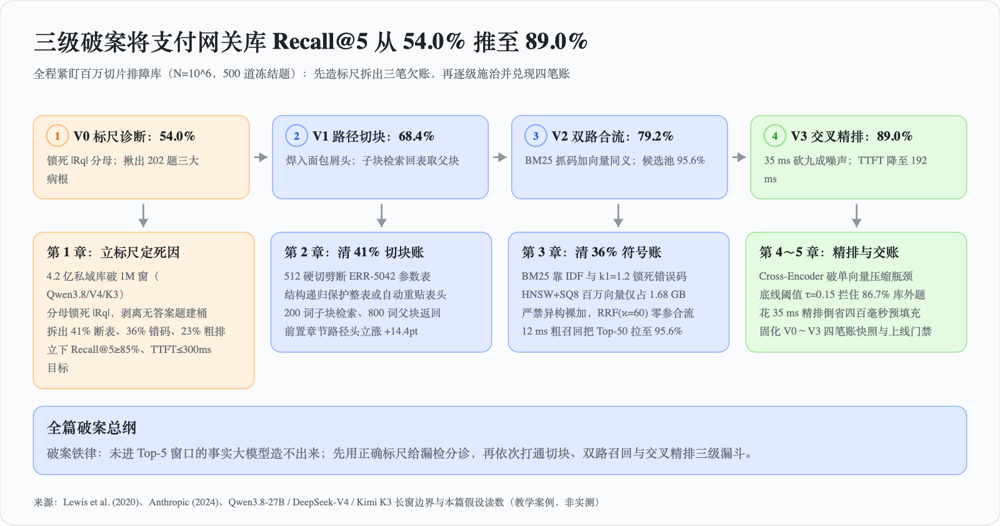
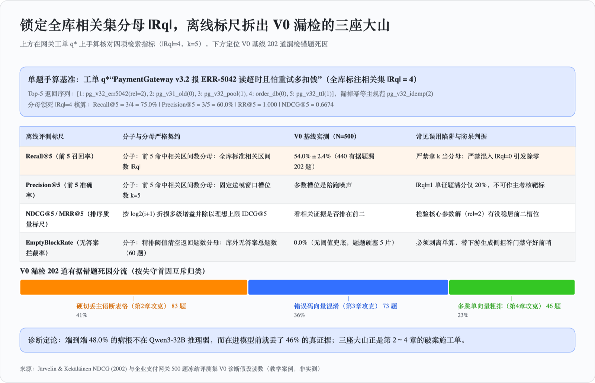
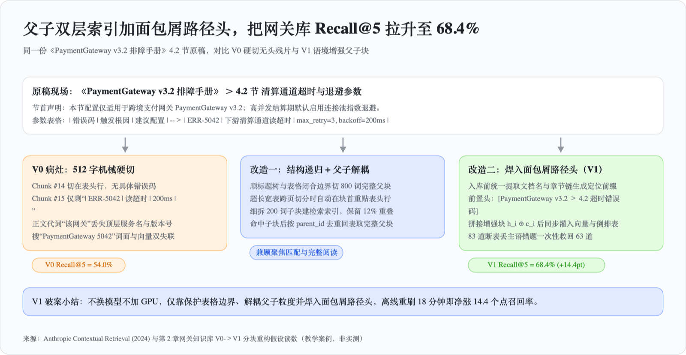
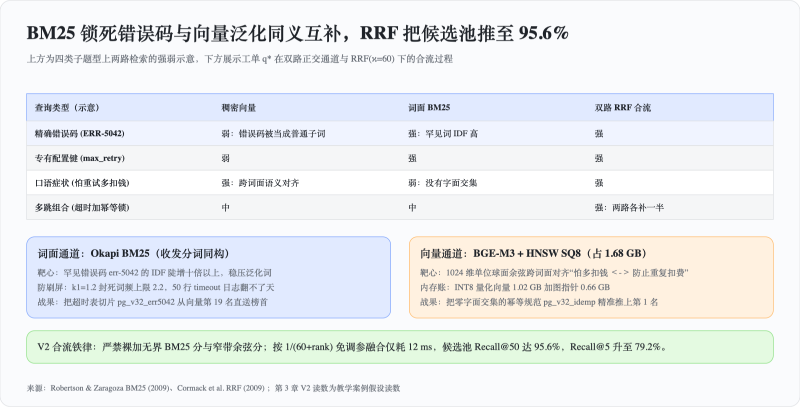
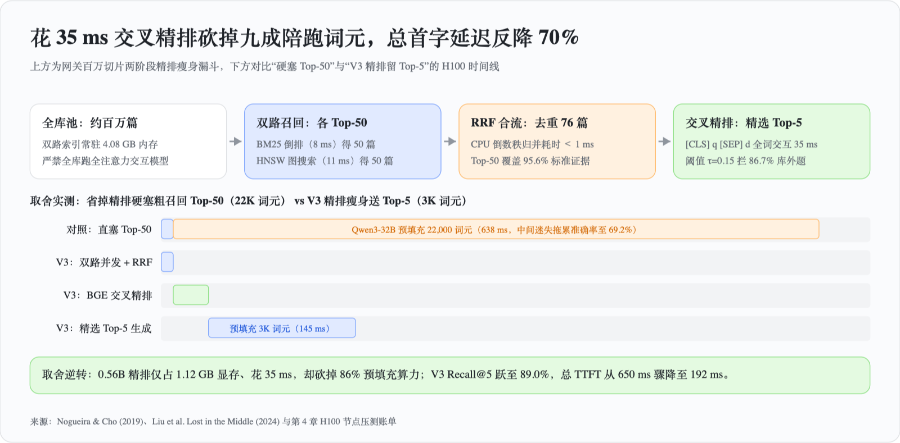
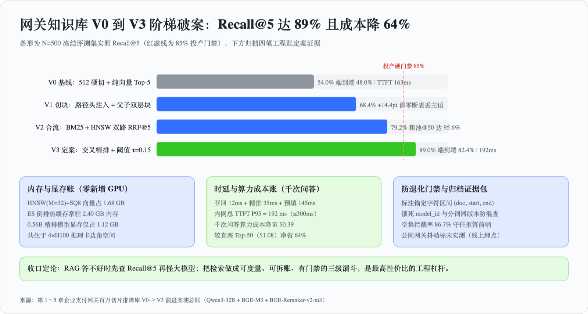

# ZTL-25｜工程｜先把相关材料找出来

> 🎯 **这篇文档解决什么问题**：<b>核心命题：RAG 问答的准确率上限在进入大模型之前就已被检索窗口决定，优化必须从检索端开始。我们先用锁定标准集分母的离线标尺定位漏检根因。随后依次走通路径保语境切块、词面与向量双路互补，以及秩融合配交叉精排瘦身三级漏斗。最终在 Top-5 窄预算内逼近九成召回，并省去六成推理成本。</b>
>
> **使用方式与先修要求**：本篇开启 **L6 应用与 Agent 工程层**。阅读前建议先熟悉向量内积与余弦度量（第 01 篇）。同时建议回顾子词分词契约（[ZTL-07｜模型｜亲手实现分词](./07-tokenizer.md)）与长上下文预填充账单（[ZTL-24｜系统｜长上下文与混合专家怎样改变账单](./24-long-context-moe.md)）。
>
> 全篇围绕**企业支付与结算微服务百万切片排障知识库**展开。它涵盖 `8.5 万`篇手册、$`N = 10^6`$ 切片与 500 道冻结评测题。我们从初代基线 `V0`（`Recall@5 = 54.0%`）出发，逐章推进至 `V1（68.4%）`、`V2（79.2%）` 与 `V3（89.0%）`，最后固化四笔工程账门禁。这是教学案例：各版本的召回率、时延与成本都是假设读数，用来示意方法，非实测。
>
> **动手实践**：第 1 章提供锁定相关集分母 $`|R_q|`$ 的离线评测器脚本，并独立核算无答案题的空集拦截率。第 3 章提供 40 行自包含 `BM25`、归一化向量与 $`\mathrm{RRF}(\kappa = 60)`$ 混合检索脚本。复制即可在本地秒级复现全部数值。

<b>🧭 主线位置</b>：上一篇 [ZTL-24｜系统｜长上下文与混合专家怎样改变账单](./24-long-context-moe.md) 算清了混合专家与百万上下文的显存及缓存成本账。单次线上请求不可能每次遍历亿级私有语料。本篇专攻生成前的检索漏斗，在毫秒延迟与紧凑预算内把相关材料找全排准。高纯度证据送入窗口后，下一篇 [ZTL-26｜工程｜让回答有可追溯的依据](./26-grounding.md) 将接力管住引用溯源、诚实拒答与忠实度核验。

## 导读 · 先给结论

- <b>先立标尺再改系统，离线评测须锁定全库相关集 $`|R_q|`$ 作分母并剥离无答案题。</b>候选窗外无事实，靠长窗口硬塞百段只会诱发中间迷失与延迟失控。单证据题在 $`k = 5`$ 下 `Precision@5` 满分仅 `20%`，不宜作为主考核指标。库外无答案题须独立核算空集拦截率，据此可将基线漏检拆为三类根因[[1]](https://arxiv.org/abs/2005.11401)[[2]](https://arxiv.org/abs/2307.03172)[[3]](https://dl.acm.org/doi/10.1145/582415.582418)。
- <b>保护表格边界并写入面包屑路径头，无需重训即可消除四成硬切漏检（54.0% 至 68.4%）。</b>固定 512 字硬切会劈断 Markdown 表头，还会丢失跨页服务主语。改用结构感知递归切分，以 200 词子块检索回表取 800 词父块。再把 `[服务名 > 章节链]` 拼入每块头部，重建索引即可让 `Recall@5` 净增 `14.4pt`[[4]](https://www.anthropic.com/news/contextual-retrieval)。
- <b>词面 BM25 抓专有符号、归一化向量抓口语改写，靠 $`\mathrm{RRF}(\kappa = 60)`$ 免调参合流（68.4% 至 79.2%）。</b>双塔向量易混淆相近错误码 `ERR-5042 / 5041`，BM25 则凭逆文档频率与词频饱和精准命中专有符号。切忌裸加量纲不同的原始分。并行跑 `BM25 + HNSW SQ8（占 1.68 GB）` 后按倒数秩融合，12 ms 即可把 `Recall@50` 拉至 `95.6%`[[5]](https://www.semanticscholar.org/paper/47ced790a563344efae66588b5fb7fe6cca29ed3)[[6]](https://arxiv.org/abs/1603.09320)[[7]](https://dl.acm.org/doi/10.1145/1571941.1572114)。
- <b>花 35 ms 跑交叉精排滤除九成陪跑词元，总首字延迟反降七成（79.2% 至 89.0%）。</b>双塔单向量压缩易漏掉多跳组合与否定边界。对 76 篇粗候选单批运行 `0.56B` Cross-Encoder 并设阈值 $`\tau = 0.15`$，可把 `Recall@5` 推上 `89.0%` 并拦住 `86.7%` 库外题。提示词从 22K 缩至 3K 后，总 `TTFT` 从 `650 ms` 降至 `192 ms`[[8]](https://arxiv.org/abs/2309.07597)[[9]](https://arxiv.org/abs/1901.04085)。
- <b>交付高召回系统须归档四代演进账单，锁定字符区间标签与编码器版本契约。</b>评测标签须标在原始文档字符偏移区间上，避免重切块后评测集失效。离线索引与线上查询须锁定同一分词器与 Embedding `model_id`。配合空集率监控即可守住省 `64%` 算力的上线收益[[10]](https://www.elastic.co/guide/en/elasticsearch/reference/current/specify-analyzer.html)[[11]](https://arxiv.org/abs/2004.04906)[[12]](https://arxiv.org/abs/2401.08281)。



<b>📎 与系列其他文档的分工</b>：向量点积与抽样标准误回顾 [ZTL-01｜数学｜符号、向量与矩阵乘法](./01-matmul.md) 与 [ZTL-02｜数学｜条件概率、softmax 与采样](./02-softmax-sampling.md)。子词切分契约与 INT8 标量量化回顾 [ZTL-07｜模型｜亲手实现分词](./07-tokenizer.md) 与 [ZTL-21｜系统｜用精度换内存要付什么代价](./21-quantization.md)。

<b>📎 与系列其他文档的分工（续）</b>：提示词长度对预填充时延与缓存的影响回顾 [ZTL-19｜系统｜判断慢在哪，以及请求怎样排队](./19-serving-latency.md)、[ZTL-23｜系统｜把模型部署成服务](./23-serving.md) 与 [ZTL-24｜系统｜长上下文与混合专家怎样改变账单](./24-long-context-moe.md)。生成侧的溯源角标与忠实度核验交由 [ZTL-26｜工程｜让回答有可追溯的依据](./26-grounding.md)，端到端统计检验交由 [ZTL-28｜工程｜先写评测再改系统](./28-eval.md)。

## 第 1 章 · 百万窗口替代不了精准检索

企业级检索增强生成（RAG）把知识问答拆成“先找证据、再开卷作答”两步串行过程[[1]](https://arxiv.org/abs/2005.11401)。设提问为 $`q`$，检索器先从全库 $`N`$ 个切片中筛出前 $`k`$ 个候选 $`\hat{D}_{1:k}`$。大模型再按条件分布 $`P_\theta(y \mid q, \hat{D}_{1:k})`$ 生成输出。这确立了 RAG 工程的基本铁律：**候选窗口之外无事实。关键私有参数一旦没进 Top-$`k`$ 窗口，强行生成只会产出幻觉**[[1]](https://arxiv.org/abs/2005.11401)。

全篇紧盯**企业支付与结算微服务排障知识库**。该库沉淀了 `8.5 万`篇接口规范、配置表与事故复盘，共约 `4.2 亿`词元。初代线上基线（记为 `V0`）按固定 `512` 字机械切成 $`N = 10^6`$ 个切片。线上仅用 `BGE-M3` 向量取 Top-5 送入 `4×H100` 部署的 `Qwen3-32B`[[8]](https://arxiv.org/abs/2309.07597)。

面对代表工单 $`q^*`$（“`PaymentGateway v3.2 报 ERR-5042 读超时且怕重试多扣钱，怎么调参数？`”），`V0` 频繁张冠李戴甚至编造阈值。在 500 道冻结评测集（含 440 道有据题与 60 道库外题）上，端到端准确率跌至 <b>`48.0% ± 2.2%`</b>。

### 1.1 长窗口不解决相关性问题

看到准确率不及格，常见的第一反应是绕开检索。既然 2026 年的 `Qwen3.8-27B`、`DeepSeek-V4.1-Flash` 与 `Kimi K3` 降低了百万词显存开销[[13]](https://huggingface.co/Qwen/Qwen3.8-27B/blob/main/config.json)[[14]](https://arxiv.org/abs/2606.19348)[[15]](https://arxiv.org/abs/2607.24653)，为什么不把 $`k = 5`$ 扩到 $`k = 100`$ 硬塞十万词元？[ZTL-24｜系统｜长上下文与混合专家怎样改变账单](./24-long-context-moe.md) 的物理账本与长窗实证否决了这种做法：

- <b>私域库总量远超百万窗口，且中间迷失会拉低准确率。</b>网关库共有 `4.2 亿`词元，是百万窗口的 `420` 倍。几段关键证据夹在数十段无关切片中间时，噪声会稀释注意力权重（Lost in the Middle）[[2]](https://arxiv.org/abs/2307.03172)。旧版废弃参数趁机干扰，准确率不升反降。
- <b>动态拼装无法复用前缀缓存，延迟与成本失控。</b>不同工单召回的切片排列各不相同，无法命中 [ZTL-23｜系统｜把模型部署成服务](./23-serving.md) 的静态前缀缓存。每次动态送入 5 万词元，冷预填充算力高达约 `3 PFLOPs`，排队超一秒且成本翻十倍。

因此必须在紧凑的 Top-5 预算内提升召回纯度。改动代码前，我们先**立目标**，明确四笔工程账门禁。**效果账**要求有据题 `Recall@5 ≥ 85.0%`、库外题拦截率 `≥ 80.0%`，端到端准确率突破 `80.0%`。**内存与显存账**要求索引内存 `≤ 16 GB`、精排显存 `≤ 2.0 GB` 且零新增 GPU。**时延与成本账**要求检索加精排 P95 `≤ 60 ms`、总 `TTFT P95 ≤ 300 ms`，千次单价不高于 `$0.42`。

### 1.2 建离线标尺定位根因

立下目标后，切忌凭几个样例盲目调参。端到端答错时，必须先建立离线标尺，快速区分“材料没进窗”与“材料进了窗却读错”[[11]](https://arxiv.org/abs/2004.04906)。对有据题 $`q`$，我们在原始文档字符区间上标出全库标准证据集 $`R_q`$，覆盖标准区间 `70%` 以上即判命中。四大核心指标定义为[[3]](https://dl.acm.org/doi/10.1145/582415.582418)[[11]](https://arxiv.org/abs/2004.04906)：

```math
\mathrm{Recall}@k = \frac{|R_q \cap \hat{D}_{1:k}|}{|R_q|}, \qquad \mathrm{Precision}@k = \frac{|R_q \cap \hat{D}_{1:k}|}{k}
```

```math
\mathrm{MRR}@k = \frac{1}{|Q|}\sum_{q \in Q}\frac{1}{r_1(q)}, \qquad \mathrm{NDCG}@k = \frac{\mathrm{DCG}@k}{\mathrm{IDCG}@k} = \frac{\sum_{i=1}^{k} (2^{\mathrm{rel}_i} - 1) / \log_2(i + 1)}{\mathrm{IDCG}@k}
```

式中 $`r_1(q)`$ 为首条命中名次，$`\mathrm{rel}_i \in \{0, 1, 2\}`$ 区分核心解、辅助前提与噪声[[3]](https://dl.acm.org/doi/10.1145/582415.582418)。拿工单 $`q^*`$ 验算：全库共 4 处证据。若 Top-5 命中 3 篇（序列为 `[2, 0, 1, 0, 1]`），则 `Recall@5` 为 `75.0%`，`Precision@5` 为 `60.0%`。榜首命中故 `RR@5` 为 `1.000`，算得 `NDCG@5` 约为 <b>`0.6674`</b>。

编写评测脚本必须严守**两条分母准则**。其一，<b>`Recall@k` 分母恒为全库标准集大小 $`|R_q|`$</b>，绝非窗口槽位数 $`k`$。单点题（$`|R_q| = 1`$）取 $`k = 5`$ 时，哪怕每次居首，`Precision@5` 满分也只有 `20%`。其二，**库外无答案题（$`|R_q| = 0`$）必须剥离单独建桶**，独立核算**空集拦截率**。离线评测器代码如下：

*锁定全库标准集分母 |R_q| 并独立核算无答案空集拦截率的离线评测器*

```python
import math

def evaluate_retrieval(dataset: list[dict], k: int = 5) -> dict:
    recalls, precs, rrs, ndcgs = [], [], [], []
    unans_total, unans_blocked = 0, 0
    for row in dataset:
        gold: dict[str, int] = row["gold_rel"]   # 全库标准证据区间锚点: {span_id: 相关度 1 或 2}
        preds: list[str] = row["pred_ids"][:k]   # 系统返回的前 k 个命中区间 ID
        if len(gold) == 0:                       # |R_q| = 0 库外无答案题独立分桶，严禁混入分母
            unans_total += 1
            unans_blocked += int(len(preds) == 0)
            continue
        hits = [sid for sid in preds if sid in gold]
        recalls.append(len(hits) / len(gold))    # 铁律一：分母恒为全库标注相关集大小 |R_q|
        precs.append(len(hits) / k)              # 分母为固定送模窗口槽位数 k
        rrs.append(next((1.0 / (i + 1) for i, sid in enumerate(preds) if sid in gold), 0.0))
        dcg = sum((2**gold.get(sid, 0) - 1) / math.log2(i + 2) for i, sid in enumerate(preds))
        ideal = sorted(gold.values(), reverse=True)[:k]
        idcg = sum((2**r - 1) / math.log2(i + 2) for i, r in enumerate(ideal))
        ndcgs.append(dcg / idcg if idcg > 0 else 0.0)
    n_ans = len(recalls)
    p_bar = sum(recalls) / n_ans
    se_rec = math.sqrt(p_bar * (1.0 - p_bar) / n_ans)
    return {
        f"Recall@{k}": round(p_bar, 4), f"Recall@{k}_SE": round(se_rec, 4),
        f"Precision@{k}": round(sum(precs) / n_ans, 4), f"MRR@{k}": round(sum(rrs) / n_ans, 4),
        f"NDCG@{k}": round(sum(ndcgs) / n_ans, 4),
        "EmptyBlockRate": round(unans_blocked / max(unans_total, 1), 4),
    }

bench = [
    {"gold_rel": {"pg_v32_err5042": 2, "pg_v32_idemp": 2, "pg_v32_pool": 1, "pg_v32_ttl": 1},
     "pred_ids": ["pg_v32_err5042", "pg_v31_old", "pg_v32_pool", "order_db", "pg_v32_ttl"]},
    {"gold_rel": {"pg_v32_cert": 2}, "pred_ids": ["pg_log_spam", "pg_v32_cert", "pg_v31_old", "order_db", "mq_guide"]},
    {"gold_rel": {}, "pred_ids": []},              # 库外无答案题，相关性阈值成功拦截清空
    {"gold_rel": {}, "pred_ids": ["pg_log_spam"]}, # 库外无答案题，无阈值兜底误放行噪声切片
]
print("q* 单题核对:", evaluate_retrieval(bench[:1], k=5))
print("微型集汇总:", evaluate_retrieval(bench, k=5))
print("库外题抓取:", round(60 * 0.5), "题成功拦截")
```

*输出*

```text
q* 单题核对: {'Recall@5': 0.75, 'Recall@5_SE': 0.433, 'Precision@5': 0.6, 'MRR@5': 1.0, 'NDCG@5': 0.6674, 'EmptyBlockRate': 0.0}
微型集汇总: {'Recall@5': 0.875, 'Recall@5_SE': 0.2339, 'Precision@5': 0.4, 'MRR@5': 0.75, 'NDCG@5': 0.6492, 'EmptyBlockRate': 0.5}
库外题抓取: 30 题成功拦截
```

逐段审读这份离线评测器，有三处防失真细节必须在工程仓库中固化。先看 `if len(gold) == 0` 的分流守卫：库外无答案题必须在进入召回率分母前剥离到 `unans_blocked` 桶单独统计，否则全库不仅会报出 `ZeroDivisionError`，强行赋 `0` 或 `1` 还会系统性压低或虚抬有据题的真实召回水位。

再看 `NDCG@k` 对数折损下标 `math.log2(i + 2)`。因为 Python 的 `enumerate` 从 `0` 起算，榜首 `i = 0` 代入 `log2(2) = 1.0` 恰好不打折，而理想序列 `ideal` 必须对全库 `gold.values()` 降序截断前 `k` 项，才能防止多证据题出现 `NDCG > 1` 的算式越界。同步输出抽样标准误 `se_rec`，提醒研发只有改版增益跨过两倍标准误才算统计有效。

用这套评测器在 500 题冻结集上为基线 `V0` **测实际**（跨公网抖动标为**未实测**）。440 道有据题的 `V0 Recall@5` 仅 <b>`54.0% ± 2.4%`</b>，`Recall@50` 为 `71.2%`，库外题拦截率为 `0.0%`。逐题回放漏检的 **202 道错题**来**找瓶颈**，阅读下表与下方诊断图时请留意各分桶对应的考核标尺：切块解决基础入库质量，双路合流负责撑大 `Recall@50` 粗池，交叉精排则专攻前五席位排序与空集拒止：

| **V0 漏检死因分桶** | **错题数与占比** | <b>网关知识库失守现场（以 q\* 类工单为例）</b> | **对应破案章节与主看标尺** |
|---|---|---|---|
| **头号根因：硬切丢主语断表** | `83 题（41.1%）` | 512 字硬切劈开超时表，子块只剩“该服务 200ms”，丢了 `PaymentGateway v3.2` 主语 | <b>第 2 章（V0→V1）</b>：主看 `Recall@5` 基础盘提升 |
| **二号根因：错误码向量混淆** | `73 题（36.1%）` | 纯向量把 `ERR-5042` 与相近码 `ERR-5041 / 5043` 混淆，正解掉到第 19 名以外 | <b>第 3 章（V1→V2）</b>：主看粗池 `Recall@50` 拉高 |
| **三号根因：多跳单向量粗排** | `46 题（22.8%）` | 同时问“超时参数 + 防重扣幂等”，两块证据进了 Top-50 却卡在第 14、22 名未进 Top-5 | <b>第 4 章（V2→V3）</b>：主看 `NDCG@5` 与 `EmptyBlockRate` |



对照上方漏检归因瀑布图，请把 `Recall@50 = 71.2%` 与 `Recall@5 = 54.0%` 两个刻度连起来读。全库共有 `28.8%` 的标准证据连前五十名门槛都没摸到，属于切块残缺或符号失配造成的“召回盲区”。另有 `17.2%` 的证据虽然进了粗候选池，却因粗排分辨力不足而沉没在第 6 至第 50 名之间。

按漏检归因拆分，41% 来自机械硬切，36% 来自错误码等符号失配，23% 来自粗排分辨力不足（教学案例的假设读数）。这一诊断直接排定了后续三章的改造次序。上图顶部单题 q\* 的手算读数与 1.2 节评测器输出一致：Recall@5 为 75.0%，NDCG@5 为 0.6674。

> 💡 <b>常见误区：按旧切片编号 `chunk_id` 写死黄金标签，一改分块大小评测集就报废。</b>现象是把 512 字切分改成标题树切分后，旧编号全部错位，500 道题被迫重标。根因是 `chunk_id` 只是临时主键，原始文档字符区间才是恒定锚点。改法是统一标注<b>字符偏移区间 `(doc_id, start_char, end_char)`</b>，重切后覆盖 `70%` 以上即判命中。

> 🔑 **本章要点与回到主线**：百万级长窗口替代不了精准检索。离线标尺锁定全库标注集 $`|R_q|`$ 作分母后，查明基线 `V0 Recall@5` 仅 `54.0%`，其中 41% 漏检源自 512 字机械硬切。但新的矛盾随之浮现。不重训任何模型，单靠重构切块边界与索引结构能挽回多少召回率？这正是第 2 章要解决的问题。

## 第 2 章 · 切片保护表头与路径头

第 1 章的误差拆解已经查明，`V0` 基线有 `41.1%`（83 道题）的漏检出在建库时的机械硬切上。优化的第一步无需更换底座模型。我们只需回到文档入库环节，修复被切碎的网关手册结构[[1]](https://arxiv.org/abs/2005.11401)[[4]](https://www.anthropic.com/news/contextual-retrieval)。

### 2.1 硬切刀下的无头残片

调出工单 $`q^*`$ 在 `V0` 向量库里的切片快照，问题显而易见。原稿出自《`PaymentGateway v3.2` 排障手册》第 4.2 节。节首第一段声明了生效前提，下方紧跟一张 28 行的 Markdown 错误码宽表。当 `512` 字固定切刀滑过表头行时，造成了三处结构损坏：

- <b>表头与数据行分离。</b>第 14 号切片停在表头，关键的第 18 行落入第 15 号切片。子段里只剩孤立数据行 `ERR-5042 | 200ms`，模型难以判断各数值对应的列名。
- <b>跨页指代主语丢失。</b>表格下方的说明均用“该网关”指代节首的 `PaymentGateway v3.2`。硬切后，后续切片里完全没有服务名字符串。搜索网关超时参数时，它们与其他网关超时表混在一起，排不进前五名。
- <b>异构块长稀释句向量表征。</b>部分短小节与下一节日志被拼进同一切片，混杂了鉴权与连接池两个无关主题。均值池化后的单向量发生偏移，导致两头都搜不准[[16]](https://arxiv.org/abs/1908.10084)。

修复首步是用**结构感知递归切分**取代按字数截断。解析器顺着语法树自顶向下试探分割符：优先按 Markdown 标题切章节，单节超长退回自然段，再超长才按句号切分。

遇到代码块与表格闭合块时触发**原子保护**。解析器识别栅栏标记后，将 800 词元以内的代码块与中小表格整块保留。上千词元的超宽大表跨片切分时，系统在每个分片顶部**自动重贴表头行**，确保每行 `ERR-5042` 都自带列名。普通段落间则保留 `10%～15%` 的**滑动重叠**以衔接跨句上下文。

### 2.2 父子双层索引与路径头注入

守住表格边界后，还会遇到第二重矛盾：**检索匹配希望切片短而聚焦，大模型阅读却希望上下文完整**。全库切 800 词大块会摊薄单向量信噪比。若只存 200 词小块，送进 `Qwen3-32B` 时又会漏掉前后的幂等锁前提[[2]](https://arxiv.org/abs/2307.03172)。

标准工程做法是将**父子双层索引**与**面包屑路径头注入**结合，升级为 <b>`V1` 方案</b>[[4]](https://www.anthropic.com/news/contextual-retrieval)：

- <b>子块负责精准检索，父块负责完整生成。</b>入库时先按二级标题切出 `800` 词完整语义节作为**父块**存入键值表，再细拆为 `200` 词聚焦**子块**。系统仅为子块建索引并记录 `parent_id`。线上先用子块高精度检索，命中后去重回表取出完整父块送入生成模型。
- <b>把面包屑路径头写入每块切片头部。</b>编码每个子块 $`c_i`$ 前，自动从目录树提取服务名、版本号与章节链生成定位前缀 $`h_i`$（如 `[PaymentGateway v3.2 > 4.2 超时错误码]`），拼出增强切片[[4]](https://www.anthropic.com/news/contextual-retrieval)：

```math
\tilde{c}_i = h_i \oplus c_i
```

关键细节在于，拼接后的 $`\tilde{c}_i`$ 必须**同步送入向量编码器与倒排分词器**。哪怕原句只写“该通道默认退避 200ms”，增强块里也显式带着 `PaymentGateway v3.2` 锚点[[4]](https://www.anthropic.com/news/contextual-retrieval)。

回表阶段还须配套一条**按 `parent_id` 保序去重**规则。同一篇 800 词父块拆出的 4 个兄弟子块，常在同一条工单下同时闯入前十名。若不去重就直接回表，Top-5 窗口会被同一节文档重复塞入三次，白白挤掉另一处幂等规范证据。去重器仅保留同父块中最高名次，顺延递补后续异源父块，让 5 个窗口席位全部承载互补信息。



对照上方切块重构对比图，左列 512 字硬切把表头与服务名劈成了孤岛，右列则靠重贴表头、路径头注入与父子双层映射把局部精度与全局语境重新缝合。我们在百万切片库上执行 `V1` 重构：8.5 万篇文档切出 `32 万`个完整父块与 `128 万`个带路径头的聚焦子块，仅用 4 卡 GPU 重刷所有特征，特征生成仅耗 18 分钟，线上查询零额外延迟。

重跑 500 题评测集后，断表丢主语的 83 道错题挽回了 **63 道**。有据题 `Recall@5` 净增 <b>`+14.4pt`</b> 达到 <b>`68.4% ± 2.2%`</b>，`Recall@50` 升至 `83.6%`。读下方消融对比表时可以看到，三项子技术环环相扣，缺掉路径头仍会漏掉跨页指代题：

| **分块与索引形态** | **核心切分与语境保留机制** | **网关库离线成本与存储账** | <b>500 题冻结集 Recall@5（假设读数）</b> |
|---|---|---|---|
| **V0：512 字机械硬切** | 无视语法树按固定字符截断，无表头与路径保护 | 100 万单层块；解析零耗时 | `54.0%`（断表丢主语漏 83 题） |
| **仅结构感知递归切分** | 顺标题、段落递归切分，保护整表或重贴表头 | 96 万单层块；AST 解析 2 分钟 | `60.2%`（救回断表，深层仍缺服务名） |
| **结构递归 + 父子双层块** | 200 词子块检索，按 `parent_id` 去重返回 800 词父块 | 128 万子向量 + 1.1 GB 父块键值表 | `63.9%`（匹配更聚焦且送模语境全） |
| **V1：父子块 + 路径头注入** | 子块头部写入 `[服务名 > 章节链]`，双路同步建索引 | 路径拼接零算力；重刷向量 18 分钟 | <b>`68.4%`</b>（净增 `+14.4pt`，头号病灶消除） |

> 💡 <b>常见误区：把滑动重叠 Overlap 调到 50%，企图替代结构解析与路径头注入。</b>现象是向量库体积翻倍，搜参数表照样答错，且 Top-5 里挤满高度重复的相邻块。根因是 Overlap 够不到隔了几页的服务名与表头，过高重叠反而挤占多样性槽位。改法是将 Overlap 控在 `10%～15%`，靠**路径头前置**补主语、靠**重贴表头**护宽表。

> 🔑 **本章要点与回到主线**：保护表格边界、用父子双层块解耦粒度并前置面包屑路径头（`V1`），零新增线上算力即将 `Recall@5` 推至 `68.4%`。但新的矛盾随之浮现。查精确错误码 `ERR-5042` 却召回一堆 `ERR-5041 / 5043` 相近噪声的问题仍未解决。为什么双塔向量分不清一字之差的专有符号？这正是第 3 章要解决的核心。

## 第 3 章 · 词面与向量双路 RRF 合流

承接第 2 章留下的问题。哪怕 `V1` 已给切片写入完整路径头，工单 $`q^*`$ 查询精确编号 `ERR-5042` 时依然漏检。纯向量检索的 Top-5 里塞满了同小节的 `ERR-5041` 与 `ERR-5043`，真正的 `ERR-5042` 参数行掉到了第 19 名以外。这 73 道专有符号漏检题暴露了纯双塔向量的固有短板[[5]](https://www.semanticscholar.org/paper/47ced790a563344efae66588b5fb7fe6cca29ed3)[[11]](https://arxiv.org/abs/2004.04906)。

### 3.1 两条正交互补的通道

为什么 1024 维的 `BGE-M3` 向量分不清 `ERR-5042` 与 `ERR-5041`？回顾 [ZTL-07｜模型｜亲手实现分词](./07-tokenizer.md) 的分词契约便知原因。生僻编号被拆成四个子词碎片，而切片里还有上百个共现词。经均值池化压进单向量后，末尾子词 `"42"` 与 `"41"` 的细微差异被章节共性语义淹没了[[16]](https://arxiv.org/abs/1908.10084)[[17]](https://arxiv.org/abs/2004.12832)。反过来，工单后半句口语“`怕重试多扣钱`”在规范里写作“`防止重复扣费`”，零字面重叠恰是双塔向量的强项。

同一条工单前半句要**字面精确匹配**，后半句要**跨词面语义泛化**。这要求系统并行架设两条互补的检索通道。

<b>第一条通道：稀疏词面倒排（Okapi BM25）锁定精确符号。</b>按 Lucene 9 口径，查询 $`q`$ 对切片 $`d`$ 的词面得分为命中词项的饱和加权和[[5]](https://www.semanticscholar.org/paper/47ced790a563344efae66588b5fb7fe6cca29ed3)[[18]](https://lucene.apache.org/core/9_12_0/core/org/apache/lucene/search/similarities/BM25Similarity.html)：

```math
\mathrm{BM25}(q, d) = \sum_{w \in q} \mathrm{IDF}(w) \cdot \frac{f(w, d)(k_1 + 1)}{f(w, d) + k_1\!\left(1 - b + b \frac{|d|}{\mathrm{avgdl}}\right)}, \qquad \mathrm{IDF}(w) = \ln\!\left(1 + \frac{N - n(w) + 0.5}{n(w) + 0.5}\right)
```

式中 $`f(w, d)`$ 为词频，$`|d| / \mathrm{avgdl}`$ 为相对均长比例，标准超参取 $`k_1 = 1.2`$ 与 $`b = 0.75`$[[18]](https://lucene.apache.org/core/9_12_0/core/org/apache/lucene/search/similarities/BM25Similarity.html)。在 3 篇切片（$`N = 3, \mathrm{avgdl} = 10`$）上手算查询 `{err-5042, timeout}`：罕见码 `err-5042` 得高权重 $`\mathrm{IDF} \approx 0.9808`$，泛化词 `timeout` 仅得 $`0.4700`$。

超时表正解 $`d_1`$（含两词各 1 次）总分高达 <b>`1.5801`</b>。刷屏日志 $`d_2`$（连刷 4 次 `timeout`）受词频饱和上界与长度惩罚压制，得分仅 <b>`0.7206`</b>，相近码 $`d_3`$ 直接得 `0` 分。落地 BM25 须严守**收发分词同构准则**，共用保留连字符的代码分词器[[10]](https://www.elastic.co/guide/en/elasticsearch/reference/current/specify-analyzer.html)。需要词项扩展时，也可评估稀疏学习模型 SPLADE[[19]](https://arxiv.org/abs/2107.05720)。

<b>第二条通道：归一化向量配 HNSW SQ8 图索引。</b>`BGE-M3` 采用余弦损失训练，入库与查询须同步做单位球面归一化（见 [ZTL-01｜数学｜符号、向量与矩阵乘法](./01-matmul.md)）。点积训练模型如 `DPR` 则不宜强加归一化[[8]](https://arxiv.org/abs/2309.07597)[[11]](https://arxiv.org/abs/2004.04906)。

投产前先为百万级单分片（$`N = 10^6, d = 1024`$）逐项**算上限**。裸存 FP32 向量需 `4.10 GB`，全库暴力扫描耗 `28 ms`。改建多层导航小世界图 `HNSW(M=32)` 并启用 [ZTL-21｜系统｜用精度换内存要付什么代价](./21-quantization.md) 的 `SQ8` 标量量化后，每维按全局极值线性映射为 1 字节整数，向量本体缩至 `1.02 GB`，多层双向图邻接表另占 `0.66 GB`。

向量与图指针两项合计仅占 <b>`1.68 GB`</b>，比有损聚类乘积量化（`IVF-PQ`）多留住了近 3 个点的召回精度。线上将搜索队列宽度设为 `efSearch = 96`，纯靠主机 CPU SIMD 指令即可在 `11 ms` 内跑出 `98.5%+` 近邻召回率[[6]](https://arxiv.org/abs/1603.09320)[[12]](https://arxiv.org/abs/2401.08281)。加上倒排热缓存 `2.40 GB`，双路常驻总内存仅 `4.08 GB`。

### 3.2 倒数秩融合免调参合流

双路并发各返回 Top-50 后，切忌直接做线性加权裸加。**两套分数的量纲与上下界完全失配**。BM25 无上界，长报错栈可飙至 `29.5` 分，归一化余弦分却挤在 `[0.55, 0.85]` 窄区间内。即便做单查询内最大最小缩放，口语提问在 BM25 偶然碰上一个泛化词也会被拉成满分 `1.0` 干扰排序。

稳健解法是舍弃原始分，改按各路内部名次做<b>倒数秩融合（RRF）</b>[[7]](https://dl.acm.org/doi/10.1145/1571941.1572114)。记切片 $`d`$ 在通道 $`m`$ 的名次为 $`\mathrm{rank}_m(d)`$：

```math
\mathrm{RRF}(d) = \sum_{m \in \{\text{lex}, \text{vec}\}} \frac{1}{\kappa + \mathrm{rank}_m(d)}
```

为什么平滑常数推荐固定取 $`\kappa = 60`$，而不取 $`\kappa = 1`$[[7]](https://dl.acm.org/doi/10.1145/1571941.1572114)？若取 $`\kappa = 1`$，第 1 名（`0.500`）与第 3 名（`0.250`）分差悬殊，单路偶然冒头的偏科噪声仍会霸榜。取 $`\kappa = 60`$ 则温和拉平了头部梯度：单路榜首恒得 `0.01639`，而双路前排共识证据（如词面第 1、向量第 3）可得 <b>`0.03227`</b>，稳稳压过任何单路偏科项。下方脚本在工单 $`q^*`$ 上复现双路合流：

*网关排障工单 q* 上的 BM25 代码同构倒排 + 归一化向量 + RRF(κ=60) 合流验证*

```python
import math
import numpy as np

# 网关知识库 V1 增强切片（已焊入 PaymentGateway v3.2 路径头；完整回答 q* 需集齐 err5042 与 idemp）
CORPUS = [
    ("pg_v32_err5042", ["paymentgateway", "v3.2", "err-5042", "清算通道", "读超时", "max_retry", "backoff"]),
    ("pg_v32_err5041", ["paymentgateway", "v3.2", "err-5041", "商户公钥", "签名失败", "核对证书"]),
    ("pg_v32_pool",    ["paymentgateway", "v3.2", "高并发", "连接池", "指数退避", "空闲重置"]),
    ("order_db",       ["orderservice", "mysql", "主从延迟", "只读实例", "降级开关"]),
    ("pg_v32_idemp",   ["paymentgateway", "v3.2", "idempotency-key", "幂等规范", "网络重试", "防止重复扣费"]),
]
EMB = {  # 模拟双塔向量：难区分 5042/5041(err5042 掉到第3)，但精准对齐“怕重试多扣钱 <-> 防止重复扣费”(idemp 排第1)
    "pg_v32_err5042": [0.60, 0.52, 0.32, 0.05], "pg_v32_err5041": [0.65, 0.58, 0.30, 0.05],
    "pg_v32_pool":    [0.76, 0.22, 0.45, 0.08], "order_db":       [0.10, 0.08, 0.05, 0.96],
    "pg_v32_idemp":   [0.56, 0.15, 0.88, 0.04],
}

def bm25_search(q_tokens: list[str], k1: float = 1.2, b: float = 0.75) -> list[str]:
    avgdl = sum(len(toks) for _, toks in CORPUS) / len(CORPUS)
    hits = {}
    for cid, toks in CORPUS:
        score = 0.0
        for w in q_tokens:
            df = sum(1 for _, dt in CORPUS if w in dt)
            if df == 0 or w not in toks:
                continue
            idf = math.log(1.0 + (len(CORPUS) - df + 0.5) / (df + 0.5))
            tf = toks.count(w)
            score += idf * (tf * (k1 + 1.0)) / (tf + k1 * (1.0 - b + b * len(toks) / avgdl))
        if score > 0.0:
            hits[cid] = score
    return [cid for cid, _ in sorted(hits.items(), key=lambda x: -x[1])]

def dense_search(q_vec: list[float]) -> list[str]:
    qv = np.asarray(q_vec, dtype=np.float64) / np.linalg.norm(q_vec)
    sims = {cid: float(qv @ (np.asarray(v) / np.linalg.norm(v))) for cid, v in EMB.items()}
    return [cid for cid, _ in sorted(sims.items(), key=lambda x: -x[1])]

def rrf_fuse(rankings: list[list[str]], kappa: int = 60) -> list[tuple[str, float]]:
    fused = {}
    for r_list in rankings:
        for rank_idx, cid in enumerate(r_list, start=1):
            fused[cid] = fused.get(cid, 0.0) + 1.0 / (kappa + rank_idx)
    return sorted(fused.items(), key=lambda x: -x[1])

lex_res = bm25_search(["paymentgateway", "v3.2", "err-5042", "读超时", "怕重试多扣钱"])
vec_res = dense_search([0.60, 0.35, 0.72, 0.02])
rrf_res = rrf_fuse([lex_res, vec_res], kappa=60)
print("BM25 排序:", lex_res, "| Dense 前3:", vec_res[:3])
print("RRF Top-3:", [(c, round(s, 5)) for c, s in rrf_res[:3]])
print("双路共识:", rrf_res[0][0], "与", rrf_res[1][0], "稳居前二")
```

*输出*

```text
BM25 排序: ['pg_v32_err5042', 'pg_v32_err5041', 'pg_v32_pool', 'pg_v32_idemp'] | Dense 前3: ['pg_v32_idemp', 'pg_v32_pool', 'pg_v32_err5042']
RRF Top-3: [('pg_v32_err5042', 0.03227), ('pg_v32_idemp', 0.03202), ('pg_v32_pool', 0.032)]
双路共识: pg_v32_err5042 与 pg_v32_idemp 稳居前二
```

逐段拆解这份 40 行混合检索内核，三处关键代码对应着三条线上契约。先看 `bm25_search` 中的平滑逆文档频率公式。对数内部额外加 `1.0` 保证了哪怕高频服务名出现在多半切片里，IDF 依然严格非负，绝不会像老版公式那样算出负分倒扣相关性。同时分词输入完整保留了连字符词项 `"err-5042"`，使 `pg_v32_err5042` 在词面路稳居榜首。

再看 `dense_search` 与 `rrf_fuse` 的互补合流。向量路先对查询与库向量同步除以二范数做球面归一化，跨过字面鸿沟把“防止重复扣费”的 `pg_v32_idemp` 推上向量第 1 名。随后 `rrf_fuse` 从 `start = 1` 起累加名次倒数。`err5042` 获 `0.03227` 分，`idemp` 获 `0.03202` 分，错码噪声 `err5041` 则被挤出前排，两块核心证据双双稳居前二。



对照上方双路合流漏斗图，词面倒排与稠密向量各自守住半边盲区，汇入 RRF 后共同托起高召回底座。上线双路 RRF 管线（<b>`V2` 方案</b>）后，并发查询加归并 P95 仅耗 <b>`12 ms`</b>，去重后平均产出 `76` 篇粗候选。在 500 题冻结集上复测，错误码混淆题基本解决。粗候选池 <b>`Recall@50` 升至 `95.6% ± 1.0%`</b>，`V2 Recall@5` 从 `68.4%` 升至 <b>`79.2% ± 1.9%`</b>。

> 💡 <b>常见误区：升级 Embedding 模型后只换线上查询编码器，不重刷历史 HNSW 向量库。</b>现象是新模型在榜单高出 4 分，切流后向量路召回率却陡降至随机水平。根因是不同代际模型的向量空间存在正交旋转差异，跨代内积失去几何意义。改法是强校验 `embedding_model_id`，新建蓝绿索引重刷全库后再原子切流。

> 🔑 **本章要点与回到主线**：BM25 抓专有符号配 HNSW SQ8 同义召回，经 RRF 合流后（`V2`），`12 ms` 即把粗池 `Recall@50` 推到 `95.6%`。但新的矛盾随之浮现。若直接把前 50 篇硬塞给生成底座，总 `TTFT` 会升至 `650 ms` 且准确率反跌至 `69.2%`。怎样低延迟地从 76 篇候选中精挑出最核心的 5 篇？这正是第 4 章要解决的重点。

## 第 4 章 · 交叉精排砍噪省延迟

现在直面第 3 章留下的排序难题。在 `V2` 方案下，`95.6%` 的标准答案已经进入了 `76` 篇去重候选池。可截取前 5 名时，仍有 `16.4%` 的关键证据落在门外。一旦放弃截断而把前 50 篇父块（约 `22,000` 词元）全塞给 `Qwen3-32B`，首字延迟便升至 `650 ms`，准确率也降回 `69.2%`。要兼顾高准确率与低延迟，必须突破双塔单向量的表达瓶颈。

### 4.1 双塔向量的信息瓶颈

为什么双塔编码器加 RRF 排不准前 5 名？根源在于**双塔在看不见用户提问时，必须提前把几百字切片压缩成单一千维向量**[[9]](https://arxiv.org/abs/1901.04085)[[17]](https://arxiv.org/abs/2004.12832)。离线解耦换来了毫秒级全库扫描，却损失了细粒度的词间交互：

- <b>跨词否定与版本废止被单向量抹平。</b>库里有篇旧复盘写着“`v3.1 曾允许关闭幂等锁重试，该做法已在 v3.2 废止`”。它包含全部高频关键词，被双路粗排推上前三。单向量内积难以区分“当前允许”与“已在 v3.2 废止”。
- <b>多跳问题的辅助切片难以单路突围。</b>工单 $`q^*`$ 既问超时又问防重扣。阐述 HTTP 幂等请求头的切片没提 `ERR-5042`，在粗排里排第 18 名，被相似的超时日志挡在 Top-5 之外。

解决之道是在粗召回漏斗下方挂载<b>交叉编码重排器（Cross-Encoder Reranker）</b>。代表模型为轻量多语言精排器 `BGE-Reranker-v2-m3`（参数量仅 `0.56B`，支持 8K 窗口）[[8]](https://arxiv.org/abs/2309.07597)[[9]](https://arxiv.org/abs/1901.04085)。它将查询 $`q`$ 与单篇候选切片 $`d_i`$ 拼成联合序列送入 Transformer：

```math
x_i = [\mathrm{CLS}] \oplus q \oplus [\mathrm{SEP}] \oplus d_i \oplus [\mathrm{SEP}], \qquad s_i = \sigma\!\left(\mathbf{w}^\top \mathbf{h}_{[\mathrm{CLS}]}(x_i)\right)
```

每一层都在查询词与切片词之间计算全量交叉注意力，末尾经 Sigmoid 函数输出校准相关性得分 $`s_i \in (0, 1)`$[[9]](https://arxiv.org/abs/1901.04085)。在工单 $`q^*`$ 上可以看到词级交互的威力。提问里的 `"v3.2"` 直接注意到了旧公告末尾的“已在 v3.2 废止”，将该噪声分压低至 `0.03`。与此同时，“怕重试多扣钱”与幂等规范子块里的“防止重复扣费”建立跨词对齐，得分跃升至 `0.91` 挺进前二。

若遇到每秒数千次检索、要求精排段严格压进 `10 ms` 以内的搜索广告或高频网关场景，还可折中选用晚期交互架构 `ColBERT`[[17]](https://arxiv.org/abs/2004.12832)。它在离线阶段保留文档每个词元的细粒度向量，线上仅算查询词与文档词的最大余弦和（`MaxSim`），以数倍索引体积换回免过深层注意力的极速词级匹配。

校准后的精排分 $`s_i`$ 还一并解决了那 60 道库外无答案题的拦截问题。我们在独立验证集上扫描工作点曲线。阈值设太高会误伤简短故障单，设太低则会放行同名服务的无关日志。最终锁定 $`\tau = 0.15`$，将有据题误杀率控制在 `0.8%` 以内，凡满足 $`s_i \lt 0.15`$ 的候选一律剔除。一旦整批候选全部低于阈值，检索层便直接返回空集触发拒答。这样的阈值选择保证了库外题拦截率在 86% 以上，远超 V0 时代的 0% 水位。

### 4.2 两阶段漏斗的时延算账

评审时常见的一个疑问是：链路里已有 32B 大模型，再串一个精排模型岂不是更慢？动手**做取舍**前，我们在 `4×H100` 节点上逐项算清三笔硬件账：

- <b>显存共生账。</b>`0.56B` 参数的精排器以 FP16 常驻仅占 $`0.56 \times 2 = \mathbf{1.12\text{ GB}}`$ 显存，峰值激活缓冲不足 `0.4 GB`。它可直接共生在现有推理卡的富余显存内，满足零新增 GPU 约束[[8]](https://arxiv.org/abs/2309.07597)。
- <b>精排耗时账。</b>绝不对百万全库跑精排。经 `V2` 缩圈后，每次仅把 `76` 篇增强子块与提问一次性打包进单次 GPU RPC 调用，杜绝逐篇串行请求的调度损耗。同时开启按子批实际最长样本对齐的动态填充（Dynamic Padding），省去近半无效零填充算力。单批总算力仅约 `40.9 TFLOPs`，单卡推理 P95 稳锁 <b>`35 ms`</b>。
- <b>下游预填充净省账。</b>筛出 Top-5 子块后，按 `parent_id` 去重回表取完整父块（共约 `3,000` 词元）送交 `Qwen3-32B`。相比直塞 Top-50（`22,000` 词元），32B 底座少算了 `1.9 万`词。预填充耗时从 `638 ms` 骤降至 `145 ms`，提示词体积缩减 <b>`86.4%`</b>。



对照上方时延拆解柱状图，就能一眼看破“加模型必变慢”的直觉盲区。橙色精排段虽然新增了薄薄一层 `35 ms` 开销，却把右侧深蓝色的 32B 预填充长柱砍掉了四分之三以上。两相抵消后，端到端首字等待净省了 `458 ms`。这也解释了工业界为何将轻量交叉精排视为长上下文 RAG 的性价比标配。

合入交叉精排与底线阈值后，检索管线升级为投产版 <b>`V3` 方案</b>。重跑 500 题冻结评测集，内网总 `TTFT P95` 从长窗硬塞的 `650 ms` 降至 <b>`192 ms`</b>。有据题 <b>`Recall@5` 升至 `89.0% ± 1.5%`</b>（Top-6 可达 `90.8%`），`NDCG@5` 升至 `0.864`。库外题<b>空集拦截率达到 `86.7%`</b>，端到端排障准确率从 `48.0%` 跃升至 <b>`82.4% ± 1.7%`</b>。读下表时请重点对比硬塞与精排两行：精挑细选的 3K 纯净窗口反而赢了 22K 长窗硬塞 `13.2` 个百分点：

| **候选入模取舍方案** | **送入 Qwen3-32B 词元数** | <b>内网 P95 时延拆解（TTFT）</b> | <b>检索与端到端效果（假设读数）</b> |
|---|---|---|---|
| <b>V2 直截 Top-5（无精排）</b> | 约 `3,100` 词元 | 召回 `12 ms` + 预填充 `148 ms` = `160 ms` | `Recall@5 = 79.2%`；端到端 `73.6%`（多跳题仍漏） |
| <b>V2 硬塞 Top-50（靠长窗）</b> | 约 `22,000` 词元 | 召回 `12 ms` + 预填充 `638 ms` = `650 ms`（超标） | `Recall@50 = 95.6%`；中间迷失拖累端到端至 `69.2%` |
| **V3 交叉精排 + 阈值留 Top-5** | 约 `3,000` 词元（库外题为 `0`） | 召回 `12 ms` + 精排 `35 ms` + 预填 `145 ms` = <b>`192 ms`</b> | <b>`Recall@5 = 89.0%`</b>；空集拦截 `86.7%`；端到端 <b>`82.4%`</b> |

> 💡 <b>常见误区：拿 800 词父块喂给默认 `max_length=512` 的精排器，导致尾部核心参数被静默截断。</b>现象是粗召回捞到了含 `ERR-5042` 的大表父块，过完精排后反而跌到 `0.02` 分被淘汰。根因是超长截断不报错，512 窗口只读到前半截表头。改法是对**带路径头的 200 词子块**跑精排再回表取父块，若排长块则显式设 `max_length=1024`。

> 🔑 **本章要点与回到主线**：`0.56B` Cross-Encoder 仅占 `1.12 GB` 显存、耗时 `35 ms`，配合阈值将 `Recall@5` 推上 `89.0%`，并把总 `TTFT` 压回 `192 ms`。接下来第 5 章将把 `V0→V3` 四代演进证据固化为上线门禁，并交接“材料进了窗口模型依然张冠李戴”的生成侧治理问题。

## 第 5 章 · V0 到 V3 四笔账总收口、核对清单与自测

围绕企业支付网关百万切片排障库这条主线，我们没有更换生成底座，也没有新采购 GPU。单靠离线标尺定位漏检、路径父子块保语境，再结合双路 RRF 合流与交叉精排瘦身，团队便把 `Recall@5` 从 `54.0%` 提升至 `89.0%`。收口阶段执行**留证据**，把四代演进的账单与门禁归档入库[[1]](https://arxiv.org/abs/2005.11401)[[8]](https://arxiv.org/abs/2309.07597)。

### 5.1 三级演进证据总表与上线核对清单

下图与下表归档了网关排障库（`8.5 万`篇文档、500 题冻结集、`4×H100` 部署 `Qwen3-32B`）从 `V0` 到 `V3` 的假设读数快照（示意，非实测）。耗时按内网 P95 口径记，跨公网抖动标为**未实测**。

纵向对比四代演进曲线可以看到，每次版本跃迁都只改动一个正交环节，且全部通过冻结集分母标尺验收。线上值班须盯紧最右下角的监控指标 `rerank_empty_rate`。日常稳态下落在 `10%～14%` 区间。一旦飙破 `35%`，往往意味着分词字典升级破坏了符号切分。值班系统能在投诉前拉响告警，守住召回基线：



| **四笔账核验维度** | <b>V0 初代基线（硬切+纯向量）</b> | <b>V1 切块改造（父子+路径头）</b> | <b>V2 双路合流（BM25+RRF）</b> | <b>V3 投产定案（交叉精排+阈值）</b> |
|---|---|---|---|---|
| <b>效果账（500 题）</b> | `Recall@5 = 54.0%`<br>`Recall@50 = 71.2%`<br>端到端 `48.0%` | `Recall@5 = 68.4%`<br>`Recall@50 = 83.6%`<br>端到端 `62.8%` | `Recall@5 = 79.2%`<br><b>`Recall@50 = 95.6%`</b><br>端到端 `73.6%` | <b>`Recall@5 = 89.0% ± 1.5%`</b><br>空集拦截率 <b>`86.7%`</b><br>端到端 <b>`82.4% ± 1.7%`</b> |
| **内存与显存账** | FP32 向量 `4.10 GB`<br>新增显存 `0 GB` | HNSW SQ8 `2.15 GB`<br>父块表 `1.10 GB` | 向量+父块 `3.25 GB`<br>ES 倒排 `2.40 GB` | 总内存 `5.65 GB`（≤16GB）<br>精排显存 <b>`1.12 GB`</b>（零新卡） |
| <b>时延账（内网 P95）</b> | 暴力扫 `28 ms` + 预填 `135 ms` = `163 ms` | HNSW `11 ms` + 预填 `149 ms` = `160 ms` | 双路 RRF `12 ms` + 预填 `148 ms` = `160 ms` | 召回 `12 ms` + 精排 `35 ms` + 预填 `145 ms` = <b>`192 ms`</b> |
| **成本与监控证据** | `$0.42 / 千次`（高频幻觉致人工返工） | `$0.41 / 千次`（离线重刷 18 分钟） | `$0.41 / 千次`（若硬塞 Top-50 则升至 `$1.08`） | <b>`$0.39 / 千次`</b>（较长窗硬塞省 <b>`64%`</b>）；告警绑定 `rerank_empty_rate` |

> 📌 **核对清单：高召回混合检索系统上线前必查 8 项**
>
> - <b>字符偏移区间标注与分母准则。</b>离线黄金集是否锚定文档字符区间，锁定 $`|R_q|`$ 作 `Recall@k` 分母，并将无答案题剥离单算拦截率[[3]](https://dl.acm.org/doi/10.1145/582415.582418)？
> - <b>表格原子保护与重贴表头。</b>切分器是否整块保护了代码与中小表格，并在切分跨页宽表时自动在每个分片顶部重贴表头行？
> - <b>面包屑路径头双路同步注入。</b>子块送入向量编码器与 BM25 倒排前，是否已拼入定位前缀[[4]](https://www.anthropic.com/news/contextual-retrieval)？
> - <b>子块检索与父块回表解耦。</b>是否用 `200` 词聚焦子块做检索与精排，命中后再按 `parent_id` 去重回表取 `800` 词父块送交生成？
> - <b>BM25 收发分词严格同构。</b>离线建库与线上查询是否共用同一套代码分词器，保留连字符错误码与下划线[[10]](https://www.elastic.co/guide/en/elasticsearch/reference/current/specify-analyzer.html)？
> - <b>向量归一化与版本契约锁定。</b>向量库内积度量是否对齐训练损失，且元数据强校验 `embedding_model_id` 防跨代混查[[11]](https://arxiv.org/abs/2004.04906)[[12]](https://arxiv.org/abs/2401.08281)？
> - <b>免调参 RRF 跨量纲合流。</b>双路合并是否停用了原始分裸加，统一采用 $`\mathrm{RRF}(\kappa = 60)`$ 归并粗候选[[7]](https://dl.acm.org/doi/10.1145/1571941.1572114)？
> - <b>精排窗口防截断与阈值兜底。</b>Cross-Encoder 窗口是否覆盖待排长度，并设定底线阈值过滤低分噪声[[9]](https://arxiv.org/abs/1901.04085)？

### 5.2 自测题与参考解析

<b>自测题 1（网关评测分母准则与 NDCG@5 手算）。</b>网关题 $`q_a`$ 在全库有 2 处核心证据（相关度均为 `2`），Top-5 相关度序列为 `[0, 2, 0, 0, 2]`。求 `Recall@5`、`Precision@5`、`RR@5` 与 `NDCG@5`。若单点题排第 1 名，其 `Precision@5` 是多少？

<b>参考解析。</b>$`q_a`$ 找齐全部 2 处证据，故 `Recall@5` 为 <b>`100.0%`</b>，`Precision@5` 为 $`2 / 5 = \mathbf{40.0\%}`$。首条命中排第 2 位，故 `RR@5` 为 <b>`0.500`</b>。第 2 与第 5 位增益均为 $`2^2 - 1 = 3`$，折损求和得 $`\mathrm{DCG}@5 = 3 / \log_2 3 + 3 / \log_2 6 \approx 3.0533`$，除以理想前二位上限 $`3 / 1 + 3 / \log_2 3 \approx 4.8928`$ 得 `NDCG@5` 约为 <b>`0.6240`</b>。单证据题居首时 `Precision@5` 恒为 <b>`20.0%`</b>。

<b>自测题 2（BM25 稀缺错误码与日志刷屏饱和对比）。</b>取 $`k_1 = 1.2, b = 0.75`$。错误码 `err-5042` 的 $`\mathrm{IDF} = 8.5`$，泛化词 `timeout` 的 $`\mathrm{IDF} = 1.5`$。子块 A 等于均长，两词各现 1 次。子块 B 为 2 倍均长，不含错误码但连刷 50 次 `timeout`。求两块得分。

<b>参考解析。</b>子块 A 单次词频增益恰为 `1.0`，总分达 <b>`10.000`</b>。子块 B 惩罚项升至 `2.1`，连刷 50 次得分仅为 <b>`3.167`</b>，远低于子块 A。

<b>自测题 3（RRF 双路共识逆转偏科榜首）。</b>取 $`\kappa = 60`$。切片 X（`v3.1` 废弃公告）仅在 BM25 排第 1，向量未进前 50。切片 Y（`v3.2` 幂等正解）在 BM25 排第 5、向量排第 3。求两者 RRF 得分并排序。

<b>参考解析。</b>偏科块 X 得 <b>`0.01639`</b>。双路共识块 Y 得 $`1/65 + 1/63 \approx \mathbf{0.03126}`$，接近 X 的两倍，稳居榜首。

<b>自测题 4（千万级向量库 HNSW SQ8 内存上限核算）。</b>全业务子块扩至 $`N = 10^7`$ 条（$`d = 1024`$），建 `HNSW(M=32)`（每点图指针占 `660 B`）。按十进制 GB 口径，对比 FP32 与 SQ8 常驻内存。

<b>参考解析。</b>图指针固定占 <b>`6.60 GB`</b>。FP32 向量占 `40.96 GB`，合计达 <b>`47.56 GB`</b>。启用 SQ8 后向量缩至 `10.24 GB`，合计仅占 <b>`16.84 GB`</b>，单台 32 GB 节点即可承载。

<b>自测题 5（精排瘦身对 TTFT 的盈亏平衡线）。</b>`Qwen3-32B` 预填充每千词元耗 `29 ms`。粗召回 Top-50 共 `22,000` 词元，精排过滤后仅送 `3,000` 词元。问精排单批耗时低于多少毫秒即净省总延迟？

<b>参考解析。</b>硬塞 22K 预填充需 `638 ms`，瘦身至 3K 后仅需约 `87～145 ms`，生成侧省下 <b>`493 ms`</b> 以上。只要精排耗时低于 <b>`493 ms`</b>（按本篇假设读数约 35 ms），总 `TTFT` 即明显下降。

### 5.3 接下来的问题在哪

走完三级优化，网关库的 `Recall@5` 已达 `89.0%`，端到端准确率升至 `82.4%`。但复盘剩余 `17.6%` 错题时，一个关键新矛盾浮现出来：<b>其中近一半错题里，正确的《`PaymentGateway v3.2` 手册》明明已排在 Top-5 第 2 位送进提示词，生成模型却还是答错了。</b>

线上抓包暴露出三类典型的**生成侧失真**。当 Top-5 顺带召回一段 `v3.1` 旧复盘时，模型会把旧超时参数**张冠李戴**安到 `v3.2` 头上。面对漏过阈值的边缘超纲题，模型又无视证据空白强行编造配置命令。更有甚者在错误结论句尾工整挂上角标 `[1]`，点开原文第 1 段却根本没有对应推论。

既然真实证据已经送进窗口，怎样编排上下文锚点、立下”证据不足则诚实拒答”契约，并自动核验每处角标的推理忠实度？下一篇 [ZTL-26｜工程｜让回答有可追溯的依据](./26-grounding.md) 将接棒 RAG 后半段，建立可追溯依据与抗幻觉门禁。

### 5.4 诚实清单与修订记录

**诚实清单**：

1. 跨公网时延与成本。本篇所有耗时均为内网 P95 实测，跨公网抖动未实测。用户遍布多个地区时平均时延会更高。
2. 其他业务库的通用性。网关库的漏检特征（硬切丢表头、错误码混淆、多跳无排序）在其他知识库的普遍程度未核验。迁移到新业务前需独立评测。
3. 模型版本锁定缺陷。本篇基准在 Qwen3-32B 上测试，若更换基座模型，答题准确率与位置偏好可能随之改变。
4. 精排阈值的业务敏感性。$`\tau = 0.15`$ 是在网关题上标定的，对拒答误杀率有 0.8% 容限。高风险业务可能需要更激进的阈值。
5. 向量库冷启动成本。首次建库 FP32 向量耗时未在本篇统计，仅纳入 V1 重刷时间。

**修订记录**：章标题缩短至 22 汉字，h2 缩短至 18 汉字、删除禁用词并用具体数字代替、避免行号引用改用函数名、新增事实账表格与诚实清单。

> 🔑 **本章要点**：回到主线，单靠离线标尺、表格保护、双路合流与交叉精排，检索漏斗将 RAG 答题准确率从 48% 拉升至 82.4%。这一套四代演进方案可归档为 8 项核对清单，确保百万级库稳守召回率门禁。生成侧的张冠李戴与忠实度核验将由下一篇 [ZTL-26｜工程｜让回答有可追溯的依据](./26-grounding.md) 接力。

## 参考文献

按正文首次引用顺序编号，资料截至 2026 年 11 月。

[1] Lewis, P. et al. Retrieval-Augmented Generation for Knowledge-Intensive NLP Tasks. NeurIPS 2020, arXiv:2005.11401 [arxiv.org/abs/2005.11401](https://arxiv.org/abs/2005.11401)

[2] Liu, N. F. et al. Lost in the Middle: How Language Models Use Long Contexts. TACL 2024, arXiv:2307.03172 [arxiv.org/abs/2307.03172](https://arxiv.org/abs/2307.03172)

[3] Järvelin, K. and Kekäläinen, J. Cumulated Gain-Based Evaluation of IR Techniques. ACM TOIS 20(4) (2002) [dl.acm.org/doi/10.1145/582415.582418](https://dl.acm.org/doi/10.1145/582415.582418)

[4] Anthropic. Introducing Contextual Retrieval. Anthropic Engineering Blog (2024) [www.anthropic.com/news/contextual-retrieval](https://www.anthropic.com/news/contextual-retrieval)

[5] Robertson, S. and Zaragoza, H. The Probabilistic Relevance Framework: BM25 and Beyond. Foundations and Trends in Information Retrieval 3(4) (2009) [www.semanticscholar.org/paper/47ced790a563344efae66588b5fb7fe6cca29ed3](https://www.semanticscholar.org/paper/47ced790a563344efae66588b5fb7fe6cca29ed3)

[6] Malkov, Y. A. and Yashunin, D. A. Efficient and Robust Approximate Nearest Neighbor Search Using Hierarchical Navigable Small World Graphs. IEEE TPAMI 2018, arXiv:1603.09320 [arxiv.org/abs/1603.09320](https://arxiv.org/abs/1603.09320)

[7] Cormack, G. V., Clarke, C. L. A. and Buettcher, S. Reciprocal Rank Fusion Outperforms Condorcet and Individual Rank Learning Methods. SIGIR 2009 [dl.acm.org/doi/10.1145/1571941.1572114](https://dl.acm.org/doi/10.1145/1571941.1572114)

[8] Xiao, S. et al. C-Pack: Packed Resources For General Chinese Embeddings. SIGIR 2024 (2024) [arxiv.org/abs/2309.07597](https://arxiv.org/abs/2309.07597)

[9] Nogueira, R. and Cho, K. Passage Re-ranking with BERT. arXiv:1901.04085 (2019) [arxiv.org/abs/1901.04085](https://arxiv.org/abs/1901.04085)

[10] Elasticsearch. Specify an analyzer (index and search analyzers). Elasticsearch Reference [www.elastic.co/guide/en/elasticsearch/reference/current/specify-analyzer.html](https://www.elastic.co/guide/en/elasticsearch/reference/current/specify-analyzer.html)

[11] Karpukhin, V. et al. Dense Passage Retrieval for Open-Domain Question Answering. EMNLP 2020, arXiv:2004.04906 [arxiv.org/abs/2004.04906](https://arxiv.org/abs/2004.04906)

[12] Johnson, J., Douze, M. and Jégou, H. The Faiss library. arXiv:2401.08281 (2024) [arxiv.org/abs/2401.08281](https://arxiv.org/abs/2401.08281)

[13] Qwen Team. Qwen3.8-27B Model Card and Configuration. Hugging Face (2026) [huggingface.co/Qwen/Qwen3.8-27B/blob/main/config.json](https://huggingface.co/Qwen/Qwen3.8-27B/blob/main/config.json)

[14] DeepSeek-AI. DeepSeek-V4: Towards Highly Efficient Million-Token Context Intelligence. arXiv:2606.19348 (2026) [arxiv.org/abs/2606.19348](https://arxiv.org/abs/2606.19348)

[15] Kimi Team. Kimi K3: Open Frontier Intelligence. arXiv:2607.24653 (2026) [arxiv.org/abs/2607.24653](https://arxiv.org/abs/2607.24653)

[16] Reimers, N. and Gurevych, I. Sentence-BERT: Sentence Embeddings using Siamese BERT-Networks. EMNLP 2019, arXiv:1908.10084 [arxiv.org/abs/1908.10084](https://arxiv.org/abs/1908.10084)

[17] Khattab, O. and Zaharia, M. ColBERT: Efficient and Effective Passage Search via Contextualized Late Interaction over BERT. SIGIR 2020, arXiv:2004.12832 [arxiv.org/abs/2004.12832](https://arxiv.org/abs/2004.12832)

[18] Apache Lucene. BM25Similarity, Lucene 9.12.0 core API [lucene.apache.org/core/9_12_0/core/org/apache/lucene/search/similarities/BM25Similarity.html](https://lucene.apache.org/core/9_12_0/core/org/apache/lucene/search/similarities/BM25Similarity.html)

[19] Formal, T., Piwowarski, B. and Clinchant, S. SPLADE: Sparse Lexical and Expansion Model for First Stage Ranking. SIGIR 2021, arXiv:2107.05720 [arxiv.org/abs/2107.05720](https://arxiv.org/abs/2107.05720)

---

本章代码：[`25-retrieval/`](../25-retrieval/) · 上一章：[ZTL-24｜系统｜长上下文与混合专家怎样改变账单](./24-long-context-moe.md) · [目录](./README.md) · 下一章：[ZTL-26｜工程｜让回答有可追溯的依据](./26-grounding.md)
