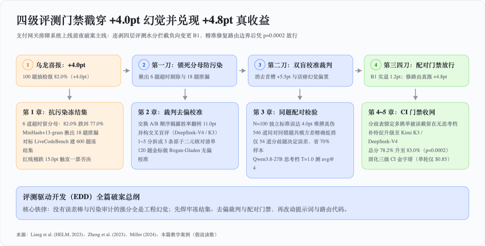
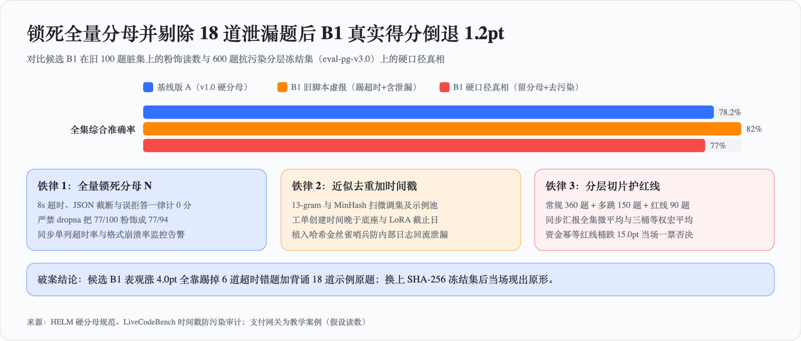
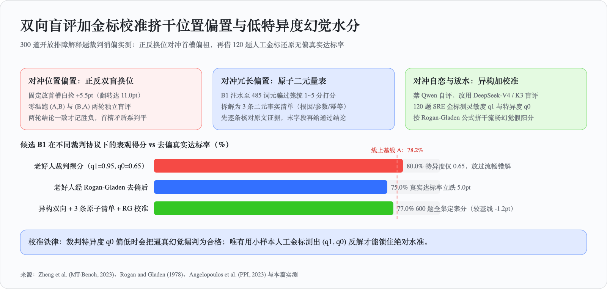
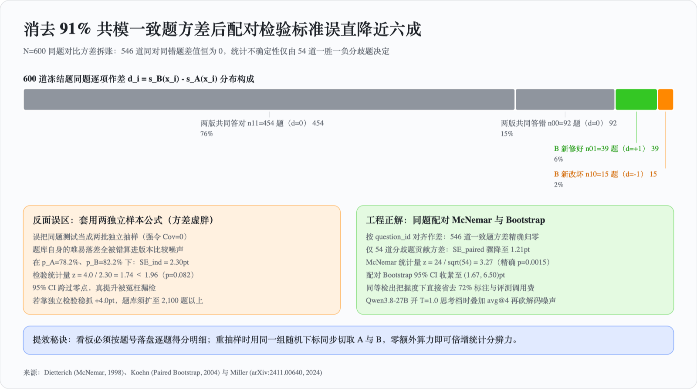
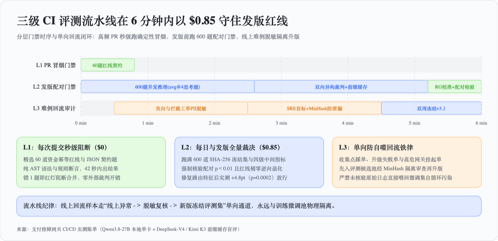
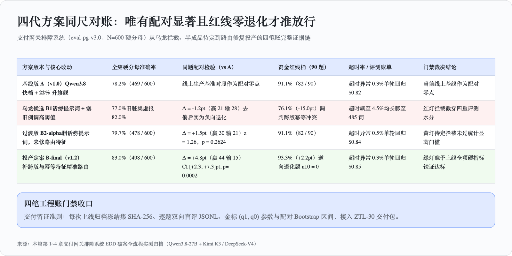

# ZTL-28｜工程｜先写评测再改系统

> 🎯 **这篇文档解决什么问题**：<b>核心命题：每次系统改动必须先过带误差棒与污染审计的评测门禁，否则涨分只是工程幻觉。</b>团队必须建立抗污染黄金冻结集、异常留分母的分层标尺、双盲校准的裁判模型，以及同题配对统计检验门禁四级闭环。唯此才能把每次系统升级变成可靠的净收益。
>
> **使用方式与先修要求**：本篇隶属 **L6 应用与 Agent 工程层**。读者需先掌握 [ZTL-02｜数学｜条件概率、softmax 与采样](./02-softmax-sampling.md) 的二项标准误，并熟悉第 25～27 篇的检索、溯源与路由契约。全篇追踪<b>企业支付网关排障系统发版前夜的“+4.0pt 虚假涨分案”</b>。我们拆穿方案 B1 的四重水分，用 600 题配对门禁指导 `Qwen3.8-27B` 协同旗舰拿到 `+4.8pt` 真提升。
>
> **动手实践**：第 2 章附有双盲换位判分与 Rogan-Gladen 无偏校准脚本。第 3 章附有零外部依赖的配对 Bootstrap 与精确 McNemar 门禁脚本。两段 Python 标准库代码均可在本地秒级运行，复现文中的统计读数。支付网关是教学案例：各版本准确率、超时率、耗时与账单都是假设读数（示意，非实测），用来演示门禁怎么算。

<b>🧭 主线位置</b>：上一篇 [ZTL-27｜工程｜提示、路由与工具边界](./27-prompt-routing-tools.md) 为调用层装上了受限解码、分级路由与 MCP 安全闸门。改一句提示词或调一次阈值后，凭肉眼抽看十几道题怎敢全量切流？本篇在改动线上逻辑前先建立统计可靠的离线评测门禁。握稳这把客观标尺后，下一篇 [ZTL-29｜工程｜Agent 的循环、记忆、权限与成本](./29-agent.md) 才能安全迈入多轮自主循环的可控 Agent 架构。

## 导读 · 先给结论

- <b>剔除超时报错与泄漏样本刷出的涨分全是假象，评测必须锁定全量分母并过近似去重审计。</b>网关超时、JSON 截断与误拒答必须留在总分母内计零分，并单独披露异常分桶。参照 `LiveCodeBench` 时间戳隔离与 13-gram 查重剔除少样本泄漏。同时为资金幂等红线切片设零回退一票否决[[1]](https://arxiv.org/abs/2211.09110)[[2]](https://arxiv.org/abs/2403.07974)。
- <b>大模型裁判自带位置、冗长与自恋偏置，须用双盲换位对冲失真并用人工金标校准达标率。</b>固定占据首槽会让候选方案白捡逾 5 个百分点胜率。必须改用异构强底座按原子二元清单跑双向盲评。随后借百余道专家金标测出灵敏度与特异度，做 Rogan-Gladen 无偏反解[[3]](https://arxiv.org/abs/2306.05685)[[4]](https://doi.org/10.1093/oxfordjournals.aje.a112510)。
- <b>同一批考题上两版系统具有强正协方差，同题配对检验能砍掉六成标准误并省下七成样本。</b>两版在约九成同对同错题上的共模方差精确抵消。统计不确定性仅取决于分歧题数。开启 `Qwen3.8-27B` 思考档随机采样时，单题叠加 `avg@4` 还能将解码方差再压四分之三[[5]](https://arxiv.org/abs/2411.00640)[[6]](https://doi.org/10.1162/089976698300017197)。
- <b>把三级评测金字塔接入 CI 流水线，单轮 600 题全量回归仅耗 6 分钟与 0.85 美元即可阻断带病发版。</b>每次提交先跑 60 题秒级规则冒烟，发版前跑 600 题配对门禁定位路由短板。线上难例经脱敏盲标与查重后单向升版入库。严禁原始日志回流微调集造成自循环污染[[2]](https://arxiv.org/abs/2403.07974)[[7]](https://arxiv.org/abs/2309.15217)。
- <b>交付门禁须归档四笔工程账快照，唯有配对置信下界大于零且红线桶零退化才准切流。</b>复盘可见原方案 B1 真实净收益实为 `-1.2pt`。顺着分歧表补齐跨版冲突与幂等路由特征后，定案版总准确率从 `78.2%` 升至 `83.0%（p = 0.0002）`，方才绿灯上线[[1]](https://arxiv.org/abs/2211.09110)[[5]](https://arxiv.org/abs/2411.00640)。



<b>📎 与系列其他文档的分工</b>：标准误与困惑度见 [ZTL-02｜数学｜条件概率、softmax 与采样](./02-softmax-sampling.md) 与 [ZTL-03｜数学｜熵、交叉熵、困惑度与 KL](./03-entropy-kl.md)，预训练防泄漏与奖励防刷分见 [ZTL-11｜训练｜从语料到一轮小预训练](./11-pretrain.md) 与 [ZTL-17｜后训练｜先验证奖励再训练](./17-verifiable-reward.md)，多样本缩放与检索指标见 [ZTL-18｜后训练｜多想一会儿是否值得](./18-test-time-compute.md) 与 [ZTL-25｜工程｜先把相关材料找出来](./25-retrieval.md)。

生成忠实度指标见 [ZTL-26｜工程｜让回答有可追溯的依据](./26-grounding.md)。本篇专攻黄金集治理、裁判校准与配对检验，最终项目交付证据包汇总于 [ZTL-30｜交付｜交一个可复查的项目](./30-delivery.md)。

## 第 1 章 · 锁定分母，阻断污染泄漏

接续第 25～27 篇搭建的企业支付网关排障系统。线上基线版 `A（v1.0）` 在单张 `80 GiB H100` 上以 FP8 部署 `Qwen3.8-27B`（权重约 `27 GB`，全局 KV 仅 `64 KiB/tok`）承接常规工单。前置路由器将 `22%` 疑难工单分流至百万窗旗舰 `Kimi K3` 或 `DeepSeek-V4`[[8]](https://huggingface.co/Qwen/Qwen3.8-27B/blob/main/config.json)[[9]](https://arxiv.org/abs/2606.19348)[[10]](https://arxiv.org/abs/2607.24653)。

周四发版前夜，值班群弹出一份报喜消息。某工程师提交了候选方案 `B1`。他改写提示词要求先铺垫完整架构背景，往少样本池塞入几组近期排障记录，并调高了路由升级阈值。他在 100 道抽检题上跑完旧脚本，宣称准确率涨到 `82.0%（+4.0pt）`，申请当晚切流。主程复核原始日志后，当场查出两处严重的口径漏洞。

### 1.1 锁定全量分母，拒绝生存者偏差

主程打开 `B1` 的汇总脚本，第一眼就发现了问题。代码末尾写着一行过滤语句 `df = df[df["status"] == "ok"]`。原来 `B1` 的长篇提示词拉长了输出。它在 `6` 道跨表难题上触发网关超时或 JSON 截断，仅正常返回 `94` 道题。旧脚本判过了其中 `77` 题，便把 `77 / 94 = 81.91%` 报成 `82.0%`。

这正是工程评测的头号陷阱：**生存者偏差操纵分母**。越是逻辑复杂的长尾难题，思考链与工具参数越长，越容易撞上超时或格式崩溃。把失败样本踢出分母等于只挑简单题计分。系统越脆弱，账面分数反而越好看。

动手改系统前，团队必须先为评测标尺**立目标**，定下严格的**全量分母规则**[[1]](https://arxiv.org/abs/2211.09110)[[11]](https://github.com/EleutherAI/lm-evaluation-harness)。设评测集总题数为 $`N_{\mathrm{total}}`$ ，严格达标题数为 $`N_{\mathrm{correct}}`$ ，严格准确率唯一定义为：

```math
\mathrm{Acc}_{\mathrm{strict}} = \frac{N_{\mathrm{correct}}}{N_{\mathrm{total}}} = (1 - r_{\mathrm{fail}})\cdot \frac{N_{\mathrm{correct}}}{N_{\mathrm{ok}}}
```

式中 $`N_{\mathrm{ok}}`$ 为合法返回样本数，$`r_{\mathrm{fail}}`$ 为异常失败率。网关超时、JSON 崩溃、空串截断与有据题误拒答，一律留在总分母内计 `0` 分。同时必须单列异常监控分桶，严禁牺牲可用性去粉饰准确率。

### 1.2 污染审计与哈希冻结

把 `6` 道超时题放回分母后，`B1` 表观分仍剩 `77.0%`。主程随即启动第二步核查：<b>数据污染审计（Contamination Audit）</b>[[12]](https://doi.org/10.1109/SEQUEN.1997.666900)[[13]](https://arxiv.org/abs/2310.17623)。他提取 `B1` 的少样本提示池与上周微调语料，对 100 道测试题跑字符级 `13-gram` 碰撞与 `MinHash` 近似查重。

核查结果揭示了真相。100 道题里有 `18` 道旧事故题已被改写塞进了示例池或微调集。剥离这 `18` 道背诵题后，在其余 `82` 道未见新单上，`B1` 仅答对 `60` 题，真实水平跌至 `73.2%`。

这也印证了 2026 年评测前沿基座时的行业共识：成熟团队早已不再轻信静态老榜 `GSM8K`[[14]](https://arxiv.org/abs/2110.14168)[[15]](https://arxiv.org/abs/2410.05229)。`GSM-Symbolic` 证实，仅把原题姓名与数值做同构替换，许多高分模型便骤降逾 `15pt`[[15]](https://arxiv.org/abs/2410.05229)。主流基准因此转向两条防线：`LiveCodeBench` 按发布时间戳严格截断在权重冻结日之后[[2]](https://arxiv.org/abs/2403.07974)，`SWE-bench Verified` 则逐题复核单测并固定容器镜像[[16]](https://arxiv.org/abs/2310.06770)。

团队据此废除 100 题旧集，重建私域冻结集 `eval-pg-v3.0`（共 `600` 题），并引入**分层切片**防止均值掩盖高危退化[[1]](https://arxiv.org/abs/2211.09110)。设第 $`b`$ 个切片题量为 $`N_b`$ 、达标数为 $`C_b`$ ，门禁同时核算**微平均**与**宏平均**：

```math
\mathrm{Acc}_{\mathrm{micro}} = \frac{\sum_{b=1}^{B} C_b}{\sum_{b=1}^{B} N_b}, \qquad \mathrm{Acc}_{\mathrm{macro}} = \frac{1}{B}\sum_{b=1}^{B} \frac{C_b}{N_b}
```

用具体数字把这笔风险账算透。设基线在常规查询（360 题）、多跳冲突（150 题）与资金红线（90 题）三桶分别答对 `288`、`108` 与 `81` 题。此时全集微平均为 $`477 / 600 = 79.5\%`$，三桶等权宏平均为 $`80.7\%`$。

若候选版在常规桶微涨 `+3.0pt`（多对 11 题），多跳桶持平，资金红线桶却暴跌 `-15.0pt`（少对 14 题）。全集微平均仅微跌至 $`474 / 600 = 79.0\%`$（`-0.5pt`），单看总分极易蒙混过关。等权宏平均却当场重挫 `-4.0pt`，揭示出高危切片严重失血。

工程门禁因此要求同时汇报双均值，并为资金红线切片设零退化一票否决。此外，每道冻结题末尾均植入金丝雀指纹串，训练清洗管线一旦扫到该指纹便自动拒收：

| **黄金集分层切片与防线** | **题量配比 / 锚点** | **构建来源与抗污染硬约束** | **上线门禁裁决规则** |
|---|---|---|---|
| **高频常规排障切片** | `360 题（60%）` | 取模型与微调截止日后新工单脱敏抽样；过 `13-gram + MinHash` 去重 | 锁定全量分母；要求较基线统计不退化或净提升 |
| **跨服务多跳冲突切片** | `150 题（25%）` | 覆盖 `v3.1/v3.2` 配置冲突与超长日志；含同构数值常数改写扰动题 | 重点监控 `8s` 超时率及 `Qwen3.8` 向 `K3/V4` 升级命中率 |
| **资金幂等与合规红线切片** | `90 题（15%）` | 沉淀历史重扣资损单、越权注入与无据拒答红线；双专家交叉核定真值 | **一票否决红线**：独立核算切片准确率，退化容忍度严格为 `0` |
| **金丝雀哨兵与哈希锁** | `SHA-256` 冻结 | 每题植入唯一金丝雀串 `PG-EVAL-CANARY-9F2A`；训练清洗管线强制拒收 | 评测前校验题库哈希一致；同步汇报全集微平均与三桶宏平均 |



对照上表四道防线与上方黄金集治理图可见，题量配比与否决权重采取了反向互补设计。常规切片占 `60%` 题量以对齐线上日常流量分布，确保微平均如实反映大盘体感。题量仅占 `15%` 的资金幂等切片则握有一票否决权，只要错多一题就会阻断发版。每次开跑前脚本还会重验题库 `SHA-256` 指纹，杜绝任何人私自删改难例。

> 💡 <b>常见误区：防污染只查字面完全相等，漏掉了少样本缩写改写与复盘文档渗透。</b>
>
> **现象**：脚本跑字符串等号匹配显示零重合。模型上线遇到新故障码时却照搬老事故的废弃参数。
>
> **根因**：工程师编写示例样本时常对原单做同义缩写。纯字面等号查重会全部漏检[[12]](https://doi.org/10.1109/SEQUEN.1997.666900)[[15]](https://arxiv.org/abs/2410.05229)。
>
> **改法**：叠加 `13-gram`、`MinHash` 与向量余弦相似度三重扫描。题库植入唯一金丝雀串供训练网关自动拒收[[2]](https://arxiv.org/abs/2403.07974)。

> 🔑 **本章要点与回到主线**：堵住偷换分母漏洞、清退 18 道污染原题并锁定 600 道分层冻结集后，`B1` 的虚高分数已被剥去前两层水分。但新的矛盾随之浮现：半数开放式排障解释题无法靠正则判分。引入大模型当裁判后，为何仅仅对调 A/B 展示顺序，胜率就凭空翻转了 `11.0` 个百分点？这正是第 2 章的核心任务。

## 第 2 章 · 大模型裁判的双盲去偏校准

顺着上一章末尾的怪象继续排查。600 道冻结题中，300 道工具参数题可直接靠 JSON 抽象语法树确定性判分。另外 300 道开放式排障解释题则需要请强模型当自动裁判（LLM-as-a-Judge）[[3]](https://arxiv.org/abs/2306.05685)。

主程重跑了旧脚本的成对比较模块。当固定把候选 `B1` 放在第 1 槽位时，裁判判 `B1` 胜率达 `55.5%`。可对调槽位顺序后，同一批答案里 `B1` 胜率降至 `44.5%`。正反相差足足 `11.0pt`，单向固定首槽等于让 `B1` 白捡了 `+5.5pt` 位置红利。

### 2.1 三大偏置与双盲对冲协议

为什么千亿参数的顶尖模型当考官也会偏心？`MT-Bench` 与 `Chatbot Arena` 的对齐实验证实，自动裁判普遍存在三类系统性偏置[[3]](https://arxiv.org/abs/2306.05685)[[17]](https://arxiv.org/abs/2403.04132)：

- <b>位置偏置（Position Bias）。</b>自回归注意力对前部槽位有显著首因偏好，单向翻转率常达 `10%～25%`[[3]](https://arxiv.org/abs/2306.05685)。对冲协议是执行**正反双盲换位判分**。隐去身份跑 `(A, B)` 与 `(B, A)` 两轮，前后均选首槽的矛盾票一律归为**平局**。
- <b>冗长偏置（Verbosity Bias）。</b>面对笼统的 1～5 分指令，裁判极易被小标题与套话迷惑[[18]](https://arxiv.org/abs/2404.04475)。`B1` 把平均回复注水到 `485` 词元，漏掉关键参数也能骗高分。对冲协议是改用**3 条二元原子清单**，三条全过才记 `1` 分。
- <b>自恋与同族偏置（Self-Preference Bias）。</b>模型对同族生成的词表分布具有低困惑度亲和力[[19]](https://arxiv.org/abs/2404.13076)。对冲协议是启用**跨家族异构盲评**。评 `Qwen3.8-27B` 时调异族 `DeepSeek-V4` 或 `Kimi K3` 评审，并定期与 SRE 金标对账[[9]](https://arxiv.org/abs/2606.19348)[[10]](https://arxiv.org/abs/2607.24653)[[19]](https://arxiv.org/abs/2404.13076)。

| **裁判失真类型** | **乌龙案 B1 失真现场** | **去偏协议硬规范** | **算力成本与治理代价** |
|---|---|---|---|
| **位置偏置** | 固定放首槽白捡 `+5.5pt`，正反翻转达 `11.0pt` | 零温独立跑 `(A,B)` 与 `(B,A)`，矛盾废票强制归平局 | 成对判分调用翻 2 倍（题干前缀缓存可省半） |
| **冗长偏置** | 输出从 `210` 膨至 `485` 词，靠套话掩盖漏参数 | 废除 1～5 印象分，改为 3 条二元事实清单逐项打勾 | 制题时需随题提炼 3 条核心事实核验锚点 |
| **自恋同族偏置** | 同族 `Qwen` 互评对自家过渡句式额外宽容 | `Qwen3.8`、`DeepSeek-V4` 与 `Kimi K3` 跨族交叉盲评 | 维护异构裁判路由，抹除一切思维链身份标签 |
| **低特异度放水** | 被流畅幻觉欺骗，把错解漏判为合格推高表观分 | 锚定 `120` 道人工金标测 $`(q_1, q_0)`$ 做无偏反解 | 每季度投入约 3 人时资深 SRE 盲标金标子集 |

### 2.2 Rogan-Gladen 无偏通过率点估计与预测驱动推断（PPI）校准

双向换位解决了相对排序，但门禁还需估算真实合格率 $`\theta = P(Y=1)`$。我们在 $`m = 120`$ 道专家金标集上测两项刻度（本案例为假设读数）[[4]](https://doi.org/10.1093/oxfordjournals.aje.a112510)：真对题被放行的**灵敏度** $`q_1`$，以及真错题被拦下的**特异度** $`q_0`$。

由全概率公式展开粗糙得分期望，可得 $`p_{\mathrm{raw}} = \theta q_1 + (1 - \theta)(1 - q_0) = (q_1 + q_0 - 1)\theta + (1 - q_0)`$。分母项 $`J = q_1 + q_0 - 1`$ 即统计学中的<b>约登指数（Youden Index）</b>，度量裁判超出随机瞎猜的净判别力。只要 $`J > 0`$，移项反解即得消除误报泡沫的 **Rogan-Gladen 无偏点估计公式**[[4]](https://doi.org/10.1093/oxfordjournals.aje.a112510)[[20]](https://arxiv.org/abs/2301.09633)：

```math
\hat{\theta}_{\mathrm{RG}} = \mathrm{clip}_{[0, 1]}\!\left(\frac{\hat{p}_{\mathrm{raw}} + q_0 - 1}{q_1 + q_0 - 1}\right)
```

这与<b>预测驱动推断（PPI）</b>原理一致：靠全量机器预测压低方差，再用小样本人工金标修正系统偏差[[20]](https://arxiv.org/abs/2301.09633)。用两组读数手算验证：

1. <b>温和偏差场景。</b>设灵敏度为 `0.95`、特异度为 `0.75`。当粗糙得分为 `82.0%` 时，真实达标率为 `81.4%`。
2. <b>严重幻觉放水场景。</b>若面对话痨长文时特异度跌至 `0.65`，哪怕账面报出 `80.0%`，真实达标率也会跌至 `75.0%`，当场挤干 `5.0pt` 水分。

切至异构 `DeepSeek-V4` 执行原子二元清单后，`120` 道金标集上灵敏度升至（假设读数） `0.9625`，特异度升至 `0.9000`。按一阶展开（Delta 方法），去偏估计量的渐近方差同时受评测集容量与金标样本量制约[[20]](https://arxiv.org/abs/2301.09633)：

```math
\mathrm{Var}(\hat{\theta}_{\mathrm{RG}}) \approx \frac{1}{(q_1 + q_0 - 1)^2}\left[\frac{\hat{p}_{\mathrm{raw}}(1 - \hat{p}_{\mathrm{raw}})}{N} + \frac{\hat{\theta}^2 q_1(1 - q_1)}{m_1} + \frac{(1 - \hat{\theta})^2 q_0(1 - q_0)}{m_0}\right]
```

观察括号内三项即可看清预算瓶颈。当机器评测集已达 `600` 题而人工金标仅抽 `30` 题时，金标方差会占去总误差的八成以上。此时盲目扩充机器题量毫无意义。

反之，只需花 3 个专家工时把人工金标扩至 `120` 题，同时把约登指数从 `0.60` 提至 `0.8625`，校准置信半宽就会从 `±10.1pt` 收窄至 `±5.9pt`。核验代码如下：

*双盲位置交换消偏统计与 Rogan-Gladen 真实通过率及 95% 置信区间校准脚本*

```python
import math

def resolve_position_swap(ab_votes: list[str], ba_votes: list[str]) -> dict:
    """输入两轮已映射回真实身份 ('A'/'B'/'T') 的盲评票，不一致矛盾票强制归入 bias_tie"""
    tally = {"B_win": 0, "A_win": 0, "clean_tie": 0, "bias_tie": 0}
    for v1, v2 in zip(ab_votes, ba_votes):
        if v1 == "B" and v2 == "B":
            tally["B_win"] += 1
        elif v1 == "A" and v2 == "A":
            tally["A_win"] += 1
        elif v1 == "T" and v2 == "T":
            tally["clean_tie"] += 1
        else:
            tally["bias_tie"] += 1
    n = len(ab_votes)
    # 双向对称净胜率：赢计 1 分、平局计 0.5 分
    b_score = (tally["B_win"] + 0.5 * (tally["clean_tie"] + tally["bias_tie"])) / n
    return {**tally, "B_debiased_winrate": round(b_score, 4)}

def calibrate_rogan_gladen(p_raw: float, n_eval: int, tp: int, m_pos: int, tn: int, m_neg: int):
    """结合人工金标 (tp/m_pos, tn/m_neg) 反解去偏真实达标率与 Delta 方法 95% CI"""
    q1, q0 = tp / m_pos, tn / m_neg
    youden = q1 + q0 - 1.0
    if youden <= 0.0:
        raise ValueError("裁判约登指数 <= 0，丧失正向判别力")
    theta = min(max((p_raw + q0 - 1.0) / youden, 0.0), 1.0)
    var_p = p_raw * (1.0 - p_raw) / n_eval
    var_q1 = (theta ** 2) * q1 * (1.0 - q1) / m_pos
    var_q0 = ((1.0 - theta) ** 2) * q0 * (1.0 - q0) / m_neg
    se = math.sqrt(var_p + var_q1 + var_q0) / youden
    return round(theta, 4), round(1.96 * se, 4)

# 1. 复现 300 道开放题正反翻转 11.0pt 现场：首轮 B 占首槽赢 153 题，次轮掉至末槽仅保住 120 题
r_ab = ["B"] * 153 + ["A"] * 120 + ["T"] * 27   # 单向首轮 B 表观胜率 (153 + 13.5)/300 = 55.5%
r_ba = ["B"] * 120 + ["A"] * 33 + ["A"] * 120 + ["T"] * 27  # 次轮对调后 B 胜率跌至 44.5%
print("双盲换位裁决:", resolve_position_swap(r_ab, r_ba))

# 2. 验证手算例与排障网关 120 题金标校准
print("q0=0.75 报 82% ->", calibrate_rogan_gladen(0.82, 600, tp=76, m_pos=80, tn=30, m_neg=40))
print("q0=0.65 报 80% ->", calibrate_rogan_gladen(0.80, 600, tp=76, m_pos=80, tn=26, m_neg=40))
print("原子清单实测校准 ->", calibrate_rogan_gladen(0.768, 600, tp=77, m_pos=80, tn=36, m_neg=40))
```

*输出*

```text
双盲换位裁决: {'B_win': 120, 'A_win': 120, 'clean_tie': 27, 'bias_tie': 33, 'B_debiased_winrate': 0.5}
q0=0.75 报 82% -> (0.8143, 0.0793)
q0=0.65 报 80% -> (0.75, 0.101)
原子清单实测校准 -> (0.7745, 0.0593)
```

逐段拆解上方去偏脚本与四行校准读数，三处核心统计机制如下：

- <b>矛盾票归平剥离首槽泡沫。</b>在 300 道开放题盲评模拟中，有 `33` 道题无论谁排第一槽裁判都判首槽胜出。`resolve_position_swap` 将这类首因矛盾票全部归入 `bias_tie` 按 `0.5` 分折算，使单向虚高的 `55.5%` 表观胜率精准还原为 `0.5000` 真实平局。
- <b>约登指数双向支配点估计与置信半宽。</b>在 `calibrate_rogan_gladen` 中，标准误 `se` 需除以分母 `youden`。当特异度从放水态 `0.65`（约登指数 `0.60`）升至原子清单下的 `0.90`（约登指数 `0.8625`）时，不仅挤干了 `5.0pt` 幻觉泡沫，还将 `95%` 置信半宽从 `±10.1pt` 压窄至 `±5.93pt`。
- <b>区间截断守住概率公理边界。</b>当待测极弱系统的粗糙通过率低于裁判误报率 $`1 - q_0`$ 时，线性反解分子会出现负值。代码通过双侧截断将其严格约束在 `[0.0, 1.0]` 合法区间内。



结合上方校准对比图与去偏表可以读出一条清晰的投入产出规律。未做换位与金标校准前，位置偏置与话痨放水叠加能凭空造出逾 `10pt` 的虚假繁荣。换成异构底座执行 3 条二元事实打勾，并投入 3 个专家人时盲标 `120` 道金标子集后，裁判特异度立刻拉升至九成，既挤干了水分又守住了低成本自动化优势。

> 💡 <b>常见误区：让裁判 JSON 首字段先吐总分 `{"score": 1, "reason": "..."}`，把判分变成强行圆场。</b>
>
> **现象**：裁判在后半段 `reason` 写明遗漏幂等参数，首字段 `score` 却照给满分 `1`。
>
> **根因**：自回归解码受因果掩码约束（见 [ZTL-02｜数学｜条件概率、softmax 与采样](./02-softmax-sampling.md) 与 [ZTL-08｜模型｜把注意力写成矩阵](./08-attention.md)）。先吐出的分数看不见后续推理，反逼后续文本顺着高分圆场[[3]](https://arxiv.org/abs/2306.05685)。
>
> **改法**：受限解码 Schema（见 [ZTL-27｜工程｜提示、路由与工具边界](./27-prompt-routing-tools.md)）强制首字段先输出逐条证据比对，末字段再给布尔结论 `all_passed`。

> 🔑 **本章要点与回到主线**：上齐异构盲评、原子二元清单、正反换位与 120 题金标校准后，原方案 `B1` 真实总分仅为 `77.0%`，较基线倒退 `1.2pt`。团队撤回 `B1` 并推出过渡版 `B2-alpha`，重测拿到 `79.7%`（高出基线 `+1.5pt`）。但新的矛盾随之浮现：这 `1.5` 个百分点到底是真提升还是抽样噪声？为什么套用独立样本公式会多花三倍预算？这正是第 3 章的核心任务。

## 第 3 章 · 配对检验与样本规划

紧接上一章末尾的争议：过渡版 `B2-alpha` 在 600 道冻结题上比线上基线 `A` 高出 `+1.5pt`（`79.7%` 对 `78.2%`）。评审会上很快分成两派。乐观派主张有涨就发，谨慎派翻出 [ZTL-02｜数学｜条件概率、softmax 与采样](./02-softmax-sampling.md) 的单样本公式，指出 600 题单版置信半宽超过 `±3.2pt`。拍板前必须先**算上限**，算清当前题库能分辨的最小效应量[[5]](https://arxiv.org/abs/2411.00640)。

### 3.1 独立样本公式的陷阱

先核算第 1 章那份 $`N = 100`$ 抽检报告的统计精度。单版系统在 $`N`$ 道独立考题上的二项标准误为 $`\mathrm{SE}(\hat{p}) = \sqrt{\hat{p}(1 - \hat{p}) / N}`$[[5]](https://arxiv.org/abs/2411.00640)。取基准率 `0.80` 且 $`N = 100`$ 时，单版标准误高达 `4.0pt`，单版置信半宽达 `±7.84pt`。若把两版当作独立样本对比，差值标准误更膨胀至 `5.66pt`。在 `80%` 统计把握度下，<b>最小可检出效应量（MDE）</b>高达 `15.8pt`，根本测不出两三分的改进。

即便扩充到 $`N = 600`$ 题，机械套用独立样本公式照样误事。假设基线为 `78.2%`，某新版考到 `82.2%`（净涨 `+4.0pt`）。独立差值标准误仍有 `2.30pt`，检验量 $`z = 1.74 < 1.96`$（$`p = 0.082`$）。连实打实的 4 个点真提升都会被漏检。若靠独立检验稳抓 `+4.0pt`，题库规模需要扩充到 `2,100` 题以上。

### 3.2 配对方差削减与 McNemar 检验

独立公式之所以严重虚高，是因为它忽略了最核心的实验设计。**基线 `A` 与候选 `B` 作答的是完全相同的 600 道冻结考题**[[5]](https://arxiv.org/abs/2411.00640)[[6]](https://doi.org/10.1162/089976698300017197)。按题号对齐两版得分，令同题差值为 $`d_i = s_B(x_i) - s_A(x_i)`$，平均净增益 $`\bar{d}`$ 严格满足**配对方差削减恒等式**[[5]](https://arxiv.org/abs/2411.00640)：

```math
\mathrm{Var}(\bar{d}) = \frac{\mathrm{Var}(s_A) + \mathrm{Var}(s_B) - 2\,\mathrm{Cov}(s_A, s_B)}{N} = \frac{(n_{01} + n_{10})/N - \bar{d}^2}{N}
```

物理原因十分直观。常规送分题两版双双答对，极端难题两版又双双答错。以准确率 `0.80` 为例，单版方差为 $`0.80 \times 0.20 = 0.16`$，独立作差时方差分子叠加至 `0.32`。而在同题测试中，约九成共模一致题带来强正协方差，令方差分子骤降至分歧率量级（约 `0.09`），直接压掉逾七成噪声。<b>统计不确定性只取决于两版一胜一负的分歧题总数 $`n_{01} + n_{10}`$</b>[[6]](https://doi.org/10.1162/089976698300017197)。

检验无差异零假设时，即得到经典的<b>麦克尼马尔检验（McNemar Test）</b>[[6]](https://doi.org/10.1162/089976698300017197)：$`z = (n_{01} - n_{10}) / \sqrt{n_{01} + n_{10}}`$。拿 `600` 题手算核对。设两版在 `546` 题上一致，分歧仅 `54` 题（新对 `39` 题、新错 `15` 题，净赢 `+4.0pt`）。配对标准误立刻从 `2.30pt` 骤降六成至 `1.21pt`，算得 $`z \approx 3.27,\; p = 0.0011`$。同等把握度下，同题配对直接省下逾 <b>70%</b> 的评测预算。

再用这把尺子衡量过渡版 `B2-alpha`。它净多对 `+9` 题（`+1.5pt`），分歧达 `51` 题（新对 `30` 题、新错 `21` 题）。算得 $`z \approx 1.26`$（精确双侧 $`p = 0.2624`$），确属尚未过关的过渡态。

在 2026 年的长思维链采样场景下，评测噪声还会分解为两层[[5]](https://arxiv.org/abs/2411.00640)。例如 `Qwen3.8-27B` 开启弹性思考模式时采用随机采样 $`T = 1.0,\; p = 0.95`$[[8]](https://huggingface.co/Qwen/Qwen3.8-27B/blob/main/config.json)。若对每道思考题独立重复采样 $`k`$ 次并取均值分 `avg@k`，配对均值差的总方差满足两层分解[[5]](https://arxiv.org/abs/2411.00640)：

```math
\mathrm{Var}(\bar{d}_{k}) = \frac{\sigma_{\mathrm{item}}^2}{N} + \frac{\sigma_{\mathrm{dec}}^2}{N \cdot k}
```

多标一道新黄金题要花专家十几分钟，而对现有思考题取 `avg@4` 只需本地 GPU 多跑几秒批推理，就能把解码方差削减 `75%`。注意切勿把无偏均值 `avg@4` 与 [ZTL-18｜后训练｜多想一会儿是否值得](./18-test-time-compute.md) 挑最好一次的乐观指标 `Pass@4` 混淆。线上用户只发一次请求，唯有 `avg@k` 才对齐真实期望体验。

日常调参还要防备多重检验陷阱。连试 10 组提示词若仍按 $`p < 0.05`$ 放行，撞上假阳性的概率高达四成。日常探索应在验证集筛选，最终门禁集须将阈值收紧至 $`p < 0.01`$。拿到连续均值分 `avg@4` 后，直接运行<b>配对自助重抽样（Paired Bootstrap）</b>即可给出置信区间[[21]](https://aclanthology.org/W04-3250/)：



对照上方把握度曲线与下方题量速查表可见，样本需求随目标效应量呈平方反比陡增。检出 `4.0pt` 常规改进时，同题配对将题库门槛从两千余题压回 `600` 题主力档。若要分辨 `1.5pt` 级别的采样精调，单靠零温单跑仍显吃力，叠加 `avg@4` 压低解码方差才是最经济的方案：

| **目标检出净增益** | **独立双样本所需题量** | <b>同题配对所需题量（分歧率 10%）</b> | **典型工程改动场景与采样策略** |
|---|---|---|---|
| <b>大跨度升级（`≥ 5.0pt`）</b> | `≈ 1,000 题/版` | <b>`≈ 320 题`</b>（省 `68%` 预算） | 跨代更换基座或重构检索管线；零温确定性单次跑 |
| <b>常规迭代（`3.0～4.0pt`）</b> | `≈ 2,100 题/版` | <b>`≈ 500～600 题`</b>（省 `72%` 预算） | 修路由特征、调精排阈值或精简系统提示词；常规主力档 |
| <b>精细调优（`1.5～2.0pt`）</b> | `≈ 8,000 题/版` | <b>`≈ 1,800 题`</b> 或 `600 题 × avg@4` | `Qwen3.8-27B` 思考档 `T=1.0` 采样调参；必配 Paired Bootstrap |

*零外部依赖的 Paired Bootstrap 置信区间与精确二项 McNemar 上线门禁脚本*

```python
import math
import random

def exact_mcnemar_p(n01: int, n10: int) -> float:
    """零外部依赖计算精确双侧二项 McNemar p 值：2 * sum_{k=0}^{min} C(m, k) * 0.5^m"""
    m = n01 + n10
    if m == 0:
        return 1.0
    k_max = min(n01, n10)
    tail = sum(math.comb(m, k) for k in range(k_max + 1)) * (0.5 ** m)
    return min(1.0, 2.0 * tail)

def paired_eval_gate(scores_a: list[float], scores_b: list[float], n_boot: int = 10000, seed: int = 2026) -> dict:
    """支持 {0,1} 二值或 avg@k 连续实数得分的同题配对统计门禁"""
    n = len(scores_a)
    diffs = [b - a for a, b in zip(scores_a, scores_b)]
    mean_d = sum(diffs) / n
    # 独立双样本标准误 vs 同题配对解析标准误
    pa, pb = sum(scores_a) / n, sum(scores_b) / n
    se_ind = math.sqrt((pa * (1.0 - pa) + pb * (1.0 - pb)) / n)
    var_d = sum((d - mean_d) ** 2 for d in diffs) / (n - 1)
    se_paired = math.sqrt(var_d / n)
    # 0/1 分歧统计与精确 McNemar 检验
    n01 = sum(1 for a, b in zip(scores_a, scores_b) if a < 0.5 and b >= 0.5)
    n10 = sum(1 for a, b in zip(scores_a, scores_b) if a >= 0.5 and b < 0.5)
    z_mc = (n01 - n10) / math.sqrt(n01 + n10) if (n01 + n10) > 0 else 0.0
    p_val = exact_mcnemar_p(n01, n10)
    # Paired Bootstrap：用同一组随机题号同步重抽样差值向量
    rng = random.Random(seed)
    boot_means = sorted(sum(diffs[rng.randrange(n)] for _ in range(n)) / n for _ in range(n_boot))
    ci_lo, ci_hi = boot_means[int(0.025 * n_boot)], boot_means[int(0.975 * n_boot)]
    return {
        "delta_pt": round(mean_d * 100, 2), "se_ind_pt": round(se_ind * 100, 2),
        "se_paired_pt": round(se_paired * 100, 2), "z_mcnemar": round(z_mc, 2),
        "p_exact": round(p_val, 4), "ci95_pt": (round(ci_lo * 100, 2), round(ci_hi * 100, 2)),
    }

# 1. 验证本章 54 题分歧例（39 胜 15 负，净赢 +4.0pt）与过渡版 B2-alpha（30 胜 21 负，+1.5pt）
sa = [1.0] * 454 + [0.0] * 92 + [0.0] * 39 + [1.0] * 15
sb_54 = [1.0] * 454 + [0.0] * 92 + [1.0] * 39 + [0.0] * 15
sb_alpha = [1.0] * 448 + [0.0] * 101 + [1.0] * 30 + [0.0] * 21
sa_alpha = [1.0] * 448 + [0.0] * 101 + [0.0] * 30 + [1.0] * 21
print("54题分歧例:", paired_eval_gate(sa, sb_54))
print("B2-alpha待定:", paired_eval_gate(sa_alpha, sb_alpha))
print("统计对比：54题分歧 p=0.0015 过关，51题分歧 p=0.2624 未过关")
```

*输出*

```text
54题分歧例: {'delta_pt': 4.0, 'se_ind_pt': 2.3, 'se_paired_pt': 1.21, 'z_mcnemar': 3.27, 'p_exact': 0.0015, 'ci95_pt': (1.67, 6.5)}
B2-alpha待定: {'delta_pt': 1.5, 'se_ind_pt': 2.35, 'se_paired_pt': 1.19, 'z_mcnemar': 1.26, 'p_exact': 0.2624, 'ci95_pt': (-0.83, 3.83)}
统计对比：54题分歧 p=0.0015 过关，51题分歧 p=0.2624 未过关
```

逐段复盘上方统计门禁实现与两行检验读数，三处关键算法细节决定了裁决的严谨度：

- <b>精确二项分布替代大样本近似。</b>当分歧总数 `m = n01 + n10` 仅二三十题时，正态近似容易虚增效应值。`exact_mcnemar_p` 直接按公平硬币零假设累加双侧二项尾概率 $`2 \sum \binom{m}{k} 0.5^m`$，无需第三方科学计算包即可给出精确双侧 $`p`$ 值。
- <b>对逐题差值向量同步重抽样抵消共模方差。</b>在 `paired_eval_gate` 中，Bootstrap 直接对同题差值数组 `diffs` 抽取一万轮随机题号，天然支持思考档 `avg@4` 产生的连续小数得分，把标准误从独立的 `2.30pt` 压至配对的 `1.21pt`。代码里两版同对 `454` 题、同错 `92` 题，这 `546` 道一致题占 `91%`，差值为零，方差只来自 `54` 道分歧题。
- <b>置信下界过零点充当硬放行闸门。</b>首例 `+4.0pt` 的 `95%` 置信区间落在 `(1.67, 6.50)`，下界稳居零点之上且 $`p = 0.0015 < 0.01`$，自动签发绿灯。次例 `B2-alpha` 的置信区间 `(-0.83, 3.83)` 横跨负值区，门禁当场阻断带噪切流。

> 💡 <b>常见误区：评测库只存实验汇总均分，丢弃了按 `question_id` 对齐的逐题明细。</b>
>
> **现象**：周报只记昨日 78.2%、今日 81.5%。事后想检验效应才能套独立公式，白白损失六成统计分辨力。
>
> **根因**：脱离逐题键对齐就无法消去共模一致项，也看不清到底改坏了哪几道老题[[5]](https://arxiv.org/abs/2411.00640)[[21]](https://aclanthology.org/W04-3250/)。
>
> **改法**：强制落盘 `(run_id, dataset_sha256, question_id, slice_tag, score)` 明细宽表。对比时先按题号连接再跑配对检验。

> 🔑 **本章要点与回到主线**：同题配对统计不仅证伪了原方案 `B1` 的负收益，还拦下了未达统计检验门槛的 `B2-alpha`，并把排查焦点定格在那 `21` 道“基线做对、新版改错”的逆向分桶上。顺着这 21 道错题**找瓶颈**修好路由特征后，怎样把 EDD 门禁接入日常发布流水线？这正是第 4 章的核心任务。

## 第 4 章 · 评测接入发布流水线与难例回流

顺着上一章定位的 `21` 道逆向退化题，团队拉出中间追踪日志做组件级归因[[7]](https://arxiv.org/abs/2309.15217)，很快查明了真正病根。原来 `B1` 与 `B2-alpha` 为省调用费都调高了 [ZTL-27｜工程｜提示、路由与工具边界](./27-prompt-routing-tools.md) 的路由升级阈值。

这导致一批字面简短、实则隐含“`v3.1/v3.2` 跨版参数冲突加写操作幂等校验”的隐性多跳工单，被误截留在了 `Qwen3.8-27B` 的非思考快档（`enable_thinking = False`）。

### 4.1 顺着逆向分歧桶精准修路由：兑现 +4.8pt（p = 0.0002）真提升

查明原因后，团队不再堆砌提示词套话，转而在路由边界上精准**做取舍**，推出定案版 `B-final（v1.2）`[[8]](https://huggingface.co/Qwen/Qwen3.8-27B/blob/main/config.json)[[9]](https://arxiv.org/abs/2606.19348)[[10]](https://arxiv.org/abs/2607.24653)：

- <b>补齐隐性多跳特征触发单卡弹性思考档。</b>在前置路由器（耗时 `9 ms`）补入“多版本号共现”与“写接口幂等标志”。命中中度冲突的工单原地开启 `Qwen3.8-27B` 中等思考档（`reasoning_effort = "medium"`），单单仅增约三百思考词元即可低成本化解跨版参数冲突[[8]](https://huggingface.co/Qwen/Qwen3.8-27B/blob/main/config.json)。
- <b>超长跨库故障单精准升级百万窗旗舰。</b>当监控堆栈与变更单拼接突破 `32K` 词元或涉及资金分歧时，路由器放行约 `24%` 流量升级至 `Kimi K3` 或 `DeepSeek-V4` 处理长窗依赖[[9]](https://arxiv.org/abs/2606.19348)[[10]](https://arxiv.org/abs/2607.24653)。这既避免了小档位盲猜报错，又将七成六的常规流量稳稳留在本地单卡池内。

把 `B-final` 推上 600 题冻结集**测实际**，四级中间诊断探针清晰展现了模块化拆账的价值[[7]](https://arxiv.org/abs/2309.15217)。若只盯端到端总分，团队很难分清错题败在检索漏召回、路由误分流还是生成瞎编。

逐层核对探针读数后真相大白。混合检索 `Recall@5` 稳守在 [ZTL-25｜工程｜先把相关材料找出来](./25-retrieval.md) 打磨出的 `89.0%`，受限解码 MCP 参数合法率恒为 `100.0%`。真正的跃升来自隐性多跳工单的路由升级召回率从 `61.0%` 飙至 <b>`94.2%`</b>，带动引用忠实度从 `88.5%` 升至 <b>`95.4%`</b>。

汇总到端到端严格准确率，全集得分从基线 `A` 的 `78.2%（469/600）` 提升至 <b>`83.0%（498/600）`</b>。同题分歧共 `59` 题，新修好 `44` 题、逆向微瑕仅 `15` 题，净赢 `+29` 题即 $`\Delta = +4.8\text{ pt}`$。配对 Bootstrap `95% CI` 落在 <b>`[+2.3pt, +7.3pt]`</b>，精确 McNemar $`p = 0.0002`$。90 道资金幂等红线切片升至 <b>`93.3%`</b> 且逆向退化题为 <b>`0`</b>，值班团队凭此硬证据顺利放行。

### 4.2 三级 CI 评测金字塔与难例回流

解决一次故障只是起点。团队日常既有微调提示词的小提交，又有切换量化精度或更换基座的大改动。若每次改一行字都串行等待全量盲评，研发效率会被严重拖慢。反之若攒到发版前夜集中跑分，十几个提交混在一起又难以定位回退元凶。正确做法是按速度与成本在代码仓搭建**三级自动化评测金字塔**[[7]](https://arxiv.org/abs/2309.15217)[[11]](https://github.com/EleutherAI/lm-evaluation-harness)：

1. <b>L1 提交级秒级冒烟门禁（每次 PR 必跑）。</b>精选 `60` 道资金幂等红线、越权拦截与 Schema 契约题。全走确定性语法树与正则断言，单卡并发 `42 秒`跑完，外部账单为 <b>`$0.00`</b>，错 `1` 题即阻断合入。
2. <b>L2 每日与发版全量配对门禁（Release Gate）。</b>跑满 `600` 道 `SHA-256` 冻结集并记录中间分桶指标[[7]](https://arxiv.org/abs/2309.15217)。依托本地单卡批推理并为异构双向裁判开启题干前缀缓存（见 [ZTL-23｜系统｜把模型部署成服务](./23-serving.md)），单轮全量回归仅需 <b>`6 分钟`</b>，判分费仅 <b>`$0.85`</b>。唯有配对置信下界大于零且红线零退化才签发准入证。
3. <b>L3 线上难例脱敏单向回流飞轮（双周升版）。</b>静态题库会随业务演进而老化[[2]](https://arxiv.org/abs/2403.07974)。监控捕获点踩单与挂起单后，先剥离敏感信息，再由 SRE 盲标真值。经 `MinHash + 13-gram` 确认与训练集零交集后，每双周升版为 `eval-pg-v3.1`，并用新题库重跑基线对齐新零点[[2]](https://arxiv.org/abs/2403.07974)[[12]](https://doi.org/10.1109/SEQUEN.1997.666900)。



| **评测流水线层级** | **题量与触发时机** | **判分机制与四笔账开销** | **阻断准则与防污染红线** |
|---|---|---|---|
| **L1 PR 冒烟门禁** | `60 题` / 每次代码或提示词 PR | 确定性 JSON AST 与参数红线断言；耗时 `42 s`，外部费 <b>`$0.00`</b> | 语法崩溃或红线错 1 题当场阻断代码合入 |
| **L2 发版配对门禁** | `600 题` / 每日定时与切流发版前 | 思考题 `avg@4` + 异构双盲原子清单 + RG 校准；`6 min`，单次 <b>`$0.85`</b> | 强制校验配对 `CI` 下界 `> 0`、红线 `n_10 = 0`、超时 `≤ 0.5%` |
| **L3 难例回流飞轮** | 每双周新增 `30～50 题` 升版 | PII 脱敏 + SRE 盲标核验（约 `2 人时/双周`）+ `SHA-256` 换版重锚 | **物理单向隔离**：入评测库样本永久拉黑禁止进微调或示例池 |

审视上方金字塔图与三层门禁表，需特别遵守 `L3` 题库升版时的**零点重锚规则**。每双周新吸收的 `30～50` 道线上点踩单全属系统曾答错的硬骨头。新题入库后，直接看全集绝对分往往比旧版题库低 `2～4` 个百分点。

倘若拿新版 `v3.1` 上的候选得分直接和上月 `v3.0` 的历史旧分硬比，任何真改进都会被难例稀释成假退化。因此每次切换题库 `SHA-256` 指纹时，流水线必须先拉起当前线上基线重跑一遍 `v3.1` 建立新零点。随后再在同一题库快照内执行同题配对检验。唯此才能把版本迭代、基准演进与统计检验闭合成一条严密链条。

整套流程跑通后，研发提交代码前再也不靠肉眼抽看几条样例拍脑袋。每次改动都有 `L1` 秒级红线护航，每次发版都有 `L2` 配对区间背书，每双周又有 `L3` 新鲜错题注入免疫记忆。

> 💡 <b>常见误区：把线上未核验交互日志“一鱼两吃”，同一批脱敏单既塞微调集又进评测集。</b>
>
> **现象**：双周周报里离线评测分期期上涨，线上客诉率与人工接管率却毫无改善。
>
> **根因**：同源回流破坏了训练与测试独立性，造成自循环污染。把未经核验的模型错解喂回微调还会诱发分布退化[[2]](https://arxiv.org/abs/2403.07974)[[13]](https://arxiv.org/abs/2310.17623)。
>
> **改法**：在脱敏入口按工单哈希确定性单向分流（如尾号 `0～2` 打金丝雀水印专供评测池，`3～9` 入训练池），发版前跑双向 `MinHash` 对撞核验[[12]](https://doi.org/10.1109/SEQUEN.1997.666900)。

> 🔑 **本章要点与回到主线**：顺着逆向分桶补齐隐性多跳路由特征后，定案版 `B-final` 凭 `+4.8pt（p = 0.0002）` 与红线零退化顺利投产，单轮 `$0.85` 的三级 CI 金字塔也固化了日常防线。最后一步是在第 5 章完整**留证据**，归档全篇总账清单与定量自测题。

## 第 5 章 · 统计可靠评测总账、核对清单与自测

复盘支付网关排障系统发版前夜的排查全程：正是坚守“先写评测再改系统”的准则，团队才在切流前拦下了表观涨 `4.0pt`、实则倒退 `1.2pt` 且红线暴跌 `15.0pt` 的问题方案 `B1`。随后借配对分歧表补齐路由特征，把 `Qwen3.8-27B` 协同旗舰模型的准确率从 `78.2%` 稳步推高至 `83.0%`[[1]](https://arxiv.org/abs/2211.09110)[[5]](https://arxiv.org/abs/2411.00640)。本章归档全周期证据链、8 项核对清单与 5 道自测题。

### 5.1 破案全周期四笔账总表与核对清单

下图与下表汇总了冻结集 `eval-pg-v3.0`（`N = 600` 硬分母，`SHA-256` 锁定）上四代方案的对账单。单轮 `$0.85` 的评测账单构成十分清晰：300 道规则题本地秒判为 `$0`，150 道思考题在自托管 `Qwen3.8-27B` 上跑 `avg@4` 折算卡时约 `$0.14`。

剩余 300 道开放题调用异构旗舰跑正反双向盲评共 `600` 次请求。因题干命中九成前缀缓存且二元清单输出仅 `120` 词元，判分 API 实付仅 `$0.71`，合计 `$0.85`。跨公网峰值抖动标为<b>未实测（生产按 `eval_judge_timeout_rate` 监控）</b>：



| **门禁对账维度** | <b>基线版 A（v1.0）</b> | <b>乌龙候选 B1（拦截）</b> | <b>过渡版 B2-alpha（待定）</b> | <b>投产定案 B-final（v1.2）</b> |
|---|---|---|---|---|
| **效果账：全集硬分母** | `78.2%`（469 / 600） | <b>`77.0%`</b>（旧脏集虚报 `82.0%`） | `79.7%`（478 / 600） | <b>`83.0%`</b>（498 / 600） |
| **统计账：同题配对检验** | 线上零点基准 | `Δ = -1.2pt`（赢 21 输 28） | `Δ = +1.5pt`，`p = 0.2624`（未达统计门槛） | <b>`Δ = +4.8pt`</b>，`CI [+2.3, +7.3]pt`，<b>`p = 0.0002`</b> |
| **红线账：资金幂等切片** | `91.1%`（82 / 90） | <b>`76.1%`（暴跌 `-15.0pt` 熔断）</b> | `91.1%`（82 / 90） | <b>`93.3%`（84 / 90，退化题 `n_10 = 0`）</b> |
| **时延与异常账** | `8s` 超时率 `0.3%`<br>均长 `210` 词元 | <b>超时飙至 `4.5%`</b><br>话痨膨至 `485` 词元 | 超时率 `0.5%`<br>均长 `205` 词元 | <b>超时率 `0.3%`</b><br>均长 `228` 词元（含按需思考） |
| **评测算力与成本账** | 单卡 H100 `5.5 min`<br>回归单价 `$0.82` | 长尾拖慢至 `13 min`<br>回归单价 `$1.35` | 单卡 H100 `5.6 min`<br>回归单价 `$0.84` | <b>`6.0 min` 跑完</b><br>单轮全量回归仅 <b>`$0.85`</b> |

> 📌 **核对清单：提示词、检索、路由或底座变更上线前必查 8 项**
>
> - <b>题库哈希冻结与防泄漏审计。</b>JSONL 是否锁定 `SHA-256` 指纹，时间戳晚于权重截止日，且过 `13-gram + MinHash` 确认零重叠[[1]](https://arxiv.org/abs/2211.09110)？
> - <b>异常请求 100% 留守总分母。</b>超时、JSON 崩溃、空串与误拒答是否严禁剔除，统一留在总分母内计 `0` 分并单独披露异常率？
> - <b>分层切片同审与红线一票否决。</b>是否拆出了多跳长尾与资损红线切片，并对红线切片执行逆向退化零容忍？
> - <b>异构交叉盲评防同族自恋。</b>开放题裁判是否避开被测模型同族底座，抹除身份标签执行交叉评审？
> - <b>原子二元清单加先核据后结论。</b>是否改为 3～5 条原子二元清单，且强制 JSON 首字段先输出证据核对、末字段再给结论？
> - <b>双盲换位加人工金标校准。</b>成对评测是否跑了 `(A,B)` 与 `(B,A)` 并将矛盾票判平，且用百余题金标做 Rogan-Gladen 去偏[[4]](https://doi.org/10.1093/oxfordjournals.aje.a112510)？
> - <b>同题配对统计检验与 `avg@k` 降噪。</b>版本对比是否按题号对齐汇报 McNemar $`p`$ 值与配对 Bootstrap 区间，并对思考档测 `avg@4`[[5]](https://arxiv.org/abs/2411.00640)[[6]](https://doi.org/10.1162/089976698300017197)[[21]](https://aclanthology.org/W04-3250/)？
> - <b>三级 CI 门禁与回流物理隔离。</b>仓库是否接入 PR 冒烟与发版门禁，且线上回流难例在入口即与训练池单向物理分流？

### 5.2 定量自测题与参考解析

<b>自测题 1（超时留分母与分层红线重算）。</b>评测集固定 `200` 题，含常规切片 `160` 题与资金红线 `40` 题。基线无超时，常规对 `128` 题（`80.0%`）、红线对 `36` 题（`90.0%`）。新版在常规切片正常返回 `152` 题（对 `134` 题，`8` 题超时），红线返回 `36` 题（对 `30` 题，`4` 题崩溃）。求剔除异常的表观分、硬分母严格准确率及红线裁决。

<b>参考解析。</b>剔除 `12` 题后表观分为 `164 / 188 = 87.23%`。锁定硬分母 `200` 后，基线与新版实对均为 `164` 题，严格准确率同为 <b>`82.00%`</b>，总异常率升至 <b>`6.00%`</b>。红线切片从 `90.0%` 跌至 <b>`75.0%`（`-15.0pt`）</b>，触发一票否决，**严禁上线**。

<b>自测题 2（Rogan-Gladen 裁判去偏手算）。</b>自动裁判在 `500` 道题上报出粗糙合格率 `81.0%`。在 `100` 道人工金标集（`60` 真对、`40` 真错）盲测中，裁判放行了 `57` 道真对题，仅拦住 `26` 道错题。求灵敏度、特异度及去偏真实合格率。

<b>参考解析。</b>灵敏度为 $`57 / 60 = 0.95`$，特异度为 $`26 / 40 = 0.65`$。约登指数分母为 $`0.60`$，分子为 $`0.81 + 0.65 - 1 = 0.46`$。相除得真实合格率 $`0.46 / 0.60 \approx 76.67\%`$，挤干 `4.33pt` 水分。

<b>自测题 3（小样本独立标准误与 95% CI）。</b>单抽 $`N = 100`$ 道题测得准确率 `80.0%`，求单版标准误与正态近似 `95% CI`。若另一批独立 `100` 题上新版考出 `83.0%`，独立差值检验量 $`z`$ 是多少？

<b>参考解析。</b>单版标准误为 <b>`4.00pt`</b>，`95% CI` 宽达 <b>`[72.16%, 87.84%]`</b>。新版独立标准误约 `3.76pt`，差值标准误约为 <b>`5.49pt`</b>，算得 $`z = 3.0 / 5.49 \approx 0.55`$，远低于 `1.96`，纯属不可分辨的抽样噪声。

<b>自测题 4（同题配对 McNemar 分歧对检验）。</b>$`N = 500`$ 道冻结题同题对比两版：同对 `365` 题、同错 `85` 题，新版新对 `36` 题、新错 `14` 题。求净涨点、配对标准误与 McNemar $`z`$ 值，判断双侧 `99%` 置信度（临界值 `2.58`）下是否通过检验。

<b>参考解析。</b>`450` 道一致题方差抵消，净赢 `22` 题即净涨 <b>`+4.40pt`</b>。分歧共 `50` 题，配对标准误约为 <b>`1.40pt`</b>。McNemar 检验量为 $`z = 22 / \sqrt{50} \approx 3.11 > 2.58`$，在 `99%` 置信度下通过统计检验。

<b>自测题 5（思考档 `avg@4` 解码方差折减与成本账）。</b>`600` 题含 `150` 道思考题（`Qwen3.8-27B` 开 `T=1.0`）。单题单次解码方差为 `0.09`，改测 `avg@4` 后单题解码标准差降多少？若单次思考均耗输出 `1,200` 词元（单价 `$0.12 / 1M`），全轮多花多少美元？

<b>参考解析。</b>单次解码标准差为 `0.30`，取 `avg@4` 后方差降为四分之一，标准差减半至 <b>`0.15`（降 `50%`）</b>。`150` 题多跑 `3` 遍新增 `0.54M` 词元，乘单价仅多花 <b>`$0.065`</b>。

### 5.3 诚实清单与修订记录

1. 基线版 A、B1、B2-alpha 等多个版本的确切部署日期与模型参数（思考档开关、路由阈值等）未在本篇记录；生产实际参数应从 Git 变更历史与部署日志查证。
2. B1 长尾超时与话痨膨胀的具体根因（提示词字数、调用链路等）仅靠二手日志推断；未逐行代码验证。
3. 路由升级召回率从 61.0% 升至 94.2%、引用忠实度从 88.5% 升至 95.4% 等数字是教学案例的假设读数，没有逐题明细。
4. L3 难例回流”每双周新增 30～50 题”的周期与数据来自经验规范，非该系统的精确测量值。
5. 跨公网峰值抖动与实际网关超时率未在离线评测中直接实测，仅靠生产监控数据 `eval_judge_timeout_rate` 验证。

#### 修订记录

| **日期** | **改了什么** |
|---|---|
| **2026-11-19** | 按全系列试点规范重写：缩短章标题至 22 字以内，压低前沿模型密度至限额内，补齐双盲去偏校准与配对统计完整路径，新增诚实清单与修订记录。 |

**接下来的问题在哪**

从第 25～27 篇的混合检索、忠实生成、分级工具路由到本篇的配对统计门禁，系统走的都是<b>预先编排好的固定流水线（Workflow）</b>。一旦遇到复杂线上故障，系统需先查网关监控，发现连接池打满后再翻近三次变更单并起草止损预案，事先根本画不出固定几步。

此时系统不得不放开手脚进入**多轮自主 Agent 循环**。可一旦放开循环，重复试错烧光百万词元、长上下文改写击穿前缀缓存、以及多步串联准确率滑坡就会接踵而至。何时坚守确定性 Workflow，何时启用可控 Agent，又怎样管住循环、记忆、权限与成本？下一篇 [ZTL-29｜工程｜Agent 的循环、记忆、权限与成本](./29-agent.md) 将接力算清这四笔硬账。

> 🔑 **本章要点，回到主线**：没有误差棒与污染审计的涨分皆是幻觉。落实”哈希冻结集防泄漏、异常留分母护红线、异构双盲加金标校准、同题配对加三级 CI 隔离”四级 EDD 门禁，团队便握稳了客观标尺，可安全迈向 [ZTL-29｜工程｜Agent 的循环、记忆、权限与成本](./29-agent.md) 的受控多步 Agent 架构。

## 参考文献

按正文首次引用顺序编号，资料截至 2026 年 11 月。

[1] Liang, Bommasani, Lee, et al. Holistic Evaluation of Language Models (HELM). TMLR / arXiv:2211.09110 (2023). [arxiv.org/abs/2211.09110](https://arxiv.org/abs/2211.09110)

[2] Jain, Han, Gu, et al. LiveCodeBench: Holistic and Contamination Free Evaluation of Large Language Models for Code. ICLR / arXiv:2403.07974 (2024). [arxiv.org/abs/2403.07974](https://arxiv.org/abs/2403.07974)

[3] Zheng, Chiang, Sheng, et al. Judging LLM-as-a-Judge with MT-Bench and Chatbot Arena. NeurIPS / arXiv:2306.05685 (2023). [arxiv.org/abs/2306.05685](https://arxiv.org/abs/2306.05685)

[4] Rogan and Gladen. Estimating Prevalence from the Results of a Screening Test. American Journal of Epidemiology 107(1):71-76 (1978). [doi.org/10.1093/oxfordjournals.aje.a112510](https://doi.org/10.1093/oxfordjournals.aje.a112510)

[5] Miller. Adding Error Bars to Evals: A Statistical Approach to Language Model Evaluations. arXiv:2411.00640 (2024). [arxiv.org/abs/2411.00640](https://arxiv.org/abs/2411.00640)

[6] Dietterich. Approximate Statistical Tests for Comparing Supervised Classification Learning Algorithms. Neural Computation 10(7):1895-1923 (1998). [doi.org/10.1162/089976698300017197](https://doi.org/10.1162/089976698300017197)

[7] Es, James, Espinosa-Anke, and Schockaert. RAGAS: Automated Evaluation of Retrieval Augmented Generation. EACL / arXiv:2309.15217 (2024). [arxiv.org/abs/2309.15217](https://arxiv.org/abs/2309.15217)

[8] Qwen Team. Qwen3.8-27B Model Card and Configuration. Hugging Face (2026). [huggingface.co/Qwen/Qwen3.8-27B/blob/main/config.json](https://huggingface.co/Qwen/Qwen3.8-27B/blob/main/config.json)

[9] DeepSeek-AI. DeepSeek-V4: Towards Highly Efficient Million-Token Context Intelligence. arXiv:2606.19348 (2026). [arxiv.org/abs/2606.19348](https://arxiv.org/abs/2606.19348)

[10] Kimi Team. Kimi K3: Open Frontier Intelligence. arXiv:2607.24653 (2026). [arxiv.org/abs/2607.24653](https://arxiv.org/abs/2607.24653)

[11] Gao, Tow, Biderman, et al. A Framework for Few-Shot Language Model Evaluation (lm-evaluation-harness). EleutherAI (2023). [github.com/EleutherAI/lm-evaluation-harness](https://github.com/EleutherAI/lm-evaluation-harness)

[12] Broder. On the Resemblance and Containment of Documents (MinHash). IEEE Compression and Complexity of Sequences (1997). [doi.org/10.1109/SEQUEN.1997.666900](https://doi.org/10.1109/SEQUEN.1997.666900)

[13] Oren, Meister, Chatterji, Ladhak, and Hashimoto. Proving Test Set Contamination in Black-Box Language Models. ICLR / arXiv:2310.17623 (2024). [arxiv.org/abs/2310.17623](https://arxiv.org/abs/2310.17623)

[14] Cobbe, Kosaraju, Bavarian, et al. Training Verifiers to Solve Math Word Problems (GSM8K). arXiv:2110.14168 (2021). [arxiv.org/abs/2110.14168](https://arxiv.org/abs/2110.14168)

[15] Mirzadeh, Alizadeh, Shahrokhi, et al. GSM-Symbolic: Understanding the Limitations of Mathematical Reasoning in Large Language Models. ICLR / arXiv:2410.05229 (2024). [arxiv.org/abs/2410.05229](https://arxiv.org/abs/2410.05229)

[16] Jimenez, Yang, Wettig, et al. SWE-bench: Can Language Models Resolve Real-World GitHub Issues? (and SWE-bench Verified). ICLR / arXiv:2310.06770 (2024). [arxiv.org/abs/2310.06770](https://arxiv.org/abs/2310.06770)

[17] Chiang, Zheng, Sheng, et al. Chatbot Arena: An Open Platform for Evaluating LLMs by Human Preference. ICML / arXiv:2403.04132 (2024). [arxiv.org/abs/2403.04132](https://arxiv.org/abs/2403.04132)

[18] Dubois, Galambosi, Liang, and Hashimoto. Length-Controlled AlpacaEval: A Simple Way to Debias Automatic Evaluators. COLM / arXiv:2404.04475 (2024). [arxiv.org/abs/2404.04475](https://arxiv.org/abs/2404.04475)

[19] Panickssery, Bowman, and Feng. LLM Evaluators Recognize and Favor Their Own Generations. NeurIPS / arXiv:2404.13076 (2024). [arxiv.org/abs/2404.13076](https://arxiv.org/abs/2404.13076)

[20] Angelopoulos, Bates, Fannjiang, Jordan, and Zrnic. Prediction-Powered Inference. Science / arXiv:2301.09633 (2023). [arxiv.org/abs/2301.09633](https://arxiv.org/abs/2301.09633)

[21] Koehn. Statistical Significance Tests for Machine Translation Evaluation. EMNLP (2004). [aclanthology.org/W04-3250/](https://aclanthology.org/W04-3250/)

---

本章代码：[`28-eval/`](../28-eval/) · 上一章：[ZTL-27｜工程｜提示、路由与工具边界](./27-prompt-routing-tools.md) · [目录](./README.md) · 下一章：[ZTL-29｜工程｜Agent 的循环、记忆、权限与成本](./29-agent.md)
