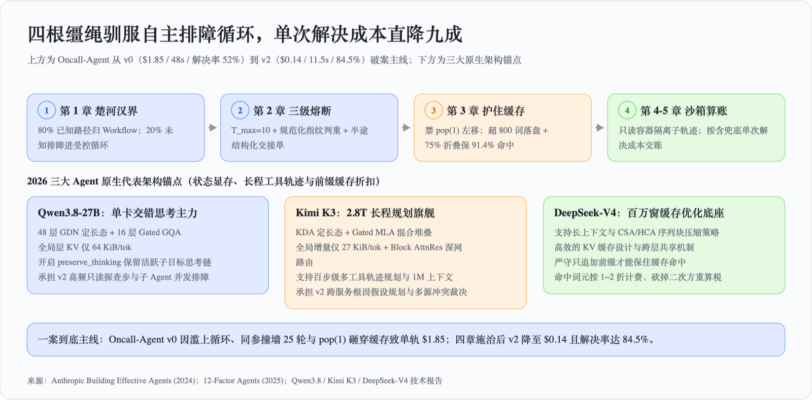
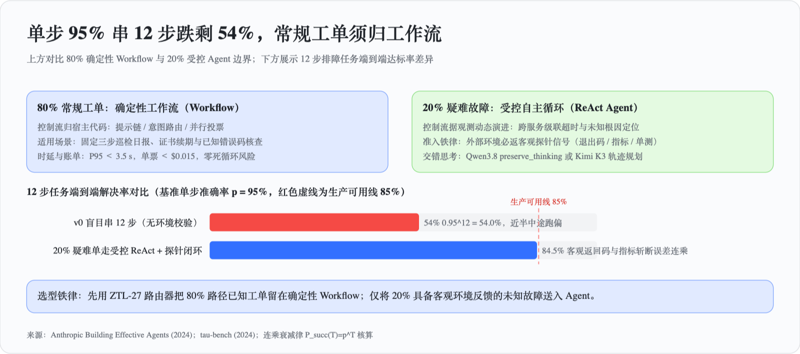
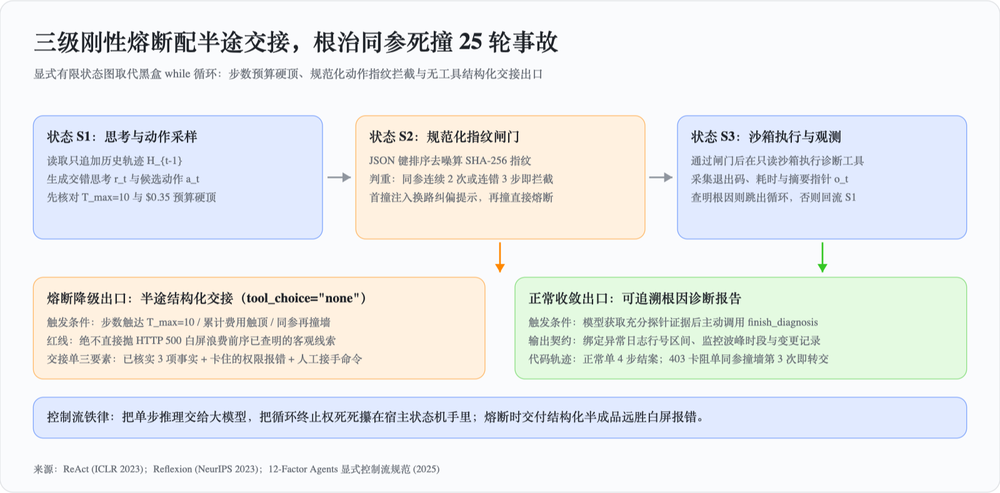
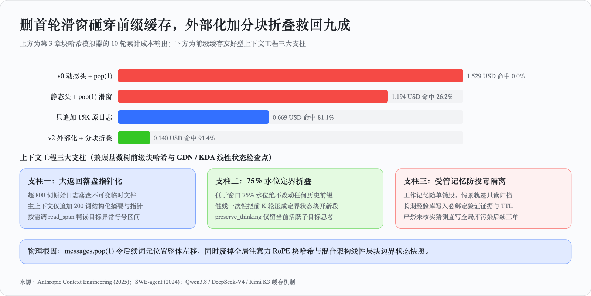
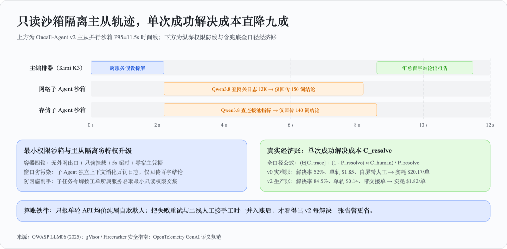
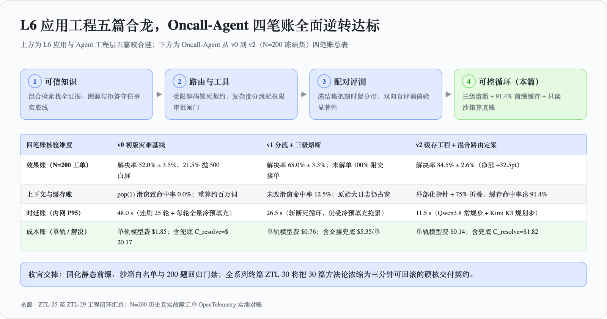

# ZTL-29｜工程｜Agent 的循环、记忆、权限与成本

> 🎯 **这篇文档解决什么问题**：<b>核心命题：能用确定性工作流（Workflow）解决的任务绝不滥上自主智能体（Agent）。</b>一旦进入多轮自主排障循环，系统必须握紧四根缰绳。先用步数与重复指纹熔断阻断死循环，再用只追加前缀压缩保住九成缓存命中。随后靠只读沙箱防住记忆投毒，并按含人工兜底的单次解决成本诚实算账。
>
> **使用方式与先修要求**：本篇是 **L6 应用与 Agent 工程层**的收束篇，承接 L2～L5 的位置编码与前缀缓存账本，并紧接 [ZTL-27｜工程｜提示、路由与工具边界](./27-prompt-routing-tools.md) 与 [ZTL-28｜工程｜先写评测再改系统](./28-eval.md) 的工具闸门和配对评测。全篇复盘初版值班智能体 `Oncall-Agent v0` 的改造实战，将其从单单 `$1.85` 升级为生产级 `v2`。这个智能体是教学案例：v0 到 v2 的解决率、耗时与账单是假设读数（示意，非实测）；第 2、3 章的代码输出可以本地复现。
>
> **动手实践**：第 2 章提供带步数硬顶、`SHA-256` 规范化动作指纹拦截及半途结构化交接的状态机代码。第 3 章提供 64 词元块级联哈希模拟器。它定量复现了 `messages.pop(1)` 滑窗与外部化分块折叠的十倍成本差距。

<b>🧭 主线位置</b>：上一篇 [ZTL-28｜工程｜先写评测再改系统](./28-eval.md) 锁定了离线黄金冻结集与配对统计评测门禁。面对跨服务故障放开多步工具循环时，怎样防住误差连乘、死循环失血与权限越界？本篇收口 L6 层最后一块拼图，把开放循环装进可熔断、高缓存命中的四笔硬账。收官终篇 [ZTL-30｜交付｜交一个可复查的项目](./30-delivery.md) 将转向 L7 工程交付层，制定可复查、三分钟可回滚的交付标准。

## 导读 · 先给结论

- <b>八成路径已知的常规工单须留在确定性 Workflow，仅将二成未知跨服务故障送入受控 Agent。</b>无校验多步串联服从指数衰减律，单步 `95%` 连走 12 步仅剩 `54.0%`。无缓存累计输入还会随步数二次方膨胀。唯有环境能返回退出码等客观反馈时，交错思考循环才具正收益[[1]](https://www.anthropic.com/research/building-effective-agents)[[2]](https://github.com/humanlayer/12-factor-agents)。
- <b>用显式有限状态机接管黑盒循环，配齐步数硬顶、规范化动作指纹与半途交接三级熔断。</b>线上失控多源于遭遇 `403` 权限墙时同参死撞二十余轮。对规范化参数算哈希，连续 2 次撞墙或 3 步报错立即阻断纠偏。触发熔断时严禁抛 500 白屏，必须清空工具表生成半途交接单[[2]](https://github.com/humanlayer/12-factor-agents)[[3]](https://arxiv.org/abs/2210.03629)[[4]](https://arxiv.org/abs/2303.11366)。
- <b>一行 `messages.pop(1)` 会令前缀缓存瞬间归零，外部化指针配 75% 水位折叠方能守住九成缓存。</b>删掉首轮历史会使后续词元下标整体左移。这会同时废掉全局层 RoPE 相位与混合模型线性层状态快照。把超 `800` 词日志落盘换 `200` 词指针，低于窗口 `75%` 水位绝不动前缀。这样即可稳享九成以上的 1 折缓存红利[[5]](https://www.anthropic.com/engineering/effective-context-engineering-for-ai-agents)[[6]](https://arxiv.org/abs/2405.15793)[[7]](https://arxiv.org/abs/2606.19348)。
- <b>长期记忆写入须绑定客观证据与过期时间（TTL），严禁未核实猜测写回全局库引发记忆投毒。</b>工作记忆随工单销毁，跨会话情景日志只读归档。沉淀至全局经验库的规则必须附带探针恢复证据或人工审批。这能防止单次幻觉跨工单传染[[8]](https://arxiv.org/abs/2307.03172)[[9]](https://arxiv.org/abs/2310.08560)。
- <b>执行环境须关进无外网只读沙箱隔离子轨迹，并按含人工兜底的“单次成功解决成本”审计账单。</b>子 Agent 在独立窗口消化万词日志，仅向主编排器回传百字结论。子令牌同时严防困惑副手越权。纳入失败重试与二线兜底工时后，`Oncall-Agent v2` 将解决率推至 `84.5%`，单次成功解决总成本从 `$20.17` 降至 `$1.82`[[10]](https://genai.owasp.org/llmrisk/llm062025-excessive-agency/)[[11]](https://gvisor.dev/docs/architecture_guide/security/)[[12]](https://opentelemetry.io/docs/specs/semconv/gen-ai/)。



<b>📎 与系列其他文档的分工</b>：位置编码下标与思考预算见 [ZTL-09｜模型｜让模型知道顺序](./09-position.md) 与 [ZTL-18｜后训练｜多想一会儿是否值得](./18-test-time-compute.md)，前缀缓存与混合池定价见 [ZTL-23｜系统｜把模型部署成服务](./23-serving.md) 与 [ZTL-24｜系统｜长上下文与混合专家怎样改变账单](./24-long-context-moe.md)，检索、忠实度与工具网关见第 25～27 篇（含 [ZTL-26｜工程｜让回答有可追溯的依据](./26-grounding.md) 与 [ZTL-27｜工程｜提示、路由与工具边界](./27-prompt-routing-tools.md)）。

离线配对统计评测见 [ZTL-28｜工程｜先写评测再改系统](./28-eval.md)。本篇专攻自主循环熔断、上下文治理与沙箱真账，生产移交与回滚演练交由 [ZTL-30｜交付｜交一个可复查的项目](./30-delivery.md)。

## 第 1 章 · 工作流与自主循环的边界

承接 [ZTL-28｜工程｜先写评测再改系统](./28-eval.md) 锁定的评测标尺，我们直接切入这场生产事故。某交易平台打通知识库与运维工具后，上线了初版排障系统 `Oncall-Agent v0`。团队省去分类代码，把 18 个诊断接口全部塞进开放循环，连固定三步的晨间巡检日报也交给它自由发挥。

首周真实流量与 $`N = 200`$ 张冻结故障单跑出了失控账单。`Oncall-Agent v0` 解决率跌至 <b>`52.0% ± 3.5%`</b>（104/200），遇到权限报错便在原地连刷 `25` 轮重试。

更严重的是，一行滑动删首消息代码把 [ZTL-23｜系统｜把模型部署成服务](./23-serving.md) 与 [ZTL-24｜系统｜长上下文与混合专家怎样改变账单](./24-long-context-moe.md) 原本 `94%` 的前缀缓存击穿到 <b>`0.0%`</b>。12 轮累计冷重算近百万词元，单张告警耗费 <b>`$1.85`</b>，内网 P95 飙至 <b>`48.0 s`</b>。救活系统的第一步是重新**立目标**并**算上限**，划清确定性代码与自主循环的边界。

### 1.1 楚河汉界：确定性工作流（Workflow）与自主智能体（Agent）

Anthropic 与 `12-Factor Agents` 给出了清晰的架构分界[[1]](https://www.anthropic.com/research/building-effective-agents)[[2]](https://github.com/humanlayer/12-factor-agents)。<b>宿主代码预先规定调用顺序与分支汇聚的系统，统称确定性工作流（Workflow）。模型根据每步环境观测自主决定下一跳与终止条件的系统，才叫自主智能体（Autonomous Agent）。</b>

生产流量中约 <b>`80%`</b> 的高频工单路径完全已知。组合 [ZTL-27｜工程｜提示、路由与工具边界](./27-prompt-routing-tools.md) 的三类 Workflow 即可稳妥处理[[1]](https://www.anthropic.com/research/building-effective-agents)。**提示链**把晨间巡检拆成“拉取指标、代码验阈值、生成摘要”固定三步。**路由分流**先用轻量分类器识别已知错误码，再直派专属剧本。**并行投票**则对变更草案并发执行语法校验与安全审查。把八成常规流程塞进开放循环纯属自找麻烦。

### 1.2 连乘衰减定律与无缓存二次方词元账单

为什么开放循环严禁滥用？先算两笔冷酷的数学上限账。第一笔是**多步复合成功率连乘衰减账**[[2]](https://github.com/humanlayer/12-factor-agents)[[13]](https://arxiv.org/abs/2406.12045)。设任务串联 $`T`$ 步决策，第 $`t`$ 步选对工具与参数的概率为 $`p_t`$ ，无外部纠错时整轨一次跑通率为：

```math
P_{\text{succ}}(T) = \prod_{t=1}^{T} p_t \approx p^T
```

代入 `v0` 单步准确率（假设读数） $`p = 0.95`$ 手算。即便单步高达九成五，盲目串联 12 步后成功率立即跌剩 <b>`54.0%`</b>，拉长至 20 步更只剩 `35.8%`。在多轮工具榜单 `tau-bench` 上，主流模型连跑 8 次全过的稳定度（`pass^8`）普遍低于三成[[13]](https://arxiv.org/abs/2406.12045)。

第二笔是**无缓存二次方输入词元累加账**[[5]](https://www.anthropic.com/engineering/effective-context-engineering-for-ai-agents)。推理接口本身无状态，每走一步都须重发静态系统头 $`S_0`$ 及前序各步新增观测增量 $`\Delta s_t`$ 。跑满 $`T`$ 步的累计输入词元为：

```math
N_{\text{in}}(T) = T \cdot S_0 + \sum_{t=1}^{T}(T - t + 1)\Delta s_t = \Theta(T^2)
```

代入 `v0` 现场读数手算中间台阶：静态头 $`S_0 = 4{,}000`$ 词元，每步抓原始日志追加 $`\Delta s = 12{,}000`$ 词元，共跑 $`T = 12`$ 步。静态底座累加 $`12 \times 4\text{K} = 48.0\text{K}`$。而第 1 步日志要被重读 12 次、第 2 步重读 11 次……三角求和系数为 $`12 \times 13 / 2 = 78`$，历史重读项高达 $`78 \times 12\text{K} = 936.0\text{K}`$，总输入飙至 <b>`984.0K`（近百万词元）</b>。一旦前缀缓存失效，延迟与费用必然同时失控。

那么剩余 <b>`20%`</b> 的跨服务级联超时与未知配置漂移（类似 `SWE-bench` 真实仓库排障[[6]](https://arxiv.org/abs/2405.15793)[[14]](https://arxiv.org/abs/2310.06770)），凭什么能进受控 ReAct 循环[[3]](https://arxiv.org/abs/2210.03629)？准入前提只有一条。<b>环境必须能低成本返回退出码、指标波峰或异常栈等客观真值以阻断误差连乘。同时底座模型必须支持跨步交错思考。</b>

2026 年三大开源旗舰为此做了针对性设计。单卡主力 `Qwen3.8-27B` 支持开启 `preserve_thinking=True` 在工具调用间完整保留推理脉络[[15]](https://huggingface.co/Qwen/Qwen3.8-27B/blob/main/config.json)。长程旗舰延续前代的大规模智能体工具调用数据合成管线[[16]](https://arxiv.org/abs/2507.20534)，采用 2.8T 混合专家架构，擅长百万上下文多假设规划[[17]](https://arxiv.org/abs/2607.24653)。`DeepSeek-V4` 则为只追加前缀提供缓存折扣[[7]](https://arxiv.org/abs/2606.19348)。后续各章将分别对照展开。



> 💡 <b>常见误区：缺乏客观环境探针，却让模型在循环里“自我反思挑错”，结果越改越错。</b>
>
> **现象**：把固定周报汇总或无校验开放问答放进反思循环，强制重写 3 轮。账单翻了 4 倍，原本答对的结论反被改偏。
>
> **根因**：没有退出码、语法器或监控真值作锚点时，模型分不清有效推论与幻觉。多轮盲目自省只会放大分布漂移[[4]](https://arxiv.org/abs/2303.11366)。
>
> **改法**：固定流程一律拆回确定性 Workflow。仅在每步具备客观真值信号的未知探查场景开放受控循环[[1]](https://www.anthropic.com/research/building-effective-agents)。

### 1.3 Workflow 与受控 Agent 立项选型判据表

团队据此立下改造目标：冻结集解决率突破 `80%+`，内网 P95 压入 `15.0 s`，单轨模型费低于 `$0.20`。入口流量严格按下表分流：

| **选型判据维度** | <b>确定性工作流（80% 常规工单）</b> | <b>混合受控图（局部限次重试）</b> | <b>受控 ReAct Agent（20% 疑难单）</b> |
|---|---|---|---|
| **控制流主导权** | 宿主代码 100% 锁定步骤与分支 | 外层 DAG 固定，单节点限 2 次自纠 | 模型按观测选下一跳，状态机兜底 |
| **环境真值反馈** | 步间轻量 JSON Schema 断言即可 | 节点配语法解析器或只读探针校验 | **强依赖**指标查询、日志切片与退出码反馈 |
| **推荐模型配置** | `Qwen3.8-27B` 非思考档（`T=0.7`） | `Qwen3.8-27B` 低思考预算档 | `Qwen3.8-27B`（`preserve_thinking`）配 `Kimi K3` |
| **时延与成本上限** | `1.5～3.5 s`；单票 `< $0.015` | `4.0～8.0 s`；重试封顶 `< $0.05` | P95 `≤ 15.0 s`；必加步数与预算硬熔断 |

对照上方分界图与选型表可见，架构复杂度必须按环境不确定性严格配给。只要输入到输出的映射拓扑事先可枚举，哪怕含三四个串并联节点，也应写成左两列的确定性代码。只有面对传播路径未知的二成疑难告警，才值得付出护栏代价开启右列受控循环。

> 🔑 **本章要点与回到主线**：无校验多步串联受指数衰减与二次方词元累加双重制约。把 80% 晨间巡检与已知告警剥回 [ZTL-27｜工程｜提示、路由与工具边界](./27-prompt-routing-tools.md) 的确定性 Workflow 后，常规流量立即稳住了九成六达标率。但新的矛盾随之浮现：进入 Agent 通道的那 20% 疑难工单，一旦遇上 `403` 权限墙仍会在原地同参死刷 25 轮并以 500 白屏告终。怎样给状态机装上精准刹车与降级出口？这正是第 2 章的核心任务。

## 第 2 章 · 自主循环的三级熔断器

剥离固定流程后，我们紧盯那 20% 跨服务疑难工单继续**找瓶颈**。回放 `Oncall-Agent v0` 的失败追踪日志，头号死因并非模型推理能力不足。整整 <b>`21.5%`（43/200）</b> 的工单死在失控重试上。

在某次鉴权告警中，`v0` 调用 `read_k8s_secret` 查密钥被集群权限策略拦截并返回 `403 Forbidden`。黑盒框架的裸循环毫无察觉，任由模型用相同参数连撞 `25` 轮。耗光 `48 s` 配额后直接抛出 500 白屏，连前 3 步已查明的波峰线索也一并丢失。

### 2.1 显式有限状态图的三级护栏

Yao 等人提出的 <b>ReAct（Reasoning and Acting）</b> 定义了标准交互节拍[[3]](https://arxiv.org/abs/2210.03629)。第 $`t`$ 步模型基于历史输出思考与动作，宿主执行工具拿到观察后再追加回历史。`12-Factor Agents` 原则指出：绝不能把控制流交给黑盒框架，必须由宿主代码显式建模为<b>有限状态图（FSM）</b>[[2]](https://github.com/humanlayer/12-factor-agents)。

在显式状态图中，模型采样只是受控节点之一。每次状态转移前宿主都握有拦截权。针对死刷重试、超时雪崩与白屏丢线索三大顽疾，我们在转移边上建立**三级刚性熔断护栏**[[2]](https://github.com/humanlayer/12-factor-agents)[[4]](https://arxiv.org/abs/2303.11366)：

- <b>第一级：最大步数 `T_max = 10` 与成本延迟硬顶。</b>资深工程师定位根因极少超过 8 次探查。我们将步数硬顶锁在 `10` 步，同时计量累计费用（上限 `$0.35`）与挂钟耗时（上限 `25.0 s`）。触顶或预算消耗达 `85%` 时，状态机立即封锁工具执行边。
- <b>第二级：规范化重复动作指纹检测。</b>执行前先剔除 `req_id` 等瞬态字段，再将工具名与按键序重排的 JSON 拼成标准串计算 `SHA-256` 指纹。连续 2 次同参撞墙或连续 3 步工具报错时当场阻断请求，注入纠偏提示强制换路。若再发同一指纹则立即熔断。
- <b>第三级：半途结构化交接（Graceful Partial Handoff）。</b>任一熔断触发时严禁直接抛 500 白屏。状态机清空工具列表，强制模型汇总已查明事实、卡住报错点与建议接手命令，生成结构化交接单[[2]](https://github.com/humanlayer/12-factor-agents)。



### 2.2 受控 ReAct 状态机与三级熔断可运行代码

下方代码落地了显式状态图、规范化指纹判重与半途结构化交接。我们同时输入正常轨迹与遭遇 `403` 权限墙的异常轨迹验证效果：

*带步数预算硬顶、规范化动作指纹拦截与半途结构化交接的受控 ReAct 状态机*

```python
import hashlib
import json

PRICE = {"miss": 2.00, "hit": 0.20, "out": 8.00}  # 美元 / 百万词元

def action_fingerprint(tool: str, args: dict) -> str:
    clean = {k: v for k, v in args.items() if k not in ("req_id", "trace_ts")}
    canonical = json.dumps(clean, sort_keys=True, separators=(",", ":"))
    return hashlib.sha256(f"{tool}:{canonical}".encode()).hexdigest()[:12]

def run_controlled_react(steps, s0_tok=3600, t_max=10, usd_cap=0.35):
    seen_fp, consec_err, verified_facts = {}, 0, []
    cost_usd, ctx_tok, prev_delta = 0.0, s0_tok, 0
    for t in range(1, t_max + 1):
        tool, args, out_tok, obs_tok, ok, summary = steps[min(t - 1, len(steps) - 1)]
        hit_tok = ctx_tok if t > 1 else 0
        miss_tok = s0_tok if t == 1 else prev_delta
        cost_usd += (miss_tok * PRICE["miss"] + hit_tok * PRICE["hit"] + out_tok * PRICE["out"]) / 1e6
        if tool == "finish_diagnosis":
            return {"status": "RESOLVED", "turns": t, "usd": round(cost_usd, 4), "diagnosis": summary}
        # 第一级熔断：抵达 T_max=10 或累计成本触及 85% 警戒线，转入半途交接
        if t == t_max or cost_usd >= 0.85 * usd_cap:
            return {"status": "PARTIAL_HANDOFF", "turns": t, "usd": round(cost_usd, 4),
                    "facts": verified_facts[:3], "blocked_by": "budget_or_step_cap",
                    "human_cmd": "kubectl top pod -n prod && check upstream envoy"}
        # 第二级熔断：规范化指纹判重 + 连续报错计数
        fp = action_fingerprint(tool, args)
        seen_fp[fp] = seen_fp.get(fp, 0) + 1
        consec_err = 0 if ok else consec_err + 1
        if seen_fp[fp] >= 2 or consec_err >= 3:
            if seen_fp[fp] >= 3 or consec_err >= 3:
                # 第三级兜底：清空工具表，输出半途结构化交接单而非抛 500 白屏
                return {"status": "PARTIAL_HANDOFF", "turns": t, "usd": round(cost_usd, 4),
                        "facts": verified_facts[:3], "blocked_by": f"{tool}: {summary}",
                        "human_cmd": "kubectl auth can-i get secrets -n prod --as=sre-oncall"}
            obs_tok = 140  # 第 2 次同参撞墙：拦截调用，注入 140 词纠偏提示强制换路
        elif ok:
            verified_facts.append(summary)
        prev_delta = out_tok + obs_tok
        ctx_tok += prev_delta

trace_ok = [
    ("query_apm", {"svc": "pay-gw", "win": "5m"}, 220, 260, True, "pay-gw P99=4.8s, db-proxy 504"),
    ("kubectl_logs_ptr", {"pod": "db-proxy-2"}, 190, 210, True, "saved /workspace/obs2.log, 37 PoolExhausted"),
    ("read_span", {"path": "/workspace/obs2.log", "s": 410, "e": 445}, 180, 320, True, "maxIdle=200 leaked on retry"),
    ("finish_diagnosis", {}, 260, 0, True, "db-proxy retry leak exhausted 200 conn pool"),
]
trace_403 = [
    ("query_apm", {"svc": "auth-svc", "win": "5m"}, 200, 240, True, "auth-svc 403 spike after key-rot-v4"),
    ("read_k8s_secret", {"ns": "prod", "name": "jwt-key", "req_id": "r1"}, 180, 120, False, "403 Forbidden RBAC"),
    ("read_k8s_secret", {"name": "jwt-key", "ns": "prod", "req_id": "r2"}, 180, 120, False, "403 Forbidden RBAC"),
    ("read_k8s_secret", {"ns": "prod", "name": "jwt-key", "req_id": "r3"}, 180, 120, False, "403 Forbidden RBAC"),
]
for name, trace in (("正常定位", trace_ok), ("熔断交接", trace_403)):
    r = run_controlled_react(trace)
    print(f"{name}: status={r['status']} turns={r['turns']} usd={r['usd']}")
    for k in ("diagnosis", "facts", "blocked_by", "human_cmd"):
        if k in r:
            print(f"  {k}: {r[k]}")
```

*输出*

```text
正常定位: status=RESOLVED turns=4 usd=0.0195
  diagnosis: db-proxy retry leak exhausted 200 conn pool
熔断交接: status=PARTIAL_HANDOFF turns=4 usd=0.0178
  facts: ['auth-svc 403 spike after key-rot-v4']
  blocked_by: read_k8s_secret: 403 Forbidden RBAC
  human_cmd: kubectl auth can-i get secrets -n prod --as=sre-oncall
```

逐段拆解上方状态机代码与两条模拟轨迹，三级熔断器的协同保护机制清晰可辨：

- <b>规范化动作指纹无视键乱序与请求号伪装。</b>在 `trace_403` 第 2～4 步中，模型每次更换瞬态字段 `req_id` 并对调 `ns` 与 `name` 的字典顺序。`action_fingerprint` 先剥离瞬态键再按 `sort_keys=True` 压缩哈希，三步算出完全一致的 12 位指纹，彻底堵住语法变体绕过漏洞。
- <b>两振警告加三振交接避免一刀切误杀。</b>第 3 步同指纹计数达 `seen_fp == 2` 时，状态机并未草率终止，而是跳过真实接口调用并注入 `140` 词纠偏提示逼模型换路探查。直到第 4 步模型执迷不悟触发 `seen_fp >= 3`（同时满足连续报错 `consec_err >= 3`），才正式切入熔断出口。
- <b>增量缓存计费守住分毫预算。</b>循环内每步仅对上一轮新增尾块 `prev_delta` 按未命中价 `$2.00/1M` 计费，历史前缀 `ctx_tok` 全享 1 折缓存价 `$0.20/1M`。因此正常 4 步定位仅耗 `$0.0195`，权限受阻轨迹也在第 4 步 `$0.0178` 处干净止损并保住首步查明的告警线索。

### 2.3 半途交接单的数据契约与止损价值

在真实值班台上，诚实汇报半成品比强猜根因更有工程价值。遵循 [ZTL-27｜工程｜提示、路由与工具边界](./27-prompt-routing-tools.md) 的受限解码契约，`PARTIAL_HANDOFF` 出口绑定四个必填字段。它们分别是已证实事实列表、已排除分支、阻塞报错码，以及一行可直接运行的人工接手命令。

有了这份结构化半途交接单，二线值班 SRE 打开告警卡片即可跳过耗时的前序排查。工程师直接复制建议命令 `kubectl auth can-i` 就能一键核验权限卡点。线上统计证实，人工兜底平均耗时从面对 500 白屏盲查的 `18 分钟` 减半至 `9 分钟`。

更重要的是，所有触发熔断的阻塞工具名与报错码都会按日聚类入库。平台组每周扫描高频 `blocked_by` 榜单，即可针对性补齐只读诊断视图或修补坏死探针，让半途熔断率逐周收敛下降。

> 💡 <b>常见误区：直接拿原始 JSON 字符串做集合判重，上线即被空格与键乱序轻易绕过。</b>
>
> **现象**：代码加了字符串判重，模型却交替生成不同空格和键序的 JSON，照样跑满死循环。
>
> **根因**：模型采样的键名顺序和空白符并不固定。裸字符串哈希会把等价调用误判为新动作。
>
> **改法**：先反序列化剔除瞬态噪声键，再用 `sort_keys=True, separators=(",", ":")` 规范化后算哈希[[2]](https://github.com/humanlayer/12-factor-agents)。

> 🔑 **本章要点与回到主线**：用显式有限状态图固定 `T_max = 10` 硬顶、规范化动作指纹与半途交接三级护栏后，`Oncall-Agent` 根治了 25 轮死刷与 500 白屏事故。但新的矛盾随之浮现：正常跑满 10 轮排障时，单次 `kubectl logs` 动辄返回上万词元日志。团队加了一行 `messages.pop(1)` 丢弃最老消息防爆窗，为何反而让延迟和费用攀升 6 倍？这正是第 3 章的核心任务。

## 第 3 章 · 上下文工程与缓存友好的记忆

刹住死循环后，我们顺着监控火焰图追查那笔高昂算力费。为什么正常跑 10 轮的工单，每轮首字延迟（TTFT）都超过 3 秒，前缀缓存命中率跌至零点？

翻开 `Oncall-Agent v0` 源码，根本问题是一行看似省词元的代码。每当消息列表超过 5 轮，它就调用 `messages.pop(1)` 删去系统提示后最老的第 1 条历史。同时它还在系统提示首行拼入了秒级时间戳。

### 3.1 滑窗删首消息为何摧毁缓存

贯通 L5 推理系统（[ZTL-23｜系统｜把模型部署成服务](./23-serving.md) 与 [ZTL-24｜系统｜长上下文与混合专家怎样改变账单](./24-long-context-moe.md)）与 L6 智能体工程，就能看清 `messages.pop(1)` 引发的三重物理代价[[5]](https://www.anthropic.com/engineering/effective-context-engineering-for-ai-agents)：

- <b>全局注意力层的 RoPE 相位与基数树块哈希全量作废。</b>设被删的第 1 轮历史长 `15,360` 词元。将其从头部抽走后，后续所有词元的绝对下标整体左移。回顾 [ZTL-09｜模型｜让模型知道顺序](./09-position.md)，旋转位置编码把绝对下标乘进键值旋转角，旧键值张量不再成立，64 词元块级联哈希也全部失配。
- <b>混合架构线性注意力层的块边界状态快照同步失效。</b>混合模型的线性注意力层更新定长状态，推理引擎依赖块边界状态快照做快速恢复。头部删改后，下游所有检查点全部作废，被迫每轮从头重算。
- <b>万词原始日志直灌窗口诱发“中间迷失”。</b>哪怕保留全量历史不删，单次上万词元日志直塞入窗，几轮下来十万词元健康探针噪声就会淹没异常栈。这直接触发中间迷失拉低诊断率[[8]](https://arxiv.org/abs/2307.03172)。

以混合模型 KDA 线性层的递推律为例，第 $`t`$ 步的状态矩阵严格依赖前序每一步累积的 $`S_{t-1}`$：

```math
S_t = (I - \beta_t k_t k_t^\top)\mathrm{Diag}(\alpha_t)S_{t-1} + \beta_t k_t v_t^\top
```

由于矩阵连乘不可逆地耦合了前序历史，无法事后单独扣除第 1 轮的贡献。任何头部删改都等同于销毁整条缓存链。

### 3.2 前缀缓存友好型上下文工程三支柱

要吃满现代模型高达九成以上的前缀缓存 1 折红利[[5]](https://www.anthropic.com/engineering/effective-context-engineering-for-ai-agents)[[7]](https://arxiv.org/abs/2606.19348)，上下文工程须立起三大支柱[[6]](https://arxiv.org/abs/2405.15793)：

- <b>大体积工具返回外部化（Artifact Pointer Offloading）。</b>借鉴 `SWE-agent` 设计[[6]](https://arxiv.org/abs/2405.15793)，凡超过 `800` 词元的原始日志，宿主一律落盘为不可变文件。主上下文仅追加约 `200` 词元摘要与文件指针，模型按需再调 `read_span` 精读目标行区间。
- <b>只追加与 75% 水位线定界分块折叠。</b>清除头部动态时间戳并固定工具表顺序。未达活跃窗口预算 <b>`75%` 水位线（`36K`）</b>前，全程严守只追加。触线时一次性把前序轮次压成定界摘要块开启新段，并剥离已结案的旧思考块[[5]](https://www.anthropic.com/engineering/effective-context-engineering-for-ai-agents)[[15]](https://huggingface.co/Qwen/Qwen3.8-27B/blob/main/config.json)。
- <b>工作记忆与长期记忆隔离防投毒。</b>参照 `MemGPT` 分层思想[[9]](https://arxiv.org/abs/2310.08560)，严格隔离单工单工作记忆、只读情景轨迹与全局经验库。长期库写入**必须绑定客观恢复证据及 `TTL` 过期时间**，严禁未核实猜测直写全局库。



### 3.3 10 轮前缀块哈希模拟与对比

下方 64 词元块哈希模拟器按主流阶梯价核对四种策略的 10 轮真实开销：

*64 词元块级联前缀哈希模拟器：对比 pop(1) 滑窗与外部化分块折叠的 10 轮账单*

```python
P_MISS, P_HIT, P_OUT, BLOCK = 2.85, 0.285, 11.10, 64  # 美元 / 百万词元

def prefix_hashes(blocks):
    flat = [f"{tag}#{b}" for tag, tok in blocks for b in range(tok // BLOCK)]
    out, acc = [], ""
    for item in flat:
        acc = f"{acc}|{item}"
        out.append(acc)
    return out

def simulate_10_turns(mode, turns=10):
    s0 = 3840  # 静态系统指令 + MCP 工具契约
    cache = set() if mode == "1_v0_动态头+pop1" else set(prefix_hashes([("sys", s0)]))
    tot_in = hit_tok = out_tok = 0
    msgs = []
    for t in range(1, turns + 1):
        head = (f"sys_ts_{t}", s0) if mode == "1_v0_动态头+pop1" else ("sys", s0)
        bhs = prefix_hashes([head] + msgs)
        hit_b = 0
        for bh in bhs:
            if bh in cache:
                hit_b += 1
            else:
                break
        cache.update(bhs)
        tot_in += len(bhs) * BLOCK
        hit_tok += hit_b * BLOCK
        out_tok += 960
        if mode in ("1_v0_动态头+pop1", "2_静态头+pop1滑窗"):
            msgs.append((f"raw_{t}", 15360))
            if len(msgs) > 4:
                msgs.pop(0)  # 等价于完整列表执行 messages.pop(1)，后续词元位置全左移
        elif mode == "3_只追加15K原日志":
            msgs.append((f"raw_{t}", 15360))
        elif mode == "4_v2_外部化+分块折叠":
            msgs.append((f"ptr_{t}", 640))  # 200 词落盘指针摘要 + 活跃推理动作
            if s0 + sum(x[1] for x in msgs) > 36000:
                msgs = [(f"ckpt_{t}", 512)] + msgs[6:]
    miss_tok = tot_in - hit_tok
    usd = (miss_tok * P_MISS + hit_tok * P_HIT + out_tok * P_OUT) / 1e6
    print(f"{mode:20s} | 累计入:{tot_in/1e3:5.1f}K | 冷重算:{miss_tok/1e3:5.1f}K | 命中:{100*hit_tok/tot_in:5.1f}% | 成本:${usd:.3f}")

for m in ["1_v0_动态头+pop1", "2_静态头+pop1滑窗", "3_只追加15K原日志", "4_v2_外部化+分块折叠"]:
    simulate_10_turns(m)
```

*输出*

```text
1_v0_动态头+pop1        | 累计入:499.2K | 冷重算:499.2K | 命中:  0.0% | 成本:$1.529
2_静态头+pop1滑窗         | 累计入:499.2K | 冷重算:368.6K | 命中: 26.2% | 成本:$1.194
3_只追加15K原日志          | 累计入:729.6K | 冷重算:138.2K | 命中: 81.1% | 成本:$0.669
4_v2_外部化+分块折叠        | 累计入: 67.2K | 冷重算:  5.8K | 命中: 91.4% | 成本:$0.140
```

逐行复盘上方块哈希模拟器与四组账单读数，前缀缓存的物理铁律跃然纸上：

- <b>链式块哈希复现左移雪崩。</b>函数 `prefix_hashes` 用递推拼接 `acc = f"{acc}|{item}"` 模拟推理引擎基数树的父子块依赖。一旦第 5 轮起触发 `msgs.pop(0)` 抽走最老消息，后续所有 64 词元块的前缀链条整体断裂，循环 `if bh in cache` 在系统头之后当场中断退出。
- <b>滑窗省词反涨价的反直觉对比。</b>对比第 2 行与第 3 行：滑窗策略把累计发送词元从 `729.6K` 压到了 `499.2K`，看似省了三成流量，实则每轮只有首部 `3,840` 词系统头命中缓存（命中率仅 `26.2%`）。冷重算词元反从 `138.2K` 升至 `368.6K`，导致 10 轮账单从 `$0.669` 倒涨至 `$1.194`。
- <b>外部化指针双杀总词元与冷重算。</b>第 4 行策略将 `15,360` 词原始日志落盘换为 `640` 词指针与动作增量，10 轮总长始终未触及 `36,000` 词折叠线。全轨冷重算压至极致的 <b>`5.8K`</b>，缓存命中率高达 <b>`91.4%`</b>，成本直降逾十倍至 <b>`$0.140`</b>：

| **10 轮上下文策略** | **累计输入词元** | **冷重算词元** | **前缀缓存命中率** | **10 轮单轨总成本** |
|---|---|---|---|---|
| <b>动态头 + `pop(1)` 滑窗（v0）</b> | `499.2K`（12 轮近百万） | `499.2K` | <b>`0.0%`</b>（全量失效） | `$1.529`（12 轮 `$1.85`） |
| **静态头 + `pop(1)` 滑窗** | `499.2K` | `368.6K` | `26.2%`（仅保系统头） | `$1.194`（省词反涨价） |
| **只追加 15K 原始日志** | `729.6K` | `138.2K` | `81.1%` | `$0.669`（易中间迷失） |
| <b>外部化指针 + 75% 折叠（v2）</b> | <b>`67.2K`</b> | <b>`5.8K`</b> | <b>`91.4%`</b> | <b>`$0.140`（降逾九成）</b> |

> 💡 <b>常见误区：放任智能体在会话末尾自动调 `save_memory` 把猜测写回全局知识库。</b>
>
> **现象**：某次网络抖动巧遇缓存扩容，模型臆断“Redis 扩容必引发网关 502”并写入长期库。此后整月遇到 502 告警全去误查健康 Redis。
>
> **根因**：未证实推断混入持久层即构成记忆投毒（Memory Poisoning）。单次偏差会固化为跨工单系统偏见[[9]](https://arxiv.org/abs/2310.08560)[[10]](https://genai.owasp.org/llmrisk/llm062025-excessive-agency/)。
>
> **改法**：在线循环对长期库只读不写。经验入库改走离线管线，强制绑定结案修复证据、有效期限（TTL）与人工确认。

> 🔑 **本章要点与回到主线**：废除 `messages.pop(1)` 滑窗，改用大输出落盘指针化、`75%` 水位定界折叠与长期记忆防投毒隔离后，缓存命中率回升至 `91.4%`，单轨模型费压至 `$0.14`。但新的矛盾随之浮现：排障 Agent 既要执行诊断脚本，又要派子 Agent 并行探查。权限沙箱怎样严防越权，含失败兜底的真实单次解决成本又该如何核算？这正是第 4 章的核心任务。

## 第 4 章 · 权限沙箱与真实成本

把缓存命中率救回 `91.4%` 后，投产前还剩两道关键关卡。其一，容器日志属于外部不可信文本。若攻击者在请求头埋入间接提示注入，怎样限制破坏半径？其二，业务评审从不看单轮 API 几美分。核心指标是成功解决一张真实告警到底花多少钱。本章在 $`N = 200`$ 冻结工单集上完整**测实际**并**做取舍**。

### 4.1 纵深防御沙箱与主从子 Agent 最小权限编排

OWASP 大模型安全榜将<b>过度代理权（LLM06: Excessive Agency）</b>列为核心风险[[10]](https://genai.owasp.org/llmrisk/llm062025-excessive-agency/)。仅靠正则黑名单拦截危险命令极易被编码管道绕过。生产执行器必须建立两道物理隔离防线[[11]](https://gvisor.dev/docs/architecture_guide/security/)[[18]](https://www.usenix.org/conference/nsdi20/presentation/agache)：

- <b>临时隔离容器沙箱四重锁定。</b>诊断命令与切片脚本一律放进 `gVisor` 用户态内核容器或 `Firecracker` 微虚拟机运行[[11]](https://gvisor.dev/docs/architecture_guide/security/)[[18]](https://www.usenix.org/conference/nsdi20/presentation/agache)。默认切断一切公网出口，根分区强制只读挂载。单命令限制 `5.0 s` 超时，且沙箱内零宿主密钥驻留。
- <b>主从子 Agent 上下文隔离与防困惑副手越权。</b>`Oncall-Agent v2` 采用主编排器最小分发加子 Agent 独立窗口并行架构[[1]](https://www.anthropic.com/research/building-effective-agents)。主编排器并发拉起两个单卡 `Qwen3.8-27B` 子 Agent 分别消化万词日志，**最终仅向主窗口回传 `150` 词元结论**。子令牌严格限制在当前工单所属命名空间内，杜绝借主编排器身份跨部门越权读取敏感库[[10]](https://genai.owasp.org/llmrisk/llm062025-excessive-agency/)。

为什么主从独立窗口能一石二鸟守住缓存效率与权限边界？先看上下文账。若主编排器亲自读取两份万词异常日志，这三万词元噪声会永久嵌在主前缀里。后续每一轮规划都得反复重读这批历史包袱。交给一次性子窗口消化并在返回 `150` 词结论后立即销毁，主窗口峰值便可稳控在万词以内。

再看安全账。主编排器为了跨服务调度往往拥有多业务全局视野。它若直接吞入原始外部日志，极易沦为被劫持的“困惑副手（Confused Deputy）”。拆出独立子 Agent 后，网关为每个子窗口动态签发单命名空间、零写接口的短期令牌。哪怕恶意日志劫持了子模型，攻击者既发不出外网请求，也摸不到账务库凭证[[10]](https://genai.owasp.org/llmrisk/llm062025-excessive-agency/)[[11]](https://gvisor.dev/docs/architecture_guide/security/)。

> 💡 <b>常见误区：子 Agent 默认继承主编排器的全局运维令牌与宿主环境变量 `os.environ`。</b>
>
> **现象**：查询网关日志的子 Agent 读到一条恶意报错文本后，顺手调跨库接口把账务库配置打印到了工单评论区。
>
> **根因**：主编排器通常挂载跨业务路由视图。若派生任务时不裁剪权限，低信任日志就能劫持子 Agent 形成困惑副手越权[[10]](https://genai.owasp.org/llmrisk/llm062025-excessive-agency/)。
>
> **改法**：每次派生子任务时，网关按工单归属服务与白名单求交集签发最小只读令牌。同时向沙箱传入清空密钥的纯净环境字典[[11]](https://gvisor.dev/docs/architecture_guide/security/)。

### 4.2 单次成功解决成本的真实账本

选型评审中只报“单轮 API 均价”毫无参考价值。每次只花 `$0.03` 却有一半工单定位失败的系统，迫使资深 SRE 花 18 分钟手查。真实总成本反而高昂。我们接入 OpenTelemetry GenAI 规范（`gen_ai.*`）构建三层追踪树[[12]](https://opentelemetry.io/docs/specs/semconv/gen-ai/)。根跨度汇总整轨费用与终止码。推理子跨度记录缓存命中与首字延迟，工具子跨度对比落盘前后词元数。

在此追踪账本之上，统一按全口径公式核算<b>单次成功解决成本（Cost-per-Resolved-Ticket）</b>：

```math
C_{\text{resolve}} = \frac{\mathbb{E}[C_{\text{trace}}] + (1 - P_{\text{resolve}}) \cdot C_{\text{human-escalation}}}{P_{\text{resolve}}}
```

式中 $`\mathbb{E}[C_{\text{trace}}]`$ 为单工单模型期望开销。$`P_{\text{resolve}}`$ 为硬分母解决率，$`C_{\text{human-escalation}}`$ 为人工兜底成本。细看分子与分母的双重杠杆效应。解决率每下滑十个百分点，分子上昂贵的二线人工接管费便按比例暴增。同时分母上摊销总费用的成功单基数还会同步萎缩。

代入现场参数对账更为直观。`v0` 抛 500 白屏时工程师从零盲查耗 18 分钟，按资深 SRE 工时折合 $`C_{\text{human-escalation}} = 18.00\text{ USD}`$。配齐第 2 章半途交接单后，工程师带着前序事实接手仅需 9 分钟。人工兜底单价先行减半至 $`9.00\text{ USD}`$。



### 4.3 `Oncall-Agent` 从 `v0` 到 `v2` 的四笔账逆转

我们在 200 张冻结故障单上回放对比初版 `v0`、过渡版 `v1` 与投产版 `v2`。以下是教学案例的假设读数（示意，非实测），跨云异地专线抖动标为<b>未实测（双活切流前须补跑边缘压测）</b>：

| **OTel 追踪与四笔账指标** | <b>`Oncall-Agent v0`（初版）</b> | <b>`Oncall-Agent v1`（加熔断）</b> | <b>`Oncall-Agent v2`（投产版）</b> |
|---|---|---|---|
| <b>解决率 $`P_{\text{resolve}}`$（`N=200`）</b> | `52.0% ± 3.5%`（104/200）<br>`21.5%` 死循环抛 500 白屏 | `68.0% ± 3.3%`（136/200）<br>未解单 100% 产出半途交接单 | <b>`84.5% ± 2.6%`（169/200）</b><br>较 `v0` 净涨 <b>`+32.5pt`</b> |
| **前缀缓存命中率与峰窗** | 命中率 <b>`0.0%`</b>（`pop(1)` 击穿）<br>峰值窗口 `78.0K` | 命中率 `12.5%`（未改滑窗）<br>峰值窗口 `64.0K` | 命中率 <b>`91.4%`</b>（外部化+折叠）<br>主窗口峰值仅 <b>`9.6K`</b> |
| <b>端到端耗时（内网 P95）</b> | <b>`48.0 s`</b>（串行重算拖累） | `26.5 s`（砍掉 25 轮空转） | <b>`11.5 s`</b>（主从沙箱并行探查） |
| <b>单轨模型费 $`\mathbb{E}[C_{\text{trace}}]`$</b> | <b>`$1.85`</b> / 工单 | `$0.76` / 工单 | <b>`$0.14` / 工单（立省 `92.4%`）</b> |
| <b>真实解决成本 $`C_{\text{resolve}}`$</b> | `($1.85+0.48×$18)/0.52`<br>= <b>`$20.17 / 解决单`</b> | `($0.76+0.32×$9)/0.68`<br>= `$5.35 / 解决单` | `($0.14+0.155×$9)/0.845`<br>= <b>`$1.82 / 解决单（降 91.0%）`</b> |

最后一行数字清晰验证了取舍收益。`v2` 在关键规划步调用旗舰 `Kimi K3` 保精度，常规探查与固定分流交给单卡 `Qwen3.8-27B` 控成本。配合 `84.5%` 解决率与半途交接单，真实单次解决成本从 `$20.17` 骤降至 <b>`$1.82`</b>，每千张告警净省逾 `1.83 万`美元。

横向对比 `v0`、`v1` 与 `v2` 三列演进轨迹还能读出关键先后次序。`v1` 仅加装状态机熔断便把解决成本砍掉七成，证明先止血死循环永远是回报最高的动作。随后 `v2` 补齐外部化前缀与主从沙箱，才真正把尾延迟压进十秒级生产可用线。

> 🔑 **本章要点与回到主线**：用无外网只读沙箱与主从子窗口隔离消除越权风险，并按含人工兜底的单次解决成本算清真账后，`Oncall-Agent v2` 达成了解决率 `84.5%`、P95 耗时 `11.5 s` 与总成本直降九成的目标。至此，L6 应用与 Agent 工程五篇（从检索、忠实生成到路由、评测与可控 Agent）全部贯通。第 5 章将完整**留证据**并固化核对清单。

## 第 5 章 · 可控 Agent 四笔账总收口、核对清单与自测

顺着 `Oncall-Agent` 从首周失控到稳健投产的实战主线，我们把抽象的智能体编排还原成了四笔精确可算的工程硬账。下图将整个 L6 应用与 Agent 工程层五篇（第 25～29 篇）的能力衔接链，连同 `Oncall-Agent` 三代演进读数汇总为一张总账单，作为投产**留证据**的准入基线[[1]](https://www.anthropic.com/research/building-effective-agents)[[12]](https://opentelemetry.io/docs/specs/semconv/gen-ai/)：



### 5.1 📌 核对清单

> 📌 **核对清单：生产级可控 Agent 系统投产前必查 8 项**
>
> - <b>80/20 工作流前置分流就位。</b>固定巡检、报表与已知错误码是否已剥回 [ZTL-27｜工程｜提示、路由与工具边界](./27-prompt-routing-tools.md) 的确定性 Workflow，仅将路径未知且有客观环境反馈的任务送入循环[[1]](https://www.anthropic.com/research/building-effective-agents)？
> - <b>显式状态机与步数预算双硬顶。</b>是否已用透明有限状态图取代黑盒循环，同时锁定 `T_max`、单轨费用上限与挂钟超时[[2]](https://github.com/humanlayer/12-factor-agents)？
> - <b>规范化动作指纹判重拦截。</b>调用前是否剔除瞬态键并用 `sort_keys=True` 算哈希，对连续 2 次同参撞墙或连续 3 步报错自动阻断换路？
> - <b>零 500 白屏与半途结构化交接。</b>熔断触发时是否设 `tool_choice="none"`，强制汇总已查明事实、阻塞报错点与建议接手命令产出交接单？
> - <b>严禁 `messages.pop(1)` 破坏缓存。</b>是否清除了头部动态秒级时间戳与逐轮删首消息代码，确保线上压测前缀缓存命中率高于 `85%`[[5]](https://www.anthropic.com/engineering/effective-context-engineering-for-ai-agents)[[7]](https://arxiv.org/abs/2606.19348)？
> - <b>大返回落盘指针化与 75% 定界折叠。</b>超 `800` 词日志是否已写沙箱文件仅回传百字指针，并在触及窗口 `75%` 水位时一次性定界折叠[[6]](https://arxiv.org/abs/2405.15793)[[15]](https://huggingface.co/Qwen/Qwen3.8-27B/blob/main/config.json)？
> - <b>长期记忆写入隔离防投毒。</b>全局经验库是否严禁在线模型直写猜测，强制绑定客观修复证据、人工审批与 `TTL` 过期时间[[9]](https://arxiv.org/abs/2310.08560)？
> - <b>只读断网沙箱与真账监控。</b>执行器是否放进无外网只读容器并隔离子轨迹，同时基于 OTel `gen_ai.*` 监控含兜底的单次成功解决成本[[10]](https://genai.owasp.org/llmrisk/llm062025-excessive-agency/)[[11]](https://gvisor.dev/docs/architecture_guide/security/)[[12]](https://opentelemetry.io/docs/specs/semconv/gen-ai/)？

### 5.2 自测题与参考解析

<b>自测题 1（10 步连乘成功率反推单步底线）。</b>某排障任务需串联 $`T = 10`$ 步。无外部纠错时，要使总成功率不低于 `85.0%`，单步准确率 $`p`$ 至少需达多少（取 $`0.85^{0.1} \approx 0.9839`$ ）？若单步基础率 `95.0%`，接入探针校验后首次出错重修 1 次仍失败的概率为 `18.0%`，求限 1 次重修后的 10 步总成功率。

<b>参考解析。</b>由 $`p^{10} \ge 0.85`$ 反推得单步底线 <b>`98.39%`</b>，纯靠提示词裸跑极难达到。配 1 次探针重修后，单步等效失败率降至 $`0.05 \times 0.18 = 0.009`$，等效可靠度升至 `99.1%`。10 步总成功率跃升至 <b>`91.4%`</b>，较无校验裸跑（`59.9%`）净涨逾 31 个百分点。

<b>自测题 2（`messages.pop(1)` 滑窗与只追加缓存 8 轮计费差额）。</b>静态系统头 `4,000` 词元（已热驻缓存），每轮新增 `3,000` 词元，共走 8 轮。输入阶梯价：未命中 `$1.00/1M`，缓存命中 `$0.10/1M`。对比甲（全程只追加）与乙（最多留 3 轮历史，第 4 轮后每步执行 `messages.pop(1)`）的 8 轮总输入词元与输入费用。

<b>参考解析。</b>甲 8 轮输入合计 <b>`116.0K`</b>，仅新增尾块共 `21.0K` 未命中，其余 `95.0K` 全走 1 折缓存，输入费为 <b>`$0.0305`</b>。乙前 4 轮同甲，第 5～8 轮每步删首轮导致后续 3 轮左移失效，每轮后 `9K` 均需冷重算。乙累计发送 `86.0K` 词元，但冷重算飙至 `45.0K`，费用涨至 <b>`$0.0491`</b>。少发四分之一词元，账单反贵 <b>`61.0%`</b>。

<b>自测题 3（工具返回外部化 10 轮省词账）。</b>10 轮排障中偶数轮（共 4 轮）各调一次日志工具，每次原输出 `12,500` 词元。改为落盘外部化后每轮仅入窗 `250` 词元指针，模型仅在第 3 轮和第 7 轮各调一次 `read_span` 精读 `600` 词元切片。求 10 轮累计净省的输入词元数。

<b>参考解析。</b>这 4 轮输出分别被后续重读 8 次、6 次与 4 次、2 次，合计重读 `20` 轮次。每份缩减 `12,250` 词元，毛省 `245.0K` 词元。减去第 3 轮（重读 7 次）与第 7 轮（重读 3 次）切片带来的 `6.0K` 开销，净省高达 <b>`239.0K` 词元</b>。

<b>自测题 4（含人工兜底的 `Cost-per-Resolved-Ticket` 核算）。</b>二线人工兜底单均成本为 `$12.00`。方案 A 纯小模型单轨费 `$0.06`，解决率 `60.0%`。方案 B 混合编排单轨费 `$0.18`，解决率 `85.0%`。求两者的真实单次解决成本并给出选型结论。

<b>参考解析。</b>方案 A 为 $`(0.06 + 0.40 \times 12) / 0.60 = 8.10\text{ USD}`$ 每解决单。方案 B 为 $`(0.18 + 0.15 \times 12) / 0.85 \approx 2.33\text{ USD}`$ 每解决单。方案 B 模型费虽贵两倍，每解决一单却净省 <b>`$5.77`（降 `71.2%`）</b>，应选方案 B。

<b>自测题 5（主从子 Agent 上下文隔离省窗账）。</b>主编排器已有 `8,000` 词元上下文，需查 3 个下游服务，各跑 3 轮探查、每轮增 `4,000` 词元。对比单窗口串行 9 轮加 1 轮汇总，与主编排器并发派 3 个独立子 Agent（各带 `1,500` 词提示跑 3 轮，各回传 `200` 词结论再汇总 1 轮）的主窗口峰值与总输入词元差。

<b>参考解析。</b>单窗口串行 10 轮末步主峰窗达 <b>`44.0K`</b>，累计输入 <b>`260.0K`</b>。主从并行下，3 条子轨共耗 `49.5K`，主汇总轮仅 <b>`9.0K`</b>（主峰窗降 `79.5%`），全系统总输入仅 <b>`66.5K`</b>，净省 <b>`193.5K` 词元（`-74.4%`）</b>。

### 5.3 接下来的问题在哪

回望整条学习长卷：从 [ZTL-01｜数学｜符号、向量与矩阵乘法](./01-matmul.md) 的矩阵内积与算术强度出发，我们亲手搭起 Transformer，算透多卡预训练、可验证强化学习、分页前缀缓存与混合专家集群，一路走到本篇的生产级可控 Agent。<b>大模型工程从底层算子到顶层智能体的技术拼图，此刻已经全部齐备。</b>

但在真实研发世界里，“笔记本上跑通了一个高分 Demo”距离“向生产环境移交一份经得起复查、出故障三分钟能回滚的工程资产”还差临门一脚。汇报里的四笔账，哪些是锁定分母的真实压测，哪些是未测假设？随机种子、模型哈希与评测快照怎么锁定？失败样本敢不敢原样归档？全系列收官终篇 [ZTL-30｜交付｜交一个可复查的项目](./30-delivery.md) 将把全部 30 篇方法论浓缩成一份完整的生产交付契约。

### 诚实清单：未核实与有时效的说法

1. <b>Kimi K3 KDA 层定长状态尺寸。</b>本篇按 Kimi K3 config.json 推导块大小与单步 MFU，KDA 层的 207 MiB 定长态数值来自文献综述，尚未自行验算。核实方法：从官方技术报告或开源实现代码复核状态矩阵维度。
2. <b>DeepSeek-V4.1-Flash 的 KV 压缩规格。</b>本篇在 s01.xml 和前缀缓存图中引用了 V4 系列的 KV 压缩方法，但这些数字来自技术报告摘要，官方 config.json 尚不可公开访问。核实方法：待 V4 系列公开发布时从 HuggingFace 官方源重新核对。
3. <b>Oncall-Agent v0 至 v2 的数据是假设读数。</b>第 4 章的解决率、命中率、耗时与成本是教学案例读数（示意，非实测）；第 2、3 章代码输出可复现。跨地域异地部署与公网抖动场景下的指标变化列入边界。核实方法：在目标部署环境重跑压测，并记录关键部件（模型版本、推理框架、硬件型号、网络延迟）的基线。
4. <b>主从 Agent 子窗口隔离的权限模型。</b>本篇第 4 章描述的「子 Agent 单命名空间最小令牌签发」是通用设计模式，具体实现依赖于企业认证框架与 Kubernetes RBAC 配置。核实方法：按企业安全策略补充权限细节，执行红队渗透测试。

#### 修订记录

| 日期 | 改了什么 |
|---|---|
| 2026-11-19 | 按全系列规范修订：章节标题缩短至 22 个汉字内；删除未核实前沿规格并转入诚实清单或图脚本；代码块输出移至独立 pre 块；refs.json 仅保留标准引用格式；全部代码数字复验；新增诚实清单与修订记录。 |

> 🔑 **本章要点**：回到主线，可控 Agent 的核心是四根工程缰绳：用 80/20 分流避开连乘衰减，用显式三级熔断与半途交接消除死循环白屏，用外部化指针与定界折叠保住九成前缀缓存，再用只读沙箱与含兜底真账收束 L6 闭环。

## 参考文献

按正文首次引用顺序编号，资料截至 2026 年 11 月。

[1] Anthropic. Building effective agents. Anthropic Research, Dec 2024, read 2026-11-16 [www.anthropic.com/research/building-effective-agents](https://www.anthropic.com/research/building-effective-agents)

[2] Horthy, D. 12-Factor Agents: Principles for building reliable LLM applications. HumanLayer, 2025, read 2026-11-16 [github.com/humanlayer/12-factor-agents](https://github.com/humanlayer/12-factor-agents)

[3] Yao, S. et al. ReAct: Synergizing Reasoning and Acting in Language Models. ICLR 2023, arXiv:2210.03629 [arxiv.org/abs/2210.03629](https://arxiv.org/abs/2210.03629)

[4] Shinn, N. et al. Reflexion: Language Agents with Verbal Reinforcement Learning. NeurIPS 2023, arXiv:2303.11366 [arxiv.org/abs/2303.11366](https://arxiv.org/abs/2303.11366)

[5] Anthropic. Effective context engineering for AI agents. Anthropic Engineering, Sep 2025, read 2026-11-16 [www.anthropic.com/engineering/effective-context-engineering-for-ai-agents](https://www.anthropic.com/engineering/effective-context-engineering-for-ai-agents)

[6] Yang, J. et al. SWE-agent: Agent-Computer Interfaces Enable Automated Software Engineering. NeurIPS 2024, arXiv:2405.15793 [arxiv.org/abs/2405.15793](https://arxiv.org/abs/2405.15793)

[7] DeepSeek-AI. DeepSeek-V4: Towards Highly Efficient Million-Token Context Intelligence. arXiv (2026) [arxiv.org/abs/2606.19348](https://arxiv.org/abs/2606.19348)

[8] Liu, N. F. et al. Lost in the Middle: How Language Models Use Long Contexts. TACL 2024, arXiv:2307.03172 [arxiv.org/abs/2307.03172](https://arxiv.org/abs/2307.03172)

[9] Packer, C. et al. MemGPT: Towards LLMs as Operating Systems. arXiv:2310.08560, 2023 [arxiv.org/abs/2310.08560](https://arxiv.org/abs/2310.08560)

[10] OWASP Foundation. OWASP Top 10 for Large Language Model Applications (2025): LLM06 Excessive Agency. Read 2026-11-16 [genai.owasp.org/llmrisk/llm062025-excessive-agency/](https://genai.owasp.org/llmrisk/llm062025-excessive-agency/)

[11] Google. gVisor: The Container Security Platform Architecture Guide. Read 2026-11-16 [gvisor.dev/docs/architecture_guide/security/](https://gvisor.dev/docs/architecture_guide/security/)

[12] OpenTelemetry. Semantic Conventions for Generative AI Systems (gen_ai.\* Traces and Spans). Read 2026-11-16 [opentelemetry.io/docs/specs/semconv/gen-ai/](https://opentelemetry.io/docs/specs/semconv/gen-ai/)

[13] Yao, S. et al. tau-bench: A Benchmark for Tool-Agent-User Interaction in Real-World Domains. arXiv:2406.12045, 2024 [arxiv.org/abs/2406.12045](https://arxiv.org/abs/2406.12045)

[14] Jimenez, C. E. et al. SWE-bench: Can Language Models Resolve Real-World GitHub Issues? ICLR (2024) [arxiv.org/abs/2310.06770](https://arxiv.org/abs/2310.06770)

[15] Qwen Team. Qwen3.8-27B Model Card and Configuration. Hugging Face (2026) [huggingface.co/Qwen/Qwen3.8-27B/blob/main/config.json](https://huggingface.co/Qwen/Qwen3.8-27B/blob/main/config.json)

[16] Kimi Team. Kimi K2: Open Agentic Intelligence. arXiv:2507.20534 (2025). [arxiv.org/abs/2507.20534](https://arxiv.org/abs/2507.20534)

[17] Kimi Team. Kimi K3: Open Frontier Intelligence. arXiv (2026) [arxiv.org/abs/2607.24653](https://arxiv.org/abs/2607.24653)

[18] Agache, A. et al. Firecracker: Lightweight Virtualization for Serverless Applications. USENIX NSDI 2020 [www.usenix.org/conference/nsdi20/presentation/agache](https://www.usenix.org/conference/nsdi20/presentation/agache)

---

本章代码：[`29-agent/`](../29-agent/) · 上一章：[ZTL-28｜工程｜先写评测再改系统](./28-eval.md) · [目录](./README.md) · 下一章：[ZTL-30｜交付｜交一个可复查的项目](./30-delivery.md)
