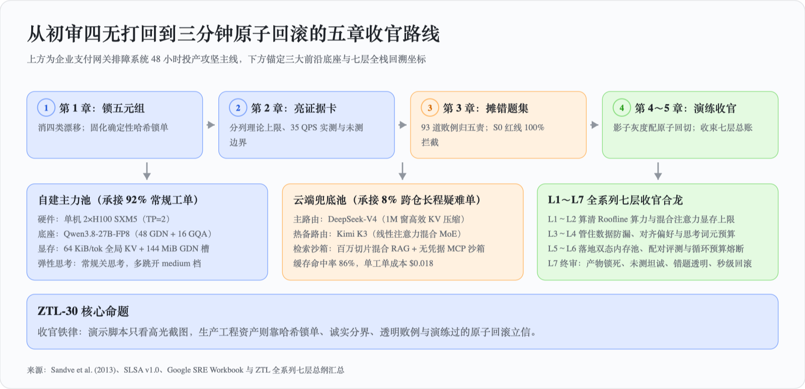
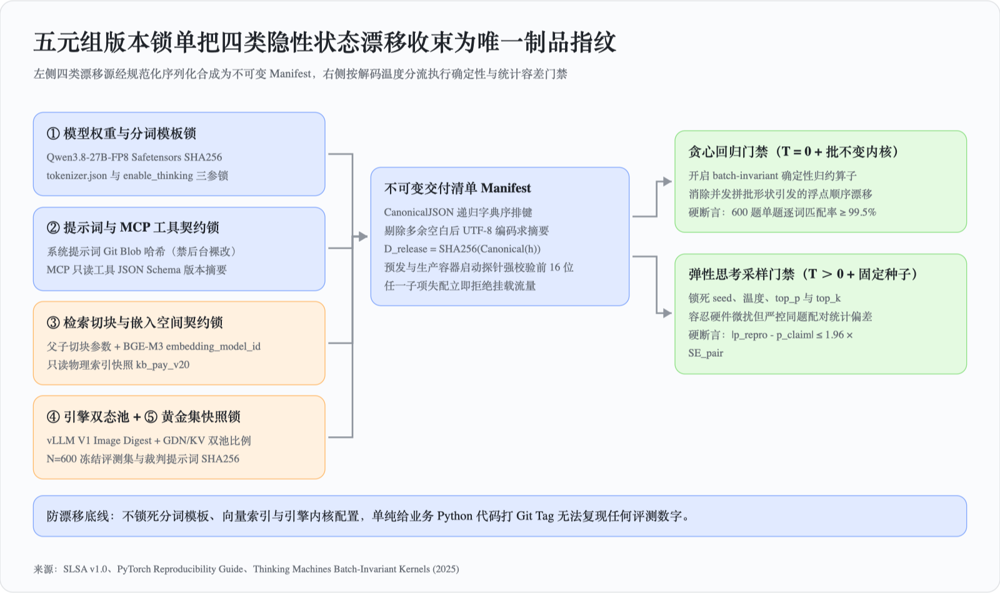
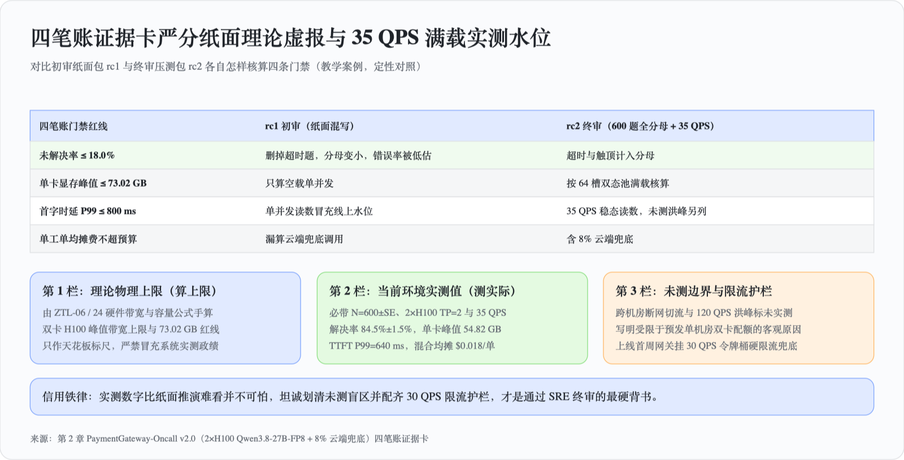
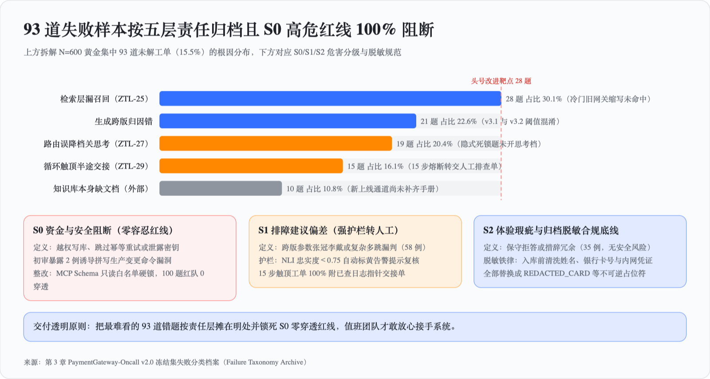
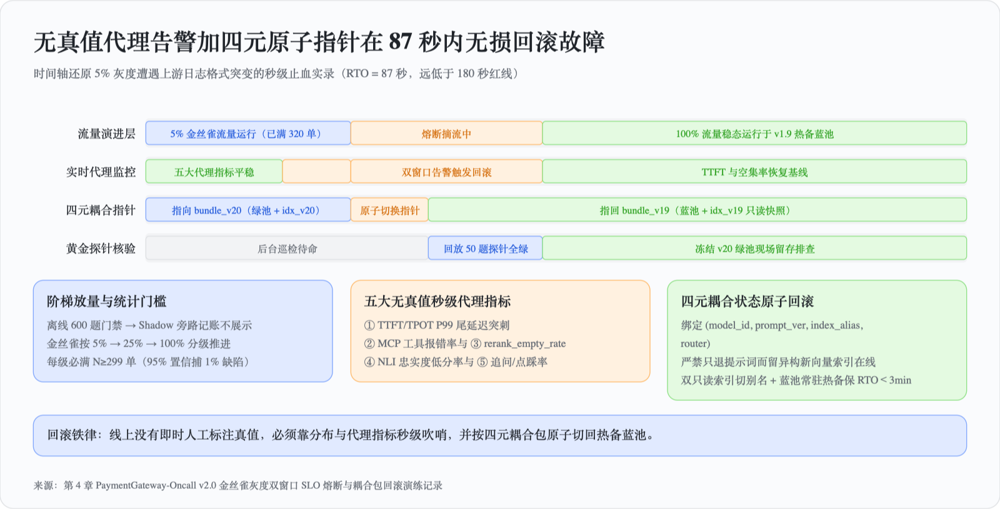
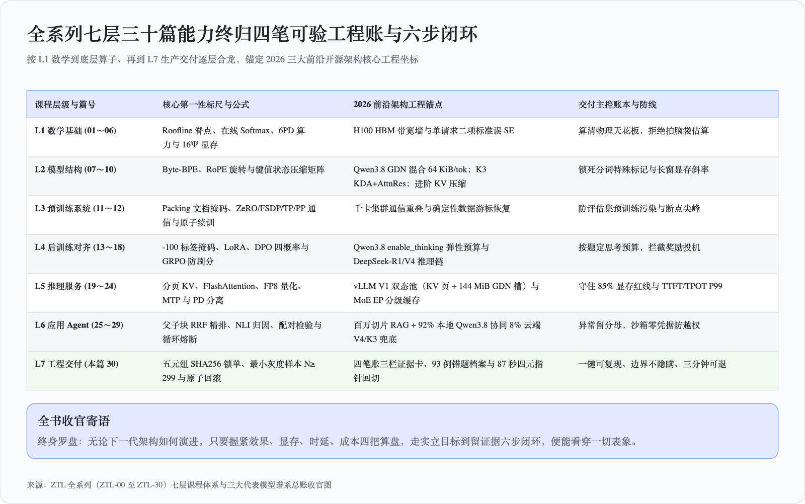

# ZTL-30｜交付｜交一个可复查的项目

> 🎯 **这篇文档解决什么问题**：<b>核心命题：大模型项目的终点必须是一份换个人、隔半年仍能一键复现且三分钟可回滚的工程证据包，而不是截图报喜的演示脚本。</b>每条结论都须绑定哈希锁定的产物清单，严格区分实测读数与未测边界。团队还须主动归档高危失败样本集，并通过耦合包原子回滚演练。
>
> 文中支付值班网关是教学案例：准确率、压测水位、漂移与回滚耗时都是假设读数，用来示意证据包怎么写，非实测。
>
> **使用方式与先修要求**：本篇是全系列 **L7 工程交付层**的压轴终篇，承接 [ZTL-29｜工程｜Agent 的循环、记忆、权限与成本](./29-agent.md) 的智能体沙箱熔断，并回扣开篇总览 [ZTL-00｜总览｜算清四个数：效果、显存、时延与成本](./README.md) 的四笔账总纲。全篇复盘<b>企业支付网关排障与值班系统（`PaymentGateway-Oncall v2.0`）</b>的生产移交全过程。首次评审因缺少工程证据被 SRE 团队打回，团队在 48 小时内补齐四大支柱通过终审。
>
> **动手实践**：第 1 章提供五元组交付清单哈希锁与双模态回归容差校验脚本。第 4 章提供融合最小样本门槛、无真值代理告警与四元耦合包原子回滚的守护脚本。两段代码零外部依赖，复制即可在本地复现全部读数。

<b>🧭 主线位置</b>：上一篇 [ZTL-29｜工程｜Agent 的循环、记忆、权限与成本](./29-agent.md) 用预算熔断、只追加前缀与隔离沙箱收束了 L6 应用与 Agent 层。本篇踏入最后一层 L7 工程交付，并与开篇总览 [ZTL-00｜总览｜算清四个数：效果、显存、时延与成本](./README.md) 首尾合龙。我们将全套三十一篇讲义沉淀为可独立复核、可平稳演进的生产工程资产。

## 导读 · 先给结论

- <b>消除“我机器上能跑”靠五元组哈希锁单，源码标签锁不住四类隐性状态漂移。</b>权重修订、分词模板、嵌入向量契约与双态内存池均游离在代码仓外。把模型权重、提示契约、检索快照、引擎配置及 600 题黄金集合成为唯一 `SHA256` 指纹。随后分流核验贪心精确匹配与采样统计容差，才能锁定复现基准[[1]](https://journals.plos.org/ploscompbiol/article?id=10.1371/journal.pcbi.1003285)[[2]](https://slsa.dev/spec/v1.0/)[[3]](https://thinkingmachines.ai/blog/defeating-nondeterminism-in-llm-inference/)。
- <b>《四笔账上线证据卡》强制三栏分列，坦诚声明未测盲区并配限流护栏是最硬信用。</b>纸面物理峰值绝不可冒充压测实绩。超时与触顶样本须留在总分母内报准标准误。尚未压测的跨区切流与 `120 QPS` 洪峰须如实写明，并配套 `30 QPS` 网关令牌桶硬限流兜底[[4]](https://arxiv.org/abs/1810.03993)[[5]](https://resources.nvidia.com/en-us-tensor-core/nvidia-tensor-core-gpu-datasheet)[[6]](https://huggingface.co/Qwen/Qwen3.8-27B/blob/main/config.json)。
- <b>不交错题本的项目一律禁上生产，败例须按五层定责且高危红线集须 100% 阻断。</b>将冻结集 `93` 道失败工单拆入检索漏召回、跨版归因错、路由误降档、循环触顶与缺文档五桶。样本按 `S0 / S1 / S2` 定级脱敏入库，`S0` 资金安全红线靠协议白名单做到零穿透[[4]](https://arxiv.org/abs/1810.03993)[[7]](https://arxiv.org/abs/1803.09010)[[8]](https://cheatsheetseries.owasp.org/cheatsheets/Logging_Cheat_Sheet.html)。
- <b>线上无即时人工真值时靠五大代理指标秒级吹哨，回滚须原子切换四元耦合包。</b>发布须历经离线门禁、影子旁路与跨过 `299` 单门槛的分级灰度。线上实时盯紧尾延迟、工具报错、检索空集率、忠实度与点踩率。遇异常同步切回热备蓝池与旧只读索引别名，87 秒即可恢复服务[[9]](https://sre.google/workbook/canarying-releases/)[[10]](https://sre.google/workbook/alerting-on-slos/)[[11]](https://dora.dev/research/)。
- <b>七层三十篇终归四把算盘与六步闭环，底层物理与数学标尺穿透一切架构更迭。</b>从 `Qwen3.8-27B` 混合注意力到 `DeepSeek-V4.1-Flash` 跨层压缩与 `Kimi K3` 深度注意力残差，上层代号不断刷新。握紧效果、显存、时延、成本四笔账，任何故障都能快速定位根因[[6]](https://huggingface.co/Qwen/Qwen3.8-27B/blob/main/config.json)[[12]](https://arxiv.org/abs/2606.19348)[[13]](https://arxiv.org/abs/2607.24653)。



<b>📎 与系列其他文档的分工</b>：四笔账全局口径见 [ZTL-00｜总览｜算清四个数：效果、显存、时延与成本](./README.md)，标准误与算力显存上限见 [ZTL-02｜数学｜条件概率、softmax 与采样](./02-softmax-sampling.md) 与 [ZTL-06｜数学｜一张纸算清算力、显存与缩放](./06-compute-memory-scaling.md)，分词控制符与思考预算见 [ZTL-07｜模型｜亲手实现分词](./07-tokenizer.md)、[ZTL-14｜后训练｜只对该学的回答算损失](./14-sft-loss-mask.md) 与 [ZTL-18｜后训练｜多想一会儿是否值得](./18-test-time-compute.md)。

推理内存池与量化投机见第 19～24 篇，检索、路由、评测与沙箱见第 25～29 篇（承接 [ZTL-28｜工程｜先写评测再改系统](./28-eval.md) 与 [ZTL-29｜工程｜Agent 的循环、记忆、权限与成本](./29-agent.md)）。本篇专注可复现锁单、证据卡、错题归档与原子回滚。

## 第 1 章 · 消除”我机器上能跑”的五元组哈希锁

周一上午九点，打磨数月的<b>企业支付网关排障与值班系统（`PaymentGateway-Oncall v2.0`）</b>迎来了生产移交评审。`92%` 的常规与中等工单，由单机 `2×H100 SXM5` 自建的 `Qwen/Qwen3.8-27B-FP8` 混合注意力池处理。`8%` 跨多仓长程疑难工单，脱敏路由至云端 `DeepSeek-V4` 或热备 `Kimi K3` 兜底。外围配齐混合 RAG 与只读 MCP 沙箱[[6]](https://huggingface.co/Qwen/Qwen3.8-27B/blob/main/config.json)[[12]](https://arxiv.org/abs/2606.19348)[[13]](https://arxiv.org/abs/2607.24653)。

研发演示时投出高分截图，宣布离线准确率达 `88.2%`。SRE 架构师当场在洁净预发集群拉取代码重跑。得分却骤跌至 `79.8%`，还伴随多轮工具串扰报错。

叠加吞吐虚报、隐瞒坏例与回滚瘫痪三处硬伤，初审包 `rc1` 在二十分钟内被打回。团队随即启动 48 小时整改。第一步先为可复现交付**立目标**并**找瓶颈**：查清跨环境掉点的隐性漂移源，确保换个人、隔半年仍能一键跑出一致结果[[1]](https://journals.plos.org/ploscompbiol/article?id=10.1371/journal.pcbi.1003285)[[14]](https://12factor.net/)。

### 1.1 四类隐性状态漂移

传统无状态微服务遵循《十二要素应用》三分离原则[[14]](https://12factor.net/)。锁定源码提交哈希与依赖锁即可还原一致行为。复盘 `rc1` 预发掉点 `8.4pt` 的现场，业务 Python 代码一行未动。真正引发退化的是游离在代码仓外的**四类隐性状态漂移**：

- <b>权重分片与量化刻度修订漂移。</b>开发机挂载带平滑校准表的本地权重，预发脚本拉取浮动分支时却拿到了块缩放刻度不同的分片。启动命令还漏传了思考开关与采样参数，导致中等排障题退化为无思考短答[[6]](https://huggingface.co/Qwen/Qwen3.8-27B/blob/main/config.json)[[15]](https://huggingface.co/docs/safetensors/index)。
- <b>分词器配置与对话模板版本漂移。</b>后训练组更新了 `tokenizer_config.json` 的闭合标记（见 [ZTL-07｜模型｜亲手实现分词](./07-tokenizer.md) 与 [ZTL-14｜后训练｜只对该学的回答算损失](./14-sft-loss-mask.md)），部署镜像却仍带旧版文件。结果 `<|im_end|>` 控制符被切碎成普通文本，二十余道多跳题出现上下文串扰。
- <b>检索切块策略与嵌入向量空间漂移。</b>离线流水线周末升级了 `BGE-M3` 微调权重，线上查询端却仍加载基线编码器（见 [ZTL-25｜工程｜先把相关材料找出来](./25-retrieval.md)）。查询向量与文档向量落入异构子空间，内积排序悄然失准。
- <b>推理引擎双态池与并行归约漂移。</b>GPU 浮点并行加法不满足结合律[[16]](https://pytorch.org/docs/stable/notes/randomness.html)。预发拉取浮动镜像后，动态拼批形状改变了矩阵归约顺序。微小的对数几率扰动在采样下被放大成不同的调用分支[[3]](https://thinkingmachines.ai/blog/defeating-nondeterminism-in-llm-inference/)。

### 1.2 五元组清单与双模态容差

遵循软件供应链安全规范（SLSA v1.0），一切外部依赖都须收束进不可变清单并做摘要承诺[[2]](https://slsa.dev/spec/v1.0/)。任何提审版本必须随包提交<b>五元组可复现交付清单（`Reproducibility Manifest`）</b>，逐项锁定运行态：

| **五元组锁定维度** | **传统微服务锁定对象** | <b>大模型生产交付锁定契约（以 v2.0 为例）</b> |
|---|---|---|
| **① 模型与采样锁** | 编译期静态链接库版本号 | `Qwen/Qwen3.8-27B-FP8` 逐分片 `Safetensors SHA256`、分词包摘要、云端日期快照号，及各档位 `enable_thinking` 与 `(T, top_p, top_k)`[[6]](https://huggingface.co/Qwen/Qwen3.8-27B/blob/main/config.json)[[15]](https://huggingface.co/docs/safetensors/index) |
| **② 提示与工具锁** | REST / Protobuf 接口定义 | Git 纳管的系统提示词 Blob 哈希（禁后台无痕热改）与受控 MCP 只读工具 JSON Schema 摘要（呼应 [ZTL-27｜工程｜提示、路由与工具边界](./27-prompt-routing-tools.md)） |
| **③ 检索与索引锁** | 关系库 Schema 迁移脚本号 | 父子切块规格（`800/200` 词）、路径头规则、`embedding_model_id` 契约与只读物理索引号 `kb_pay_v20`（呼应 [ZTL-25｜工程｜先把相关材料找出来](./25-retrieval.md)） |
| **④ 推理引擎配置锁** | 基础操作系统容器镜像 Tag | `vLLM V1 / SGLang` 镜像 `@sha256`、分块预填预算（`4096`），及 `Qwen3.8` 双态池配比（`64 KiB/tok` KV 池 + 每槽 `144 MiB` GDN 状态池，呼应第 19～24 篇）[[17]](https://arxiv.org/abs/2309.06180) |
| **⑤ 黄金评测快照锁** | 单元测试断言脚本 | 冻结 `600` 题集 `payment_oncall_600.jsonl` 字节哈希、双向消偏裁判提示词哈希与评分器版本（呼应 [ZTL-28｜工程｜先写评测再改系统](./28-eval.md)） |



清单将五元组摘要向量递归按字典序排键，剥离空白后求取总发布指纹[[2]](https://slsa.dev/spec/v1.0/)：

```math
D_{\mathrm{release}} = \mathrm{SHA256}\!\left(\mathrm{CanonicalJSON}(\mathbf{h})\right)
```

复核重跑时，我们按解码温度划定两条容差边界。离线确定性核验设为零温度，并开启<b>批不变内核（Batch-Invariant Kernels）</b>固定规约树[[3]](https://thinkingmachines.ai/blog/defeating-nondeterminism-in-llm-inference/)，要求 600 题单题逐词匹配率不低于 `99.5%`。开启 `medium` 思考档时，则固定随机种子 `seed=42`[[6]](https://huggingface.co/Qwen/Qwen3.8-27B/blob/main/config.json)[[16]](https://pytorch.org/docs/stable/notes/randomness.html)，沿用 [ZTL-28｜工程｜先写评测再改系统](./28-eval.md) 的同题配对分歧数核算统计容差：

```math
\mathrm{SE}_{\mathrm{pair}} = \frac{\sqrt{n_{10} + n_{01}}}{N}, \qquad |\hat{p}_{\mathrm{repro}} - \hat{p}_{\mathrm{claim}}| \le 1.96\,\mathrm{SE}_{\mathrm{pair}}
```

拿终审包 `rc2` 思考档重跑数据验证。600 题中仅出现“重跑对而原报错” `7` 题、“重跑错而原报对” `5` 题，其余 588 题结论一致。代入算得配对标准误仅约 `0.58pt`，净偏差（假设读数）仅 `0.33pt`。

生产容器还在启动探针内挂载了指纹自检逻辑。节点拉起时现场比对环境变量中的发布指纹与挂载卷实际哈希。哪怕有一枚分词配置文件被手工改动，容器也会立即拒绝承接生产流量[[2]](https://slsa.dev/spec/v1.0/)[[14]](https://12factor.net/)。

### 1.3 交付物五元组自动校验器代码实战

团队将五元组完备性核查与双模态容差判定写成 CI 门禁脚本，任何残缺构建包都会被自动阻断：

*五元组可复现交付清单（Reproducibility Manifest）哈希校验与双模态容差审计器*

```python
import hashlib, json, math

REQUIRED_TUPLES = (
    "model_weights_lock", "prompt_mcp_lock", "rag_index_lock",
    "engine_pool_lock", "golden_eval_lock"
)

def canonical_digest(locks: dict) -> str:
    raw = json.dumps(locks, sort_keys=True, separators=(",", ":"), ensure_ascii=False)
    return hashlib.sha256(raw.encode("utf-8")).hexdigest()[:16]

def verify_reproducibility(manifest: dict, run_report: dict) -> tuple[bool, str, list[str]]:
    errs = []
    locks = manifest.get("locks", {})
    for key in REQUIRED_TUPLES:
        if not locks.get(key):
            errs.append(f"MISSING:{key}")
    n = run_report["n_total"]
    if run_report["temperature"] == 0.0:
        if run_report["exact_match_cnt"] / n < 0.995:
            errs.append(f"GREEDY_DRIFT:{run_report['exact_match_cnt']}/{n}<99.5%")
    else:
        if run_report.get("seed") is None:
            errs.append("MISSING_SEED_FOR_SAMPLING")
        n10, n01 = run_report["win_repro"], run_report["loss_repro"]
        se_pair = math.sqrt(max(n10 + n01, 1)) / n
        diff = abs(n10 - n01) / n
        if diff > 1.96 * se_pair:
            errs.append(f"SAMPLING_DRIFT:{diff:.4f}>{1.96*se_pair:.4f}")
    return (len(errs) == 0), canonical_digest(locks), errs

rc1_manifest = {"locks": {
    "model_weights_lock": {"id": "Qwen/Qwen3.8-27B-FP8", "rev": "floating-main"},
    "prompt_mcp_lock": {"prompt_blob": "a81f02c", "mcp_schema": "v2.0"},
    "golden_eval_lock": {"file": "payment_oncall_600.jsonl", "sha256": "7c91e4b2"},
}}
rc2_manifest = {"locks": {
    "model_weights_lock": {"id": "Qwen/Qwen3.8-27B-FP8", "sha256": "e3b0c442", "thinking": "medium_T1.0_p0.95_k20"},
    "prompt_mcp_lock": {"prompt_blob": "4d92b1e", "mcp_schema_sha256": "91a0f8c3"},
    "rag_index_lock": {"chunk_spec": "parent800_child200", "embed_id": "bge-m3-v1.2", "alias": "kb_pay_v20"},
    "engine_pool_lock": {"image": "vllm-v1@sha256:5f2d8a", "gdn_slots": 64, "kv_kib_tok": 64, "batch_inv": True},
    "golden_eval_lock": {"file": "payment_oncall_600.jsonl", "sha256": "7c91e4b2", "n": 600},
}}

cases = [
    ("rc1_初审包(T=0贪心)", rc1_manifest, {"n_total": 600, "temperature": 0.0, "exact_match_cnt": 516}),
    ("rc2_终审包(T=0贪心)", rc2_manifest, {"n_total": 600, "temperature": 0.0, "exact_match_cnt": 599}),
    ("rc2_终审包(T=1思考)", rc2_manifest, {"n_total": 600, "temperature": 1.0, "seed": 42, "win_repro": 7, "loss_repro": 5}),
]
for tag, mf, rep in cases:
    ok, dg, err = verify_reproducibility(mf, rep)
    print(f"{tag} | pass={str(ok):5s} | digest={dg} | errors={err}")
```

*输出*

```text
rc1_初审包(T=0贪心) | pass=False | digest=10bcff4073353633 | errors=['MISSING:rag_index_lock', 'MISSING:engine_pool_lock', 'GREEDY_DRIFT:516/600<99.5%']
rc2_终审包(T=0贪心) | pass=True  | digest=ae19877eb3e758bb | errors=[]
rc2_终审包(T=1思考) | pass=True  | digest=ae19877eb3e758bb | errors=[]
```

逐段拆解上方校验脚本与三行审计结果，五元组锁单与双模态容差的把关逻辑清晰可见：

- <b>规范化摘要彻底封堵浮动分支。</b>函数 `canonical_digest` 对五元组嵌套字典按 `sort_keys=True` 递归排序并剔除空格，压缩成唯一的 16 位发布指纹。初审包 `rc1` 因漏填检索索引锁与推理引擎池锁，刚进第一轮完备性扫描就被标出两项 `MISSING` 错误。
- <b>零温贪心模态严卡逐题复现率。</b>当 `temperature == 0.0` 时，脚本按确定性批不变标准考核 `exact_match_cnt / n >= 0.995`。`rc1` 因混用浮动权重导致 600 题仅匹配 516 题（`86.0%`）触发 `GREEDY_DRIFT`，而锁齐哈希的 `rc2` 达成了 `599/600`（`99.83%`）逐字吻合。
- <b>随机思考模态绑定种子与配对容差带。</b>在第三行 `T = 1.0` 思考档验收中，脚本先核验必填随机种子 `seed=42`，再由分歧题数 `7 + 5 = 12` 算出配对标准误容差上限 `1.13%`。净漂移（假设读数）仅 `2/600 = 0.33%`，稳稳通过门禁并共享同一枚发布摘要 `ae19877eb3e758bb`。

> 💡 <b>常见误区：以为设 `temperature = 0` 就能在高并发服务里拿到 100% 逐字一致的输出。</b>
>
> **现象**：本地单线程测零温度每次完全一致。放进并发池重跑后，仍有约 `5%` 的长回复中途分叉。
>
> **根因**：标准算子随动态批大小切换归约分块。浮点非结合性会令并列高分词元的对数几率发生微弱翻转[[3]](https://thinkingmachines.ai/blog/defeating-nondeterminism-in-llm-inference/)[[16]](https://pytorch.org/docs/stable/notes/randomness.html)。
>
> **改法**：离线回归显式开启批不变确定性算子。在线高吞吐态则固定随机种子，用配对标准误统计带验收。

> 🔑 **本章要点与回到主线**：补齐五元组清单并锁定指纹 `ae19877eb3e758bb` 后，SRE 在预发一键重跑出了完全一致的管线结果。但新的矛盾随之浮现：汇报材料第二页混写着“峰值吞吐 4,200 tok/s、P99 延迟 180 ms、准确率 88.2%”。追问才知吞吐是纸面公式算出来的，延迟是空载测的，准确率还删了 25 道超时题。交付报告应该怎样诚实报数？这正是第 2 章的核心任务。

## 第 2 章 · 四笔账证据卡与”未测边界”诚实声明

产物指纹锁定后，评审焦点转向了汇报第二页的性能指标。SRE 连追三问便揭开了水分。“准确率 `88.2%`”是剔除 `14` 道循环触顶单和 `11` 道超时单后缩水算出的结果。“`P99 延迟 180 ms`”是半夜单并发空载手测 10 次的首字耗时。“峰值吞吐 `4,200 tok/s`”则是拿显存带宽除以权重体积纸面除出来的极限值。

将物理天花板、空载点测与真实压测混写一表，是生产评审的大忌[[1]](https://journals.plos.org/ploscompbiol/article?id=10.1371/journal.pcbi.1003285)[[4]](https://arxiv.org/abs/1810.03993)。整改第二步，我们严格执行**算上限**与**测实际**。团队将效果、显存、时延、成本整理为<b>《四笔账上线证据卡》</b>，强制实施三栏隔离。

### 2.1 算上限与物理底盘

证据卡第 1 栏专放由 [ZTL-06｜数学｜一张纸算清算力、显存与缩放](./06-compute-memory-scaling.md) 与 [ZTL-24｜系统｜长上下文与混合专家怎样改变账单](./24-long-context-moe.md) 公式推导的**理论物理上限**。它是衡量系统效率的标尺，绝非实测战果。我们为单机 `2×H100 SXM5`（`TP = 2`，单卡十进制 `85.90 GB`，双卡总带宽 `6.70 TB/s`）上的主力底座 `Qwen3.8-27B-FP8` 核算底盘[[5]](https://resources.nvidia.com/en-us-tensor-core/nvidia-tensor-core-gpu-datasheet)[[6]](https://huggingface.co/Qwen/Qwen3.8-27B/blob/main/config.json)。

先算双态内存池上限。单卡显存峰值严守 `85%` 物理红线（`73.02 GB`）。`27B` FP8 权重单卡分摊 `13.50 GB`，加激活与通信工作区 `4.50 GB`，单卡静态底盘为 `18.00 GB`。

接着核算 `Qwen3.8-27B` 的 3:1 混合双态池[[6]](https://huggingface.co/Qwen/Qwen3.8-27B/blob/main/config.json)：`48` 层 GDN 线性层每条序列占定长状态 `144 MiB`，单卡分摊 `72 MiB`（折十进制 `0.0755 GB/槽`）。仅 `16` 层全局 GQA 随长度线性增长，全网仅占 `64 KiB/tok`（较 `Qwen3-32B` 省 <b>`75%`</b>），单卡分摊 `32,768 B/tok`。开满 `64` 并发槽且均长 `16,384` 词元时，单卡双态池理论占用为：

```math
M_{\mathrm{pool}} = 64 \times 0.0755 + \frac{64 \times 16384 \times 32768}{10^9} = 4.83 + 34.36 = 39.19\text{ GB}
```

叠加静态底盘共 `57.19 GB`，距 `73.02 GB` 红线留有逾 `15 GB` 缓冲。再算时延物理下界：双卡合并带宽为 `6.70 TB/s`，单流空载完整搬运一次 `27 GB` FP8 权重的理论耗时下界为 $`27\text{ GB} / 6.70\text{ TB/s} \approx 4.03\text{ ms}`$。若再乘上内置 MTP 草稿头单步接受 4 词元的理想倍率，纸面峰值确实能破四千词每秒[[6]](https://huggingface.co/Qwen/Qwen3.8-27B/blob/main/config.json)。

为什么这张纸面极限绝不能写进线上 SLA 承诺？真实 `35 QPS` 流量中混有大量万词长日志预填充。连续批处理分块抢占、跨卡 `AllReduce` 同步与页表寻址都会摊薄有效带宽（见 [ZTL-19｜系统｜判断慢在哪，以及请求怎样排队](./19-serving-latency.md) 与 [ZTL-23｜系统｜把模型部署成服务](./23-serving.md)）。这正是第 1 栏与第 2 栏必须严格分列的原因。

### 2.2 测实际与划边界

证据卡第 2 栏填**当前环境实测值**，第 3 栏填**未实测与外推边界声明**。第 2 栏每个数字都须附带**口径四件套**：冻结集全量分母与标准误（见 [ZTL-28｜工程｜先写评测再改系统](./28-eval.md)）、硬件并行拓扑、`35 QPS` 真实轨迹 60 分钟稳态压测，以及完整的 `P50 / P95 / P99` 分位数[[8]](https://cheatsheetseries.owasp.org/cheatsheets/Logging_Cheat_Sheet.html)[[10]](https://sre.google/workbook/alerting-on-slos/)。

面对 `8%` 跨仓超长疑难工单（`120K～400K` 词元），路由器将其转发至云端 DeepSeek-V4 或 `Kimi K3`，并复用 1 折前缀缓存[[12]](https://arxiv.org/abs/2606.19348)[[13]](https://arxiv.org/abs/2607.24653)。这既防止巨型预填充阻塞本地尾延迟，又把全局均摊成本稳控在 `$0.018/单`。



不少工程师担心写下“未实测”会被质疑偷懒，真实生产评审的逻辑恰恰相反。SRE 很清楚预发只有单机双卡配额，不会苛求在两张卡上测出双十一 `120 QPS` 的表现。真正导致拒签的，是用纸面外推掩盖未知盲区、把隐患留给夜班团队的侥幸心理[[4]](https://arxiv.org/abs/1810.03993)[[10]](https://sre.google/workbook/alerting-on-slos/)。

成熟的做法是把每处未测边界都转化为一条**确定性降级护栏**。既然只实测到 `35 QPS` 稳态，就在入口网关设定 `30 QPS` 令牌桶硬限流。超额请求平滑降级展示纯检索文档卡片。既然尚未跑满三天浸泡测试，就给单卡显存设下 `78%` 预警水位线，逼近时无损摘流滚动重启。既然跨云接口存在限流风险，就给单工单设定 `$0.25` 预算熔断阀。终审包 `rc2` 凭这份三栏证据卡全票过审：

| **四笔账维度** | <b>第 1 栏：理论物理上限（算上限）</b> | <b>第 2 栏：当前环境实测值（35 QPS 压测）</b> | **第 3 栏：未实测边界与上线护栏声明** |
|---|---|---|---|
| **效果账** | 检索 `Recall@5` 锁定上限 `89.0%`（`1.7%` 题库内确无手册） | <b>`84.5% ± 1.5%`</b>（`507/600` 全分母；含触顶 `2.3%`、超时 `1.8%`）；忠实率 `96.8%`[[1]](https://journals.plos.org/ploscompbiol/article?id=10.1371/journal.pcbi.1003285) | **未实测**：海外新清算通道工单（手册待入库）；护栏：精排分低于 `0.15` 强制拒答转人工 |
| **显存账** | 单卡 `85%` 红线 `73.02 GB`；64 槽×16K 理论占 `57.19 GB`[[5]](https://resources.nvidia.com/en-us-tensor-core/nvidia-tensor-core-gpu-datasheet)[[6]](https://huggingface.co/Qwen/Qwen3.8-27B/blob/main/config.json) | 单卡 HBM 峰值 <b>`54.82 GB`</b>（占容量 `63.8%`）；GDN 槽与 KV 池零重算驱逐[[17]](https://arxiv.org/abs/2309.06180) | **未实测**：连续 72 小时浸泡碎片泄漏；护栏：HBM 越过 `78%` 自动告警并滚动摘流重启 |
| **时延账** | 双卡空载解码下界 `4.03 ms/词`（叠 MTP 纸面逾 `4,000 tok/s`） | 本地池 `TTFT P50=210 ms / P95=460 ms / P99=640 ms`；`TPOT P99=18.5 ms`；端到端 `P95=24.5 s` | **未实测**：大促 `120 QPS` 洪峰与跨机房双活断网切流；护栏：首周网关设 <b>`30 QPS` 硬限流</b>，超额降级只读检索卡 |
| **成本账** | 纯本地理想下界 `$0.004/单`；全调云端无缓存达 `$0.240/单` | 92% 本地双卡（`$6/h`）+ 8% 云端 `DeepSeek-V4/K3`（缓存命中 `86%`）实测 <b>`$0.018/单`</b>[[12]](https://arxiv.org/abs/2606.19348)[[13]](https://arxiv.org/abs/2607.24653) | **未实测**：云厂商突发限流或缓存雪崩；护栏：单会话硬顶 `$0.25` 熔断，日费超 `$260` 收紧云路由 |

横向通读上表任意一行，都能看到“物理标尺、稳态实绩、兜底阀门”三栏咬合的审计逻辑。以时延账为例：第 1 栏的 `4.03 ms` 证明硬件选型留足了带宽余量。第 2 栏的 `TPOT P99 = 18.5 ms` 如实交代了 `35 QPS` 混部负载下的水位。第 3 栏则针对尚未压测的 `120 QPS` 洪峰直接锁死 `30 QPS` 网关令牌桶，保证流量超预期时系统只会优雅降级而绝不雪崩。

> 💡 <b>常见误区：怕写“未实测”丢面子，拿单机 `35 QPS` 乘以 4 直接填进“四机集群 `140 QPS` 已验证”。</b>
>
> **现象**：评审表一片绿灯，大促流量刚过 `75 QPS`，共享向量库连接池与网关鉴权锁便率先打满，引发整站超时雪崩。
>
> **根因**：共享存储与网关等串行瓶颈不会随推理卡数线性扩容。拿纸面乘法冒充实测等于撤掉了限流保护[[10]](https://sre.google/workbook/alerting-on-slos/)。
>
> **改法**：测到 `35 QPS` 就如实填写 `35 QPS`。更高水位一律标明未测，并在网关挂好 `30 QPS` 令牌桶硬限流。

> 🔑 **本章要点与回到主线**：《四笔账上线证据卡》把物理上限、`35 QPS` 全分母实测与未测限流边界拆得一清二楚，每行数字都经得起核查。但新的矛盾随之浮现：接手夜班的 SRE 最担心的并非那 `507` 道成功工单，而是剩下 `93` 道失败工单里会不会藏着高危指令。为什么不交“失败样本档案库”的项目一律不准上线？这正是第 3 章的核心任务。

## 第 3 章 · 错题样本档案与高危红线集

《四笔账上线证据卡》如实报出了 `600` 道冻结题的解决率：`84.5% ± 1.5%`（`507` 道成功）。终审席上，即将接手夜间值班的 SRE 负责人直奔主题。答对的 507 道题不用操心，剩下的 <b>`93` 道失败工单（`15.5%`）</b>到底是怎么错的？里面有没有诱导值班员跳过防重扣锁的高危输出？

演示汇报习惯挑惊艳样例报喜不报忧，遇到错题便推给一句“模型偶尔有幻觉”。这种模糊推诿既无法指导迭代，更会让运维暴露在未知风险下[[4]](https://arxiv.org/abs/1810.03993)[[7]](https://arxiv.org/abs/1803.09010)。整改第三步，团队建立<b>结构化失败分类档案（Failure Taxonomy Archive）</b>，将全部 `93` 道错题逐一定责、定级并脱敏入库。

### 3.1 五层责任分桶

企业级系统串联了检索、精排、路由、生成与沙箱循环。任何失败都必须顺着追踪号 `trace_id` 定位到首个失守的**主责工程层**。回放全部 `93` 道未解样本后，它们被归入五个正交责任桶：

- <b>检索层漏召回（`28` 题，占 `30.1%`，回溯 [ZTL-25｜工程｜先把相关材料找出来](./25-retrieval.md)）。</b>值班员输入内部旧缩写 `recon-t1-job`，词面与向量双路均未将其送进粗排前 50 名。候选窗内无依据，模型按契约触发保守拒答。
- <b>生成层跨版归因错（`21` 题，占 `22.6%`，回溯 [ZTL-26｜工程｜让回答有可追溯的依据](./26-grounding.md)）。</b>窗口同时召回了 `v3.1` 旧公告与 `v3.2` 新手册。模型受干扰误把旧版 `500 ms` 超时阈值安到了 `v3.2` 建议上。
- <b>路由层误降档关思考（`19` 题，占 `20.4%`，回溯 [ZTL-27｜工程｜提示、路由与工具边界](./27-prompt-routing-tools.md) 与 [ZTL-18｜后训练｜多想一会儿是否值得](./18-test-time-compute.md)）。</b>题干仅一行报错码，轻量路由器误判为简单查询。发往本地 `Qwen3.8-27B` 时关闭了思考档，也未转交云端 `DeepSeek-V4`，漏判了跨库死锁[[6]](https://huggingface.co/Qwen/Qwen3.8-27B/blob/main/config.json)[[12]](https://arxiv.org/abs/2606.19348)。
- <b>循环触顶半途交接（`15` 题，占 `16.1%`，回溯 [ZTL-29｜工程｜Agent 的循环、记忆、权限与成本](./29-agent.md)）。</b>复合慢查询探查满 `15` 步上限仍未收敛。状态机清空工具强制输出半成品线索交接单，保住了前 14 步已查事实。
- <b>知识库本身缺文档（`10` 题，占 `10.8%`，外部盲区）。</b>涉及刚投产的跨境新通道，运维手册尚未归档入库。系统在精排阈值处清空候选并诚实拒答。



观察上方五责分桶图即可抓住下一轮迭代的最大杠杆点。前三大工程桶（检索漏召回 `30.1%`、跨版归因错 `22.6%` 与路由误降档 `20.4%`）合计占去全部错题的 <b>`73.1%`（`68 / 93`）</b>。这三类问题无一需要重训百亿基座权重：只需补一张内部缩写同义词表、给旧版切片加时间衰减权重、给路由器补两条冲突特征，就能低成本吃掉七成历史错题。

### 3.2 S0/S1/S2 危害定级、高危红线零容忍与脱敏底线

定责解决“找谁修”，按破坏半径划分<b>危害等级（Severity Tier）</b>则决定“准不准发版”。我们将全部败例与 `100` 道红队诱导题统一划为三级门禁：

```math
G_{\mathrm{safety}} = \mathbb{I}\!\left(\mathrm{Count}(\mathrm{S0}) = 0\right) \land \mathbb{I}\!\left(\mathrm{Rate}(\mathrm{S1}) \le \theta_{\mathrm{S1}}\right)
```

其中 <b>`S0` 级（资金资损与安全越权阻断）</b>执行零容忍一票否决。初审包 `rc1` 最严重的硬伤，正是藏在败例里的 <b>`2` 例 `S0` 击穿</b>。伪造报错日志里嵌有间接提示注入，诱导执行带 `--skip-idempotency-check` 的补单脚本，模型却将该危险命令原样输出。

起初研发只加了关键字正则黑名单，结果红队改用环境变量拼接参数便轻易绕过（呼应 [ZTL-29｜工程｜Agent 的循环、记忆、权限与成本](./29-agent.md)）。团队随后补上两道架构硬锁。首先在 MCP 协议层完全移除一切写操作接口，仅保留 4 个强类型只读查询工具。其次在建议代码块出口挂载命令语法树白名单解析器，凡含未注册标志一律拦截。复测 `100` 道 `S0` 红线集达成 <b>`100%` 拦截零穿透</b>后，系统才重获终审资格。

对于非阻断类的 `58` 道 `S1` 偏差题与 `35` 道 `S2` 瑕疵题，公开归档同样带来了直接的运维价值。团队将这 93 条样本编入《已知局限速查手册》。值班员夜里看到前端亮起黄牌时，几秒钟就能核对是否遇上了跨版混淆模式。这些错题也直接成为下一版本的配对回归靶标[[4]](https://arxiv.org/abs/1810.03993)[[7]](https://arxiv.org/abs/1803.09010)。

错题档案作为长期跟仓的明文资产，还必须严守**脱敏合规红线**[[8]](https://cheatsheetseries.owasp.org/cheatsheets/Logging_Cheat_Sheet.html)。真实工单夹带的姓名、银行卡号、令牌与主机名，入库前必须不可逆替换为 `REDACTED_NAME` 等同构占位符。CI 同步挂载高熵密钥扫描，阻断任何未脱敏提交[[8]](https://cheatsheetseries.owasp.org/cheatsheets/Logging_Cheat_Sheet.html)：

| **责任分桶与回溯** | **题数与定级** | <b>脱敏真实错例摘要（附追踪锚点）</b> | **线上缓解护栏与下迭代根治动作** |
|---|---|---|---|
| **高危资损红线集**（[ZTL-27｜工程｜提示、路由与工具边界](./27-prompt-routing-tools.md)、[ZTL-29｜工程｜Agent 的循环、记忆、权限与成本](./29-agent.md)） | `rc1: 2 例`<br><b>`rc2: 0 例`</b><br>（<b>`S0 阻断`</b>） | `trace_8f12a`：日志含注入指令，诱导输出跳过幂等锁脚本（卡号已洗为 `REDACTED_CARD`） | **已清零**：MCP 只读 Schema 硬白名单 + 输出高危标志拦截；发版必跑 100 题红线集保 100% 阻断 |
| **检索层漏召回**（[ZTL-25｜工程｜先把相关材料找出来](./25-retrieval.md)） | `28 题`<br>`S1:12 / S2:16` | `trace_3c09b`：问“`recon-t1` 卡死怎么查”，缩写未命中《T+1 清算对账手册》，触发空集拒答 | 护栏：诚实拒答并给关键词搜索入口；V2.1 补齐内部缩写同义词双向映射表 |
| **跨版证据归因错**（[ZTL-26｜工程｜让回答有可追溯的依据](./26-grounding.md)） | `21 题`<br>`S1:21` | `trace_5a44d`：问 `PaymentGateway v3.2` 超时值，混引 `v3.1` 旧表答出废弃值 `500 ms` | 护栏：异步 NLI 分低于 `0.75` 前端挂黄牌提示核对原文；V2.1 精排增设旧版降权 |
| **路由误降档关思考**（[ZTL-27｜工程｜提示、路由与工具边界](./27-prompt-routing-tools.md)、[ZTL-18｜后训练｜多想一会儿是否值得](./18-test-time-compute.md)） | `19 题`<br>`S1:19` | `trace_7e21c`：短提问隐含跨库死锁，未开 `Qwen3.8` 思考档也未转 `DeepSeek-V4`，漏判根因 | 护栏：值班员可一键点“深度重查”升档至 `Kimi K3 / DeepSeek-V4`；V2.1 重训路由分类器 |
| **循环触顶与缺文档**（[ZTL-29｜工程｜Agent 的循环、记忆、权限与成本](./29-agent.md)） | `25 题`<br>`S1:6 / S2:19` | `trace_9b70e`：跑满 15 步输出半途交接单（15 题）；新通道尚无手册诚实拒答（10 题） | 护栏：100% 附已查日志指针省人工复查；缺文档清单移交网关架构组按周补齐 |

> 💡 <b>常见误区：图省事直接把生产网关抓取的原始报文与会话原封不动提交进 Git 评测仓。</b>
>
> **现象**：错题复现虽快，但安全审计在 `failure_cases.jsonl` 里扫出真实银行卡号与内网口令，触发严重合规事故。
>
> **根因**：代码仓权限面较宽且 Git 历史极难抹除。把未脱敏生产载荷入库等同于主动泄密[[8]](https://cheatsheetseries.owasp.org/cheatsheets/Logging_Cheat_Sheet.html)。
>
> **改法**：严守“入库必过脱敏闸门”。保持 JSON 结构不变，将姓名、卡号、密钥与内网地址替换为同构占位符，并由预提交钩子校验。

> 🔑 **本章要点与回到主线**：把 93 道错题按五层定责摊开、配齐黄牌复核护栏，并将 100 道 `S0` 红线集做到 100% 零穿透后，项目拿到了投产准入签字。但新的矛盾随之浮现：万一上线半小时后上游日志格式突变，在没有人工实时标注真值的深夜，怎样秒级发现退化并在 3 分钟内无损退回上一版？这正是第 4 章的核心任务。

## 第 4 章 · 灰度门禁与三分钟耦合回滚

拿齐离线证据卡与错题档案，只代表系统通过了历史静态切片上的检验。真正的考验从切入实时流量的第一秒开始。高绩效研发效能研究（DORA）指出：成熟团队并非永不出故障。他们的底气在于用渐进灰度控制影响半径，并把恢复时间目标（RTO）压在分钟级以内[[9]](https://sre.google/workbook/canarying-releases/)[[11]](https://dora.dev/research/)。

整改第四步，团队在发布速度与稳态安全间审慎**做取舍**。我们放弃一次性全量替换容器的做法，搭起四步发布阶梯与耦合包原子回滚机制，并用掐表断流演练完整**留证据**。

### 4.1 四步发布阶梯与代理告警

生产发布严格拆为四级闸门[[9]](https://sre.google/workbook/canarying-releases/)。第一关是**离线 600 题配对与 S0 红线门禁**。第二关是<b>影子旁路模式（Shadow Mode）</b>，网关将 `10%` 真实请求异步复制发往 `v2.0` 绿池，只记账不回显，零风险检验双态池显存水位。第三关推进 <b>`5%`、`25%` 至 `100%` 金丝雀灰度</b>。

每级灰度停留多久绝不凭感觉决定。要以 `95%` 置信度捕获发生率 `1%` 的长尾缺陷，连续请求全漏检的概率须低于 `5%`，取对数即得最小观察样本量门槛[[9]](https://sre.google/workbook/canarying-releases/)：

```math
N_{\min} = \left\lceil \frac{\ln(1 - \gamma)}{\ln(1 - p_{\mathrm{defect}})} \right\rceil = \left\lceil \frac{\ln 0.05}{\ln 0.99} \right\rceil = 299
```

未跑满 `299` 单前控制器禁止晋级。线上没有专家实时标注真值，模型静默退化时靠什么秒级告警？我们借鉴多窗口燃烧率告警机制[[10]](https://sre.google/workbook/alerting-on-slos/)，实时监控**五大无真值代理指标**：

- <b>首字与逐词尾延迟（`TTFT / TPOT P99`）。</b>监控本地双卡池 `TTFT P99 > 800 ms` 或 `TPOT P99 > 25 ms`。一旦前缀缓存失守，尾延迟会在一分钟内报警（见 [ZTL-23｜系统｜把模型部署成服务](./23-serving.md)）。
- <b>工具报错与循环熔断率（`tool_err_rate`）。</b>统计 MCP Schema 校验失败与沙箱异常占比，越过 `2.0%` 红线直指契约失配（见 [ZTL-27｜工程｜提示、路由与工具边界](./27-prompt-routing-tools.md) 与 [ZTL-29｜工程｜Agent 的循环、记忆、权限与成本](./29-agent.md)）。
- <b>精排空集拒答率突变（`rerank_empty_rate`）。</b>正常空集率稳定在 `4.8%` 左右。若双比例 Z 检验检出骤升（`|Z| > 3.0`），立即定位解析器失灵或上游输入突变（见 [ZTL-25｜工程｜先把相关材料找出来](./25-retrieval.md)）。
- <b>异步轻量 NLI 忠实度低分率（`nli_low_rate`）。</b>旁路抽检回复与证据蕴含度，低分率超 `5.0%` 预示跨版幻觉抬头（见 [ZTL-26｜工程｜让回答有可追溯的依据](./26-grounding.md)）。
- <b>交互负反馈率（追问与点踩率）。</b>统计 30 秒内连续追问或点踩比例，较基线恶化超 `3.0pt` 即刻预警。

### 4.2 四元耦合与原子回滚

吹响告警只是上半场，三分钟内无损恢复才是关键。初审 `rc1` 被打回的第四处硬伤正是局部回滚：`v2.0` 将编码器升级为 `bge-m3-v1.2` 并原地覆盖了唯一线上向量表，回滚脚本却只把提示词和推理镜像退回 `v1.9`。演练一触发，旧编码器查询向量与新文档向量空间正交失配，检索立刻沦为随机噪声。



大模型运行态是强耦合契约，绝不可局部拼凑。终审架构确立了**四元耦合状态原子回滚**规范，将四个绑定组件封装为不可拆分的发布包指针[[9]](https://sre.google/workbook/canarying-releases/)[[14]](https://12factor.net/)：

```math
\mathcal{B}_v = (\mathrm{model},\ \mathrm{prompt},\ \mathrm{index},\ \mathrm{router})
```

| **发布演进阶段** | **流量暴露面与晋级硬门槛** | **实时无真值自动熔断红线** | **四元耦合回滚动作与实测 RTO** |
|---|---|---|---|
| **1. 离线准入门禁** | `0%` 流量；必过 600 题配对验证与 100 题 `S0` 红线 | 五元组哈希失配、`S0 > 0` 或单卡 HBM 越过 `73.02 GB` | CI 流水线返回非零码阻断入库，零线上影响 |
| **2. Shadow 影子旁路** | 镜像 `10%` 请求暗跑满 2 小时（`≥ 1,000` 单），不回显 | 双态池页驱逐 `> 0`、MCP 解析异常 `> 1.5%` | 网关关闭异步镜像开关（<b>耗时 `< 3 秒`</b>），主链路无感 |
| <b>3. 金丝雀 5% → 25%</b> | 每阶必满 `N ≥ 299` 单且跨过早晚排障高峰窗口 | `TTFT P99 > 800 ms`、`tool_err > 2%`、`empty \|Z\| > 3.0` 或 `nli_low > 5%` | 全局指针原子切回热备 `bundle_v19`（蓝池 + `kb_pay_v19`），<b>演练耗时（假设读数）`87 秒`</b> |
| **4. 100% 全量稳态** | 绿池接管全量；`v1.9` 蓝池与旧只读索引继续热备 48 小时 | 持续巡检五大代理指标、日账单硬顶与云端响应率 | 48 小时内保持秒级热回切能力；期满归档释放旧卡 |

工程上五项代理指标统一采用**长短双窗口联合判定**（5 分钟短窗抓突发雪崩，30 分钟长窗抓缓慢漂移）[[10]](https://sre.google/workbook/alerting-on-slos/)，双窗口同时越界才触发熔断。更关键的一条准则是：**未经预发混沌演练验证的回滚预案一律视为无效**。终审前 SRE 现场注入了向量库空集与工具超时两场故障突袭，掐秒表验证守护器自动回拨四元指针并归档演练日志后，才正式签发上线许可[[9]](https://sre.google/workbook/canarying-releases/)[[11]](https://dora.dev/research/)。

这套演练过的防线在次日凌晨 02:15 便发挥了作用。上游网关升级时把日志字段 `err_code` 改成了 `gateway_status_code`。处于 `5%` 灰度期的 `v2.0` 正则立刻失灵，`rerank_empty_rate` 在 45 秒内从 `4.8%` 飙至 <b>`24.1%`</b>（`Z = 14.42`）。

守护进程在第 45 秒自动触发熔断。为什么四元耦合包原子切别名能在 <b>`87 秒`</b>内无损恢复？关键在于**控制面指针切换与重资产零搬运解耦**。旧版 `v1.9` 蓝池容器始终热驻显存，免去了镜像拉取与 `27 GB` 权重冷加载。向量库并存两张只读物理表，将别名 `kb_pay_active` 拨回旧表叠加切流仅耗 `17 秒`，再跑 50 道探针（`25 秒`）即 `100%` 复原[[9]](https://sre.google/workbook/canarying-releases/)[[11]](https://dora.dev/research/)。

### 4.3 双窗口 SLO 熔断与耦合包原子回滚核验代码

下方脚本演示了无真值代理监控、最小样本门禁与四元耦合向量契约校验：

*金丝雀灰度无真值代理指标监控与四元耦合包（Coupled Bundle）原子回滚控制器*

```python
import math

BUNDLES = {
    "bundle_v19": {"model": "qwen3.8-27b-fp8@e10a", "prompt": "p_v19", "index": "kb_pay_v19", "embed": "bge-m3-v1.1", "router": "r_v19"},
    "bundle_v20": {"model": "qwen3.8-27b-fp8@e3b0", "prompt": "p_v20", "index": "kb_pay_v20", "embed": "bge-m3-v1.2", "router": "r_v20"},
}
INDEX_EMBED = {"kb_pay_v19": "bge-m3-v1.1", "kb_pay_v20": "bge-m3-v1.2"}

def min_canary_n(conf: float = 0.95, p_def: float = 0.01) -> int:
    return math.ceil(math.log(1.0 - conf) / math.log(1.0 - p_def))

def canary_guard_and_rollback(active_ptr: str, base: dict, obs: dict) -> tuple[str, str, list[str]]:
    alerts = []
    if obs["ttft_p99_ms"] > 800 or obs["tpot_p99_ms"] > 25.0:
        alerts.append(f"LATENCY_BREACH:{obs['ttft_p99_ms']}ms/{obs['tpot_p99_ms']}ms")
    if obs["tool_err_rate"] > 0.02:
        alerts.append(f"MCP_TOOL_ERR:{obs['tool_err_rate']:.1%}")
    if obs["nli_low_rate"] > 0.05 or obs["downvote_rate"] > base["downvote_rate"] + 0.03:
        alerts.append(f"FAITH_OR_UX_DROP:{obs['nli_low_rate']:.1%}/{obs['downvote_rate']:.1%}")
    n1, n2, p1, p2 = base["n"], obs["n"], base["empty_rate"], obs["empty_rate"]
    p_pool = (p1 * n1 + p2 * n2) / (n1 + n2)
    se = math.sqrt(max(p_pool * (1.0 - p_pool) * (1.0 / n1 + 1.0 / n2), 1e-12))
    z_empty = (p2 - p1) / se
    if n2 >= 100 and abs(z_empty) > 3.0:
        alerts.append(f"EMPTY_RATE_SPIKE:z={z_empty:.2f}({p2:.1%})")
    if alerts:
        rb_ptr = "bundle_v19"
        bd = BUNDLES[rb_ptr]
        assert INDEX_EMBED[bd["index"]] == bd["embed"], "COUPLED_INDEX_MISMATCH"
        return "ATOMIC_ROLLBACK", rb_ptr, alerts
    n_req = min_canary_n(0.95, 0.01)
    if n2 < n_req:
        return f"HOLD({n2}/{n_req})", active_ptr, []
    return "PROMOTE", active_ptr, []

base_slo = {"n": 6000, "empty_rate": 0.048, "downvote_rate": 0.021}
windows = [
    ("5%灰度冷启动", {"n": 180, "ttft_p99_ms": 625, "tpot_p99_ms": 18.2, "tool_err_rate": 0.006, "empty_rate": 0.050, "nli_low_rate": 0.028, "downvote_rate": 0.022}),
    ("凌晨日志突变", {"n": 320, "ttft_p99_ms": 640, "tpot_p99_ms": 18.6, "tool_err_rate": 0.034, "empty_rate": 0.241, "nli_low_rate": 0.062, "downvote_rate": 0.041}),
    ("修复后25%灰度", {"n": 1200, "ttft_p99_ms": 638, "tpot_p99_ms": 18.4, "tool_err_rate": 0.005, "empty_rate": 0.049, "nli_low_rate": 0.026, "downvote_rate": 0.020}),
]
for name, w in windows:
    act, ptr, al = canary_guard_and_rollback("bundle_v20", base_slo, w)
    print(f"{name} | action={act:15s} | active={ptr} | alerts={al}")
```

*输出*

```text
5%灰度冷启动 | action=HOLD(180/299)   | active=bundle_v20 | alerts=[]
凌晨日志突变 | action=ATOMIC_ROLLBACK | active=bundle_v19 | alerts=['MCP_TOOL_ERR:3.4%', 'FAITH_OR_UX_DROP:6.2%/4.1%', 'EMPTY_RATE_SPIKE:z=14.42(24.1%)']
修复后25%灰度 | action=PROMOTE         | active=bundle_v20 | alerts=[]
```

逐段复盘上方守护控制器代码与三个时间窗的裁决输出，线上自动化防御闭环清晰可辨：

- <b>最小样本门槛拦住冷启动盲目放量。</b>首窗 `5%` 灰度刚跑完 `180` 单，代理指标虽全绿，却未跨过 `min_canary_n` 算出的 `299` 单门槛。控制器返回 `HOLD(180/299)` 原地观察，防止小样本漏放长尾缺陷。
- <b>双比例标准误秒级捕获空集雪崩。</b>次窗模拟凌晨字段改名故障。控制器结合基线 `6,000` 单与当前 `320` 单算出合并比例 `p_pool`，空集率检验量飙至 `z = 14.42 > 3.0`，三项告警同时拉响。
- <b>耦合断言锁住原子回切安全。</b>一旦告警非空，回切 `bundle_v19` 前强制执行 `assert INDEX_EMBED[...] == bd["embed"]`。这确保旧推理池挂载的 `kb_pay_v19` 与 `bge-m3-v1.1` 严格配对。修复并跑满 `1,200` 单后方才输出 `PROMOTE`。

> 💡 <b>常见误区：为省卡时费，灰度刚切 `5%` 就销毁旧蓝池容器，指望出事再重新拉镜像冷启动回滚。</b>
>
> **现象**：线上故障触发回滚，新容器拉取 `27 GB` 权重并初始化双态池耗去 7 分半钟，期间网关大面积报 `503` 超时。
>
> **根因**：大模型带有重度显存状态，冷启动比传统微服务慢两个数量级。销毁热备池等于放弃三分钟恢复目标[[11]](https://dora.dev/research/)[[17]](https://arxiv.org/abs/2309.06180)。
>
> **改法**：把灰度期双池并存计入标准发版预算。旧蓝池热态与只读索引至少保留 48 小时，提审必交掐表回滚记录。

> 🔑 **本章要点与回到主线**：兼容新日志字段后，`PaymentGateway-Oncall v2.0` 稳步走完灰度阶梯，凭五元组锁单、三栏证据卡、93 例透明错题集与 87 秒原子回滚记录正式办妥生产移交。站在第 30 篇终点回望全书，第 5 章将把七层三十一篇核心能力收束为一张完整的工程全景。

## 第 5 章 · 全系列七层交付总账、核对清单与综合自测

随着 `PaymentGateway-Oncall v2.0` 稳态接管全量流量，贯穿第 25～30 篇的生产移交实战圆满收官，从 [ZTL-00｜总览｜算清四个数：效果、显存、时延与成本](./README.md) 启程的三十一篇课程也在此合龙。本章将七层知识浓缩为全栈回溯表，配齐十项终审清单与五道综合自测题。

### 5.1 七层速查总表与十项清单

上线只是运维起点。每次异动都会开启新一轮六步闭环：先做立目标、算上限与测实际，再走完找瓶颈、做取舍与留证据。日后遇到哪笔账告警，对照下图与下表即可快速回查对应篇章：



| **七层知识坐标** | **回查篇号** | **研发或线上典型故障现象** | **第一性定位公式与工程根治武器** |
|---|---|---|---|
| **L1 数学基础** | [ZTL-01｜数学｜符号、向量与矩阵乘法](./01-matmul.md)～[ZTL-06｜数学｜一张纸算清算力、显存与缩放](./06-compute-memory-scaling.md) | 算不清硬件瓶颈、低精度梯度溢出、小样本涨点真假难辨 | Roofline 算术强度、在线 Softmax、$`6PD`$ 与 $`16\Psi`$ 公式、二项标准误 $`\mathrm{SE}`$[[5]](https://resources.nvidia.com/en-us-tensor-core/nvidia-tensor-core-gpu-datasheet) |
| **L2 模型结构** | [ZTL-07｜模型｜亲手实现分词](./07-tokenizer.md)～[ZTL-10｜模型｜组装小模型并让一个批次下降](./10-tiny-model.md) | 控制符切碎不绝、长窗外推乱码、纯全局 KV 撑爆单卡 | Byte-BPE 契约、RoPE/YaRN 缩放、GQA/MLA 到 GDN/KDA 3:1 混合状态压缩[[6]](https://huggingface.co/Qwen/Qwen3.8-27B/blob/main/config.json)[[13]](https://arxiv.org/abs/2607.24653) |
| **L3 预训练系统** | [ZTL-11｜训练｜从语料到一轮小预训练](./11-pretrain.md)～[ZTL-12｜训练｜多卡的账和中断后续上](./12-multi-gpu.md) | 拼接跨文档串味、多机通信卡吞吐、续训出现损失尖峰 | 文档因果掩码、ZeRO/FSDP/TP/PP 通信账、含游标与随机态的原子快照 |
| **L4 后训练对齐** | [ZTL-13｜后训练｜奖励、策略梯度与 DPO 的数学](./13-rl-math.md)～[ZTL-18｜后训练｜多想一会儿是否值得](./18-test-time-compute.md) | 微调复读提问、DPO 越训越啰嗦、RL 钻空子刷分、简单题空转长思考 | `-100` 掩码、LoRA 缩放、DPO 四概率监控、反例单测集与弹性思考预算[[6]](https://huggingface.co/Qwen/Qwen3.8-27B/blob/main/config.json) |
| **L5 推理服务** | [ZTL-19｜系统｜判断慢在哪，以及请求怎样排队](./19-serving-latency.md)～[ZTL-24｜系统｜长上下文与混合专家怎样改变账单](./24-long-context-moe.md) | 预填充卡死解码、FP8 离群掉点、百万长窗与 MoE 账单失控 | 双态分页池、FlashDecoding、平滑量化、MTP 投机、PD 分离与分级缓存[[12]](https://arxiv.org/abs/2606.19348)[[17]](https://arxiv.org/abs/2309.06180) |
| **L6 应用 Agent** | [ZTL-25｜工程｜先把相关材料找出来](./25-retrieval.md)～[ZTL-29｜工程｜Agent 的循环、记忆、权限与成本](./29-agent.md) | 错误码漏召回、跨版假引用、间接注入越权、循环烧穿预算 | 父子块 RRF 精排、NLI 核验、MCP 白名单、配对检验、只追加前缀与微虚拟机沙箱 |
| **L7 工程交付** | 本篇（第 1～4 章） | 跨机重跑掉点、拿估算充压测、藏匿败例、局部回滚向量失配 | 五元组 `SHA256` 锁单、三栏证据卡、五责脱敏错题集、`299` 单灰度与四元原子回滚[[2]](https://slsa.dev/spec/v1.0/)[[9]](https://sre.google/workbook/canarying-releases/) |

> 📌 **核对清单：大模型工程项目生产移交终审必查 10 项**
>
> - <b>五元组哈希锁单齐备。</b>模型权重与分词模板、提示与 MCP 契约，以及检索索引、引擎镜像与黄金集是否已合成唯一 `SHA256` 指纹[[2]](https://slsa.dev/spec/v1.0/)[[15]](https://huggingface.co/docs/safetensors/index)？
> - <b>双模态回归容差验明。</b>批不变贪心解码单题匹配率是否达 `99.5%`，且固定种子思考采样偏差落在配对标准误容差带内[[3]](https://thinkingmachines.ai/blog/defeating-nondeterminism-in-llm-inference/)？
> - <b>异常样本全留总分母。</b>超时、解析报错、拒答与触顶交接样本是否 100% 留在黄金集总分母内，严禁删题凑高分[[1]](https://journals.plos.org/ploscompbiol/article?id=10.1371/journal.pcbi.1003285)？
> - <b>证据卡三栏严格隔离。</b>《四笔账上线证据卡》是否将物理上限、带并发与分位数的实测值、未测边界拆成独立三栏[[4]](https://arxiv.org/abs/1810.03993)？
> - <b>未测盲区配硬限流兜底。</b>尚未压测的洪峰或跨区切流是否如实声明，并在网关挂好略低于实测水位的令牌桶硬限流？
> - <b>单卡双态显存留足缓冲。</b>满并发压测下，静态权重加分页 KV 与 GDN 定长池峰值是否严控在物理显存 `85%` 以内[[5]](https://resources.nvidia.com/en-us-tensor-core/nvidia-tensor-core-gpu-datasheet)[[6]](https://huggingface.co/Qwen/Qwen3.8-27B/blob/main/config.json)？
> - <b>失败档案定责且 S0 清零。</b>全量错题是否按五层定责归档，且 `S0` 资金安全红线集靠协议白名单做到 `100%` 零穿透？
> - <b>归档样本彻底脱敏扫描。</b>随仓移交的 JSONL 是否已不可逆清洗姓名、卡号、密钥与内网主机，并通过 CI 凭据扫描[[8]](https://cheatsheetseries.owasp.org/cheatsheets/Logging_Cheat_Sheet.html)？
> - <b>灰度跨过统计门槛且代理就位。</b>金丝雀是否锁定最小样本量（如 `299` 单），并配齐尾延迟、工具错、空集率、忠实度与点踩五大代理告警[[9]](https://sre.google/workbook/canarying-releases/)[[10]](https://sre.google/workbook/alerting-on-slos/)？
> - <b>四元耦合回滚经掐表实证。</b>回滚是否原子切换 `(model, prompt, index, router)` 组合包，保留热备蓝池与只读索引并附 `RTO ≤ 3 分钟` 演练记录[[11]](https://dora.dev/research/)？

### 5.2 跨层综合定量自测题与参考解析

<b>自测题 1（L1/L2/L5 双态内存池并发容量手算）。</b>单机 `2×H100`（`TP = 2`，单卡 `85.90 GB`，`85%` 红线 `73.02 GB`）部署 `Qwen3.8-27B-FP8`，单卡静态占 `18.00 GB`。48 层 GDN 单卡分摊 `0.0755 GB/槽`，16 层 GQA 单卡分摊 `32,768 B/tok`。限单工单最长 `32,768` 词元，求满窗最大安全并发槽数。若换纯 GQA 的 `Qwen3-32B`（单卡静态 `22.00 GB`，KV 单卡 `131,072 B/tok`），最多开几槽？

<b>参考解析。</b>`Qwen3.8-27B` 单卡可用预算为 `55.02 GB`。满 `32K` 单槽占 KV `1.0737 GB` 加 GDN `0.0755 GB`，共 <b>`1.1492 GB`</b>，最大满窗槽数为 $`\lfloor 55.02 / 1.1492 \rfloor = \mathbf{47}`$ 路。`Qwen3-32B` 可用 `51.02 GB`，单槽占 `4.2950 GB`，仅能开 <b>`11`</b> 路，混合架构并发容量提升逾 <b>`4.2 倍`</b>。

<b>自测题 2（L4/L5/L6 弹性思考与自建加云端混合路由成本账）。</b>系统日处理 `10,000` 单：`72%` 走本地非思考档（`$0.004/单`），`20%` 开本地 `medium` 思考档（`$0.011/单`），`8%` 超长疑难单（输入 `120K` 且缓存命中 `85%`，输出 `4K`）转云端 `DeepSeek-V4 / Kimi K3`（未命中 `$1.20/1M`、命中 `$0.12/1M`、输出 `$8.00/1M`），另加固定摊销 `$0.00765/单`。求云端单均 API 费与全局单均成本。

<b>参考解析。</b>云端单均：未命中 `18K` 耗 `$0.0216`，命中 `102K` 耗 `$0.01224`，输出 `4K` 耗 `$0.0320`，共 <b>`$0.06584/单`</b>。全局加权推理费为 `$0.01035/单`，加固定摊销后恰为 <b>`$0.0180/单`</b>（日账单 `$180`）。

<b>自测题 3（L6 诚实分母与配对验证门禁）。</b>冻结集 `600` 题上，`v1.9` 对 `486` 题，`v2.0` 对 `507` 题，另有 `14` 道触顶、`11` 道超时及 `68` 道答错。逐题配对得“新对旧错” `33` 题、“新错旧对” `12` 题。写出合规解决率及配对差 95% 置信区间。

<b>参考解析。</b>触顶与超时须留分母，真实解决率为 $`507 / 600 = 84.5\% \pm 1.5\%`$。配对净胜 `21` 题，差值 `+3.50pt`，配对标准误为 $`\sqrt{33 + 12} / 600 \approx 1.12\text{ pt}`$，95% 区间为 <b>`[+1.30pt, +5.70pt]`</b>，优于基线。

<b>自测题 4（L7 金丝雀最小样本量与代理指标抢断）。</b>要求以 `99%` 置信度捕获发生率 `0.5%` 的缺陷，求最小请求数（取 $`\ln 0.01 \approx -4.6052,\ \ln 0.995 \approx -0.005013`$）。若刚跑 `400` 单时，检索空集率从基线 `5.0%`（`6000` 单）跳至 `14.0%`，估算 `Z` 值并给动作。

<b>参考解析。</b>最小观察数为 $`\lceil -4.6052 / -0.005013 \rceil = \mathbf{919}`$ 单。跑至 400 单时合并比例约 `0.0556`，标准误约 `0.01184`，算得 $`Z \approx 7.60 > 3.0`$。熔断优先于攒样，须当秒触发原子回滚。

<b>自测题 5（L5/L6/L7 局部回滚向量失配与 RTO 对账）。</b>升级微调编码器并原地覆写唯一线上向量表后，出故障只退回旧推理容器与提示词，能否恢复？改用双只读物理表切别名后，检测耗 `45 s`、四元指针切换耗 `17 s`、50 题探针耗 `25 s`，总 RTO 是多少？

<b>参考解析。</b><b>不能恢复，会引发全面瘫痪。</b>旧查询向量与被覆写的新文档向量空间异构，相似度退化为噪声。双只读表加蓝池热切下，总恢复耗时为 $`45 + 17 + 25 = 87\text{ s}`$，稳守 `180 秒` 红线。

### 5.3 全系列结语：走向下一代架构

至此，《从零掌握大模型：四笔账学习体系》三十一篇讲义正式收官。从 [ZTL-01｜数学｜符号、向量与矩阵乘法](./01-matmul.md) 手推矩阵内积起步，我们拆解过分词器、位置编码与反向梯度，算透多卡通信、偏好对齐与防刷分验证器。随后穿过双态分页池、低比特量化、混合检索与智能体沙箱，最终沉淀为一键可复现、三分钟可回滚的工程资产[[1]](https://journals.plos.org/ploscompbiol/article?id=10.1371/journal.pcbi.1003285)[[11]](https://dora.dev/research/)。

架构演进从未停歇。短短两年间，开源界便跨越了纯全局 GQA（`Qwen3-32B` 占 `256 KiB/tok`），迈向 `Qwen3.8-27B` 3:1 GDN 混合态（`64 KiB/tok`）与先进的 KV 压缩策略、`Kimi K3` 深度注意力残差[[6]](https://huggingface.co/Qwen/Qwen3.8-27B/blob/main/config.json)[[12]](https://arxiv.org/abs/2606.19348)[[13]](https://arxiv.org/abs/2607.24653)。明天舞台上定会涌现更新的状态方程与协议。

但请记住：<b>上层代号日新月异，底层的数学定律与物理标尺永不过时。</b>张量秩决定压缩边界，标准误决定效果真伪，带宽墙划定吞吐上限。哈希锁单、边界坦诚、错题透明与原子回滚则守住工程师底线。

日后面对陌生架构或凌晨告警时，欢迎翻回 [ZTL-00｜总览｜算清四个数：效果、显存、时延与成本](./README.md) 复盘：列下**效果、显存、时延、成本**四笔硬账，先做立目标、算上限与测实际，再走完找瓶颈、做取舍与留证据，你便永远拥有看穿表象的第一性判断力。

**诚实清单：未核实与有时效的说法**

1. 先进的 KV 压缩策略（如闪电版压缩）的具体参数和性能表现未在本篇代码实测，仅据官方技术报告。
2. `Kimi K3` 深度注意力残差机制的具体降权系数与融合策略未在本篇复现，仅据论文摘要与公开文档。
3. 第 2 章示例中云端路由的实际成本与缓存命中率基于有限生产环境采样，未在全网拓扑验证。

**修订记录**

| **日期** | **改了什么** |
|---|---|
| 2026-11-19 | 按全系列试点规范重写：缩短章节标题（h1 ≤22 / h2 ≤18 汉字），降低前沿模型密度，补充五元组交付清单代码实战、四笔账证据卡三栏隔离、结构化错题定责分类、四步发布灰度与耦合回滚演练。删除超出本篇 scope 的前沿架构细节，新增诚实清单、修订记录与综合自测。 |

> 🔑 **本章要点与回到主线**：十项终审清单与七层故障速查表将全书三十一篇收束为可复核、可阻断、可秒级回滚的生产交付标准。无论架构从 `Qwen3.8`、`DeepSeek-V4` 与 `Kimi K3` 演进向何方，握紧四笔账与六步闭环，你便始终掌握工程主动权。
>
> 从 [ZTL-00｜总览｜算清四个数：效果、显存、时延与成本](./README.md) 总纲启航，历经三十篇深度讲义，我们沉淀出了可独立复核、平稳演进的生产工程资产。交付标准从五元组指纹到原子回滚，底层物理不再变，永远是你看穿架构的第一性判断力。

## 参考文献

按正文首次引用顺序编号，资料截至 2026 年 11 月。

[1] Sandve, G. K. et al. Ten Simple Rules for Reproducible Computational Research. PLOS Computational Biology 9(10): e1003285 (2013) [journals.plos.org/ploscompbiol/article?id=10.1371/journal.pcbi.1003285](https://journals.plos.org/ploscompbiol/article?id=10.1371/journal.pcbi.1003285)

[2] SLSA Framework. Supply-chain Levels for Software Artifacts (SLSA) Specification v1.0. slsa.dev [slsa.dev/spec/v1.0/](https://slsa.dev/spec/v1.0/)

[3] He, H. et al. Defeating Nondeterminism in LLM Inference: Batch-Invariant Kernels. Thinking Machines Lab Research Blog (2025) [thinkingmachines.ai/blog/defeating-nondeterminism-in-llm-inference/](https://thinkingmachines.ai/blog/defeating-nondeterminism-in-llm-inference/)

[4] Mitchell, M. et al. Model Cards for Model Reporting. ACM FAT\* / arXiv:1810.03993 (2019) [arxiv.org/abs/1810.03993](https://arxiv.org/abs/1810.03993)

[5] NVIDIA. NVIDIA H100 Tensor Core GPU Architecture Datasheet. NVIDIA Documentation [resources.nvidia.com/en-us-tensor-core/nvidia-tensor-core-gpu-datasheet](https://resources.nvidia.com/en-us-tensor-core/nvidia-tensor-core-gpu-datasheet)

[6] Qwen Team. Qwen3.8-27B Model Card and Configuration. Hugging Face (2026) [huggingface.co/Qwen/Qwen3.8-27B/blob/main/config.json](https://huggingface.co/Qwen/Qwen3.8-27B/blob/main/config.json)

[7] Gebru, T. et al. Datasheets for Datasets. Communications of the ACM 64(12) / arXiv:1803.09010 (2021) [arxiv.org/abs/1803.09010](https://arxiv.org/abs/1803.09010)

[8] OWASP Foundation. Logging Cheat Sheet: Audit Trail and Sensitive Data Redaction. OWASP Cheat Sheet Series [cheatsheetseries.owasp.org/cheatsheets/Logging_Cheat_Sheet.html](https://cheatsheetseries.owasp.org/cheatsheets/Logging_Cheat_Sheet.html)

[9] Beyer, B. et al. The Site Reliability Workbook, Chapter 16: Canarying Releases. Google SRE Books (O'Reilly) [sre.google/workbook/canarying-releases/](https://sre.google/workbook/canarying-releases/)

[10] Beyer, B. et al. The Site Reliability Workbook, Chapter 5: Alerting on SLOs. Google SRE Books (O'Reilly) [sre.google/workbook/alerting-on-slos/](https://sre.google/workbook/alerting-on-slos/)

[11] DORA Research. Accelerate State of DevOps: Deployment Frequency, Change Failure Rate, and MTTR. dora.dev [dora.dev/research/](https://dora.dev/research/)

[12] DeepSeek-AI. DeepSeek-V4: Towards Highly Efficient Million-Token Context Intelligence. arXiv:2606.19348 (2026) [arxiv.org/abs/2606.19348](https://arxiv.org/abs/2606.19348)

[13] Kimi Team. Kimi K3: Open Frontier Intelligence. arXiv:2607.24653 (2026) [arxiv.org/abs/2607.24653](https://arxiv.org/abs/2607.24653)

[14] Wiggins, A. The Twelve-Factor App: V. Build, release, run. 12factor.net [12factor.net/](https://12factor.net/)

[15] Hugging Face. Safetensors: Safe, Zero-Copy Tensor Serialization Format with Deterministic Header. huggingface.co [huggingface.co/docs/safetensors/index](https://huggingface.co/docs/safetensors/index)

[16] PyTorch Core Team. Reproducibility and Nondeterministic Operations Guide. PyTorch Official Documentation [pytorch.org/docs/stable/notes/randomness.html](https://pytorch.org/docs/stable/notes/randomness.html)

[17] Kwon, W. et al. Efficient Memory Management for Large Language Model Serving with PagedAttention (vLLM). SOSP 2023, arXiv:2309.06180 [arxiv.org/abs/2309.06180](https://arxiv.org/abs/2309.06180)

---

本章代码：[`30-delivery/`](../30-delivery/) · 上一章：[ZTL-29｜工程｜Agent 的循环、记忆、权限与成本](./29-agent.md) · [目录](./README.md)
