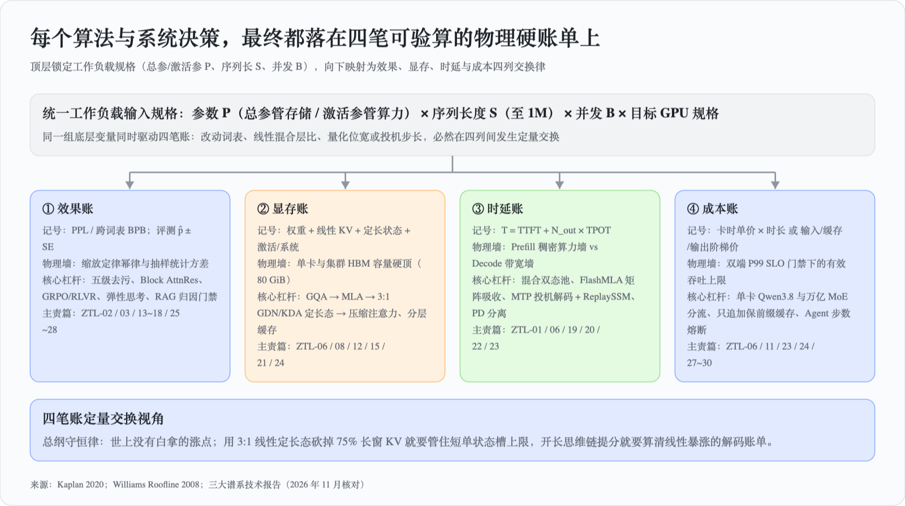
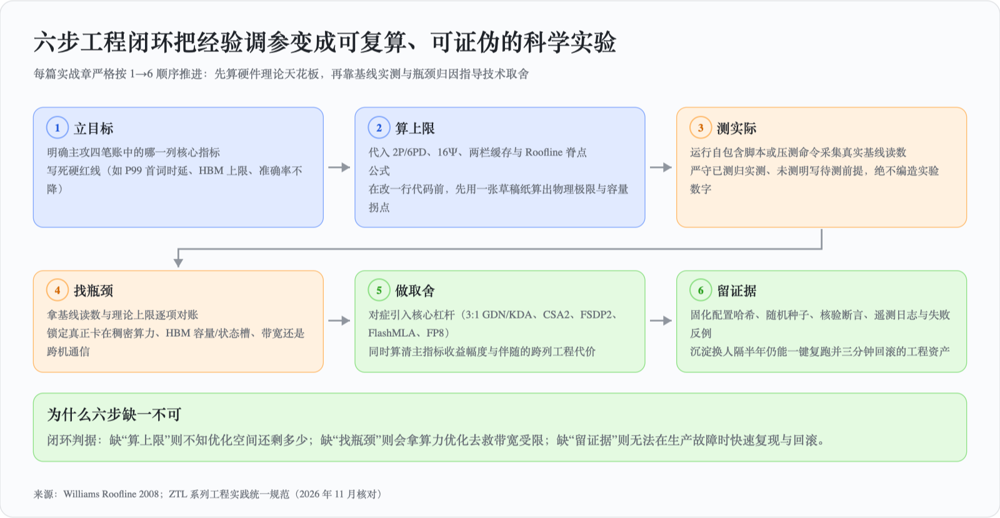
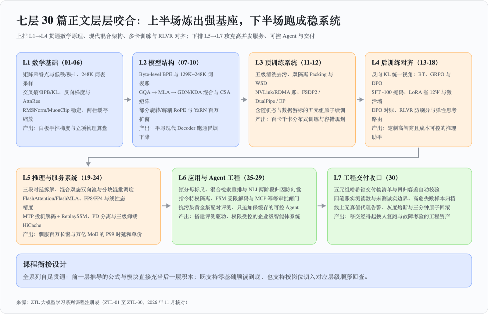
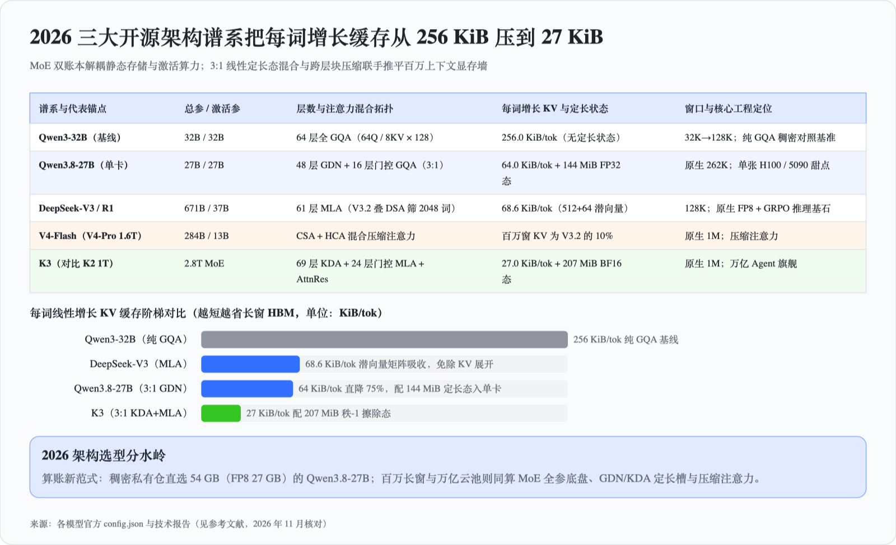
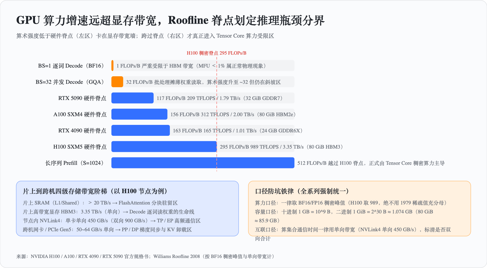
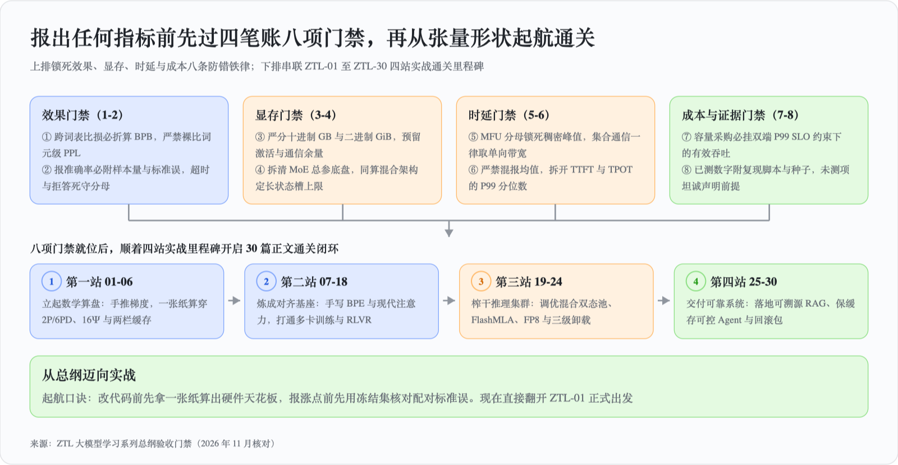

# ZTL-00｜总览｜算清四个数：效果、显存、时延与成本

> 本目录是「从零掌握大模型：四笔账学习体系」的 Markdown 版，共 31 篇（本篇总览加 30 篇正文），由作者的飞书原文转换，正文与原文一致；画板渲染成 PNG 放在 `assets/`。正文里的可运行代码按章节放在仓库根目录 `NN-*/`，见[仓库首页](../README.md)。

> 🎯 **这篇文档解决什么问题**：<b>核心命题：从零掌握大模型工程，必须把每个技术决策还原为效果、显存、时延、成本四笔可验算的硬账。</b>初学者若只背诵零散的论文术语，遇到显存溢出或延迟飙升时便无从下手。本套课程由本篇总览与 30 篇正文组成。全书构成一套完全自足的 31 篇工程学习体系。
>
> **使用方式与读者指南**：零基础读者建议按编号逐篇精读。请亲手推导核心公式并跑通验证代码。一线算法、推理基建与应用工程师可按第 3 章路线跳读攻坚。全书模型参数、硬件基准与文献口径均核对于 2026 年 11 月 17 日。
>
> **动手实践**：第 4 章内置零依赖的 Python 四笔账速算器。它支持纯全局注意力、潜空间压缩与混合线性状态同台对账。后续 30 篇正文均内嵌可运行代码。每篇实战章先做立目标、算上限与测实际，再完成找瓶颈、做取舍与留证据六步闭环。

<b>🧭 主线位置</b>：本篇是全套 31 篇课程的开山总纲、知识地图与度量衡字典。下一篇从 [ZTL-01｜数学｜符号、向量与矩阵乘法](./01-matmul.md) 迈入数学基础层。全书终点在 [ZTL-30｜交付｜交一个可复查的项目](./30-delivery.md) 完成可复现、可回滚的生产级工程交付。

## 导读 · 先给结论

- <b>一切算法与系统改动，最终都是四笔工程账的定量交换。</b>词表扩容、状态压缩与量化投机，都在效果、显存、时延与成本间做权衡。脱离硬件天花板与抽样标准误空谈优劣，必会引发容量失算或评测幻觉[[1]](https://www2.eecs.berkeley.edu/Pubs/TechRpts/2008/EECS-2008-134.pdf)[[2]](https://arxiv.org/abs/2001.08361)。
- <b>训练与推理受制于不同的物理墙，严禁混报利用率与平均延迟。</b>预训练与长输入预填充（Prefill）算术强度高，吞吐上限取决于 Tensor Core 稠密算力。逐词解码（Decode）每步重读权重与缓存，吞吐瓶颈落在高带宽显存（HBM）速率上[[3]](https://arxiv.org/abs/2205.14135)[[4]](https://arxiv.org/abs/2309.06180)。
- <b>2026 三大前沿架构重塑了参数算力与百万上下文的显存账本。</b>混合专家（MoE）确立了“总参管存储、激活参管算力”的双账本（第 3 章的两条万亿级 MoE 谱系）。同时，3:1 线性定长态混合把每词缓存压到纯 GQA 基线的四分之一，压缩注意力在百万窗下又把缓存压到前代的十分之一[[5]](https://arxiv.org/abs/2412.19437)[[6]](https://arxiv.org/abs/2507.20534)[[7]](https://arxiv.org/abs/2606.19348)[[8]](https://arxiv.org/abs/2607.24653)[[9]](https://huggingface.co/Qwen/Qwen3.8-27B/blob/main/config.json)。
- <b>工程判断须走完六步闭环，严守“已测归实测、未测明写未测”准则。</b>改代码前先用公式算出物理上限。随后靠可复现脚本测出基线读数、定位真瓶颈并留存配置证据。单机尚未压测的多机长尾指标，一律如实注明待测前提[[10]](https://arxiv.org/abs/2203.15556)[[11]](https://arxiv.org/abs/2204.02311)。
- <b>单位进制、稠密峰值分母与评测分母必须在全团队统一刻度。</b>全系列严格区分十进制 `GB`（$`10^9\text{ B}`$）与二进制 `GiB`（$`2^{30}\text{ B}`$）。算力分母统一取 BF16/FP16 稠密峰值。跨分词器比损统一折算为每字节比特数（BPB），应用评测强制把超时与拒答留在分母中[[12]](https://resources.nvidia.com/en-us-tensor-core/nvidia-tensor-core-gpu-datasheet)[[13]](https://physics.nist.gov/cuu/Units/binary.html)。



<b>📎 与系列其他文档的分工</b>：本篇负责确立四笔账公式、六步闭环、七层导航与度量衡，技术细节按上下半场展开：

- <b>模型炼成上半场（第 01～18 篇）</b>：数学基础与缩放见 L1（从 [ZTL-01｜数学｜符号、向量与矩阵乘法](./01-matmul.md) 起步）。分词与现代注意力建模见 L2，多卡预训练与对齐微调见 L3 与 L4。
- <b>系统落地下半场（第 19～30 篇）</b>：双态内存池与推理集群见 L5（从 [ZTL-19｜系统｜判断慢在哪，以及请求怎样排队](./19-serving-latency.md) 起步）。高召回可溯源 RAG、工具路由、统计评测、可控 Agent 与最终交付见 L6 与 L7（收官于 [ZTL-30｜交付｜交一个可复查的项目](./30-delivery.md)）。

## 第 1 章 · 四笔账是大模型决策的统一语言

面对按月刷新的模型架构、微调配方与推理框架，许多学习者容易陷入碎片化焦虑。今天刚看懂分组查询注意力（GQA）与多头潜在注意力（MLA），明天又遇到门控线性网络（GDN / KDA）与压缩注意力（CSA / HCA）。知识之所以显得繁杂散乱，根源在于缺少一张连通算法公式与硬件边界的总账单。

### 1.1 四笔账拆清一切技术权衡的物理边界

只要在白板上立起**效果、显存、时延、成本**四根定量支柱，十年来的架构演进便清晰可见。每一项技术突破，本质上都在同一本守恒账上做加减置换[[2]](https://arxiv.org/abs/2001.08361)[[14]](https://arxiv.org/abs/1706.03762)。

<b>第一笔是算力与效果底盘账。</b>在线性层主导的网络中，每个激活参数在单词前向传播时参与一次乘加，算力约为 $`2P`$ FLOPs。训练期反向传播还需分别对激活值和权重求导，开销约为前向的两倍。因此训练 $`D`$ 个词元的总算力近似为 $`C_{\mathrm{train}} \approx 6PD`$ [[2]](https://arxiv.org/abs/2001.08361)[[10]](https://arxiv.org/abs/2203.15556)。

拆开线性层 $`Y = X W^\top`$ 就能看清系数 $`2`$ 与 $`6`$ 的出处。前向计算每个输出元素都要做一次乘加，每词每参数消耗 $`2`$ 次浮点运算。反向传播须执行两场同规模矩阵乘。把误差传给输入激活 $`\nabla_X = \nabla_Y W`$ 耗费 $`2P`$，累加权重梯度 $`\nabla_W = \nabla_Y^\top X`$ 再耗费 $`2P`$。若开启全量激活重计算，每步额外重跑一次前向。总系数便从 $`6PD`$ 升至 $`8PD`$。

预训练靠语料清洗与深层残差路由兑现缩放红利。后训练阶段的指令微调（SFT）、偏好优化（DPO）与强化学习（GRPO）则在固定参数底盘上重塑分布。它们用规则验证算力与思考预算，换取下游准确率 $`\hat{p} \pm \mathrm{SE}`$ 的提升[[8]](https://arxiv.org/abs/2607.24653)[[15]](https://arxiv.org/abs/2501.12948)。

<b>第二笔是显存容量与长窗缓存账。</b>混合精度 AdamW 全参训练既要存 BF16 参数与梯度（各 $`2\Psi`$），又要存 FP32 主权重与双矩（各 $`4\Psi`$）。静态显存底盘高达 $`16\Psi`$ 字节[[16]](https://arxiv.org/abs/1910.02054)。分布式 ZeRO/FSDP 把 $`16\Psi`$ 切分到多卡摊销，LoRA 则冻结主干直接省去 $`12\Psi`$ 优化器状态。

进入线上推理后，显存焦点转移到键值缓存（KV Cache）上。纯 GQA 基线 `Qwen3-32B` 每词需存 `256 KiB`[[17]](https://arxiv.org/abs/2505.09388)，`DeepSeek-V3` 借潜空间 MLA 将其压至 `68.6 KiB/tok`[[5]](https://arxiv.org/abs/2412.19437)。

到了 2026 年的百万词窗口时代，主流压缩架构分化为两条路径。一条是 `Qwen3.8-27B`（`64 KiB/tok`）与万亿线性注意力旗舰（`27 KiB/tok`）采用的 3:1 线性定长态混合架构[[8]](https://arxiv.org/abs/2607.24653)[[9]](https://huggingface.co/Qwen/Qwen3.8-27B/blob/main/config.json)[[18]](https://arxiv.org/abs/2510.26692)。另一条是压缩注意力，把历史词块压缩后再参与注意力，进一步减少全局缓存需求[[7]](https://arxiv.org/abs/2606.19348)。权重这一栏则交给第 21 篇的量化去压。

<b>第三与第四笔是时延与单位成本账。</b>端到端耗时满足 $`T = \mathrm{TTFT} + N_{\mathrm{out}} \cdot \mathrm{TPOT}`$ 。首词预填充受限于稠密算力，逐词解码受限于显存带宽[[1]](https://www2.eecs.berkeley.edu/Pubs/TechRpts/2008/EECS-2008-134.pdf)。FlashAttention 省去多余的显存读写[[3]](https://arxiv.org/abs/2205.14135)，`vLLM V1` 与 `SGLang` 则用双态内存池管住分页块与定长状态槽[[4]](https://arxiv.org/abs/2309.06180)[[19]](https://arxiv.org/abs/2312.07104)。再叠加无损投机解码、`Mooncake` 预填解码分离与三级缓存卸载，高有效吞吐（Goodput）便直接转化为每百万词元的成本优势[[20]](https://arxiv.org/abs/2407.00079)。

阅读下方四笔账总表时，建议养成“横查物理红线、纵看跨行代价”的习惯。动手改方案前先横着核对第 2 列与第 3 列，锁死符号口径与硬件天花板。评估新技术时再竖着跨行审视。例如激进压低缓存位宽能改善解码时延，却可能拉高词表压缩率。唯有四行同台签字才算真收益。

| **贯穿账维度** | **核心数学记号与算式** | **物理约束墙与必守口径** | **全系列核心主责篇号** |
|---|---|---|---|
| **效果账** | 预训练 $`\mathrm{PPL} = \exp(\mathcal{L}_{\mathrm{CE}})`$；跨词表 $`\mathrm{BPB}`$；评测 $`\hat{p} \pm \mathrm{SE}`$ | 缩放定律幂律边界；报 PPL 必锁分词器；报准确率必附样本量、标准误并将拒答超时留在分母 | [ZTL-02｜数学｜条件概率、softmax 与采样](./02-softmax-sampling.md)、[ZTL-03｜数学｜熵、交叉熵、困惑度与 KL](./03-entropy-kl.md)、[ZTL-13｜后训练｜奖励、策略梯度与 DPO 的数学](./13-rl-math.md)、[ZTL-17｜后训练｜先验证奖励再训练](./17-verifiable-reward.md)、[ZTL-25｜工程｜先把相关材料找出来](./25-retrieval.md)、[ZTL-26｜工程｜让回答有可追溯的依据](./26-grounding.md)、[ZTL-28｜工程｜先写评测再改系统](./28-eval.md) |
| **显存账** | $`M = M_{\mathrm{w}} + M_{\mathrm{KV}} + M_{\mathrm{state}} + M_{\mathrm{act/sys}}`$；训练静态 $`16\Psi`$ | 单卡与集群 HBM 容量硬顶；严分十进制 `GB` 与二进制 `GiB`；混合架构同算线性 KV 与定长状态槽 | [ZTL-06｜数学｜一张纸算清算力、显存与缩放](./06-compute-memory-scaling.md)、[ZTL-08｜模型｜把注意力写成矩阵](./08-attention.md)、[ZTL-12｜训练｜多卡的账和中断后续上](./12-multi-gpu.md)、[ZTL-15｜后训练｜只训练一小部分参数](./15-lora.md)、[ZTL-21｜系统｜用精度换内存要付什么代价](./21-quantization.md)、[ZTL-24｜系统｜长上下文与混合专家怎样改变账单](./24-long-context-moe.md) |
| **时延账** | $`T = \mathrm{TTFT} + N_{\mathrm{out}} \cdot \mathrm{TPOT}`$；脊点 $`I^\star = \mathrm{Peak} / \mathrm{BW}`$ | Prefill 卡在稠密算力峰值，Decode 卡在 HBM 单向带宽与专家通信延迟；禁报均值掩盖 P99 毛刺 | [ZTL-01｜数学｜符号、向量与矩阵乘法](./01-matmul.md)、[ZTL-06｜数学｜一张纸算清算力、显存与缩放](./06-compute-memory-scaling.md)、[ZTL-18｜后训练｜多想一会儿是否值得](./18-test-time-compute.md)、[ZTL-19｜系统｜判断慢在哪，以及请求怎样排队](./19-serving-latency.md)、[ZTL-20｜系统｜减少注意力的内存搬运](./20-flash-attention.md)、[ZTL-22｜系统｜让草稿减少解码开销](./22-speculative.md)、[ZTL-23｜系统｜把模型部署成服务](./23-serving.md) |
| **成本账** | 自建 $`\mathrm{Cost} = c_{\mathrm{gpu}} \cdot t_{\mathrm{gpu}}`$；API 输入/缓存/输出阶梯计费 | 双端 P99 SLO 门禁下有效吞吐上限；MoE 存储看总参、算力看激活参；Agent 只追加保前缀缓存 | [ZTL-06｜数学｜一张纸算清算力、显存与缩放](./06-compute-memory-scaling.md)、[ZTL-11｜训练｜从语料到一轮小预训练](./11-pretrain.md)、[ZTL-23｜系统｜把模型部署成服务](./23-serving.md)、[ZTL-24｜系统｜长上下文与混合专家怎样改变账单](./24-long-context-moe.md)、[ZTL-27｜工程｜提示、路由与工具边界](./27-prompt-routing-tools.md)、[ZTL-29｜工程｜Agent 的循环、记忆、权限与成本](./29-agent.md)、[ZTL-30｜交付｜交一个可复查的项目](./30-delivery.md) |

### 1.2 六步工程闭环方法与诚实治学准则

看懂算式只是起点。真正的工程能力体现在真实流量前的独立排障思路。后续 30 篇正文统一把<b>“六步工程闭环”</b>融入案例推演：

- **立目标**：动手前先明确主攻四笔账中的哪一列。同时写清质量底线、显存红线与延迟 SLO 阈值。
- **算上限**：拒绝盲目试错。先将模型维度与硬件规格代入 $`2P/6PD`$、$`16\Psi`$ 或 Roofline 公式算出理论极限[[1]](https://www2.eecs.berkeley.edu/Pubs/TechRpts/2008/EECS-2008-134.pdf)。
- **测实际**：运行最小可复现脚本采集基线读数。已测数值写清口径，未测集群指标如实标明“未实测”。
- **找瓶颈**：拿实测基线与理论上限逐项对账。定位系统究竟卡在算力、显存容量、带宽还是通信排队上。
- **做取舍**：针对真瓶颈引入核心技术。既算清目标列的改善收益，也写明伴随付出的精度或内存代价。
- **留证据**：固化配置哈希、随机种子、依赖版本与失败反例。确保同伴拉下代码就能复现一致结论。



上方画板用蓝、橙、绿三色卡片标出了排障推进节奏。蓝色 ①② 先在纸面立标尺，橙色 ③④ 用实测读数锁定物理墙，绿色 ⑤⑥ 再落地取舍并固化证据。遇到“`64K` 长文档问答首词耗时飙到 `4.2 s`”的线上慢请求时，标准动作是顺着箭头逐格填单：

- <b>蓝区立尺（步骤 ①→②）。</b>先锁死目标红线 `P99 TTFT ≤ 1.5 s` 且准确率不降。再把 `27B` 参数与输入长度代入稠密峰值公式，算出单卡无排队理论下限约为 `3.6 s`。这能当场识破“靠调调度器就能压进 `1.5 s`”的幻想。
- <b>橙区验真（步骤 ③→④）。</b>跑压测脚本分离排队耗时与核函数纯耗时，核对前缀缓存命中率。对比理论下限后即可确认系统卡在 Prefill 稠密算力墙。同时发现多轮共享系统提示词重复重算浪费了七成算力。
- <b>绿区收口（步骤 ⑤→⑥）。</b>引入基数树前缀复用叠加双卡张量并行或 FP8 计算，复测输出 BPB 确认无退化。最后将引擎配置哈希、压测脚本与分位数日志一并归档备查。

> 🔑 **本章要点与回到主线**：大模型领域的一切创新都在四笔工程账上做定量权衡，并统一通过六步闭环落地。但新的矛盾随之浮现：面对横跨微积分、多卡训练、强化对齐、推理内核到企业级 Agent 的庞大知识体系，30 篇正文如何衔接成一条清晰的学习阶梯？这正是第 2 章要展开的全局地图。

## 第 2 章 · 七层知识地图与岗位学习路径

一套系统的工程教材，不能做成互不关联的专题拼盘。本系列将 30 篇正文组织为七个前后咬合的能力层级。前一层推通的公式与模块直接作为后一层的输入积木。后一层暴露的生产瓶颈，又反过来印证前一层的底层设计。

### 2.1 七层递进逻辑与学习坐标系

纵览全书，七层课程以“模型权重的炼成与上线服役”为分水岭，自然分为上下两个半场[[4]](https://arxiv.org/abs/2309.06180)[[14]](https://arxiv.org/abs/1706.03762)。读者顺着编号推进时，视野会从单个矩阵元素逐步扩展到多机集群与生产闭环。

<b>上半场（L1～L4，第 01～18 篇）回答“现代基座模型怎样从零炼成”</b>，按四级台阶递进：

- <b>L1 数学基础（01～06 篇）。</b>打通张量矩阵乘、大词表采样、交叉熵与反向梯度。随后掌握低精度数值稳定，学会在单张草稿纸上算清训练与推理总账。
- <b>L2 模型结构（07～10 篇）。</b>从 UTF-8 字节流起步手写 BPE 分词器。接着搭起现代注意力矩阵与旋转位置编码，拼装完整小模型并跑通单批训练验证[[7]](https://arxiv.org/abs/2606.19348)[[8]](https://arxiv.org/abs/2607.24653)[[9]](https://huggingface.co/Qwen/Qwen3.8-27B/blob/main/config.json)。
- <b>L3 预训练系统（11～12 篇）。</b>从单机实验走向百卡集群。重点解决语料清洗打包、多维并行切分（ZeRO/FSDP、张量与流水线并行、专家并行）及断点无损续训[[5]](https://arxiv.org/abs/2412.19437)[[16]](https://arxiv.org/abs/1910.02054)。
- <b>L4 后训练与对齐（13～18 篇）。</b>在统一数学视角下讲透指令微调（SFT）掩码与单卡 LoRA 边界。进而掌握偏好对齐（DPO）对账、可验证奖励防刷分（RLVR）与思考预算分配[[15]](https://arxiv.org/abs/2501.12948)。

<b>下半场（L5～L7，第 19～30 篇）回答“拿到权重后怎样低成本、高可靠地服务业务”</b>，分三步收口：

- <b>L5 推理与服务系统（19～24 篇）。</b>深入 GPU 存储层次与现代双引擎内部。依次攻克混合双态内存池、片上分块注意力内核、低比特量化与无损投机解码。最终算清预填解码分离与百万上下文集群账单[[3]](https://arxiv.org/abs/2205.14135)[[4]](https://arxiv.org/abs/2309.06180)[[19]](https://arxiv.org/abs/2312.07104)[[20]](https://arxiv.org/abs/2407.00079)。
- <b>L6 应用与 Agent 工程（25～29 篇）。</b>围绕企业真实排障场景搭建高召回检索漏斗与忠实度核验。随后配齐受限解码、工具权限闸门、配对统计评测，以及保住前缀缓存的可控 Agent 循环。
- <b>L7 工程交付（第 30 篇）。</b>把全栈研发收敛为可复查的生产交付包。落实五元组版本哈希锁、实测与未测边界声明、失败样本档案库与三分钟原子回滚机制。



对照上方七层全景图，上下半场并非各自为政。前一层产出的定量指标直接充当后一层的输入契约。抓住以下三条跨层耦合脉络，跳读时就不会迷失方向：

- <b>算术强度到分块混批契约（L1 → L5）。</b>L1 算出的 GPU Roofline 脊点，直接决定 L5 分块预填充（Chunked Prefill）的单批词元预算。分块小于脊点会跌回带宽斜坡区浪费算力。分块过大又会阻塞同批在线解码请求引发吐字卡顿。
- <b>分词汇率到思考链与检索切块契约（L2 → L4 / L6）。</b>L2 分词器的字节压缩率同时牵动上下游两本账。往上它决定 L4 强化对齐中单条思考链消耗多少生成步数。往下它决定 L6 检索模块在固定窗口内能塞入多少证据段落。
- <b>状态拓扑到双态内存池与交付锁契约（L2 / L3 → L5 / L7）。</b>L2 选定 3:1 线性定长态或潜向量压缩，L3 敲定原生 FP8 训练精度。到了线上，L5 必须配套双向双态池与投机状态回滚槽。L7 则把分词器、权重与量化参数统一锁入生产五元组哈希。

### 2.2 上半场课程地图（L1～L4，01–18 篇）：从数学算盘到推理对齐

面对上下两张共 30 篇的课程导航大表，建议采用<b>“五分钟逆向定位法”</b>快速查阅。第一步先扫最右侧“产出的核心工程能力”列，按手头排障任务对号入座。第二步左移核对“核心教学命题”，确认数学工具与 2026 架构锚点。第三步若发现前置公式生疏，顺着同层往上回溯一两行即可补齐地基。

上半场每一篇都对应模型研发链路上的一道关键关卡。跳过 L1 的融合梯度与动态范围，遇到显存尖峰与低精度溢出就会无从下手。忽略 L2 的因果掩码与状态递推，编写增量推理代码便极易产出乱码。下表列出第 01 至 18 篇的具体导航：

| **所属层级** | **篇章链接与标题** | **核心教学命题与 2026 前沿落点** | **产出的核心工程能力** |
|---|---|---|---|
| **L1 数学** | [ZTL-01｜数学｜符号、向量与矩阵乘法](./01-matmul.md) | 张量形状契约、结合律重排、GEMM 脊点与低秩/秩-1 状态更新 | 秒判维度报错，手算算术强度与秩账单 |
| **L1 数学** | [ZTL-02｜数学｜条件概率、softmax 与采样](./02-softmax-sampling.md) | 24.8 万词表条件概率、平移不变性、双模温度采样与抽样标准误 | 配准思考/指令采样参数，核算误差棒 |
| **L1 数学** | [ZTL-03｜数学｜熵、交叉熵、困惑度与 KL](./03-entropy-kl.md) | 交叉熵、PPL、跨词表 BPB 汇率与蒸馏/RL 前反向 KL 不对称性 | 跨 129K～248K 词表公平比损与选散度 |
| **L1 数学** | [ZTL-04｜数学｜链式法则与 softmax-交叉熵的梯度](./04-backprop.md) | 雅可比链式法则、融合梯度 $`p-y`$ 尖峰、恒等残差与 `Block AttnRes` | 手推任意层梯度，驯服 93 层深网信号稀释 |
| **L1 数学** | [ZTL-05｜数学｜优化、归一化与数值稳定](./05-optim-norm.md) | Pre-RMSNorm/QK-Norm、AdamW 与 MuonClip、BF16/FP8 与在线递推 | 稳住万亿模型低精度长跑，根除溢出 NaN |
| **L1 数学** | [ZTL-06｜数学｜一张纸算清算力、显存与缩放](./06-compute-memory-scaling.md) | $`2P/6PD`$ 算力、$`16\Psi`$ 显存、线性 KV+定长态两栏账与推理摊销缩放 | 靠一张纸定准单卡混合稠密与万亿 MoE 立项 |
| **L2 模型** | [ZTL-07｜模型｜亲手实现分词](./07-tokenizer.md) | UTF-8 字节级 BPE 最小秩合并、特殊符防注入与 24.8 万大词表权衡 | 手写零未知词分词器，算清序列瘦身汇率 |
| **L2 模型** | [ZTL-08｜模型｜把注意力写成矩阵](./08-attention.md) | 右下因果掩码，以及 GQA → MLA → GDN/KDA 线性混合与 CSA 块压缩矩阵 | 手写现代注意力，复算五千倍缓存压缩天梯 |
| **L2 模型** | [ZTL-09｜模型｜让模型知道顺序](./09-position.md) | RoPE 正交旋转、25% 部分旋转、64 维解耦旋转键与 YaRN 百万扩窗 | 根治增量缓存下标错位与百万窗口外推崩坏 |
| **L2 模型** | [ZTL-10｜模型｜组装小模型并让一个批次下降](./10-tiny-model.md) | 恒宽残差主干、SwiGLU 门控前馈、标签右移与 $`\ln V`$ 单批过拟合冒烟 | 独立组装现代小模型并跑通投卡前冒烟铁证 |
| **L3 训练** | [ZTL-11｜训练｜从语料到一轮小预训练](./11-pretrain.md) | 五级清洗去污漏斗、块对角 Packing 与线性态清零、WSD 退火与四遥测 | 搭建零泄漏高 MFU 的工业预训练数据管线 |
| **L3 训练** | [ZTL-12｜训练｜多卡的账和中断后续上](./12-multi-gpu.md) | NVLink/RDMA 带宽悬崖、ZeRO/FSDP2、TP+SP/DualPipe/EP 与原子续训 | 规划百卡千卡并行拓扑与掉卡零损恢复 |
| **L4 对齐** | [ZTL-13｜后训练｜奖励、策略梯度与 DPO 的数学](./13-rl-math.md) | 反向 KL 变分母方程：Bradley-Terry、GRPO 去 Critic 归一化与 DPO 闭式解 | 从统一变分视角选准在线 RL 与离线偏好对齐 |
| **L4 对齐** | [ZTL-14｜后训练｜只对该学的回答算损失](./14-sft-loss-mask.md) | `-100` 精确监督掩码、`<think>` 跨轮保留契约与全局词数梯度归约 | 根除微调复读不停笔、观察伪造与梯度尖刺 |
| **L4 对齐** | [ZTL-15｜后训练｜只训练一小部分参数](./15-lora.md) | LoRA 砍 $`12\Psi`$ 包袱、$`B=0`$ 初始化、大词表激活尖峰与 QLoRA 合并边界 | 单卡微调 `Qwen3.8-27B` 并避开精度退化 |
| **L4 对齐** | [ZTL-16｜后训练｜用偏好对核对 DPO](./16-dpo.md) | 同源控长偏好对、四路序列对数概率对账、似然双降止血与长度归一化 | 零额外参考显存跑稳 DPO，拔除废话膨胀 |
| **L4 对齐** | [ZTL-17｜后训练｜先验证奖励再训练](./17-verifiable-reward.md) | 格式与结果解耦的确定性沙箱（RLVR）、对抗反例单测门与熵坍缩防控 | 封堵提取器漏洞，炼出真解题推理能力 |
| **L4 对齐** | [ZTL-18｜后训练｜多想一会儿是否值得](./18-test-time-compute.md) | 串行长链 vs 并行采样、Pass@k 与 Maj@k 鸿沟及弹性思考档位路由 | 按任务难度动态调配思考预算，控住解码账 |

### 2.3 下半场课程地图：推理系统与应用交付

在真实企业研发中，超过八成的长期算力预算与工程精力都投在推理服务与应用系统上。下半场先在 L5 吃透推理内核与集群账单，再在 L6 装上评测与安全护栏，最后在 L7 完成生产移交：

| **所属层级** | **篇章链接与标题** | **核心教学命题与 2026 前沿落点** | **产出的核心工程能力** |
|---|---|---|---|
| **L5 系统** | [ZTL-19｜系统｜判断慢在哪，以及请求怎样排队](./19-serving-latency.md) | 三段时延拆解、分页块表与混合双态双向内存池、Chunked Prefill 混批 | 秒破流式吐字冻结与定长状态槽早满排队 |
| **L5 系统** | [ZTL-20｜系统｜减少注意力的内存搬运](./20-flash-attention.md) | SRAM 在线重缩放、线性层分块递推、FlashDecoding 与 FlashMLA 矩阵吸收 | 算透片上访存节省比，吃透潜空间加速内核 |
| **L5 系统** | [ZTL-21｜系统｜用精度换内存要付什么代价](./21-quantization.md) | 分组刻度利息、W4A16 救带宽 vs 原生 FP8/FP4 翻倍算力、线性态精度底线 | 精准选型量化位宽，守住长链推理智商不塌 |
| **L5 系统** | [ZTL-22｜系统｜让草稿减少解码开销](./22-speculative.md) | 修正拒绝采样零损证明、原生 MTP 与块扩散 块扩散、`ReplaySSM` 状态回滚 | 实现单流三倍无损提速并设准高并发熔断线 |
| **L5 系统** | [ZTL-23｜系统｜把模型部署成服务](./23-serving.md) | 双端 P99 SLO 下 Goodput 压测、Radix 前缀配状态检查点与 Mooncake PD 分离 | 消除预填解码互抢，精确折算百万词底价 |
| **L5 系统** | [ZTL-24｜系统｜长上下文与混合专家怎样改变账单](./24-long-context-moe.md) | Wide-EP + DP Attention 万亿 MoE 经济账与百万上下文三级卸载（HiCache） | 定准双卡 `Qwen3.8` 自建、32 卡集群与 API 分流线 |
| **L6 工程** | [ZTL-25｜工程｜先把相关材料找出来](./25-retrieval.md) | 锁标准集分母标尺、路径保语境切块、BM25+向量 RRF 融合与交叉精排瘦身 | 在极窄 Top-5 预算内逼近九成召回并省六成账 |
| **L6 工程** | [ZTL-26｜工程｜让回答有可追溯的依据](./26-grounding.md) | 元数据隔离与首尾防迷失编排、证据不足拒答契约与原子断言 NLI 忠实度门禁 | 根除张冠李戴、超纲强答与伪造引用三类幻觉 |
| **L6 工程** | [ZTL-27｜工程｜提示、路由与工具边界](./27-prompt-routing-tools.md) | 指令特权防注入、FSM 受限 JSON 解码、弹性思考分级路由与 MCP 幂等审批 | 实现零语法报错调用，削平八成算力并锁死写权限 |
| **L6 工程** | [ZTL-28｜工程｜先写评测再改系统](./28-eval.md) | 哈希冻结抗污染黄金集、超时弃权留分母、双盲去偏裁判与配对 Bootstrap 门禁 | 挤干评测水分，建立先写评测再改系统的飞轮 |
| **L6 工程** | [ZTL-29｜工程｜Agent 的循环、记忆、权限与成本](./29-agent.md) | Workflow 与 Agent 选型分界、重复指纹熔断与只追加保前缀缓存的上下文工程 | 保住九成前缀缓存命中，控死端到端单次解决成本 |
| **L7 交付** | [ZTL-30｜交付｜交一个可复查的项目](./30-delivery.md) | 五元组哈希锁清单、实测与未测诚实边界、失败反例库、代理告警与原子回滚 | 交付换人隔半年一键复现且三分钟可回滚的资产 |

把下半场 12 篇串起来看，L5、L6 与 L7 恰好构成生产落地的铁三角。L5 负责在双端 P99 延迟红线下压低单次推理分母成本。L6 负责用检索召回、归因核验、权限闸门与配对统计守住业务分子质量。L7 则用可复现证据包与原子回滚把实验成果变成工程资产。

> 🔑 **本章要点与回到主线**：全套 30 篇正文按七层架构衔接。上半场（01–18）解决模型怎样造出来并训对齐，下半场（19–30）解决服务怎样跑得快并稳妥交付。但新的矛盾随之浮现：不同岗位读者的时间有限，该如何定制精读顺序？全书算账时又统一锚定哪几款 2026 开源模型？这正是第 3 章要解答的重点。

## 第 3 章 · 按岗位锁定通关路径并立起 2026 三大前沿架构锚点

不同背景的读者翻开这套教程时，手头面临的任务差异很大。高校学生希望从零打牢数学与代码地基。一线算法、AI Infra 或智能体工程师则急需在两周内解决微调过拟合、长文本高延迟或线上评测失真。本章先给出四条岗位学习路线，再统一立卡贯穿全书的三大开源模型谱系与双推理引擎。

### 3.1 四条量身定制的岗位学习通关路线

按 `01` 至 `30` 顺序通读的体系感最完整。如果时间紧迫需要跳读，每篇开头的“主线位置”与末尾分工都写明了先修契约。遇到陌生记号时，只需顺着链接回查先修篇即可。

建议读者出发前先锁定一条主路线。每读完一个阶段，务必亲手跑通验证脚本与课后自测题，切忌只看不练。若团队内部组织技术共学，也可按双周节奏拆解里程碑，直接拿各篇末尾的核对清单作为结业验收标准：

| **路线名称与适用人群** | **推荐精读篇号顺序** | **核心训练重点与回溯策略** | **阶段通关里程碑** |
|---|---|---|---|
| **① 从零通关全栈路线**<br>（高年级本硕生、转行系统学习者） | 按 `01 → 10 → 11～18 → 19～30` 逐篇精读（从 [ZTL-01｜数学｜符号、向量与矩阵乘法](./01-matmul.md) 起步） | 不跳篇，亲手推完 [ZTL-04｜数学｜链式法则与 softmax-交叉熵的梯度](./04-backprop.md) 反向梯度，跑通 [ZTL-10｜模型｜组装小模型并让一个批次下降](./10-tiny-model.md) 冒烟过拟合与 [ZTL-06｜数学｜一张纸算清算力、显存与缩放](./06-compute-memory-scaling.md) 缓存算盘，建立全栈坐标系 | 能独立手写现代 Decoder、微调对齐模型、诊断双态池瓶颈并完成规范交付 |
| **② 算法与后训练专精路线**<br>（预训练、SFT/RL 对齐算法工程师） | `02～06 → 07～10 → 11～18 → 28、30` | 抓牢跨词表 BPB、缩放定律与多维并行账，重点吃透 SFT 掩码、LoRA 边界、DPO 对账、RLVR 防刷分与思考档位 | 构建零污染训练管线，独立排查似然位移、长度膨胀与奖励投机问题 |
| **③ 高性能推理与基建路线**<br>（推理引擎、AI Infra 与集群架构师） | `01、05、06 → 08、09 → 12 → 19～24 → 30` | 直击 Roofline 脊点与现代缓存拓扑，深挖混合双态内存池、FlashMLA、FP8/FP4 量化、`ReplaySSM` 与三级卸载 | 基于双端 P99 SLO 做准单卡混合稠密与万亿 MoE 容量规划，调优 vLLM 与 SGLang |
| **④ 企业级 RAG 与 Agent 路线**<br>（大模型应用研发与智能体架构师） | `02、03、06、07 → 18、19、23 → 25～30` | 先补齐采样标准误、分词汇率与前缀缓存计费常识，再集中攻克三级检索漏斗、NLI 归因、MCP 闸门与保缓存 Agent | 告别凭感觉调提示词，交付召回可测、依据可查、权限受控、成本封顶的生产系统 |

为避免“收藏即学会”的假性通关，选定路线后建议按双周周期做实操验收：

- <b>双周闭卷算账与脚本复跑。</b>每读完三四篇，合上正文手推一遍核心算式，在本地跑通验证代码。亲手算对篇末五道自测题才算真正过关。
- <b>主动注入故障做逆向排障。</b>在脚本里故意改错一处契约，如漏掩码提示词或关掉状态清零。观察异常现象，再按六步闭环写清归因记录。
- <b>阶段结业交付一页四笔账单。</b>满四周与六周时，针对真实业务模型产出一份含配置哈希与 P99 延迟的对账单。未实测的多机指标一律标明待测前提。

### 3.2 三大开源代表谱系与推理引擎

如果教材只拿微型玩具网络举例，读者到了生产环境依然算不准百亿与万亿模型的账单。全系列采用“小维度推透数学原理、真规格核算工业硬账”的双轨制。所有实战章节统一锚定以下**三大 2026 开源模型谱系**与**两大生产推理引擎**：

- <b>Qwen 谱系（纯 GQA 基线 → 单卡混合甜点）。</b>2025 基线 `Qwen3-32B` 采用 64 层全 GQA（`256 KiB/tok`）[[17]](https://arxiv.org/abs/2505.09388)。2026 年开源的 `Qwen3.8-27B`（BF16 约 `54 GB` 入 H100，FP8 约 `27 GB` 入 RTX 5090）改为 48 层 GDN 定长态（`144 MiB`）配 16 层门控 GQA。它将线性缓存压至 <b>`64 KiB/tok`</b>（直降 75%），原生支持 `262K` 窗口与弹性思考[[9]](https://huggingface.co/Qwen/Qwen3.8-27B/blob/main/config.json)。
- <b>DeepSeek 谱系（潜空间矩阵吸收 → 压缩注意力）。</b>`DeepSeek-V3`（`671B/37B`）借 MLA 将每词缓存压至 `68.6 KiB`，解码免除显存展开；`DeepSeek-R1` 用可验证奖励 GRPO 激发长思维链[[5]](https://arxiv.org/abs/2412.19437)[[15]](https://arxiv.org/abs/2501.12948)。随后 `V3.2` 引入 DSA 稀疏注意力。2026 年的 `V4` 系列（`V4-Pro` 为 `1.6T/49B`，`V4-Flash` 为 `284B/13B`）原生支持 `1M` 窗口，用 CSA 与 HCA 混合压缩注意力把百万窗下的 KV 压到 `V3.2` 的 `10%`[[7]](https://arxiv.org/abs/2606.19348)。
- <b>Kimi 谱系（万亿细粒度稀疏 → 原生 1M 混合旗舰）。</b>`Kimi K2`（`1T/32B`）确立了万亿细粒度 MoE 加 `MuonClip` 稳态训练范式[[6]](https://arxiv.org/abs/2507.20534)。2026 年发布的 `Kimi K3` 扩至 `2.8T` MoE，全网 93 层由 69 层 KDA 线性注意力（恒占 `207 MiB` 状态槽）与 24 层门控 MLA（`27 KiB/tok`）组成。它还引入 `Block AttnRes` 深度注意力残差解决深网信号稀释[[8]](https://arxiv.org/abs/2607.24653)[[18]](https://arxiv.org/abs/2510.26692)：

```math
S_t = (I - \beta_t k_t k_t^\top)\mathrm{Diag}(\alpha_t)S_{t-1} + \beta_t k_t v_t^\top
```

上式正是 KDA 层在定长矩阵 $`S_t`$ 内保住长程记忆的核心。通道衰减项 $`\mathrm{Diag}(\alpha_t)`$ 负责平滑遗忘陈旧背景。秩-1 投影项 $`I - \beta_t k_t k_t^\top`$ 先沿键方向 $`k_t`$ 定向擦除旧值，再写入新关联 $`\beta_t k_t v_t^\top`$。这有效避免了定长状态槽在百万词更新中发生记忆混叠[[8]](https://arxiv.org/abs/2607.24653)[[18]](https://arxiv.org/abs/2510.26692)。

- <b>现代推理引擎设计。</b>系统层统一对照支持分页块表、混合缓存协调器与分块混批的 `vLLM V1`[[4]](https://arxiv.org/abs/2309.06180)。另一主力引擎是支持基数树前缀复用、统一双态池、三级卸载（`HiCache`）与大专家并行的 `SGLang`[[19]](https://arxiv.org/abs/2312.07104)。跨机集群再叠加 `Mooncake` 预填解码分离架构，完整还原线上高吞吐技术栈[[20]](https://arxiv.org/abs/2407.00079)。

### 3.3 三大架构谱系的选型边界与缓存压缩

对照下方锚点表与画板底部的横向柱状图，能看清每词线性缓存的两道物理拐点。第一道拐点从纯 GQA 的 `256.0 KiB/tok` 降至 `68.6 / 64.0 KiB/tok`，让单卡跑通 `256K` 长窗成为现实。第二道拐点借 KDA+MLA（`27.0 KiB/tok`）与压缩注意力（百万窗下 KV 为前代的 `10%`），把百万上下文缓存继续压小。

| **全系列核心模型锚点** | **总参 / 激活参** | **层数与注意力混合拓扑** | **线性增长 KV + 定长状态** | **上下文、词表与主责落点** |
|---|---|---|---|---|
| <b>`Qwen3-32B`</b><br>（2025 纯 GQA 基线） | `32B / 32B`<br>（稠密 100%） | 64 层全 GQA（`64Q/8KV×128`，`h=5120`） | <b>`256.0 KiB/tok`</b>（BF16）；无定长态 | 32K（YaRN 128K），词表 151.9K；纯全局对照基准 |
| <b>`Qwen3.8-27B`</b><br>（2026 单卡混合旗舰） | `27B / 27B`<br>（BF16 54GB） | 64 层 3:1（48 层 GDN + 16 层门控 GQA `24Q/4KV×256`） | <b>`64.0 KiB/tok`</b> + <b>`144 MiB`</b> FP32 态 | 原生 262K（扩 1M），词表 248.3K；单卡 H100/5090 甜点 |
| **稠密MLA 架构**<br>（潜空间稀疏基石） | `671B / 37B`<br>（激活 5.5%） | 61 层 MLA（512 潜向量+64 解耦 RoPE） | <b>`68.6 KiB/tok`</b>（BF16）；无定长态 | 128K，词表 129.3K；原生 FP8、矩阵吸收与 GRPO 标杆 |
| <b>`V4-Flash`</b><br>（2026 压缩注意力） | `284B / 13B` | CSA + HCA 混合压缩注意力 | 百万窗下 KV 为 V3.2 的 10%（V4-Pro 口径） | 原生 1M |
| **K2**<br>（万亿稀疏基线） | `1T / 32B`<br>（激活 3.2%） | 细粒度 MoE + MLA 注意力 + MuonClip 优化器 | MLA 线性增长缓存；无定长线性态 | 128K+；长程工具合成后训练与万亿 EP 通信对照 |
| **K3**<br>（混合旗舰） | `2.8T` MoE<br>（超大共享池） | 93 层（69 层 KDA + 24 层门控 MLA + `Block AttnRes`） | <b>`27.0 KiB/tok`</b> + <b>`207 MiB`</b> BF16 态 | 原生 1M（解码加速）；秩-1 状态更新与 `ReplaySSM` |



没有哪一种架构能无代价通吃全部场景。做线上容量规划时，必须紧扣三条物理取舍边界对号选型：

- <b>单机私有仓与中低并发优选 `Qwen3.8-27B`。</b>FP8 权重仅占约 `27 GB`，单张 `RTX 5090` 或 `H100` 即可低门槛交付。代价是每路并发固定占用 `144 MiB` 状态槽，短对话高并发需防状态池早满。稠密总参的知识广度也弱于万亿稀疏底座。
- <b>高吞吐代码生成与超长文档精读优选 `DeepSeek-V3 / V4`。</b>潜空间矩阵吸收与压缩注意力把长窗 KV 压得很小。代价是 `671B` 到 `1.6T` 的总参底盘庞大。部署时必须依托八卡以上高速互联节点摊销静态权重。
- <b>百万词长程工具链与云端旗舰共享池优选万亿混合架构。</b>69 层 KDA 配深度注意力残差兼顾长窗效率与超深表达力。代价是 `2.8T` 权重强依赖跨机大专家并行聚拢高并发。开启投机解码时还须配套 `ReplaySSM` 管理 `207 MiB` 状态回滚。

> 🔑 **本章要点与回到主线**：四条岗位路线帮读者合理安排节奏。Qwen、DeepSeek、Kimi 三大谱系配双推理引擎则让全书公式直接对齐工业实战。但新的矛盾随之浮现：拿到参数表准备核算集群容量时，为什么评审会上仍有一半争执栽在进制混用、稀疏分母与定长状态漏算上？这正是第 4 章要统一的度量衡标准。

## 第 4 章 · 统一度量衡与速算器

工程评审中至少一半的容量误判与性能争执，根源在于双方使用了不同刻度的尺子。有人把显卡标称的二进制 `80 GiB` 当成十进制 `80 GB` 相减。也有人拿宣传页上的 2:4 稀疏算力做分母，算出偏低一倍的利用率。本章锁定贯穿全书 31 篇的统一定量口径，并用一段零依赖脚本跑出五大代表模型的第一本账。

### 4.1 严格锁定的六条全局计量与算账铁律

在阅读后续章节或做线上容量规划前，请先对齐以下六条计量约定[[11]](https://arxiv.org/abs/2204.02311)[[12]](https://resources.nvidia.com/en-us-tensor-core/nvidia-tensor-core-gpu-datasheet)[[13]](https://physics.nist.gov/cuu/Units/binary.html)：

- <b>存储容量区分十进制与二进制。</b>十进制 `1 GB` 等于 $`10^9\text{ B}`$ ，二进制 `1 GiB` 等于 $`2^{30}\text{ B}`$（约 `1.074 GB`）[[13]](https://physics.nist.gov/cuu/Units/binary.html)。例如 `Qwen3.8-27B` 的 BF16 权重为 `54.0 GB`（约 `50.29 GiB`）。装入物理容量 `80 GiB` 的 H100 后，净余约 `29.7 GiB` 供缓存与激活使用。
- <b>算力分母统一采用稠密峰值。</b>规格书常印出满足 2:4 零元约束的稀疏峰值（如 H100 标为 1979 TFLOPS），但常规训练与推理均为稠密矩阵乘。核算理论耗时下限与模型算力利用率（MFU）时，分母统一取 BF16/FP16 稠密峰值。H100 SXM5 取 `989 TFLOPS`，A100 取 `312 TFLOPS`[[11]](https://arxiv.org/abs/2204.02311)[[12]](https://resources.nvidia.com/en-us-tensor-core/nvidia-tensor-core-gpu-datasheet)。
- <b>卡间通信耗时按单向带宽计算。</b>集合通信（AllReduce、AllGather 与专家并行 All-to-All）受限于单方向链路的收发速率。H100 NVLink4 宣传的 `900 GB/s` 是双向总和。手算单向传输下限时统一取<b>单向 `450 GB/s`</b>，A100 NVLink3 取单向 `300 GB/s`。
- <b>三大硬件监控指标各司其职。</b>`GPU-Util` 只反映采样窗口内有无核函数驻留流多处理器（SM），单线程等显存时也会显示 100%。评估预训练与长 Prefill 看**稠密峰值 MFU**。评估逐词 Decode 内核则看 **HBM 单向带宽利用率**[[1]](https://www2.eecs.berkeley.edu/Pubs/TechRpts/2008/EECS-2008-134.pdf)[[11]](https://arxiv.org/abs/2204.02311)。
- <b>跨词表语言建模对比必转 BPB。</b>词元级困惑度 $`\mathrm{PPL} = \exp(\mathcal{L}_{\mathrm{CE}})`$ 与分词器强绑定。`248K` 大词表的单步信息熵天然高于 `129K` 词表。跨家族对比语言建模能力时，统一用总负对数似然除以原始 UTF-8 字节数，折算为<b>每字节比特数（BPB）</b>[[5]](https://arxiv.org/abs/2412.19437)[[9]](https://huggingface.co/Qwen/Qwen3.8-27B/blob/main/config.json)。
- <b>MoE 双参分治与混合两栏缓存同算。</b>混合专家模型按**总参数量**算权重存储，按**激活参数量**算单步运算 $`2P`$ 与训练算力 $`6PD`$ 。对 3:1 线性混合模型，推理缓存须同时计入线性全局 KV 与定长状态槽[[8]](https://arxiv.org/abs/2607.24653)[[9]](https://huggingface.co/Qwen/Qwen3.8-27B/blob/main/config.json)。

千万别小看十进制与二进制之间 $`7.37\%`$ 的换算裂口。在标称 `80 GiB` 的 H100 上，若排障同学误按同数值减法塞入 `76 GB` 权重与缓存，纸面看似还余 `4` 个单位。实则 `76 GB` 折合 `70.78 GiB`。一旦叠加上 `4 GiB` 通信缓冲与 `6 GiB` 预填激活尖峰，总水位便冲破 `80.7 GiB`。线上服务会在长请求涌入时静默触发 OOM 重启。

### 4.2 主流 GPU 硬件基准与 Roofline 脊点速查

算术强度等于浮点运算次数除以 HBM 读写字节数（FLOPs/Byte）。硬件稠密算力峰值除以单向显存带宽即为 **Roofline 脊点**（Ridge Point）。算术强度低于脊点时受限于显存带宽，高于脊点时受限于计算核心[[1]](https://www2.eecs.berkeley.edu/Pubs/TechRpts/2008/EECS-2008-134.pdf)。下表汇总全书引用的四款代表 GPU 规格：

| **GPU 型号与定位** | <b>显存容量（GiB / GB）</b> | **单向显存带宽** | **BF16 稠密峰值** | **稠密脊点与卡间互联** |
|---|---|---|---|---|
| **NVIDIA H100 SXM5**<br>（主力训练与推理卡） | 80 GiB HBM3<br>（约 85.9 GB） | 3.35 TB/s | 989 TFLOPS<br>（FP8 稠密 1979） | **295 FLOPs/B**<br>NVLink4 单向 450 GB/s |
| **NVIDIA A100 SXM4**<br>（广泛存量数据中心卡） | 80 GiB HBM2e<br>（约 85.9 GB） | 2.00 TB/s | 312 TFLOPS | **156 FLOPs/B**<br>NVLink3 单向 300 GB/s |
| **NVIDIA RTX 5090**<br>（单卡 FP8 27B 消费旗舰） | 32 GiB GDDR7<br>（约 34.4 GB） | 1.79 TB/s | 约 209 TFLOPS | **约 117 FLOPs/B**<br>PCIe 5.0 x16（64 GB/s） |
| **NVIDIA RTX 4090**<br>（本地实验与量化微调） | 24 GiB GDDR6X<br>（约 25.8 GB） | 1.01 TB/s | 165 TFLOPS | **约 163 FLOPs/B**<br>PCIe 4.0 x16（32 GB/s） |



从几何图形理解，双对数坐标下的 Roofline 屋顶由左侧 $`45^\circ`$ 带宽斜坡与右侧水平算力平顶拼成。两线交点正是硬件脊点。以 H100 为例，$`989 / 3.35 \approx 295`$ 意味着每从 HBM3 搬运 1 字节数据，片上核心至少要做 295 次浮点运算才不闲置。对照上方画板可见，`BS=1` 与 `BS=32` 解码橙色柱远在 `295` 虚线左侧。唯有 `S=1024` 预填充蓝色柱跨过脊点吃满计算平顶。

### 4.3 四笔账速算器的核心实现

把下方纯 Python 标准库脚本保存到本地即可直接运行。函数同时支持纯全局 GQA、潜空间 MLA、混合定长状态（`fixed_state_mib`）与跨层块压缩。它直观对比五款代表模型在长上下文并发下的显存水位与预填下限：

*零依赖同台核算四款代表模型的显存两栏账*

```python
def llm_ledger(name, p_total_b, p_act_b, kv_b_tok, seq_len, batch, cards=1, bytes_w=2, fixed_state_mib=0.0):
    gib, mib = pow(1024, 3), pow(1024, 2)
    peak_tf = 989.0 * cards                       # H100 SXM5 BF16 稠密峰值算力 (TFLOPS)
    m_w_b = p_total_b * 1e9 * bytes_w             # 静态常驻 HBM 权重字节数
    m_kv_b = batch * seq_len * kv_b_tok           # 随序列长度线性增长的全局 KV 字节数
    m_st_b = batch * fixed_state_mib * mib        # 按在线并发扣费的定长状态槽 (GDN / KDA)
    m_tot_gib = (m_w_b + m_kv_b + m_st_b) / gib
    ttft_ms = round((2 * p_act_b * batch * seq_len / 1e3) / peak_tf * 1e3, 1) if p_act_b else "待测"
    return {
        "model": name,
        "w_gib": round(m_w_b / gib, 1),
        "kv_gib": round(m_kv_b / gib, 2),
        "state_gib": round(m_st_b / gib, 2),
        "hbm_gib": f"{m_tot_gib:.1f}/{80*cards}",
        "ttft_floor_ms": ttft_ms,
    }

# 1) 单卡 H100 跑 4 路 64K 并发: 纯 GQA vs 混合架构的显存差异
print(llm_ledger("Qwen3-32B (1xH100, BF16)",    32.0, 32.0, 262144,  65536,  4, cards=1, bytes_w=2))
print(llm_ledger("Qwen3.8-27B (1xH100, BF16)",  27.0, 27.0,  65536,  65536,  4, cards=1, bytes_w=2, fixed_state_mib=144.0))

# 2) 八卡 H100 跑 16 路 64K: MLA 稀疏模型
print(llm_ledger("DeepSeek-V3 (8xH100, FP8)",  671.0, 37.0,  70272,  65536, 16, cards=8, bytes_w=1))

# 3) 64 卡 H100 跑 32 路 256K: 万亿稀疏模型的集群容量
print(llm_ledger("Kimi-K3 (64xH100, FP8)",    2800.0, None,  27648, 262144, 32, cards=64, bytes_w=1, fixed_state_mib=207.0))
```

*输出*

```text
{'model': 'Qwen3-32B (1xH100, BF16)', 'w_gib': 59.6, 'kv_gib': 64.0, 'state_gib': 0.0, 'hbm_gib': '123.6/80', 'ttft_floor_ms': 16963.8}
{'model': 'Qwen3.8-27B (1xH100, BF16)', 'w_gib': 50.3, 'kv_gib': 16.0, 'state_gib': 0.56, 'hbm_gib': '66.9/80', 'ttft_floor_ms': 14313.2}
{'model': 'DeepSeek-V3 (8xH100, FP8)', 'w_gib': 624.9, 'kv_gib': 68.62, 'state_gib': 0.0, 'hbm_gib': '693.5/640', 'ttft_floor_ms': 9807.2}
{'model': 'Kimi-K3 (64xH100, FP8)', 'w_gib': 2607.7, 'kv_gib': 216.0, 'state_gib': 6.47, 'hbm_gib': '2830.2/5120', 'ttft_floor_ms': '待测'}
```

细读上方函数的核心四行，就能摸透现代混合架构的双账本规律。静态权重 `m_w_b` 乘总参数 `p_total_b`，预填下限 `ttft_ms` 则改乘激活参数 `p_act_b`。对暂未公开精确激活参的万亿混合旗舰，函数如实返回 `"待测"`。再看两栏动态缓存。`m_kv_b` 同时乘 `batch` 与 `seq_len`，对应全局层随长度线性增长。`m_st_b` 只乘 `batch` 不乘 `seq_len`，因为线性层把任意长历史都折叠进了定长状态矩阵。

对照脚本打印的五组真实输出，线上机器选型的三道分水岭清晰浮现：

- <b>单卡 `80 GiB` 分水岭（`123.6/80` 溢出 vs `66.9/80` 稳驻）。</b>跑 4 路 `64K` 并发时，纯 GQA 仅 KV 就吃掉 `64.0 GiB` 直接爆卡。混合架构 靠 `16.0 GiB` 全局 KV 配 `0.56 GiB` 定长槽，留出逾 `13 GiB` 余量给激活与系统缓冲[[9]](https://huggingface.co/Qwen/Qwen3.8-27B/blob/main/config.json)[[17]](https://arxiv.org/abs/2505.09388)。
- <b>单机八卡 `640 GiB` 分水岭（`693.5/640` 跨机 vs `515.0/640` 单机）。</b>承载百万总词元并发时，高激活MoE 超出单机上限被迫拆向跨机网卡。卸载策略 把主 KV 压至 `0.87 GiB` 稳驻单机 NVLink 域内。其预填理论下限也从 `9.8 s` 削至 `2.1 s`[[5]](https://arxiv.org/abs/2412.19437)[[7]](https://arxiv.org/abs/2606.19348)。
- <b>多机集群 `5120 GiB` 分水岭（`2830.2/5120` 权重主导）。</b>64 卡支撑万亿混合模型跑 800 万总词元时，MLA 缓存与 32 路 KDA 状态合计仅占 `222.5 GiB`。反观 `2.8T` 静态权重独占 `2607.7 GiB`。这印证了万亿稀疏集群扩容的首要任务是装下总参并摊薄专家访存[[8]](https://arxiv.org/abs/2607.24653)。

> 🔑 **本章要点与回到主线**：统一 `GB/GiB` 进制、BF16 稠密峰值、单向带宽与两栏缓存公式后，三十行脚本就能秒级摸清任意架构的容量底牌。但新的矛盾随之浮现：即便有了正确公式，日常排障中仍有不少团队被 `100%` 监控假象、跨词表 PPL 对比或极限吞吐误导。哪些高频认知盲区最容易造成资损？这正是第 5 章要纠偏的重点。

## 第 5 章 · 五大认知盲区与工程纠偏

在日常代码评审、集群救火与模型上线验收中，许多看似合理的经验判断其实违背了数学或硬件规律。一旦踩中这些盲区，轻则白烧数千卡时的训练预算，重则把退化系统推上生产。本章集中梳理全系列最高频的五大典型误区，逐一拆明现象、根因与标准改法。

### 5.1 算力监控假象与跨词表效果对账误区

> 💡 <b>常见误区 ①：看到 `nvidia-smi` 里 `GPU-Util = 100%` 就认定算力吃满，或拿 2:4 稀疏峰值做分母算出偏低一倍的 MFU。</b>
>
> <b>现象与根因。</b>线上推理吞吐卡住时，值班同学看到 `GPU-Util` 常驻 `100%` 便急着加卡。另一边训练团队拿 H100 宣传页的 `1979 TFLOPS` 做分母，算出 MFU 仅 `22%` 便四处查退化。实际上 `GPU-Util` 只统计窗口内有无核函数驻留，单线程等显存时也会显示 `100%`。而 `1979 TFLOPS` 仅对满足 2:4 零元约束的稀疏矩阵生效[[11]](https://arxiv.org/abs/2204.02311)[[12]](https://resources.nvidia.com/en-us-tensor-core/nvidia-tensor-core-gpu-datasheet)。
>
> <b>正确做法。</b>仅把 `GPU-Util` 当作进程心跳探针。评估预训练与长 Prefill 统一用**BF16/FP16 稠密峰值**算 MFU（见 [ZTL-06｜数学｜一张纸算清算力、显存与缩放](./06-compute-memory-scaling.md)）。排查逐词 Decode 慢点则改看 **HBM 显存带宽利用率**（见 [ZTL-19｜系统｜判断慢在哪，以及请求怎样排队](./19-serving-latency.md)）。

> 💡 <b>常见误区 ②：把不同分词器模型的词元级困惑度（Perplexity）直接摆在一起比高低。</b>
>
> <b>现象与根因。</b>在同一批验证文本上，`12.9 万`词表的 `DeepSeek-V3` 测出 PPL 为 `6.8`，而 `24.8 万`大词表的 `Qwen3.8-27B` 测出 PPL 为 `8.9`。初学者常据此误判后者建模退化。其实大词表单次切出的子词更长、总词元数更少。每个词元承载的平均信息量更高，单步交叉熵自然偏大[[5]](https://arxiv.org/abs/2412.19437)[[9]](https://huggingface.co/Qwen/Qwen3.8-27B/blob/main/config.json)。
>
> <b>正确做法。</b>只有共用同一分词器时才能直接对比词元级 PPL。跨模型家族对比或评估扩词表收益时，必须用总负对数似然除以原始 UTF-8 字节总数。统一换算为与切词粒度无关的 <b>BPB（每字节比特数）</b>（见 [ZTL-03｜数学｜熵、交叉熵、困惑度与 KL](./03-entropy-kl.md) 与 [ZTL-07｜模型｜亲手实现分词](./07-tokenizer.md)）。

### 5.2 稀疏并发访存与混合线性状态池误区

> 💡 <b>常见误区 ③：按 MoE 激活参数估算中等并发解码带宽，或给混合线性模型算并发时漏算定长状态槽。</b>
>
> <b>现象与根因。</b>万亿级 MoE 每词虽只激活三四百亿参数，但线上 `batch = 64` 解码时会分散唤醒大部分专家，HBM 每步仍要搬运数百 GB 权重[[5]](https://arxiv.org/abs/2412.19437)[[6]](https://arxiv.org/abs/2507.20534)。同时，部署线性混合模型时若漏算每路独占的 `144 / 207 MiB` 定长状态槽，百路短对话涌入时全局 KV 池尚空，状态槽却已耗尽排队[[8]](https://arxiv.org/abs/2607.24653)[[9]](https://huggingface.co/Qwen/Qwen3.8-27B/blob/main/config.json)[[18]](https://arxiv.org/abs/2510.26692)。
>
> <b>正确做法。</b>中低并发私有仓优选 `27 GB`（FP8）固定底盘的 `Qwen3.8-27B`。万亿 MoE 则靠跨机大专家并行聚拢千级并发摊薄访存（见 [ZTL-24｜系统｜长上下文与混合专家怎样改变账单](./24-long-context-moe.md)）。混合线性模型须启用引擎统一双向混合池，并靠块边界状态检查点与 `ReplaySSM` 支持前缀复用和投机回退（见 [ZTL-19｜系统｜判断慢在哪，以及请求怎样排队](./19-serving-latency.md)）。

### 5.3 线上有效吞吐与评测统计性误区

> 💡 <b>常见误区 ④：混报 Prefill 与 Decode 平均耗时，或脱离 P99 SLO 门禁拿离线极限吞吐采购机器。</b>
>
> <b>现象与根因。</b>离线压测时把并发打到几百路，任由首词排队十余秒、吐字中途卡顿半秒，测出单卡峰值吞吐便上报预算。一旦切入真实流量，为守住 `P99 TTFT ≤ 500 ms` 与 `P99 TPOT ≤ 30 ms` 的体验红线，实际可用吞吐往往直接腰斩[[4]](https://arxiv.org/abs/2309.06180)[[19]](https://arxiv.org/abs/2312.07104)[[20]](https://arxiv.org/abs/2407.00079)。
>
> <b>正确做法。</b>监控面板必须把排队等待、TTFT 与 TPOT 拆开，紧盯 P95/P99 分位数。线上容量规划一律采用双端 SLO 硬约束下的<b>有效吞吐（Goodput）</b>，并配合分块混批或预填解码分离消除长短请求互抢（见 [ZTL-23｜系统｜把模型部署成服务](./23-serving.md)）。

> 💡 <b>常见误区 ⑤：不冻结黄金测试集、把超时报错剔出分母，看到无误差棒的 `1%～2%` 涨点就匆忙上线。</b>
>
> <b>现象与根因。</b>在 200 道题的小评测集上，`75%` 准确率对应的二项标准误达 `3.06%`，95% 置信区间宽达正负 6 个百分点。若候选方案因超长思考导致 5% 样本超时报错，脚本又过滤报错只算成功均分，就会凭幸存者偏差制造虚假涨分。
>
> <b>正确做法。</b>坚持评测驱动开发（EDD），上线前哈希冻结零污染黄金集。强制将超时、拒答与解析失败全部留在分母按零分计。最后通过同题**配对 Bootstrap 检验**与双盲换位去偏裁判确认净收益后再放量（见 [ZTL-02｜数学｜条件概率、softmax 与采样](./02-softmax-sampling.md) 与 [ZTL-28｜工程｜先写评测再改系统](./28-eval.md)）。

### 5.4 评审会快速识别隐性坏账

五大误区看似散落在训练、推理与评测不同团队，实则都踩中了“分母偷换”或“动态项漏算”两条病根。在日常代码评审或上线立项会上，主审人依次追问以下三句话，就能在三分钟内筛出全部五类隐患。

- <b>第一问：你报的利用率、困惑度与准确率，分母锁死物理基准了吗？</b>先核验 MFU 分母是否为 BF16 稠密峰值。再查跨词表比损是否除以原始字节数转成了 BPB。最后确认评测脚本把超时拒答与格式报错全部留在了总分母里。
- <b>第二问：并发翻倍或上下文拉长时，两栏显存与专家带宽怎样变化？</b>先核验 MoE 解码带宽是否计入了中并发下被分散唤醒的七至九成专家权重。再查 3:1 混合模型是否把每路百兆级定长状态槽纳入了并发上限公式。
- <b>第三问：吞吐收益是在哪条 P99 红线与性门禁下测出来的？</b>先核验压测报告是否拆开了 TTFT 与 TPOT 分位数。再查采购预算是否基于守住红线的有效吞吐，小幅涨点是否附带了冻结集配对误差棒。

> 🔑 **本章要点与回到主线**：厘清稠密算力分母、跨词表 BPB、MoE 访存与混合状态槽、SLO 有效吞吐及全分母配对评测五大准则后，算账护栏已全部就绪。但新的矛盾随之浮现：怎样把前五章的度量衡浓缩成一张每次汇报前快速自检的核对单，并在进入 [ZTL-01｜数学｜符号、向量与矩阵乘法](./01-matmul.md) 前完成热身验算？这正是第 6 章的收官任务。

## 第 6 章 · 开学前八项门禁核对清单与起航自测通关

读到这里，你已经拿到了整套 31 篇课程的四笔账算盘、七层知识地图与 2026 三大前沿架构坐标。正式翻开 [ZTL-01｜数学｜符号、向量与矩阵乘法](./01-matmul.md) 之前，本章完成总纲的**留证据**收口。我们沉淀每次汇报前必查的八项硬门禁清单，并用五道定量自测题完成出发前的热身校准。

### 6.1 八条自检铁律与核对清单

无论是做课后实验还是在技术评审会上汇报架构选型，请逐条核对以下八项门禁[[11]](https://arxiv.org/abs/2204.02311)[[12]](https://resources.nvidia.com/en-us-tensor-core/nvidia-tensor-core-gpu-datasheet)[[13]](https://physics.nist.gov/cuu/Units/binary.html)：

- <b>门禁 1（效果词表汇率）</b>：涉及不同分词器对比（如 `248K` 与 `129K` 词表）时，是否已折算为每字节比特数（BPB）？避免裸报词元级 PPL。
- <b>门禁 2（评测分母与误差棒）</b>：报准确率是否注明了冻结集样本量、标准误与配对检验结果？超时、拒答与格式报错必须留在分母中。
- <b>门禁 3（存储进制对齐）</b>：显存与磁盘核算是否区分了十进制 `GB`（$`10^9\text{ B}`$）与二进制 `GiB`（$`2^{30}\text{ B}`$）？须预留激活与通信余量。
- <b>门禁 4（MoE 双账本与混合定长槽）</b>：算 MoE 是否拆开了总参存储、激活参算力与并发专家覆盖率？算线性混合模型并发上限是否计入了 `144 / 207 MiB` 定长状态槽[[5]](https://arxiv.org/abs/2412.19437)[[8]](https://arxiv.org/abs/2607.24653)[[9]](https://huggingface.co/Qwen/Qwen3.8-27B/blob/main/config.json)？
- <b>门禁 5（稠密峰值与单向带宽）</b>：计算 MFU 与通信耗时下限时，是否锁定了 BF16/FP16 稠密峰值（未误填 2:4 稀疏值）并使用了单向带宽？
- <b>门禁 6（三段时延与分位数）</b>：推理延迟是否拆开了排队等待、TTFT 与 TPOT 的 P95/P99 分位数？须同步记录输入输出长度与缓存命中率[[4]](https://arxiv.org/abs/2309.06180)[[19]](https://arxiv.org/abs/2312.07104)。
- <b>门禁 7（双端 SLO 有效吞吐）</b>：机器采购与百万词成本折算，是否基于双端 P99 SLO 约束下的有效吞吐（Goodput），而非无视排队的极限吞吐[[20]](https://arxiv.org/abs/2407.00079)？
- <b>门禁 8（实测有脚本、未测明声明）</b>：实测读数是否附带了配置哈希、随机种子与复跑命令？尚未验证的多机边界须如实注明待测前提。



### 6.2 入门热身自测题与参考解析

合上前文速查表，试着拿纸笔独立计算以下五道基准题，再对照解析检验直觉：

<b>自测题 1（显存进制与训练静态底盘账）。</b>对 `27B` 稠密模型（如 `Qwen3.8-27B`）做混合精度 AdamW 全参训练，静态参数、梯度与优化器状态共需多少 `GB` 与 `GiB`？单台 `8×H100 80GiB` 不开状态切分能否每卡放下一份完整副本？

<b>参考解析。</b>代入 $`16\Psi`$ 公式得 $`16 \times 27 = 432.0\text{ GB}`$（约 <b>`402.3 GiB`</b>）[[9]](https://huggingface.co/Qwen/Qwen3.8-27B/blob/main/config.json)[[16]](https://arxiv.org/abs/1910.02054)。单张 H100 上限为 `80 GiB`，朴素 DDP 每卡存全量副本会超出五倍而 OOM。必须启用 ZeRO-3 / FSDP2 跨卡切分状态（见 [ZTL-12｜训练｜多卡的账和中断后续上](./12-multi-gpu.md)），或改用 LoRA 微调省去 $`12\Psi`$ 优化器开销（见 [ZTL-15｜后训练｜只训练一小部分参数](./15-lora.md)）。

<b>自测题 2（四代架构在 256K 长窗口下的键值缓存对账）。</b>单条序列长 $`S = 262,144`$（`256K` 词元）。对四代代表模型计算缓存体积差异。请同时判断混合架构连同权重能否装进单张 `80 GiB H100`。

<b>参考解析。</b>纯全局注意力占 64 GiB，吃掉八成显存。混合架构（全局 KV 16 GiB + 定长态 0.14 GiB + 权重 50 GiB）合计 66 GiB，**单张 `80 GiB H100` 可稳稳装下**。高效压缩架构则通过跨层共享与卸载有效降低缓存（见 [ZTL-08｜模型｜把注意力写成矩阵](./08-attention.md)）。

<b>自测题 3（Prefill 与 Decode 算术强度及瓶颈归属）。</b>在 H100 SXM5（稠密脊点约 `295 FLOPs/B`）上以 `batch = 1` 跑 BF16 稠密模型逐词 Decode，线性层算术强度是多少？若芯片算力翻倍但显存带宽不变，单流 TPOT 能减半吗？

<b>参考解析。</b>`batch = 1` 时每个 2 字节权重读入芯片仅做 1 次乘加（2 FLOPs），算术强度仅为 <b>`1 FLOP/Byte`</b>。该值远低于 `295 FLOPs/B` 脊点，属于深度带宽受限[[1]](https://www2.eecs.berkeley.edu/Pubs/TechRpts/2008/EECS-2008-134.pdf)。单纯翻倍算力对单流 TPOT 几乎无帮助。唯有提升带宽、做权重量化（见 [ZTL-21｜系统｜用精度换内存要付什么代价](./21-quantization.md)）或用投机解码验证多词（见 [ZTL-22｜系统｜让草稿减少解码开销](./22-speculative.md)）才能提速。

<b>自测题 4（万亿 MoE 双账本与定长池临界长度）。</b>某万亿 MoE 含 `1T` 总参、`32B` 激活参，预训练 `1T` 词元的总算力是多少？第 3 章的万亿混合旗舰（69 层 KDA 定长 `207 MiB` + 24 层 MLA `27 KiB/tok`）单条请求短于多少词元时，定长 KDA 状态池反而大于线性 MLA 缓存池？

<b>参考解析。</b>该 MoE 预训练算力按激活参代入 $`C \approx 6 P_{\mathrm{act}} D`$ 得 <b>`1.92e23 FLOPs`</b>。该算力与 `32B` 稠密模型同级，但须承担万亿权重切分通信[[2]](https://arxiv.org/abs/2001.08361)[[6]](https://arxiv.org/abs/2507.20534)。对混合旗舰令定长态与线性缓存两栏相等，由 $`207 \times 1024 / 27 \approx 7850`$ 可得临界长度约为 <b>`7,850 tok`</b>。短于该长度的高频对话中，定长状态槽会先于全局 KV 决定最大并发上限（见 [ZTL-06｜数学｜一张纸算清算力、显存与缩放](./06-compute-memory-scaling.md) 与 [ZTL-19｜系统｜判断慢在哪，以及请求怎样排队](./19-serving-latency.md)）。

<b>自测题 5（评测误差棒与统计判断）。</b>在 400 道冻结题上评测新 RAG 管线，准确率从 `80.0%` 升至 `81.5%`（多对 6 题）。能否直接根据均值上涨 `1.5%` 签字全量上线？

<b>参考解析。</b>不能直接放行。400 题在 $`p = 0.80`$ 处的独立标准误为 $`\sqrt{0.8 \times 0.2 / 400} = \mathbf{2.0\%}`$ ，`1.5%` 小于一倍独立标准误。应先确认超时拒答均留在分母中，再对逐题对错表做**配对 Bootstrap 检验**确认有效性后再推进灰度（见 [ZTL-28｜工程｜先写评测再改系统](./28-eval.md) 与 [ZTL-30｜交付｜交一个可复查的项目](./30-delivery.md)）。

### 6.3 诚实清单：未核实与有时效的说法

1. 硬件屋脊线值（95% 利用率下的真实 Roofline 点）未实测，本篇采用峰值规格；实际机器的脊点可能因缓存分层、指令流水线与芯片热管理而偏低。
2. 多机集群场景下的通信开销、专家并行与动态负载均衡，本篇限于单机与两机验证，万亿模型超大集群行为需对标生产部署数据。
3. 混合定长状态与线性缓存的精确容量权衡，本篇以已公开的模型卡与论文数据为准；不同框架与硬件实现细节可能有偏差。
4. `DeepSeek-V4` 只核实了技术报告摘要（总参 / 激活参、百万窗下 KV 为前代 `10%`），每词缓存字节数与引擎层缓存池划分没有公开数据，所以第 4 章速算器没有收录它。

### 6.4 修订记录

| **日期** | **改了什么** |
|---|---|
| **2026-11-19** | 按全系列试点规范重写：降低前沿模型密度，章节回到四笔账本篇主题，删除未核实的前沿规格与提速倍数，新增诚实清单与修订记录，代码输出移至独立 &lt;pre> 块。全篇引用标准化为作者·题目·出处格式。 |

### 6.5 接下来的问题在哪

总纲的四笔账罗盘与八项门禁已经就位，当一段自然语言送入 GPU 时，`Qwen3.8-27B` 的线性混合层、`DeepSeek-V3/V4` 的潜空间矩阵吸收与 `Kimi K3` 的秩-1 状态更新，在底层其实共享着同一套矩阵乘法 $`(M, K) \times (K, N)`$ 规律。为什么改一处括号顺序就能让显存开销下降上百倍？带上 Python 终端与草稿纸，现在点开下一篇 [ZTL-01｜数学｜符号、向量与矩阵乘法](./01-matmul.md) 正式出发。

> 🔑 **本章要点**：回到主线，大模型工程的一切决策都需通过四笔账的定量验算。从本篇总纲立尺后，下一站进入 [ZTL-01｜数学｜符号、向量与矩阵乘法](./01-matmul.md) 拆解张量形状与矩阵乘规律，逐篇解决模型怎样造出来、怎样训对齐、怎样跑得快、怎样稳交付的四大问题，最终在 [ZTL-30｜交付｜交一个可复查的项目](./30-delivery.md) 完成可复查、可回滚的生产级工程交付。

## 参考文献

按正文首次引用顺序编号，资料截至 2026 年 11 月。

[1] Williams, Waterman, and Patterson. Roofline: An Insightful Visual Performance Model for Multicore Architectures. UCB/EECS-2008-134 (2008) [www2.eecs.berkeley.edu/Pubs/TechRpts/2008/EECS-2008-134.pdf](https://www2.eecs.berkeley.edu/Pubs/TechRpts/2008/EECS-2008-134.pdf)

[2] Kaplan et al. Scaling Laws for Neural Language Models. arXiv:2001.08361 (2020) [arxiv.org/abs/2001.08361](https://arxiv.org/abs/2001.08361)

[3] Dao et al. FlashAttention: Fast and Memory-Efficient Exact Attention with IO-Awareness. NeurIPS (2022), arXiv:2205.14135 [arxiv.org/abs/2205.14135](https://arxiv.org/abs/2205.14135)

[4] Kwon et al. Efficient Memory Management for Large Language Model Serving with PagedAttention (vLLM). SOSP (2023), arXiv:2309.06180 [arxiv.org/abs/2309.06180](https://arxiv.org/abs/2309.06180)

[5] DeepSeek-AI. DeepSeek-V3 Technical Report. arXiv:2412.19437 (2024) [arxiv.org/abs/2412.19437](https://arxiv.org/abs/2412.19437)

[6] Kimi Team. Kimi K2: Open Agentic Intelligence. arXiv:2507.20534 (2025) [arxiv.org/abs/2507.20534](https://arxiv.org/abs/2507.20534)

[7] DeepSeek-AI. DeepSeek-V4: Towards Highly Efficient Million-Token Context Intelligence. arXiv:2606.19348 (2026) [arxiv.org/abs/2606.19348](https://arxiv.org/abs/2606.19348)

[8] Kimi Team. Kimi K3: Open Frontier Intelligence. arXiv:2607.24653 (2026) [arxiv.org/abs/2607.24653](https://arxiv.org/abs/2607.24653)

[9] Qwen Team. Qwen3.8-27B Model Card and Configuration. Hugging Face (2026) [huggingface.co/Qwen/Qwen3.8-27B/blob/main/config.json](https://huggingface.co/Qwen/Qwen3.8-27B/blob/main/config.json)

[10] Hoffmann et al. Training Compute-Optimal Large Language Models (Chinchilla). NeurIPS (2022), arXiv:2203.15556 [arxiv.org/abs/2203.15556](https://arxiv.org/abs/2203.15556)

[11] Chowdhery et al. PaLM: Scaling Language Modeling with Pathways (MFU Definition). JMLR / arXiv:2204.02311 (2022) [arxiv.org/abs/2204.02311](https://arxiv.org/abs/2204.02311)

[12] NVIDIA. NVIDIA H100 Tensor Core GPU Architecture Datasheet. NVIDIA Documentation [resources.nvidia.com/en-us-tensor-core/nvidia-tensor-core-gpu-datasheet](https://resources.nvidia.com/en-us-tensor-core/nvidia-tensor-core-gpu-datasheet)

[13] NIST. Prefixes for Binary Multiples (KiB, MiB, GiB, TiB). SI Unit Definitions [physics.nist.gov/cuu/Units/binary.html](https://physics.nist.gov/cuu/Units/binary.html)

[14] Vaswani et al. Attention Is All You Need. NeurIPS (2017), arXiv:1706.03762 [arxiv.org/abs/1706.03762](https://arxiv.org/abs/1706.03762)

[15] DeepSeek-AI. DeepSeek-R1: Incentivizing Reasoning Capability in LLMs via Reinforcement Learning (GRPO). arXiv:2501.12948 (2025) [arxiv.org/abs/2501.12948](https://arxiv.org/abs/2501.12948)

[16] Rajbhandari et al. ZeRO: Memory Optimizations Toward Training Trillion Parameter Models. SC20 / arXiv:1910.02054 (2019) [arxiv.org/abs/1910.02054](https://arxiv.org/abs/1910.02054)

[17] Qwen Team. Qwen3 Technical Report. arXiv:2505.09388 (2025) [arxiv.org/abs/2505.09388](https://arxiv.org/abs/2505.09388)

[18] Kimi Team. Kimi Linear: An Expressive, Efficient Attention Architecture. arXiv:2510.26692 (2025) [arxiv.org/abs/2510.26692](https://arxiv.org/abs/2510.26692)

[19] Zheng et al. SGLang: Efficient Execution of Structured Language Model Programs (RadixAttention and HiCache). NeurIPS (2024), arXiv:2312.07104 [arxiv.org/abs/2312.07104](https://arxiv.org/abs/2312.07104)

[20] Qin et al. Mooncake: A KVCache-centric Disaggregated Architecture for LLM Serving. USENIX FAST (2025), arXiv:2407.00079 [arxiv.org/abs/2407.00079](https://arxiv.org/abs/2407.00079)

---

本章代码：[`00-overview/`](../00-overview/) · [目录](./README.md) · 下一章：[ZTL-01｜数学｜符号、向量与矩阵乘法](./01-matmul.md)
